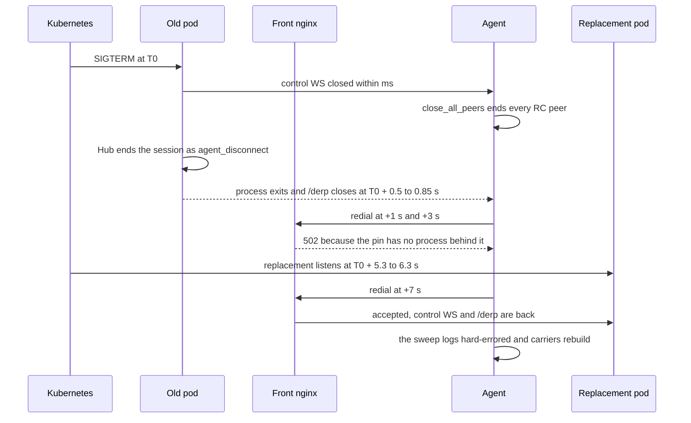
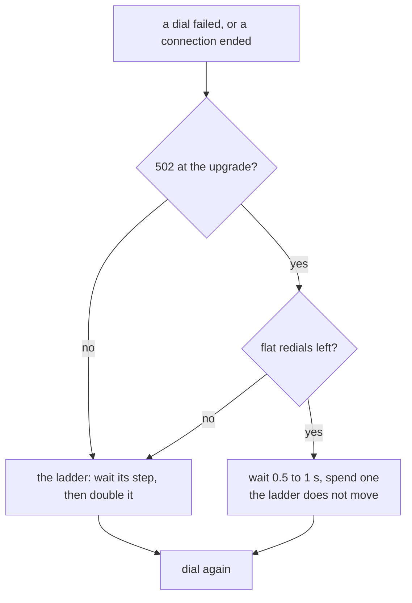

# FR-28: A pod roll freezes every relay-carried session

Status: **P1 rejected; a flat redial and an image pre-pull built; it closes when AC3 is field-verified**
("The decision", 2026-11-02). Tracking issue: `FR-28` (#865). Child of the RC-quality program; sibling of
FR-18 (carrier queue discipline).

## Where it stands (2026-10-31)

This section replaces the status, the chain and the P1 design further down. Those date from
2026-08-29 and stay as the record, along with their anchors: the `/derp` code has since moved to
`crates/modules/network/`.

The freeze is real and bigger than this spec said, and `/derp` is not where it lives. A roll does
not freeze a relay-carried session. It ends every session on the rolled pod, on any carrier, and
the `/derp` outage sits inside that.

The numbers come from `agent_logs`, `remote_sessions` and `stats_usage` for the 14 rolls of 10-26
to 10-31, plus a 15th watched live (2026-10-31 20:50Z, mostly 0.4.191).

| Question | Measured |
|---|---|
| Does a session ride out a roll? | **No: 9 of 9** sessions Active at a roll ended `agent_disconnect`, 7 on `direct` and 2 on `derp`. A new session was Active 8.4–18.6 s after the cut (median 10.9 s): `direct` 8.4–17.1 s, `derp` 17.6 s and 18.6 s. |
| Does `/derp` still drop? | Every socket, once per roll. 310 sockets: down p50 7.6 s, p90 15.9 s, p99 26.2 s. Live roll: p50 7.2 s, p90 9.4 s. |
| `relay carrier send hard-errored`? | 14–73 lines per roll on 10–15 hosts, every one a DERP carrier. Live roll: 34 lines on 15 hosts. |
| `/derp` close to `control-WS reattached`? | p50 7.7 s, p90 32 s. Live roll: p50 8.7 s, p90 9.3 s. The oldest version in these logs (0.4.48) takes about 60 s. |
| How long is a roll? | Live roll: 33.9 s from the first SIGTERM to the second replacement Ready. |
| How much rides a pod's `/derp`? | Nearly all DERP: 751 of 754 registrations in 3 days were on the pods, and regional PoPs only serve server-forced pins. That is about 47 % of metered relay bytes over 8 days (the rest is TURN) and about 5 % of RC sessions. |

### The chain today



The agent closes every peer on any control-WS close (`agents/roomlerd/src/signaling.rs:3063-3070`)
and the Hub ends the agent's sessions when it unregisters (`crates/modules/fleet/src/hub.rs:1159-1201`).
`docs/multi-pod-scale-out.md:182` records this; the 08-29 spec missed it.

The live roll, read from the pods and the k8s events, as seconds after each SIGTERM:

| Step | Wave 1 | Wave 2 |
|---|---|---|
| SIGTERM | 20:50:05.480 | 20:50:22.338 |
| Old pod exited | +0.5 | +0.85 |
| Replacement scheduled | +1.5 | +1.7 |
| Image pulled | +5.9 | +5.1 |
| Binary listening | +6.3 | +5.3 |
| Ready | +16.9 | +17.1 |

Almost all of the wait is Kubernetes and the image: the pull took 3–4 s, and the binary listened
under 0.4 s after its container started.

⚠️ **The per-roll `/derp` p50 measures the agent's timer as much as the pods.** It sits on the
backoff ladder (1, 2, 4, 8, 10 s; `agents/roomlerd/src/derp.rs:49`, `:522`): 3.4 s in one roll,
7.5–7.7 s in ten, 15.2–15.8 s in two, 25.9 s in one. A replacement that listens just after a step
waits for the next one. The control WS doubles the same way, up to 60 s
(`agents/roomlerd/src/signaling.rs:1369`).

A device in two orgs holds one socket per org, each pinned by its own tenant, so it can lose a
socket in each wave. That accounts for the 6–8 hosts per roll that log two closes: on the roll of
10-31 17:41Z they were six of the seven two-org devices, and every single-org host logged one.

### Why P1 as designed cannot work

1. **It cannot save the session.** The session ends on the control WS, before `/derp` closes: on
   2026-10-30 at 19:43:07.882 the Hub ended a `direct` and a `derp` session in the same millisecond,
   and both agents' `/derp` sockets closed within about a second after that. A perfect `/derp` swap
   leaves AC1 where it is.
2. **There is no second pod to dial.** The front nginx pins `/ws` and `/derp` by tenant:
   `hash … consistent`, `max_fails=0`, `proxy_next_upstream off`. That is deliberate, since a ring
   that walked to the survivor parked long-lived sockets on the wrong pod after a roll (the
   fleet-wide "green but not online" incident of 2026-07-29). So a second dial reaches the same dying
   pod, and the replacement cannot exist until that pod is gone, because hostNetwork pods cannot
   double-bind (`maxSurge: 0`). Even a dial the old pod accepted in its last 0.5–0.85 s would die
   with it. Measured on the live roll with one dial every 200 ms at four ring positions, all hashing
   to the same pod: 492 dials answered 401 straight through the other pod's wave, then each position
   took 23 consecutive 502s over about 5 s, until the replacement listened.
3. **One peer cannot move alone.** DERP is pod-local (`docs/multi-pod-scale-out.md:141-157`), so a
   pair exchanges frames only while both sockets are on one pod. A peer that moved first would send
   into a pod where its partner is not registered, and the frame is dropped as a miss
   (`crates/modules/network/src/derp.rs:654-671`). The 08-29 design's "safe by construction" holds
   on one pod only. Moving a pair needs both peers to move in one window, or dual-send while they do,
   with C-5's convergence closing sockets under it (`crates/modules/network/src/derp_cluster.rs:126-188`).
   This point is reasoned from the code, not measured.

### What an old agent does with an unknown frame

For whoever puts the next frame on this socket: agents back to 0.4.48, the oldest version in these
logs, ignore a Text frame (the `Some(Ok(_))` arm, `agents/roomlerd/src/derp.rs:506`) and drop a Binary frame
under 32 bytes (`crates/tunnel-core/src/transport/derp.rs:559-562`). A Binary frame of 32 bytes or
more reads as a peer's frame and raises `Unrouted`. So a server-to-agent signal needs no capability
gate as long as it is Text. This was read at the tags `agent-v0.4.48` and `agent-v0.4.154`, not run.

### What is left

| Lever | Lives in | What it buys | What it costs |
|---|---|---|---|
| Redial flat on an LB 502 instead of climbing the ladder | agent, both loops | The ladder's waste: every roll lands within a second of the replacement listening | Small, default OFF, but it is the floor, and #2221's rule still binds: a server that accepts and drops must climb. This spec scoped the ladder out; that needs the operator |
| Pre-pull the image on both nodes before the roll | promote lane | 3–4 s off each wave on the live roll, likely more on a large delta | A deploy-lane change |
| An RC session survives a control-WS loss | a new FR | AC1, and whichever of the other `agent_disconnect` ends are not daemon restarts (about 5 % of sessions ended that way outside rolls in the last 7 days) | A design of its own: the Hub is pod-local, `close_all_peers` is what stops a peer leaking its sockets, and consent and kick must still reach the session |
| A per-pod `/derp` route plus dual-send | front nginx and agent | Overlay pairs keep moving through a roll. RC sessions still end | Changes the floor and undoes the strict pin for this path |
| The floor on a regional PoP | later | A roll never touches the carrier | Both peers need the PoP, and today only forced pins use one |

The first two together would put a reattach at about 3 s: the old pod's exit and the rescheduling
take about 1.7 s, the start about 0.4 s, and a flat redial up to 1 s more. That is an estimate from
the live roll, not a measurement.

## The decision (2026-11-02)

FR-135's D15 settled the question the read left open: FR-28's flat redial and the pre-pull now, and a new
FR next for an RC session that survives a control-socket loss. The operator approved it on 2026-11-02, open
to being overturned (`docs/fr/FR-135-one-rc-media-pipeline.md` §10).

| Item | Outcome |
|---|---|
| P1, make-before-break | Rejected on this topology, for the three reasons above |
| Flat redial on an LB 502 | P2: built in the agent, default OFF |
| Image pre-pull before a roll | P3: built in the promote lane |
| AC1, no delivery gap above 500 ms | Moves to the new FR, because a roll still ends the session on the control socket |
| AC2, `hard-errored` disappears | Retires: the line marks a close, and a roll closes the socket |
| AC3, reattach below about 4 s | Stays. FR-28 closes when it is field-verified |
| AC4 to AC6 | Unchanged |

| Phase | What | Lives in | Kill switch | State |
|---|---|---|---|---|
| P0 | Fire every `/derp` cancel on SIGTERM | server | none | Disproven and reverted, 2026-08-29 |
| P1 | Make-before-break on `/derp` | agent and server | none | Rejected, 2026-11-02 |
| P2 | Flat redial on a 502 | agent, both loops | `ws_flat_redial`, default OFF | Built. Rides the next agent release |
| P3 | Pre-pull before a roll | `promote.yml` (#3320) and the deploy repo | Delete the DaemonSet's file | Built. In force from the first promote after both halves merge |
| Docs | `docs/overlay-communication.md`, `docs/multi-pod-scale-out.md`, `docs/deployment.md`, the index rows | docs | none | Written with each phase. The field numbers come with the read |

## P2: the flat redial

A 502 at the upgrade means the front is up and this tenant's pin has no process behind it, which on this
topology is a roll. So the socket redials every 0.5 to 1 s instead of waiting out the ladder, and lands within
a second of the replacement listening.



| What happened | The ladder | Flat redials left |
|---|---|---|
| 502 at the upgrade, with redials left | Does not move | One fewer |
| 502 at the upgrade, none left | Climbs from the step it stood on | 0 |
| Any other answer: 401, 500, 503, 504, a timeout, a refused connection | Climbs | Unchanged |
| Accepted, then dropped inside 30 s | Control socket: climbs (#2221). `/derp`: restarts at 1 s, as it always has | Unchanged |
| A connection that lived 30 s | Restarts at 1 s | Back to 30 |
| A major network change (only the control socket listens for one) | Restarts at 1 s | Back to 30 |

The code: `FlatRedial` (`agents/roomlerd/src/ws_connect.rs:60`) with its allowance and wait (`:33`, `:38`), the
control loop's decision and refill (`agents/roomlerd/src/signaling.rs:1396`, `:1132`), and `/derp`'s
(`agents/roomlerd/src/derp.rs:531`, `:525`). Regional relays keep their ladder
(`agents/roomlerd/src/derp.rs:327`): no pod rolls under one.

⚠️ **#2221's rule binds.** A server that accepts and drops must climb, or a fleet reconnects to it every second.
So only a 502 is flat, and an accepted socket that does not last refills nothing. Otherwise a crash-looping pod
would buy itself flat dials for good.

⚠️ **The allowance is the bound.** A 502 is not only ours: a corporate proxy can answer one for hours. One outage
costs one socket at most 30 extra dials, and then the ordinary ladder runs. Thirty redials spend 15 to 30 s, and
the slowest of the 14 rolls had a median socket back at 26 s.

⚠️ **The wait is drawn, not fixed,** because a roll ends a whole fleet's sockets in the same millisecond. At most
1 s keeps the promise above.

⚠️ **Off is the ladder as it was.** `FlatRedial::off` always answers `None`, and the switch is read as every
opt-in gate is (`tunnel_core::env::flag`): `1`, `true`, `yes` or `on` turn it on, and anything else, a typo
included, stays on the ladder. Set `ws_flat_redial = true`
in the config or `ROOMLERD_WS_FLAT_REDIAL=1`, and restart. It is a device-side key and not pushable from the
server: turning a floor's behaviour on is a decision made on the device or by a release, as FR-132 decided for
`zero_copy`.

Each flat redial logs one INFO line ending `redialling flat (FR-28)`, with `wait_ms` and `left`. So a field read
sees the switch at work, and `left=0` shows an outage that ran it out.

### What it costs

| | On the ladder | Flat |
|---|---|---|
| Dials per socket through a 5 s wave | 3 (+1, +3 and +7 s) | About 8 |
| Dials per socket in the first 30 s of a 502 that never ends | 4 | About 33 |

⚠️ **Read this before a default flip.** Each dial is a TLS handshake at the front, so a wave costs it about 1.3
handshakes per socket per second for its length. Today that is a few dozen a second. On a fleet a hundred times
this size it is a number to measure first. The flip is a staged rollout and the operator's decision.

### Found, not changed

- `/derp`'s ladder restarts on any accepted upgrade (`agents/roomlerd/src/derp.rs:370`), so a server that accepts
  and drops gets one dial a second for good. #2221 fixed only the control socket. It stays as it is with the
  switch on too: climbing there would slow the floor on any path whose middlebox kills young sockets, on exactly
  the hosts with no other carrier. That change needs its own read.
- A clean close on the control socket redials with no wait at all (the `Ok(())` arm,
  `agents/roomlerd/src/signaling.rs:1136`). A roll does not take that arm: 22 of 22 hosts on the 12:43Z roll below
  read `Connection reset without closing handshake`.

## P3: the pre-pull

The wave's largest cost is the pull, 3 to 4 s of 5.3 to 6.3 s. With #3320, a promote moves a DaemonSet's image
first, which rolls nothing and makes both nodes pull, waits 30 s, and only then bumps `newTag`. `roomler2`'s
`imagePullPolicy` is `IfNotPresent`, so a replacement finds the image on its node. A pull that fails or outlasts
the wait leaves today's roll. The design, its failure table and why it is not an ArgoCD sync wave are in
`docs/deployment.md`, "The pre-pull", which #3320 adds.

## What the two buy

A reattach is when the replacement listens, plus the wait for the next dial.

| Replacement listens at | The ladder lands | Flat lands | Rolls of the 14, by `/derp`'s median |
|---|---|---|---|
| Under +3 s | +3 s | Within 1 s of it | 1 |
| +3 to +7 s | +7 s | Within 1 s of it | 10 |
| +7 to +15 s | +15 s | Within 1 s of it | 2 |
| Past +15 s | +25 s on `/derp`, +31 s on the control socket | Within 1 s of it | 1 |

So neither lever alone is the whole answer, and that is an estimate until the field read:

- **The redial alone** takes at most 1.7 s off an ordinary roll, where the replacement listens at +5.3 to +6.3 s
  and the ladder lands at +7 s. Its value is the tail: up to about 20 s off a slow roll.
- **The pre-pull alone** should move listening to about +2.1 s (the old pod's exit and the rescheduling take about
  1.7 s, the start about 0.4 s), where the ladder's +3 s dial lands. That may meet AC3 on a roll where nothing is
  slow. One that listens just past +3 s then costs the wait until +7 s, and the redial is what holds the number
  there.

## The field read

**RED, from production logs.** The roll of 2026-11-02 12:43Z (`hosted-20261102-b8c6d1b`), read from `agent_logs`
on 22 hosts: every control socket died with `Connection reset without closing handshake`, then dialed at +1 s and
+3 s (502), and was accepted at +7 s.

| Measure | Value | n |
|---|---|---|
| Control-socket close to `control-WS reattached` | p50 7.8 s, p90 8.8 s, max 60.1 s | 15 |
| `/derp` close to registered | p50 7.7 s, p90 8.1 s | 23 |
| `relay carrier send hard-errored` | 45 lines on 16 hosts | |

The 60 s is one host, the shape the oldest agents show on the 10-31 read. Its version was not read.

**GREEN needs** P2 in a release, both halves of P3 merged, and a promote, with the switch on for at least 2 hosts
(AC5) and the rest of the fleet as the control in the same roll. It reads the same lines, plus the replacement
pod's `Container image already present on machine`, the rollout's duration (AC4), and each host's `redialling
flat` lines. The hosts are standing-consent devices and test guests, never a corporate laptop.

## The measurement

Driving a live session through the browser on 2026-08-29 caught a **2436 ms
`video DC delivery gap` + decode stall on an IDLE session** — no dragging, nothing
to blame on the encoder. Correlating the agent logs against pod age gave an exact,
repeatable chain:

```
pod roll → /derp WS closed under the relay carrier → carrier rebuild
        → video DC delivery gap → decode stall → visible freeze
```

Both hosts, same second, against pods 69 s old:

| time | host | line |
|---|---|---|
| `10:26:57Z` | CORPLAP-3 | `overlay: relay carrier send hard-errored (/derp WS closed under it)` ×3 |
| `10:26:56Z` | CORPLAP-2 | `overlay: control-WS reattached — re-joined with carriers intact` |
| `10:27:01Z` | CORPLAP-3 | `overlay: control-WS reattached — re-joined with carriers intact` |

An earlier instance recovered in **~4 s** (`08:36:34 → 08:36:38`).

🔑 **DERP churn is otherwise rare** — 2–3 events per host per 6 h, *all* correlating
with rolls. So this is not a flaky-network story: it is self-inflicted, and it is
the one freeze cause that can be reproduced on demand.

## Root cause

The agent learns the `/derp` WS is gone **by failing to send on it**. Nothing tells
it in advance, so the sequence is: pod dies → agent keeps handing frames to a dead
socket → a send hard-errors → `DeathReason::HardDead`
(`crates/tunnel-core/src/overlay/runtime/establish.rs:693-702`) → carrier rebuild →
`MuxEvent::Recovered` opens the fast-walk window
(`crates/tunnel-core/src/overlay/runtime.rs:2653-2656`).

That recovery path has already been optimised once (#28: `DERP_RECOVERY_WALK_WINDOW`
+ `DERP_RECOVERY_RECHECK`, after a field case where "the WS returned in 1.5 s and the
floor still took 5 s more"). The remaining cost is upstream of it — the time spent
not knowing.

⚠️ **The pod knows it is going away and does not say so.** `main.rs:244-266` already
runs `shutdown_cleanup` on SIGTERM before axum stops accepting, and
`ws/derp.rs:80-85` already defines a **`DerpCancelRegistry`** whose entire purpose is
"fire it to rehome a socket parked on the wrong pod; the socket loop's cancel arm
breaks, teardown releases the directory record, and the client's reconnect re-lands
per the current LB map". The primitive exists and is simply not wired to shutdown.

## Design — announce the death instead of letting it be discovered

**P0. Fire every `/derp` cancel on SIGTERM.** ❌ **DISPROVEN AND REVERTED** (#867,
#874, reverted in the PR that carries this edit). In the existing shutdown hook, walk
`DerpCancelRegistry` and notify each connection before the process stops accepting.
Each agent gets a clean close at T+0 rather than discovering it at first-failed-send,
and re-lands on the surviving pod through the normal reconnect.

⚠️ This is **not** the pre-close HTTP draining that `main.rs:249-253` deliberately
rejects ("maxSurge=0 means every drained second is downtime for this node"). It adds
no delay: it is a broadcast on the way out, and the process stops accepting exactly
when it does today.

⚠️ Kill switch: `ROOMLER__DERP__DRAIN_ON_SHUTDOWN` (default on once proven; off ⇒
today's behaviour byte-for-byte).

### Why P0 failed — the premise, not the primitive

Three rolls, same three hosts, deliberate:

| roll | terminating pods | `hard-errored` |
|---|---|---|
| `11:41:01Z` | no drain (baseline) | 8 |
| `11:42:26Z` | drain via `notify_waiters` | 12 |
| `12:20:23Z` | drain via `notify_one` | **10** |

Recovery did not improve either: baseline 4-28 s, `notify_one` 16-58 s.

The first round also had a real bug — `notify_waiters` drops a signal when no task is
parked, and the socket loop rebuilds its `notified()` future every `select!` iteration,
so exactly the BUSY sockets missed it. Fixing that to `notify_one` moved the number from
12 to 10. It did not fix the freeze, because:

⚠️ **Closing the socket early IS the announcement, and any close — graceful or not —
fails the agent's in-flight sends.** That is precisely what `relay carrier send
hard-errored (/derp WS closed under it)` reports: it marks *a close*, not an *ungraceful*
one. The cost was never in DISCOVERING the death. It is in having **no carrier at all**
between the old WS closing and a replacement being up, and telling the agent sooner only
starts that window sooner.

🔑 The acceptance criterion ("the `hard-errored` line must disappear") was a good
falsifier and did its job. The reasoning it was testing was wrong.

**P1. Reconnect-before-close — the actual fix.** The agent opens the replacement `/derp`
WS and moves carriers across **while the old socket still carries**: the make-before-break
the overlay already does for carrier upgrades. Only overlap closes the gap.

The trigger should be an application-level "going away" frame, precisely because it can
be delivered **without closing anything** — which is the property P0 lacked. The server
half is small (emit the frame on SIGTERM, then behave as today); the work is agent-side:
hold two sockets, move carriers, retire the old one.

⚠️ Scope note: this is an AGENT change, so it ships on the agent release cadence and
reaches the fleet gradually, unlike P0 which was server-only. A server that emits the
frame to an agent too old to understand it must be a no-op.

## Acceptance criteria

The operator's decision of 2026-11-02 changed the first two. AC3 to AC6 keep their words.

- ~~A deliberate `kubectl rollout restart` with a live relay-carried session produces **no `video DC delivery
  gap` > 500 ms** in the viewer console (today: 2436 ms measured).~~ **Moved** to the new FR for an RC session
  that survives a control-socket loss: a roll ends the session on the control socket, 9 of 9, so nothing on
  `/derp` can reach it.
- ~~Agent-side `relay carrier send hard-errored (/derp WS closed under it)` **disappears** for a graceful roll —
  the carrier should be rebuilt from a clean close, not from a failed send. Its continued presence means P0 did
  not take, regardless of what the timings say.~~ **Retired:** the line marks a close, as P0 found, and a roll
  closes the socket. Only an overlap could end it, and this topology offers none.
- [ ] Time from pod SIGTERM to `control-WS reattached` drops below the ~4 s measured.
- [ ] No regression in rollout duration — the deploy must not get slower, since the
      whole reason pre-close draining was rejected is that surge is 0.
- [ ] Verified on ≥2 hosts in one roll, since the failure is fleet-wide by nature.
- [ ] Docs: `docs/overlay-communication.md` and `docs/multi-pod-scale-out.md` updated in the house
      style, with the `docs/README.md` index row.

| AC | Today | What it takes |
|---|---|---|
| Under ~4 s to `control-WS reattached` | p50 7.8 s, p90 8.8 s on the 12:43Z roll | P2 with the switch on, and P3 ("What the two buy") |
| Rollout not slower | Baseline 33.9 s, first SIGTERM to second Ready | A read on the same roll. The pre-pull's 30 s comes before the first SIGTERM, with every pod serving, and should shorten each wave |
| ≥ 2 hosts | Read on 22 hosts with the switch off | Two hosts with the switch on, in one roll |
| Docs | Written for what is built | Ticked with the field numbers in them |

⚠️ What moved with AC1: the reader for it does not exist either. `video DC delivery gap` is console-only and logs
only above 1500 ms (`ui/src/composables/useRemoteControl.ts:8092`).

## Out of scope

- The ladder's own steps. P2 goes around them on a 502 and changes nothing else.
- Non-graceful pod death (SIGKILL, node loss). Nothing can be announced there; that
  case keeps today's discover-by-failure path, which is why P0 cannot be the only
  defence and the existing recovery walk stays.
- Making RC sessions survive a roll: the new FR.
- Changing the rollout strategy (maxSurge, pod count), pre-close draining, a per-pod `/derp` route.

## Field log

| date | build | result |
|---|---|---|
| 2026-08-29 | 0.4.15 | Measured: 2436 ms delivery gap + decode stall on an idle session; chain confirmed on 2 hosts against a 69 s-old pod; ~4 s SIGTERM→reattach in an earlier instance. FR filed. |
| 2026-08-29 | 0.4.17 | **P0 DISPROVEN over three deliberate rolls** (8 / 12 / 10 `hard-errored`; recovery no better). Premise wrong: the agent was never late to notice, it was carrier-less either way. P0 reverted rather than left default-ON looking like a fix. The two notify-semantics tests are KEPT — `notify_waiters` losing a signal when nobody is parked is a general hazard wherever a `select!` loop is signalled. |
| 2026-10-31 | fleet of 10-26 to 10-31 | RED read from logs on 14 production rolls: 9 of 9 sessions ended `agent_disconnect`, 310 `/derp` sockets down p50 7.6 s, 14–73 `hard-errored` lines per roll. All of it is in "Where it stands". |
| 2026-10-31 | 0.4.191, `hosted-20261031-5281d7f` | Roll watched live at 20:50Z: 33.9 s, two waves 16.9 s apart, 34 `hard-errored` lines on 15 hosts, `/derp` down p50 7.2 s. Dial probe at four ring positions: 401 through the other pod's wave, 502 for about 5 s in their own. No session was live, so AC1 stands on the 9 above. |
| 2026-11-02 | 0.4.197, `hosted-20261102-b8c6d1b` | RED for AC3, the 12:43Z roll read from `agent_logs` on 22 hosts: control-socket close to `control-WS reattached` p50 7.8 s, p90 8.8 s; `/derp` p50 7.7 s, p90 8.1 s; 45 `hard-errored` lines on 16 hosts. Dials at +1 and +3 s answered 502, accepted at +7 s. |

## P1 — concrete design (scoped, NOT implemented)

⚠️ Rejected by the decision of 2026-11-02: this design cannot work on today's topology, for the three reasons
in "Where it stands". It stays as the record of what was proposed.

The structure is favourable. `DerpMux` already outlives its socket: *"the outbound
receiver lives for the mux's whole life (across reconnects), so a reconnect never severs
the `DerpConn`→WS path"* (`transport/derp.rs:356-361`). Carriers hang off the mux, not
off the socket, so a socket swap need not be visible to them at all.

What makes today's reconnect visible is `mark_down()` — the agent's WS loop
(`agents/roomlerd/src/derp.rs:323-363`) is shaped
`loop { connect; register; mark_up; inner select; mark_down; backoff }`, and every
iteration owns one `tx`/`rx` pair. `mark_down` is what withholds carrier builds and
ultimately drives the freeze.

**The change**: on a "going away" signal, dial and register a SECOND socket, swap `tx`,
retire the old `rx` — **without ever calling `mark_down`**. The mux stays up, carriers
never notice, and the visible outage is the swap itself (one dial, sub-second) rather
than a full down→backoff→up→walk cycle.

Server half is small: emit the frame in the existing SIGTERM hook, then behave exactly as
today. Agent half is the work: the loop must hold two sockets briefly and move the write
half across.

### ⚠️ Why this needs its own cycle, not a bolt-on

`derp.rs` IS the connectivity floor — *"with every UDP path blocked, DERP over TLS :443
still carries the mesh"* is commitment #2 in CLAUDE.md. A defect in this loop does not
degrade the mesh, it removes the floor, and on exactly the corp-VPN hosts that have no
other carrier. That earns a design pass, review, and a staged rollout of its own.

Specific hazards to design against, all visible in the current loop:

- **A failed second dial must not cost the first socket.** The old `tx` has to keep
  carrying until the new one is registered, so the swap is commit-on-success. Getting
  this backwards converts a graceful roll into a hard outage — strictly worse than today.
- **The registration frame is the first frame on a socket** (`derp.rs:217`). The new
  socket is not usable until that lands, so "registered" is the swap point, not
  "connected".
- **Both sockets are registered under the same pubkey for an instant.** The server's
  registry is last-writer-wins (`ws/derp.rs:448-451` deregisters only `if` still ours),
  so the overlap is safe by construction — but that property is load-bearing and should
  be asserted, not assumed.
- **Ungraceful death still exists.** SIGKILL and node loss cannot be announced, so the
  discover-by-failed-send path and the #28 recovery walk both stay. P1 removes the cost
  of the *graceful* case only.

### Value, stated honestly

This is worth doing, but it is not the largest RC-quality lever: it affects only sessions
live during a deploy. The measured win of this whole arc so far is the FR-22 probe cache
(#861, up to 1.9 s off a reconnect, shipped). P1 should be picked up deliberately, not
because it is the last thing left open.
