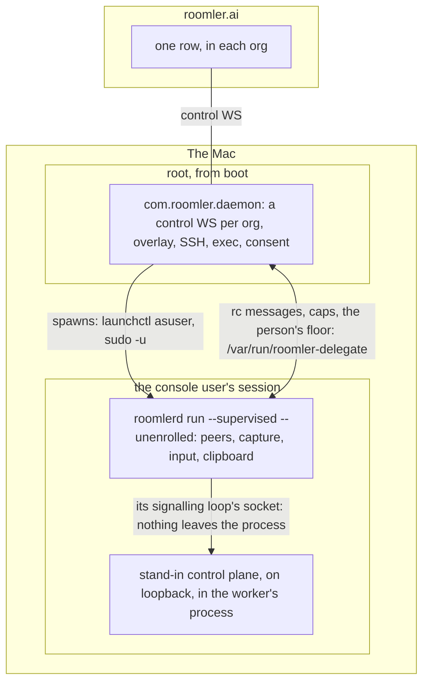

# FR-43: One macOS device row — a supervising daemon and an unenrolled GUI worker

**Status:** P0, P1, P2, P2c and P2d are shipped and field-verified (0.4.33 → 0.4.192): the daemon's row streams real pixels, accepts input and reports the worker's permissions, and a package update no longer undoes that. **P3a, P3b and P3c are field-verified on released 0.4.200** (2026-11-05, a throwaway tart Mac): with the switch on, one row streams and takes input for every org, asks in each org's name under the person's own floor, carries the worker's logs, and serves `roomler ssh` with nobody logged in, and `sudo roomlerd one-row` migrates a two-row Mac, keeping its overlay address and its signature, or puts everything back. The switch is still off by default, so a Mac is two rows until a person migrates it. **P3d is field-verified on released 0.4.201** (2026-11-05, a fresh tart Mac): the script the server serves, `install.sh --one-row`, installs a Mac as one row from one token, and on its first start that row streams, takes input and serves `roomler ssh`. It is off by default too. Left: the operator's flip of the default: see [P3 design](#p3-design--one-enrollment). A worst-phase `kill -9` of the worker takes 6.19 s on 0.4.192, down from 10.09 s on 0.4.191. Tracking issue: `FR-43`.

⚠️ Anchors RE-VERIFIED against master `c6e8ec58` on 2026-09-06, when this record was
landed 27 releases after the field run. `remote_control`'s hub moved to
`crates/modules/fleet/src/hub.rs` in the interim and every citation to it was stale —
which is exactly why the convention asks for a master sha rather than a bare line number.

## Goal

A Mac appears in Devices **once**, like every other platform, while keeping both things
it can do today: remote desktop from the GUI session, and overlay mesh + SSH from boot.
One enrollment, one control WS, one row to `exec` and `ssh` against.

## Why there are two of them today, and what is actually forced

macOS is the only platform that needs **two processes**, and that half is not
negotiable:

| Plane | Needs | Where it must run |
|---|---|---|
| capture / input / clipboard | a WindowServer connection | the console user's GUI session |
| `utun` + route table + SSH | root | session 0 |

`docs/installation.md:104-113` states it; `agents/roomlerd/packaging/macos/com.roomler.agent.plist`
and `com.roomler.daemon.plist` are the two units, and both invoke the *same* binary with
the same `run` subcommand — the split is context, not code.

**Windows does not need two because a SYSTEM process can reach the interactive desktop.**
`agents/roomlerd/src/win_service/desktop.rs:1-16` documents the mechanism (a thread
attaches to `winsta0\Default` / `winsta0\Winlogon` and captures/injects there), and
`win_service/supervisor.rs:266` (`spawn_in_session`) + `:746` (`decide_spawn`) is the shape: the SCM
service supervises, the agent proper runs in a session. macOS has **no `SetThreadDesktop`
equivalent** — a session-0 daemon cannot borrow the console user's WindowServer, at all.
That is the whole asymmetry.

**What is NOT forced is two enrollments.** That comes from us: the hub keys a device's
control WS on `agent_id` and a second connection displaces the first
(`crates/modules/fleet/src/hub.rs:91`), so we gave each half its own identity and the
Mac became two rows. Cost, paid daily: every `roomler exec` / `roomler ssh` must target
the *right* row (the GUI row cannot reach root, the root row cannot see the screen), the
install needs two tokens, and Devices shows one machine twice.

## Key design — port our own Windows supervisor to launchd (P1; see the P2 correction below)

The root daemon becomes the **single enrolled identity** (control WS, overlay, SSH, from
boot); the GUI-session process becomes an **unenrolled worker** it spawns and drives.

- **Spawn**: root → `launchctl asuser <console-uid>` (or a daemon-managed LaunchAgent),
  the launchd analogue of `spawn_in_session`. Console-user changes (login, logout, fast
  user switch) drive respawn, mirroring `decide_spawn`'s session-change handling.
- **Transport**: the LocalAPI unix socket, which already solves exactly this addressing
  problem — `crates/localapi/src/lib.rs:4227-4237` documents `/var/run/roomler` as the
  root daemon's well-known socket precisely because "a per-user path cannot serve a root
  daemon … that is the trap the macOS LaunchDaemon split walks into".
- **Division**: signalling + consent + policy in the daemon; the rc session's WebRTC
  peer, capture, encode, input, clipboard and file transfer in the worker (media stays
  local to the session that can produce it — no pixels cross the socket).
- **TCC**: the worker is the same bundle at the same path, so Screen Recording and
  Accessibility grants carry. This is only safe *now*: before FR-5's stable signing
  identity, any change to how the capture process launches risked re-prompting on every
  update. `codesign -d -r-` equality is the pre-flight check (FR-5's method).

## Phases

| P | Scope | Kill switch |
|---|---|---|
| P0 | Spike: daemon spawns a GUI worker via `launchctl asuser`, worker answers a LocalAPI caps probe from the daemon. Measures the respawn latency and the TCC verdict. | n/a (spike, no ship) |
| P1 | Daemon-as-supervisor: spawn + babysit + session-change respawn. Worker still enrolled — nothing changes for the server yet. | `macos_supervise_gui_worker` (default **off** ⇒ today's two independent halves) |
| P2 | Session delegation: the daemon's WS accepts an rc session and drives the worker over LocalAPI. | per-session fallback — delegation failure re-serves from the worker's own enrollment |
| P2c | The daemon's row advertises the WORKER's `permissions`, so the dashboard stops calling a working capture target "not a capture target". | caps are only ever sent when they CHANGE; absent field = today's behaviour |
| P2d | The installer stops reverting P2 on every update: with the daemon supervising, the `.pkg` no longer re-bootstraps the per-user LaunchAgent. | the guard needs BOTH the daemon opt-in and `macos_supervise_gui_worker = true`; either absent = today's behaviour byte-for-byte |
| P3a | The worker runs with no enrollment: `run --supervised --unenrolled`, on a stand-in control plane in its own process. | `macos_one_row` in the root's config (default **off**; off = P2 byte for byte) |
| P3b | A secondary org's session is delegated, each worker reply goes to the org that asked, and the person's floor crosses to the daemon. | the same switch |
| P3c | `sudo roomlerd one-row` migrates a two-row Mac; a person deletes the retired row through the ordinary route. | `--revert`, until that delete |
| P3d | `--one-row` at install: one token, one row. | `--daemon-token` keeps working (the two-row install stays reachable) |

## P2 design — session delegation over LocalAPI

Anchors below verified against master `3980e79d`.

### ⚠️ First, a correction to "Key design" above: P2 has no Windows precedent

"Port our own Windows supervisor to launchd" is true of **P1 and only P1**. The Windows
SCM service is a *pure launcher*: `win_service/mod.rs:404` hands off to
`supervisor::run(worker_exe, vec!["run"], …)` and does nothing else, so the spawned worker
is the entire agent — control WS, overlay, capture, input, all in one process. Windows
never had to split the planes, because a SYSTEM process can attach to the interactive
desktop (`win_service/desktop.rs`). **There is no delegation protocol to port.** P2 is new
work, and the design below should be read as such rather than as a translation.

### Why not the Windows shape (worker enrolled, daemon only supervising)

Because it deletes the reason the macOS daemon half exists. With nobody logged in there
would be no agent at all: no overlay, no `roomler ssh`, no `roomler exec`, no presence —
exactly the "reachable before anyone logs in" property `win_service/mod.rs`'s own module
docs list as the point of service mode. So the **daemon must hold the enrollment**, and
the session has to reach the worker some other way.

### Why not "let the worker open its own WS for the session"

Tempting, and it would remove the IPC entirely. It cannot work as-is: `Hub::register_agent`
(`crates/modules/fleet/src/hub.rs:280`) is keyed on `agent_id`, and a second connection
**displaces** the first — the displaced socket is cancelled within milliseconds by design
(`hub.rs:91-96`). A worker dialling in as the same device would knock the daemon's control
WS off the air, which is precisely the login/displace/relaunch loop P1's stand-down exists
to prevent. Making it work would mean teaching the server about session-scoped secondary
connections: a server change, a new authenticated surface, and a new way for a compromised
device to hold two sockets. Not worth it to avoid a unix socket we already own.

### What actually has to cross the boundary

Of the 28 `ServerMsg` and 28 `ClientMsg` variants the agent handles today, the rc session
needs **nine**, and no media among them:

| direction | messages |
|---|---|
| daemon → worker | `SessionCreated`, `SdpOffer`, `SdpAnswer`, `Ice`, `Terminate` |
| worker → daemon | `SdpAnswer`, `Ice`, `SessionStats`, `Terminate` |

Everything else stays where it already is: `RpcExec*`, `Ssh*`, `Tunnel*`, `Config*`,
`Derp*`, `KeyRotate`, `JoinOrg` and the whole overlay are daemon-side concerns and do not
move. Input, clipboard and file transfer ride the session's **data channels**, so once the
worker owns the peer they never touch the socket either. Pixels never cross it. This is the
property that makes the whole phase affordable: the IPC carries a few hundred bytes at
session setup and then nothing.

### The transport problem, stated honestly

LocalAPI is **strictly request→response**: `serve_connection` reads newline-delimited JSON,
answers each line, and loops to EOF (`crates/localapi/src/lib.rs:3596`); `TailLog`'s
own doc calls itself "poll-based follow (no streaming)" (`lib.rs:1548`). There is no server
push, and delegation needs it in both directions — trickle ICE arrives whenever the network
decides, not when someone asks.

Three options, and the trade is latency versus a protocol exception:

1. **Long-poll** (`RcPoll` blocks until a frame is queued, `RcPush` for the reverse). Fits
   the existing protocol with zero changes. Costs a round-trip of latency on every ICE
   candidate — i.e. on the session-setup critical path — and still holds a connection open
   permanently, so it buys nothing operationally.
2. **One streaming verb** — `RcAttach`. The worker connects and sends it; from that point
   the daemon treats *that connection* as a bidirectional frame channel until EOF. A
   documented, single-verb exception to the request/response rule, confined to one match
   arm and invisible to every other caller.
3. **A second LocalAPI server in the worker**, so daemon→worker push is an ordinary
   request. No protocol change, but two dispatch surfaces to secure instead of one, a
   second socket path to agree on, and a startup ordering problem (the daemon cannot push
   before the worker's listener exists).

**Recommendation: (2).** The exception is real and should be written down rather than
disguised as polling. It keeps one socket, one ACL, one dispatch surface, and it is the
only option whose latency does not sit on the path a human perceives as "how long until my
screen appears".

⚠️ `RcAttach` must be **daemon-only**, not something any local process can call: it would
otherwise let any user-session process on the box volunteer to serve remote-control
sessions. The socket's own ACL is the trust boundary today
(`lib.rs:4227-4237` — `/var/run/roomler`, 0600), which is *not* sufficient on its own here,
because the worker is an ordinary user process and so is an attacker's. The attach must
carry the one-shot secret the daemon passed to the worker in its spawn environment, and the
daemon must accept exactly one attached worker at a time.

### Consent

Stays in the daemon, and this is not a compromise — FR-27 already built the mechanism.
`PromptSurface` (`agents/roomlerd/src/consent.rs:184`) is a chain, and its **companion**
rung is precisely "a per-user process the daemon starts on demand"
(`companion::ensure_running()`). A session-0 daemon has no native surface and correctly
falls through to it. So the daemon keeps the policy decision (`strictest_of`, the local
floor) and the prompt appears in the user's session, with no new mechanism.

### Kill switch and fallback

Per the phase table: delegation failure **re-serves from the worker's own enrollment**.
That is only meaningful while P2 and P3 are separate — during P2 the worker is still
enrolled, so a failed `RcAttach` means the daemon declines the session and the worker's own
WS serves it exactly as today. ⚠️ This makes P2 genuinely reversible and P3 genuinely not:
once the second enrollment is gone, the fallback is gone with it. P3 must therefore not
ship until P2 has field evidence, not merely CI.

### P2b-2 design — the worker serves a delegated session

Measured against master `4fa59b9c`, and the measurements are what make it small.

### The seam is the SENDER, not the message

The instinct is to route each reply as it is produced. That is not needed, and
the numbers say why:

| in the five rc arms | count |
|---|---|
| direct `send_msg(ws, …)` | **3**, all in the `SdpOffer` arm |
| `outbound_tx` uses | **1** — `AgentPeer::new(…, outbound_tx.clone(), …)` |

Everything an rc session later emits — ICE, `SessionStats`, its own
`Terminate` — leaves through the sender the **peer was constructed with**. So a
delegated session needs one decision, taken once, at peer construction: hand it
a sender whose drain wraps each `ClientMsg` in a `DelegateFrame::FromWorker`
instead of the worker's own WS queue. No per-message routing, and nothing
downstream needs to know it is delegated.

The three direct sends are the only remainder, and they take a small
`ReplySink` (`Ws(&mut …)` | `Delegate(&…)`) so the daemon path stays
byte-for-byte what it is today.

### Where the worker runs it

In the loop it already has. The worker keeps its own enrollment and WS through
P2 (that is the fallback), so `connect_once` simply gains the delegation
channel as another `select!` source; delegated messages go through the SAME
`handle_server_msg` with the SAME session state, differing only in the sender
their peer was built with. Session ids come from the daemon's row and cannot
collide with the worker's own.

### It is field-falsifiable, which P2b-1 was not

`AgentCaps.permissions` — including `no-gui-session` — is **reporting only**;
nothing server-side gates session creation on it (`models.rs:112-138` is
explicit that readers should treat it as "not a capture target"). So a
controller can open a session against the DAEMON's row today, and the test is
binary: pixels appear, or they do not.

### Order of work

1. `ReplySink` + the three `SdpOffer` sends (pure refactor, no behaviour
   change on the daemon path).
2. The delegated sender at `AgentPeer::new`.
3. The worker's `select!` arm.

⚠️ Step 1 touches the shared session-setup path, so it breaks remote desktop on
**every** platform if it is wrong — not just macOS. The integration lane
(`agent_e2e_tests` drives a full `rc:*` round-trip in-process) is the check that
actually covers it, and it does NOT run on a PR unless `crates/tests/**` is
touched: dispatch it on the branch before merging.

## Open questions for implementation

- **Session ownership on worker death.** If the worker dies mid-session the daemon holds a
  live server-side session with nothing behind it. It must `Terminate` with a reason the
  controller can act on, rather than let the controller watch a frozen screen — the same
  argument that made `rc:consent.reason` worth splitting in FR-27.
- **Does `SessionCreated` carry everything the worker needs** (permissions, TURN creds,
  relay region) or does the worker need daemon state as well? If the latter, the attach
  handshake should carry it once rather than per-session.
- **Ordering.** ICE candidates may arrive before the worker has attached. The daemon needs
  a small per-session queue, or an explicit "not ready" refusal — silently dropping them
  would produce a session that half-works, which is worse than one that fails.

## P2c design — the daemon's row stops calling itself "not a capture target"

Measured against master `c6e8ec58` (2026-09-06).

P2b made the daemon's row able to stream real pixels. It still advertises
`permissions: ["no-gui-session"]`, so the dashboard renders it as *not a capture
target* and the operator has to know the trick to use it. Until that is fixed
the feature works and looks broken, which is close to not working.

### The constraint that shapes everything: caps are announced ONCE

The server takes caps from `rc:agent.hello` and nowhere else
(`crates/modules/fleet/src/socket.rs:60`). `AgentHeartbeat` carries `rss_mb`,
`cpu_pct`, `active_sessions` and `sys` — **no caps**
(`crates/remote_control/src/signaling.rs:623`). There is no post-hello refresh
path at all.

That matters because the worker attaches on its own schedule: the supervisor
spawns it at daemon start and it attaches ~260 ms later, but it also attaches
after a console-user change, after a hand-back, and not at all when nobody is
logged in. Whatever P2c does must cope with caps that become true *after* the
WS is already up.

### Rejected: wait for a worker before saying hello

The obvious fix — delay the hello until a worker has attached, so the caps are
right first time — is **wrong, and expensively so**. It couples the daemon's
control WS to GUI-worker readiness, which destroys the one property the daemon
half exists for: reachable *before anyone logs in*. A headless reboot would
never connect at all, and `roomler ssh` / `exec` / the mesh would wait on a
login that may never come. The daemon must say hello immediately and correct
itself later.

### Chosen: an optional `caps` on the heartbeat, sent only when it CHANGES

- **Additive on the wire.** `AgentHeartbeat.caps: Option<AgentCaps>` with
  `skip_serializing_if`, so an older server ignores it and an older agent simply
  never sends it. No version gate, no capability verb.
- **Sent on change, not every beat.** Caps are ~200 bytes and the heartbeat is
  frequent; in steady state this costs nothing. The daemon keeps the last
  announced value and sends when the effective caps differ.
- **Self-healing.** The heartbeat is already on a timer, so a missed update
  corrects itself rather than needing its own retry.

The worker sends its caps over the existing delegation channel at attach
(`DelegateFrame::WorkerCaps`), and the daemon computes *effective* caps.

### What the worker's caps replace, and what they do not

Only **`permissions`** and **`has_input_permission`** — the two that are false
about the daemon and true about the worker, and the two the dashboard renders.

⚠️ NOT `codecs` / `hw_encoders` / `transports`. Measured on the MacBook
2026-09-01: both halves report **identical** values, so there is nothing to gain
— and the P2b-3 lesson argues against it anyway. The daemon is the half that
answers `rc:session.request`, so its resolution is what the server was told; if
the two ever diverged, advertising the worker's list while resolving with the
daemon's would produce exactly the class of bug P2b-3 was. Revisit only with a
measurement showing they differ.

### ⚠️ It must revert

When the worker detaches — logout, hand-back to launchd, a crash — the row must
go back to `no-gui-session`, or it claims a capture target that is gone and the
next session gets the black screen P2b just fixed. Reconcile, do not toggle:
compute effective caps from current state and send when they differ, the same
shape as [`crate::power::PowerKeeper`].

### The worker inherits the root's session knobs (FR-97 / FR-119, 2026-10-23)

The same `env_reset` that dropped P1's environment marker drops every
`ROOMLERD_*` variable, and the worker reads the person's `config.toml`, not
`/etc/roomler/config.toml`. So a session-side knob the root had, set in its
plist or written into its config by `roomler config set` or a remote-config
push, changed the hello the root sent and nothing the worker did. Found by
FR-119's field run: `fps_high` set as root made the picker show, the asks were
ignored, and `rc:video-info` carried no fps fields. FR-97's Mac kill switches had
the same split.

`spawn_worker` now hands the worker the root's **effective** value of an
explicit allowlist, `WORKER_ENV_FORWARD`
(`agents/roomlerd/src/macos_supervisor.rs:275`): each through
`tunnel_core::env::node_env` (environment, then config fallback), and only when
the root has one, as `sudo -u '#uid' /usr/bin/env ROOMLERD_K=v … run
--supervised` (`macos_supervisor.rs:396`). In the worker an environment variable
beats its own config, so the session does what the hello promised. `env` execs
into the agent, so the chain the supervisor reaps and the signals it relays are
unchanged.

| Forwarded | Owner |
|---|---|
| `LOCK_HINT`, `CLIPBOARD_MAC_WATCH`, `MAC_LAYOUT`, `MAC_DISPLAY_MATCH` | FR-97's Mac kill switches (P2d-1, P2e-1, P2d-2a, P2d-2b) |
| `DISPLAY_MATCH` | the owner's display-match policy (FR-97 P2d-2b), published only when it is not the default; the worker keeps the stricter of it and its own (`never`, then `auto`, then `always`), so neither half loosens the other's (`agents/roomlerd/src/display_match.rs:1239`) |
| `FPS_HIGH`, `FPS_DENY` | FR-119's high-refresh picker and its per-cell ceilings |
| `ENCODER_CELLS_DENY` | the encoder-cells kill switch: a gate applies at every entry point, and the worker is where a session's encoders open |

⚠️ **An allowlist, never `config_fallbacks_for_child()`.** That helper exports
every registered config knob, which suits the caps-probe child, but the worker is
a full agent: a root-only knob (a relay server, the overlay, the updater) would
start a second one in the person's session. A session-side knob joins the list
when it is added; a test keeps the root-only ones out
(`no_root_only_knob_is_forwarded_to_the_worker`).

⚠️ **The root's value wins over the person's own.** Through P2 the worker keeps
its own enrollment (the fallback, above) and reads the person's config. An
environment variable beats a config key, so while the root has a value for a
forwarded knob, the person's own value for it does not apply, whether it was set
by hand or pushed to the per-user row. For a kill switch that is the point, since
one account must not undo a switch set for the machine. To give the per-user row
its own value, clear the root's.

### A worker never outlives its daemon (#2987, 2026-10-27)

The process group that lets `stop_worker` take the whole chain down is also why
the chain survived a daemon that never reached `stop_worker`: the watchdog's
`exit(2)` after a 69 s stall, on the operator's MacBook on 2026-10-26. The
orphaned 0.4.174 worker kept the person's single-instance lock through the
0.4.175 and 0.4.177 updates. Every new worker exited 0 on that lock, the
supervisor gave up naming "no per-user enrollment", and the orphan's re-attach
was refused as a `secret mismatch` every 30 s.

| | as built |
|---|---|
| **Lifeline** | `spawn_worker` writes `stdin_handoff`: the secret, then `roomler-lifeline/1`, in one write. It keeps its end of the pipe in a static that lives as long as the daemon process (`agents/roomlerd/src/macos_supervisor.rs:709`, `:581`, `:372`). The worker's stdin thread reads the secret, then the offer, then blocks until end-of-file (`stdin_link`, `:430`), and leaves through the internal shutdown (`agents/roomlerd/src/delegate_worker.rs:577`, `:625`). |
| **Reap** | At start and after a worker exits 0 within `HEALTHY_RUN`, a daemon that holds no worker stops every process running exactly `<exe> run --supervised` as a person (`macos_supervisor.rs:878`, `:499`). SIGTERM, then up to `REAP_GRACE` (20 s, more than the worker's `LIFELINE_BACKSTOP` of 15 s), then SIGKILL. |
| **Diagnosis** | The give-up reads the last worker's end: code 0 is a held lock, anything else the enrollment hint (`macos_supervisor.rs:475`). |

An adversarial review before the merge found three edges, all fixed in the same PR:

| Edge | Fix |
|---|---|
| With a 2 s grace, the next daemon's reap could SIGKILL a worker of this release that was still in its own clean stop. The worker no longer hears the SIGTERM, so the kill came before its clean-run mark and counted a crash on the person's config. | `REAP_GRACE` exceeds `LIFELINE_BACKSTOP`, and a compile-time assert holds the order |
| A reap that stopped something reset the give-up count. Two spawners of `run --supervised` (two root daemons on different `--config`s, each with its own lock) would then stop each other's workers forever. | The exit still counts: `MAX_FAST_EXITS` bounds it |
| A reap with the LaunchAgent loaded left no user half. launchd's worker had exited 0 on the held lock and is never retried, and `LaunchdOwns` kickstarts only a debt. | A reap that stopped anything while the LaunchAgent is loaded owes `KICKSTART_RETRIES` |

The proposal on the issue was different, and both changes were deliberate:

- **Not "exit on delegation EOF plus `secret mismatch`".** The refusal is silent
  by design (`delegate::serve` sends no reason), so the worker cannot tell a
  refusal from a restart that is still in progress. The pipe's end-of-file is
  certain: the kernel closes the write end when the daemon process ends, however
  it ends.
- **Not "record the pgid in a runtime file".** A daemon from before #2987 never
  wrote one, so the workers already stranded in the field would stay stranded.
  Matching the exact command line also finds those workers, and it carries no
  stale-pid risk.

**Field-verified on 0.4.181 (2026-10-28, the operator's MacBook).** After a
`kill -9` of the daemon, the worker left 5.7 ms later through a clean stop, and the
next daemon's worker attached 472 ms after the kill. A stand-in for an older worker
had its argv set to exactly `<exe> run --supervised`, and the next daemon's reap
stopped it 107 ms before spawning. A `SIGSTOP`ped worker cannot stand in for an old
one: the kernel's SIGHUP to an orphaned, stopped process group ends it first.

Operator-facing detail, the mixed-version matrix, the field runs and the remedy
for a stuck Mac: `docs/installation.md`, "The GUI worker never outlives its
daemon".

### Components

| where | change |
|---|---|
| wire | `AgentHeartbeat.caps: Option<AgentCaps>` |
| agent | `DelegateFrame::WorkerCaps`; effective-caps computation; send-on-change |
| server | accept caps on a heartbeat, update the hub's `AgentConn` and the `agents` row |
| UI | none — it already renders `permissions` |

## P2d — the installer stopped reverting P2 on every update

**P2 had a half-life of one release, and the release was the thing that ended
it.** `macos_supervisor::decide` stands down whenever
`gui/<uid>/com.roomler.agent` is loaded — correctly, since the loser of that
race must be the supervisor rather than the enrolled agent. The `.pkg`'s
`postinstall` then re-bootstrapped that exact label unconditionally, so every
package update handed the GUI worker back to launchd and disarmed delegation.
The daemon's row went back to advertising a capture target it cannot serve, and
a controller connecting to it got the black-screen-with-working-input symptom
this FR exists to remove.

The operator's remedy (`launchctl bootout gui/<uid>/com.roomler.agent`, which
the daemon's own log tells them to run) survived exactly until the next update —
and an update is precisely when nobody is watching.

Neither half was wrong on its own; nothing connected them. The supervisor knew
about the LaunchAgent, and the installer had never heard of the supervisor.

**The guard** (`agents/roomlerd/packaging/macos/postinstall`): when the root
daemon is opted in **and** its config carries
`macos_supervise_gui_worker = true`, the LaunchAgent is booted out and its plist
removed, and the daemon owns the worker.

- It reads the daemon's **own config** rather than a marker file of the
  installer's own. That key is the one `decide()` acts on, so the installer and
  the supervisor cannot disagree about who owns the worker; a marker would be a
  second source of truth for one fact.
- It **removes the plist** rather than merely skipping the bootstrap. A plist
  left in `~/Library/LaunchAgents` is loaded by launchd at the next login, so
  skipping alone would postpone the breakage by one login instead of ending it.
- ⚠️ It is **interlocked with the daemon opt-in**, and that interlock is the
  load-bearing half. Honouring the config key without a daemon to supervise
  would strip the LaunchAgent off a Mac that then installs no daemon either —
  no capture, no input, nothing to supervise. Only one of the six
  daemon × key states changes behaviour; the other five are today's path
  byte-for-byte.
- The dual-read behind the daemon opt-in is now **one function with two
  callers** (`daemon_is_enabled`). Two copies that drifted into disagreeing
  would produce exactly the stripped-worker Mac above — the same
  two-divergent-definitions shape that froze every managed role in FR-82.
- Booting the job out is **not a new hazard**: `replace_launchd_service` has
  always booted this label out as its first act. The change is that it is no
  longer bootstrapped back.

⚠️ `agents/roomlerd/packaging/macos/postinstall` had **no `.gitattributes`
rule**, only `core.autocrlf` on one developer's box. It has no extension, so
`scripts/*.sh` never matched it, and the rule written for the dpkg maintainer
scripts — *"`#!/bin/sh\r` … fails to configure on EVERY host"* — had no macOS
counterpart despite the identical failure mode under PackageKit. Pinned
`text eol=lf` alongside this change.

## P3 design — one enrollment

The operator chose on 2026-11-02 (#971): a secondary org's session is delegated and its consent names the org; the worker is fully unenrolled, not dormant; migration starts with a person's one command, and the retired row goes through an ordinary delete. Read against master `658a0bef2`. P3a and P3b are built behind the switch, and P3c as a command a person runs. All three are proven in unit tests only. P3d is not built yet.

**P3 is still needed.** MacBook-1 is two rows, the worker holds its own enrollment and its own control WS, and FR-129's pairing gives one approval but two tokens. The P2 layout makes that enrollment load-bearing:

| What stops one row today | Where | Measured on 0.4.191 |
|---|---|---|
| The worker serves a delegated session only from inside its own connection, in the `next_delegated` arm | `agents/roomlerd/src/signaling.rs:3066` | Delete the per-user row and the worker exits 7 at every spawn, so the daemon's row loses remote desktop with it |
| `run` refuses to start with no config | `agents/roomlerd/src/app.rs:3725-3730` | A root-only Mac gets no worker, so one token gives a row that can't stream. That is AC1's RED |
| Delegation is primary-org only, on purpose | `agents/roomlerd/src/signaling.rs:3726-3728`, `agents/roomlerd/src/app.rs:5098`, `:5285` | Not run. A secondary org's rows stream today through the per-user half, which P3 removes. P3b gives a secondary's loop the host under the switch |

After P3 a Mac has one row in each org, and the worker talks to the server through the daemon alone:



### The switch

`macos_one_row` in the root's `config.toml`, default **off**, read at the daemon's start. It only means something with `macos_supervise_gui_worker = true`. Like that key it is the device's own: it is not in `DesiredConfig`, so no server can push it.

| | Off, the default | On |
|---|---|---|
| The spawn (`agents/roomlerd/src/macos_supervisor.rs:641`) | `run --supervised`, on the person's enrollment | `run --supervised --unenrolled` |
| A person's enrollment on this Mac | what the worker runs on | ignored and left in the file, so turning the switch off brings it back until the migration strips it |
| A secondary org's session | served by the root, no pixels | delegated |
| A Mac with no per-user config | no worker | a worker |

⚠️ The switch does not turn itself on. The default flips only after the field proof below, and that flip is the operator's.

### P3a — the worker holds no enrollment

**A stand-in for the control plane, in the worker's process.** With `--unenrolled` the worker binds `127.0.0.1:0` and runs a small WS server that answers pings and discards the rest. Its signalling loop dials that instead of a server, so `connect_once` runs as it does everywhere, its `next_delegated` arm included, and the warning in [Order of work](#order-of-work) about the shared session-setup path does not reach this phase. The handshake must carry a secret minted for the process (`agents/roomlerd/src/signaling.rs:1753-1758` sends it as the token, and `agents/roomlerd/src/ws_connect.rs:143` dials an address literal directly), so another local process that dials the port gets a 401 and no socket.

Rejected: a `ControlLink` enum over the WS. It looks small at `send_frame` and `ws.next()`, but the receive deadline and the ping arms would each need a detached branch, on the path every platform's sessions take.

⚠️ **The stand-in's lifetime is the worker's.** The secret proves the worker to the stand-in, and nothing proves the stand-in to the worker. If the listener ended while the worker lived, its port would be free, any local process could bind it, and the loop's reconnect would dial that process, hand it the secret and act on what it sent. That process would be a control plane for a worker holding the person's TCC grants. So when the listener's task ends, for any reason, the worker exits at once, with a code of its own, and the supervisor starts a new one on a new port with a new secret. It never dials an old port. The exit is a crash record on the root's enrollment (`agents/roomlerd/src/macos_supervisor.rs:271`), because that task ending is a defect. A test kills the listener and reads the exit from a real child process.

Rejected: a mutual check on the upgrade response. The secret goes out in the request, so whoever answers already holds it, and a real challenge would add a handshake to `connect_once` to guard a state the exit removes.

⚠️ **A session reaches this process through the root's delegation socket and nothing else.** `handle_server_msg` has three callers: the `next_delegated` arm (`signaling.rs:3143`), the `ws.next()` arm (`:3234`) and, since #3453, the `caps.news` arm (`:2509`), which hands on only the requests the `ws.next()` arm held until the encoder probe first answered. With `--unenrolled` the `ws.next()` arm drops every text frame before it holds any (`OrgCtx::unenrolled`, false in every other process), so the third caller has nothing to hand on. That gate does not depend on who holds the port. It is the one line this phase adds to `connect_once`. The worker reaches the delegation socket at a path only root can bind (`/var/run/roomler-delegate`, `agents/roomlerd/src/delegate.rs:80-81`). Its other two listeners take no session:

| Listener | What it serves | Why it stays |
|---|---|---|
| The per-user LocalAPI socket, `0600` | The person's own verbs. No verb starts a session, and the tunnel verbs refuse (below) | The companion and `roomler` as the console user |
| The loopback probe, `127.0.0.1:47989` (`agents/roomlerd/src/rc_local_turn.rs:42-43`) | The TURN half answers 503 with no overlay address. The clipboard bridge serves the page in the person's own browser, behind an origin allowlist | As on any per-user install; root cannot reach the person's pasteboard |

The WebRTC peers, the SSH server and the relay responder need an offer or an overlay this process no longer has.

**The person's file is never rewritten.** `run_cmd` takes the file and runs on a view of it, `AgentConfig::for_unenrolled_worker`, built right after the load (`agents/roomlerd/src/app.rs:3797`). The startup saves that write the loaded copy (`config::StartupWrites`, from `app.rs:3802`) become no-ops in this mode, and every later writer already reloads the file first. So an unmigrated person's token survives on disk, and the switch stays a real off.

| In `run_cmd` | Enrolled worker | `--unenrolled` |
|---|---|---|
| No config file (`app.rs:3725`) | bails, the supervisor gives up | writes one with blank identity fields, because `caps`, `record` and `config set` load the file |
| No secret on stdin (`agents/roomlerd/src/delegate_worker.rs:210`) | warns and keeps serving its own row | exits: with no channel it can serve nothing, and the supervisor's bound applies |
| Identity, `[[orgs]]`, `[[tunnel_routes]]`, overlay, SSH, exec, relay | from the file | blank or off in the view: the root holds all of them |
| Preflight to the server (`app.rs:4114`) | runs | skipped |
| Crash bookkeeping and rollback (`app.rs:4118-4256`) | runs | skipped. A worker cannot install a package. The supervisor records its crashes on the root's enrollment (`macos_supervisor.rs:1093`) |
| Updater (`app.rs:4266`, `:5450`) | runs | off: the view sets `auto_update = false`, and the root and its update helper own updates |
| Crash upload (`app.rs:4466`), log upload (`app.rs:4509`) | on its own token | no token: the supervisor records a crash on the root's enrollment, and the log lines go to the daemon (below) |
| Self-unenroll on a stop (`app.rs:5612`) | if its row is ephemeral | never: this process is not that row |

**What the person sees.** A worker with no enrollment answers `Status` with the root half's identity and link, not its own blanks, over the person socket it already uses for the network fields (`agents/roomlerd/src/person_socket.rs:272`, `:297`). `connected` comes from the root half only, since the stand-in always reads connected. With no answer from the root half the status reads disconnected and lists no org: the companion opens a row's server in a browser, and a row here would name the stand-in. `network_from` goes, because with one row nothing is lent. `Devices` and `Mesh` go straight to the root half (`person_socket.rs:175`) and never to the worker's own `self_view`, whose row points at the stand-in. The companion's `enrolled` stops meaning "a file exists" (`agents/roomler-desktop/src/commands.rs:88`), which lets the daemon's word fill it in (`:156`), and "Open Roomler" and "View screen" read the server and tenant from the daemon's rows when the person's file has none (`:1771`, `:1868`).

⚠️ **A verb that needs the server or a host role answers at once.** As the console user it reaches the worker, and the person socket refuses it on the root half (`crates/localapi/src/lib.rs:3403`). So on a one-row Mac it answers with an error that says to run it with `sudo`, which reaches the root's own socket (`agents/roomlerd/src/localapi_state.rs:658`):

| Verbs | Without that answer |
|---|---|
| `CreateForward`, `CreateSocks5`, `ExecRemote`, `SshSession`, `Connect` | The hub's sink is up on the stand-in, which discards the request, so the caller waits out its deadline |
| `RouteAdd`, `RouteUpdate` | A route in the person's file, for a reconciler with no server |
| `SetDeviceName` | A rename in a file that names no row |
| `ExternalPasswordSet`, `ExternalPasswordClear`, `ExternalPasswordStatus` | A password this process cannot serve, and "none set" on a device whose root half may hold one |

Declared `[[tunnel_routes]]` in a person's file are named by the migration, not moved.

**The worker's logs, in a PR of their own.** The worker's `agent_logs` lines have no enrollment to upload on. So they cross the delegation channel, up to 100 a frame with each message cut at 8 KiB (`DelegateFrame::WorkerLogs`, `agents/roomlerd/src/delegate.rs:169`, sent from `agents/roomlerd/src/delegate_worker.rs:497`). The daemon uploads them on its own row, through an uploader of their own that starts only as root with both keys on (`agents/roomlerd/src/app.rs:4739`). The daemon marks each line `process: gui-worker` (`delegate.rs:287`), so a worker cannot pass a line off as the daemon's. `ROOMLERD_LOGS_UPLOAD_DISABLED` in either process stops it, and an older daemon skips the frame, which leaves the lines on the Mac. The worker's panic records stay on the Mac too: its supervisor records the crash itself.

### P3b — a secondary org's session is delegated

Built behind the switch, and proven in unit tests only. Under the switch, `run_cmd` gives every org loop the host (`agents/roomlerd/src/app.rs:4728`, `:5098`, and `:5285` for a join, through `Delegation::for_secondary`, `agents/roomlerd/src/delegate.rs:456`). The gates that read `ctx.is_primary` now read whether the loop holds the host: the delegation (`agents/roomlerd/src/signaling.rs:3726-3728`), the session params (`:4100`), the audio offer (`:3906`), and the caps on the hello and the heartbeat (`:1861-1879`, `:2607-2621`). Off one row only the primary's loop holds the host, so with the switch off nothing changes.

| Who holds the host | Switch off, the default | Switch on |
|---|---|---|
| The primary's loop | yes, as in P2 | yes |
| A secondary org's loop | no: `Delegation::Off` | yes |
| The worker's own loops | never | never |

**Each worker reply goes to the org that asked.** `DelegateHost` keeps the primary's outbound and one per secondary label (`delegate.rs:634`), each loop pointing the host at its own WS on every connect (`signaling.rs:1990`). A bounded `session → org` map (`delegate.rs:643`, 1,024 sessions, oldest out) is written where a session's params cross (`send_params`, `delegate.rs:1087`) and read in `relay_upstream` (`delegate.rs:1428`). A secondary's reply goes on its own WS, or is dropped while that WS is down, never on the primary's, whose server holds no such session. A session no org handed over goes to the primary, as every reply did before P3b. The map outlives a transient detach, since the worker re-attaches with its sessions live and a session's org doesn't change with the process serving it. It is forgotten on `revoke`, with the record list, because the next worker is a new one. Signing and sealing need no change. They run per loop on that loop's outbound (`signaling.rs:2763`, `:2777`), so an answer is signed with the key of the org it belongs to.

**No org reaches into another's session.** One worker now serves sessions from orgs that trust each other no more than any two tenants do. A session belongs to the org whose params crossed for it, and another org's params or messages about the same id never cross, whichever came first (`send_to_worker`, `delegate.rs:937`). On a one-row Mac a session crosses only once its params did, the primary's included, so the worker hears of no session that skipped its org's `Request` arm and consent. Off one row the primary keeps P2's rule: a session whose params never crossed still crosses.

**The consent names the org.** The prompt stays the daemon's. `prompt_org` already names the org on a multi-org device (`signaling.rs:6966`, `docs/multi-org.md` §8b), and `asking_org` already reaches the worker's banner in the session params. This is the same rule Windows and Linux run. The field proof reads the prompt itself, because the macOS native panel is still FR-27's open item.

**The person's floor crosses too.** `DelegateFrame::PersonFloor` (`delegate.rs:177`) carries the person's `auto_grant_session` and their `rc_*` floor. A worker with no enrollment sends it at attach, and again when a `config set` changes the floor (`agents/roomlerd/src/delegate_worker.rs:377`, `:526`). A one-row daemon keeps it, across a detach too, and its `Request` arm takes the stricter of the person's and its own, for the consent mode (`signaling.rs:4023`) and for the session policy (`:4042`). The heartbeat's caps report the same combined floor (`:2640`), so the hub's strip can say why. A frame that leaves a value out reads as the strict one. The floor only tightens, so it is not the authority over the root's gates that #2871 left open. A daemon that isn't one row's skips the frame, and a worker that never sends one leaves the root's values standing. It binds remote-desktop sessions only: `rc:exec` runs as root, under the root's own floor (`signaling.rs:5692`).

**Side effects, all under the switch.**

- **Keep busy.** Every org's policy now reaches the worker (`signaling.rs:5454`), and the worker gets the strictest, as `note_keep_busy_policy` intends (`delegate.rs:993`). Off one row a secondary's deny still never reaches the worker, as before.
- **The privacy curtain.** P3a left one fact open: the worker's `Reporter.tenant_id` and `drain_leftovers` run on its blank tenant, so a curtain a dead worker left up would go unreported. On a Mac no curtain goes up at all (`agents/roomlerd/src/privacy.rs:109`: Windows only), so there is nothing to report. If a Mac curtain is ever built, the worker's reporter needs the asking org's tenant, and `PrivacyActivity` needs a place in the relay's whitelist (`delegable_outbound`, `delegate.rs:532`), which drops it today.
- **FR-121's loopback relay** stays the primary's (`signaling.rs:2206`): a secondary's delegated session gets none, as before.

### P3c — a person's one command

Built (`agents/roomlerd/src/one_row.rs`), and off in the only way a command can be: it changes nothing until a person runs it. `sudo roomlerd one-row` says its plan and asks. `--dry-run` stops after the plan, `--yes` answers where no terminal can ask (`roomler exec`), and `--revert` is the way back.

| Step | What it does | If it fails |
|---|---|---|
| Read | Root and macOS. The root's file enrolled. The daemon answering `Status` on the system socket, served by root, and connected. A person at the console, since the verify needs their session. Every account under `/Users` with a roomler folder or a LaunchAgent plist, its folder found as that person's own process finds it (`crates/agent-core/src/appdirs.rs:85`). One person per folder: an entry that links to another account's folder, as the tart image's `/Users/runner` does to `/Users/admin`, is that account, and the folder's own entry names it (`agents/roomlerd/src/one_row.rs:1010`) | Stops. Nothing has changed |
| Plan | Each enrollment in a person's file, the primary and every `[[orgs]]` entry, is **retired** where the root holds that server and tenant, and **moved** where it does not (`agents/roomlerd/src/one_row.rs:278`). An ephemeral one the root does not hold stops the plan: such a row lives only with the half that enrolled it. A Mac with no person's enrollment only gets the switches | `--dry-run` stops here, and so does a `*.pre-one-row` an earlier migration left |
| Keep | Each file it writes copied to `*.pre-one-row`, mode 600, owned as the original, never over another copy | Puts back what it did, and stops |
| LaunchAgent | `gui/<uid>/com.roomler.agent` booted out where it is loaded and waited out, then its plist moved aside, as `postinstall`'s guard does (`agents/roomlerd/packaging/macos/postinstall:231-232`). The plist goes to the person's roomler folder, not `~/Library/LaunchAgents`, which launchd reads at every login | The same |
| Root's file | Both switches on. A moved enrollment appended to `[[orgs]]` with its token, agent id and WireGuard key unchanged, and its overlay off | The same |
| People's files | Identity, WireGuard key and `[[orgs]]` blanked, every other key kept (`agents/roomlerd/src/one_row.rs:263`). The owner is put back: `save` renames a new file into place, which root would own, and the person's worker could no longer read it | The same |
| Restart | `launchctl kickstart -k system/com.roomler.daemon`. **This ends live sessions, and the plan says so first.** A daemon with another pid and start time must answer within 30 s (`agents/roomlerd/src/one_row.rs:795`) | Puts everything back, and restarts |
| Verify | Within 60 s, from `Status`: connected, every moved org connected, and the new `gui_worker` (`crates/localapi/src/lib.rs:473`) reporting `one_row`, `attached` and `screen-capture` (`agents/roomlerd/src/one_row.rs:502`) | The same, and says what it lacked last |
| Report | Each retired row's name, agent id and tenant, with its `DELETE`. Each moved label. The overlay address before and after | |

**One undo, in a fixed order** (`agents/roomlerd/src/one_row.rs:740`). The copies go back over the files, the plists go back, each LaunchAgent booted out is bootstrapped again, and only then does the daemon restart, onto what was put back. A copy that goes back is consumed, so a Mac put back holds no `*.pre-one-row`. A failed step runs the undo, and so do a restart that never brings a new daemon and a verify that runs out.

**The undo outlives the restart.** Under `roomler exec` the command is the daemon's own child: `sh -c` hands a lone command its pid, and the daemon kills that pid when the restart stops it, before the verify and the undo. So after the yes the command applies nothing itself. A copy of it in a session of its own (`setsid`) does, and goes ahead only if its own plan has the digest of the one that was said (`agents/roomlerd/src/one_row.rs:1163`). The first waits for it and leaves with its code, and once the copy has started, a Ctrl-C or a dropped session ends only the one that waits. The copy never uses `println!`, which panics on a closed pipe (`agents/roomlerd/src/one_row.rs:1331`), and its account also goes to `/var/log/roomler/one-row.log`.

**The system socket, by name** (`agents/roomlerd/src/one_row.rs:1426`). A client's default order asks a per-user daemon first, and on a two-row Mac that is the half being retired.

**A moved enrollment's overlay starts off**, and so does any listener it had (`agents/roomlerd/src/one_row.rs:226`). A migration that brought up a TUN or a SOCKS port would change the root's network under its owner. The key moves with it, so `roomlerd org overlay` brings back the same node, and the plan says so for each one that ran the overlay.

**The person's WireGuard key goes with the identity.** A key two files hold would make a later re-enrollment of that half a second node with it, which the server refuses (`wg_key_taken_by_other`).

**`--revert`** (`agents/roomlerd/src/one_row.rs:935`) puts back every copy and every plist, bootstraps the console user's LaunchAgent where the root's file it puts back leaves that half to launchd (`agents/roomlerd/src/one_row.rs:928`), and restarts. A retired row a person has deleted since cannot come back: its token is dead, and that half needs `roomlerd enroll` again.

**What the tests prove** (`agents/roomlerd/src/one_row.rs:1455`): the planner and both transforms; one person per folder, read from a real `/Users`-shaped temp dir with a link in it in the Linux lane; the undo after a failed copy, a failed write, a restart that never comes back and a verify that runs out, each leaving the files byte for byte as they were; the dry run writing nothing; a leftover copy refused; the digest that names a plan; and `--revert` giving back the files of a two-row Mac. All of it runs against a fake Mac in a temp dir. `launchctl`, `chown`, `setsid` and the 60 s on a real Mac are the field proof's (AC5, AC12, AC17).

**The retired row is deleted by a person, through the ordinary route.** `DELETE /api/tenant/{tid}/agent/{id}` (`crates/modules/fleet/src/agent.rs:1324`) is `remove_agent_device` (`crates/modules/fleet/src/removal.rs:43`): the lease released first, then the tombstone, then the kick. That is the order AC12 names. The command cannot do this itself: a device holds no user credential, and `POST /api/agent/self/unenroll` refuses a permanent row on purpose (`agent.rs:573`), so a compromised host cannot erase its own record. Deleting the row is therefore the person's second act, and the Mac works whether or not they have done it yet. A row left behind only reads offline.

**The overlay address.** The root's enrollment is untouched, so its row keeps its node and its address. A moved enrollment keeps its row, its key and any address it had, since only the holder of the token changed. A retired row with a node of its own releases it through the delete. Where the only address in an org was on the retired row, the plan says so before anything changes.

⚠️ **A moved row keeps the machine id it enrolled with.** `{tenant_id, machine_id}` still holds, with that row under the per-user half's id (`crates/agent-core/src/machine.rs:33`) and the root's under its own (`:130`). Enrolling the root into that org later would make a new row, as it would today.

### P3d — one token at install

`roomlerd enroll --one-row` writes both keys beside the enrollment, and `install.sh --role daemon --token <one> --one-row` enrolls the root half alone: the marker, the package, the enrollment with the overlay on, the LaunchAgent removed, the daemon kickstarted (`scripts/install.sh:884`, `:977`). `--pair` takes the same flag. The two-row commands stay as they are (`--daemon-token`, `scripts/install.sh:278`), so a person without admin rights keeps the per-user half alone, which is a one-row Mac with no mesh. The wizard's `halves: 2` (`docs/device-pairing.md:153`) and the dashboard's commands follow only when the default flips.

**Built: `roomlerd enroll --one-row`** (`agents/roomlerd/src/app.rs:146`). It is refused off macOS and without root, beside the token check and so before the token is spent (`agents/roomlerd/src/app.rs:1690`, `:8424`). It sets both switches before the save, as `--overlay` does, so the daemon's first start is one row (`agents/roomlerd/src/app.rs:2851`, `:8453`). On a Mac the package has just installed, its LaunchAgent still has to go: running the package again removes it, because P2d's guard reads the switch. `install.sh --one-row` does that in the same command (below). The tests (`agents/roomlerd/src/app.rs:8459`) cover the flag, both refusals and the two keys it writes.

**Built: `install.sh --one-row`** (`scripts/install.sh:227`, `:1006`). One token or one `--pair` approval, on a Mac that is not enrolled yet. The order differs from the design above in two places, both for the same reason: what removes the LaunchAgent is the package's own guard.

| Step | What it does | Why there |
|---|---|---|
| The package | As a per-user install runs it: the LaunchAgent comes up as it always has | The binary has to exist before anything can ask it |
| The check | The installed binary's `enroll --help` must list `--one-row` (`scripts/install.sh:1045`) | A release from before P3d stops here with the package installed, nothing enrolled, no marker and the token not spent |
| The marker and the enrollment | The root half, enrolled with the overlay on and both switches (`scripts/install.sh:1067`) | The marker waits for the check, so a stop above requests no root half |
| The package again | Its guard reads the switch from the root half's config, removes the LaunchAgent and its plist, and starts the root half (`scripts/install.sh:1073`) | The guard decides as it does at every update after, so the installer and the daemon cannot disagree about who owns the worker. Nothing kickstarts the daemon: the package starts it after the guard |

A Mac whose root half is a row of its own stops before any change and is pointed to `sudo roomlerd one-row`, since enrolling over it would leave both rows; one that is one row already, both keys read the way the guard reads them, only updates its package and needs no token (`scripts/install.sh:1013`). It is refused, with a message that names the flag, off macOS, on the tunnel role, beside `--daemon-token`, with the halves the wizard runs, and with `--no-enroll` (`scripts/install.sh:287`). A person's enrollment left from an earlier install is ignored by the one row and nothing runs it any more, so the script says its row stays offline (`scripts/install.sh:1080`). On a one-row Mac the grant notice restarts the root half rather than a LaunchAgent that is gone (`scripts/install.sh:1112`). The wizard has no one-row control: FR-129's next phase decides. A unit test pins the check and the arguments against the binary's own help (`agents/roomlerd/src/app.rs:8513`), so a rename on either side fails CI rather than every one-row install.

Before it shipped, the macOS path ran under `dash` with stand-ins for `installer`, `launchctl`, `sudo` and `roomlerd`; the stand-in `installer` reads the guard's two conditions as the postinstall does. Of 18 cases, the script before the change passed 2: the two-row install, which is the control, and one refusal its unknown-flag error happened to satisfy. The change passed all 18. That proves the order, the refusals and the messages, not macOS. AC1's install half is the field read, done on released 0.4.201 with the script the server serves: a fresh tart Mac, one token, one row on its first start ([field log](#2026-11-05--p3d-on-released-04201-one-token-one-row)).

### What does not move

| Invariant | Under P3 |
|---|---|
| One daemon per machine | Still one. The worker stays a process of that install, and now holds less |
| Who holds the TCC grant | The same bundle at the same path, through the same chain (`macos_supervisor.rs:641-700`). The migration touches no bundle, which is what AC5 reads |
| The hub keys on `agent_id` (`crates/modules/fleet/src/hub.rs:914`) | The worker no longer dials a server, so it can displace nothing |
| The delegation channel's two gates (`delegate.rs:764-785`) | Unchanged |
| The reap's exact match (`macos_supervisor.rs:486`, `:499`) | Matches both command lines, so a worker of either kind is found |

### What rides what

| PR | Holds | Field proof |
|---|---|---|
| This one | The design, in the spec | None |
| P3a | The switch, the unenrolled worker, the stand-in, the person's surfaces | AC1's stream half: RED on the current release, GREEN on the release carrying it |
| P3a logs | The worker's log lines over the channel | AC18 |
| P3b | Secondary orgs, the routing, the floor | AC15, AC16 |
| P3c | The command | AC5, AC12, AC17 |
| P3d | `--one-row` | AC1 |

Each is default-off, so none waits for the FR-63 read. All the field proof runs on throwaway tart Macs, one at a time, and a Mac's `roomler ssh` half of AC1 shares AC3's wait on the vmtest org's switch.

## Acceptance criteria

- [x] A fresh install with **one** token produces **one** device row, and that row serves
      both a remote-desktop session and `roomler ssh`.
      *(2026-11-05, released 0.4.200, tart Mac, the switches set by hand: everything but the
      install itself, which is P3d's. RED: one token on the root alone, the switch off. The worker
      died on arrival five times and the supervisor stopped ("no per-user enrollment"), the row
      read `no-gui-session`, and a viewer had no picture. GREEN, the switch on: the worker ran
      `run --supervised --unenrolled`, the channel attached 51 ms after the spawn, the row read
      `screen-capture` + `input`, and a viewer decoded lit pixels (99.4 %, VP9 4:4:4). On the
      migrated Mac, one boot served both on the same row: `roomler ssh` as root and an RD session
      (99.6 % lit). Field log.)*
      *(2026-11-05, released 0.4.201, the install itself: a fresh tart Mac and the script the
      server serves, `install.sh --one-row` with one token. RED: before the server's roll, the
      served script answered `unknown flag: --one-row`. GREEN: one row on the first start, both
      switches in the root's file, no LaunchAgent, and the worker `run --supervised --unenrolled`
      attached 193 ms after its spawn. After the grants and the restart the script names, a
      viewer decoded lit pixels (99.6 %, VP9 4:4:4) and its input arrived, and `roomler ssh` ran
      as root on the same row. Field log.)*
- [x] `roomler exec <mac>` reaches root-owned paths **and** the GUI session's log from the
      same row (today this needs two different rows).
      *(2026-10-31, 0.4.190, read-only on MacBook-1. It needs no P3: the "two rows" above was
      already wrong for reads. The daemon's row runs as `root`, lists the `-rw------- root wheel`
      `/etc/roomler/config.toml`, and `tail`s the worker's log under the person's Library. On
      the per-user row the same `cat` answers `Permission denied`, which is the control.)*
- [x] After a reboot with **nobody logged in**, the Mac is present in `roomler peers` and
      `roomler ssh` works — the capability the daemon half exists for.
      *(2026-11-05, released 0.4.200, tart Mac, one row. The vmtest org's `remote_ssh_enabled` was
      on for 4 minutes and read back off; `SshPolicy` was set on the run's two throwaway rows only;
      the Mac's own `ssh_enabled` in the root's file. From an originator on the released `.deb`,
      each gate refused first, in turn and by name. After a reboot with auto-login off: up 55 s,
      0 users, the console owned by root, no `gui/501`, only the root daemon, the row online as
      `no-gui-session`. Each end listed the other in `roomler peers`, and `roomler ssh` exited 0
      as root with 0 console sessions and no worker. Field log.)*
      *(2026-10-31, 0.4.191, tart Mac. The mesh half is met: auto-login removed and rebooted, the
      console owned by root, 0 sessions, no `gui/501`, the daemon the only `roomlerd`. The Mac's
      `roomler peers` showed the anchor on `relay:derp/tcp`, a `roomler ping` to it round-tripped
      in 37.0 ms, the anchor's `peers` listed the Mac, and the per-user row went offline, which is
      the control. No ping started from the far side: the anchor runs 0.4.48, whose `roomler
      ping` errored, and its container has no `ping`. **`roomler ssh` is not measured**: the
      vmtest org's `remote_ssh_enabled` is off, and an org switch is the operator's to flip.)*
- [x] A remote-desktop session started while logged in streams real pixels and accepts
      input, with `caps` reporting `has_input_permission: true` and **no TCC re-prompt**.
      *(2026-11-05, decided per the recommendation: read from the Mac, not asked. MacBook-1
      (macOS 27.0.1) took 0.4.200 at 22:54Z on 11-04. Its unified log keeps TCC lines for every
      hour back past the update, 17 in the update's hour, and none of them, then or since, names
      roomler; the worker's first start on 0.4.200 logged both grants held. The read's own access
      to a protected file did log as roomler's, so TCC would have named roomler had it asked. The
      confirmation seen over the tart Mac's streams names `com.apple.sshd-session`, the lab's own
      screenshot through Apple's sshd, not roomlerd. Field log.)*
      *(2026-10-31, 0.4.191. Pixels, input and `has_input_permission: true` are met, in one
      delegated session on the daemon's row of a throwaway tart Mac: field log. **The re-prompt
      half is partly met, and a VM cannot finish it.** MacBook-1's 67 retained worker starts
      across 41 versions (0.4.141 → 0.4.190) each logged both grants held, but that log line
      reads the grant, not the screen. The VM's own grant is seeded, and macOS still showed
      its screen-recording confirmation over a working stream. Whether a person on a real Mac
      is asked again is the operator's to say.)*
- [x] `codesign -d -r-` on the bundle is byte-identical before and after the migration.
      *(2026-11-05, released 0.4.200, tart Mac: its SHA-256 read `dfb59ad7…` before and after
      every run of `one-row`, the two that stopped, the one that migrated, the `--revert` and the
      final migration.)*
- [x] P2c: with a worker attached, the daemon's row reports `screen-capture` +
      `input` and the dashboard stops calling it "not a capture target".
      *Field-verified 2026-09-24 end to end — the daemon's send AND the row the dashboard
      renders from (field log). The daemon's own hello reports `no-gui-session`, so the
      row can only say otherwise through the P2c heartbeat path.*
- [x] P2c: when the worker DETACHES, the row goes back to `no-gui-session`
      within one heartbeat — a stale "capture target" is worse than an honest
      "not one", because the next session gets a black screen.
      *(2026-10-31, 0.4.191, tart Mac. A detach longer than a heartbeat, which the 09-24 run
      could not get: the LaunchAgent bootstrapped back, the supervisor handed over, and the
      channel closed at 19:59:47.8Z. The row read `no-gui-session` on the heartbeat of
      19:59:54.2Z, 6.4 s later, while the per-user row stayed online. Booted out again, the
      worker attached at 20:00:53.3Z and the row read `screen-capture` + `input` on the
      heartbeat of 20:00:54.2Z. No offline sample in 61.)*
- [x] P2c: a device with no worker (every non-macOS agent, and a macOS one with
      the switch off) sends no `caps` on a steady heartbeat, and exactly one when
      what it advertises changes — measured on the wire, not inferred from
      behaviour.
      *(2026-11-05, Windows, released 0.4.200: the signed `roomlerd.exe` from the perMachine
      MSI, whose SHA-256 matches its sidecar, taken out by an administrative install so nothing
      was installed, against the same kind of capture server in a throwaway Win11 guest. 13 steady
      heartbeats over 5.5 minutes, none with `caps`. The live `rc_clipboard off` from the guest's
      SSH session, session 0, was refused ("only the person at this device's console can change
      what a remote session may use here"), as it should be, so a second run made it from the
      console session: 3 heartbeats without, the next one, 26 s after the flip, with `caps`, then
      3 without. All three platforms are measured.)*
      *(Reworded 2026-10-31: it said "no `caps` at all", which stopped being true when later
      FRs made more of the caps live, so a heartbeat now re-announces on any change
      (`signaling.rs:2354-2365`). Measured with a capture server on released agents, a live
      `rc_clipboard off` as the same-run control. Linux 0.4.190: 15 heartbeats, 14 without
      `caps`, one 16 s after the flip. macOS 0.4.190, root daemon, key absent, hello
      `no-gui-session`: 5 without, one after the flip, then none. **Windows is not measured**:
      it takes the same `Delegation::Off` as Linux, and that is inference.)*
- [x] P2d: a supervised Mac takes a package **update** and delegation is still
      armed afterwards — `gui/<uid>/com.roomler.agent` is not loaded, the plist
      is gone from `~/Library/LaunchAgents`, and a session started after the
      update streams real pixels. This is the criterion the old build fails, so
      measure it on the CURRENT release first.
      *(2026-09-24, `agent-v0.4.100` — the first package update to reach a
      supervised Mac since P2d landed; the Mac took it unattended. After it:
      `launchctl print gui/501/com.roomler.agent` → **`Could not find service`**;
      `~/Library/LaunchAgents` holds only `com.roomler.desktop.plist` — **no
      `com.roomler.agent.plist`**; a session started afterwards on the daemon row
      rendered **3024×1968** (native Retina), luma variance **3957** (a black frame
      reads ~0), **H.265** at **8 fps** with the bitrate counter live. Preconditions
      on the device: `macos_supervise_gui_worker = true`. ⚠️ **The fail half is the
      RECORDED pre-P2d observation**, not a fresh re-measurement: the P2d section
      above documents `postinstall` re-bootstrapping the label on every update and
      the black-screen-with-working-input result, which is why P2d exists.
      Re-creating it today would mean downgrading the operator's Mac to a pre-P2d
      build.)*
- [x] P2d: a Mac with the daemon opted in but the supervise key **absent** takes
      the same update and keeps its LaunchAgent — the five unchanged states are
      what makes this safe to ship to every Mac, not just the supervised one.
      *(2026-10-31, `installer -pkg` 0.4.190 → 0.4.191 on a tart Mac, the key line deleted and
      `grep -c` reading 0 just before it: the LaunchAgent came back with a new pid and
      `runs = 1`, its plist stayed, no `--supervised` process. The key = `false` state held the
      same way from 0.4.189 to 0.4.190. Control on the same Mac: the key `true` and the same
      package, and the job was gone, the plist removed, and the worker `--supervised`.
      ⚠️ `enroll` and the daemon's own saves write the key as `false`, so a real Mac that
      never touched it reads `false`, not absent.)*
- [x] `kill -9` on the GUI worker respawns it within 10 s **without** the control WS
      dropping (measured: the device row never goes offline).
      *(2026-11-01, released 0.4.192, tart Mac, 10 kills phase-locked to the supervisor's tick:
      1.36–6.19 s from the kill to the channel attached, 0 offline samples in 108, no reconnect.
      RED on 0.4.191, same rig and phases: 5.29–10.09 s, so the worst phase missed the 10 s. The
      fix wakes on the backoff (`next_tick_in`).)*
- [x] An existing two-row Mac migrates to one row keeping its overlay address, and the
      retired row is tombstoned per `release_overlay_node`'s ordering (never re-issued).
      *(2026-11-05, released 0.4.200, tart Mac, two rows in one org and the root also in a
      second. After `sudo roomlerd one-row` the root's row kept its node: `100.65.20.9` and its
      IPv6 twin before and after, in `Status` and in `GET …/overlay-node`. The retired per-user
      row read offline. It held no node, so its `DELETE` answered `{"deleted":true,
      "overlay_released":false,"overlay_ip":null}`, a `GET` of it then answered 404, and the
      root's node was unchanged. A retired row that holds a node is released by the same route
      in the order the P3c design gives (lease, then tombstone).)*
- [x] With the kill switch off, behaviour is byte-for-byte today's.
      *(2026-10-31, tart Mac, switch off. On 0.4.190: no `--supervised` process, no
      `/var/run/roomler-delegate`, no supervisor or delegation line in the root log, launchd
      owning the worker, and the heartbeats of the AC8 row. On 0.4.191 a real viewer on the
      per-user row streamed lit pixels, and the daemon's row logged `no_display` and showed
      none. That is the pre-P1 pair. In the code the switch stops the supervisor before it does
      anything (`macos_supervisor.rs:977-984`). "Byte-for-byte" is read off those surfaces;
      nothing here diffs two builds.)*
- [~] **Docs:** `docs/installation.md` describes the one-row Mac, with a mermaid diagram of the
      daemon, the worker and the delegation channel, its migration and its kill switch, under
      the `docs/README.md` index row it already has, and `docs/platform-support.md` stops
      saying two rows. *(The layout that ships today is documented there, with the diagram, as
      of 2026-10-31. This stays open until P3 changes it.)*
      *(2026-11-05: `docs/installation.md` describes the one-row Mac with its own diagram, its
      migration and its switch. `docs/platform-support.md` says two rows by default, which is
      still true: it changes when the default flips.)*
- [x] P3b: with the switch on, a session on a secondary org's row streams real pixels and takes
      input, and its consent prompt names that org. With the switch off the same row reads
      `no-gui-session` and shows no pixels, as today.
      *(2026-11-05, released 0.4.200, tart Mac in two orgs. RED, the switch off: the second
      org's row on the root read `no-gui-session`, and a viewer had no frame. GREEN, one row:
      that row streamed (99.6 % lit); the pointer landed on three test points within 1 pt, a
      click and a wheel arrived, and "hello 123A" reached a Terminal. The prompt, read from the
      native panel itself in another org's held session, said "On behalf of" the second org.)*
- [x] P3b: a person's `auto_grant_session = false` in their own file makes a session on the one
      row ask them, in every org, and a root value of `false` holds whatever the person's file
      says.
      *(2026-11-05, released 0.4.200, tart Mac. RED, two rows: with the person's `false`, the
      daemon's row granted without asking (`AutoGrant`). GREEN, one row: the same person value
      made a session in each org ask, each prompt naming its org; a root `false` with the
      person's `true` asked too.)*
- [x] P3c: a migration whose verify fails leaves the Mac as it was, both files restored, and
      `--revert` before the delete gives back a two-row Mac that streams.
      *(2026-11-05, released 0.4.200, tart Mac. Screen Recording revoked: after 60 s the verify
      said "the GUI worker holds no Screen Recording grant (it reports: input)", put back both
      files, restarted, and said "the Mac is as it was"; whole-file copies kept beforehand
      compared identical right after and 20 s later. `--revert` before the delete put both files
      back identical to the copies from before the migration, and the per-user row streamed
      again (99.6 % lit). Field log, with one earlier run that is not explained.)*
- [x] P3a: a one-row Mac's worker logs reach `agent_logs`, on the row.
      *(2026-11-05, released 0.4.200, tart Mac. RED: before the switch-on, no line on the daemon's
      row came from the worker, and on the Mac's two-row layout that day none of its 510 did. GREEN: from the switch-on at 02:40:57Z, 159 lines marked
      `gui-worker` on the row, the first at the switch-on.)*

## Dead hypotheses — do not re-run these

1. **"The self-signed cert (FR-5) lets us merge the halves."** No. The cert fixed TCC
   *persistence* (a stable designated requirement across updates). The split is about
   *session access*. Orthogonal axes; merging was never gated on signing. What the cert
   *does* buy is that this refactor is now safe to attempt at all.
2. **"Windows merges them into one process, so macOS can."** Windows can only do it
   because of desktop attachment (`win_service/desktop.rs`). Absent that API, a session-0
   macOS daemon has no path to the screen — no entitlement, no TCC grant, nothing.
3. **"Run the daemon as the console user."** Loses root ⇒ no `utun`, no routes, no SSH
   server.
4. **"Run the agent as root inside the GUI session."** `/Library/LaunchAgents` jobs run
   as the console user; macOS has no root GUI agent.
5. **"Make the GUI half primary and give it a privileged helper."** Works while someone
   is logged in, and silently drops the mesh + SSH at the login window and on a headless
   reboot — a regression against what the daemon half exists for.
6. **"Pass the delegation channel as an inherited socketpair fd, so possession of the fd
   IS the authorisation."** Strictly better than a spawn-time secret — nothing to leak,
   no one-attached-worker bookkeeping, no new verb reachable by other processes, and the
   channel dies with the process. It does not survive P1's spawn chain: **`sudo` closes
   inherited descriptors**. Measured on the MacBook 2026-08-31 rather than read out of
   sudo's manual —

   | chain | fd 3 in the child |
   |---|---|
   | `launchctl asuser 501 <exe>` | **inherited** (`/etc/hosts`, 213 bytes) |
   | `launchctl asuser 501 sudo -u '#501' <exe>` | **gone** |

   Note the first row: `launchctl asuser` itself preserves fds, so this becomes available
   the day the chain drops `sudo` and drops privilege **in-process** instead — the
   machinery already exists (`RunAs::ConsoleUser`, `exec::apply_run_as`, P5). That is a
   real future simplification, but it would replace the identity mechanism that has only
   just been field-verified after costing an outage, so it is not a P2 dependency. Worth
   revisiting at P3, when the daemon owns the spawn unconditionally.

## Open decisions

- Spawn mechanism: settled by the field. P1 to P2d run `launchctl asuser` from the daemon,
  verified through every release since 0.4.36.
- Settled by the operator on 2026-11-02 (#971): secondary orgs are delegated with the consent
  naming the org, the worker is fully unenrolled, and migration is a person's one command with an
  ordinary delete. [P3 design](#p3-design--one-enrollment) has what follows from each.
- When `macos_one_row` becomes the default: after AC1, AC5, AC12 and AC15 to AC18 read green. The
  operator's.

## Out of scope

Apple Developer ID / notarization (FR-7) · Windows and Linux, unchanged · the update half
`com.roomler.update` (FR-5), which stays a separate root unit by design · the desktop
companion.

## Field-verification log

On the operator's MacBook (Apple Silicon), driven remotely — `roomler exec` for P0,
`roomler ssh` on the daemon row from P1 onwards — until the throwaway tart Macs of 2026-10-23 on.

### 2026-08-30 — P0 spike: the mechanism works, and one half was never measured

From the running root daemon, a capture in session 0 fails with *"could not create image
from display"*. The same call through `launchctl asuser <console-uid>` produced an 8.4 MB
screenshot in **233 ms**, and our own binary spawned that way reported both a live GUI
session and its TCC grants — so the grants survive, which is what made P1 worth building.

**What the spike got wrong, and why:** it never measured the worker's *identity*. The
probe was `roomlerd caps`, which reports the GUI session and the TCC grants — both of
which root-in-a-session genuinely has — and says nothing about *which config* the process
would load. **A probe that shares a blind spot with the design confirms the design.**
`id -u` was the missing measurement, and it cost the outage below.

### 2026-08-30 — P1 (0.4.33) shipped, then took the Mac's remote-desktop half offline

`launchctl asuser <uid> <cmd>` joins the user's Mach bootstrap namespace but does **not**
change credentials — `launchctl asuser 501 id -u` prints `0`. Every spawned worker
therefore ran as root, resolved *root's* profile config, died instantly with
`no config found at /var/root/Library/Application Support/…`, and was respawned for as
long as the LaunchAgent stayed unloaded. Nothing bounded the ladder.

Fixed in **#1026** (0.4.34): `sudo -u "#<uid>"` — numeric, so no `getpwuid` lookup and no
wrong account when a uid has several names — plus `MAX_FAST_EXITS`, because a worker that
can *never* start is a configuration fault and hammering it hides the cause.

### 2026-08-30 — 0.4.34 re-test: privilege drop verified

Worker pid 4526 at **uid 501 (the console user, not root)**, parent 4525 = `sudo -u '#501'` at uid 0;
LaunchAgent confirmed not loaded; `permissions: ["screen-capture", "input"]`.
`kill -9` → respawned in ~14 s, again uid 501. Stand-down verified separately: with the
LaunchAgent loaded, `action=LaunchdOwns` and the user half's pid never moved.

Hand-back left an **orphan**: `stop_worker` killed only the direct child, so the agent
survived re-parented to launchd, held the single-instance lock, and launchd's own worker
exited *cleanly* on it — `KeepAlive{SuccessfulExit=false}` never retried. Turning the
supervisor **off** left the Mac running an unsupervised orphan nothing would restart.
A switch whose off position leaves the machine worse than either steady state is not a
kill switch. Fixed in **#1029** (0.4.35): own process group + group signal.

### 2026-08-31 — 0.4.35 re-test: #1029 confirmed, and it uncovered the other half

Precondition asserted first (`git merge-base --is-ancestor <fix> agent-v0.4.35`), because
"merged" is not "released" and "released" is not "installed".

The group structure, measured under supervision:

<!-- RETIRED-NAME-ANCHOR(5): verbatim `ps` output from the MacBook. The macOS
     bundle is deliberately NOT renamed — its name keys the TCC grants, so
     renaming it would drop Screen Recording + Accessibility on every Mac
     (FR-21). Rewriting the capture to the current name would make it a
     transcription rather than evidence. -->
```
25894     1 25894     0  roomler-agent   <- root daemon
34322 25894 34322     0  sudo            <- our child, OWN group (process_group(0))
34323 34322 34322   501  roomler-agent   <- worker, SAME group, uid 501
```

`sudo` does not `setsid` here (a separate probe showed a shell under `sudo -u "#501"`
carrying a pgid inherited from its ancestor), so `kill(-pgid, …)` reaches the whole
`launchctl → sudo → agent` chain and cannot touch the daemon. **No orphan survived.**

But the hand-back then left **no user half at all**:

```
22:58:03.902  user half:  WARN single-instance lock held by another process; exiting   <- exit 0
22:58:08.725  daemon:     INFO macOS supervisor: stopping our GUI worker group … pgid=34322
```

launchd starts its worker the instant the plist is bootstrapped; it hits our worker's
lock and exits **0**; up to `POLL` (5 s) later we notice `LaunchdOwns` and kill ours.

**The orphan and this are the same root cause seen from opposite ends: whoever loses the
single-instance lock exits 0, and `KeepAlive{SuccessfulExit=false}` never retries a clean
exit.** #1029 fixed *which side* loses; it did not make the hand-back complete. Fixed in
**#1039**: handing back is two steps, so it is its own `Action::HandBack(uid)` — stop our
group, then `launchctl kickstart` the LaunchAgent (without `-k`, so it is idempotent).

Separate hazard seen in the same window and filed as **#1040**, not fixed here: while
losing the lock race during the update, the user half logged
`rollback installer downloaded — spawning + exiting target=agent-v0.4.33`. Lock-conflict
exits can read as a crash loop to the rollback machinery, which would *downgrade* a
healthy host. This is why #1039 deliberately did **not** take the otherwise-obvious route
of making that exit non-zero.

### 2026-08-31 — 0.4.36: hand-back complete, P1 done

Same sequence, on a build carrying #1039. Takeover clean (worker uid 501 in its own
process group); bootstrapping the LaunchAgent back left **no orphan** *and* launchd owning
exactly one user half.

The log is the result worth keeping, because the race still fires:

```
00:09:01.773  user half:  WARN single-instance lock held by another process; exiting
00:09:02.424  daemon:     INFO macOS supervisor state action=HandBack(501)
00:09:02.424  daemon:     INFO stopping our GUI worker group ... pgid=71668
00:09:12.672  daemon:     INFO handed the worker back to launchd uid=501
00:09:17.684  daemon:     INFO macOS supervisor state action=LaunchdOwns
```

launchd's worker still loses the lock race and still exits 0; the kickstart is what brings
it back. A failure condition that reproduced and was recovered from is better evidence
than one that failed to occur.

Hand-back takes ~10 s end to end (SIGTERM, grace, SIGKILL, reap, kickstart), during which
the session has no user half. Bounded and self-healing; noted, not tuned.

**P1 is complete.** The switch stays default-off until P2 gives the daemon something to
delegate to.

### 2026-09-01 — P2b: the daemon's row streams real pixels

The goal of this FR, demonstrated on `agent-v0.4.43`. A session opened against the
**root daemon's device row** — session 0, no WindowServer, never able to show a
screen — streams the real desktop and accepts input, served by the GUI worker:

```
6a96be11  delegated  hevc_videotoolbox  viewer_age_ms 26, 5, 6
6a96bed9  delegated  hevc_videotoolbox  viewer_age_ms 5, 13, 8
6a96bf00  delegated  hevc_videotoolbox  viewer_age_ms 6, 8, 10
```

5–13 ms, indistinguishable from a direct session on the user's own row.

**The negative arm came for free.** Before delegation was armed, the same row gave a
black screen — and reproduced this FR's premise exactly:

```
WARN scrap capture unavailable — falling back to NoopCapture
     error=creating scrap::Capturer: other error
```

Session established, consent auto-granted, encoder running, ICE direct: everything
worked except the picture.

**Two bugs the field found and CI could not.**

1. **The delegated session was missing everything `Request` resolved** (#1137). First
   attempt: input worked — the operator unlocked macOS and dragged a window from the
   browser — and the screen stayed black. `Request` is not delegable, but it is the arm
   that RESOLVES the session and stashes seven values `SdpOffer` CONSUMES. `transport`
   defaults to `None` = the legacy RTP track, so the worker wrote 13 MB to a pipe the
   browser was not reading. The whitelist was chosen by asking which messages a session
   HANDLES; the miss was that one of them carries state another consumes.

2. **A latency finding that was NOT delegation** (#1152). 230–600 ms frame age vs 5–9 ms
   direct. Delegation and codec were perfectly confounded — every delegated session
   H.264 and slow, every direct one HEVC and fast — and breaking that needed one
   controlled run: among DELEGATED sessions, HEVC gives 5–13 ms and H.264 gives 139 ms.
   Ruled out first, each by measurement: ICE relay (`relay=false`, Host↔Host), the media
   path (`send_wait_avg 0.04 ms`, zero drops/errors), the daemon negotiating on weaker
   caps (both halves report identical caps), B-frame reordering (`max_b_frames(0)` is
   applied to every encoder). ⚠️ The UI auto-selected H.264, so the slow path was the
   DEFAULT.

⚠️ **Instrumentation lesson.** The delegation trace shipped at `debug!`, so the field
logs could not answer *"did it cross?"* — the first diagnosis had to correlate session
ids across two log files. Now `info!`, and the serving line should also carry
`session_id`: establishing WHICH sessions were delegated still took three queries.
A feature whose whole question is "did this reach the other side" must answer it at the
level the field runs at.

**P2b is complete.** P2c is next: the daemon's row still advertises `no-gui-session`, so
the UI presents it as "not a capture target" even though it now is one.

### 2026-09-24 — `agent-v0.4.100`: P2d holds through a real update (AC9)

P2d (#1553) had been CI-green for fifteen days and never met the event it exists for.
`agent-v0.4.100` was the first package update to reach this supervised Mac since, and it
arrived the way updates do — **unattended**. The daemon row went offline at 11:29Z,
the separately-enrolled `MacBook-1` row followed at 11:36Z, and the daemon
came back on 0.4.100.

| check, after the update | result |
|---|---|
| `launchctl print gui/501/com.roomler.agent` | **`Could not find service`** — not loaded |
| `~/Library/LaunchAgents/` | only `com.roomler.desktop.plist` (touched by this update) — **no `com.roomler.agent.plist`** |
| a session started afterwards, on the daemon row | canvas **3024 × 1968**, luma variance **3957**, **H.265**, **8 fps**, bitrate counter live (95 → 93 kbps between reads) |
| `macos_supervise_gui_worker` | `true` — this is the supervised case AC9 names |

The second row going dark and **staying** dark is the other half of the same result: that
row *was* the LaunchAgent. Under the pre-P2d installer the update would have
re-bootstrapped it, the row would have come back, and the supervisor would have stood down
to `LaunchdOwns`. What remains is one row serving the session — the shape this FR exists for.

⚠️ **Watch-only, on purpose.** The session drove no input on the operator's machine, so
AC4's input half (`has_input_permission`, no TCC re-prompt) is **not** claimed here.
⚠️ **AC10 needs a second Mac** — one with the daemon opted in but the supervise key
*absent*, which must keep its LaunchAgent through the same update. This Mac cannot be
both halves.

### 2026-09-24 — P2c: the daemon's row reports the worker's permissions (end to end)

P2c shipped in `agent-v0.4.78` (#1458) and waited seventeen days for this. Two halves,
because each alone can lie:

| half | evidence |
|---|---|
| the daemon **sends** | its log, every connection: `announcing changed capabilities on the heartbeat (FR-43 P2c) permissions=Some(["screen-capture", "input"])` |
| the row **reports** | the dashboard's own data for MacBook-1-Daemon (`os: macos`, online): `permissions: ["screen-capture", "input"]`, `has_input_permission: true` |

🔑 **Why the second half is the one that counts.** The agent log proves only the send; a
broken `update_capabilities` on the server would leave that log identical while the row
kept saying `no-gui-session`. And the row value is self-discriminating: the daemon runs in
session 0, so its own **hello** reports `no-gui-session` on every connect — which is
exactly what this row showed before P2c (#971's step log after P2b shipped: *"the daemon's
row still advertises `no-gui-session`, so the UI presents it as 'not a capture target'
even though it now is one"*). The only path by which it can
read `screen-capture` + `input` is the P2c heartbeat → `update_capabilities` → the
dashboard. `permissionWarnings()` therefore renders no "No screen access" / "No input
access" chips, and the `no-gui-session` early return (the "not a capture target" branch)
does not fire.

⚠️ **The re-announcements are frequent, and that is correct.** The daemon announced these
same permissions 49 times across one 27-hour window — `last_announced_permissions` is
scoped to a *connection*, because a new connection's hello resets the row to
`no-gui-session` and P2c must restore it. Each one follows a fresh control connection, and
overnight those were the Mac surfacing from sleep: WireGuard's
`CONNECTION_EXPIRED(REJECT_AFTER_TIME * 3)` precedes them. That sleep is FR-55's, not this
FR's — and it turned out to be a real FR-55 defect (#1612).

⚠️ **Not claimed.** P2c's *revert* (row back to `no-gui-session` when the worker
detaches) needs a detach longer than one heartbeat: the two observed today
(`delegation channel closed` → `attached` at 11:50:35 and 17:50:43) lasted ~2 s, so no
heartbeat fell inside either, and a row that never needed to revert says nothing about
whether it can. The no-worker criterion asks for a **wire** measurement, and the absence
of a log line on another device is inference from behaviour, which it rules out. And
`has_input_permission: true` in the caps is only AC4's reporting half — that criterion
also needs real input accepted with no TCC re-prompt.

### 2026-10-23 — #2758: the worker obeys the root's switches (red on 0.4.154, green on its candidate)

Throwaway tart Macs (macOS 15.7.7), both halves enrolled in the vmtest org, sessions
auto-granted, the root's supervisor on and the LaunchAgent booted out, so the GUI worker is
the per-user half, started by the root. `ROOMLERD_CLIPBOARD_MAC_WATCH=0`,
`ROOMLERD_LOCK_HINT=0` and the root-only `ROOMLERD_AUTO_UPDATE=0` were set in the root's
LaunchDaemon plist only. A Playwright viewer on mars connected to the **root's** row, so the
session was delegated to the worker (`serving a delegated rc message kind="rc:ice"` in its
log). It subscribed to text and image events, and the guest copied a 64×48 PNG, then a
line of text, as the console user.

| | 🔴 released 0.4.154 | 🟢 the candidate (rehearsal 39912891967, `.pkg` `9ea527d4…`) | the candidate, no switch (control) |
|---|---|---|---|
| the worker's `ROOMLERD_*` (`ps -E`) | none | `CLIPBOARD_MAC_WATCH=0`, `LOCK_HINT=0`; not `AUTO_UPDATE` | none |
| the root's log | — | `the worker inherits the root's session knobs keys=["ROOMLERD_LOCK_HINT", "ROOMLERD_CLIPBOARD_MAC_WATCH"]` | — |
| the hello: root's row / per-user row | `not-watched` / no word | `not-watched` / `not-watched` | no word / no word |
| the copied image | pushed unasked 0.9 s after the copy (`clipboard:img-begin` 64×48, 1010 bytes) | nothing: 0 binary frames | pushed unasked 0.9 s after the copy |
| the copied text | arrived | arrived | arrived |

The red is the defect in one line: the root's hello said `not-watched`, and the session it
handed over pushed the image anyway. The control shows the candidate still watches images
when no switch is set, so the green's silence is the switch.

🔍 **`ps -E` lists a forwarded variable twice, and only one of them is a variable.** sudo
sets `SUDO_COMMAND` to the whole command line it ran, and that line now carries the
`ROOMLERD_K=v` arguments. Split on spaces, those arguments read like variables. A
synthetic `sudo -u '#501' /usr/bin/env WENV_PROBE=1 /bin/sleep` showed `WENV_PROBE=1` once
inside `SUDO_COMMAND` and once on its own, with an argv of just `/bin/sleep 12`.

🔍 **A dead end, kept.** The first red attempt enrolled only the root half. The supervisor
found no worker in 90 s, as in P2b's root-only tart runs on 2026-10-22. Through P2 the
worker keeps its own enrollment and that layout has none; why no worker appeared was not
diagnosed further. The root served the session
itself, and no push arrived at all, not even text, because a root daemon outside the
console session cannot reach the pasteboard.

### 2026-10-25 — #2871: the P2 layout's second configuration surfaced in the companion

On the operator's MacBook (0.4.169, supervised), read-only: the GUI worker runs on the
console user's own enrollment and `~/Library/Application Support/live.roomler.roomler/
config.toml`, as P2 requires (the fallback), and the companion's Device configuration
edits THAT file while its Overview shows the root half's overlay address (FR-97 P2h). The
two files disagreed on `overlay_enabled` and `ssh_enabled` (worker `false`, root `true`),
so a person switching SSH on in the app changed nothing the mesh node reads. The CLI's
"second daemon" note had been silent for the console user as well: `/var/run/roomler` is
`0700`, so `exists()` on the root socket is `false` to them. #2871 labels both surfaces —
the app's banner and the CLI note on `config ls` / `config set`, each reading the root
half's presence off its person socket — and makes the Overview's Service line read the
LaunchDaemon, which it called "not installed" once P2d had booted the LaunchAgent out.

The underlying fix is **P3**: one enrollment, one file, the worker's session knobs handed
down as `WORKER_ENV_FORWARD` already does. Whether the console user may set the root
half's device-owned gates from the app *before* P3 — a new authorization path on the
person socket — is the decision open on #2871.

**Design A shipped (#2871, the operator's decision, 2026-10-25).** The root half's person
socket now serves the configuration — the listing, marked per key, and `ConfigSet` of
exactly the console person's own keys (`localapi::CONSOLE_PERSON_KEYS`,
`crates/localapi/src/lib.rs:3156`) — and the companion shows the Mac as one device, each
row from the half that reads the key, by its group (`config_surface::Owner`,
`crates/agent-core/src/config_surface.rs:210`): the session groups to the worker, the
rest to the root half ([desktop-companion.md](../desktop-companion.md) §5). The
device-owned gates stay root's; P3 remains the home. Two P2 facts the split records for
P3: the root half forwards a few session knobs to the worker as a floor
(`WORKER_ENV_FORWARD`), and a delegated session's policies are judged against both halves'
configs — the root's signalling first (the browser check, the session-policy mask,
consent), then the worker's as it serves the delegated `SessionCreated` through the same
code — so the worker's copy, the one the app edits, only ever tightens the root's.

### 2026-10-31 — the open criteria on the released agent (0.4.190 → 0.4.191)

Most of the open criteria had shipped and never been read. MacBook-1 was read only, through
`roomler exec` and its retained logs. Everything else ran on one throwaway tart Mac (macOS
15.7.7, 1024 × 768, grants seeded into TCC, both halves in the vmtest org), driven from mars and
deleted afterwards. Nothing on MacBook-1 itself was changed, and every package was a released
`.pkg`.

**Switch off, then the update (AC10, AC13).** The row, the plist and the process list read the
same before and after, and the session pair is the pre-P1 pair:

| | key `false`, 0.4.190 | key line deleted, then 0.4.190 → 0.4.191 | key `true`, same package (control) |
|---|---|---|---|
| `gui/501/com.roomler.agent` | running, pid 782 | running, new pid 1368, `runs = 1` | **`Could not find service`** |
| `com.roomler.agent.plist` | present | present | **gone** |
| `run --supervised` processes | 0 | 0 | **1, as uid 501, under the daemon's `sudo`** |
| `postinstall` said | n/a | `roomlerd installed and started` | `the GUI worker is owned by the ROOT DAEMON` |
| daemon's row | `no-gui-session` | `no-gui-session` | `screen-capture`, `input`; channel attached 217 ms after the spawn |

With the switch off, a real viewer on the per-user row decoded lit pixels (99.4% lit) in 8.8 s. On
the daemon's row the same viewer stayed black, and the root log gave the reason:
`scrap capture unavailable — falling back to NoopCapture … code="no_display"`. That black row is
the RED for AC4.

⚠️ `grep -c` read 0 before the package and 1 after it: the daemon saved its config and wrote the
default back. An "absent" key lasts only until the next save.

**One session, pixels and input (AC4).** A viewer drove the daemon's row with the switch on,
delegated to the worker (`serving a delegated rc message` in its log), `direct`, VP9 4:4:4. What
arrived was read on the host, by a pointer poller in the console session and a full-screen
Terminal in raw mode that reports the mouse:

| The viewer sent | The host received |
|---|---|
| pointer to (0.25, 0.25), (0.75, 0.25), (0.5, 0.75) | (256, 192), (767, 192), (512, 575) of 1024 × 768 |
| click at (0.5, 0.75) | `ESC[<0;73;38M` then `ESC[<0;73;38m`: press and release, button 0 |
| one wheel notch down | `ESC[<65;73;38M` |
| `hello 123`, then Shift+A | `hello 123A` |

The Terminal echoed those bytes, so the viewer's final screenshot shows the input it sent, in
pixels from that same session. Run twice with the same bytes. The row read
`has_input_permission: true` throughout.

⚠️ **The picture also held two macOS dialogs over the desktop:** Local Network for `roomlerd`, and
Sequoia's screen-recording confirmation (`… may be visible or audible`, *Allow* / *Open System
Settings*). Neither stopped the stream or the input. The VM's grants were written into TCC by
hand, so the dialogs here say little about a real install, and they are why this run cannot speak
to AC4's "no re-prompt". MacBook-1's `macOS permissions: … both granted` line cannot either: it
reads the grant, while a dialog is something a person sees. The operator can answer that in one line.

**`kill -9` (AC11).** Ten kills, each worker past `HEALTHY_RUN` first, each aimed at a phase of the
supervisor's 5 s tick. Times are from the kill:

| Kill, after the last tick | Exit seen | Spawned | Channel attached |
|---|---|---|---|
| 4.7–5.0 s (3 kills) | 0.03–0.27 s | 5.07–5.33 s | 5.29–5.56 s |
| 1.1–4.2 s (4 kills) | 0.85–3.87 s | 5.90–8.92 s | 6.12–9.14 s |
| 0.2–0.4 s (3 kills) | 4.59–4.80 s | 9.65–9.86 s | **9.88–10.09 s** |

The cause was in the loop: an exit is seen on a tick, the 1 s backoff is set, and the next check
waits a whole `POLL`, so the 1 s cost 5. The fix sleeps only to the end of the backoff. A
backoff that has passed stays a normal tick, because the arms that do not spawn leave `wait_until`
set and a zero sleep would spin the loop.

The control WS held: 0 offline samples of 116, and no reconnect line in the root log. Twice a
heartbeat fell inside the gap, and the row read `no-gui-session` for one heartbeat and then
recovered. That is AC7's revert happening unprompted.

**A detach longer than a heartbeat (AC7).** The LaunchAgent bootstrapped back to force it:

| When | What |
|---|---|
| 19:59:42.5Z | `HandBack(501)`; the supervisor stops its worker |
| 19:59:47.8Z | `delegation channel closed` |
| 19:59:54.2Z | the next heartbeat: the row reads `no-gui-session`; the per-user row stays online on launchd's worker |
| 20:00:49Z | the LaunchAgent booted out |
| 20:00:53.3Z | `delegation channel attached` |
| 20:00:54.2Z | the next heartbeat: the row reads `screen-capture`, `input` |

**Nobody logged in (AC3).** Auto-login removed and the guest rebooted, twice. `ssh` answered
33 s after the reboot, and the mesh was up at the first read, 80 s after it. The per-user row
stopped at the reboot and stayed offline, which is the control. See the criterion for what was and
was not measured.

**P3's REDs.** Both on the supervised Mac, with a viewer on the daemon's row afterwards:

| Case | The worker | The supervisor | The viewer on the daemon's row |
|---|---|---|---|
| per-user row deleted | exits 7 at every spawn; `rc:goodbye` `AgentDeleted` | backs off, then gives up | no pixels, `no_display` |
| no per-user config, one root enrollment | exits 1 at every spawn | gives up in about 65 s, naming the missing per-user enrollment | no pixels, `no_display` |

The second case is what one token gives today, so it is AC1's RED. The first is a trap, so
`docs/installation.md` now warns about it: on a supervised Mac the per-user row looks like a
duplicate, and deleting it takes the daemon row's remote desktop with it.

🔍 **Found, not fixed: the viewer blames the network.** On both black rows the viewer read *"No
video from this device after 3 attempts — retrying every 30s. Its network may be blocking the
connection."* while the agent had logged `no_display` and `telling the controller`. Whether the
word reached the page is not checked here.

🔍 **A dead end, kept: a live-use check that reads a person into a restart.** The last
`user_active` on MacBook-1 read 19:05:57Z with `paused_by="local"`, which looked like someone at
the Mac. It was the worker starting: the line sits beside `restored from the per-person store`,
and keep busy read `running` 30 s later.

### 2026-11-01 — AC11 on released 0.4.192: the worst kill is 6.19 s

The same tart rig and the same ten phases as the 0.4.191 RED above, on `agent-v0.4.192`. The
`.pkg`'s SHA-256 starts `81ca6fcefc8714c6` and matches its published sidecar. The guest went from
0.4.191 to 0.4.192 by `installer` with the key `true`, so the fix arrived the way it reaches a
real Mac. Times are from the kill:

| Kill, after the last tick | Exit seen | Spawned | Channel attached | Attached on 0.4.191 |
|---|---|---|---|---|
| 4.7–4.9 s (2 kills) | 0.08–0.28 s | 1.13–1.33 s | 1.36–1.54 s | 5.29–5.56 s |
| 1.1–4.1 s (4 kills) | 0.87–3.90 s | 1.92–4.95 s | 2.16–5.16 s | 6.12–9.14 s |
| 0.1–0.4 s (4 kills) | 4.64–4.93 s | 5.70–5.98 s | **5.91–6.19 s** | 9.88–10.09 s |

The exit is still seen on the 5 s tick, as before. From there a spawn took 1.04–1.06 s at every
phase, which is the backoff, where it took 5 s on 0.4.191. The channel attached 0.21–0.24 s later.
One kill aimed at 0.15 s came 95 s after its spawn, by when the tick had drifted 0.23 s, so it
landed just before a tick and sits in the first row.

The control WS held: 0 offline samples of 108, and no reconnect. The root log's two
`rc:agent.hello sent` lines are the daemon's own connects, at 02:16:04Z and 02:17:14Z, and the
first kill came at 02:18:49Z. One heartbeat fell inside a gap, at 02:22:14.9Z: the row read
`no-gui-session` for that heartbeat and `screen-capture` again at the next. That is AC7's revert.

### 2026-11-05 — P3c on released 0.4.200: a `/Users` link names one file twice

The first `sudo roomlerd one-row --yes` on a throwaway tart Mac (macOS 15.7.7, two rows, the
person at the console) stopped in Keep and put everything back. The tart image ships
`/Users/runner` as a link to `/Users/admin`. Read followed it, so the plan listed the person's
one enrollment twice, as `admin, primary` and `runner, primary`, the same row and agent id under
both, each retired.

| At 02:50:06Z | What the command said, or the Mac read |
|---|---|
| Keep | kept the root's file and admin's, then `stopped: keeping a copy of /Users/runner/Library/Application Support/live.roomler.roomler/config.toml: File exists (os error 17)` |
| Undo | `put back` admin's file and the root's, then `the Mac is as it was` |
| Root's file, SHA-256 | `7f4b6d43…` before and after |
| Person's file, SHA-256 | `5edbc80f…` before and after |
| `*.pre-one-row` left, restart | none, and no restart |

It failed safe. The fix reads `/Users` once (`scan_homes`) and keeps one entry per folder
(`distinct_homes`, `agents/roomlerd/src/one_row.rs:1010`): the folder's own entry wins over a
link to it, and a folder reached only through links keeps the first of them by name, since its
person still has a file to migrate. With the link removed by hand, the same command migrated the
same Mac.

**GREEN on released 0.4.201**, the same afternoon: a second fresh tart Mac, made two rows by the
script the server serves (`--token` and `--daemon-token`), the link left in place. `one-row
--dry-run` listed the person once, as `admin, primary`, and `one-row --yes` went through: it kept
both files, booted the LaunchAgent out and moved its plist aside, wrote both files, restarted, and
said "the root half is connected, and its GUI worker attached (screen-capture, input)", the
overlay address as before. The retired row read offline with its `DELETE`, and a session on the
one row streamed (99.6 % lit).

### 2026-11-05 — P3a to P3c on released 0.4.200: one row, end to end

One throwaway tart Mac (macOS 15.7.7, grants seeded into TCC, the person logged in by
auto-login) on the released 0.4.200 `.pkg`, whose SHA-256 starts `1f9ab8c4a137a3ae` and matches
its sidecar. The root was enrolled in the vmtest org with the overlay on, and in a second org
through `[[orgs]]` with it off. The viewer was a private headless browser on the dev box. Every
switch was set by hand or by `one-row`, MacBook-1 was only read, and the Mac was deleted
afterwards.

**The switch (AC1's stream half, AC18).**

| | RED: one token on the root, the switch off | GREEN: the switch on |
|---|---|---|
| The worker | `exit status: 1` after 5 s, five times, then "died on arrival too many times — NOT retrying: almost always this Mac has no per-user enrollment" | `run --supervised --unenrolled`: the channel attached 51 ms after the spawn, its caps 113 ms later |
| The row | `no-gui-session` | `screen-capture`, `input` |
| A viewer | no picture | 99.4 % lit, VP9 4:4:4 over the data channel |
| The worker's lines on the row | none | 159 from the switch-on, each `process: gui-worker` |

**A second org (AC15, AC16).**

| | RED: the switch off | GREEN: one row |
|---|---|---|
| A session on the second org's row | `no-gui-session`, no frame | 99.6 % lit; the pointer on three test points within 1 pt; a click, a wheel, and "hello 123A" into a Terminal |
| Its prompt | | the root daemon's native panel: "Remote control request … On behalf of" the second org "… Deny · Approve" |
| A person's `auto_grant_session = false` | the daemon's row granted without asking (`AutoGrant`) | both orgs asked, a 300 s prompt naming each |
| A root `false` with the person's `true` | | asked |

The native panel is on screen on a one-row Mac: the root daemon's AppKit window, at layer 1000
and shared with nothing, so `screencapture` cannot see it, but the stream of a second, already
approved session can. It was read there. FR-27 lists the macOS native panel as its one
unverified surface.

**The migration (AC5, AC12, AC17).** In order, after the stop in the entry above:

| Run | Result |
|---|---|
| Screen Recording revoked, so the verify fails | "the verify failed: after 60 s, the GUI worker holds no Screen Recording grant (it reports: input)", both files put back, a restart, "the Mac is as it was" |
| A plain restart | wrote nothing to either file |
| The same failure again, whole-file copies kept first | the same words; both files identical to the copies right after and 20 s later |
| Screen Recording back, `one-row --yes` | one row: the worker attached with `screen-capture` + `input`, and the retired row listed with its `DELETE` |
| `--revert`, before the delete | both files identical to the copies from before the migration, and the per-user row back and streaming (99.6 % lit) |
| `one-row --yes` again, then the `DELETE` | one row; the root's node `100.65.20.9` before and after; the retired row, which held no node, deleted and then 404 |

`codesign -d -r-` read `dfb59ad7…` before and after every run.

🔍 **Not explained, kept:** in the first verify-failure run, both files read other hashes after the
undo than in the snapshot taken before it (root `7f4b6d43…` → `277a2eb0…`, person `5edbc80f…` →
`ccbdf2b2…`). A plain restart writes nothing, and the repeat with whole-file copies kept
beforehand compared identical. That run's files were not kept, so what changed is not known. If
it happens again, keep the files.

**Nobody logged in (AC3), and AC1's ssh half.** The vmtest org's `remote_ssh_enabled` was on
from 03:34:26Z to 03:38:29Z and read back off, and before it went on no device in the org had a
policy. `SshPolicy` went on the run's two throwaway rows only: the Mac's (`on`, `daemon`, `auto`)
and the originator's (`can_originate`). The originator was the released 0.4.200 `.deb` in a
container on the lab host, the overlay on a TUN, deleted afterwards.

| Step | `roomler ssh` from the originator to the Mac's one row |
|---|---|
| The org's switch off | "roomler SSH is disabled for this organization (an admin must enable it)" |
| On; the Mac's policy unset | "this device does not accept SSH sessions (its policy is off)" |
| The Mac's policy on | "the device you are calling from is not permitted to originate SSH sessions" |
| The originator's `can_originate` | "roomler SSH is switched off on the device itself (its own ssh_enabled setting) …" |
| The Mac's `ssh_enabled` and a restart; logged in | `uid=0(root)`, console `admin`, 1 session, exit 0 |
| A reboot with auto-login off | `root`, console `root`, 0 sessions, no worker, exit 0 |
| The switch off again | "roomler SSH is disabled for this organization" |

In the logged-in boot an RD session on the same row streamed (99.6 % lit). After the reboot the
Mac was up 55 s with 0 users, the console owned by root, `gui/501` "Domain does not support
specified action", and only the root daemon running. The supervisor logged `NoGuiSession
console_uid=None`, the SSH server took the intercepted port 2.1 s after the daemon started, and
the row read online, `no-gui-session`. Each end listed the other in `roomler peers`
(`relay:derp/tcp`, 41–45 ms).

**AC8 on Windows.** A throwaway Win11 guest in the lab ran the signed `roomlerd.exe` of the
released 0.4.200 perMachine MSI (SHA-256 = its sidecar), taken out by `msiexec /a`, so no service
and nothing else was installed. It dialled a capture server in the guest, with a config that
points nowhere else. Run 1 held 5.5 minutes: the hello, then 13 heartbeats every 30 s, none with
`caps`. Its live `rc_clipboard off` came from the SSH session, which is session 0, and the
LocalAPI refused it: "only the person at this device's console can change what a remote session
may use here (clipboard, files, audio)". That is the guard working
(`crates/localapi/src/lib.rs:2406-2418`). Run 2 made the same change from the console session,
through a one-shot interactive task as the person logged on there ("in effect now — no restart
needed"). The heartbeats read 3 without `caps`, then the next one, 26 s after the flip, with
`caps` (2,101 bytes against about 400), then 3 without. The guest was destroyed by name.

**MacBook-1's TCC log (AC4).** MacBook-1 (macOS 27.0.1) took 0.4.200 at 22:54Z on 11-04. Its
unified log keeps TCC lines for every hour back past the update, 17 in the update's hour, and
none, then or since, names roomler. The worker's first start on 0.4.200, at 22:54:37Z, logged
both grants held. The read's own access to a protected file did log as roomler's, so TCC would
have named roomler had it asked. On the tart Mac, tccd logs every check roomler makes (3,439
lines in 40 minutes), and the confirmation over its streams names `com.apple.sshd-session`, the
lab's screenshot through Apple's sshd.

**#3260 on this Mac.** On 0.4.200 a session the root serves itself (the second org's row, the
switch off) got `no_display` 30 s in, after the viewer had re-created it at 10 s. On a candidate
of #3497, 0.4.252, in the same layout, the page named `no_display` 2.04 s after it connected,
with no stall and no re-create in 50 s, and the root refused 98 ms after the request
(`checked_in_us=274`).

### 2026-11-05 — P3d on released 0.4.201: one token, one row

A throwaway tart Mac (macOS 15.7.7, the person logged in by auto-login), cloned fresh for this
read and deleted after it. Before the install it held nothing of roomler: no bundle, no config
in either place, no LaunchAgent or LaunchDaemon, no package receipt, no process. The command was
the documented one, piped from the server:

```bash
curl -fsSL https://roomler.ai/api/setup/install.sh | sh -s -- \
  --role daemon --token <token> --one-row --server https://roomler.ai --name <name>
```

The script that ran was byte-identical to master's at the 0.4.201 bump. It picked the released
0.4.201 `.pkg` and checked its SHA-256. RED, at 04:52Z, before the server's roll: the script it
served then answered `unknown flag: --one-row`.

| At | What the script said, or the Mac and the server read |
|---|---|
| 15:18:34Z – 15:18:52Z | The package; the check; the marker; `enroll … --overlay --one-row`, "Enrollment successful"; the package again, whose guard "removes the per-user LaunchAgent and starts the root half"; the grant notice, naming `sudo launchctl kickstart -k system/com.roomler.daemon`. Exit 0 |
| 15:18:51Z | The root half: `macOS GUI-worker supervisor ON … one_row=true`, the worker spawned as the person, the delegation channel attached 193 ms later |
| 15:18:57Z | One row in the org, online, 0.4.201, and no other |
| 15:19:09Z | The root's file: `macos_one_row = true`, `macos_supervise_gui_worker = true`, `overlay_enabled = true` and the enrollment. The person's file: no enrollment. No `~/Library/LaunchAgents/com.roomler.agent.plist`, and no `gui/501/com.roomler.agent`. `system/com.roomler.daemon` running, and the worker `run --supervised --unenrolled` |

Then the two grants, written into TCC as the lab's stand-in for the person's two toggles, and
the restart the notice names. The worker logged both grants held, and the row read
`screen-capture`, `input`.

| On the one row | Result |
|---|---|
| A session from the private headless viewer | Its input arrived: the pointer on three test points within 1 pt, a wheel notch, and "hello 123A" typed into a Terminal. The stream: 99.6 % lit, VP9 4:4:4 |
| `roomler ssh` from an originator (the released 0.4.201 `.deb` in a container on the lab host), with the org's switch and both rows' policies on, as in the entry above | First "roomler SSH is switched off on the device itself", since the install leaves the device's own `ssh_enabled` off. With it on and the root half restarted: `uid=0(root)`, console `admin`, the worker running, exit 0 |
| A second session, on the same daemon after the SSH read | 99.6 % lit |

The vmtest org's `remote_ssh_enabled` was on from 15:23:44Z to 15:25:10Z and read back off. Both
rows' SSH policies were closed before the delete. The originator, the Mac and both rows were
deleted.

On its first start macOS also asked whether `roomlerd` may find devices on local networks, and
announced the new background item. The session waited on neither.

### 2026-11-06 — #2871 on a two-half Mac: RED on 0.4.202, GREEN on the 0.4.340 candidate

A throwaway tart Mac (macOS 15.7.7, 2 CPU, 4 GiB) in the root-mode two-half layout, installed from
the released `.pkg`: the per-user half on the person's own file (uid 501), and the root half on
`/etc/roomler/config.toml`. Both halves were enrolled in the vmtest org, with Roomler SSH closed on
both rows and auto-update off. For GREEN, the signed and notarized candidate of #2912 (0.4.340,
built with `publish_release=false`) was installed over the same install. The person's moves on the
companion's Device configuration page went through the accessibility API, as the signed-in user.
Each change was read back from both files and both daemons' logs
([the read on #2871](https://github.com/gjovanov/roomler-ai/issues/2871#issuecomment-6697158874)).

| | 🔴 released 0.4.202 | 🟢 the candidate 0.4.340 |
|---|---|---|
| The banner | #2879's note: "This page edits the per-user half of this Mac" | "This Mac runs two Roomler daemons, and this page shows both" |
| `exec_enabled`, `ssh_enabled`, `overlay_enabled` | Editable menus holding the per-user half's values. `overlay_enabled` read `off`, while the root half, which runs the mesh, had it `on` | No control. Each shows the root half's value (`overlay_enabled` `true`), an "administrator's" chip, and "Changed by an administrator in a terminal: `sudo roomler config set <key> <value>`" |
| `external_access_enabled` → `on`, from the page | "Saved — in effect now", but written to the per-user file. `/etc/roomler/config.toml` stayed `false`, and only the per-user half logged the change | Before the change the menu showed the root half's `off`, while the per-user file still held RED's `true`. "Saved — in effect now", and `/etc/roomler/config.toml` read `true` |
| `rc_clipboard`, from the page | The per-user file | The per-user file, while the root file kept its value |
| `ConfigSet` by hand on `/var/run/roomler-person/501.sock`: `exec_enabled`, `ssh_enabled`, `remote_config_enabled`, `allow_plaintext_server` | Each refused in the person socket's blanket words. Neither file changed | Each refused by name ("`exec_enabled` is an administrator's on this device …"). Neither file changed |
| The root half's log | — | `config key set by the person at the device over the person-at-the-device socket (#2871) key=external_access_enabled peer_uid=Some(501)`, with no value, beside the daemon's own `config key updated` line for the key |

The control ran on the candidate with the root half booted out, which took its person socket with it,
and the companion restarted. There was no two-daemon banner, and the gates were editable menus again
on the per-user half's own file. So a per-user-only install reads and writes its own file, as it did
before #2912.

🔍 **WebKit's `<select>` shows no menu items to the accessibility API.** `AXPress` opens the
menu, and no item can be found in it. Focusing the closed menu and typing the option chooses it, as
a person's keyboard does, and fires the page's change and save. The evidence is the page's own
"Saved" line and the two files.

🔍 **`screencapture` over SSH on macOS 15 raises a system alert.** It asks whether
`com.apple.sshd-session` may bypass the private window picker, and it covers the page in every shot
taken after it appears. Pressing Allow through the accessibility API clears it for the session.
