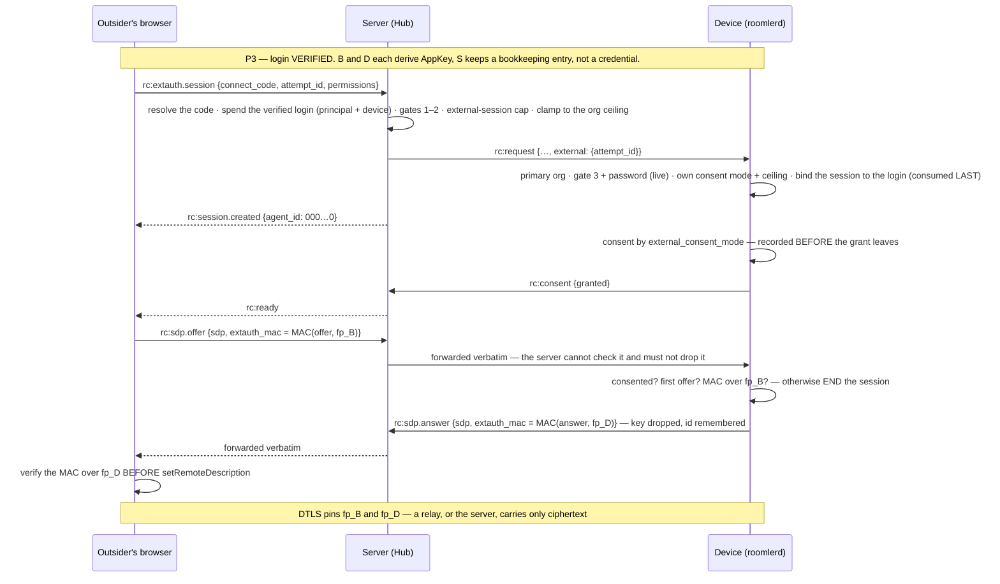

# FR-52: Cross-org remote access — an outsider, a device password, and a server that cannot use it

**Issue:** [#1100](https://github.com/gjovanov/roomler-ai/issues/1100) ·
**Status:** in progress — P1 · P2a–c · P3a–d · P4a–f shipped: an outsider proves the password to a device through the server, from any pod, and opens ONE session bound to that login by MACs over both DTLS fingerprints — decided by the device, proven against the real agent, and in a real browser through the `/connect` page. **P4f's first run on an installed daemon (2026-10-20) found the one bug none of P1–P4e's CI could see** — the controller tore down its own external session as a "ghost" the instant it was created — fixed in #2612 and re-verified green end to end: a real outsider reached `connected` with live frames through the real `/connect` page against production. **P5a built (2026-10-31)**: the open criteria each got a real refusal and a real proof, and three of them turned out not to be met as written. All but AC7's field half are ticked; that half needs a promote and a real relayed session. **P5 built (2026-10-31)**: the org hears of a person's first session and of a password being guessed, an admin can bar one person from one device, and both logs are on a page. Its field half follows the promote. §12 ·
**Owner:** remote-control (pillar 1) + control plane ·
**Anchors verified against master `b94793e77`** (re-derived 2026-10-18, after the stack merged)

The gap TeamViewer and AnyDesk fill and roomler does not: someone **outside the
organization** views and controls a device, authorised by a password the device
holds — with consent, with an audit trail, and without the server ever being able
to learn or replay that password.

## Goal

A device owner can let a person who is **not a member of the device's org** open a
remote-desktop session against it, by giving them a **connect code** and a
**password**. Both the org and the device can refuse; the device has the last word;
every attempt, including every refusal, is recorded.

Four properties, stated as the acceptance bar rather than as a description:

1. **The server is not the gate.** A compromised or malicious control plane cannot
   open an external session, cannot recover the password, and cannot substitute
   itself for the device. This is the same property `exec_enabled` / `ssh_enabled` /
   `remote_config_enabled` provide, applied where it matters most — an outsider has
   no tenant membership behind them, so the password *is* the whole authorization.
2. **The outside door is harder than the inside one.** An internal controller passes
   org policy → a permission bit → a device allowlist → consent. An external one
   passes org policy → an admin approval → a device opt-in → a cryptographic proof →
   consent. Nothing about this feature may make the internal path more permissive.
3. **Both TeamViewer workflows, one mechanism.** Durable *unattended* access (the
   personal password) and *ad-hoc attended* support (a one-time code the host reads
   out) differ only in the lifetime of the secret and who initiates. They must not
   be two wires.
4. **An empty audit is never mistaken for an empty history.** Refusals are the
   load-bearing rows, as in `ssh_audit`.

## 1. The gap, measured in the code

Every remote-desktop session passes through **one** function:
`resolve_session_authz` — `crates/modules/remote/src/controller.rs:579`. After the
self-control shortcut, the whole of the cross-org story is three lines:

```rust
// crates/modules/remote/src/controller.rs (the membership read)
let perms = state.tenants
    .get_member_permissions(agent.tenant_id, controller_user_id)
    .await
    .unwrap_or(0);            // ← non-member ⇒ Forbidden ⇒ 0
...
// :471
if !permissions::has(perms, permissions::REMOTE_CONTROL) {
    return Err("you don't have permission to control others' devices".to_string());
}
```

There is no other door. The org boundary is not a policy that can be relaxed with a
setting — it is the shape of the only authorization path. `docs/compare/vs-teamviewer.md:63`
already concedes the consequence in public: *"Attended support for a stranger's PC |
**no** — enrolment model | yes, session codes"*.

Two workflows sit behind the request, and they are not the same feature:

| | Unattended access | Ad-hoc attended support |
|---|---|---|
| Their name for it | personal password | QuickSupport |
| Secret | durable, owner-set | one-time, host-generated |
| Who is at the machine | nobody | the person asking for help |
| Initiated by | the outsider | the host |
| Risk | the higher of the two | the lower of the two |
| Consent default | prompt (owner may set auto) | pre-satisfied by the host's own act |

## 2. The constraint that decides the design

`CLAUDE.md` states it for exec, SSH, peer relays and remote config, and the code
enforces it: **the last gate is owned by the device and the server cannot write it.**
`remote_config_enabled` (`crates/agent-core/src/config.rs:212`) is not merely
defaulted-off — it is *structurally absent* from `DesiredConfig`, and
`crates/remote_control/src/models.rs:2713` says so in as many words:

> ⚠️ `remote_config_enabled` is deliberately ABSENT and must never be added.

An external-access password is that class of thing, only more so. So:

### 2a. The design that fails

Browser POSTs the password → API compares an Argon2 hash stored on the `agents` row
→ API tells the agent to start the session.

This puts the gate in the server. A compromised server then opens **any** device in
the fleet; a database dump is a fleet-wide credential dump; and the one property
every neighbouring subsystem is built to preserve is inverted precisely where the
caller is a stranger. It must not ship, and it must be named in the spec so that a
later reviewer recognises it as the tempting shortcut rather than the obvious build.

### 2b. The design that holds

The password lives **only on the device**, in `config.toml`, under the same
atomic + fsync + `.prev` + 0600/ACL treatment `ssh_host_key` already gets
(`crates/agent-core/src/config.rs:378`) — and, exactly as with SSH, **if it cannot be
persisted the feature stays off** rather than running on a per-boot secret.
Verification is a handshake the server merely relays.

### 2c. There is no free permission bit

`VIEW_SSH_AUDIT` is `1 << 30` (`crates/db/src/models/role.rs:91`) and `ALL` is
`(1 << 31) - 1` (`:172`); the UI mask is a signed int32 with bit 30 as the ceiling
(#888). A `MANAGE_EXTERNAL_ACCESS` bit **is not available**. Admin approval is
therefore a *compound* of existing bits — `MANAGE_AGENTS` **+** `REMOTE_CONTROL` —
exactly as FR-19 used `MANAGE_AGENTS` + `EXEC_DEVICE`. Clearing an approval needs
only `MANAGE_AGENTS`: revocation is not a grant.

## 2d. Where this lives after FR-69

The modular monolith (FR-69, #1307) landed between this spec and its first
phase, so the FR now spans **two** module crates, split on the line FR-69 draws:

* **`modules/fleet`** owns P1 — the org switch, the per-device approval, the
  connect code on the `agents` row, and the decision log. That is device
  MANAGEMENT, and it is the exact shape of `agent_exec`, which is fleet's.
* **`modules/remote`** will own P4 — the external branch of
  `resolve_session_authz` and the consent path, because `remote` is *what a
  CONTROLLER reaches* (`crates/modules/remote/src/lib.rs`).

That is the same split exec and SSH already have, and it means P1's routes are
mounted by fleet's `Module::routes` and its collections declared in fleet's
`Module::indexes` — never in `crates/db/src/indexes.rs`, per FR-69 rule 7.

## 3. The gate chain

Five gates, each owned by a different party, each default-deny, every decision
audited. The order is load-bearing: an earlier refusal means the later gates are
never consulted, and never leak that they exist.

| # | Gate | Owner | Mechanism |
|---|---|---|---|
| 1 | Org kill-switch | org admin | `TenantSettings.external_rc_enabled`, default `false` — the twin of `remote_exec_enabled` / `remote_ssh_enabled` (`crates/db/src/models/tenant.rs:233`) and deliberately separate from both. Off ⇒ a connect code does not resolve. |
| 2 | Per-device approval | org admin | `Agent.external_access_policy`, shaped on `PeerRelayPolicy` (`crates/remote_control/src/models.rs:3669`): default closed, set by `MANAGE_AGENTS` + `REMOTE_CONTROL`. Carries a **permission ceiling** (an org may allow external *view* without external *input*) and an optional expiry. |
| 3 | Device opt-in | device owner, locally | `external_access_enabled` in the agent's own config, default off, **absent from `DesiredConfig`**. Alongside: `external_consent_mode`, `external_max_permissions`. The refusal that survives a compromised server. |
| 4 | The password proof | device verifies, outsider proves | §4. The substitute for tenant membership, and the only gate the outsider can satisfy by their own action. |
| 5 | Host consent | whoever is at the machine | The existing `ConsentMode` path, resolved from `external_consent_mode` rather than `AccessPolicy.consent_mode` (`crates/remote_control/src/models.rs:1436`), defaulting to `Prompt`. |

> **As built (P5).** Gate 2 has one more question in it: *is this person barred from this
> device?* It is read in `gates` (`crates/modules/remote/src/extauth.rs:396`), beside gates
> 1 and 2, and it is the same kind of thing as they are: the org's refusal, on the
> server, in the same one word to the outsider. It stops an account, and it does not
> survive a compromised server. Changing the password on the device does both.

Gate 5 needs one wire addition: the prompt must say the controller is **outside the
organization**. `ServerMsg::Request` (`crates/remote_control/src/signaling.rs:3344`)
carries `tenant_name` for the multi-org case, which answers *which* org is asking —
not whether the asker is in one at all. A `controller_scope: external` field is
additive and serde-defaulted, so older agents keep today's prompt text; a device
that cannot say "outside your organization" must therefore not be gate-2 approvable,
which the `RpcCap` check in §5 enforces.

> **As built (P4).** The field is `Request.external: Option<ExternalGrant>`, and it
> carries more than a scope: the `attempt_id` of the login the device must bind the
> session to (§4c). An older agent would take it as an unknown field and serve the
> outsider as an ordinary controller, so the server opens an external session only
> on a device advertising a SECOND verb, `external-session` — `external-access` says
> a build can LOG an outsider in, which is not the same promise
> (`external_access_does_not_imply_external_session`).

## 4. The handshake

The requirement is narrow: the party *brokering* the exchange must not be able to
learn the password, mount an offline attack on it, replay a captured proof, or
impersonate the device in order to harvest it. That is the textbook case for an
**augmented PAKE**.

**Decision: OPAQUE.** `opaque-ke` 4.0 on the agent and **`@serenity-kit/opaque`**
in the browser — which is opaque-ke 4.0 itself compiled to WASM, so the two speak
RFC 9807 by construction rather than by agreement. Ristretto255, TripleDH over
SHA-512, Argon2id. SRP-6a has the same properties on paper and a long history of
implementation footguns (parameter validation, `B = 0`, group choice); the modexp
would also land in the browser bundle.

> ⚠️ **Corrected in P3a (2026-09-24).** This section originally named
> `@cloudflare/opaque-ts`. That library implements **draft v07** with **scrypt** —
> not RFC 9807, not Argon2id — so it cannot log into an opaque-ke 4.x device at all.
> Checked against its repository, not assumed.

### 4-0. The parameters are a wire surface, and they are pinned

The key-stretching function runs on the **client** — on the device at registration
(it plays both halves) and in the outsider's browser at every login. Both must use
byte-identical Argon2id parameters or the right password is refused. They are
pinned in `external_access::PinnedArgon2`, whose `Default` *is* the pinned instance
because opaque-ke falls back to `CS::Ksf::default()` whenever a caller omits the KSF:

| Parameter | Value | Why |
|---|---|---|
| algorithm / version | Argon2id / 0x13 | RFC 9106 |
| memory | 2^16 KiB (64 MiB) | the browser library's **default** ("memory-constrained", RFC 9106 §4) — the connect page passes no option, so there is no second copy to drift |
| passes / lanes | 3 / 4 | same preset |
| salt | 16 zero bytes | opaque-ke's convention; OPAQUE salts through the OPRF |

⚠️ **Measured, not argued.** P2b had used `argon2::Argon2::default()` (19 MiB, 2
passes, 1 lane). The real browser client, typing the **correct** password, could not
log into a device registered that way — `KE2 did not verify`. After pinning, the
same client logged in and both sides derived the same session key. A known-answer
test computed by an *independent* Argon2id (OpenSSL, via Node 24) locks the bytes.
The Argon2 is also `opaque_ke::argon2` now, not the workspace crate the server
hashes user passwords with, so a workspace bump cannot move a device's record.

| # | Outsider's browser | Server | Device |
|---|---|---|---|
| 1 | connect code + password | resolves code → agent; gates 1 + 2, quota, rate limit | — |
| 2 | sends `KE1` (blinded) | relays; learns nothing | gate 3; loads its OPAQUE record |
| 3 | — | relays; learns nothing | replies `KE2` |
| 4 | derives `K`; **verifies the device**; sends `KE3` | relays; learns nothing | derives `K`, verifies `KE3`, grants or refuses, **counts the failure locally** |
| 5 | puts `MAC(K, dtls_fingerprint)` on its SDP offer | forwards the offer as today | **refuses an offer whose fingerprint is not authenticated under `K`** |
| 6 | — | normal consent + session flow | gate 5 |

**Step 5 is the step that earns the claim.** Without it the server is still in the
middle of the media path and "the device verified the password" buys less than it
sounds like. With it, an authenticated session key is bound to the actual DTLS
transport, and a substituted peer fails closed.

**Registration is local and one-directional.** The owner sets the password on the
machine — `roomler rc password set`, or the desktop companion — and the device
computes and stores the OPAQUE record itself. The dashboard may show *set / not set*
and may **clear**; it can never **set**, because a password typed into a web form has
already crossed the server, which is the one thing this design exists to prevent.
(The same asymmetry as gate 2's clear-vs-approve, and for the same reason.)

### 4a. The weaker alternative, and why it is named rather than chosen

Argon2id in the browser plus `HMAC(K, nonce)` is far better than §2a and much less
work. It fails on two counts: the device must then store a **password-equivalent**
secret, and the relaying server gets an **offline cracking oracle** — guess a
password, derive, compute the tag over the nonce *it* chose, compare with the tag it
observed. Against a human-chosen password that is a real break, by exactly the party
this design excludes. It also gives the client no way to authenticate the device.

If it is ever shipped as a stopgap, the wire must carry `extauth_v` from the first
commit: retrofitting a PAKE afterwards means a forced password reset on every device
in the field.

### 4b. Failure counting belongs on the device

The backoff and lockout that make a 4-word password survivable are gate-4 state, so
they live where gate 4 lives. A server-side counter does not survive the threat this
gate exists for. Server-side per-(principal, code) ceilings ride
`crates/core/src/rate_limit.rs:37` as a *second* limit, not the only one.

⚠️⚠️ **A guess is counted when KE1 is ANSWERED — never when KE3 fails.** In OPAQUE
the *client* learns whether its password is right while opening KE2, before a KE3
exists. A guessing client stops there, so the device never receives a failure to
count. Measured with the real browser library (2026-09-24): wrong password ⇒
`KE2 did not verify` on the client and an **abandoned** login on the device — no
KE3, no failure event, nothing. A throttle keyed on failed KE3s would record zero
failures from an attacker trying passwords as fast as the server relays them.

So: every KE2 the device serves is debited against the budget; a KE3 that verifies
refunds it. Two properties follow and must be kept:

- The debit happens **before** the device answers, and an exhausted budget answers
  nothing at all — a refusal that still carried a KE2 would still be an oracle.
- Serving KE1 is cheap for the device (one OPRF evaluation and the 3DH — Argon2 is
  the *client's* cost), so the throttle is about guesses, not CPU; it should not be
  tuned as if it were DoS protection.

Locked by `a_wrong_password_is_decided_at_ke2_so_the_device_never_sees_a_failure`,
which fails loudly if the protocol property it relies on ever stops holding.

### 4c. The session: the login is bound to the transport, and the device decides (P4)

A verified login is worth **one** session, and everything that makes that session
safe is decided on the device, against a key the server never holds — P3b's
`AppKey = HKDF-SHA512(OPAQUE session key, "roomler-extauth-v1 app-key" ‖ attempt ‖ principal)`,
derived independently by the browser and the device.

The binding is a MAC over each end's DTLS certificate fingerprint, one per direction:

`extauth_mac = base64url(HMAC-SHA256(AppKey, "roomler-extauth-v1 transport" ‖ u16be ‖ role ‖ u16be ‖ fingerprint))`,
`role ∈ {offer, answer}`, and `fingerprint` is the SDP's ONE distinct
`a=fingerprint:` value as `lowercase(hash) ␠ UPPERCASE(hex)`. Zero or two distinct
certificates is a refusal: the MAC could cover one while DTLS negotiated the other.
Pinned by known-answer tests computed with Node's HMAC
(`the_transport_mac_matches_an_independent_hmac`), and exercised end to end by an
integration test that implements the browser's half — HKDF included — from this
paragraph rather than from the device's code.



Six refusal points, in the order a session meets them:

| # | Where | Refuses | Why there |
|---|---|---|---|
| 1 | server — `extauth::handle_session` | an unknown code; a login not verified on this pod, or another principal's, or for another device, or already spent | one login, one session — checked where it is cheapest |
| 2 | server — same | gates 1–2 closed; a person barred from the device (P5); a quarantined device; an archived org; no `external-session` cap; nothing left after the org's ceiling | the org's gates, re-read at session time — a revocation between login and session holds |
| 3 | device — `extauth::admit_session` | a secondary org's socket; gate 3 off or no password (read LIVE from the file); an unreadable consent mode or ceiling; a ceiling that leaves nothing; no verified login | the device's own terms, never the server's word. The login is consumed LAST, so a refusal on the device's terms leaves it unspent |
| 4 | device — `grant_consent` | a binding that ended while the question stood | a grant for a session that is over is a refusal |
| 5 | device — `check_offer`, ahead of FR-43 delegation | an offer before THIS device consented; a second offer; no MAC; a MAC that does not verify; zero or two certificates | gate 5 is the device's, and an offer is the only thing that builds a peer. Before delegation because the binding lives in the root daemon, not the GUI worker |
| 6 | device — `seal_answer`, and `seal_outbound` for a GUI worker's answer | an answer to no admitted offer; an ended session | an external session's answer is never sent unsealed |

> ⚠️⚠️ **"Not bound" means ORDINARY session, and is the one answer on which an offer
> proceeds without a MAC** — so it must never be the answer for a session that WAS
> external. An ended binding leaves its session id in a bounded memory (256, oldest
> out), and a full table **refuses the newcomer rather than evicting** a live binding:
> an evicted session would find no binding at its offer and be taken for an ordinary
> one. Both locked (`an_ended_session_is_never_admitted_again`,
> `a_full_table_refuses_the_newcomer_and_evicts_nobody`).

> ⚠️ **The server's consent directive is not consulted.** `Request.consent_mode`
> arrives as `Prompt` — which only sizes the Hub's wait to the attended window — and
> an external session ignores it: `external_consent_mode` decides, floored by the
> device's own `auto_grant_session` through `consent::strictest_of`. Email and push
> never apply. The prompt's TITLE says "from OUTSIDE your organization", because the
> controller's name is whatever they chose to call themselves.

> ⚠️ **Two server-side widenings an outsider must not inherit.** The Hub's FILES
> grandfather rule widens exactly `VIEW | INPUT | CLIPBOARD` to add `FILES`, and an
> org ceiling of exactly that triple would have handed an outsider file transfer no
> admin granted — it now skips external sessions. And system audio follows the opt-in
> alone on an ordinary session; an external one needs `AUDIO` in its grant, checked
> by the server and again by the device.

**Why a separate frame** (`rc:extauth.session`) rather than fields on
`rc:session.request`: it names the device by connect code — an outsider never learns
the internal id, and `rc:session.created` answers them with a zero id — and it has no
`local_relay` and no `override_reason`, which closes F4 by type. `ExternalGrant`
reaches `Hub::create_session` from the extauth relay only; `Hub::dispatch` always
passes `None`, so no frame a controller sends can make a session external, or an
external one ordinary.

**Across pods**, P3d's path extends as is: the session is created on the device's pod
with the relay's proxy sender, the origin pod recorded the route when it forwarded
the frame, and the sealed offer and answer cross the PR-2 relay unchanged — the MAC
rides the raw frame (`an_outsider_on_the_other_pod_opens_a_sealed_session`).

## 5. Addressing: how an outsider names a device

An outsider cannot browse the org's device list and must not be able to. They
address the device by a **connect code** — a new field, never `agent_id`, which is an
internal key and an ObjectId (timestamp-prefixed, therefore partly predictable).

**Decision:** 12 characters of Crockford base32 grouped `XXXX-XXXX-XXXX` — 60 bits,
dictatable over a phone, no `I`/`L`/`O`/`U` to mishear. Live-scoped unique index on
the agent row, rotatable by owner or admin; **rotation is the revocation story** when
a code leaks.

Two properties of the resolution endpoint, both easy to get wrong:

- **It is not an existence oracle.** A code that does not exist, a device whose org
  has gate 1 off, and a device that is merely offline must produce the same response
  *and the same latency*. Otherwise the endpoint enumerates the fleet.
- **It is rate-limited before it is useful.** `rate_limit.rs` keys on
  `(caller, device)`; this needs a second keying that works *before* a caller is
  known — per source IP and per code globally.

> **As built (P5a, 2026-10-31).** The first property did not hold on the shipped code: a
> miss and a hit make the same two reads, but only a hit has rows to decode, and 0.4 ms
> showed at every percentile (§12). Padding the reads cannot close that, and a
> rate limit only slows an attacker's averaging down. So every answer given without the
> device leaves at `ANSWER_FLOOR`, 300 ms after the knock
> (`crates/modules/remote/src/extauth.rs:91`). It is a deadline, not a pad after the
> work, so what was read to reach the answer cannot show. It sits above the 250 ms
> presence probe `forward` may wait out, so a stalled Redis does not mark an offline
> device either. Only refusals pay it: a login the device answers is as fast as the
> device.
>
> ⚠️ **What ran behind the answer was the second half of it.** The shipped rule was
> "reply first, audit after". Under a floor that rule read 1 ms late at every percentile
> on a single-threaded runtime, more than the gap it set out to close, because the
> spawned audit write ran ahead of the reply, on the one arm that writes a row. Two idle
> workers hide that (§12), and a busy pod may not have one. So an answer at the floor
> leaves from one place, `at_floor`, after its arm has returned: its row is spawned and
> everything it held is dropped, and no arm can do anything behind the answer. Locked by
> `an_audit_row_is_made_before_the_answer_it_explains`: a row is stamped as it is made,
> so the stamp says which came first, where the floor test cannot.
>
> `rc:extauth.finish` and `rc:extauth.session` were the sharper probes: no password, no
> start, no rate limit of their own, any code. Both answered `unavailable` for an
> offline device's code where a made-up code answers `unknown_attempt`. Both now say
> `unavailable` only to a principal really holding a login on that device, read the
> gates before any forward (a frame sent on to another pod comes back a relay hop
> later), and keep their audit rows behind the start limit. The cost is one word: a
> revocation seen on the other pod mid-login reads `unknown_attempt`.
>
> ⚠️ What this does not hide, so nobody reads more into it:
>
> | Still visible | Why |
> |---|---|
> | A code whose gates are open and whose device is online | It answers with a challenge. That is how a login starts |
> | A device's own `unavailable` (gate 3 off) from a device more than 300 ms away | Its round trip is longer than the floor. Outside this criterion, which is about the org's switch |
> | The org's id, to an outsider who reached `rc:ready` | The TURN username carries `org-<id>`. A foreign id 404s, so it opens nothing |

The capability verb is `RpcCap::ExternalAccess` (`crates/remote_control/src/models.rs:1144`),
matched by **equality, never prefix** — the `ssh` / `ssh-consent` rule. A device that
does not advertise it cannot be gate-2 approved, which is what keeps §3's
`controller_scope` prompt from being a promise an old agent silently breaks.

## 6. Five findings from reading master

### F1 — the hub keys controllers by `ObjectId`, so an anonymous principal forks everything

`Hub::register_controller(user_id: ObjectId)` (`crates/modules/fleet/src/hub.rs:1259`),
`RemoteSession.controller_user_id: ObjectId` (`models.rs:5573`), the `remote_audit`
rows and the TURN credential all key on a real user id. A synthetic principal would
fork the session record, the audit, the credential and the rate limiter — and leave
*"someone controlled your machine"* in the log.

### F2 — a user with no org is already legal, so the fix costs one signup and no new type

`routes/auth.rs:108` creates a user and **no tenant**. "Free account, member of
nothing" needs no new identity type: the external controller is an ordinary user who
simply is not a member of the device's tenant. **Decision: an account is required**
for unattended access. For the P6 ad-hoc flow a guest principal minted from a
one-time code is acceptable, because the host is present and watching — the
`routes/consent.rs:20` public-capability route is the established pattern for it.

### F3 — TURN credentials key on the user id, so the meter must key on the *device's* tenant

`turn_creds::ice_servers_for(user_id, …)` (`crates/remote_control/src/turn_creds.rs:372`)
issues under the controller's id. An external controller therefore consumes the org's
relay capacity attributably — but they have **no tenant**, and an external session is
relay-heavy by construction (the outsider is not on the mesh). If FR-20's ledger keys
on the controller's tenant, every external session meters to nothing. **Verify before
P5, do not assume.**

> **Verified in P5a: the gap was real, on one leg.** The device's allocation was already
> charged to the session's org (`Hub::turn_user`, FR-115 P4b). The browser's was not: it
> used a pre-fetch that names no device, because an outsider is no member of the org and
> never learns its ids, so its bytes were charged to nobody. The viewer now takes the
> credentials `rc:ready` carries before its first gathering (`withSessionIceServers`),
> which the Hub issues under the session's org, the device's. A frame with no usable
> TURN server leaves the pre-fetch in place: connecting uncharged beats not connecting.

### F4 — `local_relay` is validated as *an* overlay address, not as *the caller's*

`is_overlay_relay_ip` (`crates/modules/fleet/src/hub.rs:65`) accepts any
`100.64.0.0/10` or `fc00::/7` literal, and `hub.rs:2168` hands it to the agent as a
TURN URL. An external controller has no overlay presence, so for them the field must
be **rejected outright** — otherwise it is a probe into the org's mesh, dialled by
the agent, from outside the org.

> **Closed in P5a, by a refusal as well as a type.** P4's frame has no `local_relay`
> field, so the relay never reached the Hub, but serde dropped the key without a word:
> a frame naming one opened its session as if nothing had happened, and nobody could
> tell it had been tried. `names_a_relay` now reads the raw frame, by prefix, at the pod
> it arrived on, the only one that can see the key. The session is refused before the
> code resolves, in one answer whether it does or not, so this arm tells nothing about
> a code. The log line and the audit row are both under the start limit, because the
> frame has no limit of its own.

### F5 — the unauthenticated capability route already exists

`routes/consent.rs:20` and the UI's `guest: true` `/consent/:token` route are a
working precedent for *the token is the capability*, with single-use resolution via a
CAS. P6 follows it rather than inventing one.

## 7. Phases

| # | Phase | Kill switch | Status |
|---|---|---|---|
| P1 | Addressing + policy, **no access path**: connect code (globally unique, rotatable), the org switch, `external_access_policy`, admin UI, `external_rc_audit` (90 d TTL). `decide_approval()` returns `Result<(), ExternalRcDenyReason>` so one place records both arms. | `external_rc_enabled = false` (default) | **SHIPPED** — 19 unit + 10 route + 6 integration tests, two guards falsified |
| P2a | **The device can SAY it understands cross-org access, and opt in.** `RpcCap::ExternalAccess` on the hello (unconditional — a BUILD property, the `config` reasoning, never derived from the opt-in) + `external_access_enabled` (gate 3, default off) with its config-surface entry. The whole `external_*` surface is absent from `DesiredConfig`, guarded by a PREFIX test (FR-19's `relay_*` rule). ⚠️ Without this, gate 2 refuses EVERY device — no agent advertises the verb — so P1 is field-unverifiable until it lands. | `external_access_enabled = false` (default) | **SHIPPED** — both guards falsified |
| P2b | The device-side CREDENTIAL as a *type*: the OPAQUE suite (Ristretto255 · TripleDh · **Argon2id** Ksf), the registration record, `external_consent_mode`, `external_max_permissions`. Registration runs entirely on the device — it plays both halves, nothing crosses a network — which is *why* the dashboard can show *set / not set* and CLEAR but never SET. | `external-access` feature, off in every release build | **SHIPPED** — 7 unit tests incl. a full login round-trip |
| P2c | The way to actually set one: `roomler rc password set\|clear\|status` over a new LocalAPI verb, and the length floor. Registration + persistence happen in the DAEMON (it owns the config path and the write lock); the CLI only carries the plaintext across the local pipe, the same channel and the same authority that already flips `exec_enabled`. ⚠️ No `--password` flag, ever — argv is world-readable through `/proc/<pid>/cmdline`. ⚠️ **Narrowed since, to the CONSOLE user** (the 2026-10-14 restack), the rule `files_dir` and `keep_busy_enabled` already had: the LocalAPI admits RDP guests too, and these gates decide who may take the console's screen. The narrowing covers setting and clearing the password and every `external_*` key (`crates/localapi/src/lib.rs:3508`, `:3515`, the refusal at `:3069`), locked by `only_the_console_user_opens_the_device_to_outsiders`. `status` stays readable by anyone. The companion does not write the file after the daemon refused (`is_daemon_owned_key`, `agents/roomler-desktop/src/commands.rs`, locked by `recording_keys_are_the_daemons_to_accept`), and the three keys are live (`the_external_access_keys_are_live`). | the P2a flag; nothing verifies the record until P3 | **SHIPPED** — 6 unit tests, incl. the surface allowlist and the derived-`Debug` leak |
| P3a | **The compatibility surface, fixed before any wire exists.** Pinned KSF (`PinnedArgon2`, §4-0), the device's login half (`login_start` KE1→KE2, `login_finish` KE3→session key), and a cross-implementation harness (`examples/extauth_interop.rs`). **Proven against the real browser library**: RED with the old crate-default KSF (the correct password refused), GREEN after pinning with both sides deriving the same session key, and a wrong password decided at KE2 with no KE3 ever sent — the measurement §4b's counting rule rests on. Corrected the spec's browser library (`@cloudflare/opaque-ts` is draft-07 + scrypt; cannot interoperate). | `external-access` feature, in no release build | **SHIPPED** |
| P3b | The device's login **state machine** (`external_logins.rs`): guesses debited when a KE2 leaves the device (§4b), check-and-debit in ONE critical section (a concurrent burst cannot outrun it), a success refunds only its own guess, 5 free then 30 s doubling to a 1 h cap over a 24 h window, bounded pending/verified tables with TTLs, and a verified login retained **single-use** as `AppKey = HKDF-SHA512(session key, label ‖ attempt ‖ principal)` — the principal is bound after the login because the browser library binds no OPAQUE `context`. Known-answer test against an independent HKDF. Open decisions 6 + 7. | same | **SHIPPED** |
| P3c | The wire: `rc:extauth.*` frames (4 client, 4 server; the device's refusal decoded leniently — anything present is a refusal), the server as a blind relay (`crates/modules/remote/src/extauth.rs`: byte-identical `unavailable` for no-such-code / gate 1 / gate 2 / offline, reply before the audit write, park-before-push, only the starter finishes, gates re-checked at KE3), the device's answer in **every** build (`agents/roomlerd/src/extauth.rs`: gate 3 and the record read LIVE from the config file, primary org only), and a `login` audit action. **Proven on loopback against the real agent**: `crates/tests/src/extauth_tests.rs`, 4 tests. ⚠️ **Single-pod only** — see P3d. | P2's flag; no client surface ships | **SHIPPED** |
| P3d | **Cross-pod.** An outsider has NO tenant, so tenant affinity cannot put their socket on the pod holding the device, and `/ws` refuses a `tid` they are not a member of — in a 2-replica deployment roughly half of them land on a pod that cannot reach it. The landing pod re-resolves the connect code and forwards the raw frame ONCE over the PR-2 rc relay (`Hop::Origin` → `Hop::Relayed`, never relayed twice); the owner pod's `rc.cmd` handler routes it to the extauth relay with the proxy sender, whose pump already routes replies back to the browser's connection. `finish` resolves the code BEFORE the attempt table, because an attempt started cross-pod lives on the other pod. Proven by `an_outsider_on_the_other_pod_still_logs_in` (device on pod 1, outsider on pod 2), falsified by disabling the forward. | same | **SHIPPED** |
| P4 | Session establishment — §4c. Designed as its own frame (`rc:extauth.session`) rather than a branch in `resolve_session_authz`: an outsider has no membership for that gate to judge, and the frame's TYPE is what keeps a connect code, not an agent id, on the wire and `local_relay` off it (F4). | per sub-phase, below | P4a–P4f **SHIPPED** (P4a–e merged 2026-10-18; P4f field-verified 2026-10-20, fix #2612) |
| P4a | **The wire and the binding primitive.** `rc:extauth.session`; `Request.external`; `extauth_mac` on the offer and the answer in both directions (relayed verbatim — the server holds no key to check it); `RpcCap::ExternalSession`; `external_logins`' binding — bind (consuming the login) → the device's consent → ONE offer → a sealed answer → the key dropped and the id remembered. KATs from an independent HMAC. | `external-access` feature, in no release build | **SHIPPED** |
| P4b | **The server's session step** (`extauth::handle_session`): a verified login kept single-use for 150 s; gates 1–2, quarantine and archived re-checked; the `external-session` cap; the org's clamp; `Hub::create_session(external)` — the only caller that passes one; a `session` audit action joined to the login by `attempt_id` and to the session by `session_id`; the FILES grandfather rule skipped; a zero agent id to the outsider. | same | **SHIPPED** |
| P4c | **The device's admission**: primary org only; gate 3 read live; its own consent mode and ceiling (now validated at `config set`); the login consumed last; the MAC checked ahead of FR-43 delegation; the answer sealed at both places an answer leaves the root daemon; audio behind `AUDIO`; the prompt titled "from OUTSIDE your organization"; a refusal ends the session as `agent_hangup`, never reported as a human's no. | same | **SHIPPED** |
| P4d | **The proof, against the real agent**: a sealed session end to end with the browser's half written from the spec; three forged offers each ENDED by the device; one login, one session, one principal; and the same session across two pods with both MACs crossing the PR-2 relay intact. | same | **SHIPPED** |
| P4e | **The `/connect` page** (`ui/src/views/remote/ConnectView.vue`, `useExternalLogin.ts`, `utils/extauth.ts`): an org-less account types the connect code and the device's password; `@serenity-kit/opaque@1.1.0` (pinned exact — a wire surface, §4-0) runs the login in a LAZY chunk, so no other page pays for the WASM; WebCrypto derives the AppKey and both MACs (KATs shared with the device's); the key is handed to the viewer in memory, once, and never touches storage. The viewer's external mode (`useRemoteControl(…, { external: true })`): asks by connect code, seals its offer, checks the answer's MAC BEFORE `setRemoteDescription` and ends the session on a missing or wrong one, never probes a local relay, and turns a reconnect into "log in again" (decision 10). A grant without CLIPBOARD closes the clipboard channel before it is negotiated (decision 9). `'wasm-unsafe-eval'` added to the CSP (decision 12). | `external-access` is in no release agent build, so every device answers `unavailable` | **SHIPPED** |
| P4f | Turn it on: `external-access` into the release feature sets; the first field run on an installed daemon with a real second account; `vs-teamviewer.md`. | gate 3 per device, default off | **SHIPPED** — `external-access` in `full` (decision 11); field-verified 2026-10-20 on 0.4.146/0.4.147 against production (§12): a real outsider account reached `connected` with live frames through the real `/connect` page, after fixing the one bug the run found (#2612) |
| P5a | **The open criteria get real refusals and real proofs.** `ANSWER_FLOOR` and the `finish`/`session` oracle (§5); a `DesiredConfig` push naming an `external_*` key refused and audited as `device_owned_key`, by prefix; an external `local_relay` refused with a log line (F4); the viewer's TURN leg charged to the device's org (F3); the Hub's mint path driven directly at a real agent; the password captured across two pods and on the page itself. | `external_rc_enabled = false` (default) | **BUILT** — §8, §12. F3's field half follows the promote |
| P5 | Visibility + accounting: owner notification on a first-ever external session by a principal and on repeated failures (`extauth_notice.rs`, `external_principals`); audit UI beside `SshAuditSection` (`/audit/external`); per-principal revocation (`PUT …/external-principals/{user_id}`, read in `gates`, ended by `terminate_external_of` on whichever pod holds the session). The plan limit was FR-115 P3b's (decision 4). (Relay bytes metered to the device's tenant, F3, moved to P5a.) | `external_rc_enabled = false` ends the whole path. A bar acts only when an admin uses one | **BUILT** — §8, §12. The field half follows the promote |
| P5-docs | [`docs/external-access.md`](../external-access.md), a row in `docs/README.md`, the routes in `docs/api.md`, both collections in `docs/data-model.md` | n/a | **DONE**, in the P5 PR |
| P6 | Ad-hoc attended support: host generates a short one-time code from tray/CLI. **Same wire** — the one-time secret takes the password's place. | separate `external_rc_mode` value; independent of unattended access | not started |

## 8. Acceptance criteria

- [x] With `external_rc_mode = off` (the default), a valid connect code + correct
      password yields the **same response and latency** as a code that does not exist.
      **P5a** — as built the switch is `external_rc_enabled = false`, and the password
      plays no part: the server answers before KE1 leaves it, so the right one and a wrong
      one are the same frame. Same response: `a_closed_code_answers_like_one_that_does_not_exist`,
      to the byte, and no answer before `ANSWER_FLOOR`. Same latency, N=600 per arm with a
      second no-such-code arm as an A/A control: the closed code reads p50 301.585 ms against
      301.565 ms on one thread and 301.636 ms against 301.637 ms on two workers, KS 0.032 and
      0.050 against a 1% critical value of 0.094, at the level of the A/A's 0.025 and 0.037.
      The shipped code read 0.4 ms apart at every percentile. Equality can only be bounded,
      so the claim is **indistinguishable at N=600**, in process, on an unsaturated runtime.
      Falsified, §12.
- [x] With gates 1 and 2 open but `external_access_enabled = false`, the session is
      refused **by the device**, and the refusal is audited. **P4f field run,
      2026-10-20** — flipped gate 3 off via a console-user scheduled task on an
      installed 0.4.147 daemon (gates 1+2 untouched, 4 still set); the real device
      password was refused: "This device is not available for outside access.
      Check the code, or ask the device owner.", no navigation past `/connect`.
      `external-rc-audit` carries the row: `{"action":"login",
      "login_refused":"unavailable", "actor":"FR-52 outsider test (do not use)",
      "at":"2026-10-20T18:42:06.748Z"}`. Gate 3 restored after. §12.
- [x] A server that is asked to start an external session **without** a client proof
      cannot: demonstrated by driving the mint path directly against a real agent.
      **P5a** — `a_server_cannot_mint_a_session_the_device_never_logged_in` calls the Hub
      the way a compromised server would, past every check the server's own code makes,
      at a real agent with every gate open and `auto` consent. A made-up attempt, another
      principal's login and a spent login were each ended by the device (`agent_hangup`);
      the same call on the principal's own login was admitted, so the refusals are the
      device's doing. Falsified, §12. ⚠️ The claim stops at a session marked external. A
      server that mints an ORDINARY session names no login, and the device cannot tell it
      from a colleague's: that is the trust FR-100 removes.
- [x] The password never appears in any server-side log, request body, or collection.
      Demonstrated by a capture of the full exchange. **The device-side half is
      done (P2c)**: `an_external_password_persists_and_never_lands_in_the_config_file`
      asserts it against the config file's RAW bytes, and
      `a_password_never_prints_itself_through_debug` covers the daemon log by
      making `Request`'s derived `Debug` safe. Both falsified. **The server's half, P5a**:
      `the_password_is_in_no_log_no_frame_and_no_collection` runs a wrong guess and a whole
      session across two pods, and searches every TRACE log line of the server and the
      device, every frame both ways and the raw BSON of every collection, in five
      spellings, with a canary down each lane that must be found. **The page's half,
      P5a**: `useExternalLogin.spec.ts` drives the real `externalLogin` and the real WASM
      client: the two frames' keys are pinned, KE1 and KE3 are RFC 9807's fixed 96 and 64
      bytes, and a wrong guess sends one frame. Four leaks into the page went red, §12.
- [x] A password cannot be SET from anywhere but the device. **P2c** — no server
      route writes it, `config set` refuses both credential keys, and
      `no_external_credential_key_is_editable_through_the_config_surface`
      allowlists the editable `external_*` keys so the next one added has to be
      defended rather than inherited. Falsified by registering the verifier.
- [x] An SDP offer whose DTLS fingerprint is not authenticated under `K` is refused
      by the agent (negative arm run explicitly — a pass with no failing arm proves
      nothing). **P4d** — `an_offer_the_login_did_not_seal_ends_the_session`: three forged
      offers (another key, no MAC, a genuine tag over a swapped certificate) each ENDED
      by the real agent, and with the check removed the forged offer was ANSWERED (M1,
      §12, 2026-09-25). P5a reran it on the current code.
- [x] A `DesiredConfig` push carrying any `external_*` key is rejected, and a test
      asserts the fields cannot be serialised into one. **P5a** — the route used to
      answer 200 and drop the key. It now answers 403 and audits `device_owned_key`, by
      prefix (`a_desired_config_push_with_an_external_key_is_refused`). The refusal that
      survives this server is the device's: a raw frame through the real decode and the
      real `apply` leaves gate 3 and every `external_*` value as the owner set them
      (`a_pushed_external_key_never_reaches_the_device`). The type cannot hold one
      (`no_external_key_is_server_pushable_via_desired_config`, P2a). Falsified, §12.
- [x] An external controller's `local_relay` is rejected (F4), with a log line. **P5a** —
      `an_external_local_relay_is_refused_and_logged`: three relay keys on a real login
      each refused, the same answer on a code that does not exist, the log line, an audit
      row, and the same login opening its session once the key is gone. Falsified, §12.
- [x] The host consent prompt names the controller as **outside the organization**,
      verified on a real device with a real second account. **P4f field run,
      2026-10-20** — a real Windows installed daemon (0.4.147) showed: "Remote
      control request from OUTSIDE your organization… FR-52 outsider test (do not
      use) is requesting to control this device. On behalf of Outside your
      organization. This person is not a member of your organization. They proved
      this device's exte[rnal password]. Permissions: VIEW \| INPUT." Approved,
      and the session reached `connected` with live frames. §12.
- [x] Every refusal reason appears in `external_rc_audit`, and the audit read is
      gated on `VIEW_REMOTE_AUDIT`. **P1** — `approval_is_compound_clearing_is_not_and_both_arms_are_audited`
      asserts 2 refusals + 1 approve + 1 clear = 4 rows, and that a plain member gets 403
      from the reader. Falsified: dropping half the gate turns it red.
- [~] Relay bytes from an external session appear against the **device's** org in the
      FR-20 ledger (F3), with a direct-path arm metering zero. **Met in code, P5a**:
      `an_external_sessions_relay_is_charged_to_the_devices_org` takes the username out
      of the real `rc:ready`, plays coturn with it, and finds the bytes on the device's
      org and none on the outsider's own, with the booking at zero until coturn reports.
      **Missing, the field half**: a real relayed session and a real direct one after the
      promote, reading the ledger for both. No unit test reaches the call site in the
      viewer, so that run also reads `getConfiguration()` on `/connect`'s peer. Its red is
      the code reading (§12, 2026-10-31) and that test: #3232 also closed a live oracle,
      so its promote did not wait for a field red.
- [x] Rotating a connect code invalidates the old one immediately. **P1** — one route
      mints and rotates, and the row holds exactly one code, so the old value is gone
      rather than retired (`a_connect_code_is_minted_on_demand_…`).
- [x] A connect code never reaches the ordinary device list, which needs only tenant
      MEMBERSHIP. **P1**, and the criterion was missing from this list until the
      implementation surfaced it — `…never_reaches_the_device_list`, falsified by
      adding the field to `AgentResponse` and watching it go red.
- [x] `docs/compare/vs-teamviewer.md:63` is updated — and only after the field run,
      not on merge. Done 2026-10-20, after §12's field run: "no — enrolment model"
      → "limited — only your own already-enrolled devices, by a time-limited code
      the device owner approves (FR-52)", plus a Choosing-section note.
- [~] The org hears of a person's first session on a device, once. Not of their second,
      and not because the log still remembers: it forgets at 90 days. Whoever holds
      `MANAGE_AGENTS` hears, and the device's owner, and nobody is told about themselves.
      **Met in code, P5**: `the_org_hears_of_a_persons_first_session_once` empties the log
      and a further session still tells nobody; one write decides who was first
      (`one_of_eight_concurrent_sessions_is_told_it_is_the_first`). Falsified, §12.
      **Missing, the field half**: a real outsider's first session reaching a real admin's
      panel and web push, after the promote.
- [~] The org hears when a device starts refusing guesses, once a window however many
      accounts are at it. **Met in code, P5**:
      `the_org_hears_once_that_a_password_is_being_guessed`, which also shows nothing
      arrives before the device refuses, because a wrong guess leaves nothing behind (§4b).
      Falsified, §12. **Missing, the field half**: the same on a real device.
- [~] An admin can bar one person from one device: the session they are in ends, a login
      they hold dies at its next step, a new knock answers what a code that does not exist
      answers, the log says why, and letting them back opens the door. `MANAGE_AGENTS`
      bars, and letting back takes `REMOTE_CONTROL` too. A session the same account holds
      as a member stands. **Met in code, P5**:
      `a_barred_person_is_put_out_and_kept_out_until_let_back`, the same from the other pod
      (`a_bar_on_the_other_pod_ends_the_session`), the race
      (`a_bar_that_crossed_an_opening_session_ends_it`,
      `a_repeated_bar_still_ends_the_session`),
      `a_bar_leaves_a_session_the_account_holds_as_a_member`, and the routes
      (`a_person_is_barred_by_a_device_admin_and_let_back_by_the_pair`). Falsified, §12.
      **Missing, the field half**: a bar ending a real outsider's live session in a real
      viewer.
- [~] The external log and the people from outside are on a page beside the SSH audit,
      under `VIEW_REMOTE_AUDIT`, usable on a phone, and a name is shown as the claim it is.
      **Met in code, P5**: `auditPhoneLists.spec.ts`, `externalAudit.spec.ts`. Falsified, §12.
      **Missing, the field half**: the page on production, with real rows.
- [x] A plan limit applies to external sessions. **FR-115 P3b** (O6 + O7, decision 4),
      field-verified there on 2026-10-21 through this path: an account in no org holding
      one external session had its second refused `session_limit`, naming the first, and it
      opened once the first ended.
- [x] The feature has its docs: `docs/external-access.md` (mermaid, tables, anchors), a
      `docs/README.md` row, its routes in `docs/api.md` and both collections in
      `docs/data-model.md`. Neither of those two had any FR-52 entry before P5.

## 9. Open decisions

1. **Does gate 2 apply when the device owner is also the org's only admin?** As
   specified, a solo owner clicks approve on their own device — friction with no
   safety gain. A `MANAGE_TENANT`-holder-owns-the-device shortcut is tempting and is
   exactly the shape of the FR-27 owner shortcut that made `consent_mode` invisible
   for a year. Default: **no shortcut**; revisit with evidence.
2. **Where does an external session appear in the device's own UI?** A session the
   org's admins cannot see would be worse than the gap it closes; a session that
   spams every admin is noise. Proposal: the existing session list, badged, plus a
   notification on the *first* session per principal only. **Built in P5, with one
   correction**: there is no session list to badge. The UI has `GET …/session/{id}` and
   nothing that lists them, so the surface is the audit page, `/audit/external`: the
   people from outside, above the log. The notification is as proposed.
3. **Does an external principal get `FILES` / `CLIPBOARD` by default?** The internal
   default is `VIEW | INPUT | CLIPBOARD` (+ the grandfathered `FILES`). Proposal for
   external: `VIEW | INPUT` only, with the rest reachable through gate 2's ceiling.
4. **Plan tier.** This is the feature that replaces a paid TeamViewer seat
   (`docs/business-model.md`), so it is a pricing lever, not just a limit. Needs a
   decision before P5, not after. **Decided 2026-10-20 (operator), FR-115 O6 + O7, and
   built in its P3b**: no paid org is needed. A session takes a slot of the org it is
   for, at that org's tier, or Free's one when the account is in no org
   (`extauth::charge_scope`, `crates/modules/remote/src/extauth.rs:990`). ⚠️ Three texts still
   say Free has no support sessions: FR-115's D3, its table
   (`docs/fr/FR-115-pricing-reshape.md:109`) and `docs/business-model.md:155`. O7 is later
   and is what runs. They are the operator's wording on a closed FR, so they are
   recorded here and left alone.
5. **Gate 2 is weaker than FR-19's, and P1 says so rather than implying otherwise.**
   The spec called `MANAGE_AGENTS` + `REMOTE_CONTROL` "the FR-19 shape". It is not:
   FR-19 pairs `MANAGE_AGENTS` with `EXEC_DEVICE`, which `DEFAULT_ADMIN` deliberately
   does NOT carry, so it is a real extra grant — whereas `DEFAULT_ADMIN` **does** carry
   `REMOTE_CONTROL`, so this pair is no hurdle for the seeded `admin` role and bites
   only on a custom role built without it. Shipped as-is deliberately: the design does
   not lean on gate 2 as the security boundary (the org switch, the device opt-in and
   the device-held password are), and borrowing `EXEC_DEVICE` would exclude the natural
   approver — a fleet admin holding no root-command grant — to buy a hurdle nothing
   depends on. A dedicated bit waits on the BigInt migration. Locked by
   `the_compound_gate_does_not_restrict_a_default_admin`, so the claim cannot rot.
6. **The guess window is in memory (P3b), so a daemon restart forgives it.**
   Persisting it would put a disk write on an attacker-driven path and a second
   writer beside the config's lock; not persisting it costs at most one day's
   budget per restart. An attacker cannot restart the daemon without local access or
   a crash bug — and a crash bug that doubled as a budget reset is the case worth
   watching for. Shipped in memory; revisit if the crash recorder ever shows a
   restart loop correlated with external-login traffic.
7. **There is no hard lockout (P3b), only a capped backoff.** A lockout that needs
   the owner to re-arm it turns anyone who knows the connect code — which is dictated
   aloud and is not a secret — into someone who can switch external access off at
   will. The cap (≈34 answered guesses a day against a ≥12-character password) is
   the trade. P5's owner notification on repeated failures is the complement: a
   human learns of a sustained attack, and rotating the connect code ends it. **Built in
   P5**, on the device's `throttled`, the first thing the server ever sees of a wrong
   guess. Once per device per 6 h, pod-local: a device's guesses all land on the pod that
   holds it, and a roll that forgets costs one extra notice.
8. **The prompt names the outsider by a name they chose (P4).** The TITLE now says
   the request is from outside the organization, and the detail line says what it
   rests on — but "Alice from IT" is still whatever the account calls itself, and
   the classic support scam is built on exactly that. Proposal: show the account's
   email too, when (and only when) it is a PROVEN address (the security baseline's
   rule for `users.email`), and say "unverified" otherwise. Needs a decision before
   P4f puts the prompt in front of real people. **Part of it built, P5**: the notices
   quote the name on one line, bounded, as a claim, and the page shows the tail of the
   account id beside it, because two accounts can carry one name. The prompt itself and
   the proven-email proposal are unchanged and still open.
9. **A device-side narrowing is enforced but not SHOWN (P4).** When the device's
   own `external_max_permissions` is narrower than the org's, the device enforces
   its grant (the input and clipboard channels refuse), but the viewer's toolbar
   follows `rc:session.created`, which carries the server's clamp. Honest options:
   the device reports its effective grant in `rc:consent` (additive), or the page
   treats refusals as the signal. P4e should pick one; the safe property — the
   device enforces its own ceiling — does not depend on it. **P4e picked neither**:
   the page follows `rc:session.created`. Found while running it (2026-10-13): the
   viewer did not even follow that for CLIPBOARD — it opened the channel and pushed
   the controller's own clipboard to a device that refused it, in every session
   whose grant lacks the bit, which for an outsider (`VIEW | INPUT` by default) is
   every session. **Fixed in P4e** (`dropClipboardChannel`): the channel is closed
   at `rc:session.created`, before it is ever negotiated. A device narrowing it
   further than the server's clamp is still enforced and not shown.
10. **One login, one offer — so a reconnect costs a login (P4).** An external session
    admits exactly one offer, because the device rebuilds its peer for each and
    nothing about a second offer is covered by the consent the first got. A network
    blip therefore sends the outsider back to the password. A reconnect ticket
    derived from the AppKey (MAC'd, single-use, short-lived, and still subject to the
    device's consent mode) would remove that without a server-side secret; deferred
    until the page exists and the cost can be measured.
11. **Who may turn `external-access` on in the release builds (P4f).** Every gate
    is default-closed, so shipping the stack changes nothing on a device until its
    owner opts in (gate 3) and sets a password — but it does put the OPAQUE stack
    (+7 crates) into every agent. The alternative is a separate build flavour; the
    proposal is to ship it in `full`, because a feature only some builds can serve is
    one the fleet view has to explain device by device. **Decided 2026-10-19 (operator): in `full`, as proposed.**
12. **The page cannot run its OPAQUE client under today's CSP (found while planning
    P4e).** `@serenity-kit/opaque` is opaque-ke compiled to WebAssembly, and the SPA's
    policy (`files/security-headers.conf:71`) is `script-src 'self' https://purestat.ai` —
    with no `'wasm-unsafe-eval'`, a browser refuses to compile any WebAssembly module,
    so the login would fail before its first frame. The CSP is one per document, and
    SPA navigation never re-fetches it, so the allowance cannot be scoped to
    `/connect` alone. Proposal: add `'wasm-unsafe-eval'` — it permits compiling
    WebAssembly and nothing else (not JS `eval`) — in the same change as the page,
    exercising the remote-control page as the security baseline requires for any CSP
    edit, and extending the `rc_local_turn.rs` test that already parses this header.
    **Resolved in P4e, as proposed**: `the_deployed_csp_compiles_webassembly_and_nothing_more`
    holds the header to `'wasm-unsafe-eval'` present and `'unsafe-eval'` absent, and the
    real-browser run proved the token both sufficient (the login and the viewer under
    the production `script-src`) and necessary (without it, no frame leaves the page).
13. **May an outsider cover the screen (FR-99's `PRIVACY`)?** **Decided 2026-10-19
    (operator): no, never.** The person at the device let a stranger in on a password
    and a name the stranger chose (decision 8), and is the only one placed to see what
    that stranger then does. A curtain would hide it from them, which is FR-99's reason
    for refusing break-glass (its decision 1). Built as a strip, like RECORD (§10), in
    two places. The hub's `privacy_grant` names it `outside_the_org`, after
    `device_cannot_curtain` and before `device_not_opted_in`, so the audit row
    (`privacy_stripped`) gives the session's reason rather than one the owner could
    change. The device's `admit_session` strips `PRIVACY` and `RECORD` again
    (`NEVER_FOR_AN_OUTSIDER`), after its own ceiling, so the server is not the only gate
    and no `external_max_permissions` value lets either back in. The page never asks for
    it (it reads no device caps), so neither strip changes what an honest page sees.
    Locked by `an_outsiders_session_never_holds_privacy` (hub),
    `the_hub_strips_privacy_before_the_agent_can_see_it` (the agent is never sent the
    name) and `an_outsider_is_never_granted_record_or_privacy` (device).
14. **Nobody can be barred before their first session (P5).** A session makes a person's
    row and no route can, because the list joins `users` for a name: a route that could
    make a row for any id would read any account's name to any org admin. So a bar needs
    someone who has come in. Rotating the code or changing the password covers everyone
    else, and they were the only levers before P5. Locked by
    `a_person_is_barred_by_a_device_admin_and_let_back_by_the_pair`.
15. **The notices do not email (P5).** They go in the app and by web push to everyone
    named, `notify_users`'s rule: what needs a person now is not an email. The person at
    the machine has the prompt, which is the first line of defence for an attended
    device. An unattended one with `external_consent_mode = auto` has nobody there, so a
    first session there reaches the org only through this notice. **Open: does that case
    want an email too?** Default: no, until someone misses one.
16. **Of the server's levers, only a bar ends a session already open (found in P5).**
    `set_enabled`, `set_policy` and `rotate_connect_code` refuse every new login and leave
    a live session running, and so do the device's own gate 3 and a password change. Each
    was built to refuse a login, and "an admin who revokes mid-login must not see it
    complete" holds. But an admin flipping the org's switch in an incident may well
    believe everyone is out. **Open: should gate 1 off, and gate 2 cleared, end the
    external sessions they cover?** Proposal: yes, through `terminate_external_of`'s shape,
    since neither can be turned off by accident and the session they end has no standing
    left. Not built: it changes what P1's two switches mean, and that is the operator's
    call. `docs/external-access.md` §5 says today's behaviour plainly.

## 10. Out of scope

- **Mobile device support** — the other half of what `vs-teamviewer.md` concedes.
  Unrelated mechanism, separate FR.
- **Unattended access without a device password** (e.g. a bearer link that grants
  control). It would put the gate back in the server.
- **Setting the password remotely.** §4. Deliberately impossible, not merely unbuilt.
- **Changing the internal authorization path.** Nothing here may loosen
  `resolve_session_authz` for org members.
- **Session recording of external sessions.** The `ssh_activity` reasoning applies:
  recording what an operator typed ships it off the host.
- **Privacy mode for external sessions** (decision 13). An outsider never covers the
  screen of the person who let them in.

## 11. Related

- `docs/remote-control.md` — the subsystem this extends.
- `docs/compare/vs-teamviewer.md:63` — the gap, conceded in public.
- `docs/fr/FR-27-host-consent.md` (#854) — the consent surface chain gate 5 rides.
- `docs/fr/FR-19-peer-relays.md` (#805) — the four-gate shape and the
  `MANAGE_AGENTS` + second-bit compound this mirrors.
- `docs/roomler-ssh.md` — the device-held-credential precedent (`ssh_host_key`,
  `ssh_authorized_keys`, "if it cannot be persisted, stay off").
- `docs/remote-config.md` — why `external_*` keys are absent from `DesiredConfig`.
- `docs/fr/FR-20-relay-cost-metering.md` (#807) — F3.

## 12. Field-verification log

| date | version | what was tested | result |
|---|---|---|---|
| 2026-09-01 | branch `fr52-cross-org-remote-access` | P1 on the dev box: `cargo test -p roomler-ai-remote-control --lib` (223 pass, 19 new), `cargo test -p roomler-ai-api --lib` (290 pass; the one failure, `auth_rate_limit::tokens_refill_over_time`, is a load-timing flake — 3/3 green in isolation, and the file is untouched by this branch), `cargo test -p roomler-ai-tests -- external_access_tests` (6/6), `bun run build` + `bun run test:unit` (949 pass), `cargo fmt --check` and `cargo clippy --all-targets -D warnings` on the four touched crates | PASS |
| 2026-09-01 | same | **Falsification.** Removed the `REMOTE_CONTROL` half of gate 2 and added `connect_code` to `AgentResponse`, then re-ran: exactly `approval_is_compound_…` and `…never_reaches_the_device_list` went red with the intended messages, the other four stayed green. Reverted; all 6 green again. A test that has never failed proves nothing. | PASS |
| 2026-09-23 | branch `fr52-p2b` | **P2c on the dev box.** `fmt` · `apply-spdx --check` · clippy (localapi + node-core + cli; roomlerd; roomlerd `--features external-access`) · `cargo check -p roomler-ai-tunnel-core --features overlay-l3,overlay-netstack --all-targets` · 261 unit tests. Plus **natively on Windows**, which is the lane that matters here — `rpassword` compiles against the Windows console API and the WSL lane cannot see it (`librpassword-*.rlib` confirmed in the Windows `target/debug/deps`; forced clippy on `roomler-cli` + `roomler-localapi`, rc=0). | PASS |
| 2026-09-23 | same | **Falsification, five guards.** floor → `len()`; a change → always mint a fresh `ServerSetup`; `Secret::Debug` → print the inner string; register `external_access_verifier` on the config surface; **leak the plaintext into another config field**. Each went RED with its own message and was reverted. The last is the end-to-end test asserting the password is absent from the config file's RAW bytes. | PASS |
| 2026-09-23 | **live 0.4.99 SYSTEM service** | **`roomler rc password status` against a REAL, pre-P2c daemon.** The request reached the daemon and came back — proving transport and dispatch — but a daemon that does not know these verbs cannot *refuse* them, it cannot **parse** them, so serde answered `unknown variant …` followed by all 22 verb names it does know, and nothing actionable. Fixed: an additive hint naming the actual problem (daemon older than the CLI), with the raw error kept underneath, because matching a foreign library's wording must degrade to noise and never to a misdiagnosis. Exit code 1, as it should be. **No unit test could have produced this**; it is the reason a live run is not optional. | FIXED |
| 2026-09-24 | branch `fr52-p2b` + P3a | **Cross-implementation interop, run 1 — the negative control, on the code as shipped in #1563.** `examples/extauth_interop.rs` (built natively on Windows) registers a password exactly as `rc password set` does and answers one login over stdio; the client is the real `@serenity-kit/opaque@1.1.0` under bun 1.4.1, library defaults. **Correct password → `finishLogin returned nothing — KE2 did not verify`**; the device saw an abandoned login. Cause: the device registered with `argon2::Argon2::default()` (19 MiB, t=2, p=1), the browser stretches with 64 MiB, t=3, p=4. | **FAIL — as predicted** |
| 2026-09-24 | same, KSF pinned | **Run 2.** Same harness after `PinnedArgon2`. Correct password → client `finishLogin OK in 157 ms`, device `OK`, and `sha256(session key)` identical on both sides (`f579ee9c…`). Browser↔device login is proven with the real library, not inferred from a shared crate. | **PASS** |
| 2026-09-24 | same | **Run 3 — wrong password.** Client: `KE2 did not verify` after 155 ms. Device: `FAIL abandoned: no KE3`. The client learns the answer from KE2 alone and the device never receives a failure — the measurement §4b's "debit at KE1" rule is built on. | **PASS** (the property holds) |
| 2026-09-24 | P3a + P3b | **Falsification, four guards.** (a) KSF one pass fewer → the independent-Argon2id known-answer test RED. (b) **Release the lock during the OPAQUE step** (the "free the lock during crypto" refactor) → a 16-thread burst had **16 of 16** KE1s answered against a budget of 5, in 3 of 3 runs — not a few extra guesses, the throttle gone. (c) A success resets the streak → exactly `a_success_refunds_its_own_guess_not_the_streak` RED, 14 green. (d) **The obvious design — debit on a failed KE3** → **8 of 15** RED, including "an abandoned login is an answered guess — counting only failed KE3s counts nothing". All reverted. | PASS |
| 2026-09-24 | P3c | **The loopback proof.** A real API server, the REAL `roomlerd` signalling loop (`external-access`) reading a real config file, an org-less account on a real user socket, opaque-ke standing in for the browser library P3a proved compatible. (1) Correct password → KE1 → device → KE2 → client → KE3 → device → **VERIFIED**, and a `login` row in the org's audit log. (2) Five wrong passwords, each decided in the client at KE2 and never finished → the sixth knock **throttled through the real server** (`retry_after_secs` 29: real time passed and the wait rounds up). (3) No-such-code, gate 1 off, gate 2 withdrawn → three byte-identical `{"t":"rc:extauth.result","refused":"unavailable"}`. (4) A stranger holding a valid KE3 for someone else's attempt → `unknown_attempt`, and the owner still verifies. Composition baseline: +12 / −0, exactly the eight wire names and four owners. | PASS |
| 2026-09-24 | P3c | **Falsification of the two server properties**, one run, both mutations: a distinguishable gate refusal → the identical-refusals test RED (`other` ≠ `unavailable`); the server's starter check removed → the only-the-starter test RED (`rejected`, not `unknown_attempt`). Each mutation turned exactly its own test red. Note the second: with the server's check gone, the stranger's KE3 reached the device — and the **device's** principal check still refused it. Two independent layers, observed. | PASS |
| 2026-09-24 | P3d | **Cross-pod, two pods over one bus** (`TestApp::spawn_pair`, a real Redis): the device homed on pod 1, the outsider's socket on pod 2. KE1 → relayed → the device → KE2 → back over the conn-addressed lane → KE3 → relayed → **VERIFIED** — including `finish`, whose attempt existed only on pod 1. **Falsified**: with the forward disabled, exactly this test fails (`unavailable` where the device's challenge was expected) and the four single-pod tests stay green, so it exercises the relay rather than a shared hub. The test announces `SKIPPED` without a bus instead of passing on nothing. | PASS |
| 2026-09-24 | P3c prep | ⚠️ **Found while rebasing onto FR-83: no CI lane runs `roomler-ai-remote-control`'s unit tests.** Every "locked by test" guard in that crate — including `ssh_does_not_imply_ssh_consent` and this FR's own `DesiredConfig` prefix guard and `external_access_tests` — has only run locally; two FR-78 tests have been red there since Vulkan became a known backend. Separately, the ClientMsg owner-table test could not run on a Windows checkout at all (CRLF; fixed here). Reported, not fixed: adding the lane needs the FR-78 tests repaired first. | reported |
| 2026-09-25 | branch `fr52-p4` | **P4 unit tests on the dev box.** roomlerd with `external-access` (the binding: KATs against Node's HMAC, normalisation and the one-certificate rule, the whole lifecycle, refuse-never-evict, the ended memory, the TTL, and a REAL login's key equal to the key the client derives from its own side) — 48 in the touched modules; `external-session` advertised exactly with the feature, checked both ways; Hub 150 (incl. the external session's zero id, its `Request.external` and the FILES rule it skips); relay 4; remote-control 215 (the 2 stale FR-78 tests skipped, as on master); node-core's `config set` validation. `fmt`; `clippy -D warnings` on roomlerd with and without the feature, the server crates `--all-targets`, `--workspace`, and CI's api+services+tests `--all-targets` lane; the tunnel-core feature check. Composition baseline **+2 / −0**: exactly `rc:extauth.session` and its owner, `remote`. | PASS |
| 2026-09-25 | same | **The P4 proof against the real agent** — `extauth_tests.rs`, with the browser's half written from §4c rather than from the device's code (HKDF built from two HMACs). (1) A verified login opens a session; `rc:session.created` carries a zero id; the offer's MAC verifies; the answer comes back sealed over the DEVICE's certificate under the same key; the browser's peer accepts it; the org's log has a `session` row naming the session and the login. (2) Three forged offers — another key, no MAC, a genuine tag over a swapped certificate — each **ENDED by the device** (`agent_hangup`), never answered. (3) Another outsider holding the attempt id, a second ask on the same login, and a never-verified attempt: all `unknown_attempt`. (4) **Two pods**: device on pod 1, outsider on pod 2, both MACs across the PR-2 relay intact. 10/10 with the P3 tests and the composition gate, 61 s. | PASS |
| 2026-09-25 | same | **Falsification, six guards, each RED on its own test only.** Against the real agent, one run: (M1) the device ignores the offer's MAC → `an_offer_the_login_did_not_seal_ends_the_session` RED — the forged offer was ANSWERED; (M2) the server drops the principal check → `a_login_opens_one_session_for_its_own_principal` RED — outsider B got `rc:session.created` on A's login; (M3) the device never seals → both sealed-session tests RED (one pod and two) — an answer with no MAC; the five P3 tests stayed green. Units, one run: (M4) the Hub's FILES rule without its external guard → the outsider got `VIEW \| INPUT \| CLIPBOARD \| FILES`; (M5) no cap on the binding table → a 33rd session admitted; (M6) the login consumed FIRST → caught. ⚠️ **M6 was caught only after the test was fixed**: the first version re-admitted the SAME session id to prove the login survived, and re-admission on the same login is deliberately idempotent (the Hub re-pushes a pending Request after a socket flap) — so it would have passed with the mutation in. Found by designing the mutation before running it; the survivor check now admits a fresh id. Also found while designing M1: removing only `check_offer` does NOT turn anything red, because the seal step refuses an answer to an offer that was never admitted — a second, independent layer. All reverted. | PASS |
| 2026-09-25 | #1628 CI | **The integration lane on the PR** (`pull_request` — it fires for a stacked PR that touches `crates/tests/**`, unlike `ci.yml`): **433 passed, 0 failed**, and all nine `extauth_tests` plus the composition gate are in the job log by name. The two two-pod tests did NOT skip — CI's Redis service carried the bus. Licensing green. | PASS |
| 2026-10-13 | branch `fr52-p4e`, real browser | **The page end to end in Chromium**, against an isolated local stack: its own API and database, a fresh `external-access` agent whose config and LocalAPI socket live under a throwaway `XDG_*` root, the Vite dev server. Signed in as an account in NO organization. (1) **Wrong password**: the challenge came back and the page said so — `rc:extauth.start` was the only frame it sent; no KE3 left it (§4b). (2) **The real password**: KE1 → KE2 → KE3 → verified; `rc:extauth.session` asked by connect code, with no agent id and no `local_relay`; `rc:session.created` carried the zero id and `VIEW \| INPUT` (asked: `VIEW \| INPUT \| CLIPBOARD \| FILES` — the org's clamp); the device consented itself (`auto`); offer and answer both sealed, the answer checked in the page before `setRemoteDescription`; no terminate; ICE and DTLS up and the channels open — "connected · no screen capture", the test build having no capture backend. 10/10 checks. | **PASS** |
| 2026-10-13 | same | **Under the production CSP, and its falsification.** The page's document served with `files/nginx-pod.conf`'s policy — `script-src` verbatim; `connect-src` plus the two dev-only `ws://localhost` origins, which production does not need because its socket is same-origin `wss:`: 10/10. Then with ONLY `'wasm-unsafe-eval'` removed: "The login could not be completed", and **no `rc:extauth.*` frame left the page** — the WASM never compiled. The injected policy applied, and the token is necessary as well as sufficient. | **PASS** |
| 2026-10-13 | same | **Wrong turns of the run, kept because the next one will meet them.** (a) A first pass stalled between the login and the viewer: Vite re-optimised the viewer's dependencies on its first visit and reloaded the page, and the in-memory handoff died with it — by design, the key never touches storage. A dev-server artifact; a production build has no such reload. (b) **A locally built test agent self-updates, host-globally**: four seconds after its hello it fetched the live release and ran the package install through `sudo`. An isolated config root does not isolate the updater; every later run set `ROOMLERD_AUTO_UPDATE=0`, and the host's installed daemon was checked untouched. (c) The device's dev-mode quirk worth knowing: the test agent reported `codecs=[]`, so "connected" here proves the transport and the seal, never pixels — P4f's field run on an installed `full` build owns that. | noted |
| 2026-10-13 | same | **Found: `config set` called the external keys restart-required** — on the path an owner REVOKES access by. `config set external_access_enabled false` answered "takes effect on the next daemon restart" while the daemon reads the key from the file at every knock. The surface claimed every key restart-required; the CLI and the desktop app each kept their own list of exceptions, and FR-52's keys were in neither. **Fixed**: `config_surface::RESEEDED_ON_SET` + `READ_AT_USE` decide the entry's `restart_required`, which the CLI, the daemon's log and the desktop app now read — and the desktop's direct-write fallback says `exec_enabled` waits for a restart, where it used to claim it was live. **On the rebuilt binary**: `config set` answers "in effect now — no restart needed" for both keys, the daemon logs "config key updated (in effect now)", and `config ls` names exactly the five live keys. **Falsified twice**, each RED on `the_refusals_an_owner_makes_report_as_live` alone (50 green): `external_access_enabled` dropped from `READ_AT_USE`; the direct-write override removed. | **FIXED** |
| 2026-10-13 | same | **Found: the viewer read the controller's clipboard in sessions without CLIPBOARD** (decision 9). The first runs above logged `[rc] clipboard read blocked` every 2 s in a `VIEW \| INPUT` session — the page CALLING `readText`, refused only because the test browser held no clipboard permission. **Fixed**: the channel is closed at `rc:session.created` (`dropClipboardChannel`). **Proven in the browser** with read permission granted and a sentinel in the clipboard: 0 reads, 0 sends on the clipboard channel, the channel created and closed but never opened while the other four opened, and the send/get controls absent. **Falsified** by removing only the hook: 4 reads, the channel opened, and `{"t":"clipboard:write","text":"p4e-clipboard-sentinel",…}` crossed to the device — the four clipboard checks RED, the other eleven green; restored, green again. The helpers falsified separately in the unit tests (a substring match; a channel closed but not forgotten). | **FIXED** |
| 2026-10-13 | same | **Found: a fast Connect click told a signed-in person to sign in again.** On a full load of `/connect` the layout fetches the user only after the route's guards: `load` at +1363 ms, `/api/auth/me` requested at +1716 ms and answered at +1993 ms. A click in that window got "Sign in again, then connect." — twice in a row from the test browser, which clicks fast; a password manager that fills and submits would too. **Fixed** (`principalReady`, the shape `socketReady` already had); the same script green after. | **FIXED** |
| 2026-10-13 | same | **On the dev box.** `vue-tsc`; the UI unit suite (1274, incl. the KATs shared with the device, the pinned KSF against the real library, and the clipboard-grant helpers); the production build — the 422 KB OPAQUE chunk is reached only through `useExternalLogin`'s dynamic `import()`, never statically and never from `index.html`; the agent's two CSP tests. For the live-keys fix: node-core 51, `roomler-cli` 69, `clippy -D warnings` on node-core + cli + roomlerd `--features external-access`, `cargo check -p roomler-desktop`, `fmt`. | PASS |
| 2026-10-20 | 0.4.146, installed daemon (`vmtest-w-ins-sys-133940`, Windows) | **P4f's first run on an installed daemon — RED.** Operator-authorized outsider account (`fr52-outsider-*@roomler-ai.invalid`, no org membership). Red→green agent pair confirmed first (`roomler rc password status`: 0.4.145 "unsupported" → a real server-pushed update → 0.4.146 "build support yes"). All five gates opened on one device: 3 (`external_access_enabled`) and 4 (device password) via a console-user scheduled task (`schtasks /IT /RL LIMITED` — an SSH session is not the interactive session these keys require); 1 and 2 via the admin API. A connect code minted, then the real `/connect` page driven by Playwright from mars against **production**. Every attempt (3/3) was torn down by the controller itself the instant the session was created: `[rc] rc:session.created for agent 000000000000000000000000 while requesting ext:<code> - releasing the ghost session`, then an endless "stuck in requesting" retry loop — no error ever reached the page. | **FAIL** |
| 2026-10-20 | same | **Cause and fix.** `sessionCreatedAction()` (`ui/src/composables/useRemoteControl.ts`, added for #1631) guards a device-switch race by comparing the server's `rc:session.created.agent_id` against the client's tracked request id. An external session's `agent_id` is ALWAYS the all-zero placeholder — the outsider never learns the device's real id — while the client tracks its own request as `ext:<connectCode>`. The two can never be equal, so the guard terminated every external session unconditionally. P1–P4e were all SHIPPED and none of them exercise this file; this is the first time the real frontend was driven through the real `/connect` page against a real backend with a real outsider. **Fixed** in #2612: an `isExternal` flag, threaded from the composable's existing `externalMode`, skips the foreign-agent check while `phase==='requesting'` — the device-switch race it guards against has no external equivalent (only one external request is ever in flight per composable, and a late create from an abandoned earlier attempt is the separate abandoned-requests registry's job, not this check's). **Negative-control tested**: temporarily disabled the new branch, confirmed the new unit test fails exactly as the field bug did (`expected 'terminate' to be 'adopt'`), restored. Full unit suite (148 files / 2409 tests) and `bun run build` green. Merged `31773e0dff`; promoted `hosted-20261020-9ba8a27`. | **FIXED** |
| 2026-10-20 | `hosted-20261020-9ba8a27`/0.4.147, same installed daemon | **The three P4f arms, all green, against production.** *(1) happy*: real connect code + real device password → the native consent prompt — "Remote control request from OUTSIDE your organization… FR-52 outsider test (do not use) is requesting to control this device. On behalf of Outside your organization. This person is not a member of your organization. They proved this device's exte[rnal password]. Permissions: VIEW \| INPUT." — approved via a QMP click on the guest's own console (independent of every Roomler input path, per the harness's design) → `ready` → `offer_sent` → `answer` → `pc_connected` → **`phase: connected`**, "H.264 SW", a live fps counter, and a captured screenshot of the actual remote desktop rendering through the connected viewer. *(2) wrong-password*: refused client-side at KE2 — "That password did not work. Attempts are limited, so check it before trying again." — no navigation past `/connect`, matching §4b's "a guess is spent when KE2 leaves the device". *(3) gate3-off*: `external_access_enabled` flipped off via the same console-user scheduled-task mechanism (gates 1/2/4 untouched); the real device password was refused — "This device is not available for outside access. Check the code, or ask the device owner." — and `external-rc-audit` carries the row `{"action":"login","login_refused":"unavailable","actor":"FR-52 outsider test (do not use)","at":"2026-10-20T18:42:06.748Z"}`, confirming AC2's "refused by the device, and the refusal is audited". Gate 3 restored after. | **PASS** |
| 2026-10-31 | shipped code, `53b316e80` | **AC1, RED.** `handle_start` called directly, N=600 alternating, sequential, on an idle database. No such code p10/p50/p90/p99 = 1.18 / 1.55 / 2.06 / 2.62 ms; gate 1 off = 1.50 / 1.94 / 2.59 / 3.26 ms. 0.4 ms at every quantile. The start limit slows the averaging down and stops nothing: accounts are free. | **FAIL** |
| 2026-10-31 | same, read before writing a test | **Found: three of the seven open criteria were not met as written.** (1) AC5: the route answered 200 and dropped an `external_*` key without a word, so a stolen admin's attempt looked like a change that took. (2) AC6: serde dropped `local_relay`, so a frame naming one opened its session as if nothing had happened, with no refusal and no log line. (3) AC7: the browser's TURN leg used a pre-fetch that names no device, so its bytes were charged to nobody. The first two were the type doing the safe thing silently. Each is now a refusal, or a charge, with a test. | **FIXED** |
| 2026-10-31 | same | **Found: `rc:extauth.finish` and `rc:extauth.session` were sharper probes than `start`.** No password, no start, no rate limit of their own, any code: an offline device's code answered `unavailable` where a made-up one answers `unknown_attempt`. `a_made_up_attempt_tells_nothing_about_the_code` holds them equal. The first draft of the F4 refusal put the same oracle back (resolve, then refuse), so it now refuses before the code matters. | **FIXED** |
| 2026-10-31 | `a21a4c09b` | **AC1, GREEN, and a second cause found on the way.** The table below. The floor absorbs the 0.4 ms. An arm that answered and then spawned its audit write read 1 ms late on one thread, more than the gap being closed, so an answer at the floor now leaves from one place after its arm has returned (§5). | **PASS** |
| 2026-10-31 | `a21a4c09b`, the page | **AC3, the page's half.** `useExternalLogin.spec.ts` drives the real `externalLogin` with the real `@serenity-kit/opaque` WASM, and the library's own server half plays the device, so a wrong password is decided where it is in production. Frame keys pinned; KE1 is 96 bytes and KE3 is 64; a wrong guess sends one frame; the password is in no frame and no console line in five spellings, with a canary down each lane that must be found. 7/7. **Falsified, four leaks into the page, each RED**: a new frame field; the password in `connect_code` as base64; a debug line; a wrong password that keeps talking. | PASS |
| 2026-10-31 | `a21a4c09b` | **Found while reviewing the F4 refusal: its log line was a flood lane.** The frame has no limit of its own, and the attempt id in it is the caller's text. The line and the audit row now sit under the start limit, and the id prints escaped, so a newline in it cannot forge a log line. | **FIXED** |
| 2026-10-31 | `a21a4c09b` | **Falsification of P5a, twelve mutations, each RED on its own guard, then reverted.** One build, six at once, the other twelve `extauth_tests::` green: (a) the gate-closed arm answers without the floor → `a_closed_code_answers_like_one_that_does_not_exist`, "answered in 5.1 ms, under the floor"; (b) `in_flight` always true → `a_made_up_attempt_tells_nothing_about_the_code`, `unavailable` where `unknown_attempt` belongs; (c) the device's `unavailable` keeps its attempt id → `every_server_refusal_looks_the_same_to_the_outsider`; (d) `names_a_relay` false → `an_external_local_relay_is_refused_and_logged`, `rc:session.created` where the refusal belongs; (e) the route's prefix check false → `a_desired_config_push_with_an_external_key_is_refused`, 200 where 403 belongs; (h) `turn_user` charges the principal → `an_external_sessions_relay_is_charged_to_the_devices_org`. One run each: (i1, i2, i3) an arm waits out the floor itself before its audit → `an_audit_row_is_made_before_the_answer_it_explains`, "the row came after the answer" in `start`, `finish` and `session`. (g) The device's `take_verified` ignores the principal → `a_server_cannot_mint_a_session_the_device_never_logged_in`, arm 2: `rc:ready` where `rc:terminate` belongs. (f) `DesiredConfig` gains `external_access_enabled`, in two stages: seven compile errors (six struct literals and `same_ssh_as`'s destructure), then, with all seven satisfied, the runtime assert of `no_external_key_is_server_pushable_via_desired_config`. The viewer: `withSessionIceServers` keeps the pre-fetch → 3 of its 12 tests. | PASS |
| 2026-10-31 | #3232, `8e7c4d765` | **P5a's lanes.** 29 pass and 2 skipped, and the integration lane's four shards (run 41245869347) with all 18 `extauth_tests::` in its logs by name and no `SKIPPED` in any shard. Merged as `857befa3e`. | PASS |
| 2026-10-31 | P5 branch, reading the code for the docs | **Found: of the server's levers, only a bar ends a session already open.** `set_enabled`, `set_policy` and `rotate_connect_code` touch no session. Each was built to refuse a login, and they do. An admin flipping the org's switch in an incident may well believe everyone is out. Decision 16, and said plainly in `docs/external-access.md` §5. Not changed: it changes what P1's two switches mean. | reported |
| 2026-10-31 | P5 branch | **Found: the notification list spelled a kind through `Debug`**, so `approval_request` read `approvalrequest` over REST and `approval_request` over the socket, and the panel's icon for it matched nothing after a reload. The stored spelling now goes both ways. | **FIXED** |
| 2026-10-31 | P5 branch | **P5 against the real agent.** Nine integration tests (§8), 58 of 58 in the run with the rest of `extauth_tests`, `external_access_tests`, the composition gate and the notification, relay and session-cap tests. Composition baseline: exactly two routes and one index set, in both block plans. The whole UI suite, 3096 tests, the production build and `vue-tsc`. | PASS |
| 2026-10-31 | P5 branch | **Falsification of P5, 18 mutations on the server and 8 on the page, each RED on its own guard, then reverted.** A person: (m1) `gates` drops the read → `a_barred_person_is_put_out_and_kept_out_until_let_back`, a login in flight came back verified; (m2) `session_opened` skips the revoked arm → `a_bar_that_crossed_an_opening_session_ends_it`, no `rc:terminate`; (m3) `terminate_external_of` ignores `external` → `a_bar_leaves_a_session_the_account_holds_as_a_member`, "the session held as a member stands"; (m18) it ignores the tenant → the same test, a foreign envelope ended 1; (m15) a repeat ends nothing → `a_repeated_bar_still_ends_the_session`; (m16) no session is ever marked external → all five tests that end one; (m6) the ctrl event never lands → `a_bar_on_the_other_pod_ends_the_session`, which also shows that test did not skip; (m10) a standing that cannot be read lets them in → `a_standing_that_cannot_be_read_refuses`. The routes, all in `a_person_is_barred_by_a_device_admin_and_let_back_by_the_pair`: (m5) a route creates the row, 200 where 404 belongs; (m8) the row is read before the verdict, 404 where the one 403 belongs, which is the oracle; (m9) letting back takes `MANAGE_AGENTS` alone, 200 where 403 belongs; (m14) a repeat writes to the log, 3 decisions where 2 belong. The notices: (m4) one on every session → `the_org_hears_of_a_persons_first_session_once`, "the same person again"; (m12) the person is told about themselves → the same test; (m13) the owner is not told → the same test, "0 of 1 notices"; (m7) `tell_of_guessing` always tells → `the_org_hears_once_that_a_password_is_being_guessed`, 3 where 1 belongs; (m19) the REST kind goes back to `Debug` → both notice tests; (m11) the unique index goes → `one_of_eight_concurrent_sessions_is_told_it_is_the_first`, two firsts in round 3. The page, each on its own spec: every reader offered a button; a bar not refreshing the log; a refusal swallowed; a bar's row not saying who it was about; letting back on `MANAGE_AGENTS` alone; a refused bar reading as barred; the store sending the opposite; the page dropping what a bar does not stop. | PASS |
| 2026-10-31 | same | **Wrong turns of that run.** (a) The first m4 did not compile, so its batch proved nothing, and only the count of reds would not have shown it. (b) m13 and m19 went red with a JSON error, not their own message. The poll ran out its 10 s at 100 ms, 100 requests against the API's burst of 60, and the 429 failed the parse: a real red, misleadingly reported, and a slow runner could have reached it in a healthy run. The helpers now look every 500 ms and `notices` asserts its status, and both went red again reading "0 of 1 notices". Read a red's message, not just its colour. (c) `the_org_hears_of_a_persons_first_session_once` needed `notification_type` as the socket spells it, which is how the `Debug` spelling above was found. | noted |
| 2026-10-31 | P5 branch | **Found by CI's own line, not by the tests that had been run: `roomler-ai-remote-control`'s lib tests no longer compiled.** A literal in its tests missed `principal`. Every integration test was green, because they compile that crate without its tests. | **FIXED** |
| 2026-10-31 | decision, not a run | **AC7's red is the code reading (the 2026-10-31 row above) and `an_external_sessions_relay_is_charged_to_the_devices_org`, not a field run.** #3232 also closed a live oracle in `rc:extauth.finish`, so its promote was not held for a red on production (hub, 2026-10-31). | noted |

### AC1: the N=600 runs

`handle_start` called directly, a fresh principal per knock, round-robin across three arms: a code that does not exist, a code whose org has gate 1 off, and a second no-such-code arm. N=600 per arm, in ms. The second no-such-code arm is an A/A control: without it, a spread means nothing. The Kolmogorov–Smirnov statistic's 1% critical value at this N is 0.094.

| Run | Runtime | No such code p50 | Gate 1 off p50 | No such code B p50 | KS closed vs none / vs none B | KS A/A |
|---|---|---|---|---|---|---|
| Floor, reply first, audit after | one thread | 301.455 | 302.496 | 301.485 | **0.745 / 0.723** | 0.057 |
| Control: floor 0, the login audit removed | one thread | 1.407 | 1.837 | 1.395 | **0.433 / 0.432** | 0.037 |
| Floor, the arm's audit before the answer | one thread | 301.499 | 301.546 | 301.511 | 0.063 / 0.067 | 0.032 |
| **One exit**, `at_floor` after the arm returned | one thread | 301.565 | 301.585 | 301.559 | 0.032 / 0.042 | 0.025 |
| **One exit** | **two workers** | 301.637 | 301.636 | 301.609 | **0.050 / 0.057** | 0.037 |
| Floor alone, reply first | two workers | 301.655 | 301.642 | 301.609 | 0.038 / 0.040 | 0.052 |

What each row shows:

- A hit costs about 0.4 ms more than a miss. The control keeps that with no audit and no floor: both make the same two reads, and only a hit has rows to decode. The floor absorbs it, which is the fix AC1 needed.
- Separately, on a single-threaded runtime an arm that answered and then spawned its audit write read +1.05 ms at every percentile: `block_on`'s future runs after the local queue drains, so the spawned write goes first. On two idle workers that vanishes (the last row). It is real for a runtime with nobody free and invisible otherwise, and no measurement here says how often a production pod is that busy.
- The one-exit shape stays on those terms whatever the runtime: each handler's arms return what to send, and `at_floor` runs after they have, so no arm can do anything behind the answer. It costs nothing at runtime. It also took out a +50 µs residual the audit-first run still showed on one thread.
- The one-thread one-exit run has a long tail (p99 306.7 / 309.6 / 313.9 ms). All three arms have it, the A/A pair included, so it is the box and not an arm.

What this does not say: equality can only be bounded, so the claim is "indistinguishable at N=600". The path measured is in process. A network adds noise and no signal, but a saturated pod was not measured.

Wrong turns, kept because each was plausible: (a) sync work after the answer: no, `audit_row` is a `tokio::spawn`, microseconds. (b) The red's 0.4 ms IS that audit: no, the control kept it with the audit removed. (c) "The floor did not fix it", which was written up before the two-worker run existed: only on one thread. Decide what a measurement would falsify before writing up what it means. And a test passing could not have told any of this apart: `a_closed_code_answers_like_one_that_does_not_exist` was green throughout the +1 ms bug. Its job is the deterministic half, no answer before the floor. The guard for the second cause is `an_audit_row_is_made_before_the_answer_it_explains`: a row is stamped as it is made, so the stamp says which came first.
