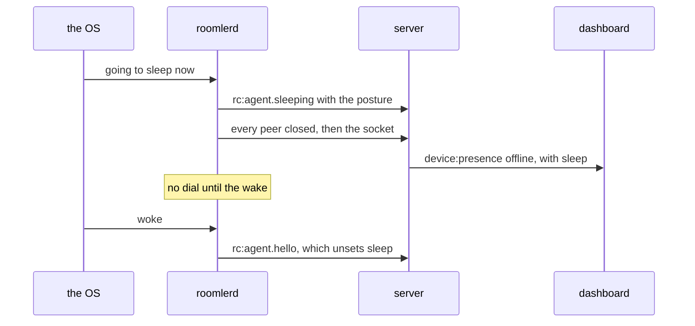

<!-- SPDX-License-Identifier: MPL-2.0 -->
# FR-55: A device stays reachable instead of quietly sleeping

**Status:** P0 measured, P1 + P2 shipped (`agent-v0.4.45` / `0.4.46`), P3 deferred on
evidence and then built under FR-97 P3b (2026-10-17, the last section), **P4 built in
[#3148](https://github.com/gjovanov/roomler-ai/pull/3148) (2026-10-30)**: a device going
to sleep says so first and reads *asleep* instead of *offline* (§P4 design),
**field-verified on Linux on the released `0.4.190`** (2026-10-31, field log), with the
same read owed on Windows and on a Mac;
P5 open — and ⚠️ **P2's AC-power arm FAILS in the field**: a Mac that
falls asleep on battery and is then plugged in stays asleep all night with our
assertion held (2026-09-24, field log). This line read "proposed" until then, with the
field log empty, while P0–P2 had shipped and been measured — the record below restores
that history. Tracking issue: [#1154](https://github.com/gjovanov/roomler-ai/issues/1154). Anchors verified against
master `40da643d`.

## Goal

An enrolled device is reachable when the operator needs it — mesh, remote desktop, SSH
and exec — instead of dropping off the fleet because the OS decided to sleep, with
nothing anywhere saying why.

Pillar 2's acceptance bar is *"just works"* on an unmanaged laptop as well as a managed
desktop. A device that is unreachable half the day does not meet it, and today **nothing
in the product has an opinion about power at all.**

## Field evidence

Reported by the operator on 2026-09-01 ("roomler going offline after a while"), then
measured on the MacBook.

**The machine really does sleep, on AC, with the lid open and closed:**

```
10:33:22  Entering Sleep state due to 'Idle Sleep':TCPKeepAlive=active Using AC (Charge:100%)
15:00:56  Entering Sleep state due to 'Clamshell Sleep':TCPKeepAlive=active Using AC (Charge:100%)
```

**Its idle timer is one minute** (`pmset -g`): `sleep 1`, `hibernatemode 3`, `standby 1`,
`disksleep 10`. Also `tcpkeepalive 1` and `womp 1` — both relevant below.

**Nothing we do holds it awake.** `pmset -g assertions` shows only `powerd` and
`WindowServer`. The single `roomlerd` mention is

```
pid 399(WindowServer): UserIsActive named:
  "com.apple.iohideventsystem.queue.tickle.nxevent service:IOHIDSystem pid:36743 process:roomlerd"
```

which is a **byproduct of injecting input during an active remote session**, not a
deliberate assertion. ⚠️ It therefore protects a session where someone is *typing*, and
not a view-only one — the case where an operator is watching a long build is exactly the
case that sleeps.

**And the codebase confirms it**: `IOPMAssertion`, `SetThreadExecutionState`,
`PowerCreateRequest` and `systemd-inhibit` have **zero** occurrences across
`agents/` and `crates/`.

## What is actually forced, and what is ours

Worth separating before designing, because one of these cannot be fixed:

| | forced by the OS | ours |
|---|---|---|
| A sleeping machine cannot serve a WS | ✅ | |
| macOS **clamshell** sleep ignores idle-sleep assertions on a laptop with no external display | ✅ | |
| Nothing asks the OS to stay awake | | ✅ |
| An active session does not hold an assertion | | ✅ |
| "Offline" and "asleep by policy" look identical to an operator | | ✅ |

So the honest framing is **two families of answer**, and a complete feature needs both:

1. **Do not sleep** — hold a power assertion while it matters.
2. **Wake it** — a mesh peer on the same L2 sends a magic packet. `womp 1` is already on
   here, and the overlay already knows which peers share a LAN.

Neither alone is sufficient: (1) cannot beat clamshell sleep or an operator who closes
the lid, and (2) needs a peer on the same segment.

## Key design

### Per-OS mechanism

- **macOS** — `IOPMAssertionCreateWithName`. Two candidate types, and they are not
  interchangeable: `kIOPMAssertionTypePreventUserIdleSystemSleep` (idle only) and
  `kIOPMAssertionTypeNetworkClientActive`, which exists precisely for "this machine is
  serving the network". ⚠️ Neither defeats **clamshell** sleep — that is an OS limit, and
  the feature must SAY so rather than appear not to work.
- **Windows** — `PowerCreateRequest` + `PowerSetRequest(PowerRequestSystemRequired)`, not
  `SetThreadExecutionState`: the latter is per-thread and unreliable from a service, which
  is exactly how `roomlerd` runs on a fleet host.
- **Linux** — logind `Inhibit()` over D-Bus (`what="sleep"`, `mode="block"`), holding the
  returned fd for as long as the inhibition should last. ⚠️ Headless servers rarely sleep,
  so this matters for desktops; and `mode=block` is a request a policy can override.

### Default OFF, and honest about it

⚠️ **Preventing sleep on a battery-powered laptop is user-hostile**, and a remote-access
tool that silently drains a battery deserves the reputation it gets. So:

- a device-owned config key, default **off** — the same last-word rule as `exec_enabled`
  and `ssh_enabled` (`docs/remote-config.md`);
- an obvious refinement to decide, not assume: **on AC only** as the middle setting;
- an **active session** should hold an assertion regardless of the standing policy — a
  session must not be cut by an idle timer. Today that happens by accident on macOS, and
  only while input flows.

### Say why the device is gone

⚠️ Today "offline" is one word covering *crashed*, *network died*, *powered off* and
*asleep by policy*, and each has a different fix. The device should report its power
policy and whether an assertion is currently held, so the dashboard can distinguish them.
This is the `Some([])` vs `None` lesson from the overlay ACL and `ssh_activity`'s
"empty ≠ inactive", recurring on a third surface — see FR-49, where five surfaces all
reported normally while a feature was dark.

## Phases

| P | Scope | Kill switch |
|---|---|---|
| P0 | **Measure first.** How often do fleet devices go offline, and does it correlate with sleep rather than crashes or network? Build nothing until the answer is known. | n/a |
| P1 | An **active rc/ssh session** holds an assertion, on all three OSes. Narrow, always-correct, no policy needed. | per-OS: assertion failure is logged and non-fatal |
| P2 | Standing policy `power_policy = never \| on-ac \| always`, default `never`, device-owned. macOS first. | the key itself; absent ⇒ today's behaviour |
| P3 | Windows + Linux implementations of the same policy. | as P2 |
| P4 | Report it: `roomler status` + the dashboard distinguish "asleep by policy" from "offline". **Built in #3148 (2026-10-30)**: the heartbeat's power posture, the `rc:agent.sleeping` goodbye from a hook on every OS, the server's record, and the *asleep* reading in `roomler status`, `roomler devices` and the dashboard (§P4 design). **Field-verified on Linux on the released `0.4.190` (2026-10-31)**; Windows and macOS owed (field log). | additive, read-only; `ROOMLERD_SLEEP_ANNOUNCE=0` turns off the goodbye and the reconnect hold |
| P5 | **Wake on LAN from a mesh peer** — an awake peer on the same L2 sends the magic packet on request. | server-side switch; off by default |

## P4 design — asleep, not offline (2026-10-30, #3148)

The full account is [`docs/power.md`](../power.md) §3. In short: the device reports its
power posture on every heartbeat, and says goodbye just before the OS sleeps it, so the
server marks it offline *with the reason* at once, instead of green until the receive
deadline and then a bare "offline".



| piece | where | what |
|---|---|---|
| the posture | `crates/remote_control/src/models.rs:2134` `PowerBrief`, on the heartbeat at `crates/remote_control/src/signaling.rs:704` | `policy`, `on_ac?`, `held`. `held: false` is "asleep by policy" (`by_policy`, `crates/remote_control/src/models.rs:2155`) |
| the hooks | `agents/roomlerd/src/sleep_notice.rs:569` (logind), `:708` (Windows), `:783` (IOKit) | they listen only and take nothing; bounded at 3.2 s on Linux and 1.5 s elsewhere, never blocking on the runtime (`agents/roomlerd/src/sleep_notice.rs:392` `will_sleep`) |
| the goodbye | `agents/roomlerd/src/signaling.rs:2029` | sends `rc:agent.sleeping`, closes every peer, then the socket. The run loop holds every dial until the wake (`agents/roomlerd/src/signaling.rs:1003`), 60 s at most (`agents/roomlerd/src/sleep_notice.rs:308`) |
| the record | `crates/modules/fleet/src/socket.rs:729`, `crates/services/src/dao/agent.rs:529` `record_sleep` | recorded first, then the ordinary teardown. Keyed by the hello's `conn_id`, so a displaced connection cannot mark a reconnected device asleep |
| the reading | `crates/remote_control/src/models.rs:2184` `SleepView::of` | a notice shows only on a device that is not online; the next hello unsets it (`crates/services/src/dao/agent.rs:517`) |
| the surfaces | `agents/roomler-cli/src/localclient.rs:2441` and `:3112`, `ui/src/utils/devicePresence.ts:90` | `roomler status`'s power line, `roomler devices`'s `asleep`, the dashboard's chip and its title |

Decided in the design review, before the code:

- **No wire gate.** A server that cannot decode an agent frame ignores it (pinned for
  #1886), and the agent closes its own socket right after, so an older server still sees
  a clean close.
- **The agent closes, and holds its next dial.** A dial inside the window the OS gives a
  computer to go to sleep would say hello again and erase the notice.
- **`never` stays byte-for-byte (AC3).** No hook takes an assertion, and on a `never`
  device the Linux delay inhibitor keeps FR-93 P5h's scope, live sessions only (open
  decision below).
- **Every hook has a hard bound**, so a goodbye that hangs never holds a laptop awake in
  a bag.
- **Peers see the fact, never the policy.** The agent-facing list carries `asleep_since`
  only (`crates/remote_control/src/models.rs:3543`): `power_policy` is a device setting,
  and settings are the fleet record.

The P4 anchors are verified against #3148's branch, on master `7e7a862ad`.

## Acceptance criteria

- [ ] P0 produces a number: what share of fleet offline-time is sleep, measured, not assumed.
- [ ] With a remote-desktop session open and **no input for 10 minutes**, the device does
      not sleep — on macOS, Windows and Linux.
- [ ] With `power_policy = never` (the default), behaviour is byte-for-byte today's: no
      assertion is taken, and `pmset -g assertions` / `powercfg /requests` show nothing
      from us.
- [ ] With `power_policy = on-ac`, a laptop on battery still sleeps and the same laptop on
      AC does not.
- [~] An operator looking at a device that is asleep by policy can tell that from the UI,
      without reading a log. *2026-10-31: proven on Linux, on the released `0.4.190`
      against production. Real suspends read `asleep` on the dashboard, in a peer's
      `roomler devices` and on the API, and the same device read plain `offline` when it
      lost its network instead (field log). Owed: the same read on Windows and on a Mac,
      whose hooks have not run in a field test. The box stays partial until they do: those
      are the devices that sleep. 2026-10-30, #3148: built and proven through the real
      server (`sleep_announce_tests`) and the real agent loop (`sleep_announce_agent`,
      shown failing first with the kill switch).*
- [~] ⚠️ The macOS **clamshell** limitation is documented in the UI where the policy is
      set — not discovered by a user whose lid-closed Mac still vanishes. *2026-10-30,
      #3148: the policy is set in two places, and both carry the key's ⚠️ clamshell
      sentence. The companion's settings row renders the description (`settings.js:350`),
      and `roomler config set power_policy` now prints the sentence on a Mac. A test pins
      the sentence in the description. Owed: the read of both on a Mac.*
- [ ] P5: a sleeping device on the same LAN as an awake peer can be woken from the
      dashboard, and the audit says who did it.
- [x] Docs: the keeper and P4's report are documented in [`docs/power.md`](../power.md)
      (mermaid, tables, `file:line` anchors) with a `docs/README.md` row, and
      `docs/api.md`, `docs/data-model.md` and `docs/real-time.md` carry `power`, `sleep`,
      `asleep_since` and `rc:agent.sleeping` (#3148, 2026-10-30).

## Open decisions

- Does the standing policy belong in `DesiredConfig` (server-pushable) or stay strictly
  device-owned? Pushing it means an org admin can drain an employee's battery; not
  pushing it means the last gate is again the one nobody can reach — the exact tension
  `docs/remote-config.md` resolves with `remote_config_enabled`.
- Is `NetworkClientActive` or `PreventUserIdleSystemSleep` the right macOS type? The
  former is semantically exact and may behave better with Power Nap; needs measuring.
  **Half-answered by measurement, 2026-09-24: `PreventUserIdleSystemSleep` is NOT
  sufficient.** It governs the idle timer during a *full*, user-driven wake and nothing
  else. It has no power over a system in a transient (dark / notification / maintenance)
  wake returning to sleep — and a Mac that dozed off on battery lives in exactly those
  wakes after it is plugged in. macOS logged ~59 such returns to sleep on AC in one night
  with our assertion held and confirmed present (field log). The replacement is still
  open and still has to be MEASURED, in the one scenario that failed:
  `NetworkClientActive`, or `PreventSystemSleep` (honoured only on AC, which is
  exactly `on-ac`'s semantics). ⚠️ Do not pick one from documentation — this module
  already chose once on "well understood" and it was wrong in the most ordinary case.
- Should an **exec** run hold an assertion? A 40-minute build kicked off by `roomler exec`
  has the same problem as a session, and the same answer is not obvious.
- **Should a `never` device on Linux hold the delay inhibitor while a control connection
  is live?** (P4, put to the operator 2026-10-30.) Today it does not. On a `never` device
  the inhibitor keeps FR-93 P5h's scope, live sessions only, so AC3 stays byte-for-byte
  and `systemd-inhibit --list` shows nothing new. The cost: logind does not wait for a
  `never` device's goodbye, so it goes out in whatever time the suspend leaves. Holding
  the inhibitor while any control connection is live would make that goodbye reliable,
  at the price of a Roomler delay inhibitor in `systemd-inhibit --list` on every Linux
  device, permanently. `on-ac` and `always` devices already hold it while a control
  connection is live. **Answered by the operator, 2026-10-30: no, live sessions only, as
  built.** Measured since (2026-10-31, field log): with no delay inhibitor on the host at
  all, the goodbye reached the server on all 4 suspends whose row was read. That is one
  idle VM, not a fleet rate.

## Out of scope

- Waking a device that is off (as opposed to asleep) — that is BIOS/AMT territory.
- Battery-life optimisation generally.
- Scheduled wake (`pmset repeat`), which is an operator's own configuration.

## Field-verification log

⚠️ This section read *"empty — P0 has not run"* until 2026-09-24, while P0 had been
measured and P1/P2 shipped and field-verified on 2026-09-01. The first two entries are
restored from #1154's comments, where that evidence had lived alone for three weeks.

### 2026-09-01 — P1 + P2 shipped in `agent-v0.4.45`, field-verified on the MacBook

Precondition asserted first: `git merge-base --is-ancestor c0287753 agent-v0.4.45`.

| # | arm | assertion | result |
|---|---|---|---|
| 1 | **control** — default policy | we hold nothing | ✅ 0 assertions |
| 2 | typo at set time | refused, not coerced | ✅ `power_policy must be one of never \| on-ac \| always (got "alwyas")` |
| 3 | `on-ac` on mains | held, by **policy** | ✅ `session_active=false` |
| 4 | flip to `never` | released | ✅ back to 0 |
| 5 | back to `on-ac` | held again | ✅ |

⚠️ **Every arm ran with the Mac already awake.** Row 3 proved we *take* the assertion
on AC; nothing proved the assertion *keeps the Mac awake* — see 2026-09-24.

### 2026-09-01 — P0 measured: the Linux fleet does not sleep, so P3 is deferred

`/sys/power/state` offers `freeze mem disk` on mars, jupiter and zeus, but `IdleAction`
is unset on all three, and uptimes were 6 weeks, 6 weeks and **25 weeks** — a host up
25 weeks has not been idle-suspending. P3 (logind `Inhibit()` over D-Bus) would put a
D-Bus stack into every Linux agent for no measured benefit. Deferred, not cancelled: the
case it exists for is a Linux *desktop*, which the fleet does not have.

Left open that day, needing a human: the **battery** arm, and a **session overriding
`never`**.

### 2026-09-24 — the battery arm passes; the AC arm FAILS

Found while field-verifying FR-43 P2c: the daemon row re-announced its capabilities
every 30–60 minutes overnight, each time right after WireGuard reported
`CONNECTION_EXPIRED(REJECT_AFTER_TIME * 3)` — nine silent minutes, i.e. the machine had
been asleep. The daemon's own log said it was holding the Mac awake the whole time.
macOS's power log (`pmset -g log`) is the surface that settles which is true.

**Battery arm — passes**, and needed no human after all: it happened on its own.

| evidence | source |
|---|---|
| 09-23 00:33:36 (+0300) `Entering Sleep state due to 'Idle Sleep' … Using Batt (Charge:76%)`, keeper **not** holding | `pmset -g log` |
| 09-24 18:28:30Z `power: released the device to sleep normally policy="on-ac"` | daemon log |
| afterwards: `Now drawing from 'Battery Power'`, `PreventSystemSleep 0`, **no** roomlerd assertion listed | `pmset -g batt` + `-g assertions` |

**AC arm — fails.** One night, second by second (`pmset` times are the Mac's `+0300`):

| time | event |
|---|---|
| 00:33:36 | `Idle Sleep`, **on battery** — correct under `on-ac` |
| 00:34:30 | `DarkWake to FullWake … due to Notification Using AC` — the charger goes in |
| 00:34:34 | keeper: `holding the device awake policy="on-ac" on_ac=Some(true) session_active=false`; macOS: `PID 72979(roomlerd) … PreventUserIdleSystemSleep "roomler: keeping this device reachable"` |
| 00:34:41 | `Notification Wake Back to Sleep` — **seven seconds later, assertion held** |
| 02:18:05 | the **same** assertion (`id 0x10000954c`) still present, age `01:43:30` |
| to 11:35 | no FullWake ever again; the Mac surfaces only in DarkWakes |

Inside the window the keeper logged as holding (00:34:34 → 11:41:30), macOS returned to
sleep **47 times — all 47 on AC**: 27 `Maintenance Sleep`, 18 `Sleep Service Back to
Sleep`, 2 `Notification Wake Back to Sleep`. **Zero** were `Idle Sleep`, and zero were
`Clamshell Sleep` — so this is **not** the documented lid limitation.

🔑 **Why it fails.** `PreventUserIdleSystemSleep` stops the *idle timer* during a full,
user-driven wake. It has no say over a system in a transient wake going back to sleep —
and a Mac that dozed off on battery is in exactly those wakes after it is plugged in.
So the assertion is real, present, and irrelevant, and the keeper's log line *"holding the
device awake"* is a claim about the device that the device contradicts.

The following day and night corroborate it from the daemon's side, more weakly: the
keeper logged one continuous hold from 09-23 08:52:50Z to 09-24 11:50:36Z, and inside it
the daemon re-announced its capabilities **49 times** — each one a fresh control
connection. The overnight ones I inspected follow the same sleep tell. `pmset` was not
pulled for that window, so it supports the finding rather than proving it a second time.

🔑🔑 **Why 2026-09-01 did not catch it.** Every arm began with the Mac awake, so it tested
whether we take the assertion, never whether the assertion keeps anyone reachable. The
scenario that matters most — lid open, battery flat by evening, plugged in at night — is
the one path the test could not enter. *A hold is not a wake.*

⚠️ **P1 (a session holds the machine) is not refuted by this**, and the reason is *when*
the assertion is taken, not how. A session can only begin while the Mac is reachable,
i.e. in a full wake — the one state where `PreventUserIdleSystemSleep` does its job. The
standing policy acquires on an AC *transition*, and plugging in a dozing laptop delivers
that transition during a transient wake, where the same assertion is inert. So the
failure is specific to P2 — the case with nobody connected, which is the case FR-55
exists for. (Not claimed: that a session is otherwise protected. Input injection tickles
`IOHIDSystem` only while someone is typing; a view-only session or an SSH session gets
nothing from it — see `power.rs`'s module doc.)

### 2026-10-17 — P3 built under FR-97 P3b: both reasons for the deferral are gone

The 2026-09-01 deferral rested on two facts, and neither holds any more.

- **D-Bus is already in every Linux agent.** `zbus` comes with `portal-capture`, which
  `full`, and so every shipped Linux build, now carries (FR-45, FR-93). The inhibitor adds
  no dependency.
- **The fleet has Linux desktops.** FR-93 put GNOME and KDE desktops in it, and a desktop
  idle-suspends, which is the case P3 exists for.

So P3 is built as designed above: logind `Inhibit()` with `mode="block"`, the fd held for as
long as the keeper wants the machine awake (`agents/roomlerd/src/power.rs`, the Linux
`imp`). It runs from a plain thread, because zbus's blocking API panics inside the tokio
runtime the keeper runs on. `what` is `sleep:idle` for a root daemon. A per-user daemon
runs outside every login session, where logind's polkit policy grants only `idle`
(`inhibit-block-sleep` is `allow_any=no`), so it takes `idle` and logs why. The design
and the field record are in FR-97 (`docs/fr/FR-97-os-feature-parity.md` §3.8, §8) and
`docs/remote-control.md` §5.1d.

### 2026-10-30 — P4 built (#3148): the server half and the agent loop proven, the real suspend owed

All of it ran on #3148's branch (on master `19a0eeca1`), against a throwaway MongoDB and
Redis:

| # | what | result |
|---|---|---|
| 1 | the server's half through the real socket, a scripted agent (`crates/tests/src/sleep_announce_tests.rs`, 2 tests) | ✅ 2/2. The goodbye ends the connection at once; the agent row, the devices grid and the `device:presence` row carry `sleep`; the next hello erases it; a displaced connection cannot write it |
| 2 | the REAL agent loop against a real server (`crates/tests/tests/sleep_announce_agent.rs`), told to sleep the way a hook tells it | ✅ 1/1 in 8.1 s. The agent logged its goodbye (`policy=on-ac held=false`), the server closed the socket as the goodbye, the dial waited, and `awake again: reconnecting` followed the wake 3 s later. After a stop the device read plain offline |
| 3 | row 2 with `ROOMLERD_SLEEP_ANNOUNCE=0`, the pre-P4 behaviour (the negative control) | ❌ as it must: `said=0`, the row stayed `status: online`, and the test failed at `asleep: not within 5s` |
| 4 | the composition baseline | moved by exactly two lines, `rc:agent.sleeping` and its owner `fleet`; re-recorded |
| 5 | the unit tests: `remote_control`, `fleet`, `localapi`, `roomlerd` `sleep_notice` + `power`, `roomler-cli` `devices_tests`, the UI's `devicePresence.spec.ts` | ✅ locally; CI on #3148 runs every lane |

Row 3 is the "shown failing first" this phase can show without sleeping anything: the
kill switch restores what the current deploy does, a device that says nothing.

Not proven yet:

- **No real suspend.** The three hooks (logind, `PowerRegisterSuspendResumeNotification`,
  IOKit) have run in no field test: rows 1 to 3 enter at `will_sleep`, one call below the
  hook. A throwaway VM that really suspends is the next read, and it waits on the
  operator's OK, because the rails forbid sleeping the dev box.
- **The macOS hook** is compiled only by CI's macOS lane.
- **A `never` device on Linux** sends its goodbye on a best-effort basis (the open
  decision above).

### 2026-10-31 — the real suspend, on production: RED on `0.4.188`, GREEN on the released `0.4.190`

The read the last section owed, for Linux. A throwaway vmtest guest (Ubuntu 24.04, a system
install, ephemeral, in the vmtest org, `power_policy` at its default, `never`) really
suspends: `systemctl suspend`, which is s2idle there. A key press wakes it; an RTC alarm does
not wake s2idle in this guest. Production's device row is read every 15 s as the vmtest
admin. For GREEN, a throwaway peer in the same org reads `roomler devices`, and a real browser
stays open on the devices grid across the suspend. GREEN installs the published `.deb`
(sidecar hash matched, good signature from the release key), the first release carrying P4,
against production's `hosted-20261031-28dfd72`.

| # | the guest | what production read | result |
|---|---|---|---|
| RED | the released `0.4.188`, before P4 (2026-10-30) | The daemon logged `viewers told (FR-93 P5h) sessions=0 told=0` and said nothing to the server; `PM: suspend entry (s2idle)` followed 1 s later. The row read `online` for 1 min 46 s, with `last_seen_at` frozen at the last heartbeat, then a bare `offline`: no `sleep`, no reason. After the wake it read `online` again within a second of the hello | ❌ as it must: "offline" for a computer that is only asleep |
| GREEN 1 | the released `0.4.190`, asleep 79 s | `saying goodbye to the server … policy=never on_ac=None held=false` and `connections=1 said=1` at 18:01:16.919, the second of `PM: suspend entry`. The server's `sleep.since` is 18:01:16.925: `presence: offline` with `sleep { policy: never, held: false }` on `/device` and `/agent`. The peer read `◌ … asleep`. The open grid's chip turned `asleep` by itself within 3 s, with no reload, and a fresh load agreed. A tap on it showed: *Asleep since 10/31/2026, 6:01:16 PM, as its power policy allows: nothing was holding it awake (power policy “never”). It reconnects by itself when it wakes. To keep it reachable, set power_policy to on-ac or always on the device.* Hello 1 s after the wake, `sleep` gone, `online` on all three | ✅ |
| GREEN 2 | the same, asleep 35 s | the same reads, and `awake again: reconnecting (FR-55 P4)` at the wake; hello 1 s later | ✅ |
| GREEN 3 | the same, asleep 20 s | the same reads, the same line; hello 1 s later | ✅ |
| CONTROL | the same device and build, its virtual link taken down: no OS notice, and nothing it says gets out | `online` for 1 min 41 s, until the server's 2:00 receive deadline after the last heartbeat, then `offline` with `sleep: null`. The chip read `offline` and the peer `○ … offline`, never `asleep`. `online` within 2 s of the link coming back | ✅ as it must: a device that gave no reason still reads `offline` |
| HEADLESS | the same build, rebooted to `multi-user.target` with `gdm`, `upower`, `NetworkManager` and `ModemManager` gone. `systemd-inhibit --list` reads `No inhibitors.`, and the same list does show a test inhibitor | 7 suspends, 7 `said=1`, 7 hellos after the wakes. The server's answer was read on 4 of them, twice on the API and twice in the peer's list, and all 4 arrived as `asleep`. The other 3 went unread because the rig's own polling hit a rate limit, and `said=1` says only that the frame was written | ✅ 4 of 4 read |

RED to GREEN: 1 min 46 s of a false `online` followed by a reason-free `offline` became an
`asleep` that names its reason within seconds. The CONTROL is what makes that a distinction
and not a new word for every drop: the same device reads differently for the two causes.
`roomler status` on the guest read `policy never — free to sleep (a sleep reads "asleep" in
the device lists)` on the released build.

HEADLESS matters for the open decision on the Linux inhibitor. The desktop guest's own delay
inhibitors (GNOME, UPower, NetworkManager, ModemManager) hold the suspend back for everyone,
the goodbye included. With none of them, the goodbye had only the time logind leaves it, and
it still arrived every time it was read. That is one idle VM, not a fleet rate: a loaded host
could still lose the race.

Dead ends, kept so nobody repeats them:

- **`virsh suspend` is no control on the lab host.** Its VM watchdog un-paused the domain
  after 83 s, before the 2:00 deadline, so the row never left `online`. That run is not a
  result. `virsh domif-setlink` replaced it.
- **Stopping `gdm` on the running guest was the wrong way to go headless.** Logins then hung
  for minutes and `systemd-inhibit --list` printed nothing, while the daemon stayed online.
  That empty list meant nothing. A real headless boot replaced it, and a hard reset needs a
  `sync` first: the first try lost its `set-default` to the reset 1 s later.
- **A read of `power` on `/device` always says `null`.** That route carries `sleep` and no
  `power`, by design; `/agent` has both. It looked like a missing posture until the right
  route read `{ policy: never, held: false }`.
- **A read filtering on `presence == asleep` finds nothing, whatever the fleet is doing.**
  `presence` stays `offline`; asleep is the `sleep` field (`docs/power.md` §3.4).

What the run showed that nobody had asked:

- **The hold can end before the wake.** GREEN 1 logged `no wake reported within the hold:
  reconnecting anyway` 40 ms before logind's wake. The monotonic clock kept running through
  this guest's s2idle, so a 79 s sleep used up the 60 s hold. Both paths reconnect; the `WARN`
  is harmless here, and `docs/power.md` §3.5 now says so.
- **Where a sleeping device still reads like an offline one:** the sidebar's grey dot, the
  dialogs for a queued action, and the remote page's `agent_offline` message, which says to
  check that the device is powered on. Each is true as far as it goes. None says why; the
  grid does. The last two are read from the code, not from a live session.

Still owed:

- **Windows and macOS.** `PowerRegisterSuspendResumeNotification` and the IOKit hook have run
  in no field test, and laptops on those two systems are the devices that sleep. Putting one
  on `0.4.190` or newer to sleep and reading the grid is the whole test. AC5 stays partial
  until then.
