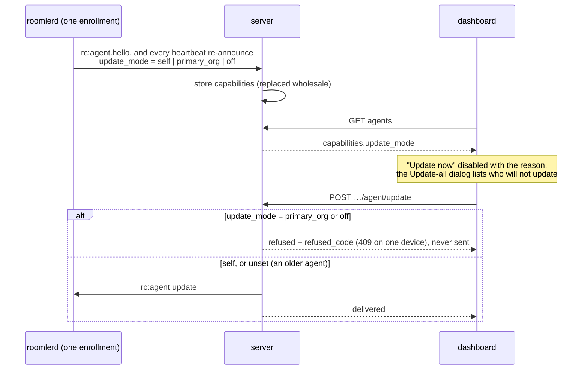

# FR-67 — An update's outcome is written, and nothing ever reads it

**Issue:** [#1267](https://github.com/gjovanov/roomler-ai/issues/1267) · **Status:** in progress (P1, P2, P7 shipped; P7 field-verified on 0.4.146) · **Found:** field-testing `agent-v0.4.48`, 2026-09-02

## Goal

Make "did this update succeed?" answerable — on the device, and across the fleet.
Today the question has an answer computed for it, and that answer is thrown away.

## The evidence

`roomlerd` already computes a verdict for every install: `InstallStatus` is a
five-state enum (`InProgress | SucceededVerified | SucceededUnverified |
InstallerFailed | Timeout`, `post_install.rs:125-146`) persisted to
`<log_dir>/last-install.json` (`post_install.rs:161`).

Measured on the fleet:

| host | record written | for | status |
|---|---|---|---|
| cluster node (Ubuntu 24.04) | **2026-08-29** | `agent-v0.4.16` | `InProgress` |
| aarch64 (Fedora/Asahi) | 2026-09-02 14:08:28 | `agent-v0.4.50` | `InProgress` |

The first row is the striking one: that host has since reached 0.4.50 — dozens of
updates, and not one recorded an outcome.

## Root cause — two independent defects, and the first one is not the cgroup

**1. The watcher waits for its own parent to die, and that death is what kills it.**

`install_tarball_linux` completes the entire install **synchronously** and returns
`Ok(std::process::id())` — *the daemon's own pid* (`updater.rs:2207`). That pid is
handed to the watcher as `--installer-pid`, and `watch()` calls
`wait_for_pid(installer_pid, INSTALLER_BUDGET)` unconditionally
(`post_install.rs:221`), polling `kill(pid, 0)` for up to 600 s
(`post_install.rs:654-679`).

So the watcher's only exit condition is the daemon's exit — while the daemon's
exit is precisely what tears down the cgroup and kills the watcher. There is
nothing being waited *for*: the install finished before the watcher existed. The
`.deb` path has the same shape — `run_linux_install_candidates` calls
`child.wait()` and returns an already-exited pid.

**2. The cgroup teardown then removes any chance of finishing.** Both packaged
units ship with no `KillMode` (`packaging/linux/roomlerd.service`,
`roomler.service`) ⇒ systemd's default `control-group`. `spawn_watcher` launches
the watcher as a plain child (`updater.rs:2573`) on the reasoning that it "is
reparented to init and runs to completion on its own" — but reparenting to PID 1
does not leave the cgroup. `docs/fr/FR-36-wayland-capture.md:371` already recorded
this exact lesson for a different subsystem.

⚠️ **The original diagnosis in #1239 named only (2).** (1) is the more important
half: with the wait removed, the watcher finishes in ~2 s and the cgroup race is
mostly moot. Fixing (2) alone would be building a systemd mechanism to support a
wait that should not exist.

**3. Nothing reads the verdict, on any platform.** `post_install::read_outcome()`
(`post_install.rs:175`) has **zero callers**. The module doc's claim that "the new
binary reads `last-install.json` at startup to surface the outcome"
(`post_install.rs:80-81`, echoed at `:10`, `:110`, `docs/remote-control.md:1256`)
was never wired. So even on Windows — where the staged watcher does produce a
verdict — nothing surfaces it.

**4. The server never learns.** No wire message carries an install outcome. The
server infers success only from a changed `agent_version` on the next hello, which
cannot distinguish *failed*, *rolled back*, and *hasn't polled yet*.

## Key design

**Stop waiting for an installer that has already finished.** That is the whole of
P1, and it needs no systemd, no new process supervision, and no new failure modes.
With the wait gone the watcher's life is: write `InProgress` → settle 2 s → run
`<origin-exe> --version` → write the terminal record.

⚠️ **This is a race, not a guarantee**, and the spec should say so rather than
claim a fix it does not deliver: if the daemon's teardown completes in under ~2 s,
the cgroup kill still lands mid-probe. **P6** closes that, and is deliberately
gated on measuring that the race is actually being lost.

### Why not go straight to a systemd transient unit

It was the first design, and it was refuted:

- **The safety premise is false as stated.** "Any `systemd-run` failure falls back
  to today's spawn" holds for `Command::spawn` failing, but `systemd-run` exits **0**
  once the start job is *enqueued* — an `execve` failure (ENOENT, an LSM denial)
  surfaces asynchronously as a failed unit, and `--collect` then garbage-collects
  it. The daemon would believe it launched a watcher that never ran. `--service-type=exec`
  is what makes the premise true, and it is therefore load-bearing, not a nicety.
- **It pays exit-path risk for a forensic-only payoff** (nothing gates on this
  file — see 3), and `.output()` with no timeout on the daemon's exit path is a
  genuine fleet-freeze mode.
- **The config kill switch is inert against that mode**: config changes are
  `restart_required` (`docs/remote-config.md:215-229`), and the failure being
  guarded blocks the very exit a restart needs.
- **It would create a failure mode that cannot exist today**: with the watcher
  surviving, PID reuse on the daemon's freed pid makes `kill(pid,0)` keep
  succeeding ⇒ a false `Timeout` on a healthy install. Removing the wait makes
  this unreachable.

### What must NOT change

- **Windows keeps its wait.** The MSI installer is genuinely asynchronous and the
  wedge-recovery path (`recover_wedged_install`) depends on it.
- The pid stays in the record for forensics; only the *wait* changes.

### P7 — an update the device was never going to act on

Found 2026-10-19. The operator's **Update all** "updated" a two-org device three
times, and its journal logged `rc:agent.update ignored — only the primary
enrollment drives the machine-wide self-updater` three times. The dashboard's org
was the device's **secondary** enrollment. A device also drops the push when its
auto-update is off (#1689). Both refusals showed up only on the device (a WARN and
a LocalAPI counter). The frame had reached the socket, so the server counted it
`delivered`. That adds a fourth case to *failed*, *rolled back* and *hasn't polled
yet*, and no version check can tell it apart from them.

| Piece | Where |
|---|---|
| The word, per connection | `AgentCaps::update_mode` (`crates/remote_control/src/models.rs:353`); `UpdateRefusal` and `update_refusal()` (`:562`, `:1361`) |
| Computed from the two facts the `UpdateNow` arm checks (`agents/roomlerd/src/signaling.rs:4719`) | `updater::update_mode` (`agents/roomlerd/src/updater.rs:2983`): `primary_org` on a secondary enrollment, `off` when no trigger is installed (`:2966`), else `self` |
| Stamped at **every** announcement | `stub_caps` (`signaling.rs:6842`, `:6855`) |
| Refused up front | `device_refusal` (`crates/modules/fleet/src/agent.rs:1427`): a 409 on one device (`:1474`), a `refused` row with its `refused_code` in a bulk (`:1606`) |
| Shown before the click | `ui/src/utils/updateRefusal.ts`; `AgentsSection.vue` disables "Update now" with the reason and lists those devices in the Update-all dialog |

> [!WARNING]
> **Stamped in `stub_caps`, not in the hello alone.** A heartbeat that
> re-announces changed caps (a login, a policy flip) *replaces* the stored blob
> (`AgentDao::update_capabilities`). A hello-only word would be erased at the
> device's first login, and the dashboard would count refused pushes as delivered
> again. The first draft had exactly that hole.

- ⚠️ **Unset means unknown, never a refusal.** No agent before P7 sends the word.
  An unrecognised word from a newer agent is ignored the same way. In both cases
  the push goes out as before.
- ⚠️ **`force` does not override it.** `force` overrides the server's own FR-2
  downgrade guard. The device ignores or drops the frame whatever the server sends.
- ⚠️ The codes are a compatibility surface with every dashboard: `primary_org`,
  `auto_update_off`, and FR-2's `pin_downgrade`.

## Phases

| # | Phase | Kill switch | Status |
|---|-------|-------------|--------|
| P1 | Stop waiting on a synchronously-completed install (Linux) | revert = today's unconditional wait | **shipped (#1400)** — field verification pending a release |
| P2 | Recover a `(deleted)` exe path + refuse a non-existent watcher binary + log the anyhow chain | revert = today's ENOENT | **shipped (#1427)** — ⚠️ NOT the guard it was scoped as: this is the whole reason the `.deb` path had no watcher |
| P3 | Read the verdict: startup log + `NodeStatus` + `roomler status` | pure addition; revert = today's silence | proposed |
| P4 | macOS `AbandonProcessGroup` — **`com.roomler.update.plist`** is the job that matters (`update-helper` is that LaunchDaemon's body and is where `installer -pkg` is spawned) | packaging-only revert | proposed — see the note below |
| P5 | Fleet answer: report the outcome to the server and show it | render-only; absent field ⇒ today's blank | proposed |
| P6 | Transient systemd unit — **only if P1 leaves a measurable race** | `update_watcher_escape_cgroup`, default OFF | deferred, evidence-gated |
| P7 | The dashboard is told which devices will not act on an update ordered from it, and why: `update_mode` in the caps, refused up front with a `refused_code`, marked before the click | revert = today's blind push; an agent without the word is pushed as before | **shipped (#2545)** · field-verified on 0.4.146 + `hosted-20261019-e46da07` |

## Acceptance criteria

- [ ] On a systemd host, a **real auto-update** leaves `last-install.json` in a
      terminal status. ⚠️ Show it is `InProgress` on the current release first — a
      pass proves nothing without the failing "before"
- [ ] ⚠️ Verified on the **auto-update** path, not a manual foreground
      `roomlerd self-update` — that reaches a verdict today and hides the bug
- [ ] A non-`SucceededVerified` outcome is visible without SSH: in the daemon's
      startup log and in `roomler status`
- [ ] **absent** (no install yet) and **`InProgress`** (an install that never
      reported) stay distinguishable — collapsing them recreates this bug one
      layer up
- [x] The `.deb` path is confirmed to spawn a watcher at all — **it did not,
      and the hypothesis was right.** 21 `post-install watcher spawn failed` in
      seven days against **zero** `post-install watcher started` (P2, #1427)
- [ ] A fleet query answers "did this update succeed on each host" without SSH
- [ ] Windows behaviour is byte-for-byte unchanged
- [x] **P7**: an update ordered from a device's **secondary** org is refused with
      `primary_org` and the way out, and never counted delivered. ⚠️ The "before"
      is recorded: on 2026-10-19 the bulk route counted it delivered (field log)
- [x] **P7**: a device with auto-update off is refused with `auto_update_off`
- [x] **P7**: an agent that predates P7 is pushed exactly as before
- [x] **P7**: the word survives a heartbeat re-announce: after a login on the
      device, its row still carries `update_mode` (field-verified with a live
      config flip as the re-announce, not a login; see the field log)

## Out of scope

- A Unix `ensure_service_running` equivalent (`post_install.rs:467`). Windows needs
  it because the SCM does not auto-restart; Linux has `Restart=always` +
  `RestartPreventExitStatus=7 8`, and a watcher running `systemctl start` would
  fight the supervisor.
- Making `write_outcome` atomic — real, but a different failure mode from "never
  written".
- The FR-56 residuals; they stay as acceptance criteria on #1157.

## Open decisions

- **P5 shape**: an additive `#[serde(default)]` field on `ClientMsg::AgentHello`
  (matching `advertised_routes`) versus a dedicated report message. Hello is
  simpler; a message reports without waiting for a reconnect.
- **P6 at all?** Decide from P1's field data, not in the abstract.

## Field-verification log

| Date | What | Result |
|---|---|---|
| 2026-09-02 | Found while field-testing `agent-v0.4.48` | `last-install.json` stuck at `InProgress` on two hosts, one since 2026-08-29 for `agent-v0.4.16` while running 0.4.50 |
| 2026-09-02 | Preconditions measured on two distros | `systemd-run` present and `INVOCATION_ID` set in the unit process on both (Fedora/systemd 257, Ubuntu/systemd 255); `KillMode=control-group` on both |
| 2026-09-02 | ⚠️ Measurement hazard | `pgrep -x roomlerd` matched a **container's** process on a host running containerised test nodes (cgroup `/system.slice/docker-….scope`). A first reading wrongly showed `INVOCATION_ID` absent on Ubuntu. Probe `systemctl show roomlerd -p MainPID` instead |
| 2026-09-02 | ⛔ First design refuted before implementation | A systemd transient unit was the initial P1. Adversarial review found its safety premise false without `--service-type=exec`, its kill switch inert against the mode it guards, and that it would *create* a PID-reuse false-`Timeout` mode. The real defect is the self-pid wait (`updater.rs:1577` + `post_install.rs:221`) — removing it needs no systemd at all |
| 2026-10-19 | ❌ P7's "before", on the fleet | The operator's **Update all** counted a two-org aarch64 device (Fedora/Asahi) as pushed three times. Its journal logged `rc:agent.update ignored — only the primary enrollment drives the machine-wide self-updater` three times: the dashboard's org was its secondary enrollment. That day's remedy was `roomlerd org set-primary` on the device, which exposed #2540 (both meshes off; fixed in #2541) |
| 2026-10-19 | ❌ The "before" on a cell | A kept vmtest Ubuntu cell in two orgs, on 0.4.145 and the then-prod server `hosted-20261019-dd59ede`. A push to its secondary org's row: `HTTP 200 {"delivered":true}`, and in the same second the device logged `rc:agent.update ignored … ignored_total=1` |
| 2026-10-19 | ✅ **P7 field-verified on 0.4.146** | Server `hosted-20261019-e46da07`, candidate run 39331259421 (its `.deb` byte-identical to the published one). AC1: a push from the secondary org → `HTTP 409` naming `roomlerd org set-primary`, and 0 `rc:agent.update` lines on the device. AC2: `auto_update false` → row `update_mode=off` → `HTTP 409` (`auto_update_off`). AC3: a 0.4.145 agent (no word) → `HTTP 200 delivered`, as before. AC4: a live `keep_busy_enabled` flip made both connections re-announce their caps (`announcing changed capabilities on the heartbeat`), and both rows still carried the word. A lock/unlock first changed no caps, so it re-announced nothing and is not counted. A Win11 SYSTEM install laid over 0.4.145 reads `update_mode=self` |
| 2026-10-19 | ✅ **The field case itself, on the release** | The two-org aarch64 device from the top of this log, updated to 0.4.146 by its own updater (`.asc` verified against the pinned key; `post-install verdict: SucceededVerified`). Its secondary org's row now reads `update_mode=primary_org`, and a push from that org gets `HTTP 409` with the way out. Earlier the same day the same click was counted delivered three times while the device ignored it |

## P4 — scoped, and one question left before it is safe to write

Verified: **no** plist in `agents/roomlerd/packaging/macos/` sets
`AbandonProcessGroup`, so it defaults to false and launchd reaps the job's
remaining process group when the job exits — the same bug class as the systemd
cgroup teardown.

macOS is also the platform where it matters most, because it is the one where the
installer genuinely IS asynchronous: `installer -pkg` is `.spawn()`ed and returns
a live pid, so **P1 does not help there** — the watcher must actually wait, and
therefore must actually survive.

The job to fix is **`com.roomler.update`**, whose body is `roomlerd update-helper`
(`main.rs`, `Command::UpdateHelper`) — that is where the install runs.
`com.roomler.daemon` may need it too if the daemon ever spawns an installer
directly rather than delegating to the helper.

⚠️ Deliberately not written yet: `AbandonProcessGroup=true` stops launchd reaping
**every** remaining child, not just the watcher, and FR-41 already records a
grandchild holding a unit open. The open question is whether `update-helper`
exits immediately after spawning `installer(8)` — if so the key is exactly right;
if it waits, the reap window may not exist and the key would be loosening
shutdown for nothing. That wants checking on a real Mac (there is one on the
mesh) before a packaging change lands.

## Field-verification log — P1

| Date | What | Result |
|---|---|---|
| 2026-09-05 | The failing **"before"**, three hosts, prior to any fix | all `InProgress`: two stuck on `agent-v0.4.16` (written 2026-08-29) and one on `agent-v0.4.13` (2026-08-28), while all three were running **0.4.70**. ~54 releases, not one recorded outcome |
| 2026-09-05 | P2's `(deleted)` check | **INCONCLUSIVE, not negative** — `readlink /proc/<MainPID>/exe` is clean on all three, but the suffix can only exist between a `.deb` install and the next restart, and all three had restarted since. Needs running inside that window |
| 2026-09-05 | ⚠️ Probe hygiene | measured via `systemctl show roomlerd -p MainPID`, never `pgrep -x roomlerd` — the latter matches containerised test nodes and already produced one wrong reading in this FR |
| 2026-09-06 | ✅ **P2's question answered — and it inverts P1's evidence** | The `.deb` path has **never** had a watcher. On a cluster node: **21** `post-install watcher spawn failed` in 7 days, **0** `post-install watcher started`, `last-install.json` untouched since 2026-08-29 while the host moved 0.4.16 → 0.4.73. `apt` replaces `/usr/bin/roomlerd`, unlinking the running image, so `current_exe()` reads `…(deleted)` and `Command::spawn` fails ENOENT. 🔑 The code asserted the opposite — *"Unix package managers replace files without stopping readers, so the in-place spawn stays correct there"* — and replacing the file is exactly what breaks it. ⚠️ **This corrects what P1's "before" evidence meant**: the frozen `InProgress` records were read as the cgroup killing the watcher; on this path there was no watcher to kill. P1 still fixes the *tarball* path, where the watcher does start. |
| 2026-09-06 | ⚠️ Why it hid for months | the failure surfaced as a single context-less `WARN` — `%e` on an `anyhow::Error` prints only the outermost context (*"spawning post-install-watch subprocess"*) and drops the ENOENT that explains it. P2 logs the chain (`{:#}`). A diagnostic that cannot say *why* is how 21 consecutive failures read as noise. |
| 2026-09-06 | ⏳ P1 field verification still open | P1 is in released 0.4.72/73/74 and the fleet is on 0.4.73, but every host checked takes the `.deb` path — where P2 had to land first for a watcher to exist at all. Re-verify on a **tarball** host, or on any host once P2 ships. |
