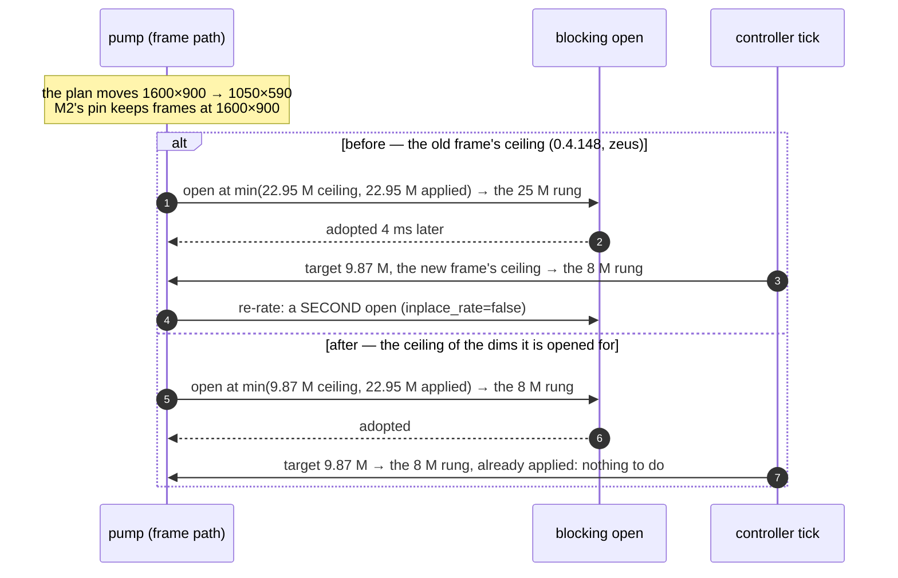

# FR-70 — The media pipeline leaves the runtime

**Issue:** [#1330](https://github.com/gjovanov/roomler-ai/issues/1330) · **Status:** proposed 2026-09-04 ·
**Plan:** [`media-pipeline-architecture`](../plans/media-pipeline-architecture.md)

## Goal

Make the remote-desktop media path a **dedicated thread per session** that reads
an immutable plan and never awaits, so that the 34 rate/quality heuristics, 8
estimators and 11 kill switches in `encode/` become unnecessary rather than
better-tuned — and delete them as the acceptance criterion.

Operator's framing, which is the requirement: *"no sync processes
(thread-offloaded) for relay-based connections, start and on-going, and reduce
the patch-work to minimum."*

## Why now — five field findings, five different causes, one symptom

Measured 2026-09-04 across CORPLAP-1/-2/-3. Full detail and log excerpts in the
plan; the short form:

1. **The encoder open blocks every session's first frames** — `open_ms` 292–957 ms,
   every session, every host. The session has *no encoder at all* while it runs.
2. **Five regions between the loop top and capture were untimed** — `other_ms`
   157–782 ms, including passes with capture *and* encode both zero. Named in
   #1327.
3. **CORPLAP-3 is encode-bound** — single frames at 221–502 ms.
4. 🚨 **The worst excursion is TRANSPORT** — a 4903 ms paint with a 1485-byte send
   queue, 28 ms iterations and a 5.6–8.5 Mbps link: a DERP/TCP head-of-line
   block, invisible to every pipeline instrument.
5. 🚨🚨 **A remembered rate held a session at the 200 kbps floor for four
   minutes, overrode an explicit `Native` resolution choice, and reported
   success** — session `6a9abc30`, CORPLAP-1 → neo16 over the overlay pair
   (host↔host on the mesh, DERP underneath the corp VPN): `slow_link_floor_bps=
   Some(200000)` and `goodput_bps=None` in every window, zero send stalls, zero
   viewer-congested windows, paint age 55–108 ms, the target sawing
   `200k → 225k → 253k → 285k → 200k` on repeat, resolution forced to 1280×800
   at 15 fps. 0.013 bits/pixel; the operator sees blurred text. ⚠️ The plan's
   first reading of this line — `lc=170000`, a learned *ceiling* below the
   floor — was **wrong**: the FR-35 learner can only ever LIFT a ceiling above
   the plan's and was inert. The pin is the rate MEMORY, entering through
   three doors, the third of which seals the other two — see "P1 — as built".

🔑 **One symptom, five causes.** That is how the patch-work accumulated: every
excursion arrives looking like a pipeline problem because `viewer_age_ms` fuses
sender, transit and viewer latency into one number.

## Key design

Three planes, one owner each, no synchronous coupling — see the plan for the
full statement.

- **Media plane** — one dedicated OS thread per session owning capture → scale →
  encode. Never awaits. ⚠️ A thread, **not** per-frame `spawn_blocking`: MF needs
  per-thread COM/`MFStartup` and QSV sessions are thread-affine, so an arbitrary
  pool thread can break hardware encode outright. 🔑 Capture already has exactly
  this shape and is the one stage that measured clean.
- **Transport plane** — the send task plus arrival telemetry that **splits**
  produced-too-much / transit-stalled / viewer-side. Finding 4 is unattributable
  without it.
- **Control plane** — signalling, stats reads, policy, one controller. It
  *publishes* a plan; it never reaches into the media loop.

**The invariant:** the media thread never makes a rate or geometry decision, it
reads a plan. Adoption is cheap because a replacement encoder is built on that
same thread while the current one keeps producing (make-before-break), which is
impossible today because the open is an await point in the frame path.

**Two rules the control plane owes**, both broken by finding 5: a prior may open
a session but never pin one; an explicit operator choice is never silently
overridden.

## Phases

`M0` measurement → `M1` media thread → `M2` make-before-break → `M3` plan handoff (**designed 2026-09-08**, §"M3 — the plan handoff, as designed"; **M3a — the plan in SHADOW — built 2026-10-18**, §"M3a — as built"; **M3a.1 — stale replacements counted apart, and the shadow's first genuine finding (a dims replacement opened at the old frame's rate), 2026-10-21**, §"M3a.1"; **M3a.2 — that replacement opens at the ceiling of its own dims, 2026-10-21**, §"M3a.2"; M3b not built)
→ `M4` one controller (FR-63 B1/B2) → `M5` the deletions (FR-62 A4 + FR-63 B3) ·
~~`T1` transport classification~~ (→ **FR-71 #1362**, 2026-09-05) · `P1` priors decay + visible overrides.

⚠️ **P1 first in value**: it is what the operator can see today and needs no
threading work. **P1 landed 2026-09-04 in #1333** (kill switch `rate_prior_decay`) — see
"P1 — as built" below. ⚠️ **M5 is the acceptance criterion**, not an
afterthought — if the deletions do not happen this is one more lever and the
complaint stands.

**M0's last item — the age split — landed 2026-09-04.** The viewer's decode
workers now stamp every frame's ARRIVAL (last chunk in the worker) beside its
paint, and `rc:decodestat` carries the window's arrival age as an optional
`arr_ms` beside `age_ms` (same clock mapping, so it rides only alongside it;
floored at 1 because 0 is the agent's absent sentinel). The agent packs it into
the spare `u16` of the age word (`viewer_rate::pack_age_with_arrival`) and the
heartbeat prints one field:

```
age_split=Some(AgeSplit { sender_ms: Some(12.3), transit_ms: 4878, viewer_ms: 13 })
```

`viewer_ms` = paint − arrival (decode queue + decode + paint, inside the
browser); `sender_ms` = this window's send-queue wait (`send_wait_avg_ms`,
enqueue → wire-complete — `None` on the VP9-444 pump, which keeps no such
figure, so its `transit_ms` is an upper bound); `transit_ms` = arrival − sender,
everything between the wire and the worker, the relay included. Finding 4 reads
as `transit_ms ≈ 4.9 s` with `viewer_ms` and `sender_ms` in the tens of ms —
attributable without reading source, which was M0's gate. `None` from a pre-M0
viewer, or a window with no age report. ⚠️ Telemetry only: no loop reads it
yet — acting on it (a transit stall must not cut the rate) is T1, and the diag
HUD does not render the two new `HopWindow`s yet.

## M1 — the encoder thread, as designed (2026-09-05)

Anchors verified against master `b4d12871`.

**What the pump is today.** `media_pump_ffmpeg_dc` (`agents/roomlerd/src/peer.rs:4712–7506`,
27 await points) runs on a tokio worker and does everything in one loop: the
budget gate and rate applies (`:5763`, `:6639`, `:6677`, `:6740`, `:6991`), pacing
(`:5799`), capture (`:5813`, already a handoff to capture's own thread), the
encoder open (`:6237`, a `spawn_blocking` since FR-65), keyframe requests
(`:6326`, `:6339`, `:6348`, `:6976`), the background rebuild's adoption
(`:5410`, `adopt_rebuilt`), **the encode itself as
`tokio::task::block_in_place(|| enc.encode_sync(&frame))` (`:6759`)**, and the
hand-off to the dedicated send task (`:6892`). Scaling is inside the encoder
(`encode/ffmpeg/encoder.rs`), not a stage of the loop. The encoder is therefore
driven from whichever worker thread the pump task happens to be polled on, held
there by `block_in_place`, and every `enc.*` call is a direct method call from
the decision that wanted it.

**M1's shape: the encoder gets a thread, the decisions stay where they are.**
`encode::thread::EncoderThread` owns the `VideoEncoder` on one dedicated OS
thread per session (named `rc-enc-<session>`; MF/COM and QSV affinity satisfied
by construction) and serves a bounded command channel:

| command | reply | replaces |
|---|---|---|
| `Encode(Arc<Frame>)` | `Result<Vec<EncodedPacket>>` over a oneshot | `block_in_place(encode_sync)` `:6759` |
| `SetBitrate(bps)` | none (fire-and-forget, in order) | the five `set_bitrate` sites |
| `RequestKeyframe` | none | the four `request_keyframe` sites |
| `Adopt(RebuiltEncoder)` | `bool` | `adopt_rebuilt` `:5410` |
| `Open(params)` / `Reopen(params)` | `Result<()>` | the `spawn_blocking` open `:6237` — the open happens ON the encoder thread, so M2's replacement encoder is built there too |
| `Probe` (name, `supports_dynamic_bitrate`, `reconfig_forces_idr`) | a cached `EncoderCaps` snapshot | the `enc.name()` / capability reads (`:6266`, `:6629`, `:7190`) |

The pump loop keeps its structure and every decision site; the only change at
each site is that a method call becomes a send. `Encode` is awaited (the loop
still consumes one frame at a time — cadence, pacing and the budget gate are
unchanged), which is why M1 changes NO behaviour: the same frame, the same
decision, the same packet, one thread hop later (~10 µs, measured before
merge). The worker thread is never blocked again, so every other task on the
runtime (signalling, the send task, the heartbeats, the control DC) stops
sharing a thread with a 5–30 ms encode.

**Kill switch** `media_thread` (config tribool + `ROOMLERD_MEDIA_THREAD`),
**default OFF for one release**: off = today's `block_in_place` loop verbatim.
Both paths share one `EncoderHandle` enum so the pump has exactly one call
site per operation and the switch is a constructor choice, not a second loop.

**Split.** M1a — the thread, the command channel and the switch, with the
pump otherwise untouched; the B0 simulator is not involved (nothing about rate
changes). M1b — the VP9-444 pump on the same handle. M1c — the measurement on
all three CORPLAP hosts after a release with the switch on: `iter_ms_max`,
`pump_stalls`, `apply_ms_max` (FR-65's counters) and the age split, against
the same session shape with the switch off — **the gate is "unchanged or
better", and a regression on any host keeps the default off**.

**Status.** M1a built 2026-09-05 ([#1375](https://github.com/gjovanov/roomler-ai/pull/1375)):
`encode::thread::EncoderThread<E: EncoderOps>` (generic, unit-tested on the
default build with a fake — in-order service on the named thread, the maxrate
mirror exact after the await, destruction on the owning thread at drop, an
encode error is the encoder's not the thread's, a dead thread fails the next
command instead of blocking), `encode::ffmpeg::EncoderHandle` (`Inline` /
`Threaded`, one call site per operation), fourteen pump sites rewired from a
method call to a send, kill switch `media_thread` default off. A spawn
failure hands the encoder back so the handle falls back to inline. Verified
with the feature on in WSL against the vendored FFmpeg tree (rustc 1.95's
diagnostic renderer panics on a pre-existing dead-code warning there — on
master too — so `--message-format=short` is the form that answers). M1b built
the same day: the VP9-444 pump on the same handle — which had run its whole
libvpx encode (BGRA→YUV included) on the runtime worker with **no
`block_in_place` at all** — through a generalised
`encode::thread::EncoderHandle<E>` whose inline path keeps each pump's own
behaviour verbatim (`EncoderOps::INLINE_BLOCK_IN_PLACE`), plus
`EncoderHandle::with(f)` for the operations the trait does not name
(`set_speed`); nine sites rewired, the same switch. Both shipped in
`agent-v0.4.69` with the switch off.

**M1c — first point (2026-09-05 18:11–18:18 UTC, CORPLAP-1 on 0.4.69).** Two
back-to-back sessions, hevc_qsv 1920×1200 on the same relay path (the host's
corp VPN was up), the host at its lock screen with mouse motion only, the
switch flipped between them by `roomler config set media_thread …` + a detached
restart; session B logged `FR-70 M1: encoder handed to its own thread …
threaded=true`.

| steady state (heartbeats 4+) | A: switch off (`6a9c5b65`) | B: switch on (`6a9c5c6d`) |
|---|---|---|
| heartbeats | 32 | 28 |
| `avg_encode_ms` avg / max | 11.19 / 11.94 | 10.89 / 12.11 |
| `avg_capture_ms` | 3.31 | 3.15 |
| `iter_ms_max` avg over windows / worst | 29.0 / **90.0** | 18.2 / **50.4** |
| windows with `iter_ms_max` > 50 ms | 5 | 1 |
| `pump_stalls` / `send_stalls` / `apply_ms_max` | 0 / 0 / 0 | 0 / 0 / 0 |
| the open, `open_ms` (unchanged by M1) | 414 | 485 |

Encode and capture averages equal within noise (the channel hop is invisible
at this scale); the loop's worst pass per window came down — the worst steady
window 90 → 50 ms, the >50 ms windows 5 → 1 — which is the runtime worker no
longer carrying the encode. **Unchanged or better on this host.** One host, one
short session per arm, low motion: the gate wants the same on CORPLAP-2 and
CORPLAP-3 before the default flips. The device was returned to the default.

**M1c — the other two hosts (2026-09-05 18:30–18:38 UTC, both on 0.4.69,
sessions driven concurrently from neo16, switch off then on with a detached
restart between; both switch-on sessions logged `threaded=true`).**

| steady state (heartbeats 4+) | CORPLAP-3 off (`6a9c5fb3`) | CORPLAP-3 on (`…bf574`) | CORPLAP-2 off (`6a9c5fcd`) | CORPLAP-2 on (`…bf57d`) |
|---|---|---|---|---|
| encoder · path | av1_qsv · direct, 60 fps target, 9.7 Mbps, an unlocked desktop | same | av1_nvenc · relay (corp VPN), 6.8 / 5.8 Mbps, lock screen | same |
| heartbeats | 44 | 45 | 31 | 39 |
| `avg_encode_ms` avg / max | 13.64 / 17.85 | 13.51 / 16.17 | 10.83 / 11.96 | 10.97 / 12.33 |
| `avg_capture_ms` | 4.81 | 3.26 | 3.36 | 3.31 |
| `iter_ms_max` avg / worst | 27.3 / 51.2 | 21.9 / 32.1 | 56.3 / **785.7** | 37.2 / 84.3 |
| windows with `iter_ms_max` > 50 ms | 2 | 0 | 4 of 31 | 8 of 39 |
| `pump_stalls` / `send_stalls` | 0 / 0 | 0 / 0 | 0 / 1 | 0 / 1 |
| the open, `open_ms` (unchanged by M1) | 632 | 684 | **2919** | **2846** |

CORPLAP-3 — the encode-bound host — is better on every counter with the switch
on. CORPLAP-2 is better on the averages and on the worst pass (786 → 84 ms)
and equal on encode/capture, but its count of >50 ms windows went the other
way (4 of 31 → 8 of 39) on a relay path whose off-arm carried a 786 ms
outlier; that one counter on that one host is not a clear regression and not
a clean pass either. **Verdict across the three hosts: no host regressed on
averages or worst pass; one counter on CORPLAP-2 is ambiguous.** The default
stays off for this release as the gate says; a longer CORPLAP-2 pair (or a
week of the fleet with the switch on per device) decides the flip. Both
devices were returned to the default. ⚠️ Side finding, unrelated to M1:
CORPLAP-2's encoder open takes **2.8–2.9 s** (av1_nvenc) on every session —
finding 1's worst instance so far, and M2's strongest case.

**The longer CORPLAP-2 pair (2026-09-05 18:41–18:54 UTC, ~4.5 min each,
same relay path, lock screen with mouse motion):**

| steady state (heartbeats 4+) | off (`6a9c6245`) | on (`6a9c640b`) |
|---|---|---|
| heartbeats | 133 | 144 |
| `avg_encode_ms` avg / max | 10.84 / 12.16 | 10.63 / 12.41 |
| `avg_capture_ms` | 1.78 | 2.59 |
| `iter_ms_max` avg over windows | 30.5 | 36.6 |
| windows with `iter_ms_max` > 50 ms | 29 of 133 (22 %) | 25 of 144 (17 %) |
| windows > 100 ms | 0 | 2 — both the lock-screen click burst (121 budget-gate skips in that window, 957 ms) and its tail |
| the open | 2910 ms | 2898 ms |

The ambiguous counter resolves in the switch's favour over a longer run (22 %
→ 17 % of windows over 50 ms); the two >100 ms windows on the on-arm are the
burst the click produced, which the off-arm had inside its excluded opening
heartbeats. Encode and capture equal within noise again. **The gate is met on
all three hosts: `media_thread` flips to on for 0.4.70** (this PR), with
`media_thread = false` per device as the way back; the fleet's
`iter_ms_max` / `pump_stalls` in `agent_logs` after the roll is the check
that the three short pairs did not mislead.

**0.4.70 — the same-day fleet read (2026-09-05, released 19:46 UTC, read
20:05–20:42 UTC).** One trap first, because it would have made the read
unfalsifiable: all three CORPLAP hosts still carried an explicit
`media_thread = false` in `config.toml`, left behind by the M1c pairs (the
off-arm was written last on each; CORPLAP-1 also kept `transit_hold = false`
from FR-71's field session). An explicit key beats the built-in default, so
the flip would have changed nothing on exactly the hosts being read and
"no regression" would have been measured on the inline encoder. The keys
were cleared with `roomler config clear` on all three before any reading;
CORPLAP-3 was restarted on the default, CORPLAP-1 and -2 took it at the
restart of the operator's own dashboard-triggered update. `threaded=true` in
every session's log is the proof the default is what ran. The rule this
leaves: a default flip's field check starts by proving the key is absent on
every host, not by reading counters.

Before = the operator's own sessions on 0.4.69 (inline), 597 heartbeats
each; after = the operator's own sessions on 0.4.70 on CORPLAP-1/-2
(597 and 570 heartbeats) and a driven 3-minute session on CORPLAP-3
(185), steady state = heartbeats 4+:

| | CORPLAP-1 (hevc_qsv, relay) | CORPLAP-2 (av1_nvenc, relay) | CORPLAP-3 (av1_qsv, direct) |
|---|---|---|---|
| `avg_encode_ms` before → after | 9.63 → 10.01 | 11.17 → 10.34 | 12.35 → 12.48 |
| `avg_capture_ms` | 2.64 → 3.36 | 1.40 → 1.39 | 2.37 → 2.63 |
| `iter_ms_max` avg over windows | 21.2 → 21.9 | 27.8 → 23.9 | 15.2 → 17.1 |
| worst steady window | 90.6 → 120.6 | 81.1 → 84.0 | 67.5 → 67.2 |
| windows > 50 ms | 8 (1 %) → 11 (2 %) | 130 (22 %) → 93 (16 %) | 2 (0 %) → 4 (2 %) |
| pump stalls after the opening | 0 → 1 | 0 → 0 | 0 → 0 |
| the session-start open | 534 ms | 2915 ms | 711 ms |

Encode and capture equal within noise on all three; the host M1c had called
ambiguous (CORPLAP-2) is the one that moved most, 22 % → 16 % of windows
over 50 ms on a 20-minute natural session — the same direction as its long
pair. CORPLAP-3's four windows over 50 ms are the +10 s start burst (67 and
63 ms, eight budget-gate skips) and two at 52 ms. CORPLAP-1's one steady
stall is the number worth keeping: at +20 s a single pass took 120.6 ms
with `capture_ms=0.345 encode_ms=0.0 … other_ms=120.273 dominant=None` —
nothing in the frame path ran, the encoder was on its thread, and the whole
pass sat in the un-instrumented residual. That is not the encoder (M1's
job, done) and not a rebuild (M2's); it is the loop body still living on a
runtime worker with everything else that runs there, which is M3's case.
**Verdict: the default holds; no host needed the way back
(`media_thread = false`); the three short pairs did not mislead.** M2a and
FR-71's gap counter rode `agent-v0.4.71` (20:37 UTC the same evening);
M2a's field gate on CORPLAP-2 is the next read.

## M2 — make-before-break, as designed and built (2026-09-05)

**What the measurement says.** The encoder open is the largest stall left in
the frame path once M1 is in: 414–685 ms on CORPLAP-1 and CORPLAP-3, and
**2.8–2.9 s on every session on CORPLAP-2** (av1_nvenc). Today every
*rebuild* pays it again with a frozen picture: `need_rebuild` fires whenever
the resampled frame's dims differ from the encoder's (`peer.rs`, the
`encoder_dims` compare before the open), and the plan moves the resolution
often — priority rungs, the relay cap, idle refine, the soft cap, a transport
flip — so a session sees several. The open itself already runs off the
worker (`spawn_blocking`, FR-65); what M2 removes is the *wait*.

**The two halves of the open.** At session start there is nothing to serve
meanwhile: the pump spawns when the answer is sent, the open starts on the
first captured frame and overlaps the ICE/DTLS setup that is already in
flight — on CORPLAP-2 the viewer's own breakdown reads
`pc_connected:+644 dc_open:+237 first_frame:+2689`, i.e. the 2.9 s open
*is* the first-frame latency and the setup it could hide behind is ~0.9 s.
That half is the encoder's cost, not the pump's, and M2 leaves it. The
other half — every rebuild after the first — is the pump's, and M2a takes
it.

**M2a — the dims make-before-break.** The rate swap already had the shape
(FR-62 P3's `bg_rebuild`: `rebuild_spec` → `open_rebuilt` on a blocking
thread → `adopt_rebuilt` between frames), but only at the encoder's own
dims — `adopt_rebuilt` refused anything else, because a stale rate swap must
not drag the session back to dims it has left. M2a generalises it:

- `FfmpegEncoder::rebuild_spec_at_dims(w, h, bps)` — the same backend, fps,
  cq and chroma at the new dims; `adopt_rebuilt` accepts a dims change (the
  packets' codec still cannot change under a live decoder, so backend and
  chroma must match), and the *pump* now guards the stale rate swap by
  comparing `RebuiltEncoder::dims` with `encoder_dims` before adopting.
- In the pump: when `need_rebuild` fires with a live encoder, the replacement
  opens in the background at the new dims while the effective target stays
  **pinned** to `built_target` — the target the live encoder was built for —
  so the capturer's cap and the resampler keep producing frames the live
  encoder can take. The frame that revealed the change is at the new dims
  already, so it is the one frame skipped. When the open completes the
  replacement is adopted between frames (its first frame is an IDR, the
  send epoch bumps, `video-info` is re-announced), the pin lifts and the
  plan's target takes over. A failed or refused open, a target that moved
  again, or an encoder that was never live falls through to the inline open
  exactly as before — there is no second loop and no new switch.
- Heartbeat: `dims_swaps`; per swap a log line with the dims and how long
  the old encoder kept serving (`FR-70 M2: dims swap adopted — the picture
  never froze`).

**Gate.** On a session with several resolution moves, the picture keeps
updating through each (frames keep flowing at the old dims while the open
runs) and `dims_swaps` counts them; `open_ms` appears in the heartbeat only
for the session's first open. The VP9-444 pump has no background rebuild
and keeps its inline re-open (its libvpx open is milliseconds). **Released
in `agent-v0.4.71` (2026-09-05 20:37 UTC), merged as #1388.**

**First field contact (2026-09-06 01:06 UTC, CORPLAP-3 on 0.4.71, sole
viewer, av1_qsv, direct): the gate FAILED, and the failure is the finding.**
Two things about driving it first. The priority dial moves no dims
(`priority_relay_cap`'s dims-caps are off by default), and "Fit to local
viewport" at a DPR-2 stage asks for 2064×1234 — more than the host has —
so it clamps to native; what moves dims is `rc:resolution`, which the
viewer re-sends on a browser-window resize (a 1100 px window asked for
1598×738, planned as 1180×738). The trigger did fire: `FR-70 M2: dims
change — opening the replacement in the background`. But the same pass had
already handed the NEW dims to the capture backend — the Phase-B
`set_output_cap` sat above the resample and the make-before-break
decision — so the very next frame arrived at 1180×738, the pinned target
could only pass it through, `need_rebuild` was true again with a swap in
flight, and the inline re-open ran anyway: a 628 ms `STALL` at 01:06:28.4,
`encoder (re)built`, and the replacement — whose own open finished 20 ms
later — dropped unadopted. `dims_swaps` stayed 0. Net behaviour on 0.4.71:
exactly pre-M2a, plus one wasted background open per dims change. **Fix**:
the capture backend's cap is handed over AFTER the make-before-break
decision and the inline open (the spawning pass leaves by `continue` and
never reaches it; every later pass sees the pinned target), so the
capturer keeps producing the live encoder's dims until the swap adopts and
the plan's target takes over. The gate re-runs on the release carrying
that: a window-resize-driven session on a 0.4.72+ host reads
`dims_swaps ≥ 1`, the `dims swap adopted` line, and no `open_ms` after the
session's first heartbeat.

**Second field contact (2026-09-06 11:34 UTC, CORPLAP-3 on 0.4.73 — the
cap-order fix in — sole viewer, av1_qsv, direct): half a pass, and the
other half names the next bug.** Driver: Fit mode, then the stage element
shrunk and restored from the page (`document.querySelector('.video-frame')
.style.width = '900px'`, later `'700px'`; the viewer's `ResizeObserver`
re-sends fit on each change) — the dropdown's option clicks do not land
reliably through the browser extension, and `resize_window` cannot shrink
a maximized window. **Downward moves work as designed**: native → 1214×758
and native → 944×590 each logged `dims change — opening the replacement in
the background` and, 300 ms later, `dims swap adopted — the picture never
froze` (`open_ms=288` and `285`, off the frame path; the adoption itself
cost `apply=16.6 ms` in-path), heartbeats with `open=0.0`, no `STALL`,
`dims_swaps=2`. **Upward moves (small → native) still froze**: the
trigger fired both times, then `encoder (re)built` + a 410 / 392 ms
`STALL` — the inline path, the replacement dropped. Cause: on the pass
where the plan moved to Native the frame still carried the old cap, so
`need_rebuild` was false and the `!need_rebuild` branch refreshed
`built_target` from the plan's NEW target although the live encoder was
still 1214×758; the cap block then lifted the cap, the next native frame
spawned the open, and the pass after that pinned to the corrupted
`built_target` (Native) — native frames against a 1214 encoder,
`need_rebuild` with a swap in flight, inline. **Fix**: `built_target` is
set only where an encoder actually comes to exist — the inline open (from
the target that produced the frame) and the adoption (from the target the
replacement was opened for, now carried in `PendingDimsOpen`) — and never
refreshed on a no-rebuild pass. The one native frame that arrives before
the pin restores the cap is CPU-downscaled by the resampler, which is why
the downward direction never showed the flaw. Gate criterion unchanged,
now in both directions.

**Third field contact (2026-09-06 12:23 UTC, CORPLAP-3 on 0.4.74 — both
fixes in — same driver): every intended move adopts, and the frame-driven
trigger is shown to be the wrong shape.** Four moves, four `dims swap
adopted — the picture never froze` (1920→1214, 1214→1920, 1920→944,
944→1920; `open_ms` 290 / 295 / 327 / 285 off the frame path, adoption
17.9 / 16.7 ms in-path, `dims_swaps=4`). The downward moves are clean.
But 7 ms after each UPWARD adoption a new `dims change` fires — back
toward the small dims — followed by two inline re-opens (`STALL` 387 and
416 ms, heartbeat `open=685 stalls=2`). What happens: the frames still in
flight after the adoption were captured under the OLD (small) cap; the
trigger read a frame's dims as the plan and opened a replacement toward
those stale dims, `continue`d past the cap block, and on the next pass the
same stale frame with a swap now pending took the inline path, whose
`built_target` then pointed at the pinned Native while the encoder was
small again — one more spawn, one more inline. The pattern says the
trigger must not be frame-driven at all: a frame's dims are evidence of
what the capturer WAS told, not of what the plan wants. **Fix**: the
make-before-break is decided from the plan — a live encoder built for
`built_target` that the plan has moved away from gets its replacement
opened at the dims the plan's target will produce
(`resample::target_dims`, the resampler's rule stated without a frame and
locked to it by a test), and the target is pinned from that same pass, so
the capture cap follows the pin and never runs ahead of the swap; a frame
whose dims match neither the encoder's nor the pin's while a cap change
is still propagating is stale and is skipped (bounded: three frames per
cap change, then the inline open self-heals a backend that rounds the
box differently). The inline path is left for what it was always for: the
session's first encoder, a backend that cannot rebuild off the frame path,
a host whose native dims changed. Gate criterion unchanged: a resize-driven
session on the release carrying this reads `dims_swaps` equal to the
number of moves, one `dims swap adopted` line per move, and no `open_ms`
and no `STALL` after the session's first heartbeat.

**Fourth field contact (2026-09-06 13:29 UTC, CORPLAP-3 on `agent-v0.4.75`
— all three fixes in — sole viewer, av1_qsv, direct): the gate is met in
both directions.** Driver: the settings dialog worked from the page (open
the Resolution select, click the list item) with the stage shrunk to
700 px first, because the Fit `ResizeObserver` did not attach in a fresh
tab (a viewer race between the phase watcher and the stage's mount — its
own small fix, not M2's). Picking Original while the encoder was already
native produced no swap (`plan_dims == encoder dims`, correct). Then:

| move | `dims change` | `dims swap adopted` | `open_ms` off-path | in-path adoption | `dims_swaps` |
|---|---|---|---|---|---|
| Fit: 1920×1200 → 944×590 | 13:29:07.600 | +285 ms, "the picture never froze" | 269 | `apply=15.1 ms` | 1 |
| Original: 944×590 → 1920×1200 | 13:29:25.833 | +252 ms | 237 | `apply=14.9 ms` | 2 |

No `encoder (re)built`, no `STALL`, no `open_ms` after the session's first
heartbeat (the one STALL is the session-start open, `open=683`, the half M2
leaves alone on purpose); heartbeats `open=0.0` and `stalls=0` throughout,
`dims_swaps` equal to the moves. Four builds to get here, each failure read
from the log before the next fix — 0.4.71 inert, 0.4.73 downward only,
0.4.74 every swap adopted but an oscillation after each upward one, 0.4.75
clean — and the shape that survived is the one the design asked for: the
media loop reads a plan and swaps encoders it did not have to wait for.
**M2a is done.** The same afternoon (16:17 UTC) the strongest-case host
passed too — CORPLAP-2, av1_nvenc, over the relay (`c=true`, age 74–92 ms),
sole viewer: four moves (1920×1200 → 944×590 → 1920×1200 → 1214×758 →
1920×1200), four `dims swap adopted`, `open_ms` 157 / 159 / 168 / 172 off
the frame path, in-path adoption `apply=41–44 ms` (nvenc; QSV adopts in
~15 ms), no `encoder (re)built` after the first open, no STALL after the
first heartbeat, `dims_swaps=4`. *Re-confirmed 2026-09-07 18:48 UTC on 0.4.80
by the operator (session `6a9f06df`, sole viewer, av1_nvenc relay): one move
Original → 1152×720, `dims_swaps=1`, `pump_stalls=0`, `other_ms_max=0`,
`iter_ms_max` 197 ms (the adoption pass), viewer age ≤ 86 ms, no freeze seen.*

**M2b — the rate rebuild — measured, and there is nothing to build.** On
2026-09-06 CORPLAP-1 (hevc_qsv, which refuses in-place rate changes, so
every AIMD move is a rebuild) ran up to **118 rate swaps in one session
with zero inline opens**: 11 sessions, exactly 11 `(re)built` lines and
11 open-STALLs, all session starts. The FR-62 P3 `bg_rebuild` already keeps
the rate rebuild off the frame path, and a rate rebuild changes no dims,
so there is no capture-cap change and no stale frame — the plan-driven
decision M2a needed has nothing to decide there. What M2 still owes is
only what its design excludes: the session-start open (0.17–2.9 s,
measured as the first-frame latency, AC2's open half). *Re-measured
2026-09-07 after FR-74 P1 raised the direct ceiling: **0 rate swaps in all
17 sessions on the three hosts** (QSV direct on CORPLAP-1 and -3 at
43 Mbps, nvenc relay on CORPLAP-2) — the rate ladder no longer fires on a
direct path at all, so the rate half of M2 has no case left to build.*

**What the day's stalls say for M3.** With every rebuild off the frame
path, the non-open pump stalls that remain are the loop body's, and the
log can now name most of them. CORPLAP-3 (direct): 72 non-open stalls,
65 dominated by `other_ms`, median 565 ms — a recurring ~600 ms pass with
nothing in the frame path; they do NOT sit on the route guard (10,717
route evictions that day, only 12 of 64 stalls within 2 s of one) but
cluster around capture-backend resets (`DXGI AccessLost — recreating
capturer`, a desktop transition) and tunnel-flow closes — work the loop
body does between the timed phases. CORPLAP-1 (relay): 56 non-open
stalls, 29 encode-dominant and 26 `other`, and the worst are multi-second
passes on transport re-nomination — 8.4 s at 09:03:37 after four overlay
`REKEY_TIMEOUT`s and failed direct probes, 5.5 s at 10:14:23 across a
`PC Disconnected → selected pair changed → Connected` — each followed by
the AIMD cutting 3.0 → 1.5 Mbps (FR-71 AC3's natural FAIL, recorded
there). That is the case for M3 in the field's own words: a media loop
that shares its worker with the capture reset, the tunnel bookkeeping and
the transport's reconnect cannot tell a stalled pipe from a stolen
thread, and the controller reads the difference as over-production.
n*Nuance from 2026-09-08 (FR-71's hold-on repeat, 12:15 UTC): the two `other`-dominated passes there (2.9 s, 7.4 s) coincided with DC sends blocked for the same lengths and with 0 B in flight once each block ended — the pump was waiting on its full send channel while the PIPE paused for the overlay's rekey, which the stall watch cannot tell from a stolen thread. M3's case stands (a loop that cannot name its own wait is the problem either way), but the 12:15 event is evidence of a paused pipe, not of a stolen worker; FR-71 T2 answers the rate half of it by deferring the verdict one window.*

**What M1 does not do**, on purpose: no `Plan` (M3), no in-loop decision
moves (M3), no make-before-break (M2 — but it becomes a `Open` on the same
thread while the current encoder keeps serving `Encode`, which is the whole
reason the open belongs there), no controller change (M4).

## M3 — the plan handoff, as designed (2026-09-08)

Anchors verified against master `93b346eb9`.

**What the pump is today, after M1 and M2.** The encoder lives on its own OS
thread behind a command channel (`encode::thread`: `encode`, `set_bitrate`,
`request_keyframe`, `adopt_rebuilt`, `rebuild_spec{,_at_dims}`, `rate_stats`,
`with`), and a replacement is built on that thread while the current one keeps
producing. What did **not** move is the deciding. `media_pump_ffmpeg_dc`
(`agents/roomlerd/src/peer.rs:4831–7934`) still computes, inside the frame path:

| what it decides | where | reads |
|---|---|---|
| the send-queue byte budget, and since FR-74 P1b the wait that qualifies it | `:5916`, `:5951` | the governor, the transport verdict, the ceiling |
| whether to skip this frame | `:5989`–`:6033` | the budget vs the live in-flight bytes |
| the encoder's target rate | `:6077` (`enc.set_bitrate`) | `governor.pre_encode_tick` per frame |
| how long to sleep before the next frame | `:6100`–`:6113` | `governor.paced_fps()` |
| the geometry to encode at | `:6255`, `:6353` (`merged_target`) | a `Mutex<TargetResolution>` shared with the control DC |
| when to rebuild, and when to adopt | `:5604`, `:5661` | dims/chroma/backend changes |

So the media loop reads shared state and decides, per frame, in the same pass
that captures and encodes. That is the coupling M0's stall watch keeps
attributing: a decision that needs a lock, an await, or a governor tick is a
decision that can stall the frame path, and a loop that stalls cannot tell a
stalled pipe from a stolen thread (FR-71's three field events, and FR-79's gate
exists because of them).

**M3's shape: the control plane publishes a plan; the media loop reads it.**

```rust
/// FR-70 M3 — everything the media loop is allowed to know. Computed by the
/// control plane, published whole, read once at the top of a frame.
#[derive(Clone, Copy, PartialEq, Eq)]
pub struct Plan {
    /// The encoder's target, already coarsened to the ladder the pump applies.
    pub bitrate_bps: u32,
    /// The geometry to encode at — the user's pick already merged with the
    /// caps and the rungs, so the loop never merges anything.
    pub dims: (u32, u32),
    /// Frames per second the loop may produce (the pacer's only input).
    pub fps: u32,
    /// FR-59 P2 / FR-74 P1b — the byte budget the gate compares the send
    /// queue against, and the measured-wait bound that qualifies it.
    pub queue_budget_bytes: usize,
    pub queue_lag_bound_ms: u64,
    /// Monotonic. The loop adopts a plan only when this moves, so a plan
    /// recomputed with identical fields costs nothing.
    pub epoch: u64,
}
```

One writer (the control plane, on the tokio task that already runs the viewer
window), one reader (the media thread), published through a single
`watch`/`ArcSwap` cell. The loop's pass becomes: **read plan → pace → capture →
scale → encode → hand to the send task → report facts**.

**The other half of the handoff is the facts.** The control plane cannot decide
without what the loop saw, and those already exist as the atomics and the sink
FR-71 and FR-79 read: `WindowSenderStats` (in-flight bytes, gate skips, send
waits, frames sent, and since FR-79 the window's stalled passes), the goodput
sink's blocked sends, and the encoder's `rate_stats`. M3 does not invent a
telemetry path; it names the one that exists as the loop's only output.

**What M3 deliberately does NOT do.** No controller change (M4), no new
estimator (FR-79 V3 did that consolidation), and **no behaviour change**: a plan
whose fields are computed exactly as the pump computes them today produces
byte-identical decisions. That is what makes it provable.

**Why it is worth doing at all** — it is the precondition for the deletions:

- the budget arithmetic, the pacer's choice and the resolution merge stop being
  three inline computations in a frame path and become three fields of one
  struct, computed in one place;
- M4 can then replace the several controllers with one, because there is a
  single place a decision is written down;
- M5's deletions become safe: nothing inside `encode/` is reachable from the
  media loop except through the plan, so removing a lever cannot silently
  change what the loop does.

**Acceptance for M3** (to be written into the criteria when it is built):

1. The media loop contains no call that decides — no governor tick, no budget
   arithmetic, no `merged_target`, no lock taken in the frame path.
2. The B0 cells and a field session produce the SAME targets, skips and dims as
   the pre-M3 build: a boundary move with a behaviour diff is a bug, not a
   refactor.
3. The diff deletes more from `peer.rs` than the plan adds, and the pump's
   line count falls.

⚠️ **Sequencing**: M3 is a wide change to a 3,000-line function, and this FR's
own rule is that the reasoning before the code is the verification budget.
It ships as its own PR with no other change riding along, and the field gate is
a session whose heartbeat is indistinguishable from the release before it.

### ⚠️ Re-scoped 2026-09-09 — two assumptions in the design above do not hold

Anchors re-verified against master `a21c02684`; the pump is now
`media_pump_ffmpeg_dc` at `peer.rs:4875` and its frame loop opens at `:5731`.

**1. There is no control-plane task to publish from.** The design says the plan
is "computed by the control plane, published whole… on the tokio task that
already runs the viewer window". That task does not exist: `tick_viewer_window`
is called at **`peer.rs:7195`, inside the frame loop**, and self-limits to once
per `VIEWER_WINDOW` by returning `None`. M1 moved the ENCODER to its own thread;
it did not move the deciding off the frame path, which is what M3 is for. So M3
does not *publish across* an existing seam — it has to **create** the seam.

**2. `pre_encode_tick` runs on EVERY frame** (`peer.rs:7431`), not once per
window. A `Plan.bitrate_bps` recomputed per window therefore changes the
rate-update cadence, which contradicts M3's own claim that "a plan whose fields
are computed exactly as the pump computes them today produces byte-identical
decisions". Either the plan's epoch bumps on exactly the condition
`pre_encode_tick` moves the target — in which case the plan is a per-frame
object and the "one writer, one reader, one cell" shape buys less than it looks
— or M3 accepts a cadence change and stops being a pure refactor. **This is the
crux to settle before any code moves**, and it is not settled here.

**3. Some plan fields carry per-frame mutable state.** The direct-path branch of
the byte budget (`:6047`+) maintains `direct_wait_ema_ms` and the
`gate_sw_{sum,frames}_last` cursors from atomics *in the frame path*. The wait
is a FACT (it stays with the loop, per the design's own split); only the BOUND
is the plan's. Worth stating explicitly, because the EMA reads like a decision.

**Proposed first PR — M3a, the plan in SHADOW.** Compute the `Plan` where the
window tick already runs, publish it, and have the pump compare its own inline
values against it per frame **without reading it**: one counter,
`plan_divergences`, per field. No behaviour change, nothing deleted, and the
retirement gate is the operator's standing rule — the counter must read
**fleet-zero** before M3b flips the loop to read the plan and deletes the inline
arithmetic. A divergence is then a measured bug in the plan rather than a
regression in the field, which is the only way "byte-identical" is provable
rather than asserted.

⚠️ M3a is also where crux (2) gets answered empirically: publish the plan at the
window cadence, and the divergence counter measures exactly how often a
per-window bitrate would differ from the per-frame one.

### Crux (2) resolved, and what M3 actually contains

**The arithmetic is already extracted.** `encode::rate_profile` exposes 33 pure
functions, and every piece of the byte gate is among them —
`constrained_queue_reference_bps`, `constrained_queue_budget_bytes`,
`direct_queue_budget_bytes`, `direct_queue_hard_budget_bytes`, and
`direct_gate_trips` (the gate verdict itself). What sits in the frame path is
not the arithmetic; it is **calling those functions once per frame against live
shared state** — `governor.pipe_bps(Instant::now(), …)`, the atomics behind the
wait EMA, and `*target_resolution.lock().unwrap()`.

So the design's stated payoff — "three inline computations become three fields
of one struct, computed in one place" — overstates the change. The computations
are already one-liners over pure functions. **M3's real content is ownership and
cadence: who calls them, on which thread, how often.**

**Which means M3 cannot be a pure refactor, and its two criteria are in tension
unless the seam is built a particular way.** Criterion 1 wants no governor tick
in the frame path; criterion 2 wants byte-identical targets. `pre_encode_tick`
runs per frame and the AIMD's additive increase is a per-frame step, so a plan
recomputed once per WINDOW necessarily produces different targets — you cannot
have both.

**The resolution: the control plane must tick at FRAME cadence, not window
cadence.** The decision moves off the media loop onto its own task, and that
task runs at the rate the pump produces frames; the loop reads the published
plan and never ticks anything. Criterion 1 is then about *where* the decision
runs, not *how often* — and criterion 2 survives, because the cadence is
preserved. The `Plan` is therefore a ~30 Hz object, not a ~1 Hz one; the
`epoch` field earns its place (most republishes are identical and cost the
reader nothing), and "one writer, one reader, one cell" still holds.

⚠️ **Consequence for M3a**: the shadow must compare at FRAME cadence, and it is
a PURITY check — call the extracted producer with the inputs the pump has at
that instant and assert it equals the inline value — not a cadence check. A
window-cadence shadow would diverge by construction, so its counter could never
reach fleet-zero and would gate nothing.

## M3a — the plan in SHADOW, as built (2026-10-18)

Anchors verified against branch `fr70-m3a` (master `d07485a9d` + this PR).
Nothing the pump decides changed; every number below is computed beside the
inline one and compared, never read.

| phase | what | kill switch | gate |
|---|---|---|---|
| **M3a** | `encode::plan`: the `Plan`, a pure producer, and a frame-cadence shadow comparison in `media_pump_ffmpeg_dc`; heartbeat `plan_divergences` + `plan_epoch` | **none, on purpose** — the shadow changes no decision, takes no await, adds no env read to the frame path, and logs at most seven lines per session; a switch would be the twelfth of the kill switches this FR exists to delete (AC4), guarding nothing | `plan_divergences` reads **zero on every field, fleet-wide**, over a week of sessions on the release carrying it; a non-zero field is a named, measured bug in the plan, fixed before M3b |

**The plan** (`agents/roomlerd/src/encode/plan.rs:70`): `bitrate_bps`, `dims`,
`fps`, `queue_budget_bytes`, `queue_lag_bound_ms`, `epoch` as designed, plus
**`queue_hard_budget_bytes`** — FR-74 P1b's hard ceiling landed beside the
design, and without it the loop would still compute
`direct_queue_hard_budget_bytes` inline, which is a decision. Two field
semantics the design left open are now stated: `bitrate_bps` is on the ladder
(`aimd::coarsen_bitrate`) because that is what every rate the encoder is handed
is compared on (`set_bitrate`'s change gate, `rebuild_spec`), and
`queue_lag_bound_ms = 0` means *bytes alone trip the budget* — the constrained
path's rule — so the one gate function `rate_profile::direct_gate_trips` serves
both transports: with the triple `(b, b, 0)` it reduces to today's
`inflight >= budget` for every inflight and every wait (locked by
`the_constrained_gate_is_the_unified_gate_at_lag_zero`, `plan.rs:652`).

**The producer** (`plan.rs:191`, `produce(&PlanInputs, &PlanKnobs, prev)`) is
pure over explicit inputs and compiles on the default build. Every knob the
inline code reads from env per frame — `relay_max_bps`, `constrained_queue_ms`,
`constrained_queue_measured`, `direct_queue_ms`, `direct_hrd_pct`, the
refined-rung cap, the Priority dial's dims-caps — is resolved ONCE per pump
into `PlanKnobs` (`plan.rs:130`), so the shadow adds **no env read to the frame
path** (FR-70's rule) and the producer takes the arithmetic through explicit
forms that the per-frame readers are now defined as:
`rate_profile::{constrained_queue_budget_bytes_at,
direct_queue_budget_bytes_at, direct_queue_hard_budget_bytes_at, hrd_pct_for}`
(`rate_profile.rs:405,540,564,578`), `encode::priority_relay_cap_for` over
`PriorityCaps` (`encode/mod.rs:1024,1036`), and
`Pipeline::merged_priority_cap_by` (`media_share.rs:354`). Each reader is its
explicit form applied, and a test locks each pair
(`the_budget_readers_equal_their_explicit_window_forms` `rate_profile.rs:1215`,
`priority_relay_cap_for_is_priority_relay_cap_over_explicit_caps`
`encode/mod.rs:1968`, `the_knobs_resolve_to_what_the_per_frame_readers_read`).

**Facts and decisions — the split the design asked for.** The producer reads
facts and emits decisions; what it was NOT given is as deliberate as what it
was:

| stays with the loop (a FACT) | why |
|---|---|
| the bytes in flight (`inflight_bytes`) | the ledger of what the loop handed the send task |
| `direct_wait_ema_ms` and the `gate_sw_{sum,frames}_last` cursors | a running MEASUREMENT of the loop's own send queue — it reads like a decision because it is updated per pass, but it decides nothing; only the BOUND it is judged against is the plan's |
| the live age of the frame at the head of the queue (`send_head_enqueued_us`) | a measurement, same reason |
| the captured frame's own dims, and the M2 pin (`built_target`) | which encoder is live is the loop's state; the plan says what to aim for |

| the plan's (a DECISION) | produced from |
|---|---|
| `queue_budget_bytes`, `queue_hard_budget_bytes`, `queue_lag_bound_ms` | transport, the pipe belief (`governor.pipe_bps`), the ceiling the LAST frame was planned at (`last_ceiling_bps` — deliberately the previous frame's: the pump reads it at the gate, before this frame's ceiling exists), the live encoder's HRD window, the once-resolved knobs |
| `fps` | `paced_fps.unwrap_or(target_fps)` — the pacer's only input; the loop paces itself ONLY below the target (rc.93) |
| `dims` | `policy::plan_dims` over the merged target, the merged dial cap, the slow-link cap, the refine state and the soft cap, reduced by `resample::target_dims`; `(0, 0)` before the first frame, when the native dims are unknown |
| `bitrate_bps` | the governor's standing target — **the one input that is itself a decision the plan does not own yet.** The controller is stateful and ticks inside the pass; a shadow cannot tick it twice, and running a second governor is M4's "one controller", not M3. See the `bitrate` check below for what the shadow CAN prove about the rate |

**Where the snapshot is taken, and why there** (`peer.rs:7586`, the block
above it): once per pass, after the swap adoption and the transport recheck and
before the byte gate — the point where M3b's loop will READ the plan. The inputs
are the facts the pump has at that instant: the native dims from the atomic
the last frame published, the control-plane state (`target_resolution`,
`priority`, the pipeline's followers), the governor's belief, pace, soft cap
and standing target, `last_ceiling_bps`, the live encoder's name. Cost: the
`target_resolution` mutex and the pipeline mutex each once more per pass than
the inline reads (uncontended, tens of ns); M3b removes both along with the
inline reads. No await, no env read.

**What is compared, where** — one counter per field, on the heartbeat as
`plan_divergences = PlanDivergences { budget, hard_budget, lag_bound, gate, fps,
dims, bitrate }` (`peer.rs:9577`), plus `plan_epoch` (how many distinct plans
the session has had). A field's FIRST divergence also logs once per session,
with both values (`FR-70 M3a: the shadow plan diverged from the pump's inline
value`, `peer.rs:9642`):

| field | the plan's value vs | at | `plan.rs` |
|---|---|---|---|
| `budget`, `hard_budget`, `lag_bound` | the pump's `queue_budget`, `hard_budget`, and the lag bound its gate used (`(b, b, 0)` on a constrained path) | the gate, every pass (`peer.rs:7678`) | `check_budget` `:401` |
| `gate` | the plan's triple through `direct_gate_trips` vs the verdict the pump's two arms reached from the same `inflight_now` and `measured_wait_ms` | the gate, every pass (`:7521`) | `check_gate_verdict` `:435` |
| `fps` | `governor.paced_fps().unwrap_or(target_fps)` | the pacer, every pass that reaches it (`:7628`) | `check_fps` `:457` |
| `dims` | `resample::target_dims(frame.native_dims(), plan_target)` — pin-independent | after capture, every frame (`:7943`); skipped while the plan has no geometry | `check_dims` `:468` |
| `dims`, `bitrate` | the dims and rate of every encoder the loop BUILT — the inline open (`:8277`), a dims swap adopted (`:7060`), a rate swap adopted (`:7124`) — judged after the controller's next tick (`:8763`): was it built at the plan's rate (on the ladder) and the plan's dims? | `note_built` `:483`, `after_tick` `:493` |

The `bitrate` check is the honest version of the rate half. The loop takes the
controller's number at every `set_bitrate` site by construction (those five
sites are what M3b collapses, not a divergence), so comparing there would be a
tautology; the two places the loop decides a rate BY ITSELF are the rate it
opens an encoder at (`min(ceiling, applied-or-seed)`, `:8152`) and the rate a
make-before-break replacement was opened for. A `bitrate` divergence is
therefore an encoder the controller re-rates on its very next tick — on a
rebuild-bound backend, a second open — and it is exactly the case the open-rate
comment at `:8148` claims never happens. The controller's own tick is folded
into the plan as a re-publish (`after_tick` bumps the epoch, counts nothing),
which keeps the plan a ~30 Hz object as crux (2) decided.

**Scope — the VP9-444 pump and the RTP pump are NOT in M3a, by decision.**
`media_pump_vp9_444_dc` shares `plan_dims`, `area_min_bitrate_bps`, the shared
split and the governor, but has no byte budget, no make-before-break and a
software pace; a shadow there would wire the same producer with three of seven
fields structurally inert and prove nothing the FFmpeg pump's does not. M3b
decides whether that pump reads the same `Plan` (it should, with the budget
unbounded) — once the producer has a fleet read behind it. `media_pump` (the
RTP track) runs its own controller with no `RateGovernor` at all (FR-112 P2b)
and is outside this FR.

**Verification, before the PR.** All on the default build unless noted:

- `encode::plan::tests` — thirteen tests: each field's arithmetic against the
  shipped constants (the 168 750-byte constrained budget at the nominal band
  and 22 218 at FR-59 P2's 395 kbps field case; 806 250 / 5 375 000 at FR-74
  P1's 43 Mbps direct ceiling, doubled for AV1's 200 % floor; the 16 KiB and
  48 KiB floors; `usize::MAX` with no reference rate), the unified-gate
  algebra, the pace, the geometry through the resampler's rule, the ladder,
  the epoch, and the shadow's counting (each field counted on its own, the
  first divergence reported once, dims skipped until the plan has geometry, a
  build judged once against the controller's first target).
- `encode::sim::tests::the_plan_producer_reproduces_the_b0_cells_budget_frame_for_frame`
  (`sim.rs:3031`) — a `RateLaw` wrapper runs the producer beside the governor
  law on every B0 fixture under the budget gate (AC0b corp VPN, airport
  hotspot, DERP with stalls, LAN bursts, the early stall, the misremembered
  fast pair, FR-70 P1's remembered-slow pair with the prior pinned and
  decaying, the genuinely slow pair, FR-71's finding 4 — ten cells), with the
  sim's constants explicit, and asserts the producer's budget equals the law's
  own statement of the inline arithmetic on **every frame**: 0 divergences on
  52 000+ frames.
- **Negative control** (the counter must be shown to count): a planted `+ 1`
  on the producer's constrained budget — see the record below — fails the B0
  test on every cell's first frame and the constant test; reverted, both
  green again. The committed half is
  `the_shadow_counts_each_field_and_reports_the_first_once` (`plan.rs:786`),
  which plants a divergence through the same `check_*` calls the pump makes.
- The lanes that compile the pump wiring are the FFmpeg ones:
  `cargo clippy -p roomlerd --features ffmpeg-encoder,vp9-444,vp9-444-bindgen --all-targets -- -D warnings`
  and `cargo test -p roomlerd --features ffmpeg-encoder --lib`, run in WSL
  against the vendored FFmpeg 9.0.1 tree CI uses (the `full` clippy job
  deliberately leaves `ffmpeg-encoder` out); the rest of CI's clippy lines
  verbatim.

**Field-verification plan (the gate).** The counter does not exist on the
current deploy, so the FAIL-first run for this phase is the planted
divergence above (a shadow cannot be made to fail in the field without
shipping a wrong plan). On the first release carrying M3a:

1. `agent_logs` over one week, every FFmpeg DC session, every host:
   `grep -o 'plan_divergences = [^}]*}'` — every field zero is the gate. A
   session that logged `FR-70 M3a: the shadow plan diverged` names the field
   and both values; that line, not the count, is what gets read.
2. The three CORPLAP hosts (hevc_qsv relay, av1_nvenc relay, av1_qsv direct)
   and one direct QSV host at native 2560×1600 (the floor-rise case the
   `bitrate` check exists for) each get a driven session with a resolution
   move each way, a Priority move, and a transport flip where one can be
   provoked — the events that move the plan — read for `plan_epoch` moving
   and `plan_divergences` not.
3. Known legitimate one-frame lags the shadow WILL count, each attributable
   from the log line and each a documented M3b design input rather than a
   bug: a native-dims change under a live session (the atomic is the last
   frame's), a refine flip during the pass's capture (inert on the fleet
   default — `priority_relay_cap`'s dims-caps are off — so a count here means
   an A/B host), a `target_resolution` or Priority write landing between the
   snapshot and the inline read, and a `pipe_bps` TTL expiry between the two
   reads (bounded at one per 15 s TTL). Anything else is a plan bug.

**Negative control — the record (2026-10-18, WSL, default build).** Planted:
`+ 1` on the producer's constrained budget (`produce`, the `(budget, budget,
0)` arm), marked `NEGATIVE CONTROL` in the source for the run.
`cargo test -p roomlerd --lib plan` → **FAILED, 3 failed / 22 passed**:

| test | what it said |
|---|---|
| `the_plan_producer_reproduces_the_b0_cells_budget_frame_for_frame` | *AC0b corp VPN thin pipe (arm B): the producer's budget diverged on 1201 of 1201 frames — first: frame 1: plan 143438 vs inline 143437 (pipe None, target 2550000)* — the first cell, every frame, both numbers named |
| `a_constrained_budget_is_the_reference_rate_s_window_floored_at_one_chunk` | `left: 168751, right: 168750` |
| `no_reference_rate_means_no_gate` | the plant overflows `usize::MAX` on the disabled-gate path (a panic, caught as a failure) |

Reverted (the `NEGATIVE CONTROL` marker gone, `grep -c` = 0): the same command
→ **ok, 25 passed / 0 failed**, and `cargo fmt --all -- --check` clean. The
counter counts; a zero from it is a measurement, not a default.

## M3a.1 — a stale replacement counted apart, and the shadow's first genuine finding (2026-10-21)

Anchors verified against branch `fr70-m3a-swap-judged-at-spawn` (master
`e476f3e13` + this change). The 2026-10-18 section above keeps its own anchors.

### The field's first read (interim)

The gate's week is not over — the first full read is due 2026-10-26 — but two
days of fleet sessions were already in `agent_logs`: the upload layer ships every
event the filter passes, so the INFO heartbeat and the WARN both land there
(7-day TTL). The read is #1330's method — the WARN line, plus the last
`plan_divergences` of each FFmpeg DC session — run as server-side aggregations
over `agent_logs` from 2026-10-19 07:33:52 UTC (0.4.144's publish):

| | |
|---|---|
| sessions carrying M3a | **58**, on **9** hosts, 25 384 heartbeats |
| releases | 0.4.144 (11) · 0.4.145 (15) · 0.4.146 (10) · 0.4.147 (12) · 0.4.148 (10) |
| backends | `hevc_qsv` 18 · `hevc_nvenc` 14 · `av1_nvenc` 13 · `av1_qsv` 7 · `hevc_videotoolbox` 5 · `hevc_vaapi` 1 |
| every field zero | **57** sessions — the busiest at `plan_epoch` 202 (CORPLAP-2, `av1_nvenc`, a 3¼-hour session) |
| a divergence | **1**: `bitrate`, once, in a 2-hour `hevc_qsv` session on 0.4.148 |

⚠️ This is the population the logs reach. The denominator from `remote_sessions`
is owed by the full read; a host whose log never arrived is "not measured", not
zero.

**The one divergence, attributed.** `FR-70 M3a: the shadow plan diverged …
field="bitrate" plan="3000000" inline="12000000"` at 06:54:43 UTC — a stall
cascade on a rebuild-bound backend (QSV refuses an in-place rate change, so
every rate move is a background open and a swap):

| UTC | what happened |
|---|---|
| 06:54:36.96 | a stall; the AIMD cuts 19.7 M → **10.7 M**, and a rate replacement spawns at that rung, **12 M** |
| 06:54:40.35 | another stall: **5.4 M** (the 6 M rung). A replacement is already in flight, so this one waits |
| 06:54:40.54 | the 12 M replacement finishes opening — 3.6 s, on a host that was stalling |
| 06:54:43.44 | adopted: better than the live 20 M encoder, 6.5 s after it was decided |
| 06:54:43.44 | the controller's next tick says **2.74 M** (the 3 M rung), and the shadow judges the adoption against that: *plan 3 M, inline 12 M* |
| 06:54:46.63 → 47.22 | the 3 M replacement opens and is adopted (`SWAP_MIN_INTERVAL` holds the next spawn 3 s after an adoption) |

**It is not a plan bug.** The loop built that replacement at exactly the plan's
rate at the moment it decided it: `rebuild_spec(bps)` coarsens the controller's
applied rate onto the ladder, and `after_tick` folds the same
`governor.applied_bps()` into the plan (`peer.rs:9146`). What the counter
measured is the plan MOVING during a build that takes seconds — which is what
make-before-break is, with one swap in flight and an encoder that cannot re-rate
in place. M3b's loop, reading the plan, would do the same thing. The check
assumed the build and the judgement are a pass apart; that holds for an inline
open, and for a replacement whose open is milliseconds, but not for one adopted
seconds after its spawn while the plan was moving.

### A driven read: the shadow's first genuine finding

The fleet read had **no** M2 dims swap in it at all (resolution moves: 1, on a
host that did not rebuild; transport flips: 2, both on NVENC; every `rc:priority`
line was the viewer's initial value), so the dims-replacement half of the check
had never fired in the field. A session driven from the prod viewer to `zeus`
(a headless fleet server, `hevc_vaapi`, direct, nobody at the screen), with the
viewer's Fit mode and the stage shrunk below the DPR-1.5 native box:

| UTC | move | agent side |
|---|---|---|
| 11:00:17.905 | resolution **down**, 1600×900 → 1050×590 | `FR-70 M2: dims change`, then adopted 4 ms later — `dims_swaps=1`, no stall |
| 11:00:17.982 | — | `bitrate` divergence: **plan `8000000`, inline `25000000`** |
| 11:02:24.715 | resolution **up**, back to 1600×900 | adopted in 8 ms, `dims_swaps=2` — **no** new divergence |
| 11:03:04 | Priority Balanced → Smoother | `rc:priority updated`; no geometry move on a direct path with the dial's dims caps at their default (off); no divergence |

**The plan held** through that 4 ms open — this is not a stale adoption. The dims
replacement was opened at `min(last_ceiling, applied)` (`peer.rs:8322`): the
**old** 1600×900 frame's ceiling and the applied 22.95 M, the 25 M rung. The plan
already aimed at 1050×590. The controller's first tick after adoption clamped the
target to the smaller frame's ceiling — 9.87 M, which is 0.43 × 23 M, the pixel
ratio — the 8 M rung. On this backend `inplace_rate=false`, so that re-rate was a
**second open** right behind the first. Going up there is no divergence because a
rising ceiling does not clamp: the AIMD climbs to it.

This is exactly what the `bitrate` check was built for — the open-rate claim
(the comment above the inline open) asserts the loop never opens an encoder the
controller re-rates on its first tick, and for a dims replacement going down it
does, every time. It is a **plan bug** in the gate's sense: M3b's loop, reading
the plan, would read the same 25 M — during a dims transition the plan's
`bitrate_bps` is the controller's target under the OLD frame's ceiling while its
`dims` already name the new one. On a relay session the cost is the IDR after the
swap, sized for the old frame's rate, into the thin pipe — the lump FR-62's swap
hold exists to avoid.

**Fix, before M3b** (its own PR, its own red/green — this one reproduces on
demand): open a dims replacement at the ceiling of the dims it is being opened
FOR, and make the plan's `bitrate_bps` respect its own `dims`.

### What I got wrong first

The first cut of this change judged every replacement against the plan at its
SPAWN and never at the next tick. It made the stale case read zero — and would
also have made the `zeus` finding read zero: judged at its spawn, that
replacement matched the plan (both said 25 M), and nothing judged the tick. The
driven session found it before the merge. The judgement is now split on whether
the plan held, and negative control 2 below locks the branch that would have
been lost.

### The change

- `Shadow::swap_spawn` (`plan.rs:552`) captures the plan's rate and dims when a
  replacement spawns, and the pump carries it beside the handle: `pending_swap`
  is now `(handle, spawn)` (`peer.rs:7382`), and `PendingDimsOpen` gains a fifth
  field (`peer.rs:8349`).
- At adoption, `judge_swap` (`plan.rs:601`, through `note_rate_swap_adopted`
  `:563` and `note_dims_swap_adopted` `:573`, wired at `peer.rs:7333` and
  `:7117`) asks one question: **did the plan move while it opened?**
  - **It held** — the common case; opens are milliseconds on most backends: the
    replacement is judged exactly as an inline open is, against the
    controller's first target after adoption (`after_tick`, `plan.rs:527`).
    Re-rated there although the plan did not move is a divergence — the `zeus`
    finding above.
  - **It moved**: a **stale adoption**, counted apart — `plan_stale_swaps` on
    the heartbeat (`peer.rs:9673`), and the session's first logs once at INFO
    with its three rates (`log_plan_stale_swap`, `peer.rs:9740`): *`FR-70 M3a: a
    replacement was adopted after the plan moved while it opened (built at the
    plan of its spawn; first time this session)`*. Not judged at the tick. That
    is the lag M4 will trade against an IDR per adoption.
  - No plan at the spawn: nothing to have moved; judged as held.
- A **rate** replacement is judged on its rate alone (`rebuild_spec` copies the
  live encoder's dims, which M2's pin holds while a dims swap opens, so they are
  not its decision, and a moved geometry does not stale it). A **dims**
  replacement is judged on rate and dims.
- Still M3a's rules: no behaviour change, no await, no env read in the frame
  path, no kill switch.

### Verification

- `encode::plan::tests`, now 20 (13 + 7), on the default build (natively on
  Windows). Both field cases verbatim: the QSV cascade → a stale adoption,
  reported once, no divergence
  (`a_replacement_adopted_after_the_plan_moved_is_stale_not_a_divergence`,
  `plan.rs:1055`), and the same sequence judged the way M3a first shipped
  reproduces that field's line — plan `3000000`, inline `12000000` (`:1080`);
  the `zeus` dims swap → plan held, judged at the tick → plan `8000000`, inline
  `25000000` (`a_dims_replacement_opened_at_the_old_frame_s_rate_is_a_divergence`,
  `:1098`). Plus: a replacement built at a plan that held is clean (`:1123`); a
  dims replacement is judged on its dims, a moved geometry stales a dims
  replacement but not a rate one (`:1144`); nothing at the spawn → judged as held
  (`:1192`); reported once, counted every time (`:1214`).
- **Negative control 1 — the stale branch.** Every replacement treated as held
  (`moved && false`, marked `NEGATIVE CONTROL 1`) → **FAILED, 3 failed / 17
  passed**: exactly the three stale-branch tests (`None` where the stale report
  was expected; `Some("dims")` missing).
- **Negative control 2 — the held branch, the one the first cut lost.** A held
  replacement never judged at the tick (`NEGATIVE CONTROL 2`) → **FAILED, 3
  failed / 17 passed**: exactly the three held-branch tests, the `zeus` case
  among them (`left: 0, right: 1` — the divergence gone).
- Both reverted (`grep -c "NEGATIVE CONTROL"` = 0): 20 passed, `cargo fmt
  --check` clean, `cargo clippy -p roomlerd --lib -- -D warnings` clean.
- CI's FFmpeg lane, in WSL against the vendored tree:
  `cargo clippy -p roomlerd --features ffmpeg-encoder,vp9-444,vp9-444-bindgen
  --all-targets -- -D warnings` clean (the pump wiring compiles only here), and
  `cargo test -p roomlerd --features ffmpeg-encoder --lib`. ⚠️ The test build
  ICEs in this WSL (`check_mod_deathness`, module `media_share`, rendering an
  existing `governor.rs` warning) — the known environmental one that master hits
  too and CI does not; run with the lint-level workaround in its own target dir.

### What it means for the gate (AC10)

**The gate does not pass yet, and that is the finding working.** The stale QSV
event is attributed (by hand up to 0.4.149; by `plan_stale_swaps` from the
release carrying this change). The `zeus` divergence is real: it will recur on
every backend whenever a dims swap goes down, until the dims replacement opens
at the target frame's ceiling. So AC10 now waits on that fix, a fresh week after
it, the full read with the `remote_sessions` denominator, and the driven moves
the field read showed are missing — a dims swap on a QSV host, a Priority move
on a relay (where the dial's link-physics cap moves the geometry), a transport
flip on a rebuild-bound backend.

**An M3b/M4 design input, measured.** A stale adoption is cheap to read and not
free to have: here 3.8 s at 12 M while the controller wanted 2.7 M, inside a
congestion event. Whether to start the next replacement sooner than
`SWAP_MIN_INTERVAL` after a stale adoption — each adoption ships an IDR into the
congested pipe — is M4's question, and `plan_stale_swaps` is the number it will
be decided on.

## M3a.2 — a dims replacement opens at the ceiling of the dims it is opened for (2026-10-21)

Anchors verified against branch `fr70-m3a2-dims-replacement-target-ceiling`
(master `67fef0a36`, which carries #2662, + this change). The sections above
keep their own anchors.

This is the fix §"M3a.1" named, done before M3b as that section requires.

### What was wrong

A dims replacement opened at `min(last_ceiling_bps, applied)`.
`last_ceiling_bps` is the ceiling of the last frame the pump planned. M2's pin
holds every frame at the OLD dims until the swap, so that is the old frame's
ceiling. On a move down, the applied rate fits under the old ceiling but not the
new one. The replacement opened at the old frame's rung, and the controller's
first tick after adoption clamped the target to the new frame's ceiling and
re-rated it. On a rebuild-bound backend (`inplace_rate=false`), that re-rate is
a second open right behind the first. On a relay, the replacement's opening IDR
is sized for the old frame's rate and goes into the thin pipe.



### The change

| Where | What |
|---|---|
| `policy::replacement_open_bps` (`policy.rs:211`) | the applied rate (or, before the controller has applied one, the remembered seed), never above the ceiling of the dims the replacement is opened FOR |
| the dims spawn (`peer.rs:8322`, the rate at `:8359`) | computes that ceiling at the plan dims with the same chain as the per-frame ceiling (`peer.rs:8486`–`8231`): `rate_plan` with the same native dims, fps, codec, chroma, encode factor, user-pick and dial factor → the learner's lift → the shared-pipeline split, floored at the plan dims' area floor |
| `CeilingLearner::ceiling_for` (`ceiling_learn.rs:138`), `RateGovernor::ceiling_for` (`governor.rs:519`) | asks the learner instead of telling it: `effective_ceiling` without recording the nominal, so the learner's judgements stay on the frame actually encoded. `effective_ceiling` now delegates to it, so the two cannot drift |

- **A move up changes nothing.** The applied rate already sits under the old
  ceiling, and the old ceiling sits under the new one. Only a move down, whose
  applied rate exceeds the new ceiling, opens lower: at the rung the controller's
  first tick would apply anyway. `rebuild_spec_at_dims` (`rebuild_spec_at` since
  FR-119 P2b-2, which also takes the frame rate) coarsens the rate the same way
  `set_bitrate` does (`encoder.rs:2301`, `:2440`), so that tick finds
  the encoder already on its rung and does nothing.
- **No kill switch, on purpose.** The change moves one transient to the rate the
  next tick applies anyway; it removes an open and adds no state. Its alarm is
  the shadow's own `bitrate` field: a wrong target ceiling reads as a divergence
  on the first adoption, in either direction. A switch would add a branch to the
  frame path that M3b deletes.

### What it does not change: the half that is M3b's

§"M3a.1" named two halves: open the replacement at its own dims' ceiling, and
make the plan's `bitrate_bps` respect its own `dims`. Only the first belongs to
M3a. The plan's `bitrate_bps` is the controller's standing target, passed
through (`produce`, `plan.rs:233`), because the producer does not own the
controller until M4 (the module doc, "Facts and decisions"). The second half is
therefore a **design requirement on M3b**: when the loop opens a dims
replacement *from the plan*, the plan must name the rate under the plan dims'
ceiling — the number this change computes — and not the controller's target
under the old ceiling. Otherwise M3b ships this bug again. The `after_tick`
judgement (`plan.rs:527`) would catch it, exactly as it caught this one.

### Verification

- **`encode::policy`, +2 tests, using the field's numbers.**
  `rate_plan(1600, 900, …)` = 22 950 000 and `rate_plan(1050, 590, …)` =
  9 873 281. Opening at the old frame's ceiling lands on the 25 M rung (the
  field's inline value). Opening at the target dims' ceiling lands on the 8 M
  rung (the field's plan value). A move up is unchanged
  (`a_dims_replacement_opens_at_the_ceiling_of_the_dims_it_is_opened_for`,
  `policy.rs:311`). Before any applied rate, the seed is used, capped by the
  ceiling (`:332`).
- **`encode::ceiling_learn`, +1 test.** `ceiling_for` answers as
  `effective_ceiling` would and leaves the nominal on the frame being encoded
  (`ceiling_learn.rs:304`). The no-side-effect half is enforced by the compiler
  (`&self`). The test pins the equality, which a later re-implementation of
  either function could break.
- **Negative control A.** `replacement_open_bps` made to ignore its ceiling in
  both arms (marked `NEGATIVE CONTROL A`) → **FAILED, 2 failed / 91 passed**:
  exactly the two policy tests. The failures are the field's own pair
  (`left: 25000000, right: 8000000`) and the seed case
  (`left: 12000000, right: 9000000`).
- **Negative control B (planted, then discarded as the wrong control).**
  Breaking `ceiling_for`'s body failed 11 existing learner and governor tests,
  which shows the delegation is exercised by the whole suite. It did **not**
  fail the new test, because both sides of that test moved together. The
  property that test guards is a type signature, and no planted body can break
  it.
- **Both reverted** (`grep -c "NEGATIVE CONTROL"` = 0): 93 passed across
  policy, learner, governor and plan. `cargo fmt --check` and
  `cargo clippy -p roomlerd --lib -- -D warnings` are clean.
- **CI's FFmpeg lane, in WSL.** `cargo clippy -p roomlerd --features
  ffmpeg-encoder,vp9-444,vp9-444-bindgen --all-targets -- -D warnings` is
  clean; the pump wiring compiles only here. `cargo test -p roomlerd --features
  ffmpeg-encoder --lib` (with the ICE workaround from §"M3a.1"): 1762 passed,
  2 failed. The two failures are environmental and unrelated: an Xvfb display
  already taken, and a WSL connect timeout.
- ⚠️ **No unit test reaches the pump's call site.** The dims spawn sits inside
  `media_pump_ffmpeg_dc`. The field verifies it: **red** on 0.4.148 (the `zeus`
  move in §"M3a.1"'s table: plan `8000000`, inline `25000000`, reproducible on
  demand), and **green owed** on the release that carries this change — the
  same driven move with no `bitrate` divergence and no re-rate in the tick
  after the adoption.

### For the gate (AC10)

This ships in 0.4.150 at the earliest; 0.4.149 was cut before #2662. The fresh
week that AC10 needs starts when that release reaches the fleet, and the `zeus`
move is its first driven check. Still owed: the full read with the
`remote_sessions` denominator, and the three driven moves §"M3a.1" lists.

## Acceptance criteria

- [ ] **AC1** — capture/scale/encode run on a dedicated thread; the async runtime
      shows no media-path blocking under a canary that records its own lateness.
- [ ] **AC2** — `open_ms` disappears from the frame path: first-frame latency
      drops by the measured open (0.29–0.96 s), before/after on the same host.
      *(Rebuild half met 2026-09-06 on `agent-v0.4.75`: every open after the
      session's first happens off the frame path — `open_ms` shows only in
      the first heartbeat, and a dims move swaps encoders with a ~15 ms
      in-path adoption instead of a 0.3–2.9 s freeze (M2 section, fourth
      field contact). The session-start half is untouched by design: that
      open IS the first-frame latency, 0.68 s on CORPLAP-3 and 2.9 s on
      CORPLAP-2, and hiding it behind the setup buys ~0.9 s at most; the
      criterion stays open for it.)*
- [ ] **AC3** — no rate or geometry decision remains in the media loop.
- [ ] **AC4** — heuristics 34 → ≤ 10, kill switches 11 → ≤ 4, estimators 8 → 1,
      each retirement gated on a counter measured fleet-zero.
- [x] **AC5 (attribution half)** — a repeat of finding 4 is attributable
      without reading source. **Met by M0's `age_split`, field-verified
      2026-09-05.**
- [ ] ~~**AC5 (response half)** — a transit stall does not cut the rate~~ —
      **moved to FR-71 (#1362) on 2026-09-05**, per the open question below;
      it closes there.
- [x] **AC6 (rate half)** — an unmeasured prior cannot hold a session at the
      floor. **Field-verified 2026-09-04 on 0.4.64** on the pair that failed:
      the prior decayed to `None` at 106 s and the target reached 3.9 Mbps with
      nothing measuring the pipe; the same build with `rate_prior_decay=false`
      reproduced the 200–285 kbps pin for three minutes. See the log.
- [x] **AC6 (visible half)** — an overridden `user_target` is visible to the
      operator. **Field-verified 2026-09-05** on web `v20260905-1c2753684ab9`:
      the pill names the slow-link cap and its remembered rate, and the
      Resolution setting says what caps the session and what lifts it. See the
      log.
- [ ] **AC7** — every phase carries a before/after from the same instrument, and
      each field test is shown to FAIL on the current deploy first.
- [x] **AC8 (M3a)** — the plan's fields are produced by ONE pure function from
      explicit inputs, compiled and tested on the default build, with every
      knob resolved once per pump and no env read added to the frame path.
      **Met 2026-10-18**: `encode::plan::produce` + `PlanKnobs`; the thirteen
      `encode::plan::tests` and the three reader-equals-explicit-form tests
      (§"M3a — as built").
- [x] **AC9 (M3a)** — the producer reproduces the inline arithmetic on every
      frame of every B0 cell, and the divergence counter is shown to COUNT
      before it is trusted to read zero. **Met 2026-10-18**: 0 divergences on
      every frame of ten cells
      (`the_plan_producer_reproduces_the_b0_cells_budget_frame_for_frame`);
      the planted `+ 1` fails every cell on its first frame and the shadow's
      own counting test plants one through the pump's `check_*` calls (the
      negative control record in §"M3a — as built").
- [ ] **AC10 (M3a field gate)** — `plan_divergences` reads zero on every field
      across the fleet's FFmpeg DC sessions over a week on the release carrying
      M3a, and every driven plan move (resolution, Priority, transport) moves
      `plan_epoch` without a divergence. The retirement gate for the inline
      arithmetic: M3b does not start until it holds. *(2026-10-21: the fleet
      read had 57 of 58 sessions zero; its one divergence was a stale
      replacement — not a plan bug, counted apart from the release carrying
      M3a.1. A driven session then found the first GENUINE plan bug: a dims
      replacement going down opens at the old frame's rate and is re-rated on
      the next tick. Owed: that fix, a week after it, the full read with the
      `remote_sessions` denominator, and the missing driven moves — §"M3a.1".
      The fix is §"M3a.2", in 0.4.150 at the earliest; the week starts there.)*

## P1 — as built (2026-09-04, PR #1333)

### The mechanism, corrected

The rate memory (`rate_memory.json`, keyed on the nominated pair's REMOTE
address) held **200 kbps** for neo16's overlay address `100.65.4.2`, written
2026-09-03 07:43 UTC. The same laptop's sessions through the public relays the
same day were remembered at 2.5–5.3 Mbps. That one number entered the session
through three doors:

| door | what it did | code |
|---|---|---|
| the opener | the AIMD opened at 200 kbps | FR-59 P8, `open_seed_bps` |
| the floor relief | with nothing measured the seed **stood in** for a measurement, so the legibility floor was relieved to 200 kbps — which is also where the multiplicative decrease bottoms out | FR-59 P1, `measured_bps = g.or(rx).or(open_seed_bps)` |
| the queue budget | the FR-59 P2 byte budget is denominated in the measured pipe, i.e. in the seed: 450 ms × 200 kbps ⇒ the 16 KB minimum | `constrained_queue_reference_bps` |

The third door sealed the other two. Every drag frame over 16 KB tripped the
gate; every trip was an AIMD decrease (bottoming at the 200 kbps floor) that also
blocked the additive increase for 5 s; and because the gate never let a queue
form, the agent's sends never blocked (`goodput_bps=None`) and the viewer's queue
never grew (`link_stats=(0, …)`), so **nothing could ever measure the pipe and
contradict the memory**. The pipe's real rate is unknown to this day; the
session never once asked it.

🔑 **And the memory reproduces itself.** `record_session` took the LAST window's
applied rate whenever the session had seen a decrease — on a lumpy relay that is
wherever the last decrease left it, biased low by the ×0.85-at-once versus
+12.5 %-per-5 s asymmetry — so the memory drifted DOWN across sessions and
`slow_link_min_bitrate` (200 kbps) was an **attractor**, not a stale day.
The FR-59 P5 profile (1280×800 @ 15 fps) is resolved once at pump start from
the same memory, so it came along every time.

### What P1 changes

1. **`encode::prior::RatePrior`** — the remembered rate is a *prior*. While no
   live measurement exists, the value standing in for one climbs **×1.25 per 10
   clean windows** toward the nominal band (the AIMD's own slow-band slope);
   two consecutive pushed-back windows (a stall, an age excess, viewer queue
   growth, a drain — *never* a byte-budget skip, which is the pump's own
   throttle) walk it one step DOWN; a live measurement (blocked-send goodput
   or the viewer's arrival rate while its queue grows) becomes the new base at
   once and decays from there at a gentler **×1.1**; at the band the prior is
   simply *gone* and the session is byte-for-byte the unremembered one.
   ⚠️ The down-step is not optional: a floor 5–10 % above the pipe grows a
   queue too slowly for either measurement to latch, and the AIMD cannot
   decrease below the floor — the age LEVEL is the only sensor that sees it.
2. It is read **exactly where the seed stood in** (`measured_pipe_bps`,
   `pre_encode_tick`), so the floor relief and the queue budget follow it up.
   The opener is untouched — a prior may open a session.
3. **The write-back records what the session knows**: a live measurement, else
   the prior as it has decayed, else (as before) the applied rate. A
   misremembered fast pair records ≥ the band after one session and stops
   re-seeding slow; a genuinely slow pair records roughly the pipe.
4. **After the FR-59 P3 clamp releases, the floor stays at the last MEASURED
   rate** and decays from there, instead of snapping back to the 1.5 M
   constant — that snap forced the target 4× over a pipe just measured and
   re-created the queue the release had waited for (the three FR-59 release
   tests now assert this).
5. **Attribution** — `RungReason::SlowLinkCap` (`slow-link-cap`). The profile's
   cap rode the Priority dial's slot and logged as `priority-cap`; the viewer,
   told `relay-limited`, advised *Priority → Sharper*, which lifts a dial cap
   and does nothing against the profile.
6. **Visible override** — `rc:video-info` gains `cap_reason` + `cap_detail`
   (trailing optional keys, present only while the effective target differs
   from the operator's, re-sent whenever the plan changes). The resolution pill
   reads `1280×800 · slow link (remembered 200 kbps) · native 1920×1200`, and
   the Resolution setting says what caps the session and what lifts it.
7. Heartbeat `prior_bps` (read it against `goodput_bps` and
   `slow_link_floor_bps`); kill switch **`rate_prior_decay`** (default on;
   off = FR-59 P8 verbatim).

### What P1 deliberately does NOT change

- The FR-59 P5 resolution profile stays engaged for the session. A mid-session
  rung flip is the 865 ms blocking QSV rebuild P5 exists to avoid; it lifts on
  the next session once the memory no longer says slow, and **M2 is what makes
  it cheap mid-session**. P1 makes it *visible*.
- The FR-35 learner — untouched. It only ever lifts a ceiling and was never the
  pin (the open decision below is answered: P1 *bounds* the memory's use as a
  stand-in measurement; it does not replace the learner).
- The climb speed below the band (+12.5 % per 5 s, FR-59 P8) — FR-63's job.

### Simulation (B0, `encode::sim`, `cargo test -p roomlerd --lib p1_report -- --ignored --nocapture`)

| cell | `rate_prior_decay` | peak target | max age | memory at end |
|---|---|---|---|---|
| remembered 200 k, pipe **20 Mbps** (the field cell; pipe rate unknown, modelled fast) | off | 895 k — **never the band** in 180 s | 73 ms | the applied rate (re-seeds slow) |
| same | on | **2.55 M** (the relay ceiling) by 140 s | 117 ms | none below the band |
| remembered 200 k, pipe **300 kbps** (the pair the memory was right about) | off | 256 k | 753 ms | the applied rate |
| same | on | 260 k | 754 ms | 202 k |

⚠️ Three fidelity findings, recorded because they change what B0 can claim:
B0's `MeasureRule::EveryWindow` feeds the floor relief the delivered rate every
window — the shipped governor measures only on **push-back** — so B0 as shipped
*cannot* reproduce this pin and its "fast pair misremembered slow" fixture
passed for a reason that does not exist in production (FR-63 should re-run its
fixtures under `OnPushBack`); a byte-budget skip is a congestion sample but
**not** a blocked send (the first run of this cell "measured" a 20 Mbps pipe from
a gate skip); and the fast cell's hover point is model geometry (the burst size
at which a frame is still in flight when the next is due), not the field's
200–285 k sawtooth — the claim is only that the budget stays denominated in the
memory.

### Field-verification log

| when | build | cell | result |
|---|---|---|---|
| 2026-09-04 12:40 UTC | 0.4.61 | CORPLAP-1 → neo16, overlay pair (`100.65.4.28 ↔ 100.65.4.2`, `relay=false`, constrained), seed 200 k, `hevc_qsv` | **The FAIL** (AC7's baseline): 4 min at `target 200–285 k`, `slow_link_floor_bps=Some(200000)`, `goodput_bps=None`, `send_stalls=0`, `link_stats=(0,…)`, age 55–108 ms, 69 budget skips, `1280×800@15`, pill `relay-limited`. Memory unchanged at 200 k. |
| 2026-09-04 18:40 UTC | **0.4.64** (`rate_prior_decay` default on) | **the same cell**: `6a9b10b5`, the primary-org overlay pair (`100.65.4.28:61310 ↔ 100.65.4.2:59196`, `relay=false`, constrained), seed 200 k from the real memory, `hevc_qsv`, the profile engaged (`1280×800@15`), log `reason="slow-link-cap"` | **PASS.** `prior_bps` `Some(200000)` → 250 000 (18:41:06) → 312 500 → 390 625 → 488 281 → 610 351 → 762 938 → 953 672 → 1 192 090 → 1 490 112 → **`None` at 18:42:39 (106 s)**; `slow_link_floor_bps` followed at 0.85× and let go with it; the target rode the floor and its own AI (200 k → 648 k at 70 s → 1.5 M → 3.0 M at 130 s → 3.9 M at 180 s, the FR-35 learner lifting the ceiling to 4.6 M) — with `goodput_bps=None`, `send_stalls=0` and `link_stats=(0,…)` in **every** window, i.e. under exactly the conditions that pinned `6a9abc30` for four minutes. Age 58–115 ms throughout. Pill at the end: `5.7 Mbps · 16 fps · 1280×800`. Write-back: `peer="100.65.4.2" stable_bps=6083280 kept_bps=6083280` — the pair is freed (200 k → 6.08 M). Repeated on the jovanov-org pair (`6a9b11c9`, `100.65.0.6 ↔ 100.65.0.5`, hand-seeded to 200 k): `None` at 114 s, 3.45 M at 155 s. |
| 2026-09-04 18:51 UTC | **0.4.64 with `rate_prior_decay=false`** (the same-build FAIL control, one flag) | `6a9b1333`, the **same** primary-org overlay pair, memory hand-seeded back to 200 k | **FAIL, as it must**: three minutes of `prior_bps=Some(200000)` and `slow_link_floor_bps=Some(200000)`, the target sawing `200k → 225k → 253k → 285k → 200k` under budget skips (66 in 3 min), `goodput_bps=None`, zero stalls, zero congested windows, age 67–122 ms — the 12:40 session, reproduced on demand. Write-back: `stable_bps=253125` — **the attractor caught in the act** (the switch-on arm had just written 6 083 280 for the same pair). |
| 2026-09-04 | 0.4.64, web bundle **not yet deployed** | the viewer half | **PENDING**: the agent sends `cap_reason="slow-link-cap"` (the log line proves the attribution), but roomler.ai still serves the pre-P1 bundle, so the pill read `1280×800 · relay-limited (native 1920×1200)` throughout. Verify the label and the Resolution-setting hint after the next web deploy (master also carries FR-69 P0–P5c, which has its own prod-rollout gate — not this FR's call). |
| 2026-09-04 | 0.4.64 | the resolution half | as designed: the FR-59 P5 cap held `1280×800` for the whole session while the rate climbed to 5.7 Mbps — the cap lifts on the NEXT session (memory now 6.08 M ⇒ no profile). Making it lift mid-session is M2's job. |
| 2026-09-05 08:57 UTC | **web `v20260905-1c2753684ab9` + agent 0.4.65** | the visible half: CORPLAP-1 pinned to the relay (`ice_relay_tcp`), the viewer's public address seeded to 200 k so the profile engages, session `6a9bd981` | **PASS.** Pill: `1280×800 · slow link (remembered 200 kbps) · native 1920×1200`. Resolution setting: *"This session is capped at 1280×800: the path was remembered 200 kbps when it opened (slow-link profile). It re-evaluates on the next session once the link has carried more. Agent native 1920×1200."* Agent log for the same session: `reason="slow-link-cap"`. ⚠️ The memory key for a relay-pinned agent is the VIEWER's public address (`37.63.112.129`), not a relay's — seeding the seven known keys engaged nothing until the session's own write-back named it. |
| 2026-09-05 09:00 UTC | **agent 0.4.66** (M0), same web | the age split: the viewer auto-reconnected after the self-update, relay-pinned, session `6a9bda3f` | **PASS.** Every heartbeat: `viewer_age_ms=Some(45)` split as `AgeSplit { sender_ms: Some(0.08–0.12), transit_ms: 43–44, viewer_ms: 1–2 }` — the fused 45 ms is the relay round trip, with the browser and the send queue each contributing ~1 ms. M0's gate (attributable to a plane without reading source) is met on a live path; the pre-M0 windows of the same day read `age_split=None`, as designed. |

Device left clean after both: `ice_relay_tcp` cleared, memory restored from the pre-test backup, daemon restarted on 0.4.66.

⚠️ Two things the run taught that the plan did not know: ICE nominates a
**different pair on every reconnect** here (the two overlay host pairs and two
public relays, in five sessions), so a cell keyed on one pair's memory is not
reproducible on demand without seeding every constrained key; and a session
started six seconds after the update task fired ran on the OLD binary until the
installer restarted the service — read the version at the session, not at the
task.

**AC6 status**: both halves field-verified — the rate half on 0.4.64
(2026-09-04), the visible half on web `v20260905-1c2753684ab9` (2026-09-05).

## Open decisions

- Whether the media thread owns the scaler too, or scale stays with capture.
- ~~Whether `PipeState` classification lives agent-side or needs a viewer-side
  report change (finding 4 needs arrival data the agent does not have today).~~
  **Moved to FR-71 (#1362)**; the arrival data exists since M0.
- ~~Whether P1's decay replaces the FR-35 learner or bounds it.~~ **Answered by
  P1: bounds.** The learner only ever lifts a ceiling and was never the pin; the
  pin was the memory's use as a stand-in measurement, and that is what decays.

## Out of scope

The encoder apply path itself (FR-62 — measured dead for QSV, and M2 makes it
irrelevant rather than fixing it); ICE path selection (FR-64).

## Related

FR-62 #1242, FR-63 #1243, FR-64 #1244, FR-65 #1255, FR-59 #1163, FR-1 #767.
