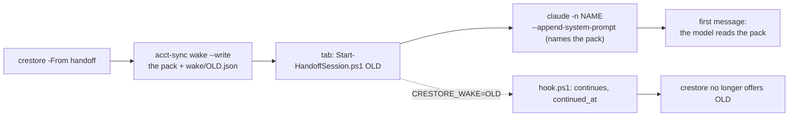
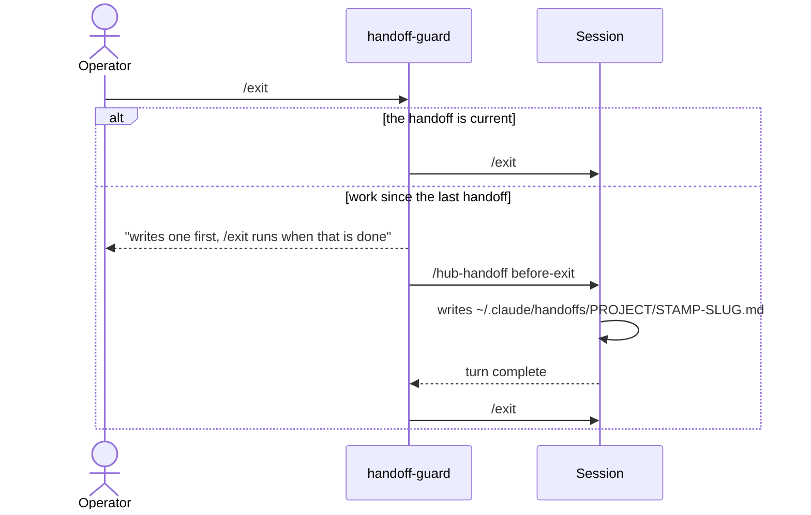
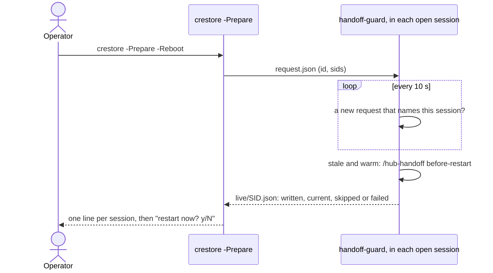

# FR-8: Claude session restore after reboot — `crestore` (WT tabs / VS Code terminals)

**Status: SHIPPED + field-verified (retrospective).** Planned + implemented 2026-08-18 (tracker, WT target, phases 1–3), extended 2026-08-26 (VS Code target, phase 4) and 2026-08-28 (effort, phase 5). Phases 6 and 7 followed on 2026-11-18 and 2026-11-19: a session can come back from a short handoff pack instead of a full resume, and a session about to stop writes its own handoff first. This is **dev-box tooling**: it lives in `%USERPROFILE%\.claude\session-restore\` on the dev box, not in this repo's source tree — documented here per the FR workflow because every roomler-ai working session (and every other project's) runs through it.

## Problem / Goal

Development runs many parallel Claude Code sessions, each in its own pwsh terminal (VS Code integrated terminals and standalone), across several project folders and worktrees (`roomler-ai` and others). A Windows restart kills every terminal; getting back to work meant manually reopening each terminal, cd'ing to the right folder, and finding + `claude --resume`-ing the right session — a dozen manual round-trips per reboot.

**Goal:** one command (`crestore`) that knows which sessions were open at shutdown and restores them all — each in its own terminal, in its original working directory, with the original session resumed and the original launch flags (`--dangerously-skip-permissions`, `--model`, …) replayed — for **any project folder**, into either **Windows Terminal tabs** or **VS Code integrated terminals**. Resuming loads only the transcript, so it costs no tokens until a prompt is sent.

**Phases 6 and 7 (operator, 2026-11-18):** after a restart, bring back all or some sessions *from a minimal handover* instead of a full resume, on the same Claude login or on another one; and just before a session stops, make sure it has an up-to-date handoff, unless it already has one. A resumed session re-reads its whole conversation on its first turn, and after a restart that read is no longer cached. Of the 8 closed roomler-ai sessions measured on 2026-11-18, the largest would have re-read 459k tokens, against 78k for a fresh session started from its pack.

## Key design

Two parts + two spawn targets, all under `~/.claude/session-restore/`:

### 1. Tracker (`hook.ps1`)

`SessionStart`/`SessionEnd` hooks in the **user-level** `~/.claude/settings.json` (so every project folder is covered) maintain one JSON per session in `registry/`: session id, cwd, transcript path, start time, and the owning claude **PID + full command line** (found by walking the hook's parent-process chain). A clean `SessionEnd` stamps `ended_at`; a reboot kills processes without the hook ever firing — **an open entry with no clean end is precisely a restore candidate**. `/clear`/fork supersede the prior entry with the same PID; entries GC after 14 days; the hook always exits 0 (a broken hook must never break a session).

- ⚠️ Claude Code hooks on this machine execute through **Git Bash**, not PowerShell — the settings command uses forward slashes (`pwsh -NoProfile -NoLogo -File ~/.claude/session-restore/hook.ps1`; bash eats backslashes in unquoted words), and the parent walk treats `bash`/`sh` as walkable shell wrappers.
- Field-proven: ✕-closing a terminal **does** fire `SessionEnd` (`reason: other`); only hard kills (reboot) leave entries open. Headless `-p` runs and subagent hook invocations are filtered out.

### 2. Restore CLI (`Restore-ClaudeSessions.ps1`, alias `crestore` in `$PROFILE`)

Candidates = open registry entries with transcript mtime within `-MaxAgeHours` (default 72), an existing cwd, and a recorded PID that is **not** alive (never double-resume a live session). Numbered picker (Enter = all), positional folder filter (`crestore roomler-ai`), `-List`, `-All`, `-DryRun`, `-Prune`, and `-Scan` — a bootstrap mode inferring sessions from transcript mtimes for sessions predating the hooks (flags <5-min-fresh files "may still be running" and warns when claude processes exist, because scan cannot distinguish idle-open from killed). Titles derive from the transcript's first real user message (these transcripts carry no `"type":"summary"` records). Launch-flag replay is **whitelist-only** (`--dangerously-skip-permissions`, `--model`, `--permission-mode`, `--add-dir`) so positional prompts and one-shot flags are never replayed.

### 3. Spawn targets

- **`wt` (default):** one `wt -w claude-restore nt -d <cwd> --title <t> pwsh -NoLogo -NoExit -Command "claude … --resume <id>"` invocation per tab (per-tab invocations dodge wt's `;` command-separator escaping entirely).
- **`-Target vscode`:** writes one **pending file** per session to `vscode-pending/` (15-min expiry) and runs `code <folder>` per distinct cwd. A **local unpacked VS Code extension** (`<publisher>.claude-session-restore`, source `vscode-ext/`, auto-synced into `~/.vscode/extensions/` by the script) consumes pendings **on window startup and via an fs-watcher** — run crestore before or after opening VS Code, both orders work — **claiming each file by delete**, so with N windows open every session spawns exactly once; the integrated terminal opens in the session's cwd and sends the resume command. Chosen over the marketplace "Restore Terminals" extension deliberately: no JSONC `settings.json` mutation, no re-spawn on every window open, one-shot by construction, zero third-party dependency.
- `$env:CRESTORE_TARGET='vscode'` makes VS Code the default target; `-InstallStartup` registers an optional delayed logon task (deliberately NOT enabled by default — restore stays a conscious action).

## Phase / status table

| Phase | What | Kill switch | Status |
|---|---|---|---|
| 1 | Tracker hooks + registry | remove the `hooks` block from `~/.claude/settings.json` | SHIPPED 2026-08-18 |
| 2 | Restore CLI + `crestore` alias + `-Scan` bootstrap | manual command; `-Prune` marks all open entries ended | SHIPPED 2026-08-18 |
| 3 | Logon task (`-InstallStartup`) | `-UninstallStartup` | SHIPPED 2026-08-18, default OFF |
| 4 | VS Code target (pending queue + local extension) | delete `~\.vscode\extensions\<publisher>.claude-session-restore-0.1.0`; stale pendings self-expire in 15 min | SHIPPED 2026-08-26 |
| 5 | Per-session effort (`-Effort`, default `max`) | `-Effort none` (omit the flag) / `-Effort inherit` (keep each session's original) / `$env:CRESTORE_EFFORT` | SHIPPED 2026-08-28 |
| 6 | Restore from a handoff pack: `-From resume\|handoff\|auto`, `-To <login>`, `Start-HandoffSession.ps1`, `continues` in the registry | `-From resume` is the default: nothing changes unless a run passes `-From handoff\|auto`, sets `$env:CRESTORE_FROM`, or adds `h` to a picker entry | SHIPPED 2026-11-18, field-verified 2026-11-19 |
| 7 | A handoff before a stop: the `handoff-guard` plugin and `crestore -Prepare` | in `/config`, the plugin's `commands` set to `none` and `limitAt` to `0`, or remove `~/.claude/skills/handoff-guard`; `-Prepare` runs only when typed, and `-DryRun` only reads | SHIPPED 2026-11-19: the guard's hold field-verified, `-Prepare` verified by its test suite only |

## Acceptance criteria

- [x] Sessions from **any** folder are tracked (user-level hooks) and restored into the right cwd with the right session id
- [x] Killed-by-reboot sessions are offered; cleanly exited / ✕-closed sessions are not; live sessions are never double-resumed (PID liveness check)
- [x] Original launch flags replayed per session (whitelist); resume costs no tokens until a prompt is sent
- [x] Every restored session starts at a chosen effort level (`-Effort`, default `max`), overridable per run and per environment, with `inherit`/`none` escape hatches — and an unknown level is a hard error rather than a silent downgrade
- [x] WT target: one tab per session in a named `claude-restore` window
- [x] VS Code target: terminals appear in the right window whether `crestore` runs before or after VS Code opens; exactly-once across multiple open windows
- [x] `-Scan` bootstraps sessions from before hook installation, flagging possibly-live ones
- [x] Silent failure modes are logged (`hook.log`, `vscode-ext.log`) and never break a session
- [x] **Phase 6:** `-From handoff` (or `h` after a picker number) opens a fresh `claude` in the session's folder whose first message reads the session's pack, instead of `claude --resume`; `-From auto` chooses per session; `resume` stays the default (field, 2026-11-19: the restored session's first tool call read the pack)
- [x] **Phase 6:** the new session's registry entry names the one it continues (`continues`, `continued_at`), and `crestore` stops offering the old session (field, 2026-11-19)
- [x] **Phase 7:** a typed `/exit` after work waits while the session writes its handoff (`/hub-handoff before-exit`), then runs when that turn ends (field, 2026-11-19, real engine); the other cases (typed twice, Esc, `/clear`, `/resume`, a current handoff, the usage window) pass in the plugin's 45 tests against a stand-in engine
- [x] **Phase 7:** every interactive session gets a record (`~/.claude/handoff-guard/live/<sid>.json`) that sees its handoff writes; worker sessions are recorded but never held (field, 2026-11-19: 9 worker sessions, 8 of them with their handoff write seen)
- [x] Docs: this spec's phase 6 and 7 sections. The usage docs live with the tools on the dev box: the crestore section of the account-sync README (`~/.claude/tools/account-sync/README.md`) and the plugin's `README.md`

## Open decisions

1. Auto-restore at logon (`-InstallStartup` + `-All`, no picker) — available but deliberately not default; revisit if the picker step ever feels like friction.
2. WSL-side claude sessions — untracked today (hooks fire, but spawn targets are Windows-side); add a `wsl.exe -d <distro>` spawn path if WSL sessions become routine.
3. The default `-From` — **decided 2026-11-19 (operator): it stays `resume`.** A session started from a pack has a new id, so whatever reaches a session by its id or name (a coordinating session's list of its workers, a peer that messages it by name) no longer reaches it. `$env:CRESTORE_FROM = 'auto'` in `$PROFILE` would change it for one machine.

## Out of scope

- Reconstructing VS Code window *layout* beyond one window per distinct folder.
- Original-terminal-host fidelity: a session that lived in a VS Code terminal may be restored into WT and vice versa — user's choice via `-Target`.
- Restoring non-claude terminal state (running builds, ssh sessions, tmux — tmux already survives on the fleet side).
- Stops that reach no hook that can wait: a closed terminal, ctrl+c or ctrl+d at the prompt, a kill, a crash, a power cut, a Windows Update restart. The guard's record then says the session ended stale, and `-From auto` brings it back from a pack built out of its transcript.
- `/compact`: it keeps the session and writes its own summary, which the pack falls back to, so holding it would add a turn to every compact.

## Effort (phase 5, 2026-08-28)

`-Effort <low|medium|high|xhigh|max|inherit|none>`, default **`max`**, env default `CRESTORE_EFFORT`. Restored sessions carry `claude --effort <level> --resume <id>` on both targets. `inherit` replays the level the session was originally launched with (omitting the flag if it had none); `none` never passes it. `--effort` is also added to the replay whitelist, and `Build-ResumeCommand` **strips any replayed `--effort` before appending the resolved one**, so a session can never carry the flag twice. `Test-EffortSupported` probes `claude --help` once per run and degrades to omitting the flag on a CLI too old to have it.

⚠️ **The ValidateSet is a security-of-intent control, not decoration**: claude itself only *warns* on an unknown `--effort` value (`Unknown --effort value 'bogus' — ignoring it and using the default effort`) and proceeds at the default. A typo would therefore silently restore a whole fleet of sessions at the wrong level; the script refuses instead.

⚠️ **Known measurement limit — the flag's effect is verified for plumbing, not for the TUI.** Non-interactive paths (`-p`, and a positional prompt, both `entrypoint: sdk`/one-shot) record `"effort":"max"` on their assistant turns **regardless of the requested level** — a `--effort low` one-shot still recorded `max`. Interactive sessions do record real per-session levels (this repo's transcripts carry `high`/`medium`/`xhigh`/`max`), but effort is written **only on assistant turns** — there is no session-state record — so confirming a restored TUI session's level requires sending it a prompt, which cannot be automated without injecting keystrokes into a window (unacceptable with ~20 live sessions on screen). Confirm by eye in a restored tab: `/effort` reports the current level.

## From a handoff (phase 6, 2026-11-18)

`crestore -From resume|handoff|auto`, default `resume`, with `$env:CRESTORE_FROM` as the environment default and a `ValidateSet` as for `-Effort`. `-To <label>` plans for another login. In the picker, `2h,4-6r` overrides single entries, and `h` or `r` alone applies to all of them.

The packs come from the dev box's account-sync tool (`~/.claude/tools/account-sync/acct-sync.mjs wake`). A pack is built from the transcript without a model call, in about 14k tokens: every prompt the person typed, word for word; the newest handoff the session wrote about itself, or failing that its last compaction summary; where it stopped; a timeline with the files it edited. `wake` also makes `auto`'s choice, per session:

| The session | `auto` gives |
|---|---|
| never sent a request | resume |
| would not be smaller as a fresh session with the pack | resume |
| was compacted and has not run since | resume |
| still has a warm cache on this login | resume |
| carries at most 70k tokens of its own above a fresh session's size | resume |
| wrote nothing about itself in its last 12 turns | resume, with `/compact` first when its first turn would re-read everything |
| anything else | handoff |

- The tab runs `Start-HandoffSession.ps1 <old id>`. It reads `~/.claude/session-restore/wake/<old id>.json` (`{session_id, cwd, name, pack, args[], created_at}`, kept 14 days), sets `CRESTORE_WAKE` and `CRESTORE_WAKE_AT`, and starts `claude <replayed flags> [--effort X] -n <name> --append-system-prompt "<one line naming the pack>"`. Nothing is sent until the first message, and the model reads the pack then. The arguments travel in the file, so no title or path has to survive quoting through `wt` or VS Code.
- `hook.ps1` records `continues` and `continued_at` on the new session's entry. `crestore` stops offering the old session once its successor is alive or has taken a turn. If the old transcript was written more than a minute after `continued_at` (it was resumed by hand and used), both are offered.
- ⚠️ The tracker hook is `async: true`, so it cannot return `additionalContext`, and claude 2.1.322 has no flag that fills in a prompt without sending it. That is why the pointer to the pack travels as `--append-system-prompt`.
- ⚠️ Windows PowerShell 5.1 can refuse to load the launcher, and started from pwsh 7 it inherits a `PSModulePath` that breaks `Microsoft.PowerShell.Security`. The VS Code command is therefore `pwsh -NoLogo -NoProfile -File "<launcher>" <id>`, proven typed into pwsh 7, Windows PowerShell 5.1, cmd and Git Bash. The WT tab keeps `& '<launcher>' <id>`.
- ⚠️ `'{0:0.00}' -f` prints a decimal comma under this box's regional format, so figures shown next to acct-sync's use the invariant culture.

## Before a stop (phase 7, 2026-11-19)

A pack is rebuilt from the transcript. A handoff the session wrote itself, while it still knew what mattered, is better, and the pack is built around it. Phase 7 makes a session that is about to stop write one, unless the one it has is current.

**`handoff-guard`** is a Claude Code plugin (function hooks) in `~/.claude/skills/handoff-guard`. It loads at user level, so it covers every project folder.

| When | What happens |
|---|---|
| `/exit`, `/clear` or `/resume` is typed and the work moved since the last handoff | The command waits. The session runs `/hub-handoff before-<command>`, and the command runs when that turn ends. Typed a second time, the command runs at once. Esc on the handoff calls it off. A prompt typed while `/exit` or `/resume` waits calls the command off; one typed while `/clear` waits is kept for the new conversation. |
| the same, with the handoff current | The command runs at once. |
| a usage window (5-hour or weekly) reaches `limitAt`, 90 % by default | A stale session writes its handoff (`/hub-handoff before-usage-limit`), once per window. One whose prompt cache is cold waits for its next turn, which warms the cache. |
| `crestore -Prepare` asks | Each session it names answers in its record (below). |

"Current" means no main-loop turn changed anything after the session's newest handoff write. A turn that only read, and the handoff turn itself, do not count. A handoff write is a Write or Edit under `~/.claude/handoffs/` (acct-sync's own packs under `acct/` excepted) or of a `handoff*.md` under `~/.claude/hub/`. acct-sync applies the same test, so the next pack is built around that file. Each session's state is kept in `~/.claude/handoff-guard/live/<sid>.json`. Every hook fails open: if the guard errs, the command, prompt or turn goes on as if it were not there.

**`crestore -Prepare [-DryRun] [-IncludeCold] [-PrepareMinutes 10] [-Reboot]`** writes `~/.claude/handoff-guard/request.json` (`{id, reason: 'restart', at, includeCold, sids}`, through a temporary file and a rename) for the open sessions: registry entries whose process is alive, the newest per process. Each session polls the file every 10 s and answers in its record. `crestore` waits up to `-PrepareMinutes`; a session that has not answered within 30 s stops holding the wait but is still read. It prints one line per session:

| Answer | Meaning |
|---|---|
| `written` | it wrote a handoff now; the line names the file |
| `current` | its handoff was already current, or it had done nothing to hand off |
| `skipped` | its prompt cache is cold, so a handoff turn would re-read the whole conversation at full price where the pack costs nothing (`-IncludeCold` writes it anyway); or it is a worker whose coordinating session owns its handoffs |
| `failed` | the handoff turn failed or gave up; the line says why |

`-Reboot` then asks y/N and runs `shutdown /r /t 60` (`shutdown /a` cancels it). `-Prepare` and `-Prune` remove guard records untouched for 7 days; `-Prepare` keeps those of open sessions.

- ⚠️ Only a plugin's command hook can hold a typed command and start a turn first. A `SessionEnd` hook in `settings.json` can neither wait nor start a turn, so it could only record that a session stopped stale.
- ⚠️ The skill the guard runs is `hub-handoff`, which writes outside every repository. A handoff skill that writes into the working tree would put the handoff in a public repository such as this one.
- ⚠️ Saving the plugin's files reloads it in every live session, and a reload drops a held command. Change it in a copy and swap the folder in with one rename.

## Not established yet

- `crestore -Prepare` for real. It spends one handoff turn per warm stale session, so it waits for a planned restart. Its 25-check test covers the request, every answer, a late answer, the record clean-up and `-Reboot` with a stand-in `shutdown`, using idle hidden processes as the live sessions.
- The usage-window trigger in the real engine: no session has reached 90 % of a window since the install.
- The VS Code extension consuming a handoff command. Only the typed command was tested, in pwsh 7, Windows PowerShell 5.1, cmd and Git Bash.
- Whether `--append-system-prompt` changes the prefix that a project's sessions share in the prompt cache.

## Field-verification log

- **2026-08-18 — hook unit tests** (fake stdin events): SessionStart writes a full entry; SessionEnd stamps `ended_at`+reason; subagent events ignored; malformed input logged and swallowed (exit 0).
- **2026-08-18 — WT E2E**: registry-driven restore spawned a `claude-restore` WT tab, cd'ed to the session's project folder, resumed the session **with `--dangerously-skip-permissions` replayed**; the hook inside the spawned session re-registered it within seconds (source `resume`, real PID, real cmdline). Closing the tab later stamped a clean end (`reason: other`).
- **2026-08-18 → 08-26 — tracker soak**: 8 days unattended across 5+ project folders; `/resume` switches recorded as `end_reason: resume`; live sessions carry fresh PID+cmdline; registry GC held.
- **2026-08-26 — VS Code E2E**: with the target window already open, a written pending file was consumed by the extension's **watcher within ~5 s** (`spawning (watch): "watch-e2e <project>"`); the integrated terminal spawned in the right cwd, resumed the session, and the registry flipped to open with the new PID and the replayed flag. Exactly-once held with 4 extension hosts live (claim-by-delete). Unpacked-folder extensions load fine (VS Code Aug 2026) but are **scanned only at app start** — first install needs a VS Code restart.
- **2026-08-26 — dry-runs both targets** over the real registry: 11 correct per-session commands across three project folders, `roomler-ai` among them; sessions without a recorded cmdline correctly fall back to plain `claude --resume <id>`; live sessions excluded; sub-5-min scan hits flagged `[!]`.
- **2026-08-28 — effort option (phase 5)**: seven modes exercised by dry-run across the real registry on both targets — default `max`, explicit `high`, `none` (flag absent), `inherit` (absent when the session recorded none), `$env:CRESTORE_EFFORT=xhigh`, VS Code queue carrying the flag, and an invalid level correctly rejected by the ValidateSet. `claude --effort max --resume <bad-id>` fails on the *session id*, proving the flag composes with `--resume`. Dead ends recorded above: print-mode/one-shot transcripts pin `effort: max`, so they cannot serve as a probe; the CLI ships as a 253 MB compiled binary, so the wiring cannot be read from a bundle; and no session-state effort record exists to read without prompting the session.
- **Gotchas banked**: Git-Bash hook execution → forward-slash paths; claude ≥2.1.223 **cross-directory resume** records the *invoking* cwd in the hook event (transcript stays in the original project dir) — harmless for the mechanism (restore always cd's first), confusing for forensics; PS local `$list` silently collides with a `[switch]$List` parameter; a silent `continue` in the extension's consume loop hid an E2E failure for an hour — every drop now logs.
- **2026-11-18 — phase 6 by test suite**: `tests/run-all.ps1` printed `all passed` at 225 checks (parse 3, hook 17, launcher 8, taken-over 16, restore `-From auto` 59, restore `-From handoff` 122). The restore tests run on a copy of the real registry with stand-in `wt.exe` and `claude.exe` that log their argv, and acct-sync writes real packs, which the run deletes. Over 8 closed roomler-ai sessions, `auto` resumed four and brought four back from a pack; the largest of those would have re-read 459k tokens resumed and started at 78k from its pack.
- **2026-11-19 — phase 7, first records in the real engine** (from 01:29Z): every new interactive session wrote its record at start. Nine worker sessions of a coordinating session were recorded and never held, and eight of them had their handoff write seen.
- **2026-11-19 — phase 7, a held `/exit` in the real engine**: a small session on Haiku, run in a hidden pseudo-terminal (node-pty with a headless xterm, so no window opened on the desktop). `/handoff-guard` reported nothing to hand off yet. After one prompt that wrote a file, `/exit` at 08:15:02Z printed "this session's handoff is stale (it has no handoff yet), so it writes one first; /exit runs when that is done". The session ran `/hub-handoff before-exit`, which judged that a one-file task needed no handoff, and `/exit` ran when that turn ended, at 08:15:20Z (`endReason: prompt_input_exit`).
- **2026-11-19 — phase 6, one real handoff tab** (operator-approved: one short message). A release session (closed 11 days earlier at 108.6k tokens) was restored with `-From handoff` into a hidden pseudo-terminal. The new session registered `continues=<old id>` at 08:21:14Z. Asked "Where did this session stop?", its first tool call read the pack, and it answered from the pack. That first call wrote 78.6k tokens to the cache, and reading the pack added 11.2k. A second `crestore -List -MaxAgeHours 400` no longer offered the old session. Two minutes in, a peer session (the release cutter) messaged the restored one, which had appeared under a release's name, and the message started a turn: a handoff tab costs nothing until it is used, and another session can use it.
- **2026-11-19 — dead end**: a stand-in `wt.exe` put on `PATH` from Git Bash as `C:/…/fake-wt` was not found, because Git Bash splits a `PATH` entry at the colon, so the real Windows Terminal opened one tab. Its session was stopped before any message, so it spent nothing; the same tab command then ran in the hidden pseudo-terminal. Put stand-ins on `PATH` as `/c/…`, and check `Get-Command wt.exe` before a run.
- **Gotchas banked (phases 6–7)**: `Start-Process node -ArgumentList '-e', '<js>'` joins its arguments with spaces and quotes none, so the test's JS is written without spaces; `crestore` can read a guard record mid-rewrite, so `Read-GuardRecord` re-reads a cut or empty file up to 3 times; a plugin may not store `$` anywhere (`claude plugin validate` refuses it), so the guard's helpers take a `hostOf($)` object.
