# FR-90: Hive — agent sessions on the org's own machines: a replicaset, a vault, a map and a shared brain

**Issue:** [#1827](https://github.com/gjovanov/roomler-ai/issues/1827) · **Status:** in progress
— design approved 2026-10-07; P0a (device core), P0b (server module), P0c (device
supervisor) and P0d-1 (the session room, turn stubs) merged, P0d-2a, P0d-2b (the viewer peer), P0d-3 (the UI), P0e (the model sidecar) and P0f (the canary test, AC2 on one device) merged — P0's build is complete; AC1 field-verified on a throwaway stack (2026-10-07), and its six findings fixed in P0g (merged); AC3 and AC4 partly field-verified (§5, §8); P1a-1 and P1a-2 (approvals: the device, the UI and the server) merged and field-run, AC5 ticked (2026-10-08); P1a-3 (Bash that runs on any host) and P1b (a restarted device's sessions end) merged and field-run; P1c-1 (drivers, the server) merged; P1c-2a (drivers, the device) merged; P1c-3 (drivers, the UI) merged, AC6 ticked on its field run; P1c-2b (AC6 as a CI test) merged; P1d-1 (the updater waits for running turns, AC7 on Linux field-verified) merged; P1d-2 (a restart resumes what the device hosted; AC20 on Linux field-verified) merged; P1e (core memory from a hand-curated brain) merged, AC8 ticked (field-verified 2026-10-08, and in CI); P1f (the transcript's renderers, P1f-1, and the long list, P1f-2) merged; P1g (the org gate, so prod can serve one test organization) and P1g-2 (a `hive.tenants` list is the switch) merged; P1h-1 (sessions on macOS: the build, and the daemon takes its harnesses down) merged; prod serves agent sessions to the test organization only (2026-10-09); P1j-1 (`adopt`, the server) merged; P1j-2 (`adopt`, the device) merged; P1j-3 (`roomler hive adopt`) and P1j-4 (`adopt`, the UI) merged; P1j-5 (the field run) merged, AC21 field-verified; P1h-2 (the macOS helper waits for agent turns; `hive` in the Linux and macOS release builds) merged; P1i-0 (Windows sessions' design) merged; P1i-1 (the Windows launcher's building blocks) merged; P1i-2 (Windows sessions wired: `hive_host` on Windows, the identity rule, the toolbelt's pipe) merged; P1i-3 (`hive` in the Windows release build) merged; P1i-4 (the Windows field run: AC3, AC7 and AC20 there, a remote-desktop connection swapping no worker) field-verified; P2-0 (the replicaset's design) merged; P1h-3 (the macOS field run: AC3, AC7 and AC20 there) field-verified, and AC3 and AC7 ticked; P2a (the member's store) merged; P1h-4 (decisions 13 and 15: a Unix session holds no administrator group, a Linux one cannot `sudo`, and a Mac refuses an account whose `sudo` needs no password) field-verified; P2b-1 (what a checkpoint takes of the config directory) merged; P2b-2 (the workspace, through the account's own git) merged; P2b-3a (`hive-checkpoint`, as the account, held to its request) merged; P2b-3b (a checkpoint at each turn's end, for a replicated session) merged; P2b-4a (`hive-materialize`, the config directory, as the account) merged; P2b-4b (`hive-materialize`, the folder, through the account's own git) merged; P2c-1 (the device's gates for holding copies, and a folder too big for one checkpoint skipped at once) merged; P2c-2a (the org's replica policy) merged; P2c-2b (placement at a start) merged; P2c-3a (the join, the server's half) merged; P2c-3b (the join, the device's half) merged; P2c-4a (placement decided again) merged; P2c-4b (the primary told, and sessions from before placement) merged; P2d-1 (the stream's grants, the server's half) merged; P2d-2a (the direct rung on the devices, and the stream's opening exchange) merged; P2d-2b (the relay rung, and a grant registered before its endpoint is built) merged; P2d-2c (the derp rung, on a route of its own) merged; P2d-3a (the events, the blobs and the acks) merged; P2d-3b (the member's wants, the ladder, a session over parked, `hive-stream` advertised) merged; P2d-4 (renewals: make-before-break at half a grant's life) merged; P2d-5 (a replica's read-only view) merged; P2d-6 (AC2 on two devices in CI) merged; P2e-1 (the fence on the device, and `rc:hive.demote`) merged; P2e-2 (the lease word: a leased session runs only on the server's word on each connection) merged; P2e-3 (the server's promotion: the route, its steps, the lease CAS and the move back, inert until a build advertises `hive-promote`) merged; P2e-4 (the primary's drain, on the device) merged; P2e-5a (the member's prepare and the moved start, taken over from its copy) merged; P2e-5b (the old fence's end on every join) merged; P2e-5c (promotion on, and what the first promotion between real devices found) merged; P2e-6a (an unreachable primary waited out, then moved away from with no drain, to the member that holds the most) merged; P2e-6b (a target that never answered its moved start: the start re-sent however late, and the session moved on from it once it is unreachable) merged; P2e-7 (the resume note: a session moved to a device told, once, who moved it, from where, where its earlier paths live now and its last tool call left open) merged; P2f (teleport, fork, an ended adopted session made managed), P2g (purges and retention), P2h (the archive replica image), P2i (full-text search on archive replicas) and P2j (the UI) merged; P2k, the field run on prod's test organization (2026-10-16): AC2, AC9, AC10, AC11, AC22, AC24, AC25 and AC26 field-verified and ticked, AC4 ticked with P2k-7's capture at the provider, and the run's fixes and that capture, P2k-1 to P2k-7, merged; its re-check on the promoted server (2026-10-17): the fixes proven in the field, AC23 and AC27 field-verified and ticked, and the replicaset switched off again after it; AC20 completed by an update's restart on macOS and Windows (2026-10-17); P3-0 (P3's design) merged, with decision 17 confirmed by the operator; P3-1 (the vault module, server side) merged; P3-2a (Cedar roles and policies) merged; P3-2b (a session's vault role) merged; P3-3a (the device's vault key) merged; P3-3b (leases, the vault's half) merged; P3-3c (revocation, the vault's half) merged; P3-4a (the daemon's lease client) in review · **Owner:** agent platform — the `hive`, `vault` and
`knowhow` modules, `roomlerd` feature `hive`, the SPA · **Anchors:** master `38f13cb34` ·
**Design:** [`../roomler-hive-design.md`](../roomler-hive-design.md) (v0.4: the full design, the
review of v0.2 and the decisions) · **Builds on:** [FR-69](FR-69-modular-monolith.md) (modules),
[FR-56](FR-56-remote-apps-on-wayland.md) (the tmux session model), [FR-43](FR-43-macos-single-enrollment.md)
(the stdin-secret worker attach), [FR-83](FR-83-ssh-grant-confirmed-before-dial.md) (a grant is
confirmed before the caller dials), [FR-86](FR-86-tunnel-transport-reupgrade.md) (the carriers),
[FR-82](FR-82-permission-refusal-is-not-a-logout.md) (managed roles), [FR-8](FR-8-claude-session-restore.md)
(session restore)

## 1. Goal

Run coding agents — Claude Code first, Codex later — on the org's own enrolled machines, as a
product rather than a pattern. [`docs/use-cases.md`](../use-cases.md) ("A harness for AI agents")
already pitches an agent in tmux that people watch and take over, with fenced networking; this FR
makes each agent session a first-class record:

1. **Sessions are org records; their content stays on the org's machines.** Every session — who
   started it, on which device, in which folder, as which OS account, what it cost, where its copies
   are — is a row in the org's database. What the agent and the people said and did lives on the
   session's **replicaset**: the org's own devices, each holding a full copy. The server never stores
   a transcript.
2. **Chat is the session's surface.** A session is a chat room; each turn is a message whose steps
   render as markdown, terminal blocks and diffs; approvals are cards a phone can answer. Content
   streams peer-to-peer from a replica; the server holds metadata-only stubs.
3. **Resume anywhere in the replicaset, teleport anywhere else** — to another machine and another
   folder, Windows to Linux included.
4. **Infrastructure the agent can use without seeing a secret.** An IAM-style vault (roles, Cedar
   policy, leases, audit) reachable over MCP and referenced from prompts by handle; a "knowhow"
   graph of what the org runs and how to reach it over the mesh.
5. **One brain the org's sessions share and improve**: memory, skills and playbooks stored
   centrally, curated, versioned and reviewed, measured by how much less steering sessions need.

Hive is the "AI" of the Business tier on roomler.ai; the self-hosted community edition gets all of
it.

## 2. Evidence (master `38f13cb34`, 2026-10-07)

- **Nothing to extend.** No Anthropic client, model id, LLM config key, MCP server or secret store
  exists in `crates/`, `agents/` or `ui/src`. The "Claude AI" service CLAUDE.md lists under
  `crates/services` and the document recognition the README describes are not in the code.
- **No encryption at rest.** JWTs are HS256 with a shared secret
  (`crates/services/src/auth/mod.rs:246-260`); the only asymmetric key signs DERP tickets
  (`crates/remote_control/src/derp_ticket.rs:92,116`); tenant cloud-storage credentials have a
  plaintext schema (`crates/db/src/models/tenant.rs:302-220`). The vault brings its own keys.
- **The primitives exist.** One spawn-as-user path (`agents/roomlerd/src/exec.rs:442,497`); the
  daemon's own PTY (`agents/roomlerd/src/pty/unix.rs:108-187`, ConPTY in
  `agents/roomlerd/src/pty/windows.rs:180-240`); the tmux model (`agents/roomlerd/src/apps/linux.rs:389-433`);
  generic consent prompts (`agents/roomlerd/src/consent.rs:174`); the stdin-secret worker attach
  (`agents/roomlerd/src/delegate.rs:16-30`); tunnel-core carriers down to DERP and data-only WebRTC
  peers (`docs/tunnels.md:61-73`); the stateless TURN-credential helper
  (`crates/remote_control/src/turn_creds.rs:46-85`).
- **The gaps are measured, not guessed.** `RunAs` sets no working directory and only `TERM`
  (`agents/roomlerd/src/pty/unix.rs:150`); on Windows it reaches only the console user and will not
  ask for credentials (`agents/roomlerd/src/exec.rs:509-514`); a root daemon's LocalAPI socket is
  `0600`, so a non-root process can't reach it (`crates/localapi/src/lib.rs:3761-3779`); tunnel SOCKS5
  has no authentication (`crates/tunnel-core/src/socks5.rs:3`) and a daemon-originated flow is
  attributed to the device owner (`crates/tunnel-core/src/policy.rs:29-63`); `SplitTun` intercepts one
  port and SSH is its only caller (`crates/tunnel-core/src/overlay/split_tun.rs:92-126`); fleet exec
  always runs as SYSTEM/root (`agents/roomlerd/src/signaling.rs:4813`).
- **Chat needs four changes.** `AuthorType::Bot` exists and nothing writes it — the DAO hard-codes
  `User` (`crates/services/src/dao/message.rs:76-78`); rooms have no type or binding
  (`crates/db/src/models/room.rs:62-126`); the message list isn't virtualized
  (`ui/src/views/chat/ChatView.vue:51`); only mentions push (`crates/core/src/notify.rs`).
- **Permission bits 0–31 are all assigned** and `ALL = (1 << 32) - 1`
  (`crates/db/src/models/role.rs:161`).
- **Claude Code makes per-session state portable.** With `CLAUDE_CONFIG_DIR` and
  `CLAUDE_CODE_PROJECT_DIR_NAME` set (≥ 2.1.234), a session's transcript and state live under one
  pinned project directory whatever the working directory is; a resume restores neither `--settings`
  nor `--mcp-config`; and Anthropic does not allow third parties to offer claude.ai login or rate
  limits, so subscription credentials are never brokered (design §4.3, §11.3).
- **The one LLM workflow on master is a false green.** `.github/workflows/daily-health-check.yml`
  reported success on every run from 2026-09-29 to 2026-10-06 with `ANTHROPIC_API_KEY` empty in the
  step environment; the `claude` step ends in under a second and `2>&1 | tee` swallows its exit
  status (run 37464801887). Hive's nightly lane must fail when the model call fails.

## 3. Design

The design is [`../roomler-hive-design.md`](../roomler-hive-design.md); this section is its spine.

### 3a. Three modules and a daemon feature

`vault` (→ `fleet`), `knowhow` (→ `network`) and `hive` (→ `chat`, `fleet`, `vault`, `knowhow`),
each a module behind the FR-69 contract (`crates/core/src/module.rs:23`); new `EDGES` in
`crates/core/src/graph.rs:15`, the forbidden pairs untouched; `hive` first in `HOOK_ORDER`
(`crates/core/src/hooks.rs:37`), because it holds sessions. The node side is a `roomlerd` feature,
and its user-level half is `roomlerd hive-host`, re-exec'd as the mapped user like `portal-helper`
(`agents/roomlerd/src/main.rs:222`) — no second binary. Wire frames are `rc:hive.*`, `rc:vault.*`,
`rc:knowhow.*` owned through `namespace()` (`crates/remote_control/src/signaling.rs:2002`); new
`RpcCap` verbs `hive`, `hive-view` (P0d-2), `hive-replica`, `vault`, `knowhow-scan`, equality-matched
(`crates/remote_control/src/models.rs:765,757`).

**In the release builds from P1h-2.** The Linux (x86_64 and arm64) and macOS builds in
`.github/workflows/release-agent.yml` carry the `hive` feature; Windows follows with its sessions
(P1i). Every gate stays the device's and default-deny, so a device runs nothing until its owner
turns `hive_enabled` (or `hive_adopt`) on. Such a device also keeps nothing: no data directory, no
`hive.db`, no store thread (`hive/supervisor.rs` `store_wanted`). A store is kept only while
sessions run or are adopted there, or once one exists, so a device that turned them off still
serves the transcripts it holds.

### 3b. The replicaset, and what the server holds

Each member of a session's replicaset keeps the same daemon-owned store — `hive.db` (SQLite with an
FTS5 index), the raw harness JSONL, a bare git repo of checkpoints, config-directory snapshots. The
primary streams events (`seq`, `fence`, `prev_hash`) and thin packs to the members over tunnel-core
carriers; members ack; the server learns freshness from the acks. Archive replicas — always-on org
devices — join every replicaset the policy allows and serve full-text search. The server holds
session metadata, turn stubs (who, status, steps, cost — no content), session cards (≤ 2 KB
summaries, scanned; `session_cards = summary` by default, `metadata` to turn them off), the brain,
and audit. Never transcripts.

**P2 — the replicaset, as designed.** Until P2 a session lives on the one device that runs it: that
device's store holds its events, and Claude Code's own state sits in the account's home there. P2
gives every session a replicaset (design §4.4, §6). The primary streams what it records to the
session's other members over a device-to-device carrier, every member keeps a full copy it could
resume, and the server learns how fresh each copy is from sequence numbers and hashes alone.
Decisions 1 and 2 (§6) set the defaults: a hosted org runs at least one archive replica, from a
container image, on its own machines; `min: 2`, archive replicas on, and a restricted session only
on devices that carry its tag. The server's switch is `hive.replicaset`
(`ROOMLER__HIVE__REPLICASET`, a field beside `hive.tenants`, `crates/config/src/settings.rs:155`, built in P2c-2a),
default off. Off, nothing is placed, streamed or moved, and every session lives on its primary
alone, as in P1. The device's own switch is `hive_replica`, default off and never pushable.

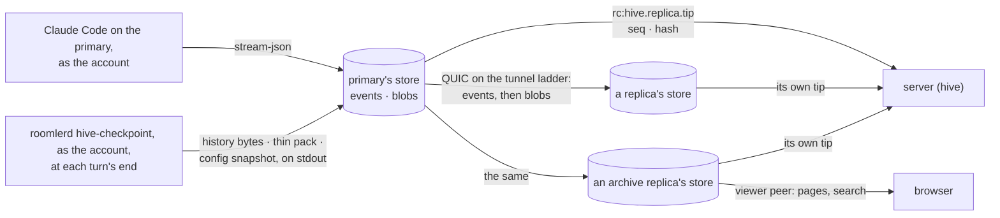

**What a member holds.** P0a's store is the base, and most of what a member needs is not in it yet.

| Piece | As built | P2 | Where |
|---|---|---|---|
| events (`seq`, `fence`, `prev_hash`, the exact JSON) | appended by one writer, which wraps each event itself, at its own clock | a member also APPLIES the primary's envelope as received, through the same chain check. The store can do it already; the daemon's writer has no command for it | `crates/hive-node/src/store.rs:533` `append`; `agents/roomlerd/src/hive/store.rs:45` `Cmd`, `:855` |
| the newest fence a member has seen | the tip's own, so only an event raises it | a fence FLOOR per session, raised by the server's word before any event of the new fence exists, and checked with the tip's | `crates/hive-node/src/chain.rs:162` |
| Claude Code's history (`<config dir>/projects/hive-<uuid>/<uuid>.jsonl`), what `--resume` needs byte for byte | not kept: it lives in the account's home, and the daemon only checks that it exists | chunks by offset, each content-addressed (BLAKE3) | `crates/hive-node/src/launch.rs:166` `history_path`; `agents/roomlerd/src/hive/supervisor.rs:4990` (`session_state_dir`) |
| the workspace | not kept | a git checkpoint at each turn's end, kept as a pack | design §6.3 |
| the rest of the session's config directory | not kept | a snapshot of an allowlist at each checkpoint | below |
| a tail a promotion cut off | — | events of an older fence past the newest common checkpoint, set aside | below |
| sessions purged here | — | their ids, so a purged session is never taken back | below |
| full-text search | `Store::search`, scoped to the sessions it is given, in the device crate only | the daemon's writer serves it to an archive replica's viewer peer | `crates/hive-node/src/store.rs:1233` |

⚠️ **The schema stays readable by the daemon before it.** A daemon refuses a store a newer one wrote
(`crates/hive-node/src/store.rs:86`), and the updater's crash-loop rollback can put an older daemon
on a device at any time (`agents/roomlerd/src/updater.rs:1499`). P2's state goes in new tables, and
`user_version` stays 1. A rolled-back daemon then opens the store, serves what it holds and ignores
the rest; a new column on `events` would cost it every transcript.

⚠️ **The daemon never opens a path in an account's tree.** Reading the history, committing the
workspace and packing it run as the session's account, in `roomlerd hive-checkpoint`: a hidden
subcommand the daemon starts at each turn's end and reads on stdout. The daemon already runs work
as the account this way: the Unix wrapper, and on Windows `roomlerd hive-prep` (`hive_win.rs`
`run_prep`). Its reverse,
`roomlerd hive-materialize`, takes blobs on stdin and writes them into the target folder and config
directory as the target's account. A root daemon that read a path the account controls would read
whatever the account pointed it at, `/etc/shadow` included, and copy it to every member. P1j drew
the same line: the hook reads the transcript, never the daemon (§3h). Members never run git: they
keep packs as they got them.

**What the primary streams.** At the end of each turn (the stream-json `result`, in `Task::on_event`,
`supervisor.rs:5469`; the run loop takes it, `checkpoint_or_stop`, `:5867`) the session's task runs `hive-checkpoint` and records a `checkpoint` event that
names, by hash, everything it produced. It chains like any event, so two members holding the same
`(seq, hash)` hold the same workspace and history too. A member on an older daemon stores the new
kind without reading it (`crates/hive-node/src/event.rs:25`), and the browser draws no card for it.

| What | Made by | Carried as | A member checks |
|---|---|---|---|
| events | the store's writer, as today | envelopes in `seq` order, batched like a viewer's page (≤ 500 and ≤ 1 MiB, `agents/roomlerd/src/hive/view.rs:91`) | `check_next` against its tip and its floor |
| the history | `hive-checkpoint` reads it past the last offset; a file that shrank, or changed before the offset, is sent whole | a blob per chunk | each chunk's BLAKE3, and the `checkpoint` event's length and hash for the whole file |
| the workspace | a commit through a temporary index seeded from the person's, so their index and branches are untouched; `refs/hive/<sid>/head` keeps it through `git gc`; a folder that is not a repository gets a shadow repository in the session's state directory (design §6.3) | a thin pack against the previous checkpoint; the first holds the whole tree | the tree id in the `checkpoint` event, and again when it is checked out |
| the config directory | an allowlist: `projects/hive-<uuid>/` (the history, sub-agent transcripts, tool results, file history, auto-memory) and `CLAUDE.md` | a manifest of `(path, mode, BLAKE3)`, and the files the member lacks | each file's hash |

⚠️ **An allowlist, never the directory.** A session's config directory is all of Claude Code's state,
and can hold a login if a person signs in inside it. Hive never moves a subscription credential, and a
replica never holds one (design §11.3). What Claude Code keeps where is probed before P2b is built,
as P1a's contract was (§3e).

⚠️ A checkpoint writes `refs/hive/<sid>/*` into the person's repository, as the account, and
`git push --mirror` would carry them. They go when the session ends or is purged.

⚠️ What a member logs names sessions, sequence numbers and hashes, never an event: a device's log
reaches the server through its uploader (`crates/agent-core/src/logs_upload.rs`).

**The carrier.** Four paths carry a device's bytes today, and none is a generic device-to-device
stream:

| Path | Carries | Between | Gate |
|---|---|---|---|
| the control WS | `rc:*` frames, metadata only, their field sets locked by test | device and server | the agent token |
| the WireGuard overlay, with `SplitTun` intercepting one TCP port below the OS | roomler SSH only: `agents/roomlerd/src/ssh.rs:215` is its one caller | two overlay nodes | an FR-83 grant; the target's `ssh_enabled` |
| tunnel sessions (`rc:tunnel.*`, `network`'s) | `host:port` flows on `quic-v1`, `webrtc-dc-v1`, `quic-derp-v1` or `wireguard-v1` | a tunnel client (the CLI, or a daemon for its declared routes) and an exit agent | `tunnel_policies`, then the exit's `forward_acl` |
| the viewer peer | a session's pages and live events | device and browser | a view grant the device confirms first (§3c) |

P2 keeps the design's choice (§6.4): tunnel-core's QUIC transport, without the tunnel's flows and
ACLs. Its pieces are a library already. An endpoint mints an ephemeral self-signed certificate whose
fingerprint the dialer pins, over a plain socket, a TURN relay or the established `/derp` WebSocket
(`crates/tunnel-core/src/transport/quic.rs:369`–`:479`), and the dialer presents a token the server
minted (`:586`, `:605`). The serving half is the exit agent's
(`agents/roomlerd/src/tunnel/quic_peer.rs:187` direct, `:229` TURN, `:272` DERP), the dialing half
the tunnel client's (`crates/tunnel-core/src/driver.rs:1627` `establish_quic`). The signalling is
Hive's own, `rc:hive.replica.*`, so `hive` still calls neither `network` nor `remote`
(`crates/core/src/graph.rs:25`). TURN credentials come from the stateless helper the viewer uses
(`crates/modules/hive/src/view.rs:299`), and the DERP leg rides each device's own `/derp`
connection.

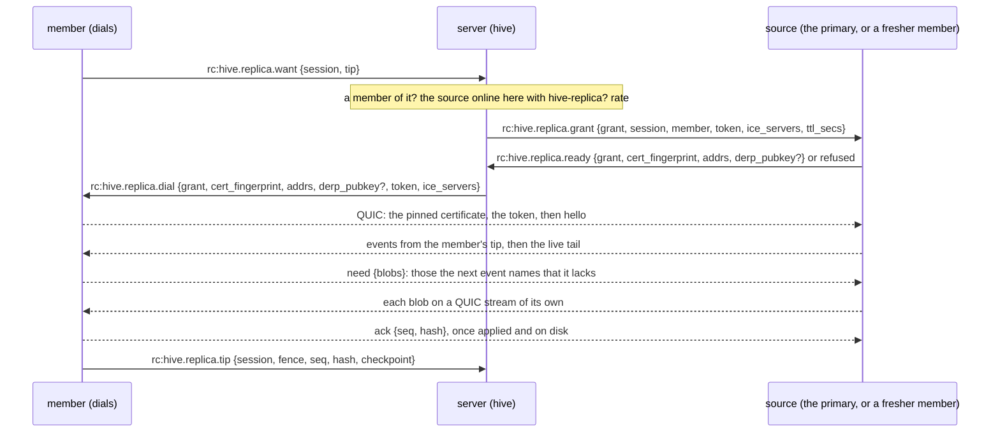

| Tier | Path | Needs | A relay sees |
|---|---|---|---|
| 1 | direct: host and server-reflexive candidates, hole-punched | UDP between the two | nothing: there is no relay |
| 2 | QUIC over TURN/UDP, with the grant's credentials | UDP to the TURN server | QUIC packets: ciphertext |
| 3 | QUIC over TURNS, TCP 443 | TCP 443 out | the same |
| 4 | `quic-derp-v1`: QUIC framed over each device's established `/derp` WebSocket | both ends overlay nodes, addressed by WireGuard key (`crates/tunnel-core/src/transport/mod.rs:44`) | the same. Under an enforcing overlay ACL, only a pair the netmap shows each other gets through (`crates/modules/network/src/derp_acl.rs:61`) |

⚠️ **The server relays a fingerprint it could replace.** Relays see only ciphertext, but the dialer
pins the certificate the server relayed, with a token the server minted, so a compromised server
could stand in the middle of a relayed stream. It gains nothing it lacks today: it can mint itself
a view grant to any session (design §13), and every grant is audited. Closing both takes a key
between the two devices that the server never learns. FR-52's binding of a session to both DTLS
fingerprints by a device-held secret (#1628, open) is that shape; it is not P2.

⚠️ **Never ratchet.** A grant lives 10 minutes and is renewed while the member follows. Each renewal
climbs the ladder again from the top and keeps the old connection until the new one carries, so a
member that fell to DERP is back on a direct path at the first renewal that finds one. As built
(P2d-4): asked for at half the grant's life, and "carries" is the ladder's own test, the new
stream's opening exchange answered.

⚠️ Replica grants are pod-local, like view grants, and need both devices' sockets on the pod that
mints them. Tenant affinity puts an org's devices on one pod. While a roll moves them, a grant is
refused `device_offline`, and the member asks again.

⚠️ On Windows, a worker that goes (an update, a restart, a crash, the console session changing: §3d)
ends the replica connections with the harnesses, and the next worker asks again. A remote-desktop
connection is not one of them (P1i-4).

**The stream.** One QUIC connection per session, member and source, opened by the member, so a
member that was away catches up from where it stopped. It is the viewer's `follow` with a member's
checks (`agents/roomlerd/src/hive/view.rs:943`): subscribe first, then catch up from the store, so an
event that lands in between is in one or the other.

| Message | From | Says |
|---|---|---|
| `hello {v, session, tip, floor, checkpoints}` | member | where its copy ends, and the `(seq, hash)` of its last few checkpoints |
| `hello {v, tip, live}`, or `diverged {at, tip, live}` | source | the source's tip; or, when the member's tip is not in the source's chain, the newest checkpoint both hold. `live`: the session is not over on the source; a member caught up with one that is over lets the stream go (P2d-3b) |
| `events {events: [{seq, fence, ts_ms, prev_hash, len}]}`, then each event's JSON | source | envelopes from the member's tip, in order, then the live tail as it is appended; each event's JSON follows its frame byte for byte |
| `need {blobs}` | member | the blobs the next event names that it lacks, by hash |
| `blob {hash, len}`, then its bytes | source | one per QUIC stream, in answer to a `need`; kept before the event that names it is applied |
| `ack {seq, hash}` | member | applied and on disk: the events up to `seq`, and every blob they name |

⚠️ **A member asks for each blob; none is pushed** (P2d-3a). P2-0 drew each blob sent ahead of the
event that names it. A pushed blob reaches the member before it can know the name, so the member
could not hold it to one, and a source could fill its disk; and a blob the member could not read at
once (its memory budget spent) would fill the connection's flow-control window under the data that
would free the budget. Asked for, a blob comes only when the member lacks it and has the room for
it, so a reconnect sends nothing held already, and a checkpoint larger than one grant can carry
still lands, a grant at a time.

⚠️ **A member's chain moves backwards in one case only.** Events of a fence older than the member's
floor, past the newest checkpoint both hold, go to the divergent table. Events at the floor's fence
never do. That is a primary's tail cut off by a promotion, and the only rewrite the store allows.

A view from a replica is read only; a driver's view is minted toward the primary, the one device
that runs the harness. Design §5.2 has a replica forward prompts to the primary. P2 does not: the
primary must be online to run a prompt anyway, and the driver can then reach it directly. As built
(P2d-5): a replica serves a view only while the primary cannot, and a driver then reads it too.

**What the server learns.** Each member reports its own tip on its own control WS:
`rc:hive.replica.tip {session, fence, seq, hash, checkpoint {seq, hash}}`, at most every 5 s while
its copy moves (what lands meanwhile in one report, its newest checkpoint with it) and when a stream
ends, and again in `rc:hive.replica.manifest` when it connects. The server keeps, per
member, `applied_seq`, the tip's hash, its newest checkpoint and when it was last seen (design §4.1's
`replicaset.members[]`), and the primary's `(seq, hash)` at its last checkpoints. A member whose
checkpoint hash differs from the primary's at the same `seq` is marked `diverged` and never
promoted. The frames carry numbers and hashes only, and their field sets are locked like every Hive
frame's.

This departs from design §4.4, where the primary reports its members' acks. A promotion is needed
exactly when the primary is gone, and then only the members can say how fresh they are. A member's
own word also arrives when it reconnects, without the primary.

**Membership and placement.** The policy is the org's: one document per tenant (`hive_policies`),
written by an `ADMINISTRATOR` and audited. Absent, it is decision 2's defaults:

```yaml
replicaset:
  min: 2                   # the primary and one more copy; fewer is shown, never accepted in silence
  max: 4
  archive: true            # every archive replica the rules allow
  prefer: [owner_devices]  # then the owner's own devices, last seen first, until min
  restricted_tags: [prod]  # a session on a device with one of these replicates only to devices carrying it too
retention_days: 90         # 0 keeps sessions for ever
archive_devices: []        # an ADMINISTRATOR's choice among the devices that offer themselves
```

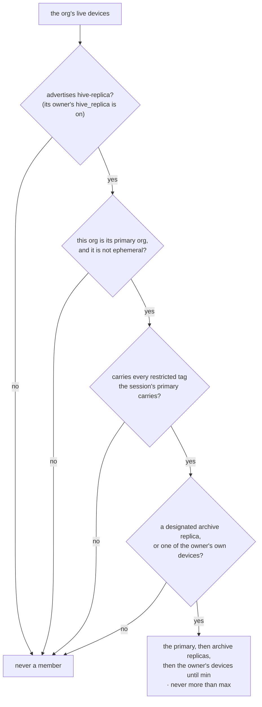

| Rule | Why | Where |
|---|---|---|
| A device holds copies only while its OWN `hive_replica` is on. It advertises `hive-replica` only then, as `hive-adopt` is advertised (`agents/roomlerd/src/encode/caps.rs:1828`), and refuses a join otherwise. `hive_archive` (it offers itself as an archive replica) and `hive_store_quota_mib` are device keys too. None is pushable, and each joins the lock test's list | the gate that survives a compromised server. The code keeps every Hive key out of `DesiredConfig` (`crates/remote_control/src/models.rs:2673`); §3g's "can ever be pushed" is the design's allowance, not the code's | `crates/agent-core/src/config.rs:374` |
| Candidates are the session owner's own devices and the archive replicas an `ADMINISTRATOR` designated, nothing else. "The owner's own" means `enrolled_by` and `owner_user_id` both name the owner | `owner_user_id` is reassignable with `MANAGE_AGENTS` alone, and `enrolled_by` is set once, at enrollment (`crates/services/src/dao/agent.rs:128`, `:1253`): a device manager who hands someone a device must not receive that person's sessions on it | `crates/remote_control/src/models.rs:2072`, `:2076` |
| A restricted tag only ever takes a device out. When no device left may hold a restricted session, the session has fewer copies than `min`, and its room says why | tags are free-form `MANAGE_AGENTS` labels (`crates/modules/fleet/src/agent.rs:1171`); as a filter they cannot widen where a copy goes. Decision 2 names prod ROLES, which are P3's, so until then the session's primary device is what carries the tag | `models.rs:1238` |
| A device that no longer qualifies (a tag taken off, its owner changed, its `hive_replica` off) gets a purge for what it may no longer hold | the rules run again when a device's tags or owner change: fleet calls a new `FleetLifecycle::agent_updated` hook (`crates/core/src/hooks.rs:114`) from its update route, as it calls `agent_renamed` there (`agent.rs:1000`) | |
| Never an ephemeral device (FR-51), never a secondary org's enrollment | an ephemeral row is hard-deleted, and could never acknowledge a purge; Hive frames count only on the primary enrollment (`agents/roomlerd/src/hive/view.rs:291`) | `models.rs:1259` |
| ⚠️ An adopted session is placed nowhere but where it was adopted | decision 11: only its owner sees it, and whoever runs an archive replica can read that replica's disk. It follows the policy once it is a managed session (P2f) | §3h |
| Placement runs when a session starts, when the policy changes, when an archive replica is designated (which back-fills the live and retained sessions it may hold, newest first), when a member goes and when tags change. A session from before P2 is placed the first time its primary connects with the switch on | a session runs on its primary whatever placement finds: replication never blocks a start | |

**Archive replicas, and the image (decision 1).** An archive replica is an always-on device of the
org, enrolled with the org as its primary org. Its owner turned `hive_replica` and `hive_archive`
on, and an `ADMINISTRATOR` designated it. It joins every session the rules allow, keeps each for the
retention, serves a session's room when no other member is online, and answers full-text search. It
runs no session: its `hive_enabled` stays off.

⚠️ **The org runs it, on its own machines.** A replica is a plaintext copy of everything the agent
saw (design §4.4), and encryption at rest is P7. An archive Roomler ran would hold every hosted org's
transcripts in Roomler's cloud, which D1 and the rule that the server never carries plaintext
forbid. Until one is online, the policy page and every room header say a session is readable only
while one of its members is, and "Add an archive replica" mints an enrollment token and shows how
to run the image.

| The image (P2h) | |
|---|---|
| what runs | `roomlerd` from the Linux release build with `hive` and `overlay-netstack`: no capture, no input, no TUN. `Dockerfile.agent-e2e` already builds an agent image this way, with a minimal feature set and an entrypoint that enrolls |
| how it enrolls | once: an entrypoint that finds no config on the volume runs `roomlerd enroll` with an `ADMINISTRATOR`'s enrollment token (single use, 10 min), never an ephemeral key's (FR-51 hard-deletes such a device once it is silent), then `roomlerd run`. The deployment fixes the hostname (a StatefulSet's pod name, compose's `hostname:`): `derive_machine_id` hashes the hostname, the OS and the config path (`crates/agent-core/src/machine.rs:21`), so two archive replicas of one org must not share a name |
| its config | `hive_replica` and `hive_archive` on; `hive_enabled` off, no `hive_accounts`, no `hive_api_key_helper`; `exec_enabled` and `ssh_enabled` off, as by default; `forward_acl.enabled = false`, so it is no tunnel exit (`crates/agent-core/src/acl.rs:43`); `auto_update = false` (`crates/agent-core/src/config.rs:870`): it updates by a new container on the same volume, never by a package installed inside one |
| where its storage lives | one volume, holding the config (the agent token, the WireGuard key) and the store (`<data dir>/hive`, `supervisor.rs:1075`, `store_path`). The volume IS the device: whoever holds it holds every session placed there, and can pose as the device |
| what it can read | every session the rules place on it, in plaintext on that volume, for the retention |
| what it cannot | run a session or call a model; reach the org's network for anyone (no exit, no exec, no SSH); need an inbound port (a stream it serves is reached through hole punching or a relay, as any device's); take a prompt (a view from a replica is read only) |

**Promotion.** A person promotes (design §4.6): the room shows each member's freshness, and the
freshest is preselected. Automatic failover waits for P6's partition suite.

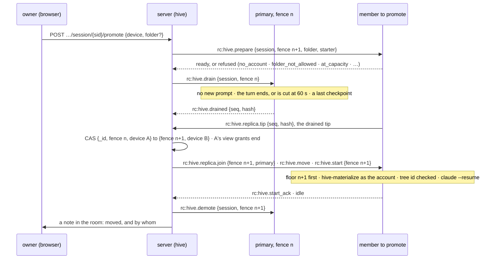

| Rule | Why | Where |
|---|---|---|
| The owner promotes, holding `HIVE_RUN` | a promotion starts the session on a device, as one of its accounts | P2e-3: `crates/modules/hive/src/promote.rs:445` (`authorize`) |
| Prepare first, the CAS last: the target passes every start gate, as it is configured now, before anything moves, and the lease moves only when the target's own tip equals the drained one | a refusal or a stalled sync leaves the session where it was (design §6.2) | P2e-3: `crates/modules/hive/src/promote.rs:1285` (`on_prepare_ack`), `:1799` (`sync_of`), `crates/modules/hive/src/dao.rs:793` (`move_lease`); the target's gates, P2e-5a: `agents/roomlerd/src/hive/supervisor.rs:2419` (`prepare`: a start's gates without its side effects, and the copy, `:2607`) |
| The drain waits for the turn to end, at most 60 s, then cuts it. Open approvals are withdrawn with it, and the resume note names the last tool call that has no result | a turn waiting on a person could not end, and the lease must not move while the old primary may still be calling the model | P2e-4: `agents/roomlerd/src/hive/supervisor.rs:5145` (`take_up_drain`: the approvals withdrawn at once, and one that opens meanwhile, `:5281`), `:5539` (`on_drain_deadline`: the cut, with Claude Code's own interrupt, `:5192`), `:5962` (`finish_drain`: the last checkpoint and the tip); the resume note, P2e-7; the server waits 75 s (`crates/config/src/settings.rs:165`, `hive.promote_drain_secs`) and withdraws on the record what is still open at the move (`promote.rs:1833`) |
| ⚠️ An unreachable primary is waited out. The server promotes away from a primary whose control connection it lost only `WS_RX_DEADLINE + OFFLINE_GRACE + 30 s` (230 s) after it lost it, and closes the socket of one that ignores a drain, to start that clock | by then at the latest, the device's own sidecar has stopped serving the session (`agents/roomlerd/src/signaling.rs:61`, `agents/roomlerd/src/hive/sidecar.rs:69`, `:153`). Before it, two executors could both call the model | P2e-6a: `crates/modules/hive/src/promote.rs:355` (`unreachable_reach`: 230 s, and `hive-lease` in the last hello), `:1616` (`move_from_unreachable`: to the member's own tip); the 230 s held to the device's two clocks by `agents/roomlerd/src/hive/sidecar/tests.rs:968`. As built, no socket is closed (the P2e-6a note below) |
| Every member's floor is the new fence before the new primary writes: the target's with its join, the others' with theirs, an offline member's before anything else it hears when it connects | the old primary's late events are then refused everywhere (`chain.rs:195`) | P2e-3: every join at the move, the old primary demoted first, the target's as the primary before its move and start (`promote.rs:1833`, `:1950`); a member behind the drained tip keeps the old fence's events up to where it ended (`crates/modules/hive/src/model.rs:191`, `fences`), P2e-5b: every join carries them (`crates/modules/hive/src/replica.rs:129`, `push_join`) and the member's store takes an older fence's events up to its end (`crates/hive-node/src/chain.rs:210`, `check_next_with_ends`); P2e-5c: the target takes that join up ahead of its start, raising its copy's floor (`agents/roomlerd/src/hive/supervisor/replica.rs:394`, `ahead_of_start`) |
| The new primary counts turns on from the record's last, which `rc:hive.move` carries with who moved the session and from where | the server ignores a stub older than its newest (`crates/modules/hive/src/dao.rs:524`) | P2e-3: `promote.rs:1943` (`before_start`); the count, P2e-5a: `agents/roomlerd/src/hive/supervisor.rs:1559` (`receive_move`), `:4120` (what the device hosts) |
| A start at a newer fence on a device that still runs an older one stops that run first, and `finish` and `let_go` remove only their own fence's entry | §3d ⚠️: before P2e-1, `decide_and_launch` was idempotent on one fence only and `finish` and `let_go` removed by session, so a second harness would have started, and the old run's end would have taken the new run's model access | P2e-1: `agents/roomlerd/src/hive/supervisor.rs:1905` (`decide_and_launch`), `:3008` (`supersede`), `:3897` (`unlive`) |
| A start refused after the CAS moves the lease back (fence n+2, to the old primary, which holds the copy) | a session is never left on a device that refused it | P2e-3: `promote.rs:2092` (`on_start_refused`), `dao.rs:845` (`move_lease_back`) |
| ⚠️ A replicated session is never launched, nor let call the model, after a start, a restart or a reconnect, until the server has said on THAT connection that this device holds it at that fence: `rc:hive.lease` lets it run (as built in P2e-2: its own frame, not the primary's join, which the replicaset's switch gates), `rc:hive.demote` ends it here. A session with no other member keeps P1's behaviour | before P2e-2, a reconnect cleared the `offline_grace` clock at once and P1d-2's resume launched before the server had said anything: a demoted primary that came back could call the model until the demote landed. AC4 says zero | P2e-2: `agents/roomlerd/src/hive/sidecar.rs:180` (`wait_for_lease_word`), `agents/roomlerd/src/hive/supervisor.rs:3370` (the resume held back), `crates/modules/hive/src/agent_socket.rs:893` (`answer_manifest`) |
| A report from a device that is no longer the session's location is answered with `rc:hive.demote` | before P2e-1, `stop_if_over` returned for any device but the location, so an old primary would never have been told | P2e-1: `crates/modules/hive/src/agent_socket.rs:942` (`demote_if_elsewhere`), from `stop_if_over` (`:843`), the turn and approval reports (`:665`, `:692`) and the manifest (`:917`) |
| The old primary forgets the session in `hosted.json` only at the demote, and stays a member if its `hive_replica` is on (else it leaves, once `min` holds elsewhere), so moving back is a promotion | a crash during a move leaves the session where it was | the forgetting, P2e-1: `agents/roomlerd/src/hive/supervisor.rs:2945` (`demote`); the membership, P2e-3: a member where placement's rules let it hold a copy, else `leaving` (`crates/modules/hive/src/placement.rs:177`, `eligible_role`) |

⚠️ **As built (P2e-3): the old primary is demoted at the move**, in the same breath as the CAS,
not once the target answers its start as the diagram above draws it. From the CAS on nothing
it does at the old fence counts, and stopping its harness before the target's starts is what
keeps two executors from overlapping (AC4). A move back starts it again, at fence n+2. A
target silent after the move holds the session until it answers; nothing moves the lease back
on silence; once the target is unreachable for 230 s, its owner can move it on (P2e-6b).

⚠️ **As built (P2e-4): a drain that cannot go quiet is refused, never forced.** The drain
refuses, and the session goes on where it runs, in two cases:
- a cut turn has not ended 10 s after its interrupt;
- the last checkpoint of a replicated session was not taken.

Once the drain has answered, it is lifted only by the server's word at its fence and ended
only by the demote. No timer on the device lifts it, because the lease may move at any
moment after that answer. The cut uses Claude Code's own interrupt, measured on 2.1.280: the
in-flight model call is aborted, the turn ends with a `result`, and the same process answers
the next prompt (`docs/hive.md` §12).

⚠️ **As built (P2e-5a): a move back puts nothing in place.** The target takes a session that
ran on another device over from its own store's copy. A session moved back to where it ran,
the move's `from` being this very device, comes back to its own state instead: the drain
checkpointed that state there, and nothing ran after. A moved start that cannot take the
session over is refused in fixed words, since the materializer's reasons can name the
account's files; the device's log keeps them. The lease then moves back (P2e-3).

⚠️ **As built (P2e-5b): a session moves about 255 times at most.** Every move keeps where one
fence ended, and a move back keeps a second. A device takes a join naming at most 256 ends and
refuses a longer one whole, since ends taken in part would let some of a fence's events past
the floor and not others. Past that, no member could ever join the session again, so the server
refuses the promotion first (`moved_too_often`), and the session runs on where it is. A member
whose daemon is from before P2e-5b reads no ends: after a move its copy stands still below its
floor until the next move's join reaches it on a newer build.

⚠️ **As built (P2e-5c): the first real promotion found what CI could not.** Fake devices
answer whatever they are sent, so P2e-3's integration tests never met a device's real answer
to the server's real order of frames. Two real devices in one promotion found five gaps, each
fixed with a negative control:
- the target refused its join as the primary, ahead of its start;
- the target, mid-take-over, told its members the session was over, and a whole copy parked;
- a member's ask overtaken by a newer join waited out its 45 s timeout;
- a stop or a park answering an overtaken ask was taken at its word;
- the move back left the session's streams open.

`docs/hive.md` §12 has the detail.

⚠️ **As built (P2e-6a): away from an unreachable primary, the lease moves to the member's own
tip.** The member's ready names where its copy ends, read from its store as it answers, and
the move goes there. Never to a report seconds old, never past where an older fence ended
(`cut_off`), and only to the member that holds the most of the session's chain
(`not_freshest`), counted as a `seq` with each ended fence counting up to its end. The
promotion reaches `syncing` before the primary is asked about a second time, so a primary
that comes back is caught by one or the other. What only the dead primary held is lost, and
the room says so. A copy holding a cut-off tail is never moved to: if a second primary goes
dark before the first has followed it, the session waits for one of them to come back.

The design above also closes the socket of a primary that ignores a drain, to start its
clock. As built it does not. A link that carries one way only is closed already: by the
device, which hears no pong for 80 s, or by the server's reaper, which hears no frame for
90 s, and either close starts the clock. And a drain may take the device 120 s while the
server waits 75 s, so a close would tear a slow, healthy primary's rc, tunnel and overlay
planes, behind a strict corporate VPN relay-locking it, for nothing.

⚠️ **As built (P2e-6b): a target that never answered.** A move's member can go dark before
it answers its start. Its start is now sent again however late it comes back: the window
after which a start is `lost` counted from the record's creation, so a member back from a
short drop lost a session that had run for hours, and it now bounds a first start only. Once
that member has been unreachable for 230 s, its owner can move the session on, as from any
unreachable primary; the move that sent the start is replaced. The record keeps where each
start came from (`moved`): a device takes a session from elsewhere over from its copy, and
one from itself back as it left it, so a move back to a device that never ran the session
must never say it is its own.

**Teleport, the path map and fork.** A teleport is a join, then a promotion.

| Step | Rule |
|---|---|
| prepare | the target's start gates, and on Windows its path refusals (`CON`, `NUL`, over-long) before anything moves (design §6.3 ⚠️). A device that will RUN the session needs `hive_enabled`, not `hive_replica`: the prepare admits it to this one session's replicaset |
| join | a full sync from the freshest member online, a server-class one before a laptop on the DERP floor (design §6.4) |
| the workspace | the target's `hive-materialize` names the commits its folder's repository already holds, and the source packs against them (git's have and want), so a target with a clone of the same repository receives only the session's own changes. A dirty clone is refused, and a sibling worktree offered (design §6.3) |
| promote | as above |
| the path map | `path_maps[] {fence, from {device, folder}, to {device, folder}}` on the record: metadata the server already holds as `location.folder`. Old turns keep their paths, and the resume note says where they live now |

A teleport moves the events, the history, the workspace objects the target lacks and the config
snapshot. Tool outputs in events are capped at 64 KiB (`crates/hive-node/src/stream_json.rs:49`);
the history holds them whole. The only measured rates are the mesh's, over WireGuard: about
56–66 MiB/s server to server (`docs/testing.md:179`), and 0.36–0.41 MiB/s for a corporate laptop on
DERP (FR-81 AC4). At that floor, 120 s carries 43–49 MiB, so AC10's second half is within reach only
for a target that already holds the repository and a session whose history fits. Nobody has
measured QUIC on these carriers; P2k does.

⚠️ **As built (P2f-1a): the devices' half.** A teleport's prepare (`rc:hive.prepare` with
`teleport`) asks every gate a promotion's prepare asks but the copy. One that passes admits that
one session's join, in a new role, `teleport`, for 30 minutes, whatever the target's
`hive_replica`; a join in that role that no prepare admitted is refused `not_prepared`,
`hive_replica` on or not. The join names the record's fence, so the target's floor is the
session's own, and its copy follows the stream as any member's does. A primary's join now takes
the session's first checkpoint at once when no turn runs, and says where its copy ends either
way, so a teleport can wait for its target's copy to reach that tip before it drains: the copy
moves while the session still runs, and the drain moves only what it added. Two parts of the
table above are not built: the full sync comes from the primary, the stream's only source (P2d),
not from the freshest member; and the Windows path refusals cannot come before anything moves,
since the target holds no checkpoint at its prepare, so they come at the take-over. The
server's half, the route and its joining step, is P2f-1b.

⚠️ **As built (P2f-1b): the server's half.** `POST …/teleport` asks a promotion's gates but
the target's membership: a device that holds a copy is promoted to (`already_a_member`). The
primary must be online here: the stream's only source is the primary, so a teleport has
nothing to copy from an unreachable one, and none replaces a move whose start was never
answered. The promotion record carries `teleport` and gains a step, `joining`, between the
target's ready and the drain: the target joins in the `teleport` role, it and the primary are
each sent their join, and the drain is asked once both answered and the target's copy holds
the tip the primary reported since the teleport began. A teleport that fails before the
move, or whose moved start is refused, lets its target go (`leaving`). Measured only on
loopback so far, between two processes on one host; AC10's numbers are the field run's.
The first real-device run found P2f-1a's target refusing its own stream: the member's dial
kept `hive_replica`'s gate (P2d-3b), so a target with it off closed every dial
`replica_disabled`. Fixed here, on the device: a dial for a teleport the device was prepared
for is followed, and a connection of a device that holds no copies follows those copies
only.

⚠️ **As built (P2f-2a): a pack against what a repository holds.** A session's first checkpoint
packs its folder's whole tree, since its commit has no parent (P2b-2), so a teleport's target with
a clone of the same repository would receive what it holds already. `roomlerd hive-pack` asks the
account's own git two questions: which commits a folder's repository holds, and the pack that
brings a commit into a repository holding some of them, thin against those the session's own
repository holds too. ⚠️ Each have's tree is named as well as the commit: `--revs` leaves out what
a negative commit reaches only on the edge, a parent of what is packed, and a first checkpoint has
none, so a pack against the person's `HEAD` alone still held the whole tree. The store keeps the
result as a substitute for the checkpoint's whole pack (decision 16), and the materializer uses it
only where that pack's own blobs are not held. Nothing sends one yet: the stream's half is P2f-2b.

⚠️ **As built (P2f-2b): the stream's have and want.** The server's prepare of a teleport says
`have_want` when `hive.teleport_have_want` is on (default off, decision 16), and the target's
admission then keeps the account and folder its gates passed. For a checkpoint whose workspace
pack is whole, the target asks `hive-pack` which of the checkpoint's `head` its folder's
repository holds, adds the folder's own `HEAD`, and sends `want_pack {commit, haves}` to a source
whose hello said `packs`. While the session runs there, the source packs against them as the
session's account and answers `pack {commit, against, chunks}` on a stream of its own. The target
fetches the chunks as it fetches any blob, keeps them as the checkpoint's substitute, and never
asks for the whole pack's own blobs. On `no_pack`, or from an older source, it takes the whole
pack, as before. A stream carries one want per commit, at most 16. Measured on loopback, between
two real devices: 306 bytes in place of a 27,549-byte whole pack
(`crates/tests/tests/hive_teleport.rs`).

⚠️ **As built (P2f-2c): a whole pack its source holds only a substitute for.** A teleport's
target that took a substitute becomes the primary, and a member that joins later asks it for the
whole pack's blobs, which it does not hold: every such stream ended `blob_missing`. Now a source's
hello lists its stand-ins (substitutes for whole packs whose own blobs are not all held), the
member asks for each by `want_pack` with no haves (or with its folder's, where it has a place to
ask), and the source makes the pack again from its repository as the session's account. Each
launch keeps where the session is worked on in the store, so a session that ended there, no
longer in `hosted.json`, is still packed for. A want with no haves for a whole pack held by its
blobs is answered `held_whole`. ⚠️ A pack made again need not hash the same, but it can: in the
real-device test B's was byte for byte A's (27,551 bytes), so B then held the pack's own blobs too
and stopped listing it.

⚠️ **As built (P2f-2d): a dirty clone refused at the prepare.** A teleport into a folder holding
the person's own work used to fail only at the moved start, after the lease moved, and the session
moved back. Now the target asks its folder at the prepare, as the account (`hive-pack clean`),
what the moved start's own verdict would be with no checkpoint in hand: missing, empty, its
repository's `HEAD`, or this session's last state may take the copy; anything else is refused
`folder_dirty`, a new refusal word, before anything moves. The detail names
`git worktree add <folder>-hive-<the id's last 8 digits>` when that sibling would be under
`hive_roots`; nothing is made for the person, since a folder must exist to pass the gates. A
folder that cannot be asked about is refused `other`, in words.

⚠️ **As built (P2f-3a): a fork, the devices' half.** `rc:hive.start` may name the session it
forks (`fork_of`: its record's id and its harness session), and only a device that advertises
`hive-fork` is sent one. At a fork's first start on a device, its folder is asked as a
teleport's is, then the parent's last checkpoint, as that device's copy holds it, is put in
place as the account under the fork's ids: the parent's own files moved from its project
directory to the fork's, their names kept, and its tree under the fork's refs. The launch is
`--resume <parent> --fork-session --session-id <fork>` until the fork's own history exists,
then `--resume <fork>`; with neither, it is refused rather than started empty. A fork's
allowlist is its own five paths and three of its parent's, for its life, so a copy of it
starts anywhere from its own chain. No copy of the parent here, or one with no conversation
yet, is refused in words. Claude Code starts a fork's first launch as `source: "fork"`, not
`resume` (probed 2026-10-13, §8), so the note that tells the fork it is one rides a second
hook matcher. The fork is made at the last checkpoint the device's copy holds: making that
copy current, the route and the record are P2f-3b. ⚠️ A fork of a fork keeps its parent's
history, which holds the turns further back, but not what the parent kept of its own parent.

⚠️ **As built (P2f-3b): a fork, the server's half.** `POST …/session/{sid}/fork {device_id,
folder, title?}` makes the fork on a device that holds a copy of the session: its primary, in a
folder of its own, or a member that answered `joined`. Only the session's owner may, holding
`HIVE_RUN` (decision 12), where the sketch below said any reader. The fork goes through the
start's own path, so it is a session like any other: its own record, harness id, room and
replicaset, placed as the record is made under the parent's restricted tags. Its record keeps
`parent {session_id, harness_session}`, and every start of it, whoever sends it, carries
`fork_of` and goes only to a connection that advertised `hive-fork`. A promotion or teleport of a
fork to a device that does not start forks is refused. On a member, the route first waits,
within `hive.fork_copy_secs` (30 s), for the member's copy to hold the last checkpoint the
primary reported, else `copy_behind`. A member reports its tip at once, then at most every 5 s,
so in the real-device test the fork took 5.2 s, about 5.1 s of it that cadence. A device with no
copy is refused `no_copy`; joining the parent's replicaset first is P2f-3c. ⚠️ `same_folder`
compares the folder as typed: another spelling of the session's own folder passes the server,
and the device's folder question refuses it unless the folder is a clean repository.

⚠️ **As built (P2f-3c): a fork onto a device that holds no copy.** Such a device no longer
answers `no_copy`. It takes a copy first, by a teleport's steps up to the copy, and the fork is
made there once it has. The move is recorded on the session as a promotion with `teleport` and
a `fork` plan, so the device gets a teleport's prepare for the session, in the fork's folder,
and then its join in the `teleport` role: it needs nothing new. Once its copy holds what the
primary said it holds, the move ends with no drain, the device is let go from the session's
replicaset (it took the copy only to fork), and the fork is made as P2f-3b makes one. A fork
taking a copy moves nothing, so a fork onto a member goes ahead meanwhile, while a promotion, a
teleport or a second such fork waits. `no_copy` now means the session does not run, so no copy
can be taken. ⚠️ The device's admission of its join is never consumed: it lapses after 30 min,
and the copy waits for the purge (P2g).

⚠️ **As built (P2f-3d): a fork into its parent's live folder, refused by the device.** The
server compares the fork's folder with the session's only as typed, and the device's folder
question lets a clean repository at its `HEAD` take the copy, so a fork typed another way onto
its parent's own device and folder passed both. At a fork's first start the device now
compares the resolved folders, when the parent runs there, and refuses `folder_dirty`, naming a
sibling as for any folder holding work of its own. Only a parent running on that device
counts.

⚠️ **As built (P2f-4a): an ended terminal session made a managed one, the devices' half.** The
design left open where the conversation comes from. An adopted session's store holds a mirror:
events, which Claude Code cannot resume. It comes from the terminal's own history: before the
launch resumes it, a child running as the terminal's account (`roomlerd hive-import`) copies it
under the managed session's names. The record stays the same session, at its fence, on the
device that adopted it. Kept at its fence, the chain stays one fence, so a member that joins
later takes the whole of it. A bumped fence would need the adopted fence's end as a fence mark,
and the server never had one: adopted sessions report no tips. Whose terminal it was is the
device's own record, kept as each session ends. A session stopped from Roomler is never made
managed: its terminal went on after the stop. `-p --resume` restores no permission mode a
terminal's history recorded (§8, probed 2026-10-13). The server's half, the route, is P2f-4b.

⚠️ **As built (P2f-4b): the server's half.** `POST …/session/{sid}/manage {folder?}`, for the
session's owner holding `HIVE_RUN`, makes the record a started session at its fence, in one
compare-and-set from an ended adopted one. It keeps `from_terminal`: who asked, when, and the
adopted end and folder. Only an end by the terminal itself (`exited`) qualifies: `stopped` and every other
end are refused. The start goes only to a connection advertising `hive-manage`. Every path that
would have ended a start `refused` or `lost` restores the adopted session instead: the device's
refusal, a start never answered within the window (counted from the asking, not the adoption),
and a device back as a build that cannot take it. The word is kept as `from_terminal.refused`,
and the route answers from that, since a restored record is `ended`. Proven between real
processes with the real hook client (`hive_manage.rs`).

⚠️ **As built (P2f-5): the path map.** Every lease move pushes `{fence, from, to, at}` onto the
record's `path_map` in the compare-and-set that moves the lease, and a move back pulls its move's
entry by fence, since no run started on the device that refused it. `rc:hive.move` carries the
map's `from` places as `earlier`, oldest first, one per folder, the newest 16, and the device's
note names every earlier folder but its own. A session moved before P2f-5 has no entries for
those moves. A start re-sent at a later connection now names the lease move's time: it used to
name its re-send. A fork's note does not take its parent's map: a fork's start carries no move.

Fork:
- `POST …/session/{sid}/fork {device, folder, title?}` makes a new record with `parent_session`, a new
  room, and the forker as its owner. The forker must read the parent and hold `HIVE_RUN`.
- The fork has its own replicaset under the rules, with the parent's restricted tags: a fork of a
  restricted session is restricted.
- The target materializes the parent's last checkpoint and history under the fork's ids, and
  launches `--resume <parent> --fork-session --session-id <fork>`: Claude Code takes the fork's id
  from Hive (§8, probe 5).
- ⚠️ A fork holds its parent's conversation up to the fork. Purging the parent does not purge the
  fork, and the purge says so.

An adopted session is promoted only once its terminal session has ended: the terminal holds the
harness, and two harnesses on one history would both write it (§3d). It becomes a managed session
through every start gate on the target (decision 11's half, §3h). It took no checkpoints, so its
workspace is not carried, and the resume note says so.

**The resume note.** The target composes it (design §6.6) from what the server sends in
`rc:hive.move` (who moved the session and when, and from which device, OS and folder: metadata the
record holds) and from what it knows itself: its own OS, folder and shell, the toolchain drift, and,
from its store, the last tool call without a result. It reaches the model as `SessionStart`
`additionalContext` (`source = resume`), through a hook in the daemon-owned `--settings`, which holds
none before P2e-7 (`supervisor.rs:4644` `write_settings`). The hook runs as the account and prints the note
the daemon wrote into the session's runtime directory, `0600` and the account's, as core memory is
written (`supervisor.rs:4755` `write_memory`). It is recorded as a `note` event and never reaches the
server. If the probe shows `-p` does not apply it, the note goes in as the harness's first input,
marked as Hive's.

As built (P2e-7): the note says who moved the session and when, the device and folder it ran in,
where its earlier turns' paths live now, and the last tool call the store holds no result for. The
OS, the shell and the toolchain drift are not in it yet. The hook is this binary, run as the
account as the toolbelt's relay is: `roomlerd hive-resume-note <file>` prints the note when there is
one (`agents/roomlerd/src/hive/resume_note.rs`). The settings carry it (`supervisor.rs:4644`
`write_settings`), and the note is written as core memory is (`supervisor.rs:4755`
`write_memory`).

**Purges and retention.** Deleting a session writes a tombstone the server keeps until every member
has acknowledged it (design §4.4, AC11):

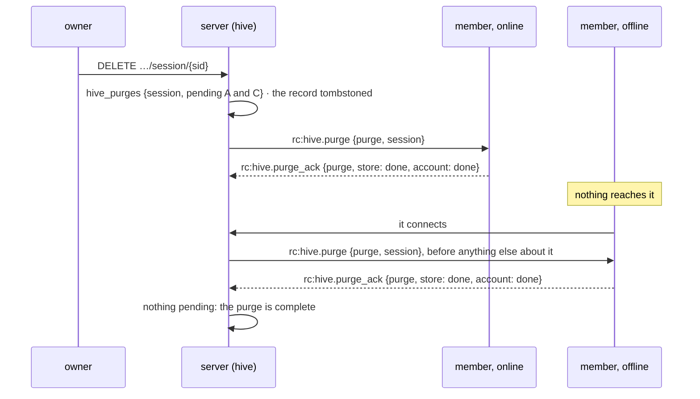

| Rule | Why |
|---|---|
| A member purges what the daemon keeps (events, index, tip: `Store::purge`, `crates/hive-node/src/store.rs:1286`; blobs; membership), the session's runtime directory, and its `hosted.json` and `adopted.json` entries; then, as the account, the session's state directory (Claude Code's config directory) and `refs/hive/<sid>/*`. Never the person's working tree | Hive deletes what Hive keeps; the folder is the person's own work |
| A session live on the member stops first | |
| The acknowledgement says, per part (`store`, `account`), done, not there, or failed and why; a failed part stays pending with its reason | as remote configuration reports back: "done", "never arrived" and "could not" each have a different fix |
| Delivered like a stop: pushed to a member online, re-sent on every connection until acknowledged (`agent_socket.rs:620`) | an offline device converges through the same code as an online one |
| Removal is final: the device keeps the purged session's id and refuses any join or event for it (`purged`). P2k-3: a leaving member's purge of its copy alone keeps no id, so placement may choose the device again | a member back with an old stream must not resurrect it; a member that only left the replicaset is no such member |
| Each member keeps the session's `retain_until`, sent with its join and renewed by the server. Past it, the member purges on its own clock, online or not, and says so in its next manifest | a device that misses a purge must not keep the content by staying offline (design §4.4) |
| A removed device: hive's `agent_removed`, first in `HOOK_ORDER` and run while the socket still exists (`crates/core/src/hooks.rs:46`, `:114`), sends it a purge of everything it holds for the org, and its pending entries then close as `device_removed`. Its credentials are revoked, so nothing more can be asked of it; until P7 its disk keeps what it held | |
| The owner purges, and so does retention | |
| Leaving a replicaset (a tag taken off, `hive_replica` off, a smaller policy) is a purge for that member alone, sent once `min` holds elsewhere | make-before-break, as the mesh moves carriers |

⚠️ **As built (P2g-1): the devices' half.** A device answers `rc:hive.purge` per part, under its
start lock so no start of the session races it. A run of it there is fenced out and stopped first,
and nothing is deleted until its task has let go. The store's part is `Store::purge`, which keeps
the id, plus the runtime directory, the hosted and adopted entries and what is held in memory.
The store purge moves the session's workplace into `purge_debts` in its own transaction, and the
account's part runs from that debt as the account (`roomlerd hive-purge`), held to
`$HOME/.roomler/hive/<sid>` exactly: so a failed account part (a Windows console user signed out)
is retried at the next delivery, and a compromised server's word never names a path. In the
folder's repository only `refs/hive/<sid>/*` and the checkpoints' index go. No server sends a
purge until P2g-2.

⚠️ **As built (P2g-2): the server's half.** `DELETE …/session/{sid}` is the owner's, holding
`HIVE_RUN` (decision 12), and is refused while a promotion is in flight. The purge names every
device the record names. It closes two kinds of part at once: a removed device's
(`device_removed`), and a member's that by its own word holds nothing (`holds_nothing`). That is a
member refused as a secondary organization's enrollment, which ignores every Hive frame, or as
purged already. No write spans two collections, so the purge is written first. The tombstone then
names it, in a compare-and-set that also asserts the record names no other device. A purge is
delivered only while its tombstone names it, so one that never took reaches nobody. The tombstone
is read by nobody, its owner included: a viewer's grant would otherwise stream from a device the
purge has not reached. It drops the names it held of the work at once, and the room, core memory
snapshot and approvals go with the purge. The purge is pushed to a connection advertising
`hive-purge`, and sent first at each connection while a part is pending. An answer lands only on
its socket's own entry. Once nothing is pending the tombstone goes, and the purge stays 90 days.
An adopted session's owner need not hold `HIVE_RUN`, so such an owner cannot purge it until
granted: decision 12's consequence, for the operator to keep or change.

⚠️ **As built (P2g-3a): retention, the server's sweep.** Every `hive.retention_sweep_secs`, one pod
(a claim in `locks`, as the startup lease takes one) purges each session that has been over for
longer than its organization's `retention_days`: the same purge as its owner's, `reason:
retention`. Only a session that is over is swept, counted from its end; a live one renews by its
own activity. The tombstone's compare-and-set requires the session still over, so one made a
managed session again after the sweep read it is kept. This reaches every device that comes back;
the device's own clock, for one that never does, is P2g-3c.

⚠️ **As built (P2g-3b): a purge reaches its device on any pod.** A purge is issued on the pod its
owner's `DELETE`, or the retention sweep, ran on, and a device whose socket was on another pod heard
of it only at its next connection. The devices the issuing pod holds no socket of are now published
on the cluster's control channel, as consent verdicts and admin kicks are, and the pod that holds
each one's socket pushes the purge there, with the hub's own tenant and `hive-purge` checks.

⚠️ **As built (P2g-3c): the retention word, the server's half.** The rule's `retain_until` is, as
built, not an instant but the organization's days and, once the session is over, its end. An
instant for a live session would have to be renewed by the server for as long as the session
lives, and a server that stopped renewing it (a bug, its switch off) would have every member
delete every live session's copy. A device asks on its own connection: at each connection, right
after it takes a session up, and daily. The server answers there only, so no capability word and
no other pod takes part, and a session it says nothing of keeps the device's last word. A member's
manifest naming a copy its clock purged refuses that member's row `purged`. The device's clock, and
its manifest saying so, are P2g-3d.

⚠️ **As built (P2g-3d): the device's own clock.** Each device keeps the server's word for every
session it holds, and purges a copy once that word has passed, online or not, through P2g-1's own
parts with no purge id. Its next manifests name the copy, so the server stops counting it. A live
session's copy is kept while the device is connected, however long, so a server that stops
answering deletes nothing; offline, it goes `days` after the device was last connected. A device
connected throughout keeps an ended session's copy until it hears the end: at its next connection,
in its daily ask, or through the server's own sweep. A word for a session the device holds nothing
of is forgotten, never purged, because purging an id is final.

⚠️ **As built (P2g-4a): a removed device purges what it holds.** The removal hook, with
`hive.replicaset` on and ahead of placement, pushes `rc:hive.purge_all {purge_id}` to the removed
device while its socket is still up. The frame carries an id, for the logs, and nothing else. It
goes from the pod that runs the removal, or through fleet's control channel ahead of the kick,
which unregisters the socket but leaves it open, so a frame queued before it is still delivered.
Since #2267 the kick tells every other connected device to stop (`rc:goodbye AgentDeleted`), but
not one sent this frame: its daemon would exit at once and cut the purge short. Since #2294 a build
that advertises `hive-purge-drain` is told too: it finishes the purge before that exit, bounded,
which also covers a pod roll mid-purge, whose reconnect is refused with the same goodbye. Nothing
answers it.
The device, as its primary enrollment, purges every session it holds: its
store's copies and workplaces, a run (stopped first), a hosted entry, one waiting to resume. Each
goes through P2g-1's parts under the start lock. The device's pending part of each unfinished purge
closes `device_removed` at once, and a purge that waited on it alone completes. A device offline at
its removal keeps what it held, but for its own clock: its next connection is refused before
anything of Hive is sent. The frame goes only to a connection advertising `hive-purge-all`, a word
of its own: `agent-v0.4.136` purges a session (`hive-purge`) but cannot decode this frame, so it
is sent nothing and keeps what it held, as one offline would.

⚠️ **As built (P2g-4b): a member that leaves.** The rule's purge for that member alone is a
`hive_purges` row naming it (`member`) and making no tombstone, so the session goes on as it is.
It is issued once the session holds its `min` copies without the member: its primary while the
session is live, and each member that took its copy and has said where it ends. A member that
joined but has reported nothing may hold nothing yet, so it does not count. Placement's decisions
and each member's tip are where this is looked at. The purge is written first and then named on
the member's row in one compare-and-set, as P2g-2 writes ahead of the tombstone. From then on
placement never takes the member back nor chooses its device again: removal is final on the
device, so a join of it would be refused for ever. The purge's completion drops the member's row.
A member that leaves while nothing can take its place keeps its copy, for as long as the session
falls short without it, or until the session's retention. A member a fork is being made from
(P2f-3c) is let go with the fork's id on its row, in the write that ends the fork's move, and
keeps its copy while the fork may still need it: the fork's first start unanswered with no run
reported (the copy is put in place before the launch), or the fork's record not made yet, for a
start's redelivery window from the fork's id. The fork's answer, and the server's last try at
making it, look again. ⚠️ The first push missed this, and the integration lane's real-device fork
test caught it: the purge reached the fork's device before the fork's start, the device purged
its copy, and the fork never came up there. Every simulated test passed, since a simulated device
answers a start whether or not it holds a copy.

⚠️ **As built (P2h-1): the archive replica image.** The posture is written by the enrollment
itself (`roomlerd enroll --archive-replica`), as `--overlay` writes `overlay_enabled`, so the first
start is already an archive replica; an entrypoint appending keys to the file afterwards would
land them under whatever table came last. It enrolls only into a fresh config, and never an
ephemeral one: the volume is the device, and FR-51 deletes an ephemeral device once it falls
silent. Both refusals come before the single-use token is spent. The image runs as its own
account, uid 10001, whose home is the volume, so the store and every file the daemon keeps live
with the config. Publishing is a dispatch, `dry_run` on by default, rather than the release lane:
a package under the operator's account is theirs to publish, as the self-host image's is (FR-42),
and a new GHCR package stays private until they make it public. The policy page's "Add an archive
replica", which mints the token and shows how to run the image, is P2h-2.

⚠️ **As built (P2h-2): the copies page.** The SPA had no policy page (P2j's), so P2h-2 brings one
with what "Add an archive replica" needs: the policy read back, the archive replicas listed, a
designation, and the token. The rules themselves stay read-only there until P2j. Its server change
is one field: whether the server copies sessions at all, in the answer the SPA already asks for,
so the page and its nav item exist only where they can do something. The snippet's server is the
browser's origin, and an enrollment never sends its token in plaintext to any host but loopback
(FR-101): a lab server needs TLS, or the container a loopback relay to it.

⚠️ **As built (P2i-1): a search grant on the device.** A frame of its own, not a field on the view
grant: a build before it would read `rc:hive.view.grant` and take a search grant for a view of
whatever session it named. Everything after the grant is the view's: the same ack, actor, peer and
frames, keyed by the grant, so a search proves no handshake of its own. The device searches the
copies it holds of the sessions named and never one more: the server can narrow what a member
searches by naming fewer, never widen it, and a device that is no archive replica answers no
search whatever a server sends. A hit is a session and a `seq`; reading the event is a view, the
server's read check again. The answer takes a prompt's shape (`{op, id, ok}`, then `hits` or
`error`) where the plan said `{op: hits}`. ⚠️ The test that proves the log stays silent first
failed for its own reason: with one tracing dispatcher registered, a callsite caches its interest
from whichever thread reaches it first, and the parallel search tests reached the actor's lines on
threads with no subscriber, so the capture saw only the lines its own thread reached first. A
second registered dispatcher makes every callsite ask per event, and positive controls (the
grant's line, the actor's end) prove the capture saw the actor (`docs/testing.md`).

⚠️ **As built (P2i-2): a search, the server's half.** A search grant lives in the view grants'
table, so the device's answer, the peer's frames, the relays and every end of a grant (the browser
leaving, the device's close, a member, device or organization removed) are a view's, with no line
of their own. It views no session (the zero id, which no session's end or move matches), so a move
ends no search: the archive's copy stays where it is. What the asker may read is `may_read`'s rule
applied in one query, the rooms they are in read once, rather than one membership read a session.
The pace comes before any read, since a search's reads are the heaviest a grant makes. A renewal
re-checks the rooms, not the sessions: a purge must not close every search in an organization
whose retention purges hourly, and the device purges its copy anyway. `GET …/hive` reads the rows,
so the SPA's box appears whichever pod answers; the open is decided on the device's pod.

⚠️ **As built (P2i-3): the search box.** The viewer's router moved out of `useHiveViewer` into
`utils/hiveRouter.ts`, unchanged, and a search goes through it: the ws store holds one handler per
frame type, and a search's peer shares every frame type with the viewer's but its first, so a
search that registered its own would silently have taken the viewer's answers away. The peer opens
at the first search and closes after two minutes without one, since a device serves 8 searches,
and a refusal is not asked again for 10 s, so a box typed into cannot spend the 20 opens a minute.
A hit names its session only by id, and the list the page loads holds the member's own sessions:
one read through a room is named generically until its hit is clicked, rather than one `GET` a hit
against the API's per-address limit. The plan said a grant closed `removed` or `not_a_member` is
opened again; as built, every end is, at the next search, which needs no list of words. ⚠️ Its
redial test found the viewer's P0g "asks again after a redial" had never run: it waited for the next
connection's id, but the store clears the id at a close and dials again, so a redial goes through
null. An open peer stayed up until its device closed it, and an open still waiting for its answer
was lost for good ("Asking the device…" for ever, the cold load's symptom). The viewer's unit test
had switched one id straight to another, which the store never does. Both peers now take the drop
as the cue, and the viewer's test drives a redial as the store makes one.

⚠️ **As built (P2j-1): a session's copies, in its room.** The plan was a panel over the record as
it stood, freshness read from each member's tip. That could not work: the server orders copies by
`on_chain`, which counts a tip's `seq` only up to where its fence ended, and the record's fence ends
are not in the view. A tip's `(fence, seq)` compared whole would read an empty copy at a newer fence
as the freshest. So each member's view answers `holds`, by the same function the promotion uses,
moved into `model.rs`, and the panel never disagrees with the move it offers. An archive replica
takes part in `not_freshest` like any copy, though it runs no session: while one holds more than
every device the session could move to, each move is refused, and the panel names it. The panel
reads the record when it opens and after a move answers; it does not follow a move in flight,
which its room does.

⚠️ **As built (P2j-2): move elsewhere, and fork.** The plan had two dialogs. As built they are two
more actions in the same panel, beside Move, sharing its folder field and its answer. A fork may
go to any device that runs sessions, those that hold a copy listed first, since P2f-3c has one
take a copy before the fork starts. Both pickers leave out an archive replica by its own word
(`hive-archive`), as P2j-1's Move leaves one out by its role: it runs no session, so the device
would only refuse.

⚠️ **As built (P2j-3): a session deleted for good.** The plan put the purge beside the other
owner actions; as built it is in the sessions list, since the purge deletes the room the copies
panel lives in. It is offered on the owner's own rows only: the list also holds the sessions read
from a room or a search hit (`fetchSession` keeps them), which only their owners purge. The owner
types the session's title to confirm: it cannot be undone, and it takes every device's copy at
once. The progress is read again every 5 s while a device has not answered, the one place the SPA
follows a purge: the purge goes on without it, and an offline device is purged when it next
connects.

⚠️ **As built (P2j-4): the policy's rules, edited in place.** The plan named a policy page; P2h-2
built the page, and the rules are edited on its policy card, by an administrator, by the write the
designations make: the whole policy. The form writes from the revision it was opened on, never a
later one, and the designations are locked while it is open, so one write at a time goes from one
revision. A policy changed meanwhile comes back a `409`: it is read again and the form shows what
is stored now. Re-basing the edits on it instead would write over the other administrator's change
after all. What the form does not edit is written as read, so a `prefer` word or a rule that only
a newer server knows survives the write. The plan's last piece of UI was missed: an ended terminal
session made a managed one (P2f-4b's route) has no button yet, and is P2j-5.

⚠️ **As built (P2j-5): an ended terminal session made a managed one.** The button sits in the
room beside Copies, where P2f-4b had left it owed. A room opens without the sessions list, so the
room asks itself whether sessions are copied there, once per organization, as the list does. The
record becomes a started session in place, so the store keeps the answer's record: the room's
transcript reads it, and stops treating the session as an adopted one. With it P2j is done in
code, and the field run (P2k) is all of P2 that is left.

⚠️ **As built (P2k-1): a subscription's token through the sidecar.** P2k's field run was to spend
an API key. The operator asked for their subscription's token instead (2026-10-16), and the
sidecar sent only `x-api-key`, which the provider refuses for such a token. The token is told
apart by the prefix Anthropic gives it (`sk-ant-oat`, where an API key begins `sk-ant-api`) rather
than by a setting of its own, so the device owner configures one helper either way. It carries no
workspace, so none is sent with it, and its usage is its owner's: every session on the device
counts against that person's limits.

⚠️ **As built (P2k-2): make-before-break counts what a copy holds.** The field run's tag
change (AC22) let a member go while a replacement joined. The replacement answered its join at
`seq` 0, holding nothing, and the leaving member's whole copy was purged about 30 ms later (on
the devices' clocks), before the replacement held one event. P2g-4b's rule counted "a joined member with a tip". A device
says `seq` 0 at its floor as it joins, because that is how the server learns it did, so the
rule was always satisfied at once. A member now counts only when its copy holds at least as much
as the leaving one's, by the rule a promotion is decided by, and each later tip looks again.

⚠️ **As built (P2k-3): a member that left may take the session again.** The field run's first
AC10 teleport went to a device that had left that session at `min` 2, its copy alone purged
(P2g-4b). The device answered the teleport's join `purged`, "removal is final", and the
teleport never completed. `rc:hive.purge` named only the purge and the session, so the device
treated every purge as a whole session's and kept its id for ever. The frame now says
`leaving: true` for a member's copy alone, on the purge's cross-pod envelope too. Such a
device purges that copy as before but keeps nothing of the session, so a later join starts
from nothing. A device before P2k-3 ignores the word, so the wire stays additive.

⚠️ **As built (P2k-4): the archive replica on the mesh.** The field run's DERP-floor teleport
(AC10) left the archive replica's copy behind: it climbed direct, then relay (refused), then
backed off and climbed again, for 6+ minutes, and never asked on `derp`. A member's ladder holds
that rung only while it has a DERP connection, and the image enrolled off the overlay. The
posture now joins the mesh, in the userspace stack the image was already built with. The
archive's own copies are what the org keeps, so a carrier that never fails matters more for it
than for any other member. A container updates by a new one on the same volume, so an older
enrollment joins at that start, and only there. Outside the image, an owner's own choice of
overlay is left as it is.

⚠️ **As built (P2k-5): the room says how many did not carry over.** AC23's field run partitioned a
primary mid-turn and moved the session away from it. Back, the old primary set aside 9 events and
logged `moved=9`, and the room said nothing of it: the count never left the device. And 9 was not
the loss. The source answered at the newest checkpoint both held (seq 28), so the device set
aside 29–37 and then took 29–33 again from the new primary. Only the 4 it wrote past where its
fence ended (33) were lost. The server now counts it itself. The returning device's tip at the
old fence, less the end the record keeps, is exactly what no copy on the session's chain holds.
The room says so in the device's name, once, as the tip that first crosses the end.

⚠️ **As built (P2k-6): the viewer's chip over a copy.** Reading a member's copy with every other
device offline (AC24), the status chip said "Live from the device", while the read-only note
under it said rightly that this was a copy. The chip took the view's state alone. An open view
of a copy now says "Reading a copy"; one still connecting says "Connecting…", as any view does.

⚠️ **As built (P2k-7): a demoted run's call, at the provider.** The field run saw a demoted
primary call nothing, but only on its own sidecar log (AC4's stale-fence half). No test sent a
demoted run's call through the sidecar to a mock provider; step 126 said CI held such a capture,
and it held none. `a_demoted_run_makes_no_model_call` does now. A run calls at its own fence.
Demoted to a newer fence, its next call, made while the run has not let go yet, is refused
`401 authentication_error`, and so is one after it ended. The provider sees nothing.

**What stops two primaries.**

| A second primary would come from | What stops it | Where |
|---|---|---|
| two promotions at once | the CAS on `{_id, fence: n}`: one moves the lease, the other matches nothing | every device transition is such a CAS (`dao.rs:148`, `:222`); P2e-3: a promotion begins only where none is in flight, and the lease moves only for the record's own (`crates/modules/hive/src/dao.rs:568`, `:793`) |
| a partitioned primary still running | its own sidecar stops `offline_grace` after its connection closed, and the server waits that out before the CAS | `sidecar.rs:153` |
| the old primary reconnecting or restarting | a replicated session runs only on the server's word on that connection | `sidecar.rs:180`, `supervisor.rs:3312` (P2e-2) |
| a demoted run's model calls | the sidecar forwards a call only while the session runs here at its token's fence, and a demote ends that at once | `sidecar.rs:148`; at the provider, `a_demoted_run_makes_no_model_call` (P2k-7) |
| its late events | every member's floor | `chain.rs:195` |
| its reports | the server's CAS ignores them, and answers with a demote | `dao.rs:256`, `agent_socket.rs:942` (P2e-1) |
| its viewers and approvals | the session's grants on the old device end at the CAS (`crates/modules/hive/src/view.rs:863` `end_grants`), and an approval is answered only over a grant | §3c; P2e-3: every view and stream of the session ends at the move, and what the old run had open is withdrawn (`crates/modules/hive/src/promote.rs:1833`) |
| a member that took its tail | the tail is set aside, and the room says how many events did not carry over | the set-aside on the device (P2d-3, `stream.rs` `set_aside`); the count in the room, once, from the record's own end (P2k-5, `replica.rs:364` `note_tail`) |

**How it composes with what is built.**

| Built | P2 |
|---|---|
| the device store (`agents/roomlerd/src/hive/store.rs`) | the writer gains apply, the floor, blobs, the divergent table, purge and search. An applied envelope is published to the live feed like an appended one, so a viewer follows a session from a replica |
| `store_wanted` (`supervisor.rs:1098`) | true also while `hive_replica` is on, so the archive container keeps a store |
| the hosted record and the resume (`hosted.rs`; `resume_once`, `supervisor.rs:3303`) | unchanged for what a device RUNS. Membership is the store's, not `hosted.json`'s; a promotion's target writes its entry at the new fence like any launch; a replicated session's resume waits for the server's word |
| the viewer peer (`agents/roomlerd/src/hive/view.rs`) | a member serves a session it holds on `hive_replica` alone, as an adopted session is served on `hive_adopt` (`:270`), read only. The server picks the member, where today it always names the location (`crates/modules/hive/src/view.rs:249`): the primary while it is online, else the freshest, an archive replica first (design §5.2). P2i adds `search` |
| the server module (`crates/modules/hive/`) | `agent_sessions` gains `replicaset`, `path_maps`, `parent_session` and `retain_until`; `hive_policies` and `hive_purges` come with their indexes in the module's own `indexes()` (`crates/modules/hive/src/lib.rs:261`, FR-69 rule 3); routes `…/session/{sid}/{replicas,promote,teleport,fork}`, `DELETE …/session/{sid}` and `…/hive/policy`; reconcile-on-connect re-sends joins, purges and the lease word; the composition baseline is re-recorded (rule 2) |
| the hive wire (`crates/remote_control/src/hive.rs`, `signaling.rs`) | `rc:hive.replica.*` (`join`, `join_ack`, `want`, `grant`, `ready`, `dial`, `close`, `tip`, `manifest`), `rc:hive.prepare` and `prepare_ack`, `rc:hive.drain` and `drained`, `rc:hive.move` (P2e-3), `rc:hive.demote`, `rc:hive.lease` (P2e-2), `rc:hive.purge` and `purge_ack`: metadata only, field sets locked, each `Owner::Hive` in `namespace()` (`signaling.rs:2655`), refusals decoded leniently (an unknown word still refuses: the prepare's are the start's `HiveRefusal`, the drain's its own `HiveDrainRefusal`), bounds in a `replica_limits` beside `view_limits` (`hive.rs:91`), and the drain's turn cut in `promote_limits`. `RpcCap::HiveReplica` (`hive-replica`), `HiveArchive` (`hive-archive`), `HiveLease` (`hive-lease`, P2e-2), `HivePromote` (`hive-promote`, P2e-3) and `HivePurge` (`hive-purge`), equality-matched: `hive` is a prefix of all five. The test asserting that `hive-replica` is no verb (`models.rs:8141`) changes with them |
| the module DAG | no new edge. `hive → fleet` reads devices' tags and owners, `hive → chat` posts the room's notes, TURN credentials come from the stateless helper, and DERP is the devices' own. Core gains one hook, `agent_updated` (a device's tags or owner changed): a hook is the only way fleet's change reaches hive (FR-69 rule 1) |
| §3g's gates | the device's `hive_replica`, `hive_archive` and `hive_store_quota_mib`: default off, never pushable. The server's: the policy is an `ADMINISTRATOR`'s; promote, teleport and fork need `HIVE_RUN` and are the owner's |

**Probes before code** (P2b, zero-spend, as P1a's contract probe was, §8): what a session's config
directory holds after a few turns, and that no credential is inside the allowlist; a `--resume` on
Linux of a history written on Windows; whether Claude Code ever rewrites, rather than appends to,
its history file; `SessionStart` `additionalContext` under `-p` on a resume; and
`--resume <id> --fork-session` with an id Hive chose.

**P2b's probes, as found** (2026-10-10, §8). Claude Code 2.1.296, the field's version, ran on
Windows 11 and in a Linux container with Hive's argv, layout and environment, against a fake
Messages API, at no model spend. What each finding changes:

| Probe | Found | What it changes |
|---|---|---|
| What the config directory holds | Inside the allowlist: `projects/hive-<uuid>/<uuid>.jsonl` (the history); `projects/hive-<uuid>/<uuid>/subagents/` (`agent-<id>.jsonl`, `agent-<id>.meta.json`); `projects/hive-<uuid>/<uuid>/tool-results/` (each output too large for the context, which the history names by absolute path); `projects/hive-<uuid>/memory/`; and `CLAUDE.md`. No file history: under `-p`, nothing was kept for a `Write` and an `Edit`. Claude Code wrote no credential into any of them. At the root, `sessions/<pid>.<sha256>.key` holds a `peerToken` beside the process's messaging pipe or socket, and stays behind when the process is killed; `sessions/<pid>.json` names the machine; `.claude.json` holds a `machineID` and a `userID` | P2b replicates those five paths, listed by name, never the directory minus exclusions. File history leaves the list, and `launch.rs`'s module comment. ⚠️ The history is content: whatever a tool printed is in it, and every `CLAUDE.md` the session loaded, the account's own `~/.claude/CLAUDE.md` included when the folder is under the home. `printenv` put the session's `ANTHROPIC_API_KEY` there; that token is good only at the primary's loopback sidecar at that fence, and P3's scrub keeps it out |
| ...and outside it | Keyed by the cwd, not the pin: the MCP log (`claude-cli-nodejs/<cwd>/mcp-logs-roomler/`, connection metadata) and a background agent's output (`<temp>/claude[-<uid>]/<cwd>/<uuid>/tasks/`) | Neither is replicated. P2g's purge, as the account, also removes `<temp>/…/<uuid>/` |
| A Windows history resumed on Linux | The allowlist, copied byte for byte, resumed with the same id from another folder, and the model got every earlier turn. Claude Code itself appended the new environment (`Platform: linux`, the folder) and re-read `CLAUDE.md` at its new path. 2.1.280 resumed a history 2.1.296 wrote | `hive-materialize` writes the bytes as they came: no project-directory rename (the pin is the name on every OS), no line-ending change (the JSONL is LF on Windows), no path rewrite. Old turns keep their paths, so P2e's resume note carries what Claude Code cannot know: who moved the session, from where, and the path map, including the old config directory, which `<persisted-output>` pointers name |
| Rewrite or append | The history and the sub-agent transcripts only grow: across turns, exits, `--resume` and `/compact`, every write-open was `O_APPEND`. `meta.json` is replaced by a rename; a tool result is written once | `hive-checkpoint` chunks those two by offset, cut at a line's end so a member never holds half a line, and the rest whole, by hash. A history grows about 120 KB with its first turn and after each compaction (two `prompt_snapshot` entries; a resume added none) and 5–11 KB a plain turn, plus up to 36 KB of a large output kept beside its file |
| `SessionStart` on a resume | It fires under `-p` with stream-json input, with `source: "resume"`, and reaches the model as a `system` message after the new prompt. The history records it, so it returns at every later resume. A hook that prints nothing leaves nothing | P2e's resume note goes in as designed, without the first-input fallback: matcher `resume`, a note printed only when the daemon left one. P1d-2's restarts then add nothing, and each move's note stays in the conversation |
| A fork with Hive's id | `--resume <parent> --fork-session --session-id <fork>` takes the chosen id. With the parent's allowlist under `projects/hive-<fork>/` and the pin `hive-<fork>`, the fork wrote `projects/hive-<fork>/<fork>.jsonl` and left the parent's files as they were | P2f mints the fork's harness id with the record, as `harness_session` is minted. `LaunchSpec` gains a parent, which adds the three flags on the fork's first launch only; after it, `history_path()` exists and the fork launches like any session |

**Sub-phases.** Each is a PR behind its kill switch; §4 tracks them.

| Sub-phase | Builds | Kill switch | Criteria |
|---|---|---|---|
| P2-0 | this design | docs only | — |
| P2a | the member's store: apply, the floor, blobs, the divergent table, purged ids, search and purge on the writer; the tables additive | nothing sends it a frame | — |
| P2b | `hive-checkpoint` and `hive-materialize` as the account, on Unix and Windows; the `checkpoint` event; the probes | taken only for a session the server joined as replicated (P2c) | — |
| P2c | membership and placement: the policy, the rules, `join`, `tip`, `manifest`, the device keys, the `agent_updated` hook | `hive.replicaset = false`; device `hive_replica = false` | AC22 |
| P2d | the carrier and the stream; a replica's read-only view | the same | AC2, AC26 |
| P2e | promotion and fencing, the path map, the resume note | the same | AC4 (its stale-fence half), AC9, AC23 |
| P2f | teleport, fork, an ended adopted session made managed | the same | AC10, AC27 |
| P2g | purges and retention | `hive.replicaset = false` (issued purges wait); `retention_days = 0` | AC11, AC22 (its purge) |
| P2h | the archive replica image | opt-in: an org that runs none has none | AC24 |
| P2i | full-text search on archive replicas | device `hive_replica = false`; no search box while no archive replica is online | AC25 |
| P2j | the UI: members and their freshness, the promote, teleport and fork dialogs, the policy page, a purge | the SPA shows nothing until a record carries a replicaset | — |
| P2k | the field run, in the test org (decision 10) | — | each box above, ticked on its evidence |

AC2 grows to two devices in CI (`crates/tests/tests/hive_canary.rs`). The second is a child process,
because a process holds one supervisor (`supervisor.rs:584`), and the server's `/derp` frames join the
places the canary must not be. As built (P2d-6): the member is the canary binary again, and the
stream rides `direct` on loopback, so in CI no stream frame crosses `/derp` (the tests build carries
no overlay) and that place is the field run's (P2k). AC17 is P5's, because it needs a card. P2 builds its other half: with
every member offline, the room shows the stubs, where the session lives and when each member was
last seen. The box waits for the card.

**P2a, the member's store, as built.** The store and its one writer can now do everything a member
does with what it is sent. Nothing sends them anything yet: no frame, no server change, and no caller
outside tests until the join (P2c), the stream (P2d), the purge (P2g) and an archive replica's search
(P2i). A device's own appends pass the same floor and `purged` checks, and P1 creates neither, so a
running device behaves as before.

| Piece | Where | What its tests pin |
|---|---|---|
| apply | `Store::apply` (`crates/hive-node/src/store.rs:543`); on the writer, `StoreHandle::apply` (`agents/roomlerd/src/hive/store.rs:442`) | the envelope is kept byte for byte, so the member ends on the primary's `(seq, hash)`; a gap, a broken link, a stale fence, the floor and `purged` are each refused, with nothing kept or indexed; the answer comes once it is committed; it reaches the live feed once it lands, and never when refused |
| the floor | table `floors`; `Store::raise_floor` (`:328`, it only rises) and `floor`; `check_next_with_floor` (`crates/hive-node/src/chain.rs:195`) for `append` and `apply` alike, `check_next` unchanged | an older fence is refused before any event of the new one exists, and before a session's first event; the device's own append is refused the same way; with no floor the check is exactly `check_next` |
| the divergent tail | table `divergent`; `Store::set_aside_after` (`:357`) | an older fence's tail leaves `events` and the index, kept as it was, and the event at `seq` is the tip again; a tail holding the floor's fence or a newer one is refused and nothing moves; nothing moves without a floor |
| blobs | tables `blobs` (named by BLAKE3) and `blob_refs` (which sessions hold each); `put_blob`, `put_named_blob`, `get_blob`, `has_blob` (`:442`–`:530`); at most 64 MiB each | the name is computed from the bytes; a peer's bytes sent under another name are kept under neither; a damaged blob is an error when read, and the right bytes mend it; a session reads only the blobs it holds |
| purged ids | table `purged` (`session`, `purged_ms`); `Store::purge` (`:638`) also removes the floor, the set-aside tail, the session's blob references and every blob no other session holds; `is_purged` | an append, an apply, a floor, a set-aside or a blob for a purged session is refused `purged`, a stream replayed from seq 1 included; the first purge's time is kept |
| the writer | `Member` (`agents/roomlerd/src/hive/store.rs:93`): apply, the floor raised and read, a set-aside, a blob put, read and checked, purge, `is_purged`, search; each answered on a oneshot with the store's own error (`WriterError`) | search covers only the sessions named, and an empty list finds nothing. These tests run on Linux, macOS and Windows CI (`hive::`) |

⚠️ The four tables are new (`P2A_TABLES`, `store.rs:80`), each made only when missing, and
`user_version` stays 1 (`:49`). `a_daemon_from_before_p2a_reads_what_p2a_wrote` runs P0a's own
statements, frozen, on a store P2a wrote: every event is served, the chain checks, search finds
nothing set aside or purged, the old daemon appends, and P2a then finds its floor, tail, blob and
purged id again. `origin/master`'s own crate did the same once, outside CI.

Blobs are kept per session, which the design leaves open: a purge must know which blobs are a
session's (a history chunk is the conversation), and a member serving one session's blob must not
hand out another's.

⚠️ "Committed" is SQLite's WAL with `synchronous = NORMAL`: an acked event survives a daemon crash,
not a power cut, so the tip a member reports after a restart is what counts.

⚠️ Open for P2e, found while building P2a. A raised floor refuses every event of an older fence,
that fence's own history included. Three members still need such events: one behind the drained tip
when its floor rises (an offline member gets its floor before anything else), one joining a promoted
session with its floor raised, and one whose tail was set aside to a checkpoint before the promotion
point. Each would be refused for good. P2e must either raise the floor together with the drained tip,
so that an older fence is refused only past it, or raise a lagging member's floor only once it holds
that tip. A viewer following a copy whose tail is set aside keeps a cursor past the new tip and would
skip the new events, so its grant must end there.

As built so far (P2e-3), the first way: the lease CAS keeps where the superseded fence ended, the
drained tip, on the record (`agent_sessions.fences`, `crates/modules/hive/src/model.rs:191`), the
one moment the server holds it, and a move back keeps the target's fence as ending there too. Every
view grant of the session ends at the move. As built in P2e-5b, every join carries the marks, and
the member's store takes an older fence's events up to its mark, at the mark only the event that
fence ended with (`crates/hive-node/src/chain.rs:210`). P2e-5c advertises `hive-promote`:
promotion is on.

### 3c. Chat and the viewer peer

A session is a `Secret` room with a generic `binding = {module, ref}`; turns are stub messages by an
agent author (`AuthorType::Bot`); prompts and approval answers travel peer-to-peer. Opening a room
renders stubs at once and opens a data-only WebRTC peer to a replica, behind a server-minted view
grant that the replica confirms before the browser dials. Assistant text goes through the existing
markdown allowlist (`ui/src/composables/useMarkdown.ts:57-62`); terminal blocks and diffs are
components, never HTML strings. ⚠️ Viewer peers are `close()`d explicitly — dropping one frees
nothing.

**The viewer peer as built (P0d-2).** The handshake rides the control WS; the content never does.

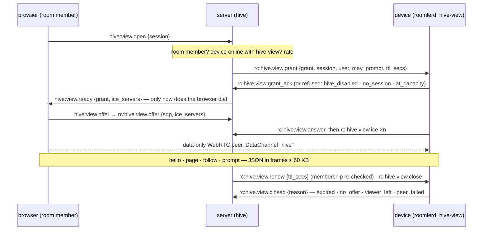

| Piece | Rule | Where |
|---|---|---|
| capability | `hive-view`, equality-matched — `hive` is its prefix and means "runs sessions", not "serves them" | `models.rs` `RpcCap::HiveView` |
| grant TTL | RELATIVE (`ttl_secs`, 10 min): the device starts its own clock, so clock skew cannot expire a fresh grant | `hive.rs` `view_limits` |
| device gates | primary org, `hive_enabled`, holds the session (live, or in its store), ≤ 8 viewers per session and ≤ 32 per device | `roomlerd/src/hive/view.rs` |
| one actor per grant | owns the peer, the timers and the channel: the one place `close()` runs; handlers capture a channel, never the peer | `view.rs` `run` |
| browser-facing ICE | as remote control's: the overlay interface kept out, `.local` candidates resolved by the OS, `ICE_RELAY_TCP` honoured; the answer goes before the device's candidates | `view.rs` `answer` |
| framing | one SCTP message over 65,536 bytes is silently LOST, so each JSON message travels as binary frames `[v1][id u32][part u16][parts u16][≤ 60,000 bytes]`, reassembled under bounds | `hive/framing.rs` |
| server gates | org AND room membership (anyone else: `not_found`, the answer a bogus id gets) · device online here with `hive-view` · ≤ 4 grants per browser connection · 20 opens / min per (user, session); `ready` only after the device's ack, a silent device is `no_answer` after 10 s | `crates/modules/hive/src/view.rs` `open` |
| whose frames count | a grant belongs to ONE browser connection and ONE device; anything else naming it moves nothing; device frames ride the per-connection ordered queue (answer before candidates) | `view.rs` `ready_grant_of`, `on_device_frame` |
| TURN credentials | minted per grant, the same for both ends, with a **12 h** TTL — the credential bounds the allocation's whole life, and the config TTL (600 s) would cut a relayed viewer at ten minutes | `turn_creds::ice_servers_for_session_with_ttl` |
| ops | `hello`, `page {after, limit}` (≤ 500 events, ≤ 1 MiB), `follow {after}` (subscribe first, then catch up: no gap, no repeat), `unfollow`, `prompt {id, text}` (only with `may_prompt`; attributed to the viewer) | `view.rs` `on_request` |

**Who takes part, as built (P1c-1).** A room has members; a session has drivers (design §4.5). The
owner names both, and only a driver's "ask the agent" travels to the harness. Everything else anyone
writes in the room is ordinary chat.

| who | reads it | prompts it, answers its approvals | stops it, names its drivers |
|---|---|---|---|
| its owner | ✅, even out of its room | ✅ while it is live | ✅ |
| a driver the owner named | ✅ | ✅ while it is live | — |
| another member of its room (a reader) | ✅ | — | — |
| anyone else, in the org or not | — (a 404, like a bogus id) | — | — |

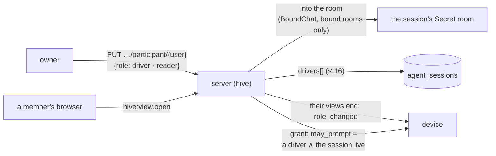

| Piece | Rule | Where |
|---|---|---|
| naming a driver | the owner only. The person must hold `HIVE_RUN`: driving runs code on the device as the session's account, and a driver answers its approvals too. **403** otherwise, audited `no_permission`. At most 16 besides the owner, held by the update's own filter | `crates/modules/hive/src/participants.rs` `set`, `dao.rs` `set_driver` |
| the room | membership through chat's module surface, for rooms bound to that module only (`BoundChat::add_bound_member`); chat's own `join` still refuses a Secret room to a non-member | `crates/modules/chat/src/bound.rs` |
| a grant | `may_prompt` = a driver and the session live, as minted. A change ends the person's views of that session (`role_changed`), and the one they reopen is minted afresh | `view.rs` `open`, `end_session_grants_of` |
| the device's word | `answered_by` and a turn's `prompted_by` are believed only when they name a driver, so no stub names anyone else | `room.rs` `approval`, `turn_stub` |
| the push | an approval goes to every driver still in the room | `room.rs` `notify_approval` |
| leaving | a member removed from the org is dropped from every session's drivers, so rejoining hands back no seat. The owner reads their own session even out of its room, because a Secret room cannot be re-entered | `hooks.rs` `member_removed`, `access.rs` `may_read` |
| transparency | every change is a note in the room: who may prompt the agent is for everyone there to see | `participants.rs` |
| the device's own gate (P1c-2) | the server names drivers; the DEVICE decides whom it lets act as one of its accounts. A driver other than the session's starter prompts and answers only when this device's `hive_accounts` maps them, by id or by a proven address, to the account the session runs as; otherwise the view is read only and `hello` says why (`driving_refused`). The starter is recognised by id from the start order, never through the map: a server before P1c-2 sends no address. Only a driver's grant carries the address | `roomlerd/src/hive/supervisor.rs` `drives_here`, `view.rs` `view_grant` |
| the model is told who asked (P1c-2) | the harness reads `[Name] …`; the transcript keeps the prompt as typed with its author beside it. A slash command goes as typed. The name is a label: brackets and control characters dropped, 64 characters at most | `crates/hive-node/src/launch.rs` `attributed_prompt` |

**The model sidecar as built (P0e).** The provider's key never enters a session.

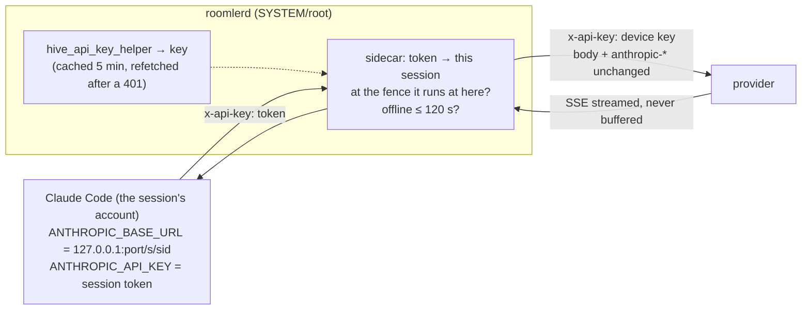

| Piece | Rule | Where |
|---|---|---|
| the key | the DAEMON runs `hive_api_key_helper`; the session's settings carry no `apiKeyHelper`, so nothing in the session can print it | `roomlerd/src/hive/sidecar.rs` `run_key_helper` |
| the token | 256 random bits per run, bound to (session, fence), minted just before the harness starts and taken back if it does not; each run revokes exactly its own token when it ends, so a run ending as the session starts again here cannot take the new run's | `sidecar.rs` `Tokens` |
| the paths | exactly `POST /v1/messages` and `POST /v1/messages/count_tokens` — what Claude Code's gateway contract needs; anything else `404 not_found_error`, `HEAD /api/hello` (its warm-up probe) harmlessly too. The device's key opens more than inference: the Files API holds every session's uploads under it, and a batch runs on after its session and its fence. `/v1/models` is left out: Claude Code calls it only under `CLAUDE_CODE_ENABLE_GATEWAY_MODEL_DISCOVERY=1`, which Hive does not set | `sidecar.rs` `forwarded` |
| the fence | a call is forwarded only while the session runs HERE at the token's fence — a stopped session, or a stale primary after a move, spends nothing | `Supervisor::sidecar_admit` |
| `offline_grace` | 120 s after the primary connection closed (and no newer one took its place), calls are refused `503 overloaded_error`; they flow again on reconnect. "Closed" is the agent's own verdict: a half-open socket (a TLS-inspecting middlebox still ACKing) counts as up until the receive-liveness deadline ends it (`WS_RX_DEADLINE`, 80 s, `signaling.rs`), so a partitioned primary's worst case is about 80 s + 120 s | `Supervisor::lost_connection` |
| the forward | method, path, query, body and headers unchanged except `x-api-key` / `authorization` (the device key swapped in) and hop-by-hop; the response streamed back as it arrives with its headers; refusals in the provider's error shape | `sidecar.rs` `handle` |

**P1f-1, the transcript's renderers, as built.** A tool call is drawn by its tool, and its result is
folded under it, matched by `tool_use_id`. A call that waited for an approval is drawn by its
approval card instead — the input the answer applies to — and its result after the answer, so the
transcript reads in the order things happened. A result whose call is outside the loaded window
stands alone. Everything is in the browser; the wire is unchanged.

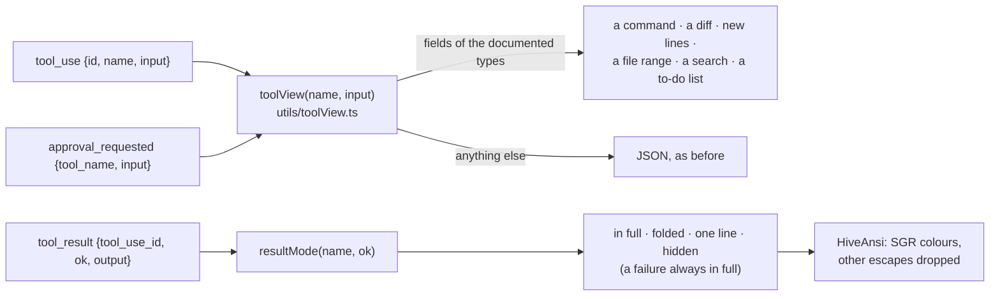

| Tool | The call | Its result |
|---|---|---|
| `Bash` | `$ command`, its description, "runs in the background" | in full, coloured |
| `Edit`, `MultiEdit` | the file, then each edit as removed and added lines; long runs of kept lines folded (3 lines of context) | its first line |
| `Write` | the file, how many lines, the first 40 as additions | its first line |
| `Read` | the file and its line range (`offset` to `offset + limit − 1`) | folded behind its line count |
| `Grep`, `Glob` | the pattern, then where | folded |
| `TodoWrite` | the list, each item to do, in progress or done | hidden |
| `WebFetch`, `WebSearch`, `Task` | the URL as text (never a link), the query, the sub-agent's task | folded |
| anything else, an MCP tool, a field of the wrong type | JSON, as before | in full |

| Rule | Why |
|---|---|
| ⚠️ Every string is the model's or a tool's, rendered by text interpolation; no `v-html` but assistant markdown through `renderMarkdown` | the one XSS boundary stays the one it was. A hostile `` in a command, a path, a diff line, a to-do or coloured output is text (a test per tool) |
| Colour comes from SGR only, as runs styled from a fixed set: a palette index 0–15, an RGB triple of integers, five flags. Other escapes are dropped, an OSC hyperlink keeps only its text, `\r` starts the line over | output can neither inject markup nor name a class or a style; a progress bar shows its last state. At most 4,000 styled runs, then plain (`utils/ansi.ts`) |
| A diff is a longest-common-subsequence table over the changed middle when it holds ≤ 250,000 cells, else every old line removed and every new one added; a side over 2,000 lines is not diffed | the truth, bounded (`utils/lineDiff.ts`) |
| An approval shows its input the same way, and is the call's only card | a driver approves an `Edit` looking at the diff, not at JSON with escaped newlines; field 2026-10-08: drawn twice, the call's result showed above the approval it came after |

**P1f-2, the long list.** While the transcript follows the newest events it keeps at most 1,000
(`keep`). The oldest go back to the device, one "load earlier" away (`useHiveViewer.trimEarlier`), and
never while someone reads further up. ⚠️ Not `content-visibility`: tried first, it made the first
scroll to the bottom land short in the field (an event off screen counts at its estimated height until
it is drawn, so the bottom moves once it is), and the window already bounds the page.

### 3d. Sessions, promotion and teleport

A session runs as the account the device maps the user to (`hive_accounts`), under `hive_roots`,
never SYSTEM/root; Windows reaches only the console user and refuses `no_console_user`. Each session
has its own Claude Code config directory with a pinned project name, launched headless on
stream-json with daemon-owned `--settings` and `--mcp-config` regenerated on every start. The
fence-bound session token gates every model call (a loopback sidecar) and every toolbelt call.
Promotion onto a replica is a lease move plus a local checkout; teleport joins the target to the
replicaset first. The updater defers while a turn runs.

⚠️ **P0 never bumps a fence** — the server creates a session at fence 1 and re-sends that fence —
so a session runs at most once per device. P2's promotion has to make a start at a NEWER fence
supersede an older run still live on the same device (stop it, then launch): as built,
`decide_and_launch` is idempotent only on the same fence, so it would start a second harness, and
the older run's `finish` would drop the newer run's live entry, and with it the newer run's model
access (`roomlerd/src/hive/supervisor.rs`).

⚠️ **A daemon restart leaves its sessions live on the server** (found in the field, 2026-10-08).
The reconcile on connect re-sends only `starting` and `stopping` sessions
(`crates/modules/hive/src/agent_socket.rs` `reconcile_on_connect`). Live ones rely on the device's
replay of its last reports, which a restarted daemon no longer holds, so the record reads `idle`
with no harness behind it. Stop clears one: the device answers "not running on this device" and
the record ends. The fix is a manifest of the sessions the device runs, sent on connect so the
server ends the rest, or P1's resume, which makes the session survive the restart. *Fixed by the
manifest in P1b. P1d-2's resume makes a session outlive a restart, and the manifest, sent after the
resume, names it.*

⚠️ **The manifest ends what the device has said it runs, and not only what it accepted**
(`crates/modules/hive/src/dao.rs` `running_on_device`). The evidence is its answer to the start
(`accepted_at`) or a run state only its own report sets (`SessionStatus::LAUNCHED`: `idle`,
`running`, `awaiting_approval`), the same rule the start route's answer reads. The state usually
lands before the answer, so a socket that drops between the two leaves `idle` with no `accepted_at`.
Reconcile never re-sends that session, because it is no longer `starting`. With `accepted_at` alone it
outlived its harness for ever. The P1b field run found one, 2026-10-08. A start the device has said
nothing about (`starting`, or `stopping`, with no `accepted_at`) stays reconcile's.

⚠️ **A device that comes back without `hive` ends what it ran** (found in the field, 2026-10-10).
Such a build runs no session and sends no manifest, so a Windows device that updated itself to
0.4.123, whose build has no `hive`, left its accepted session `idle` for ever; a crash-loop rollback
or a build made without `hive` does the same. The reconcile of a connection the hub records without
`hive` now ends those sessions as an empty manifest would, before it reads what is pending, and it
reads only its own registration: a connection a newer one displaced, or one already gone, decides
nothing (`crates/modules/hive/src/agent_socket.rs:1005`, `crates/modules/fleet/src/hub.rs:2669`
`agent_supports_hive_on`).

**Updates and restarts (P1d).** Today a session's harness is the daemon's child: an update, a crash
or `systemctl restart` kills every harness, and P1b then ends the sessions. P1d is in two steps.

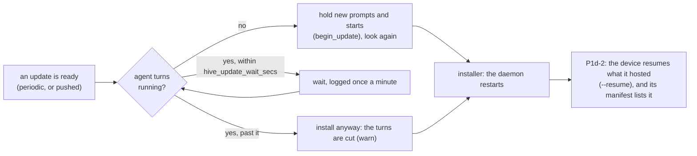

| Step | Rule | Where |
|---|---|---|
| P1d-1, the wait (AC7) | an update waits for running turns (`running` or `awaiting_approval`), at most `hive_update_wait_secs` (30 min; 0 never waits), logged when it starts and once a minute; it holds a **pushed** update too, since a person asked for the update, not for their agent to be cut. Once no turn runs, new prompts and starts are refused **before** a last look, so none begins in the gap; one admitted before still runs and is waited for. An installer that fails to start releases the hold | `roomlerd/src/updater.rs` `wait_for_agent_turns`, `hive/supervisor.rs` `turns_running` · `begin_update` |
| P1d-2, the resume (AC20) | the device keeps what it hosts on disk, and the next daemon resumes each session at its first connection, before the manifest, with every gate applied again; Claude Code is relaunched with `--resume` and the launch rebuilt in full; the turn count carries on; a turn the restart cut is reported interrupted and its open approvals withdrawn. Below | `roomlerd/src/hive/hosted.rs`, `hive/supervisor.rs` `resume_once` · `resume` · `went_down_with_daemon` |
| P1h-2, the macOS helper's hold (AC7 on macOS) | macOS installs from a root helper (`com.roomler.update`), never from the daemon, so the daemon cannot wait in-process. Before `installer(8)` the helper asks the root daemon, over its system LocalAPI socket, to hold (`HiveUpdateHold`, root only). The daemon runs the same wait and answers `HiveUpdateHeld {waited_secs, cut}`, then refuses new prompts and starts until that connection closes. A successful install has restarted the daemon by then; a failed one takes prompts again. A missing, older or silent daemon (a 2 h ceiling) gets the install it got before | `crates/localapi` `Request::HiveUpdateHold` · `serve_connection_as`, `roomlerd/src/updater.rs` `hold_for_install` · `hold_daemon_for_install`, `localapi_state.rs` `hive_update_hold` |

⚠️ `roomlerd self-update` (the CLI) does not wait: it is an operator's explicit command in another
process. Windows's update path gets the wait with its sessions (P1i).

⚠️ The hold is bound to the helper's connection, not to a timer. A helper that dies mid-wait
releases it, and so does an install that fails. Nothing else may place one: the verb is refused
to every peer but root, because a hold refuses every new prompt and start on the device.

**P1d-2, the resume, as built.** A restart still takes every harness down: under systemd
(`KillMode=control-group`) a stop sends SIGTERM to the daemon and then, a moment later, to every
process in its unit, the harness and its tools included. What changes is what the daemon does
about it.

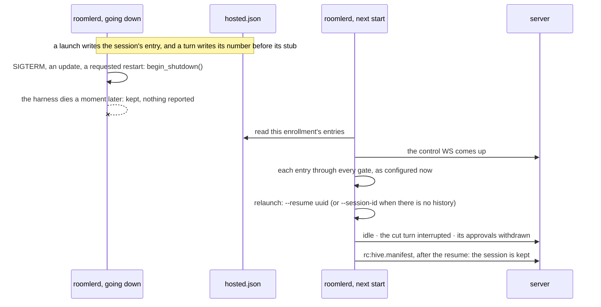

| Rule | Why |
|---|---|
| The device keeps `hosted.json` beside the replica store (root's, `0600`, written whole). Per session it holds the launch's inputs (fence, account, the folder as asked, the starter and their address, Claude Code's session id), the turns begun, the turn in progress with who asked for it, and its open approvals | after a restart the device holds nothing else: the replay of its last reports lived in memory |
| A new turn's number and a new approval are written **before** the frame that tells the server, and so is a turn's end. An approval's end is written after its frame | the server ignores a stub for a turn older than its newest, so a reused number would silence every later stub. The server edits a turn's stub to whatever comes last, so a finished turn must never be reported cut. A withdrawal sent twice changes only an approval still open |
| A harness that ends without being stopped waits 1 s before its end counts. If the daemon was told to stop by then, the session is **kept**, and nothing is reported: no `ended`, no cut turn, no withdrawal. The daemon is told by `begin_shutdown`, the moment its shutdown is signalled, by whatever signals it (an update, a requested restart, a rollback, SIGTERM, Ctrl-C), before its connections close | as built before, the daemon reported `ended` for every session it was taking down, and the server ended them |
| From `begin_shutdown` on, what the device hosts is **frozen**. The session task ignores the toolbelt, and new prompts and starts are refused ("this device is restarting") | the teardown withdraws the approvals and cuts the turn, and the frames saying so go into closing connections. Recorded, they are lost twice: on the wire, and because the next daemon finds nothing left to report. Found in the field: an approval the teardown withdrew stayed "needed" |
| The next daemon resumes at its **first connection** of the primary enrollment, once, and that connection's manifest waits for it (at most 60 s) | a manifest sent first would leave the resuming sessions out, and P1b would end every one. A device that never comes back online launches nothing |
| Every gate a start passes is passed again, as the device is configured **now**: `hive_enabled`, the starter mapped to the **same** account, the folder inside `hive_roots`, capacity, a harness. A refusal ends the session with its reason ("not resumed after the device restarted: …") and forgets it | an owner who turns sessions off, or remaps an account, and restarts must not find the session back. Its history is in the account it ran as |
| `--resume <uuid>` when Claude Code's own history exists (`<config dir>/projects/hive-<uuid>/<uuid>.jsonl`, `LaunchSpec::history_path`), `--session-id` otherwise. This holds for every launch, a start the server re-sends included | Claude Code refuses both other ways round: "Session ID … is already in use", "No conversation found" (2.1.293, probed 2026-10-08). A re-sent start after a crash used to fail the first way |
| The launch is rebuilt in full; the turn count carries on from the file; the cut turn is reported `interrupted` naming who asked; its approvals are recorded and reported `withdrawn`; the transcript says the session resumed, and which turn was cut | a resume restores neither `--settings` nor `--mcp-config` |
| The first turn of a resumed process reports no cost; every later turn reports what it cost | Claude Code restores its running total from the history's last `cost-state` entry, which only a clean exit writes, so where that process starts counting is not known on the device. No number is better than a wrong one |
| A stop that arrives before the session resumed ends it with no launch | |
| A session resumed 3 times in a row, each time without outliving the resume by 2 min, is ended instead | a resume that takes the daemon down must not become a crash loop |

⚠️ Prompts waiting behind a turn are lost when a restart cuts it. A queue exists only while a turn
runs, and an update waits that out (P1d-1). A crash, or a stop past the wait, cuts the turn, and the
transcript and the stub say so.

⚠️ `hosted.json` is not synced to disk. A clean stop, a restart and a crash all keep it. A power cut
may lose its last change, and then P1b's manifest ends what could not be resumed.

**P1h-1, sessions on macOS, as built.** The supervisor, the toolbelt, the sidecar and the viewer
were Linux-only by a `cfg` at forty-odd sites. P1h-1 compiles them for macOS too, behind one
`cfg(hive_host)` that `build.rs` sets for the `hive` feature on Linux and macOS. It makes explicit
the one behaviour that differs: who takes a harness down when the daemon leaves.

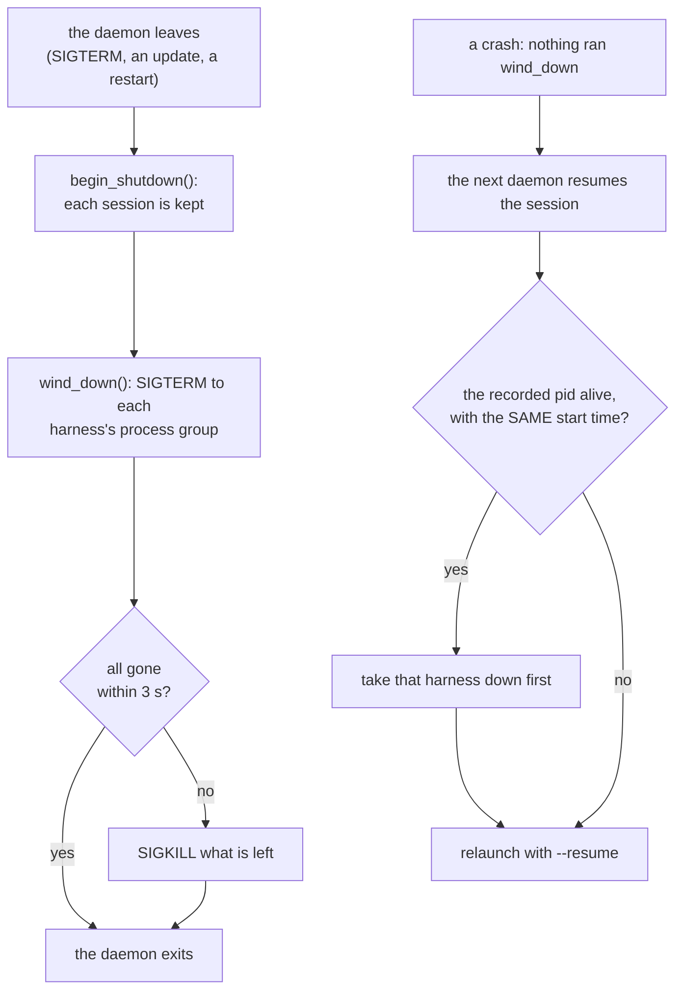

| What | Linux | macOS | Where |
|---|---|---|---|
| what builds the pillar | the `hive` feature | the same, from P1h-1 | `agents/roomlerd/build.rs` `hive_host` |
| each session's runtime files (settings, MCP config, toolbelt socket) | `/run/roomler-hive` | `/var/run/roomler-hive`, which macOS clears at boot | `hive/supervisor.rs` `RUNTIME_DIR` |
| the harness, with `hive_harness` unset | `~/.local/bin/claude`, `/usr/local/bin/claude`, `/usr/bin/claude` | the same, with Homebrew's `/opt/homebrew/bin/claude` before `/usr/bin` | `hive/supervisor.rs` `resolve_harness` |
| a harness's process group when the daemon leaves | systemd's `KillMode=control-group` kills it; `wind_down` does too, for a daemon systemd does not run | launchd does **not** kill it; `wind_down` does: SIGTERM, then SIGKILL after 3 s | `hive/supervisor.rs` `wind_down`, `hive/procs.rs` `take_down` |
| a harness a crash left running | taken down before the resume: two harnesses on one Claude Code history would both write it | the same | `hive/supervisor.rs` `reap_leftover` |
| a process's identity across time | the boot id and `/proc/<pid>/stat` field 22 | `proc_pidinfo(PROC_PIDTBSDINFO)`'s start time | `hive/procs.rs` `started` |

⚠️ A recorded pid is never signalled on its own. The start time recorded at launch (`hosted.json`
`harness_pid`, `harness_started`) must still match, so whatever holds that pid since is untouched.
Pids 0 and 1 are refused, because `kill(0, …)` is the daemon's own group and `kill(-1, …)` is
every process.

⚠️ **A link only root could have made is followed (P1h-3).** The store's directory is locked to
the daemon with no link on its way (`private_dir`, `hive/supervisor.rs:572`). FR-85's
recording-folder check refuses every link, and on macOS the root daemon's data directory is under
`/var/root`, where `/var` is the system's own link to `/private/var`: a Mac opened no store and
refused every session "/var is a symbolic link" (§8, 2026-10-10). `untrusted_link` (`:581`)
follows a link that root owns, in a directory that root owns and that nobody else may write to,
since only root could have made it, and refuses any other, as before.

⚠️ CI gains a macOS step (`cargo check` and `cargo test -- hive::` with `--features hive`).
Before it, the supervisor had never compiled for a Mac. The run on a real Mac is P1h-3.

**P1i, sessions on Windows, as designed.** Design §0.1 (D2) and §4.2: a Windows device runs a
session as the user signed in at the console, never as SYSTEM and never as anyone else. With
nobody signed in it refuses `no_console_user` (already on the wire since P0b). The supervisor P0–P1h
built is Unix-shaped at the points below. Each gets a Windows counterpart built from code the
daemon already ships. `cfg(hive_host)` grows to Windows only once all of them are in, and the
Windows release build gains `hive` last (P1i-3), so a half-built launcher never answers a start.

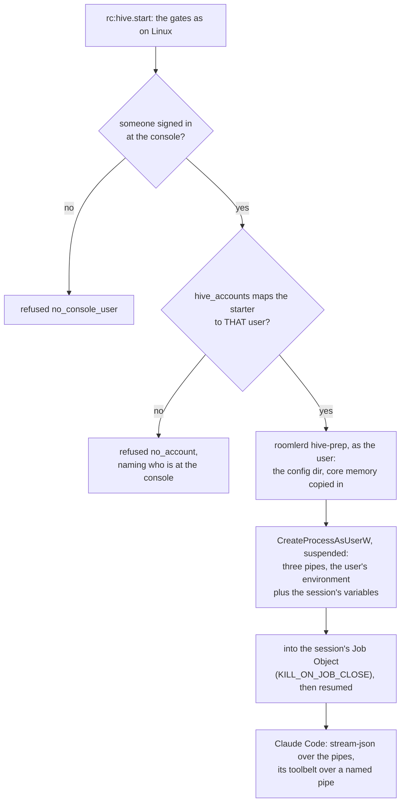

| Unix (P0–P1h) | Windows (P1i) | Built from |
|---|---|---|
| `apply_run_as` (setuid) and the `/bin/sh` wrapper | the console session's token: `WTSGetActiveConsoleSessionId` → `WTSQueryUserToken` (the daemon must be SYSTEM) → `CreateProcessAsUserW` with stdin, stdout and stderr piped, and the user's environment block plus the session's variables (`CLAUDE_CONFIG_DIR`, the sidecar's URL and token) | `win_service/supervisor.rs` `spawn_in_session_captured` (FR-89's exec streams), which gains extra variables and a suspended start |
| the account `hive_accounts` maps the starter to | the map must name the console user (`user` or `DOMAIN\user`, case-insensitive). A starter mapped to anyone else is refused `no_account`, and the refusal says who is at the console | `hive/gates.rs` `account_for` |
| the wrapper, run as the account: the config dir, the core-memory copy into an empty place | `roomlerd hive-prep`, a hidden subcommand the daemon runs as the console user and waits for, doing exactly that | new, small |
| the harness: `hive_harness`, else `~/.local/bin/claude` and the system paths | `hive_harness`, else the native installer's `%USERPROFILE%\.local\bin\claude.exe`, else npm's `%APPDATA%\npm\claude.cmd` (run through `cmd /c`, inside the same job) | `hive/supervisor.rs` `resolve_harness` |
| the harness's process group (`process_group(0)`, `kill(-pgid)`) | a Job Object per harness with `JOB_OBJECT_LIMIT_KILL_ON_JOB_CLOSE`. The harness is created suspended and assigned before it runs, so none of its tools escapes. `wind_down` and a stop end the job; a crash's leftover is found by pid and creation time | `pty/windows.rs` (the PTY's job) |
| the toolbelt's Unix socket, the account's, the peer's uid checked | a named pipe `\\.\pipe\roomler-hive-<session>-<nonce>`, created with `FILE_FLAG_FIRST_PIPE_INSTANCE` and a DACL of SYSTEM plus the console user's SID. The client's token is checked on connect | the LocalAPI pipe (`crates/localapi`), `recording/launch.rs` |
| `procs::started`: the boot id and `/proc` start time | `GetProcessTimes`'s creation time | new |
| `/run/roomler-hive/<session>` (settings, MCP config) | `%ProgramData%\Roomler\hive\run\<session>`, SYSTEM's, with read for the console user | new |
| the update wait (P1d-1) | the same `wait_for_agent_turns` in the in-process MSI updater, once `hive_host` covers Windows | `updater.rs` |

**P1i-1, the building blocks, as built.** Each is unit-tested on Windows CI: the Windows overlay
clippy lane now lints `hive` and runs `hive_win` and the whole `win_service::supervisor` suite,
which ran in no lane before. Nothing calls them yet. The supervisor is wired to them in P1i-2.

| Block | Where | What its tests pin |
|---|---|---|
| a Job Object: `KILL_ON_JOB_CLOSE`, no breakaway | `win_service/supervisor.rs:2160` `JobObject` | ending the job ends what its process started (`cmd` and its `ping`); closing its last handle ends its processes |
| the start into the job | `win_service/supervisor.rs:2277` `spawn_into_job`: created `CREATE_SUSPENDED`, assigned to the job (`:2407`), only then resumed (`:2416`). One that cannot join is ended, never resumed | the process is in its job, and sees the session's variable |
| the environment | `merge_env_block` (`:2573`): the user's own block (`CreateEnvironmentBlock`), the session's variables laid over it by name, case-insensitively, then sorted and double-NUL ended | `Path` and `PATH` are one variable; a NUL in a name or a value is refused, so it cannot smuggle in an entry of its own |
| what the child inherits | `InheritOnly` (`:2440`): a `PROC_THREAD_ATTRIBUTE_HANDLE_LIST` of its three standard handles, and nothing else the daemon holds | (the hang `pty/windows.rs` measured without one) |
| who it runs as | `SpawnAs::User(token)`. The daemon's own identity exists only under `cfg(test)`, so no build that ships can start a session as SYSTEM | |
| the console user | `hive_win.rs:135` `console_user`: `no_console_user` with nobody signed in, and `launch_failed` naming SYSTEM when the daemon may not ask. The account comes from the token's SID, the profile from the token, `%APPDATA%` from the user's own block | a test process, which is not SYSTEM, is refused and never handed a user |
| the mapping | `hive_win.rs:564` `names_console_user` and `:577` `check_mapping`: `name`, `DOMAIN\name` or `.\name`, case-insensitively. Anything else is `no_account`, naming who is at the console | a table of 15, including `CORP\dev` ≠ `WS-1\dev`, and `.` against a domain account |
| the harness | `hive_win.rs:604` `harness_candidates`, `:620` `resolve_harness` | `hive_harness` alone when set; else `claude.exe`, then npm's `claude.cmd`; a directory of that name is no harness |
| its command line | `hive_win.rs:690` `harness_command_line`: an `.exe` quoted for the C runtime; a `.cmd` through `%SystemRoot%\System32\cmd.exe /d /v:off /s /c`, an argument holding one of cmd's metacharacters (`:676`, `:680`) refused, never escaped | every argument reads back exactly through `CommandLineToArgvW`; eleven metacharacters are refused |
| `roomlerd hive-prep` | `hive_win.rs:844` `prep`, and `:897` `run_prep`, which runs it in a job of its own with a 30 s deadline; dispatched at `main.rs:1139` | the config directory is made; memory is copied only where nothing is, so a resume keeps its edits; a folder that does not open is refused; a hang is ended at its deadline |

Three decisions differ from the table above:

- `spawn_into_job` sits beside FR-89's `spawn_in_session_captured` instead of growing it, so
  `roomler exec` and SSH commands as the console user are untouched. That spawn inherits every
  inheritable handle the daemon holds, which is #1908.
- A `.cmd` harness's arguments are refused, not escaped, when they hold a metacharacter. `cmd`
  reads the line, and npm's shim passes it on again with `%*` inside an `IF (…)` block, and no
  quoting is right for both readers. Hive's own arguments never hold one.
- `hive-prep` checks that the folder opens as the user (`read_dir`). That is stricter than the
  wrapper's `cd`, and Claude Code lists the folder anyway.

Found while building it, for P1i-2: two more Unix-shaped points the table above missed. The
replica store's directory is locked with mode `0700` (`hive/supervisor.rs` `private_dir`). On
Windows that is a protected DACL of SYSTEM and Administrators, set as the directory is made, and
the runtime directory under `%ProgramData%` needs its own, because a directory there inherits
read for Users. And the sidecar runs `hive_api_key_helper` through `/bin/sh -c` (`hive/sidecar.rs:168`),
which on Windows is `cmd.exe /d /c`.

Nine negative controls each fail their test: the job without `KILL_ON_JOB_CLOSE`; the assignment
skipped (twice: the process outside its job, and ending the job leaving it running); an override
that no longer replaces the user's variable; a NUL in a value let through; cmd's metacharacters
allowed; the mapping's domain ignored; memory copied over what is there; and the backslashes before
a closing quote not doubled.

**P1i-2, sessions on Windows, wired.** `cfg(hive_host)` covers Windows now
(`agents/roomlerd/build.rs:92`): a build made with `hive` hosts sessions there. The Windows
release build gains `hive` only in P1i-3, and a device's `hive_enabled` stays off by default, so
no device changes yet. Two rows of the design table above were wrong, and the code follows what
is true:

- **The daemon is not always SYSTEM.** The process that hosts sessions is the service's worker.
  On a device installed with SystemContext (`ROOMLERD_ENABLE_SYSTEM_SWAP`) the service runs it as
  SYSTEM, in the console session, all the time: since 0.3.0-rc.7 every cycle reads as if a
  controller were connected (`win_service/supervisor.rs:852`), so `decide_spawn` (`:729`) never
  swaps it as one connects or leaves. Without SystemContext the worker is the console user,
  elevated (`ROOMLERD_ELEVATE_WORKER`, on by default), and `WTSQueryUserToken` refuses it.
  *Corrected by P1i-4's field run (§8): P1i-0 had the worker swap as a controller connects, from
  the swap's original gate, which rc.7 retired.* So
  `console_user` (`hive_win.rs:135`) takes the console session's token when this daemon is SYSTEM
  (`:159`), the filtered one for a UAC administrator, and otherwise a restricted, Medium copy of
  the daemon's own token (`:144`). That second case is FR-85's recorder rule: every administrator
  group deny-only, no privilege but traverse. Either way the session is the same person at Medium
  integrity, never elevated. The recorder's token code moved, unchanged, to `win_token.rs:209`, so
  a build without `recording` has it too.
- **The runtime files live with the store, in the service's machine-wide directory**,
  `%ProgramData%\roomler\roomler\hive` (`hive_win.rs:1016`). Both workers reach it, so the worker
  a swap brings finds what the last one hosted (`hosted.json`) and resumes it; a per-user data
  directory would differ by worker. Every directory there is owned by Administrators with a
  protected DACL (`:804`, `:809`, set by `dir_with_dacl` at `:897`): SYSTEM and Administrators,
  and for a session's own directory its account, with read. Setting the owner too means a folder
  someone made there first is taken over, never trusted, since an owner keeps `WRITE_DAC` whatever
  the DACL says. A session's restricted token, with Administrators deny-only, lists and reads no
  store. *P1i-4:* the store's directory and the runtime root, which lie on the way to every
  session's files, also let anyone signed in examine the directory itself
  (`FILE_READ_ATTRIBUTES | SYNCHRONIZE`, inherited by nothing): Claude Code refuses a settings file
  whose path has a component it cannot examine (§8, 2026-10-09).

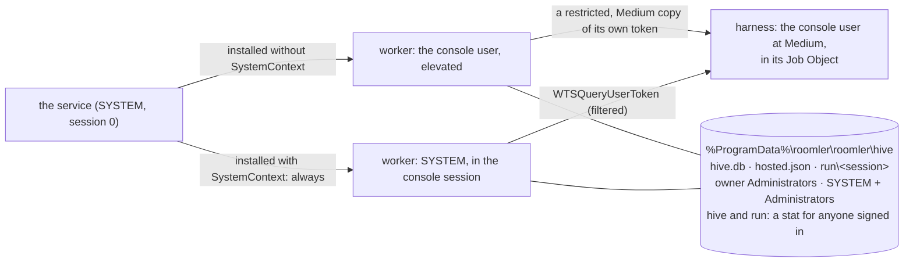

| Piece | Where | What its tests pin (Windows CI) |
|---|---|---|
| the start, as the console user | `hive/supervisor.rs:2115` `spawn`: the mapping, the harness, the session's directory (`:2150`), its settings and MCP config, `roomlerd hive-prep` as the user (`blocking`, `:2204`), then the harness SUSPENDED into its Job Object | the blocks' own (P1i-1); the whole path is P1i-4's field run |
| the harness's process | `hive_win.rs:1170` `HarnessChild`: the part of tokio's `Child` the session task uses, over the job, its pipes as async files | a line in, a line out, the exit code; a kill seen by the wait |
| the stop | `hive/supervisor.rs:3137`: stdin closed, then the job ended after the grace. No signal reaches a console-less process | — |
| the toolbelt | `hive/toolbelt.rs:730`: a named pipe, `FILE_FLAG_FIRST_PIPE_INSTANCE`, no remote client, with `hive_win.rs:990`'s DACL: SYSTEM and Administrators, and the session's account to read and write (`0x12008b`) but not to make an instance. The relay opens it with exactly that mask (`hive_win.rs:1131`); each client's account is checked again by SID (`toolbelt.rs:802`) | every approval test, over the pipe; another account's connection dropped unanswered; a name in use never taken as the first |
| a crash's leftover | `hive/procs.rs:120`, `:248`: creation times by `GetProcessTimes`, and an ended process reads as none even while a handle holds it open | an ended process has no start time; `take_down` ends what it is given |
| the key helper | `hive/sidecar.rs:182`: `cmd.exe /d /s /c "<helper>"`, by its full path, passed raw | — |
| adopting | `hive/gates.rs:68`: `hive_adopt` reads off on Windows, so the device never advertises `hive-adopt` | the owner's word on Unix, off on Windows. Since FR-97 P4c, the owner's word on Windows too, through a named pipe (`docs/hive.md` §8, *On Windows*) |

⚠️ **What ends a session's harness on Windows, and what does not.** A session's harness lives in
the Job Object of the worker that started it, so it goes when that worker goes: a service restart,
an update, a crash, and the console session changing (a sign-in, a sign-out, a switch of user), on
which the service starts a worker in the new session. The next worker resumes the session if its
gates still allow it (P1d-2): Claude Code is relaunched with `--resume`, and a turn that was
running is reported cut (AC20). A remote-desktop connection is not one of them: with SystemContext
the worker is SYSTEM from the start and stays so, and without it the worker is the console user
throughout. Measured in P1i-4 (§8): a remote-desktop session to the device left the worker's and
the harness's processes as they were, and a turn waiting at an approval through it ran afterwards.
*Corrected: P1i-0 to P1i-3 said a remote-desktop connection swaps the worker and cuts the running
turns.*

The supervisor's own tests drive a `/bin/sh` stand-in for Claude Code and stay on Linux and
macOS. On Windows CI the lane runs `hive::` as Windows compiles it.

Six negative controls each fail their test: a client of another account let through; the session's
token not restricted (what it starts carries the High label); a directory's owner not taken
over; the pipe granting the session's account the right to make an instance; an ended process
read as running; `hive_adopt` honoured on Windows.

Not in P1i: `adopt` on Windows (the hooks CLI refuses there; FR-97 P4c adds it), and a session
for anyone but the console user. There is no S4U and no `LogonUser`: the daemon "will not ask for" credentials.

### 3e. Toolbelt, vault, knowhow

The `roomler` MCP server per session (over a per-session socket or pipe, not the main LocalAPI):
brain, knowhow, `roomler_connect`, vault, `ssh_run`, `fleet_exec` (SYSTEM/root, so a person approves
every call), forwards and SOCKS through a chosen device, child sessions. The vault follows AWS IAM
semantics in Cedar: roles assumed per session, guardrail `forbid`s, `approval` as the MFA analogue,
`simulate`. Secrets reach tools, not the model: `proxy` endpoints that authenticate (HTTP named
upstreams, a k8s API proxy, an SSH agent socket, Postgres and MongoDB proxies), then `placeholder`
substitution at a TLS-terminating egress proxy for audience hosts only; every secret is bound to its
audiences. Knowhow is built from fleet and network sync, opt-in scans and session proposals, and a
fact turns active only when a probe or a person confirms it.

**P1a builds the toolbelt with one tool, `approve`** (`agents/roomlerd/src/hive/toolbelt.rs`), and
it was built against Claude Code's contract as MEASURED, not as remembered. Claude Code 2.1.293,
driven by a fake Messages API and a fake MCP server on 2026-10-08 (§8):

| Claude Code does | so the toolbelt |
|---|---|
| probes with `server/discover` (MCP draft `2026-07-28`) before `initialize`, and initializes when told no | answers every unknown method `-32601`; silence would stall the harness's start |
| calls `approve` with `{tool_name, input, tool_use_id}` and `_meta.progressToken`, and waits | answers `{"behavior":"allow","updatedInput":<input>}` or `{"behavior":"deny","message":…}` as one text block, and sends progress every 60 s while a person decides |
| asks ONE approval at a time — two parallel writes were two calls, the second after the first was answered | caps a session at 4 open and refuses a fifth at once |
| hands the model a denial as `tool_result {is_error: true}` with our message verbatim, and lists it in the result's `permission_denials` | says who denied it and why ("Dev denied this: not now") |
| keeps the permission tool out of the model's own tool list | needs no `--disallowedTools` for `approve` |
| with the server unreachable, errors every call that needs approval ("MCP tool mcp__roomler__approve … not found") and exits 1 | fails CLOSED: nothing runs unapproved |
| starts a `-p` run that fetches no feature flags in **`auto`** when nothing sets a mode | is only reached under `--permission-mode default`, which the launch now pins |
| runs a command in its read-only set (`whoami`) and reads under the working directory without asking, in every mode | — those never reach `approve` |

Claude Code starts the toolbelt itself, as the session's account, so the server it starts is a relay:
`roomlerd hive-mcp <socket>`, short-circuited at the top of `daemon_main` like the embedded CLI, so it
runs none of the daemon's start-up and writes nothing as that account. The socket is the session
account's, `0600`, in `<runtime>/<sid>/` (root, `0755`, holding the daemon-written `settings.json`
and `mcp.json`), and every connection's peer uid is checked again — a process running as that
account can connect, and all it can do is ask. The run state is the session task's alone to write:
the toolbelt reports each approval opening and closing on a channel the task reads after the
harness's stdout, so the `tool_use` lands in the transcript before the approval it caused.

**P1a-2, the server's side.** The device tells the server THAT a session waits, how it ended and
who answered — `rc:hive.approval`, whose field set a test locks so a `tool` or `input` field is a
deliberate edit. The server keeps one `agent_approvals` record and posts ONE stub per approval (a
unique index makes a replayed opening a no-op), edits the stub when it ends, and pushes the driver
a notification that names the session and never the call — by web push to every subscription,
because a desk with the app open is not a phone in a pocket. ⚠️ Who answered is the DEVICE's word:
the answer travels over the viewer peer, so the server believes it only when it names a driver (in
P1, the starter), and no stub names a person who could not have answered.

**P3, as designed (P3-0, 2026-10-17).** The vault is P3's core. Every other P3 tool, from the
proxies and dynamic credentials to session SOCKS, `ssh_run` and `fleet_exec`, is a way a session
spends a decision the vault makes. This design fixes where each piece lives, and what it must hold,
before any code. Decision 17 lists the positions for the operator to confirm. The design itself is
the design document's §7 and §8; what follows binds it to the code as it stands.

| Piece | Home | Why |
|---|---|---|
| the store, the keys, policies, leases and audit | a new module, `vault` (`crates/modules/vault`, package `roomler-ai-mod-vault`), mounted by `[modules] vault` and served only to the orgs a `vault.tenants` list names, as `hive.tenants` gates Hive (`crates/config/src/settings.rs:148`) | an unmounted module answers 503, and the list keeps the vault to the test org until its field run |
| its edges | `vault → hive` (the session record: its location, fence, role, and its room for approval cards) and `vault → fleet` (devices, their vault keys, the Hub): two new entries in `graph::EDGES` (`crates/core/src/graph.rs:35`) | hive never calls the vault. A session's requests ride its device's control WS as `rc:vault.*` frames, which the vault owns |
| the device's half | a `roomlerd` feature `vault` beside `hive`: the device's vault key, the lease cache, the proxies and the toolbelt's vault tools | a value is decrypted in the daemon, never in the harness's process, which runs as another account |

**Custody and keys.**
- Envelope encryption as designed (design §8.2): a data key per version (XChaCha20-Poly1305),
  wrapped by the org's key-encryption key (KEK).
- The KEK in P3 is an `age` X25519 identity. A self-hoster keeps it in a file. Hosted roomler.ai
  keeps it in a sealed secret on the cluster, which has no cloud KMS under it. Cloud KMS backends
  come later, behind the same trait (decision 17).
- ⚠️ **Managed custody in v1.** The vault module can decrypt every secret, so a compromised server
  can read them all. `docs/vault.md` says so in its first section, not in a footnote.
  Customer-managed keys and sovereign custody stay P7.
- The vault brings its own keys. It derives nothing from the JWT secret (HS256,
  `crates/services/src/auth/mod.rs:339`) or from the DERP ticket key
  (`crates/remote_control/src/derp_ticket.rs:8`).
- **The device's vault key** is an X25519 key the daemon makes on first need. It is kept in the
  root-only config like the overlay key, and it is never the WireGuard key. Its public half rides
  the hello. A value crosses to a device as a sealed box for that key, and lives in daemon memory
  for its lease only.

  ⚠️ **As built (P3-3a): in daemon memory, not the config.** The daemon makes the key at the
  first hello that asks while the device's `vault_enabled` is on, holds it for the life of the
  process, and gives its public half to the primary enrollment's hello only; the fleet writes it
  on the agent row from every hello (`docs/vault.md` §9). The overlay and SSH keys are
  identities a peer pins across restarts, and nothing pins this one. A leased value lives in
  daemon memory for its lease only, so a restart ends every lease whatever becomes of the key,
  and a key kept on disk would add one thing: a way for whoever reads the config, or a backup
  of it, to open a sealed value captured earlier (`agents/roomlerd/src/vault.rs:13`). Decision
  17's positions do not cover where the key is kept.

  ⚠️ **As built (P3-3b): the vault's half of a lease first.** P3-3b answers a lease and P3-3c
  revokes one, server side. The device's half (asking, opening a lease, holding it in daemon
  memory) moves to P3-4 with the tools that use it, so no agent advertises the `vault` verb
  before it can do what the verb promises. A lease is refused in a mode that releases no stored
  value (`identity`, `short-lived`, `placeholder`): a policy that permits `identity` means
  "authenticate as the session", and a lease would hand over the raw value instead
  (`docs/vault.md` §10).

  ⚠️ **As built (P3-3c): each pod tells the devices connected to it — no Hub, no new edge.**
  P3-3b expected the push to go through fleet's Hub (a `vault → fleet` edge and a vault arm in
  fleet's cross-pod control channel). But hive must never call the vault, and a session ends or
  moves on many paths, so a check that reads every session again is needed whatever carries the
  frame. With that check, each pod looking after the devices connected to it is enough: it holds
  their connections (the lease socket's) and checks the leases of those holding a live one every
  `vault.revoke_sweep_secs` and at each hello. A value written, a secret disabled or deleted, or
  a device removed revokes at once, and tells the device at once when it is on that pod. It works
  with Redis down. A removed device's leases are taken back by `agent_removed`, after hive's in
  `HOOK_ORDER`, and a failure there is logged rather than refusing the removal: a device being
  removed must not stay because the vault could not write. P3-3c also keeps a promise P3-1 made
  and P3-3b missed: a version past the `expires_at` its writer gave is never released, and no
  lease outlives its version (`docs/vault.md` §11).

  ⚠️ **As built (P3-4a): P3-4 split as P3-3 was, the daemon's lease client first.** It
  advertises `vault` from the same inputs as its key (the vault answers only a connection that
  has both), so no device claims the verb without the key, and every re-announcement carries it.
  It holds a value zeroized in daemon memory and lends it to a closure, never returning it. It
  lets a lease go at its expiry, measured on its own clock and never past the longest lease the
  vault grants, so a device whose clock runs behind cannot keep a value longer. It also lets go
  at `rc:vault.revoke`, ignoring an id it does not hold (every hello is told again), and when
  its run ends here (hive's `unlive`, which every end passes through). P3-4b to P3-4e bring the
  tools, `vault_activity` and the approval card (`docs/vault.md` §12).

  ⚠️ **As built (P3-4b): listing is its own Cedar action, and the reads need no person.**
  `secret:list` (principal `Session`, resource `Secret`, context `{device}`) is a third action
  beside `role:assume` and `secret:use`, default deny. Making "use" imply "list" through an
  action group would hold only for policies written with `in`, never for `==`, so an
  organization grants listing with permits of its own, and neither guardrail stops a listing:
  both are about using a value. A listing and a description are believed exactly as a lease is,
  from the same identity checks with the same refusal words, and are recorded before they are
  answered. A description is one decision with its request; a listing is one row a call
  (`listed N of M`), which no replay decides again. On the device the toolbelt offers
  `vault_list` and `vault_describe` only where the daemon takes leases, and the session's
  settings allow them where they are offered (`permissions.allow`, from the same answer), since
  their gate is the vault's own policy (`docs/vault.md` §13).

  ⚠️ **As built (P3-4c-1): P3-4c split three ways, and `exec_allow` is a guardrail, not a check
  in code.** `vault_exec` came first, because it is the one use tool AC13 needs. `vault_render`
  (the secrets directory) and `vault_request` (leases asked for ahead) follow as c-2 and c-3. The
  `Secret` entity carries `exec_allow`, and `guardrail:exec-only-allowed-programs` forbids every
  `exec` lease whose audience is not on it. The device asks with the program's bare name as the
  audience, and runs only that program. So the refusal is a Cedar decision: `simulate` names it,
  it is recorded with its request, and no organization can drop it. The device also hands a value
  only to a program in the system's own directories that the session's account could not have
  replaced, runs it as that account from the session's folder with a clean environment, kills the
  command's whole group at its end, and lets every lease go at once. `exec_allow` now holds bare
  names only: a path could match nothing a device asks for (`docs/vault.md` §14).

  ⚠️ **As built (P3-4c-2): a rendered file lives exactly as long as its leases.** The lease
  client now holds the files written with a value beside the value. Every way a lease is let go
  (its expiry, `rc:vault.revoke`, a release, the run's end) removes them, through one function,
  so no path forgets a file. A file is attached to every lease it holds a value of and dies with
  the first. The leases are kept, not released, when `vault_render` returns. The secrets
  directory is the daemon's, `0711`, under the session's runtime directory, and every one an
  earlier process left is removed at the daemon's start (no lease survives a restart). The
  session's settings deny the Read tool there; that is UX, and the gate is the permit, the
  guardrails and a person's approval (`docs/vault.md` §15).

  ⚠️ **As built (after P3-4c-2): a person's approval of each use is an ASK in the settings,
  not an absence from `allow`.** Writing P3-4c-2 found that `vault_exec` and `vault_render` were
  only kept out of `permissions.allow`. A repository's own `.claude/settings.json` loads too
  (open decision 7), and its allow would have skipped the person. The session's settings now
  list both under `permissions.ask` (`toolbelt::VAULT_USE_TOOLS`, written wherever the vault
  tools are offered). Claude Code reads deny, then ask, then allow, across every settings file, so
  the ask prompts whatever the repository allows. The design's
  `_meta["anthropic/requiresUserInteraction"]` was not the way: a `--permission-prompt-tool` can
  never approve a tool marked so (Claude Code turns its allow into a deny), and `approve` is that
  tool (`docs/vault.md` §14).

  ⚠️ **As built (P3-4c-3): a use takes a lease asked for ahead by WHAT it is, not by its id.**
  The design had `vault_exec` and `vault_render` take a `vault_request` lease by its id. But a call
  naming `lease:…` would hide from the person approving it which secret it hands on, the one thing
  that approval exists to show. So a call still names the secret, and the daemon takes a lease
  asked for ahead that matches it: the same run, secret, field, mode and audience. It must also
  last long enough: the command's whole timeout for `vault_exec`, the file's `ttl_s` for
  `vault_render`. A lease a call asked for itself is never taken by another, and no call lets go of
  one asked for ahead. `vault_request` takes only the modes a use takes (`exec`, `file`). It is
  allowed in the settings with the reads, since it hands the session nothing and the vault decides
  and records it; each use still asks a person. The design's `reason` argument is left out until
  something shows it (P3-4e's card takes its detail from the transcript, design §8.6). "Ahead" lives
  only on the device; the vault records the lease as any `secret:use` (`docs/vault.md` §16).

  ⚠️ **As built (P3-4d-1): P3-4d split in two, and a report is checked against the leases it
  names.** The server's half came first: `rc:vault.activity`, fire-and-forget like
  `rc:ssh.activity`, into `vault_activity`, kept apart from `vault_audit` as `ssh_activity` is from
  `ssh_audit`. A report is a claim, but not a claim about anything: it is kept only when every
  lease it names was released to this device, for this session in this organization, in the use's
  mode (`exec` for `exec`, `file` for `render`) and toward its target. So a device can claim a use
  only of what it was given, for what it was given it. Reports ride the connection's own lease
  queue, so a flood is dropped at its bound and each connection's are handled in order, at most
  120 a minute per session. An exec's exit code and timeout are never kept for a file. The device's
  half (its owner's `vault_activity_log`, default off and never pushable, and the reports
  themselves) is P3-4d-2 (`docs/vault.md` §17).

  ⚠️ **As built (P3-4d-2): a use is reported once it happened, and only where the owner says.**
  The device's `vault_activity_log` (default off) is read at each primary hello, and kept out of
  every remote configuration as `ssh_activity_log` and `vault_enabled` are: whether a device
  describes itself is its own word. A report goes out after a `vault_exec` that ran its command
  (the program, its exit code, or that it was killed at its timeout) and after a `vault_render`
  that wrote its file (its name), naming every lease the use took, whether asked for there or
  ahead. A call refused before anything ran or was written reports nothing. It is
  fire-and-forget: a full connection drops the report rather than hold the call.

  ⚠️ **As built (P3-4e-1): a card is posted only where a driver's yes could count, and the
  server, not the device, takes the answer.** P3-4e is split in three: the server (e-1), the
  device (e-2) and the web app's buttons (e-3). Hive's own approvals are answered over the viewer
  peer, on the device; a vault approval is the vault's decision, so a driver answers it through
  `POST …/vault/approval/{id}`, and Cedar decides the yes with them as the approver, then decides
  it again when a lease would spend it. The design posts a card wherever a policy "requires"
  approval, which no one can read off a policy. Built: when Cedar denies a lease, the vault asks
  Cedar again with each driver who may answer now as the approver, and posts a card only when one
  of them could allow it. Otherwise the deny stands as before. A policy may name whose yes counts
  (`context.approval.approver in Roomler::Group::"admin"`, the design's own example), which
  needed the approver to be an entity in their groups: before, it never held. Only drivers answer,
  as with hive's own approvals. The design's "unless the approval names an approver role" is not
  built: such a person is named a driver first. The design's `approval.at` is left out: a yes is
  usable for 5 minutes and a card waits 10, so no policy needs it. One yes allows one lease of that
  very request (`docs/vault.md` §18).

  ⚠️ **As built (P3-4e-2): the device asks again; nothing is pushed.** A tool whose lease waits on
  a card asks again after 2 s, the pause doubling to 15 s, for at most the card's 10 minutes. A
  push of the answer to the device was weighed and left out. An answer reaches the server on
  whichever pod takes the request, and a device's connection is held by one pod, so a push would
  still need asking as its fallback; asking alone works from any pod. Each ask is a decision the
  vault records, which is why the pause grows. A session under a policy that asks for approval now
  asks a person twice: the tool call (Claude Code's own prompt, answered on the device) and the
  vault's card (answered on the server, which cannot take the device's word for it). P3-4e-3 can
  show the two as one card.

  ⚠️ **As built (P3-4e-3): the answer under the card, and the two prompts still two.** The web app
  puts the answer under the card's own message, so the card stays a chat message any client renders,
  with its text the server's. Its buttons only reflect the route's `may_answer` and `may_approve`, and
  each answer is the route's to take or refuse. Showing hive's tool-call prompt and the vault's card
  as one was left out: the first is answered over the viewer peer to the device, the second over
  HTTP to the server, and one click doing both is two answers that can each fail on their own.

  ⚠️ **As built (P3-5b-1): P3-5b split, the Postgres engine first, and no channel binding yet.**
  P3-5b-1 is the engine alone: one client connection served against an upstream it authenticates
  to, tested against a fake upstream over real TLS, with no caller. The endpoint, `vault_connect`
  and the lease's lifetime are P3-5b-2. The SCRAM client sends `n,,` (it does not bind), never
  `SCRAM-SHA-256-PLUS`. Inside TLS whose certificate it verified, SCRAM already proves that both
  ends hold the password. What binding adds is catching a TLS terminator the system also trusts
  (an inspection proxy whose CA is in the OS store) relaying the exchange. That is P3-5b-3:
  `tls-server-end-point` over the certificate the proxy saw, where the upstream offers `-PLUS`.
  Found while writing it: an upstream's `NegotiateProtocolVersion` must reach the client
  *before* the `AuthenticationOk`, the only place libpq takes one, and a notice *after* it, since
  libpq takes none before. Found in review: Postgres takes the *last* `replication` a startup
  names, so a check of the first let `replication=false, replication=database` through as a
  walsender connection; the engine reads every one.

  ⚠️ **As built (P3-5b-2): the endpoint lives with its leases, and reads its values per
  connection.**
  - **The leases.** `vault_connect` leases the secret's `user` and `password` fields, each in
    `proxy` mode toward the upstream. A CA, when the call names one, is a third lease of a
    secret of its own, so one CA serves many databases.
  - **A directory per call** (`proxies/<id>/`), because a Postgres client dials a socket by its
    directory and port (`.s.PGSQL.5432`), not by a path.
  - **Its end.** The lease client's let-go now cancels a stop token for whatever was served
    with the lease, as it removes a rendered file. The endpoint's connections end with it, and
    the leases its call asked for itself are let go when it closes.
  - **Its values.** The endpoint holds lease ids, not values: it reads them from the leases as
    each connection starts, for that connection alone.
  - **Its bounds.** A run holds at most 8 endpoints, each serving 16 connections at once.
  - **Not in this step:** Windows (P3-5b-4), `vault_activity` for `proxy`, and MongoDB (P3-5c).

  ⚠️ **As built (P3-5b-3): bound where offered, `y` where not, never required.**
  - **Where it binds.** The exchange binds (`p=tls-server-end-point`) wherever the upstream
    offers `SCRAM-SHA-256-PLUS` and its certificate defines binding data. RFC 5929 leaves that
    undefined for a signature with no single hash (Ed25519, RSASSA-PSS); there the proxy says
    `n`.
  - **Where it says `y`.** Where the upstream offers no `-PLUS`, the proxy says `y`. An upstream
    that cannot bind takes it; one that can refuses it as a downgrade, which is what catches a
    relay stripping `-PLUS` from the offer.
  - **Preferred, not required**, as libpq's `channel_binding=prefer` is: requiring it would
    refuse every pooler and managed proxy that terminates TLS by design. A secret that should
    require it can say so in a later step.

  ⚠️ **As built (P3-5b-4): Windows serves a loopback port, and asks the system who connected.**
  - **Why not a socket.** Windows has AF_UNIX, but most database clients there cannot dial it,
    so the endpoint is `127.0.0.1` on a port the system picks.
  - **Who connected.** Any process on the device can reach the port. Each connection's process
    is found in the system's connection table (`GetExtendedTcpTable`, the row whose local end is
    the client), and served only if its token's SID is the session's account, the identity the
    toolbelt holds for the session. A pid that names another process by the time it is read
    names another account, which is refused.
  - **The port is not shareable.** Windows lets a second socket bind a port only where the first
    asked for that, and SYSTEM is the only exception.
  - **The answer** says `sslmode=disable` for the loopback leg; the upstream's leg is TLS, as on
    Unix.
  - **One endpoint for both systems.** The endpoint's code is now shared, with its socket, its
    check and its answer per system.

  ⚠️ **As built (P3-5c-1): MongoDB signs in before any `hello`, the design's order reversed.**
  - **Why.** The design had the proxy run `hello` and then SCRAM. But a server takes client
    metadata only in the first `hello` a connection sees, and refuses it in any later one
    (`ClientMetadataCannotBeMutated`), so every driver's own handshake would have failed.
  - **What it does instead.** The proxy holds the client's first message, signs in with
    `saslStart` and `saslContinue` alone, and then sends that message as the connection's first.
  - **Refusals.** A refusal answers the held message as a server answers it (`OP_REPLY` to an
    `OP_QUERY`, `OP_MSG` to an `OP_MSG`, code 18), so the driver reports the reason.
  - **Older servers.** A server before 4.4 that still asks for the empty exchange is given it.
  - **Not field-tested yet** against a real `mongod` or `mongos`: that is P3k's. The design's
    `directConnection=true` and one host stand.

  ⚠️ **As built (P3-5c-2): one endpoint, two engines, each in its own wire.**
  - **The socket per engine.** On Unix the socket is named for the engine: `.s.PGSQL.5432`, which
    a Postgres client dials by its directory, or `mongodb-27017.sock`, which a MongoDB driver dials
    by its path (a host ending in `.sock`, percent-encoded in the URI). Windows uses one loopback
    port for either.
  - **The answer per engine.** For MongoDB, the `uri` carries `directConnection=true`, so a
    driver stays on the one host and never discovers a replica-set member to dial around the
    proxy.
  - **`auth_source` is the call's,** default `admin`. It is not secret: a wrong one only fails
    the sign-in.
  - **A refusal speaks the engine's wire.** A MongoDB client sends first, so the endpoint answers
    its first message rather than writing a Postgres error it cannot read.

  ⚠️ **As built (P3-5d-1): P3-5d split, the engine first, its upstream connections kept, not
  pooled.**
  - **The split.** P3-5d-1 is the engine alone, with no caller. `vault_connect` serving it, the
    Linux endpoint and git's `insteadOf` are P3-5d-2; the macOS endpoint is P3-5d-3.
  - **One upstream connection per client connection.** It is dialled at the client's first
    request and kept for the next, so a git fetch's requests share one TLS handshake. Where the
    upstream has closed it, the next request dials again, and a request the closed connection
    never wrote is sent once more on the new one.
  - **Why not a shared pool.** A pool would keep connections past the client's, and an endpoint
    lives only as long as its leases. A client connection's upstream connection ends with it.
  - **The redirect check is a parse, not a prefix.** `https://host.elsewhere` starts with
    `https://host`. Only the whole origin is pointed back: the scheme, the host in any case, the
    port, and no user.
  - **HTTP/1.1 to the upstream.** git and REST APIs speak it; HTTP/2 can come later if an upstream
    needs it.

  ⚠️ **As built (P3-5d-2): one seam for where an endpoint listens; Linux asks the kernel who
  connected.**
  - **One seam, two kinds.** A database's endpoint on Unix is still a socket. An HTTP endpoint,
    and every endpoint on Windows, is a loopback port. The endpoint is served through one seam
    (`Place`): what it accepts on, and how it tells who connected.
  - **Who connected, on Linux.** The kernel's `/proc/net/tcp` and `tcp6` hold a row for each
    socket, with its owner's uid. The row whose local end is the connection's client names the
    account. A row in TIME_WAIT, or with no inode, belongs to no process and is never believed. A
    client on a dual-stack socket shows in `tcp6`, its address IPv4-mapped. No privilege is
    needed: the file is the reading process's own network namespace.
  - **macOS is refused before anything is leased.** Nothing there says who connected yet
    (P3-5d-3).
  - **git by environment.** The answer's `env` holds git's own configuration
    (`GIT_CONFIG_COUNT`, one `url.<endpoint>/.insteadOf` for `<upstream>/`) and
    `GIT_TERMINAL_PROMPT=0`. A session's git takes the upstream's URLs as they are, with no change
    to its configuration. Tested with a real `git ls-remote` through the endpoint.
  - **`vault_request`** asks ahead toward an origin, as it does toward a `host:port`.

  ⚠️ **As built (P3-5d-3): macOS asks which processes hold the socket; it cannot say who made
  it.**
  - **No table of owners.** macOS has nothing like Linux's `/proc/net/tcp`. It does say which
    descriptors each process holds, and what each socket is: `proc_listpids` for the processes,
    `PROC_PIDLISTFDS` for their descriptors, `PROC_PIDFDSOCKETINFO` for a socket's two ends.
  - **Who holds it, not who made it.** The first build also required the socket to have been made
    under the account's credential (`soi_stat.vst_uid`), as Linux's row and Windows' table say.
    CI's first macOS run refused even the test's own connection. The kernel never fills a
    socket's `soi_stat`: `pid_socketinfo` zeroes the struct and `fill_socketinfo` leaves it, so
    `vst_uid` reads 0 for every socket. libproc says only who holds a descriptor.
  - **So: held, and held only, by the account.** A connection is served only where its client end
    is held by processes running as the session's account and by no other account's process. Every
    process is read, so a socket another account made and still holds is refused.
  - **What that cannot catch.** A socket another account made, handed over and closed would pass.
    That needs a process of the session's own account to take the descriptor from the other
    account; Linux and Windows, which name a socket's maker, would refuse it.
  - **The SDK's layout, pinned.** `libc` has the calls but not the socket structs. They are
    mirrored from `<sys/proc_info.h>`, and the offsets read are asserted at compile time.
  - **Tested on CI's macOS lane**, the only place this code builds: a live loopback connection's
    client end is the test's own and not another uid's, and the HTTP endpoint's tests run there
    too.

  ⚠️ **As built (P3-5e-1): P3-5e split, the engine first; an upgrade's tunnel lives inside its
  session.**
  - **The split.** P3-5e-1 is the HTTP engine's half alone, with no caller: a client certificate
    in the handshake, an upgrade relayed, impersonation dropped. `vault_connect` serving it, and
    the kubeconfig, are P3-5e-2.
  - **One engine, two flavours.** A Kubernetes endpoint is an HTTP one (`Flavor::Kubernetes`):
    the upgrade and the impersonation rule are the flavour's, so a plain HTTP endpoint relays no
    upgrade and drops no header it did before.
  - **The certificate, per connection.** The upstream's roots are read once, at the call; a
    connection that presents a certificate gets a connector made for it, so the key lives in that
    connection's TLS and nowhere longer.
  - **The tunnel, inside the session.** A switched connection is not a task of its own: the
    client connection's session awaits it once the connection is handed over. Whatever ends the
    session (the endpoint's stop, the first lease let go) ends the tunnel too. A detached task
    would have outlived the lease.
  - **An upgrade gets a connection of its own.** A switched connection carries no more requests,
    so it is never the client connection's kept upstream connection.

  ⚠️ **As built (P3-5e-2): `kubernetes` is an HTTP endpoint with its flavour, and `client-cert`
  serves `http` too.**
  - **One more engine, the same endpoint.** `kubernetes` takes an origin and `auth` as `http`
    does, on the same loopback port, and its connections are served with `Flavor::Kubernetes`.
    `basic` is refused for it: no API server has taken it since Kubernetes 1.19.
  - **`client-cert` for both.** An API that asks for a client certificate need not be a cluster,
    so `http` takes `client-cert` too.
  - **A key proven at the call, and kept out of the answer.** The call makes a connector with the
    leased cert and key once, so a pair TLS cannot present is refused before anything is served.
    The refusal names no parser's words, which could quote the key.
  - **The roots, read once.** The endpoint keeps them and makes each certificate connection's
    connector over them; `tls::connector` is now only the tests' shorthand.
  - **The kubeconfig is the answer's, not a file.** Nothing in it is secret, and the session
    writes it where it likes. A file the daemon wrote would need a directory the session's account
    can read, and Windows' endpoint has none.

  ⚠️ **As built (P3-5f-1): P3-5f split, the agent first; the binding proven against OpenSSH
  itself.**
  - **The split.** P3-5f-1 is the agent alone, with no caller. `vault_connect` serving it
    (`engine: "ssh"`, the socket on Linux and macOS) is P3-5f-2, and Windows' named pipe P3-5f-3.
  - **No new crate.** `ring`, which `roomlerd` links already, signs with Ed25519 and ECDSA and
    checks a host's Ed25519, ECDSA and RSA signatures. The engine reads the key file itself
    (`PROTOCOL.key`, unencrypted).
  - **Stricter than OpenSSH's own agent in two places.** A second binding refuses the connection
    rather than keeping the first, and a binding for forwarding is refused rather than chained:
    `ssh` sends neither on a connection it signs on.
  - **A refused binding hides the key.** The connection lists no key after it, as OpenSSH's agent
    does after a failed bind, so `ssh` moves on to its other methods instead of a refusal.
  - **Tested against OpenSSH itself.** Its own `ssh` signs in through the agent to a host in the
    test (russh, where the `ssh-server` feature builds it), its log saying it bound the agent,
    and is refused for a host the secret does not name; keys `ssh-keygen` writes are read, and
    `ssh-add` lists the one key.

  ⚠️ **As built (P3-5f-2): `ssh` is a socket endpoint whose engine relays nothing, and its answer
  carries the host's keys.**
  - **The same endpoint.** `ssh` takes the database endpoint's socket on Linux and macOS
    (`ssh-agent.sock`), its directory, its uid check and its life. Windows refuses the call
    before anything is leased, until P3-5f-3's named pipe.
  - **The audience names the account.** `ssh://user@host` holds the key to that one account;
    with no user, the host's own `authorized_keys` decide. The user is a POSIX account name, so
    nothing in it needs quoting for a shell.
  - **Proven at the call, read again per connection.** The call reads the key and the hosts as
    the agent will, and refuses in the agent's words, which name no byte of either. Each
    connection gets its own agent, read from the leases as it starts.
  - **No TLS.** An agent never reads the system's roots, so a device with none still serves
    one.
  - **`known_hosts` is the answer's, not a file**, as the kubeconfig is: the hosts' keys are
    public, and the session names the file it writes in `UserKnownHostsFile`.
  - **Tested end to end with OpenSSH.** Its own `ssh` signs in through `vault_connect`'s agent,
    to a russh host in the test, with nothing but the answer: its `env` and its `known_hosts`.

  ⚠️ **As built (P3-5f-3): on Windows the agent is a named pipe whose grant is not the toolbelt
  pipe's; P3-5f is complete.**
  - **The toolbelt's pipe, but for one grant.** `\\.\pipe\roomler-vault-<id>` is made as the
    session's toolbelt pipe is (`pipe_instance`, local clients only, each client's token SID
    compared with the session's, the next instance made before a client is looked at), except
    its DACL: the session's account may open it for reading and writing whole (`GRGW`,
    `agent_pipe_sddl`).
  - **Why the grant differs.** Win32-OpenSSH opens an agent with `GENERIC_READ |
    GENERIC_WRITE` (its `fileio_connect`). The toolbelt pipe's `0x12008b` leaves out three of
    those rights, and a session's token has its Administrators group deny-only, so its `ssh.exe`
    would be refused. Only an elevated test would pass, by its Administrators grant: the first
    draft did, on this machine. `GENERIC_WRITE` lets that account add an instance of its own,
    which on this pipe gains it nothing it lacks.
  - **The same answer.** `host` and `SSH_AUTH_SOCK` name the pipe, which Win32-OpenSSH dials
    as a path; everything else is as on Unix.
  - **Tested with Windows' own `ssh.exe`.** GitHub's Windows runners carry Win32-OpenSSH 9.5,
    which binds, so its `ssh.exe` signs in through the pipe in CI with nothing but the answer.
    The grant itself is tested with the SYSTEM and Administrators grants taken out, so
    elevation cannot pass for it.

**A session's identity to the vault.** The token the sidecar mints is the device's own, bound to the
session and its fence (`agents/roomlerd/src/hive/sidecar.rs:94`). To the server, a session is its
record. So a vault request is a frame from the device that runs the session, naming the session and
its fence. The vault believes it only from the record's location at that fence, as hive's frames
are (`crates/modules/hive/src/agent_socket.rs:942`), and with the role the session assumed at its
start.

**Roles and policies.**
- **The language:** `cedar-policy` (Apache-2.0), with every policy checked against the schema on
  write.
- **The role:** a session assumes one role at its start, chosen as a start option. `role:assume`
  is decided with the starter as the principal, and the role is stored on the record.
- **What a session may do:** its role's permits, less any matching `forbid`, less what the
  device's own gates refuse. It is not narrowed to the owner's own grants (design §8.1).
- **Seeded guardrails**, when an org turns the vault on: no materializing mode on Windows, where
  no Claude Code sandbox exists (AC13); prod values never materialize.
- **`simulate`** explains a decision, and diffs a policy change against the last 7 days of
  `vault_audit`.

**Modes in P3** (design §8.5):

| Mode | What it covers |
|---|---|
| `identity` | SSH, exec and forwards, authorized by the session principal |
| `proxy` | HTTP named upstreams (git through `insteadOf`); Postgres and MongoDB, authenticating upstream with SCRAM; the Kubernetes API; an SSH agent socket |
| `short-lived` | dynamic credentials: database users, GitHub App tokens, AWS STS, a Kubernetes `TokenRequest` |
| `file`, `env`, `exec` | behind a permit, and flagged |

`placeholder` is P3b. `raw` stays for people only.

**P3-5, `proxy` mode, as designed.** A session reaches a database (and later an HTTP API, a cluster,
an SSH host) through an endpoint its daemon serves, and the daemon authenticates upstream with the
leased value. The value stays in daemon memory: no transcript, model request or session environment
holds it (AC12).

| Piece | Design |
|---|---|
| the upstream | the lease's audience: the one `host:port` the daemon connects to, which the secret must name in `audiences`, exactly. Before P3-5a the vault stored a secret's audiences and enforced nothing, which for `proxy` would let a session point the daemon's credential at any host. The guardrail `proxy-only-named-audiences` closes it, as `exec_allow` closes `exec` |
| the endpoint | a Unix socket in the session's runtime directory (the daemon's, `0711`), handed to the session's account at `0600`, each connection's peer uid checked against it, as the toolbelt's socket is. Not a loopback TCP port: any account on the device can connect to one, and the proxy authenticates for whoever does |
| the client | never authenticates. The proxy's own upstream connection does, before a byte of the client's is relayed: Postgres answers the client's startup with `AuthenticationOk` (any password, or none), and MongoDB's client connects with no credentials at all. So the value never crosses the endpoint, in either direction |
| upstream security | TLS required, the upstream's certificate verified (the system's roots, or a CA the secret holds in a field `ca`); SCRAM-SHA-256, with channel binding (`-PLUS`) where the upstream offers it. Cleartext, MD5 and every other mechanism are refused: an upstream that is not who it claims, or that asks for a form of the value it could replay elsewhere, gets nothing |
| the value | a structured secret: `user` and `password`, and optionally `ca`; the password SASLprepped (RFC 4013) |
| the lifetime | one lease per endpoint at first: the endpoint and its open connections close when the lease is let go (expiry, revocation, the run's end). A longer use asks again |
| the tool | `vault_connect {handle, engine, upstream, database?, ttl_s?}`, asked for in the session's settings like the other uses: the endpoint, and a connection string with no credential in it |
| Windows | `proxy` is Windows's only mode, but its database clients mostly cannot dial a Unix socket. A later step serves loopback TCP there, each connection's process identified (`GetExtendedTcpTable`, then the process token's SID) and refused unless it runs as the session's account |

- **Postgres** (P3-5b): the client's `SSLRequest` and `GSSENCRequest` are answered `N` (the socket is
  local). A `CancelRequest` goes to the upstream as is: the `BackendKeyData` the client holds is the
  upstream's, relayed unchanged. The startup's `user` is replaced by the secret's, its `database`
  kept, and `replication` refused. Then `AuthenticationOk`, the upstream's `ParameterStatus`,
  `BackendKeyData` and `ReadyForQuery`, and bytes both ways.
- **MongoDB** (P3-5c): the proxy's upstream connection runs `hello` and SCRAM-SHA-256 first. The
  client's `mongodb://<socket>/?directConnection=true` has no credentials, so its own `hello`
  carries no `speculativeAuthenticate`, and every byte after it is relayed. One host at first (a
  single node or a `mongos`): SRV discovery and replica-set failover come later.
- **Engines with no proxy** (MySQL, SQL Server, Redis) take `short-lived` (P3-6). HTTP named
  upstreams are P3-5d, the Kubernetes API P3-5e and the SSH agent P3-5f, each designed below.

**P3-5d, HTTP named upstreams, as designed.** A session reaches an HTTP API or a git server through
an endpoint that adds the secret's credential to every request it sends on. Design §8.5 sketched
one daemon port with each named upstream under a path of its own (`http://127.0.0.1:<p>/u/<name>/…`).
An endpoint is one call's, as for the databases, so it stands for one upstream and needs no name in
its path.

| Piece | Design |
|---|---|
| the upstream | an origin, `https://<host>[:<port>]`: TLS always, as for the databases; no path, query, user or fragment; the port written only where it is not 443, and plainly, so an origin has one spelling. It is the lease's audience, held to the secret's `audiences` exactly by `proxy-only-named-audiences`. A database's audience is `host:port`, a different string, so a secret named for SCRAM never reaches an HTTP upstream, where `Basic` would show the upstream the password itself |
| the credential | `Authorization` only, in the form the call names: `basic`, the secret's `user` and `password` (RFC 7617), or `bearer`, its `token` (RFC 6750). The session never names a header. A header it could name is one an upstream might echo back: a `User-Agent` reflected in a response would put the value in the transcript. A header of another name (`X-API-Key`, `PRIVATE-TOKEN`) would have to be the secret's to name, never the call's |
| the endpoint | `127.0.0.1`, on a port the system picks, on every system: git cannot dial a Unix socket, and few HTTP clients can. Any account on the device can reach the port, so each connection's account is read from the system's connection table and refused unless it is the session's. Windows does this already (P3-5b-4). Linux reads `/proc/net/tcp` and `/proc/net/tcp6`, whose row for the connection's client end names the account that owns the socket. macOS has neither; it reads `libproc` in a step of its own, and serves no HTTP endpoint until then |
| a request | origin-form only: `CONNECT`, an absolute or authority form and `*` are refused, since the endpoint is no forward proxy. The path and query go on as they came, and `Host` becomes the upstream's. The client's own `Authorization` and `Proxy-Authorization` are dropped, with every hop-by-hop header, and the secret's `Authorization` is added, marked sensitive. Bodies stream both ways, never gathered |
| a response | streamed back. A `Location` on the upstream's own origin is pointed back at the endpoint, so a redirect stays authenticated; one anywhere else goes back unchanged, and the client follows it with no value. The proxy never follows a redirect itself. `Alt-Svc` and `Strict-Transport-Security` are dropped: they would describe the upstream as if it were the endpoint |
| its values | read from the leases as each connection starts, as for the databases; the connection closes when its first lease is let go |
| git | the answer's `env` holds git's own configuration by environment (`GIT_CONFIG_COUNT`, `GIT_CONFIG_KEY_0` = `url.<endpoint>/.insteadOf`, `GIT_CONFIG_VALUE_0` = `<upstream>/`) and `GIT_TERMINAL_PROMPT=0`. So `git clone <upstream>/<repo>` goes through the endpoint with no change to the session's configuration, and a credential the upstream refuses fails at once rather than waiting at a prompt nobody answers |

- **What `proxy` cannot promise here.** SCRAM never shows a database the password; `Authorization`
  shows the upstream the value itself, inside TLS the proxy verified. An upstream that echoes the
  header back hands the value to the session. The secret's `audiences` are the trust, which is why
  they are matched exactly.
- **Not in P3-5d:** an upstream reached only through the device's own HTTP proxy; a header other
  than `Authorization`; an audience scoped to a path; URLs rewritten in bodies, or in headers other
  than `Location`; and a session inside Claude Code's sandbox, which reaches the network only
  through its egress proxy (P3-7).

**P3-5e, the Kubernetes API, as designed.** A session reaches a cluster's API through an endpoint
that presents the secret's credential, and gets a kubeconfig that holds none (design §8.5). It is
P3-5d's HTTP endpoint with three differences: how an API server is signed in to, what `kubectl`
streams over, and what the endpoint will not forward.

| Piece | Design |
|---|---|
| the upstream | the API server's origin, `https://<host>[:<port>]`, held to the secret's `audiences` exactly, as for `http`. The cluster's CA is the secret's `ca`, as a kubeconfig's `certificate-authority-data` is |
| the credential | `bearer`: a service account's token, or an OIDC one, in `Authorization` as for `http`. Or `client-cert`: the secret's `cert` and `key` (PEM), presented in the TLS handshake as a kubeconfig's `client-certificate-data` and `client-key-data` are. The key is read from its lease as each connection starts, and goes into that connection's TLS alone; TLS proves it without sending it |
| upgrades | `kubectl exec`, `attach`, `port-forward` and `cp` switch protocols: SPDY (`SPDY/3.1`), or WebSocket from Kubernetes 1.30. The endpoint carries a request's `Upgrade` to the API server on a connection of its own, and on its `101` joins the two ends byte for byte. The tunnel is carried within the client connection's session, so the endpoint's stop ends it. `http` relays no upgrade, and `kubernetes` none to another protocol |
| what is refused | `Impersonate-User`, `Impersonate-Group`, `Impersonate-Uid` and every `Impersonate-Extra-*`, all dropped. The session acts as the secret's identity, and never through it as another (`kubectl --as`), whatever that identity's RBAC allows |
| the answer | the endpoint's `uri`, and a kubeconfig: one cluster whose `server` is the endpoint, one context, one user with no credential. Nothing in it is secret: the session writes it where it likes and names it in `KUBECONFIG` |

- **What `proxy` cannot promise here.** A bearer token is shown to the API server whole, as any
  `Authorization` is. A client certificate's key never is.
- **Not in P3-5e:** a kubeconfig the daemon writes, or one rendered from knowhow's cluster entity
  (P4); `exec` credential plugins; HTTP/2 to the API server; a `TokenRequest` minted for the
  session (`short-lived`, P3-6).

**P3-5f, the SSH agent, as designed.** A session reaches an SSH host with a key the vault holds,
through an agent its daemon serves: `ssh` and `git` ask it to sign, and the key stays in daemon
memory. It is the one `proxy` engine that relays nothing. The session's own `ssh` connects to the
host; the endpoint only signs, and only a sign-in to that host.

| Piece | Design |
|---|---|
| the upstream | `ssh://[<user>@]<host>[:<port>]`, the port written only where it is not 22: the lease's audience, held to the secret's `audiences` exactly by `proxy-only-named-audiences`, in a spelling no database or HTTP audience has. A user in it is the one account the key signs in as; with none, the host's own `authorized_keys` decide |
| the value | a structured secret: `key`, an OpenSSH private key, unencrypted (the format `ssh-keygen` writes; the vault is its encryption), Ed25519 or ECDSA on P-256 or P-384; and `host_keys`, the host's public keys, one per line (`<type> <base64>`, as `known_hosts` holds them after the host names) |
| the endpoint | a Unix socket, as for the databases (P3-5b-2): in the session's runtime directory, handed to the session's account at `0600`, each connection's peer uid checked against it. The answer's `env` names it in `SSH_AUTH_SOCK` |
| what it answers | `REQUEST_IDENTITIES`, with the one key under the handle's name; `SIGN_REQUEST`, for a sign-in only (below); and the `session-bind@openssh.com` extension. Everything else is `SSH_AGENT_FAILURE`: adding or removing keys, `LOCK`, smartcards, every other extension. A message over 256 KiB, the limit OpenSSH's own agent keeps, closes the connection |
| what it signs | an SSH sign-in only (RFC 4252 §7): `SSH_MSG_USERAUTH_REQUEST`, service `ssh-connection`, method `publickey` or `publickey-hostbound-v00@openssh.com`, the key its own, nothing after it; and only on a connection bound to one of the secret's hosts. OpenSSH 8.9 and later binds each agent connection before it signs (`session-bind@openssh.com`): it sends the host's key, the session identifier, and the host's signature over that identifier from the key exchange. The endpoint verifies that signature, requires the key to be one of `host_keys`, and signs only a sign-in whose session identifier is the bound one (and whose host key, for `publickey-hostbound`, is the bound key). So a signature is good for one SSH session with that host and nowhere else; it is OpenSSH's own destination constraint (`ssh-add -h`), made the only mode |
| what it refuses | a connection that never binds (an `ssh` older than 8.9, `libssh2`, Paramiko); one bound for forwarding (`ssh -A` from the session, so the next hop would sign through it); a second binding; a binding whose signature does not verify, or whose host key the secret does not name; and any data that is not a sign-in, an `SSHSIG` among it (`ssh-keygen -Y sign`, git's commit signing). A refused binding leaves the connection listing no key, as OpenSSH's agent does, so `ssh` moves on to its other methods |
| the cryptography | `ring`, which `roomlerd` links already: Ed25519 and ECDSA to sign; Ed25519, ECDSA (P-256, P-384) and RSA (`rsa-sha2-256`, `rsa-sha2-512`) to check a host's signature. No new crate. A secret's key that is RSA or P-521 is refused at the call: `ring` has no P-521, and signing with an RSA key from its OpenSSH form needs arithmetic `ring` does not expose |
| the lifetime | as for the other engines: the values read from their leases as each connection starts, and the socket and its connections closed when the first lease is let go. The key's own bytes are zeroized; `ring`'s key pair, which holds the key while its connection lasts, is not zeroed when dropped |
| the answer | the socket, `env` (`SSH_AUTH_SOCK`), and `known_hosts`, the upstream's host keys under its name, for the session to write to a file of its own and name in `UserKnownHostsFile`. So `ssh` checks the host by the same keys the endpoint binds to |
| Windows | Win32-OpenSSH reads `SSH_AUTH_SOCK` as a named pipe. A later step serves one there, its DACL the session's account's SID, each client's token checked. The `ssh` Windows ships is older than 8.9 on many builds (8.1 on Windows 10), so it does not bind, and a session there needs a newer Win32-OpenSSH |

- **What `proxy` cannot promise here.** The endpoint proves to the host that the session holds the
  key, and the host lets the session in; what the session does once signed in is the host's to
  limit. The key never leaves daemon memory, and no signature it makes is good for another host.
- **Not in P3-5f:** host certificates (a CA in `host_keys`); RSA and P-521 keys; a key encrypted
  under a passphrase; agent forwarding; `SSHSIG`, for git's commit signing; a `ProxyJump` whose jump
  host takes the same key; and Windows, the step after.

**P3-6, `short-lived`, as designed.** A session gets a credential minted for it. `proxy` gave it an
endpoint, and `file`, `env` and `exec` a stored value. Here the vault stores the *issuer*: what can
mint, such as a database account that may create users or a GitHub App's key, and what a minted
credential may do, such as the roles it joins or the repositories its token reaches. The session
names the secret as it names any other. What it gets lives as long as its lease, and reaches only
what the issuer's configuration lets it. The session can read it for that long (design §8.5); it
never sees the issuer.

| Piece | Design |
|---|---|
| the secret | a new kind, `dynamic`, naming a `provider`. Its stored fields are the issuer's, under the names its provider gives them, and a field the provider does not name is refused on write. For `postgres`: `admin_user`, `admin_password`, `database` and `grants` (the roles a minted user joins, one per line), and optionally `ca`. For `github_app`: `app_id`, `installation_id` and `private_key` (PEM), and optionally `repositories` and `permissions`, which narrow every token it mints. It names exactly one audience, the place its provider mints toward: the database's `host:port`, or `https://api.github.com` |
| what a session names | the minted credential's fields, under the names its provider gives them: `postgres`'s `user`, `password`, `host`, `port` and `database`; `github_app`'s `token`. An issuer's field is never released to a session, in any mode: naming one is refused as naming a field with no value is |
| a lease | asked for in `short-lived`, for the secret as a whole (it names no field), and answered with a bundle sealed to the device's key. For a provider the device mints for, the bundle is the issuer's fields; for one the server mints for, it is the minted credential. The vault leases a dynamic secret in no other mode, and leases nothing else in `short-lived`, whatever the device asks. A new version of any of its fields takes its leases back |
| one credential per lease | every field a call names of one dynamic secret (`PGUSER` and `PGPASSWORD`) comes from one credential, minted once for the lease. Two calls with leases of their own get two credentials. A lease asked for ahead (`vault_request`) serves each call that takes it with the one credential it minted |
| the tools | `vault_exec` (`env`) and `vault_render` (a file) serve a dynamic secret as they serve a stored one. `vault_connect` does not: an endpoint that signs in with a minted user is a later step |
| the mode | `short-lived`, in Cedar's context as any mode is. The seeded Windows guardrail refuses it there, where no materializing mode runs. The prod guardrail does not refuse it: a credential that lives for minutes is what that guardrail pushes toward |
| its life | the lease's TTL, as the call asks within the tool's bounds. At the lease's end (its expiry, `rc:vault.revoke`, the run's end) the credential is revoked where the provider can be told: a database user dropped, a token deleted. Where the provider cannot be told, the credential lives to its own expiry, and the audit says when that is |
| the kill switch | `vault.providers`: the providers this server serves, by default every one built. A provider left out is refused `not_served`. Per secret, `disabled` |
| who mints | the device, for a database user: only the device reaches the database, as for `proxy`. The issuer's fields stay in daemon memory, zeroized as a `proxy` value is. For a GitHub App token, decision 18 |

**Postgres users** (P3-6b):
- **The mint.** The issuer signs in as `admin_user` by SCRAM-SHA-256, over TLS verified as for
  `proxy` (`ca`, or the system's roots). Then it runs
  `CREATE ROLE "roomler_<lease>" LOGIN PASSWORD '<verifier>' VALID UNTIL '<the lease's end>' IN ROLE <grants>`,
  and comments the role with its lease. Each name is quoted as an identifier.
  - **The password is 32 random bytes, and it goes as its SCRAM-SHA-256 verifier**, never itself.
    So a database that logs its statements logs no password.
  - `IN ROLE` needs the issuer to hold `CREATEROLE` and, from Postgres 16, `ADMIN OPTION` on each
    grant.
  - A mint the database refuses is refused at the call, in the database's own words.
- **The revocation.** `ALTER ROLE … NOLOGIN`, then the role's sessions ended, then `DROP ROLE`.
  - **The sessions end only where the issuer may end them** (`pg_terminate_backend` needs
    `pg_signal_backend`, or the role's own privileges). Where it may not, `NOLOGIN` still refuses
    new sessions, and those already open run until they close.
  - **A role that owns objects** is reassigned to the issuer first, in `database`
    (`REASSIGN OWNED BY … TO …`, `DROP OWNED BY …`). A role that still owns objects in another
    database cannot be dropped, and the audit says so.
- **A daemon that dies before revoking.** `VALID UNTIL` refuses the role's logins after its lease
  anyway. The issuer's next mint drops every role it made, by its comment, whose `VALID UNTIL` has
  passed.

**GitHub App tokens** (P3-6c):
- **The mint.** A JWT (RS256, `iss` the App's id, `iat` 60 s back for clock skew, `exp` 9 minutes
  on), signed with `private_key`. Then
  `POST /app/installations/{installation_id}/access_tokens`, with the secret's `repositories` and
  `permissions`. GitHub mints every token for an hour.
- **The revocation.** `DELETE /installation/token`, with the token itself, at the lease's end. A
  revocation that fails leaves the token alive to its hour, and the audit records both times.
- **The audience** is `https://api.github.com`. GitHub Enterprise Server comes later.

- **What `short-lived` cannot promise.** The session holds the credential, so whatever runs as it
  can use or copy it until its revocation. What bounds the credential is its lifetime and the
  issuer's scope, and both are the issuer's configuration, never the session's.
- **Not in P3-6's first steps:** MySQL, SQL Server and Redis users (P3-6d); AWS STS (P3-6e), which
  needs a stored AWS key until P7's federation; a Kubernetes `TokenRequest` (P3-6f); `vault_connect`
  signing in with a minted user; a connection string among a database user's fields; GitHub
  Enterprise Server; rotating the issuer's own credential.

  ⚠️ **As built (P3-6b-1): the vault's half, and three choices the design left open.**
  - **The pairing is two guardrails, not a check in the lease.** `dynamic-only-short-lived` and
    `short-lived-only-dynamic` are in every organization's set, so each refusal is recorded with
    the guardrail that made it, as `windows-proxy-only`'s are.
  - **A bundle's lease records each field's version** (`bundle`), and a sweep compares them all.
    Reading one field's version for it, as for a stored value, would take it back at the first
    sweep.
  - **The bundle is `{"audience": …, "fields": {…}}`**, so the device mints toward the audience
    the lease was decided for, rather than one it would have to look up.

  ⚠️ **As built (P3-6b-2a): the minter, and three choices the design left open.**
  - **Nothing is dropped under a name a mint does not make** (`roomler_` and a lease's 24 hex
    characters). A revocation checks the name before it dials, and the sweep checks each name its
    query returns before dropping it, so neither a caller nor a query's answer can point a drop at
    another role.
  - **A role already gone is a revocation done**, not a failure: the sweep or an operator may have
    dropped it first.
  - **The issuer signs in by the proxy's own handshake** (`authenticate`, lifted out of `start`),
    so its exchange is bound to the server's certificate wherever the server offers `-PLUS`, as a
    session's is. Its sessions name themselves `roomlerd vault` (`application_name`).

  ⚠️ **As built (P3-6b-2b): the caller, and four choices the design left open.**
  - **The tools describe a secret before they lease it.** Its metadata says whether it is dynamic and names its
    credential's fields, so a field it lacks is refused before anything is leased. The cost is one `secret:list`
    decision per secret per call, recorded, and a role that may use a dynamic secret must be able to list it.
  - **A credential is minted at its lease's first use**, not when the lease arrives: a lease asked for ahead holds
    no credential until a use takes it.
  - **A revocation runs in the background.** Letting a lease go never waits on a database, and a mint still running
    when its lease is let go takes its own credential back as it ends.
  - **`exec_allow` binds stored secrets alone.** A short-lived lease is decided toward the secret's own audience,
    with no program in it: what bounds the credential is its lifetime and its issuer's grants (§3e, "What
    `short-lived` cannot promise").
  - Not built: a revocation that fails is logged on the device, not reported to the vault.

**P3-6d, MySQL, SQL Server and Redis users, as designed.** Each is a provider in `vault::providers`,
minted on the device as `postgres` is, by the same caller (P3-6b-2b): one lease for a dynamic
secret's names, the credential minted at its first use, taken back when the lease is let go. What
differs is each database's accounts, how it ends one, and its wire.

| | MySQL (8.0.21+) | SQL Server (2016+) | Redis (6.0+) |
|---|---|---|---|
| the issuer's fields | `admin_user`, `admin_password`, `database`, `grants` (its roles, one per line), and optionally `ca` | `admin_user`, `admin_password`, `database`, `grants` (database roles, one per line), and optionally `ca` | `admin_user`, `admin_password`, `rules` (ACL rules, one per line), and optionally `ca` |
| the minted fields | `user`, `password`, `host`, `port`, `database` | `user`, `password`, `host`, `port`, `database` | `user`, `password`, `host`, `port` |
| the account | `CREATE USER 'roomler_<lease>'@'%' IDENTIFIED WITH caching_sha2_password AS '<hash>' DEFAULT ROLE <grants> ATTRIBUTE '{"roomler": {"lease": …, "until": …}}'` | `CREATE LOGIN [roomler_<lease>] WITH PASSWORD = <hash> HASHED, CHECK_POLICY = OFF`, then in `database` `CREATE USER … FOR LOGIN …` and `ALTER ROLE … ADD MEMBER …` | `ACL SETUSER roomler_<lease>_<end> reset on #<hash> <rules>` |
| the password, which is never sent | its `caching_sha2_password` hash: `$A$005$`, a 20-byte salt, SHA-256 crypt at 5000 rounds | its hash as SQL Server 2012+ keeps it: `0x0200`, a 4-byte salt, SHA-512 of the UTF-16 password and the salt | its SHA-256 (`#…`), which is what Redis keeps |
| its end, by the database itself | an `EVENT … ON SCHEDULE AT '<the lease's end>' … DO DROP USER`, created with the user. The mint fails without it | none: a login has no end shorter than a day | none: an ACL user has no end |
| the sweep's mark | the user's `ATTRIBUTE` (`INFORMATION_SCHEMA.USER_ATTRIBUTES`) | a `roomler_` login more than `MAX_TTL_SECS` and a minute old (`sys.server_principals.create_date`) | the name, which carries its end in seconds |
| the revocation | `ACCOUNT LOCK`, `KILL` its connections, `DROP USER`, `DROP EVENT` | `ALTER LOGIN … DISABLE`, `KILL` its sessions, `DROP USER`, `DROP LOGIN` | `ACL DELUSER`, which also closes its connections |
| the wire | MySQL's protocol: TLS after `SSLRequest`; `caching_sha2_password`, its full sign-in inside verified TLS; `COM_QUERY` | TDS 7.4 (TLS within `PRELOGIN`) and TDS 8 (TLS first); `LOGIN7`; SQL batches | RESP over verified TLS; `AUTH <user> <password>` |

- ⚠️ **No database here ends a credential the way `VALID UNTIL` does.** Postgres refuses a sign-in
  once the lease has ended, whoever is left to clean up. Of these three, only MySQL can end one by
  itself, and only through an event the mint creates. A SQL Server login or a Redis user signs in
  until something drops it. If the daemon that minted it dies first, that is the issuer's next
  sweep, whenever a mint next comes. Decision 19 says which to build first.
- ⚠️ **MySQL's DDL is not transactional.** `CREATE USER` commits before `CREATE EVENT` runs, so a
  refused event means the user is dropped at once and the mint is refused. The same holds for
  SQL Server's three statements, and for Redis, which has no transactions for `ACL`.
- ⚠️ **Redis keeps ACLs per node**, and does not replicate them. The provider mints on the one node
  its audience names, so it is not for a cluster, or for a client that reads from replicas.
- ⚠️ **SQL Server refuses `DROP LOGIN` while the login is signed in.** Where the issuer may not
  `KILL` (`ALTER ANY CONNECTION`), the login stays disabled, unable to sign in again, and the sweep
  drops it later.
- ⚠️ **A dropped account's open sessions run on** in MySQL and SQL Server, as in Postgres: ending
  them is the revocation's second step, where the issuer may. Redis closes them as it deletes the
  user.
- **Each wire is a client of its own** in `vault_proxy` (`mysql`, `tds`, `redis`), dialled only
  toward the secret's one audience, its TLS verified as `proxy`'s is. Each signs in as the issuer
  only. A `vault_connect` engine for any of them is a later step.
- **The minter is chosen by the provider:** the lease client's `mint` dispatches on the bundle's
  provider (today it calls `pg_mint` alone).

⚠️ **As built (P3-6d-1a): the MySQL minter, with no caller yet, and four choices the design left
open.**
- **Each grant is its own `GRANT`**, then `SET DEFAULT ROLE ALL`, where the design put
  `DEFAULT ROLE` in `CREATE USER`. A grant the issuer may not give is refused in MySQL's own
  words (1227), and the user is taken back.
- **The end is `FROM_UNIXTIME(<seconds>)`**, not a quoted time, so the event and the
  `ATTRIBUTE`'s `until` name the same instant whatever the server's time zone.
- **The client follows a switch to `sha256_password`** inside the verified TLS. MySQL answers
  both an account under it and one that is not there with that switch, so without it a dropped
  user's sign-in would read as a bad plugin instead of MySQL's refusal. Any other plugin,
  `mysql_native_password` included, is refused.
- **One bundle reader** (`vault_proxy::bundle`) for every minter: the Postgres minter opens its
  bundle through it too, so both read one shape the same way and zero it the same way.
- Not built: `mysql` in `vault::providers`, and the lease client's mint chosen by provider
  (P3-6d-1b).

⚠️ **As built (P3-6d-1b): the caller.**
- **`mysql` joins `vault::providers`** with Postgres's fields, so the vault declares, checks and
  leases a MySQL issuer by the code it already ran for Postgres. Three tests that used `mysql` as
  their example of a name no build knows now use `from_a_newer_build`.
- **`vault_proxy::minter`** keeps the list of providers this build mints for (`MINTS`, re-exported
  as `crate::vault::MINTS`). The lease client's issuer, mint and revocation go through it, by the
  bundle's provider. Each database gets the lease's end in its own form: RFC 3339 for Postgres's
  `VALID UNTIL`, whole seconds rounded down for MySQL's event.
- **A daemon from before P3-6d-1b refuses a `mysql` bundle unopened**, as `unsupported`, as it does
  any provider it mints nothing for. A server that serves `mysql` can therefore run ahead of the
  devices.
- **`CLIENT_LOCAL_FILES` is checked as the daemon builds** (`const _: () = assert!(…)`), so a `CAPS`
  that offered it fails the build itself, not only a test.

**P3-6e, AWS STS, as designed (P3-6e-0).** A session gets AWS credentials minted for it: a role's,
refused by AWS itself once the lease has ended. Until P7's federation lets the vault mint with no
stored key, the issuer is an IAM user's access key.

| Piece | Design |
|---|---|
| the provider | `aws_sts`, a `dynamic` secret's `provider`, minted where decision 21 says. `MintsOn` names `Device` alone today (`crates/remote_control/src/vault.rs:431`); a server mint adds `Server` |
| the issuer's fields | `access_key_id`, `secret_access_key`, `role_arn` and `region`, and optionally `external_id`. The key is an IAM user's that may `sts:AssumeRole` the role, and the role's trust policy names that user |
| its audience | the region's STS endpoint, `https://sts.<region>.amazonaws.com`, and no other |
| what a session names | `access_key_id`, `secret_access_key`, `session_token` and `region`: in `vault_exec`'s environment `AWS_ACCESS_KEY_ID`, `AWS_SECRET_ACCESS_KEY`, `AWS_SESSION_TOKEN` and `AWS_REGION`, or in a file `vault_render` writes |
| the decision | as any dynamic secret's: `secret:use` in `short-lived`, toward its one audience (§7), before anything is minted |
| the mint | `AssumeRole`, signed with SigV4 by the issuer's key: `RoleArn`; `RoleSessionName` `roomler-<lease>`; `DurationSeconds` 900; `ExternalId` where the issuer names one; and the session policy below, the only one it passes. A mint AWS refuses is refused at the call, in AWS's words |
| its end | that session policy: it allows what the role allows, and it denies every action once `aws:CurrentTime` is past the lease's end (`DateGreaterThan`). An explicit deny overrides every allow in IAM's evaluation, whatever policy grants it, so AWS refuses every request the credential signs after the lease's end, whatever becomes of the daemon |
| its revocation | none sooner. A lease let go early (`rc:vault.revoke`, the run's end) leaves its credential working until the end the lease was granted, and the audit records that end |
| the sweep | none: the mint creates nothing in AWS |
| the kill switch | `vault.providers`, without `aws_sts`. Per secret, `disabled` |

- ⚠️ **STS never mints for less than 900 seconds**, the vault's longest lease (`MAX_TTL_SECS`).
  The credential's own `Expiration` is therefore 900 s after the mint, and the session policy is
  what ends it at the lease's end. Nothing ends it sooner: STS has no call that ends one session's
  credentials, and denying one through the role's own policies needs `iam:PutRolePolicy`, a
  permission no issuer should hold.
- ⚠️ **The role is the scope.** The credential does what the role's policies allow and never more:
  the session policy's allow grants nothing the role does not, and its deny holds against every
  allow. An organization makes a role for what its sessions may do. Narrowing one role per secret
  with managed session policies (`PolicyArns`) is a later step: how IAM combines them with an
  inline policy is what the end rests on, so it waits until it is proven against AWS itself.
- ⚠️ **Two clocks.** AWS refuses a SigV4 request signed more than five minutes from its own clock,
  and it reads `aws:CurrentTime` from that clock too. The minter's clock writes the lease's end
  into the policy. A minter whose clock is off moves the end by as much, or fails to mint at all.
- **CloudTrail names the lease.** Every call the credential signs is recorded as
  `assumed-role/<role>/roomler-<lease>`, which joins back to the lease's row in `vault_audit`.
- **One credential per lease**, as P3-6 promises: one lease's `AWS_ACCESS_KEY_ID`,
  `AWS_SECRET_ACCESS_KEY` and `AWS_SESSION_TOKEN` come from one `AssumeRole`.
- **The wire is one HTTPS POST** to the audience, its TLS verified against the system's roots,
  and an XML answer whose `Credentials` carry the key, the secret, the token and the expiration.
  No AWS SDK: SigV4 is a chain of HMAC-SHA256 over the request.
- **Where the server mints** (decision 21's recommendation), the lease's bundle is the credential:
  `{"audience": …, "fields": {access_key_id, secret_access_key, session_token, region}}`, sealed to
  the device after the mint, where today's path seals the issuer's fields (`bundle_for`,
  `crates/modules/vault/src/lease.rs:1095`). Either way, a daemon from before its step refuses an
  `aws_sts` bundle unopened, as `unsupported`, as it does any provider it mints nothing for, so a
  server can serve `aws_sts` ahead of its devices.
- **Not in P3-6e:** `AssumeRoleWithWebIdentity` (P7's federation, with no stored key); managed
  session policies (`PolicyArns`); session tags and `SourceIdentity`, which need `sts:TagSession`
  and `sts:SetSourceIdentity`; partitions other than `aws` (`aws-cn`, `aws-us-gov`); `vault_connect`
  signing a session's requests with SigV4; rotating the issuer's key.

**P3-6f, a Kubernetes `TokenRequest`, as designed (P3-6f-0).** A session gets a service account's
token minted for it, bound to an object made for its lease, so that deleting that object ends the
token. It is minted on the device, as a database user is: only the device reaches a private
cluster's API server.

| Piece | Design |
|---|---|
| the provider | `kubernetes`, a `dynamic` secret's `provider`, minted on the device by the caller every device-minted provider shares (`MINTS`, `agents/roomlerd/src/vault_proxy/minter.rs:24`) |
| the issuer's fields | `namespace` and `service_account`, the account the tokens are minted for; the issuer's own credential, `admin_token` (bearer) or `admin_cert` and `admin_key` (a client certificate, PEM), named so no issuer field shares a minted field's name; and optionally `ca`, and `audiences` (one per line) for the token itself, by default the API server's own: a token whose audiences leave it out cannot sign in to it |
| its audience | the API server's origin, `https://<host>[:<port>]`, held to as `proxy`'s `kubernetes` engine holds it (P3-5e) |
| what a session names | `token`, `server`, `ca` and `namespace`: in `vault_exec`'s environment, or in a kubeconfig `vault_render` writes from a template that names them |
| the decision | as any dynamic secret's: `secret:use` in `short-lived`, toward its one audience (§7), before anything is minted |
| the mint | signed in as the issuer over TLS verified as P3-5e verifies it, with the same client (`vault_proxy::http`, `Flavor::Kubernetes`, `agents/roomlerd/src/vault_proxy/http.rs:62`): first `POST …/namespaces/<namespace>/secrets`, an empty `Opaque` Secret `roomler-<lease>` labelled with its lease and annotated with its end; then `POST …/serviceaccounts/<service_account>/token`, a `TokenRequest` whose `boundObjectRef` is that Secret by name and uid, and whose `expirationSeconds` is the lease's TTL, or 600 where the TTL is shorter. A mint the API server refuses takes the Secret back and is refused at the call, in the API server's words |
| its revocation | at the lease's end (its expiry, `rc:vault.revoke`, the run's end), `DELETE` the Secret by name, on its uid as a precondition. A bound token is refused once its object is gone, so the token ends with the Secret, within the seconds the API server caches a token's sign-in. A request already streaming (`kubectl exec`, a watch) signed in before, and runs on until it closes, as a dropped database user's open session does |
| a daemon that dies first | the token lives to its own end: 600 s after the mint, or the lease's TTL where that is longer. Where the issuer may list Secrets in its namespace, each mint deletes those an earlier mint left whose end has passed; where it may not, a left Secret stays, an empty object binding a token that has ended, until someone deletes it |
| the kill switch | `vault.providers`, without `kubernetes`. Per secret, `disabled` |

- ⚠️ **Kubernetes mints nothing shorter than ten minutes** (`expirationSeconds` below 600 is
  refused). A lease shorter than that still ends its token at the lease's end, by the Secret; only
  a daemon that dies first leaves it to its own expiry.
- ⚠️ **What the issuer needs, and what that gives it.** `create` on `serviceaccounts/token` for its
  one service account, and `create` and `delete` on `secrets`; `list` on `secrets` only for the
  sweep. In Kubernetes `list` returns every Secret's data, and `create` can make a legacy
  `kubernetes.io/service-account-token` Secret for any account in the namespace, a token that never
  expires. So the issuer belongs in a namespace of its own, holding the service account and nothing
  else: whatever the issuer can reach there, it could already mint.
- ⚠️ **The token does what the service account's RBAC allows**, impersonation included where that
  RBAC grants it. The issuer's own rights are not the session's; the account's role bindings are
  the scope. Unlike `proxy`'s endpoint (P3-5e), nothing stands between the session and the API
  server to drop `Impersonate-*`.
- ⚠️ **The cluster's audit log names the account, not the lease.** The token's claims carry the
  Secret it is bound to (`roomler-<lease>`), but the API server's audit log records the service
  account, so two sessions minting for one account read there as one. `vault_audit` holds which
  lease minted for which session; one service account per purpose keeps the cluster's log useful.
- **One credential per lease**, as P3-6 promises: one lease's names come from one `TokenRequest`.
- **Not in P3-6f:** `vault_connect` presenting a minted token, so a session reaches the cluster
  through an endpoint and never holds the token (a later step: the token stays in daemon memory, as
  a `proxy` value does); tokens bound to a Pod or a Node; `exec` credential plugins; a kubeconfig the
  daemon writes on its own.

⚠️ **As built (P3-6f-1): the minter, with no caller yet, and four choices the design left open.**
- **The sweep runs before every mint**, as the database minters' does, and a
  refusal to list (an issuer RBAC gives no `list`) skips it quietly: the
  mint goes on.
- **A `409` on the uid is a revocation done.** It means another object holds
  the name now, so ours is gone, and its token with it. Nothing else is
  deleted under a minted name.
- **One connection per request**, so a client key lives in one connection's
  TLS, as P3-5e reads it for each connection.
- **`origin_of` moved to `vault_proxy`**, as `upstream_of` did in P3-6b-2b:
  the minter is built wherever `vault` is, `hive::vault_connect` only on a
  hive host. `vault_connect` keeps it by name.
- Not built: the caller (`kubernetes` in `vault::providers` and the daemon's
  `MINTS`, the dispatcher's credential and revocation generalized beyond a
  database user's), P3-6f-2.

**Audit.** `vault_audit` holds every decision the server makes, allow and deny, with the 90-day TTL
of the network module's audits (`crates/modules/network/src/lib.rs:748`). `vault_activity` is the
device's report of use: a separate claim, as `ssh_audit` and `ssh_activity` are.

**A session's own egress.**
- **Authenticated per-session SOCKS5** (RFC 1929, the password the session's capability). Today's
  SOCKS server is "CONNECT only, no authentication" (`crates/tunnel-core/src/socks5.rs:3`).
- **`Principal::Session {sid, owner}`**, beside `TunnelClient` and `Agent`
  (`crates/tunnel-core/src/policy.rs:43`), so `tunnel_audit` names the session and not just its
  owner.

**P3-7, a session's own egress, as designed.** A session reaches a private subnet behind a device,
or the internet from a chosen place, through Roomler's own tunnels (design §7.2). Today a flow a
daemon opens is `Principal::Agent`, its subject the device's owner
(`crates/modules/network/src/agent_socket.rs:208`, `crates/modules/network/src/tunnel.rs:1263`),
and the SOCKS5 front takes no authentication (`crates/tunnel-core/src/socks5.rs:64`). A session
that used either would appear in `tunnel_audit` as its owner. It would reach whatever its owner
may, through a listener any local process can share.

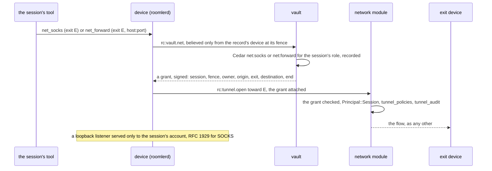

| Piece | Design |
|---|---|
| who decides | the vault. It believes a session only from the device its record places it on, at its fence (`crates/modules/vault/src/lease.rs:35`). The network module cannot, because `hive ↔ network` is forbidden both ways (`crates/core/src/graph.rs:103`). Two new Cedar actions, `net:socks` and `net:forward`. Their principal is the `Session`, their resource a new `Node` entity (an enrolled device: its tags, OS and owner), and their context the device the session runs on and, for a forward, the destination. Every decision is recorded in `vault_audit` |
| the grant | the vault's answer: a token signed by core's auth service (`crates/core/src/state.rs:53`) under an audience of its own, `net_grant`, which no other gate accepts. It names the tenant, the session and its fence, the session's owner, the origin device, the exit, the destination (one `host:port` for a forward, none for SOCKS) and its end, at most the lease ceiling (900 s). The network module verifies it and calls no module, so the graph is unchanged |
| the principal | `Principal::Session {sid, owner}`: what `tunnel_policies` are evaluated for, and what `tunnel_audit` records, a `session_id` beside `origin_agent_id` (`crates/remote_control/src/models.rs:4535`). Which subjects match it is decision 20. As built (P3-7-2a), it names the session and the device whose WS carries its flows; the owner is the flow's subject `user_id`, as for any flow |
| the listener | one per tool call, on loopback, on a port the system picks. It serves a connection only when the process holding it runs as the session's account, as `vault_connect`'s endpoint does on Linux, macOS and Windows (`agents/roomlerd/src/hive/vault_connect.rs:22`). `net_socks` adds RFC 1929: the username the session's id, the password a capability made for the listener (32 random bytes), so a second session under the same account cannot share it. The SOCKS5 front offers RFC 1929 on session listeners alone. The loopback listeners it already serves keep offering no authentication |
| the answer | `net_socks`: `socks5h://<session>:<capability>@127.0.0.1:<port>` and its end; `net_forward`: `127.0.0.1:<port>` and its end. The capability lands in the transcript. It is the session's own: refused off the device and to any other account, and gone with its listener |
| its life | until the grant's end, or the session's run ending on this device: its end, or a move, which the device's own fence ends. A grant is no lease, so no `rc:vault.revoke` names it. A flow the listener opened ends with it, both halves (#2129) |
| the gates | `vault.tenants`; the device-owned `hive_net`, default off and never pushable; Cedar's `net:*`; `tunnel_policies`; the exit's `forward_acl`. Each refuses on its own |

- ⚠️ **A compromised daemon gains little.** It already holds its agent token, which opens flows as
  `Principal::Agent`. A grant adds the session's scope, for at most its 900 seconds.
- ⚠️ **The network module never hears of a revocation.** The device closes the listener and its
  flows; the grant's end bounds the rest. A grant is asked for each tool call, never kept for a
  session.
- ⚠️ **CONNECT only.** A session listener refuses UDP ASSOCIATE: the account check reads TCP
  sockets.
- ⚠️ **An exit dials as its daemon** (found writing P3-7-1b). A session's flow to an exit's
  loopback reaches it as SYSTEM or root, and an exit that is the session's own device makes its
  own loopback the daemon's. P3-7-2b decides, at the flow, whether a session may reach an exit's
  loopback; Cedar's context does not name the session's device by id. Until then a session's
  flow reaches nothing, loopback or not (P3-7-2a).
- Not in P3-7: the egress proxy (design §7.2's third change), which the sandbox sends every
  command through, and `roomler connect` (P3-9).

**P3-8, `ssh_run`, as designed (P3-8-0).** A session runs one command on another device of its
organization over Roomler SSH, as the account that device's SSH policy maps, and gets its exit
code and output. It never holds a key: its own device's daemon is the SSH client, with an
ephemeral key minted for the one call.

Today's device-originated leg (`rc:ssh.request`, `roomler ssh` from a laptop) runs under the
origin device's owner: "the origin's owner is the person whose permissions this runs under"
(`crates/modules/network/src/agent_arms.rs:158`). A session that used it would borrow its owner's
SSH rights, the fallback P3-7 refused for tunnels. So a session's SSH is its own, and it reaches
SSH's four gates (`docs/roomler-ssh.md`) the way a session's egress reaches the tunnel policies.

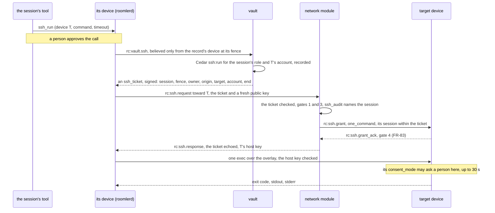

| Piece | Design |
|---|---|
| who decides | the vault first: Cedar's `ssh:run`, its principal the session, its resource the target as P3-7-1a's `Node` (`crates/modules/vault/src/policy.cedarschema:54`), its context the asking device and `account`, the account the target's `SshPolicy` maps (`daemon`, `console_user` or `named`), read from its row. Then SSH's own gates, which a ticket does not skip |
| the ask | `rc:vault.ssh {req_id, session_id, fence, target, ttl_secs}`, believed as a lease request is: the session's record, at its fence, on the asking device. The target is a live device of the organization, named by id, else `no_target`; never the asking device itself |
| the ticket | the vault's answer, `rc:vault.ssh.granted`: a token signed by core's auth service under an audience of its own, `ssh_ticket`. It names the session at its fence, its owner, the origin device, the target, the account decided on and an end at most 900 s away, and is recorded before it is sent, as a `net_grant` is, its allow naming `ticket:<id>` where a grant's names `grant:<id>` (`crates/modules/vault/src/lease.rs:649`). The answer carries the target's `os`, which the vault read for Cedar |
| at the network module | `rc:ssh.request` gains `ssh_ticket`, verified as P3-7-2a's `bind_net_grant` verifies a `net_grant` (`crates/modules/network/src/tunnel.rs:547`): on an agent's own WS, in its organization, from the device it names, toward the target it names (the request's target resolved first, then compared by id), before its end, with no leeway, and the account the target's policy maps still the one decided on. The principal is then the session. Gate 2 (`SSH_DEVICE` on a person's role) is the vault's decision in its place; gates 1, 3 and 4 hold as for anyone, `can_originate` on the origin device included |
| gate 3 for a session | which `SshPolicy` allowlists a session matches: decision 22 |
| the session's bound | `session_secs` is asked as the tool's timeout plus the target's 30 s prompt, and the network module clamps it to what is left of the ticket. The target ends the session there (`rc:ssh.grant`'s `session_secs`) |
| one command | `rc:ssh.grant` gains `one_command`, set for a session's request, and so does FR-105's pending row, so a grant the SYSTEM service claims holds it too. The target serves such a session one `exec` and refuses any other request: a shell, a PTY, a forward, a subsystem. A target that does not advertise `ssh-one-command` is refused a session's request |
| the client | the session's own daemon. An ed25519 key minted per call, as `roomler ssh` mints one (`agents/roomler-cli/src/sshcmd.rs:274`), its private half in daemon memory alone; then one `exec` to the target's overlay address on `russh`'s client. That is the crate the daemon links for its SSH server (`ssh-server`), whose client only the server's own tests drive today (`agents/roomlerd/src/ssh.rs:3006`). The target's host key is checked against `rc:ssh.response`'s `host_pubkey`, and an answer without one is refused |
| the tool | `ssh_run {device, command, timeout_s}` on the toolbelt, `device` a device's id as `net_socks` names its exit, where the device's owner turned on `hive_ssh` (device-owned, default off, never pushable) beside `vault_enabled`. The settings `ask` for it, as for the vault's uses: a person approves every call. `command` is one line, at most 8 KiB, for the target's own shell: SSH carries a string, and the target runs it with PowerShell on Windows and bash elsewhere (`agents/roomlerd/src/exec.rs:603`). The answer holds the target's `os`, the exit code, and stdout and stderr, each at most 64 KiB, as `vault_exec`'s are (`agents/roomlerd/src/hive/vault_exec.rs:47`). A timeout past 300 s is refused |
| the account and consent | the target's `SshPolicy.account_mode` and `consent_mode`, as for any caller. A person at the target may be asked before the command runs, for up to the prompt's 30 s (`agents/roomlerd/src/consent.rs:62`), and the prompt names the session, its owner and its device |
| the audit | `ssh_audit` gains `session_id` and `ssh_ticket_id`. Its `user_id` is the session's owner, `origin_agent_id` the session's device and `source` `session`; `grant_id` is still the target's grant. `ssh_activity` stays the target's claim |
| the kill switches | `vault.tenants`; the device's `hive_ssh`; the org's `remote_ssh_enabled`; the target's `ssh_enabled` |

- ⚠️ **A ticket, not a grant.** `rc:ssh.grant` is already the target's single-use grant (FR-83),
  and `grant_refused` already the target's refusal of it. A session's request carries both, so
  the vault's token is named apart and no field, log line or audit row can mean either.
- ⚠️ **A session never borrows its owner's SSH rights.** Its request carries its own ticket, the
  vault's decision for its role, and a request whose ticket does not hold is refused
  (`ticket_refused`), never served as the owner's. The owner's `SSH_DEVICE` is not read for it:
  a session's permissions are its role's, not intersected with its owner's (design §8.1).
- ⚠️ **An older server ignores the ticket**, an unknown field, and would answer the request as
  the owner's. So `rc:ssh.response` echoes `ssh_ticket_id`, as `rc:tunnel.opened` echoes
  `net_grant_id` (P3-7-2a), and the daemon never dials on an answer that does not echo the
  ticket it presented.
- ⚠️ **Never its own device.** A session already runs there, as its account. SSH would run its
  command as whatever that device's policy maps, and `daemon` is SYSTEM or root: an escalation,
  not a reach. So no ticket names the device it runs on. The auth service signs none and checks
  none, and the vault refuses the ask (`bad_request`, recorded as `own_device`).
- ⚠️ **The account is decided, not discovered.** Cedar sees the account the target maps, so an
  organization can forbid a session the daemon's: `forbid (principal, action ==
  Roomler::Action::"ssh:run", resource) when { context.account == "daemon" };`. The ticket
  carries the account, and a policy changed to another since the vault decided refuses the
  request (`ticket_refused`).
- ⚠️ **One command is the target's rule, not the client's.** A daemon holding the key could ask
  the target for anything a key may ask for. So the grant says `one_command` and the target
  enforces it; a target too old to read the field is refused a session's request, not trusted
  with it.
- ⚠️ **The key never reaches the session**, nor its transcript. The daemon mints it, presents it
  once and drops it, and the target's grant is single use and lives 60 s
  (`crates/remote_control/src/models.rs:2491`). `roomler ssh` runs the system `ssh`
  (`agents/roomler-cli/src/sshcmd.rs:94`), which would need the key in a file; the daemon does
  not.
- ⚠️ **The target's consent still applies.** A `consent_mode` that prompts holds the session's
  command for a person at the target, and the session reads a refusal or a timeout in words.
- **Not in P3-8:** `fleet_exec`, which runs as SYSTEM or root and waits on decision 5 (P3-8-3); a
  session's SSH to a device of another organization; a shell, a forward, `scp` or `sftp` for a
  session; an approval card for `ssh:run`.

**The toolbelt grows** beyond `approve` (`agents/roomlerd/src/hive/toolbelt.rs:1286`):
- the vault tools: `vault_list`, `vault_describe`, `vault_request`, `vault_exec`, `vault_render`;
- the network tools: `net_forward`, `net_socks`;
- `ssh_run`;
- `fleet_exec`, with a person approving every call.

**P3's steps.** Each is a PR behind its kill switch; §4 tracks them.

| Step | Builds | Kill switch | Criteria |
|---|---|---|---|
| P3-0 | this design | docs only | — |
| P3-1 | the vault module: secrets and versions, envelope encryption under the `age` KEK, RRNs, `vault_audit`, the metadata routes, `[modules] vault` and `vault.tenants` | the module unmounted; the org not listed | — |
| P3-2a | Cedar: the schema, roles, policies validated on write, the seeded guardrails, `simulate` | `vault.tenants` | AC13 (its decision half) |
| P3-2b | `role:assume` at a session's start, decided again whenever a session moves to another device; Cedar decisions recorded with their request, and `simulate`'s replay of a change against the last 7 days | `vault.tenants` | AC13 (its decision half) |
| P3-2c | an impossible policy refused on write (`docs/vault.md` §7): Cedar's strict validation keeps a policy whose scope can never hold, as a warning, so a `forbid` like that forbids nothing its writer meant it to (found in P3-7-1a) | `vault.tenants` | — |
| P3-3a | the device's vault key: made in daemon memory while `vault_enabled` is on, its public half in the primary enrollment's hello, kept on the agent row | device `vault_enabled = false`; the `vault` feature in no release build | — |
| P3-3b | leases, the vault's half: a session's request over its device's connection, believed only from the record's location at its fence; Cedar's `secret:use`; the value sealed to the device's key; `vault_leases` and the audit; `RpcCap::Vault` defined, advertised by no agent yet | `vault.tenants`; no agent asks before P3-4 | — |
| P3-3c | revocation, the vault's half: a push when a session ends or moves, a value changes or is disabled, or the device's key changes; the TTL | `vault.tenants` | — |
| P3-4a | the daemon's lease client: it advertises `vault` exactly where its hello carries the key, asks on the primary connection with a deadline, holds a lease's value zeroized in daemon memory, and lets it go at its expiry, at `rc:vault.revoke`, or when its run ends here; no tool asks yet | device `vault_enabled = false`; the `vault` feature in no release build | — |
| P3-4b | the toolbelt's metadata tools: `vault_list` and `vault_describe` for a session, decided by Cedar's `secret:list` | `vault.tenants` | — |
| P3-4c-1 | the toolbelt's first use tool, `vault_exec`: one command with values in its environment, run as the session's account, output scrubbed, `argv[0]` on the secret's `exec_allow` (a guardrail) | device `vault_enabled = false`; the `vault` feature in no release build | AC13 |
| P3-4c-2 | `vault_render`: a template into the session's secrets directory | device `vault_enabled = false` | — |
| P3-4c-3 | `vault_request`: a lease asked for ahead, which the other use tools take when they name the same secret toward the same audience | device `vault_enabled = false` | — |
| P3-4d-1 | `vault_activity`, the server's half: `rc:vault.activity` kept only for leases released to that device, for that session, in the use's mode and toward its target; the collection; the administrator's read | `vault.tenants`; no device reports before P3-4d-2 | — |
| P3-4d-2 | `vault_activity`, the device's half: its owner's `vault_activity_log` (default off, never pushable), and a report after each `vault_exec` and `vault_render` | device `vault_activity_log = false` | — |
| P3-4e-1 | the approval card, the vault's half: where only a driver's yes could allow a lease, a card in the session's room and `awaiting_approval`; the answer route; one yes, one lease | `vault.tenants` | — |
| P3-4e-2 | the approval card, the device's half: what the session's tools say while a card waits, and when they ask again | device `vault_enabled = false` | — |
| P3-4e-3 | the approval card in the web app: its Approve and Deny | the SPA only | — |
| P3-5a | `proxy` mode's design, and the vault's half: a secret's `audiences` in Cedar, and the guardrail `proxy-only-named-audiences` | `vault.tenants` | — |
| P3-5b-1 | the Postgres engine: SCRAM-SHA-256 and verified TLS upstream, the client's startup made the secret's user's, and what it refuses; no caller yet | the `vault` feature in no release build | — |
| P3-5b-2 | the device's proxy endpoint and `vault_connect`, with Postgres | device `vault_enabled = false`; per-secret `disabled` | AC12 |
| P3-5b-3 | SCRAM channel binding (`-PLUS`, `tls-server-end-point`) where the upstream offers it | the same | — |
| P3-5b-4 | the Windows endpoint: loopback TCP, each connection's process identified (`GetExtendedTcpTable`, then its token's SID) and refused unless it runs as the session's account | device `vault_enabled = false` | AC12 |
| P3-5c-1 | the MongoDB engine: SCRAM-SHA-256 by `saslStart` and `saslContinue` inside verified TLS, no `hello` of its own, a refusal answering the client's first message; no caller yet | the `vault` feature in no release build | — |
| P3-5c-2 | `vault_connect` serving the MongoDB engine | device `vault_enabled = false`; per-secret `disabled` | AC12 |
| P3-5d-1 | the HTTP engine: one client connection's requests sent on to one origin over verified TLS, the secret's credential in `Authorization`, the client's own credentials and hop-by-hop headers dropped, a redirect to the upstream pointed back; no caller yet | the `vault` feature in no release build | — |
| P3-5d-2 | `vault_connect` serving it: `engine: "http"`, an origin, `auth`; the loopback endpoint on Linux (`/proc/net/tcp`) and Windows; git's `insteadOf` in `env`; `vault_request` asking ahead toward an origin | device `vault_enabled = false`; per-secret `disabled` | — |
| P3-5d-3 | the macOS endpoint: each connection's account read from `libproc` | device `vault_enabled = false` | — |
| P3-5e-1 | the HTTP engine's half for Kubernetes: a client certificate in the TLS handshake, an upgrade relayed and joined (for `kubernetes` only), `Impersonate-*` dropped; no caller yet | the `vault` feature in no release build | — |
| P3-5e-2 | `vault_connect` serving it: `engine: "kubernetes"`, `auth` `bearer` or `client-cert`, the kubeconfig answer | device `vault_enabled = false`; per-secret `disabled` | — |
| P3-5f-1 | P3-5f's design, and the SSH agent engine: the agent protocol, the key and its signatures in `ring`, a sign-in signed only on a connection bound to one of the secret's hosts; no caller yet | the `vault` feature in no release build | — |
| P3-5f-2 | `vault_connect` serving it: `engine: "ssh"`, the Unix socket on Linux and macOS, `SSH_AUTH_SOCK` and `known_hosts` in the answer; OpenSSH's own `ssh` and `sshd`, end to end | device `vault_enabled = false`; per-secret `disabled` | — |
| P3-5f-3 | the Windows endpoint: a named pipe, its DACL the session's account's, each client's token checked | device `vault_enabled = false` | — |
| P3-6a | `short-lived`'s design (§3e "P3-6, `short-lived`, as designed"), and decision 18 | docs only | — |
| P3-6b-1 | the vault's half: the `dynamic` kind and its providers' fields, checked on write; a dynamic secret leased in `short-lived` alone, answered with its bundle; `vault.providers` | `vault.tenants`; `vault.providers` | — |
| P3-6b-2a | the Postgres minter on the device, with no caller yet: one user per lease, its password sent as its SCRAM verifier, the expired ones swept at each mint, a revocation that drops only a role a mint made | the `vault` feature in no release build | — |
| P3-6b-2b | its caller: `vault_exec` and `vault_render` serving a dynamic secret, a user minted for each lease and revoked at its end | device `vault_enabled = false`; `vault.providers` | — |
| P3-6c | GitHub App tokens, minted where decision 18 says | `vault.providers` | — |
| P3-6d-0 | P3-6d's design (§3e "P3-6d, MySQL, SQL Server and Redis users, as designed"), and decision 19 | docs only | — |
| P3-6d-1a | the MySQL minter on the device, with no caller yet: MySQL's client protocol, SHA-256 crypt for the password's form, one user per lease ended by an `EVENT`, the ended swept by their `ATTRIBUTE`, a revocation that drops only a user a mint made | the `vault` feature in no release build | — |
| P3-6d-1b | its caller: `mysql` in `vault::providers`, and the lease client's mint chosen by provider | `vault.providers` | — |
| P3-6d-2 | Redis users, as decision 19 says | `vault.providers` | — |
| P3-6d-3 | SQL Server logins, as decision 19 says | `vault.providers` | — |
| P3-6e-0 | AWS STS's design (§3e "P3-6e, AWS STS, as designed"), and decision 21 | docs only | — |
| P3-6e-1 | the vault's half: `aws_sts` in `vault::providers`, its issuer's fields and its one audience checked on write; its leases refused until a minter serves it | `vault.providers` | — |
| P3-6e-2 | the minter, where decision 21 says: SigV4, `AssumeRole`, and the session policy that ends each credential at its lease's end | `vault.providers` | — |
| P3-6e-3 | its caller: `vault_exec` and `vault_render` serving the minted credential | device `vault_enabled = false`; `vault.providers` | — |
| P3-6f-0 | a Kubernetes `TokenRequest`'s design (§3e "P3-6f, a Kubernetes `TokenRequest`, as designed") | docs only | — |
| P3-6f-1 | the minter on the device, with no caller yet: the lease's Secret, the `TokenRequest` bound to it, its revocation, and the sweep where the issuer may list | the `vault` feature in no release build | — |
| P3-6f-2 | its caller: `kubernetes` in `vault::providers` and in the daemon's `MINTS`, and `vault_exec` and `vault_render` serving the token | device `vault_enabled = false`; `vault.providers` | — |
| P3-7-0 | P3-7's design (§3e "P3-7, a session's own egress, as designed"), and decision 20 | docs only | — |
| P3-7-1a | the vault's half, in Cedar: `net:socks` and `net:forward`, the `Node` entity, a node named in a policy only where it is a live device of the organization, `simulate` deciding both | `vault.tenants`; nothing asks before P3-7-1b | — |
| P3-7-1b | the vault's half, on the wire: `rc:vault.net`, believed only from the device the session's record places it on, at its fence; decided by `net:*`; answered with its grant (`net_grant`, signed by core's auth service) | `vault.tenants`; no device asks before P3-7-3 | — |
| P3-7-2a | the network module's half, before decision 20: the grant verified at `rc:tunnel.open` and bound only from the device and toward the exit it names, else the open refused; `rc:tunnel.opened` echoing it; `Principal::Session`, which no subject matches yet; each flow held to the grant; `tunnel_audit.session_id` and `grant_id` | `vault.tenants`; no device presents a grant before P3-7-3 | — |
| P3-7-2b | the subjects decision 20 names, and whether a session's flow may reach an exit's loopback | `vault.tenants` | — |
| P3-7-3a | the device's half, asking and opening: `rc:vault.net` from the daemon's vault client, a grant used only for what was asked; a flow's tunnels opened under its grant, the flow ended for good when the server refuses the grant or opens without its echo | the `vault` feature in no release build; nothing asks before P3-7-3c | — |
| P3-7-3b | the listeners: one per tool call on loopback, served only to the session's account; RFC 1929 in the SOCKS5 front, on session listeners alone; each gone with its flows, both halves, at the grant's end | the `vault` feature in no release build | — |
| P3-7-3c | `hive_net` (device-owned, default off, never pushable) and the tools `net_socks` and `net_forward` | device `hive_net = false`; the `vault` feature in no release build | — |
| P3-8-0 | `ssh_run`'s design (§3e "P3-8, `ssh_run`, as designed"), and decision 22 | docs only | — |
| P3-8-1a | the vault's half: Cedar's `ssh:run`, its context the target's `account`; `rc:vault.ssh` answered with an `ssh_ticket`, never naming the asking device | `vault.tenants` | — |
| P3-8-1b | the network module's half: the ticket verified at `rc:ssh.request`, its account still the target's, the session the principal, gate 3 as decision 22 says, `session_secs` within the ticket, `one_command` on the grant, `ssh_audit` naming the session, the echo | `vault.tenants` | — |
| P3-8-2a | the target's half: `ssh-one-command`, a session's grant served one `exec` and nothing else, on the worker and on the SYSTEM service | the target's `ssh_enabled` | — |
| P3-8-2b | the device's half: `hive_ssh`, the vault client's ask, the daemon's SSH client, the tool `ssh_run` | device `hive_ssh = false`; the `vault` feature in no release build | — |
| P3-8-3 | `fleet_exec` as a tool, as decision 5 says | decision 5 | — |
| P3-9 | `roomler connect <handle>` for people (knowhow's `roomler_connect(entity)` waits for P4) | — | — |
| P3k | the field run in the test org, and `docs/vault.md` | — | AC12, AC13, AC19's vault half |
| P3b | `placeholder` egress, as designed | `vault.placeholder = false` | AC14 |

### 3f. The brain

Central, in the `hive` module: core memory in four scopes (org, project, user, device) with budgets
and visible over-budget failure, rendered as a frozen snapshot per session into `CLAUDE.md` and
Claude Code's own auto-memory directory; facts as records with evidence, versions, contradiction
cards and decay; skills and playbooks versioned centrally and projected per session. The reviewer — a
tool-less model call — runs on a replica, never on the server, and sends distilled proposals and the
session card. Improvement is counted: corrections per session, per-skill correction rates, eval
sessions that run each skill's acceptance test.

**P1e, core memory from a hand-curated brain (AC8), as designed.** People write facts; the learning
loop that proposes them is P5.

What Claude Code does with the files, probed 2026-10-08 against a fake Messages API (2.1.293, no
model spend):
- `$CLAUDE_CONFIG_DIR/CLAUDE.md` reaches the model in the first turn as "the user's private global
  instructions for all projects". It comes under "These instructions OVERRIDE any default behavior
  and you MUST follow them exactly as written".
- `$CLAUDE_CONFIG_DIR/projects/<pinned name>/memory/MEMORY.md` reaches it as "user's auto-memory,
  persists across conversations". Its topic files reach it only when the model opens them.
- Both files are inside the session's own config directory. No settings change is needed.

⚠️ **Core memory would be the first server-authored text a session's model reads, and it reads it
as overriding instructions.** Today a compromised server cannot put one word in front of the model:
prompts come only from drivers, over the peer. Approvals still gate every tool that changes
something. But read-only tools run unasked, and the server can mint itself a view grant (§3c). So
an injected "read X and show it" becomes a path. Hence a gate that belongs to the device.

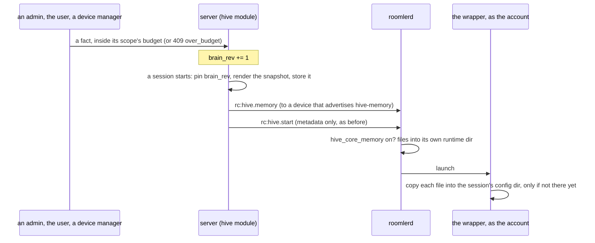

| Rule | Why |
|---|---|
| Three scopes: **org**; **user** (the session's starter); **device** (the device the session runs on). Project waits for a project identity (knowhow, P4) | the starter is whose account the session runs as |
| A fact is a record: `brain_facts {tenant_id, scope, owner_id (the user or the device; none for org), text, kind, status: active or archived, version, created_by, created_at, updated_by, updated_at}` | versions now; evidence, review and supersession come with P5 |
| Budgets: org 3,000, user 1,500, device 800 characters of active text per scope instance (design §10.3). They are held in one counter document per instance, and changed by one conditional update (`$inc` under `used ≤ budget − n`), so two concurrent writes cannot both fit | "fails visibly": a write that does not fit is `409 over_budget`, with what is used, the budget and the size asked. Nothing is evicted; a person consolidates |
| Who writes: org, `ADMINISTRATOR`; user, that user, with `HIVE_RUN`; device, `MANAGE_AGENTS`. Every write is audited (`hive_audit`, `brain`) | an org fact reaches every session in the org as an instruction |
| `brain_rev` per org, incremented by every write. A session pins it at creation. The server renders the snapshot then and stores it (`hive_session_memory`, by session): org and user into `CLAUDE.md`, device into the auto-memory `MEMORY.md` | frozen: a later fact never changes a running session (AC8), and a re-sent start carries the same snapshot |
| Delivery: `rc:hive.memory {session_id, fence, brain_rev, files}` immediately before `rc:hive.start`, and before its re-send on connect, to a device that advertises `hive-memory` | `rc:hive.start` stays metadata only, its field set locked; one socket keeps the order |
| The device's gate: `hive_core_memory`, a device key, **default off**, never pushable. Off, the frame is dropped, and the session's transcript says the device takes no core memory | the gate that survives a compromised server, like `hive_accounts` |
| The daemon writes the files into its own runtime directory (`<runtime>/<sid>/memory/`, `0755`), each `0600` and handed to the account. The wrapper, running as the account, copies each into the session's config directory **only if it is not there yet** | the daemon never writes into a tree the account owns, and no other local account reads a session's memory (its `CLAUDE.md` carries the starter's own facts). A resume (P1d-2) keeps what the session has, its own edits included. Frozen across restarts |
| No frame (an older server, or a lost one): the session runs without core memory. Its transcript says nothing of it: the note is written only when a snapshot arrived, saying which revision and whether this device shows it (`hive/supervisor.rs:1808`) | memory is an enhancement, never a single point of failure |

AC8's test is a CI test with the in-process device, its harness writing out the two files.
As built (P1e-4): `crates/tests/tests/hive_memory.rs` with the gate on, and `hive_memory_off.rs`
with it off. They are two binaries because a process has one supervisor and reads the gate once.
The harness copies out what it finds where Claude Code reads core memory, at its start and at
every turn.
- An org fact (and a device fact) is added, and session A starts: A's `CLAUDE.md` holds the org
  fact, its auto-memory `MEMORY.md` the device fact, and its transcript names the revision.
- A second fact is added: A's file does not change, even at its next turn, and session B's holds
  both, at a later revision.
- A write past the budget is refused `409 over_budget`, with the numbers. It spends nothing, and
  nothing is evicted.
- With the device's gate off, the session's config directory holds neither file, and the daemon
  did not even write its own copy. The transcript shows the frame arrived and says why.

### 3g. Gates

Running a session is remote code execution on a device, so it gets exec's and SSH's four gates:
`HIVE_RUN` in no managed role below `ADMINISTRATOR` (pinned by
`no_managed_role_below_administrator_seeds_a_root_shell`, `crates/db/src/models/role.rs:396`); a
Cedar `role:assume` permit, default deny; per-(user, device) limits after the identity gates; and the
device's own `hive_enabled`, `hive_accounts` and `hive_roots`, of which only `hive_enabled` (and
`hive_replica`) can ever be pushed, and only to devices that opted into remote config
(`crates/remote_control/src/models.rs:2352,5746`).

**P1g, the org gate, as built.** The module switch (`[modules] hive`) is all or nothing for a
server, so it has a second dial: `hive.tenants` (`ROOMLER__HIVE__TENANTS`), the organizations
agent sessions serve, as comma-separated ids. Empty or `*` is every one, which is what a
self-hosted server wants. A hosted server lists one test organization first (decision 10).

**The list is the switch** (P1g-2). A non-empty `hive.tenants` mounts the module by itself, with
no `[modules] hive`, and `/api/capabilities` says so (`Settings::hive_on`,
`crates/config/src/settings.rs`). A hosted server sets only the list, because that form fails
safe: an image from before P1g never reads the list, so with `ROOMLER__MODULES__HIVE=true` beside
it, promoting such an image — a rollback, or another session's older tag — would open the pillar
to every organization on the hosted server. With the list alone, every older image leaves it off.
Clearing the list is the kill switch.

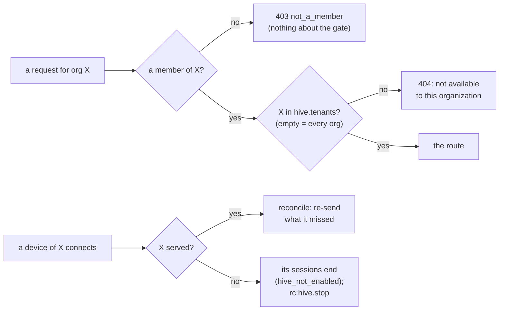

| Where | An organization agent sessions do not serve | Where in the code |
|---|---|---|
| every route | **404**, `agent sessions are not available to this organization`, after the membership check (a non-member still gets `not_a_member`) | `routes.rs` `member_tenant` |
| `GET …/hive` | the SPA's question: `{enabled: true}` or that 404; Hive's pages and nav show only where it is served | `routes.rs` `serves`, `stores/hive.ts` `checkServed`, the router guard |
| the viewer | `hive:view.open` answers `not_found`, as for a session the caller may not read | `view.rs` `open` |
| a device connecting | nothing is re-sent; what it still runs for the org ends (`hive_not_enabled`) and is told to stop | `agent_socket.rs` `end_unserved` |
| a malformed entry | logged, and it matches nothing: a typo shuts the org it meant rather than opening any other | `scope.rs` `TenantScope::parse` |
| the module switch | a list mounts the module by itself (`*` included); an image that predates P1g-2 leaves it unmounted | `settings.rs` `Settings::hive_on`, `Settings::switched_off` |

### 3h. Adopting terminal sessions (P1j)

People already run Claude Code in a terminal. `adopt` mirrors those sessions into the device's
store and lists them for their owner as read-only sessions (decision 11, design §10.8). A
terminal session passed none of Hive's start gates (`HIVE_RUN`, `hive_enabled`, `hive_roots`):
it is the person's own work, in their own account. So the gates are different ones, each
default-deny, and each owned by a different party.

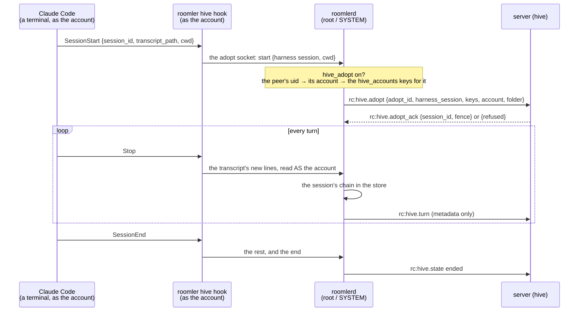

| Gate | Owner | Default | A refusal |
|---|---|---|---|
| the hooks are installed | the person, in their own user-level Claude Code settings (`roomler hive adopt`) | not installed | nothing is mirrored |
| `hive_adopt` | the device's owner: a device key, never pushable, advertised as `hive-adopt` | off | nothing reaches the server; an offer from a connection without `hive-adopt` is dropped unanswered |
| the org is served | the server (`hive.tenants`, P1g) | — | `hive_not_enabled` |
| the account names ONE person, a member | the device's `hive_accounts`, resolved by the server | — | `no_account` (no key names anyone) · `ambiguous_account` (two people) · `not_a_member` |
| capacity, rate | the server: 16 live adopted sessions a device, 20 offers a minute | — | `at_capacity` · `rate_limited` |

What each rule is, and where it lives:

| Rule | Why | Where |
|---|---|---|
| The device sends EVERY `hive_accounts` key that maps to the account; the server resolves each (a user id, or an address some account proved) and adopts only for exactly one person | the attribution is the device owner's statement, never a guess. An account shared with a second person (decision 8's `"alice.com" = "bob"`) is `ambiguous_account`, not "the one of them who is a member", which would show one person's terminal to another | `crates/modules/hive/src/adopt.rs` `people` |
| Every offer is attributed afresh. One for a terminal session already held is answered with the same record, for the same person only; held for someone else, that record ends `attribution_changed` | the device offers again after a restart or a lost ack, and a second record would split one terminal in two. A remap must never pour a new person's terminal into the old person's record | `adopt.rs` `decide` |
| No drivers, the owner included: `drives_now` is false, and naming a driver is a 409; readers by name, as for any session | the terminal holds the harness, so nothing typed here could reach it | `access.rs` `drives_now`, `participants.rs` `set` |
| The record holds no title, only the folder's name; `origin: adopted` | a terminal's first prompt is content | `model.rs` `SessionOrigin` |
| The hook reads the transcript, never the daemon | a root daemon opening a path a hook names would read any file the requester could point it at | `crates/localapi/src/hive_adopt.rs` (the protocol carries lines, never a path); `roomlerd/src/hive/supervisor/adopt.rs` `adopt_lines` |
| Who it is comes from the kernel (the adopt socket's peer credentials), not from the hook; root's own sessions are refused; a session belongs to the account that first offered it | the hook runs as whoever ran Claude Code, and says nothing that is not checked | `adopt.rs` `adopt_conn` · `adopt_hello` |
| Mirroring happens at every `Stop` (the hook runs in the background, `async`); `SessionEnd` runs in the foreground and only flushes | Claude Code gives `SessionEnd` hooks a shared 1.5 s budget, and nobody at the terminal should wait | `roomler-cli/src/hive_hooks.rs` `EVENTS` |
| `unadopt` takes out exactly what `adopt` put in; every other setting stays byte for byte (kept as raw JSON, in its order), and so does every other event and group in `hooks`; a file that is not a JSON object is refused, never rewritten; a symbolic link's target is rewritten in place, the previous bytes kept as `<file>.bak-roomler`. The containers it rewrites (`hooks`, the touched events' lists) are laid out as Claude Code writes its settings, two spaces a level, and the file keeps its final newline or its lack of one, so a file Claude Code wrote comes back from `adopt` then `unadopt` byte for byte | the person's own settings, and other tools' hooks in them (this repo's own dev box carries FR-8's), are theirs. Written compact, the containers came back on one line (P1j-5's field run, §8) | `hive_hooks.rs` `adopt_doc` · `unadopt_doc` · `render` · `write_settings` |
| The hook prints nothing and always exits 0; it sends whole lines only, at most 64 MiB a run, a line over 4 MiB or not UTF-8 as `skipped` bytes | Claude Code may show a hook's stderr and add its stdout to the model's context; a broken hook must never break a session | `hive_hooks.rs` `hook` · `next_chunk` |
| The hook entry runs the binary that installed it (`roomlerd cli hive hook` on a daemon host, `roomler hive hook` standalone) as ONE command line, the path quoted, with a 30 s timeout; never exec form (`command` + `args`) | `roomlerd` with no arguments RUNS THE DAEMON: a Claude Code that dropped an `args` list it did not know would start a daemon as the person at every hook. A version that knows no `async` waits at most the timeout | `hive_hooks.rs` `HookCommand` |
| A terminal killed outright never says `SessionEnd`: the daemon records Claude Code's process (pid + start time) and ends a session whose process is gone, every minute. Claude Code's process is the hook's nearest ancestor that is not a shell: Claude Code runs a hook's command line through `/bin/sh -c`, and dash forks it rather than exec it | otherwise a crashed terminal stays "live" forever. Taking the hook's parent, the `sh` that exits with the hook, ended every adopted session at the next sweep while its terminal ran, and the next turn offered it again as a new record (P1j-5's field run, §8) | `adopt.rs` `adopt_sweep`, `hive/procs.rs` `hook_terminal` |
| The device serves an adopted session's viewer on `hive_adopt` alone, and holds no input channel for it. That includes an ended one: the device keeps the records of the last 1,000 adopted sessions that ended here | a device may allow adopting with `hive_enabled` off, and the viewer refused every grant on `hive_enabled` before P1j. Counting only the sessions it still held, the device refused an owner their own ended session `hive_disabled` (P1j-5's field run, §8). `may_prompt` is false from the server, and a prompt for a session the device does not run is refused anyway | `hive/view.rs` `grant`, `adopt.rs` `adopt_holds` |
| Only the person's conversation is mirrored: `user` and `assistant` lines, never a subagent's (`isSidechain`) or Claude Code's bookkeeping (`isMeta`, every other line type); a line that is not JSON is skipped | the on-disk transcript is Claude Code's internal format: a change in it must thin the mirror, never stop it | `adopt.rs` `read_line` |
| `hive-adopt` is advertised only while `hive_adopt` is on, and the socket exists only then: a daemon started with it off removes a socket its predecessor left. `roomler hive adopt` tells whether the device adopts by connecting, never by the file | a device whose owner has not allowed adopting offers nothing, and says so. The leftover file read as "this device adopts" (P1j-5's field run, §8) | `encode/caps.rs`, `adopt.rs` `adopt_listen` · `adopt_remove_stale_socket`, `hive_hooks.rs` `device_adopts` |
| A stop from Roomler stops the mirroring, for good: the terminal session goes on, the record ends, and later hooks are refused `stopped`. A stopped session is held until its terminal ends, at its `SessionEnd` or when the sweep finds its process gone, and is then forgotten as every ended session is. A `claude --resume` later is offered afresh, as a new record mirrored from the start of its transcript | the terminal is the person's; Roomler can only stop watching it. Held for good, every stopped terminal stayed in the file forever, and a resume was refused `stopped` (P1j-5's field run, §8) | `adopt.rs` `adopt_stop` · `adopt_hello` · `adopt_sweep` · `AdoptedFile::retire` |
| The UI marks an adopted session (**Adopted**), says its transcript is read-only because it runs in a terminal, offers readers only, and its Stop reads **Stop mirroring**; a prompt typed in the terminal reads **In the terminal**, where an unknown author reads "Someone" elsewhere | a session nobody can prompt must not look like one somebody forgot to | `HiveSessionsView.vue`, `HiveTranscript.vue`, `HiveParticipants.vue`, `ChatView.vue` (`isAdopted`) |
| What the device keeps: `adopted.json` beside `hosted.json` (root, `0600`, written whole) — per session the record, the account and uid, the transcript offset, the turns, Claude Code's process; and the records of the last 1,000 adopted sessions that ended here | a restarted daemon goes on mirroring where it stopped, names the sessions in its manifest, and still serves an ended one to its owner | `adopt.rs` `AdoptedFile` |

⚠️ Its "an adopted session becomes a managed one" half is P2f-4: once its terminal ended, on the
device that adopted it, from the terminal's own history (the device's half P2f-4a, `docs/hive.md`
§12; the route P2f-4b). A session whose mirroring was stopped from Roomler never is.

## 4. Phases

| P | What | Kill switch | Status |
|---|---|---|---|
| claim | issue, this spec, the design, the ledger row | docs only | **merged** #1828 `73d963f45` |
| P0 | spike: `hive` module skeleton; one headless Claude Code session on one Linux device driven from a chat room; events in the device store; stubs to the server; content over a viewer peer; sidecar pass-through with the fence; `RunAs::Named` with a working directory | `[modules] hive = false`; device `hive_enabled = false` | — |
| P0a | the device core, `crates/hive-node`: transcript events and their hash chain (one writer, no gaps, an unknown kind still chains), the stream-json adapter, the replica store (SQLite + FTS5, search scoped to granted sessions), the launch spec (per-session config dir, pinned project name), `hive_roots` confinement | linked by no binary yet | **merged** #1831 `287b496b7` |
| P0b | the server side, `crates/modules/hive` (`hive → fleet`): the `agent_sessions` record and its lifecycle, `hive_audit`; start / list / get / stop routes; the wire (`RpcCap::Hive`, `rc:hive.start`·`stop` → `rc:hive.start_ack`·`state`, metadata only, lenient refusal words); `HIVE_RUN` (bit 32); reconcile-on-connect for unanswered starts and unconfirmed stops; member, device and org removal end their sessions (`member_removed` now runs from the remove-member route). No device runs a session yet | `[modules] hive = false` — the only module switch that defaults OFF | **merged** #1835 `686ec9ffb` |
| P0c | the device side, `roomlerd` feature `hive` (Linux): device keys `hive_enabled` (off) / `hive_accounts` (nobody) / `hive_roots` (nowhere) / `hive_max_sessions` / `hive_harness` / `hive_api_key_helper`, none pushable; advertise `hive`; the device's gates answer `rc:hive.start` (primary org only, idempotent on session + fence); Claude Code launched headless as the mapped account through `exec::apply_run_as` (uid 0 refused), its config dir made by a wrapper running AS that account, a daemon-owned settings file; stream-json recorded in the replica store by one writer thread; `idle` / `running` / `ended` reported, replayed on reconnect; stop = stdin EOF + SIGTERM to the process group, then SIGKILL | feature `hive` is not in `full` (no release build compiles it); device `hive_enabled = false` | **merged** #1836 `39325aeaa` |
| P0d-1 | the session room (`hive → chat`): each session is a `Secret` room at path `hive-<session>`, bound `{module: "hive", ref: <session>}`, its owner the only member — anyone else reads a 404; chat gains a generic `binding` on rooms and messages (stored, never interpreted) and agent authorship (`author_type: bot` + `author_display`, read only for a non-user author; the author id is the session's, so the edit and delete routes refuse every person); the session authors a note when it starts, is refused or ends — every server-side end included — and one **turn stub** per turn from `rc:hive.turn` (number, status, who asked, steps, duration, cost: the frame's field set cannot carry content), edited in place when the turn ends and never rewound by a late report of an older turn; the device counts turns and holds a prompt sent during one (at most 8 waiting, past that refused to the caller); and what is over stays over: a device that reports it RUNS a session whose record ended while it was away (a removed starter, an archived org) is answered with a stop — P0b had no path to it, since reconcile re-sends only what is pending | `[modules] hive = false`; feature `hive` not in `full` | **merged** #1837 `bbb688737` |
| P0d-2a | the viewer peer, device side: the `rc:hive.view.*` wire (grant · renew · offer · ice · close, and the device's grant_ack · answer · ice · closed) and capability `hive-view`; one actor per grant owning a data-only WebRTC peer (RC's browser-facing ICE setup); the `hive` DataChannel in bounded binary frames; `hello` / `page` / `follow` / `prompt`; the store's page, tip and live feed | feature `hive` not in `full`; no server sends a grant yet | **merged** #1839 `850f83e6c` |
| P0d-2b | the viewer peer, server side: the `hive:view.*` user-socket namespace, the grant table (room member, `may_prompt` = the starter while live, rate), ready only after the device's ack, the SDP/ICE relay, renew re-checks membership, close on socket close and member removal, audit; viewer TURN credentials minted per grant for 12 h (the config TTL would cut a relayed viewer at ten minutes) | `[modules] hive = false` | **merged** #1841 `c6f3bb551` |
| P0d-3 | the UI: `hive` in the SPA's module registry (default-OFF, so the capability gate fails CLOSED for it, where every other module fails open); `stores/hive` (the record); `views/hive/HiveSessionsView` (list, start dialog, stop); `useHiveViewer`, the browser's half of the viewer peer (`hive:view.*` signalling, a data-only peer dialled only after `ready`, the framing, history + live follow + "ask the agent", `close()` on every way out); `HiveTranscript` as a side panel of a hive-bound room (assistant text through `renderMarkdown`, everything else text-interpolated); `SessionView` gains `device_name` | the server's `[modules] hive` — the SPA shows nothing until the server names the module | **merged** #1842 `eef3df1ba` |
| P0e | the model sidecar: a loopback HTTP/1.1 endpoint in the daemon. The harness gets `ANTHROPIC_BASE_URL=http://127.0.0.1:<port>/s/<sid>` and a per-session token in `ANTHROPIC_API_KEY` — never the provider's key, which `hive_api_key_helper` prints to the DAEMON (cached 5 min, fetched again after a 401). Each call: this session's token, the session still running here at its fence, the device not offline past `offline_grace` (120 s), else refused in the provider's error shape; only `POST /v1/messages` and `/v1/messages/count_tokens`, matched exactly; forwarded unchanged with the key swapped in, the answer streamed (never buffered), `retry-after` and the rate-limit headers intact | feature `hive` not in `full`; no helper = no model access | **merged** #1843 `8bdbc1696` |
| P0f | the canary test (AC2, one device): `crates/tests/tests/hive_canary.rs`, its own test binary because the supervisor is process-global, drives a real server and a real in-process device (`hive::init_as_daemon`, feature `hive-test-launcher`: sessions as the test's own account, refused as root, in no release build). A prompt over the viewer peer, a tool's output, and a crashing harness's stderr each carry a canary; each must be in the device's store and in no Mongo document, object-store file, server log line or frame the server sent the browser — each absence checked beside a presence that proves the check can see. It found one channel: the `ended` detail carried the harness's last 400 bytes of stderr to the server, now a `note` in the device's transcript | a test; `hive-test-launcher` is test-only | **merged** #1844 `54075f875` |
| P0g | the AC1 field run's six findings: the server takes a start's answer in any live status (the daemon's `idle` lands first); the viewer waits for the socket before asking, and asks again after a redial; the device wires its channel's handlers inside `on_data_channel` (webrtc-rs reads the channel only after that callback returns) and the browser asks `hello` again until it is answered; `hive_api_workspace_id`, sent by the sidecar as `anthropic-workspace-id`; a turn records what it cost, not the process's running total; a repeated session announcement is shown once | fixes; `hive_api_workspace_id` unset = unchanged | **merged** #1846 `d24b1b0bf` |
| P1a-1 | approvals, the device and the UI: the session's **toolbelt** — one `roomler` MCP server per session on `<runtime>/<sid>/toolbelt.sock` (the session account's, `0600`, in a directory only the daemon writes; every peer's uid checked again), reached by the relay `roomlerd hive-mcp <socket>` that Claude Code itself starts as that account; its `approve` is the `--permission-prompt-tool`. The launch pins `--permission-mode default` (unset, a run behind the sidecar starts in `auto`, where a classifier decides), `--strict-mcp-config` (a repository's `.mcp.json` cannot shadow `roomler`) and `--disallowedTools AskUserQuestion`. While one is open the session is `awaiting_approval`; the transcript gets `approval_requested` (the call's own input) and `approval_resolved`; the viewer's `hello` names the open approvals, the device pushes `approvals` when they change, and a DRIVER's `answer {approval, allow\|deny, message?}` is taken, a reader's refused. Unanswered for 25 min is a denial that says so; a stop, or the harness letting go, withdraws it. The UI's approval card: Allow, Deny with a reason | feature `hive` not in `full`; device `hive_enabled = false` | **merged** #1848 `071e4c299` |
| P1a-2 | approvals, the server: `rc:hive.approval {approval_id, turn?, status, answered_by?}` (metadata only, the field set locked by test) → `agent_approvals`, one record per (session, approval) by a unique index, its end a compare-and-set on `open`; ONE stub per approval in the session's room ("Approval needed · turn N — open the session to answer"), edited to how it ended; `answered_by` believed only when it names a driver; a session's end withdraws what is open; the driver notified in the app and by web push to every subscription ("Claude · <device> needs approval", the session's title, its room); `NotificationType::ApprovalRequest` with a `#[serde(other)]` fallback; the device replays the newest word of its last 16 approvals on reconnect | `[modules] hive = false` | **merged** #1853 `b10ca1b85` |
| P1a-3 | Bash that runs on any host, found by P1a's field run: the launch no longer sets `CLAUDE_CODE_SUBPROCESS_ENV_SCRUB` (on Linux it makes every command sandboxed, and without bubblewrap and socat every one is refused — the real reason P0 could not run `whoami`); the session's settings keep `sandbox.autoAllowBashIfSandboxed: false`, so a sandbox that comes on — ours in P3, or the user's — never takes Bash out of the approvals | a fix | **merged** #1855 `b8c13acca` |
| P1b | finding (7), a daemon restart left its sessions live on the server: on every connection of its primary enrollment the device sends `rc:hive.manifest`, the sessions it runs NOW (ids and fences, the field set locked); the server ends each session it holds as running there — live, and launched there on the device's own word: its answer, or a run state only it reports (§3d) — that the list leaves out (`not_on_device`, or `stopped` for one being stopped), its room told and its open approvals withdrawn. A start the device has said nothing about is reconcile's, not the manifest's; another device's list, an oversized one, or none at all (an older build) changes nothing | a fix; an older device sends no manifest | **merged** #1860 `d3514f9cb` |
| P1c-1 | drivers, the server (§3c "Who takes part"): `agent_sessions.drivers`; the owner names a reader or a driver (`PUT`/`DELETE …/participant/{user}`), into the session's Secret room through chat's bound-room surface; a driver needs `HIVE_RUN`, at most 16; `may_prompt` = a driver while live, and a change ends the person's views (`role_changed`); `answered_by` and `prompted_by` believed only for a driver; the approval push to every driver in the room; any room member reads the session; a member who leaves the org drives nothing; every change audited (`participant`, with `target_id`) and noted in the room | `[modules] hive = false` | **merged** #1862 `b857488c1` |
| P1c-2a | drivers, the device (§3c "Who takes part"): a driver other than the session's starter prompts and answers only when the device's own `hive_accounts` maps them to the session's account — the gate that survives a wrong server; the starter recognised by id; `hello` says why a named driver is read only (`driving_refused`); `rc:hive.view.grant` carries the viewer's address, a driver's only (the field set locked); the harness reads `[Name] …` | feature `hive` not in `full` | **merged** #1864 `89e8df012` |
| P1c-2b | AC6's capture test, end to end (`crates/tests/tests/hive_drivers.rs`, a test binary of its own): a real server and a real in-process device; a reader's message in the room and a prompt over their own peer never reach the harness (its stdin captured), while the owner's and a named driver's do, each labelled `[Name] …`. The canary's scaffolding is shared as `tests/hive_support`. A reader's approval answer is the device's unit test's (`a_driver_answers_an_approval_over_the_peer_and_a_reader_cannot`) | a test | **merged** #1866 `1f925f3f3` |
| P1c-3 | drivers, the UI: `HiveParticipants`, the transcript's **People** dialog (the owner adds an org member as a reader or a driver, changes their part, takes them out; anyone else sees who takes part; a refusal shown in the server's words); the composer's two modes ("ask the agent" in the transcript for drivers, the room's own composer for everyone, which never reaches the agent); a reader told they read and talk, a named driver the device keeps read only told why in the device's words; a view reopened on `role_changed` | the SPA shows nothing until the server names the module | **merged** #1865 `b48a48f3b` |
| P1d-1 | the updater waits for running agent turns (AC7, §3d "Updates and restarts"): ≤ `hive_update_wait_secs` (device key, 30 min; 0 never waits), the periodic check AND a pushed update; logged when it starts and once a minute; new prompts and starts held once it goes ahead; a debug build's `ROOMLERD_UPDATE_DRY_RUN` waits exactly as a real update and installs nothing — and refuses every installer spawn, the crash-loop rollback included (the field check) | `hive_update_wait_secs = 0` | **merged** #1869 `3df638ae6` |
| P1d-2 | a restart resumes what the device hosted (AC20, §3d "P1d-2, the resume, as built"): `hosted.json` beside the store; `begin_shutdown` the moment any shutdown is signalled, so a harness that dies with the daemon is kept, not ended, and from then on the record is frozen and the toolbelt ignored (the field run's finding: an approval the teardown withdrew stayed "needed"); the resume at the first connection, before the manifest, through every gate as configured now (the same account, or none); `--resume` exactly when Claude Code's history exists, for every launch; the turn count carried on, a cut turn reported interrupted, its approvals withdrawn; a resumed process's first turn reports no cost; a stop before the resume launches nothing; 3 quick resumes in a row end the session | delete `hosted.json` (nothing resumes; P1b ends what it hosted); device `hive_enabled = false` | **merged** #1870 `48da9a69f` |
| P1e-0 | core memory's design (§3f "P1e … as designed"): the zero-spend probe of what Claude Code does with `CLAUDE.md` and the auto-memory index, the device gate it calls for, scopes, budgets, the pinned snapshot, delivery, and AC8's test | docs only | **merged** #1871 `fd86b6782` |
| P1e-1 | core memory, the server: `brain_facts`, the budget counters (one conditional upsert over a unique index; a refusal recounts once), `brain_rev`, the routes under `/tenant/{tid}/hive/brain` (list · keep · edit at a version · archive), the snapshot rendered and stored per session (`hive_session_memory`, 1 d TTL) and pinned on the record (`brain_rev`), `rc:hive.memory` sent before `rc:hive.start` and before its re-send, `RpcCap::HiveMemory` (`hive-memory`, equality-matched), the audit (`action: brain`; `hive_audit.device_id` is optional now, since an org or user fact concerns no device). A removed member's or device's facts stay as records and are never rendered | `[modules] hive = false` | **merged** #1872 `68981fd53` |
| P1e-2 | core memory, the device: `hive_core_memory` (default off, never pushable — locked with the other device gates); `hive-memory` advertised by every `hive` build; `rc:hive.memory` kept per (session, fence) for that start's launch (the primary enrollment's only, ≤ 32 KiB a document, ≤ 64 waiting, 10 min); at launch the files go into the daemon's own `<runtime>/<sid>/memory/` (each `0600` and the account's: no other local account reads them), and the wrapper copies each into the session's config dir (`CLAUDE.md`, and the auto-memory `MEMORY.md` under the pinned project name) as the account, only into an empty place, so a resume keeps the session's own copy; the transcript names the revision, or says the device shows none. A negative control (the gate check removed) fails its test on the leak | device `hive_core_memory = false`, the default | **merged** #1873 `0819037fe` |
| P1e-3 | core memory, the UI: the **Agent memory** page (`hive/HiveMemoryView`: facts by scope — organization, yours, a chosen device — with budget meters; add, edit at the version read, archive; a refusal, `409 over_budget` or a 403, shown in the server's words with the draft kept) | the SPA shows nothing until the server names the module | **merged** #1874 `1bf8d5368` |
| P1e-4 | AC8 end to end in CI (`hive_memory.rs`, the gate on; `hive_memory_off.rs`, the gate off; see the AC8 test above), and the field run | a test | **merged** #1875 `52770ef09` (field-verified 2026-10-08, §8) |
| P1f-1 | the transcript's renderers (§3c "P1f-1 … as built"): a tool call drawn by its tool — a command line, an edit as a diff, a new file's first lines, a file range, a search, a to-do list — its result folded under it by `tool_use_id`; output coloured from SGR, every other escape dropped; an approval shows its input the same way | none: the old JSON view is the fallback for anything off-shape | **merged** #1876 `05330502c` (field-verified 2026-10-08, §8) |
| P1f-2 | the long list (§3c "P1f-2, the long list"): following the newest, the transcript keeps at most 1,000 events, the oldest a "load earlier" away, never while someone reads further up (`content-visibility` was tried and dropped: the first scroll to the bottom landed short) | none: the device keeps every event; the window is the browser's | **merged** #1877 `b80238302` (field-verified 2026-10-08, §8) |
| P1g | the org gate (§3g "P1g … as built"): `hive.tenants`, the organizations agent sessions serve; every route, the viewer and a connecting device answer an unserved one as if the module were not there for it; `GET …/hive` for the SPA | `hive.tenants` empty (every org), and the module switch itself | **merged** #1879 `eb5619f95` |
| P1g-2 | the list is the switch (§3g): a non-empty `hive.tenants` mounts the module with no `[modules] hive`, and `/api/capabilities` reports it — so an older image leaves the pillar off instead of open to every organization | clearing `hive.tenants` | **merged** #1887 `3f806bf5d`; on prod since 2026-10-09 (`hosted-20261009-6c9be55`), serving the test org only (§8) |
| P1h-1 | sessions on macOS, the build (§3d "P1h-1 … as built"): the supervisor, toolbelt, sidecar and viewer compile for macOS (`cfg(hive_host)`); the harness's macOS paths; the daemon takes its harnesses down when it leaves, which launchd does not; a harness a crash left running is reaped before the resume; a macOS CI step | device `hive_enabled = false`, the default | **merged** #1888 `29913664f` |
| P1h-2 | the macOS update helper waits for running turns (AC7 there), and `hive` in the release builds for Linux and macOS: every gate stays the device's, default-deny | the feature itself; device `hive_enabled = false` | **merged** #1900 `8943758d9` |
| P1h-3 | the field run on a Mac in the test org on prod (decision 10): AC3, AC7 and AC20 on macOS. Two findings, both fixed in #1927: (1) a Mac opened no store, so it refused every session, because `/var` is a link; (2) an account in more than 16 groups could not be run as (§8) | device `hive_enabled = false`, the default | **field-verified** 2026-10-10 |
| P1h-4 | a Unix session and root (decisions 13 and 15): no administrator group; on Linux `no_new_privs`, so no `sudo` (#1934, field-verified, §8); on a Mac, whose `sudo` reads the account's groups from the directory (§8, #1935), a start as an account whose `sudo` needs no password is refused `passwordless_sudo`, checked as root with `sudo -l -U` before every launch and resume (`hive/sudo.rs`) | device `hive_allow_passwordless_sudo` (default off, never pushable) | **field-verified** 2026-10-10 (#1936, §8) |
| P1i-0 | Windows sessions' design (§3d "P1i … as designed"): the console user only; each Unix-shaped point and its Windows counterpart | docs only | **merged** #1906 `606389e3c` |
| P1i-1 | the launcher and its refusals (`no_console_user`, the console-user mapping), `roomlerd hive-prep`, the suspended start into a Job Object, `resolve_harness` on Windows; compiled and unit-tested on Windows CI | `hive` not in the Windows release build; device `hive_enabled = false` | **merged** #1909 `03f0fe04c` |
| P1i-2 | the toolbelt over a named pipe; take-down and a crash's leftover by Job Object and creation time; the resume (`hosted.json`) on Windows | the same | **merged** #1913 `c1464520d` |
| P1i-3 | `hive` in the Windows release build | device `hive_enabled = false`, the default | **merged** #1915 `3a2280aec` |
| P1i-4 | the field run on a Windows VM in the test org: AC3, AC7 and AC20 on Windows (§8). Two findings: (1) Claude Code could not examine the store's directory or the runtime root, so it refused every session's settings (fixed, #1919); (2) a session stays `idle` once its device's agent no longer runs sessions (fixed, #1925). A remote-desktop connection swaps no worker, though P1i-0 expected it to | — | **field-verified** 2026-10-10 |
| P1j-1 | `adopt`, the server (§3h): `rc:hive.adopt` → `rc:hive.adopt_ack`, `RpcCap::HiveAdopt` (`hive-adopt`, equality-matched), the record with `origin: adopted` and no title, the keys resolved to exactly one member, the same record for a repeated offer, no drivers (a 409), the audit (`action: adopt`) | a device's `hive_adopt` (P1j-2), and the org gate | **merged** #1890 `726bcb0d5` |
| P1j-2 | `adopt`, the device (§3h): `hive_adopt` (never pushable), the adopt socket and its protocol (`localapi::hive_adopt`), the peer's account from the kernel, the account's keys, the transcript JSONL into the store, turn stubs, the liveness sweep, the manifest, the stop, the viewer on `hive_adopt` alone | device `hive_adopt = false`, the default | **merged** #1891 `45098c7b2` |
| P1j-3 | `roomler hive adopt` · `unadopt` · `hook` (§3h): the person's own user-level hooks, merged and removed exactly; the hook streams what it reads, whole lines only; the hook client and the daemon tested together | the person's own settings | **merged** #1892 `339880cd8`, with finding (1) of P1j-5's field run |
| P1j-4 | `adopt`, the UI (§3h): an adopted session is marked, says it is read-only because it runs in a terminal, offers readers only, and "Stop mirroring" | the server's `origin` | **merged** #1893 `2c0a2baea` |
| P1j-5 | the field run, and AC21 (§8): on the throwaway stack, a terminal Claude Code run as the person inside the device's namespace; six findings, each fixed (§8): (1) a hook's shell taken for the terminal; (2) a stopped session held forever; (3) an ended one refused its owner with agent sessions off; (4) the terminal's own prompt read "Someone"; (5) a socket left behind read as "this device adopts"; (6) `unadopt` gave back the meaning, not the bytes | — | **merged** #1894 `40b0c6294`; AC21 field-verified (§8) |
| P1 | sessions in chat: drivers and composer modes, renderers, approvals via `--permission-prompt-tool`, notifications without content, a virtualized list; Windows (console user) and macOS; updater deferral; `adopt`; core memory from a hand-curated brain | org flag `hive.enabled` | — |
| P2 | the replicaset (§3b "P2 — the replicaset, as designed"): replication, membership policy, archive replicas, promotion, teleport, path map, resume note, fork, purge tombstones, full-text search on archive replicas | `hive.replicaset = false` (every session lives on its primary alone, as in P1); device `hive_replica = false` | — |
| P2-0 | the replicaset's design (§3b "P2 … as designed"): what a member holds and what the primary streams; the carrier (Hive's own grants over tunnel-core's QUIC ladder: direct, TURN/UDP, TURNS/443, `quic-derp-v1`); what the server learns (each member's own tip); placement and decision 2's defaults; the archive image and decision 1; promotion and what stops two primaries; teleport, fork, the resume note; purges and retention; AC22–AC26 | docs only | **merged** #1924 `0cf28b876` |
| P2a | the member's store (§3b "P2a … as built"): a received envelope applied through the chain's check; the fence floor; an older fence's tail set aside, never the floor's; content-addressed blobs; purged ids kept; search and purge on the daemon's writer; new tables only, `user_version` still 1, so a rolled-back daemon opens the store | nothing sends it a frame | **merged** #1930 `8dc867b49` |
| P2b | checkpoints as the account: `roomlerd hive-checkpoint` at each turn's end (the history's new bytes, a commit through a temporary index and its thin pack, the config allowlist) and `roomlerd hive-materialize` (the reverse, the tree id checked, Windows' name and length refusals), on Unix and as the console user on Windows; the `checkpoint` event; first, the zero-spend probes of Claude Code | taken only for a session the server joined as replicated (P2c) | — |
| P2b-1 | what a checkpoint takes of the config directory, with no daemon in it (`hive-node::checkpoint`, `docs/hive.md` §12): the five allowlisted paths and never the root; an appended file's bytes past the last checkpoint, up to its last whole line; a whole file by hash, only when it changed; a file that changed behind its offset taken again from 0; links never followed; a member's `assemble`, which checks every chunk and the whole; the `checkpoint` event | nothing takes one yet (P2b-3) | **merged** #1941 `4d99205d2` |
| P2b-2 | the workspace through the account's own git (decision 14, `docs/hive.md` §12): its own repository or a shadow in the session's state directory; a temporary index seeded from the person's, never theirs; `write-tree --prefix` for a folder inside a repository, its ignores honoured; "Roomler Hive" commits, never signed, the first parentless and each later the last's child; `refs/hive/<sid>/head`; a pack thin against the last checkpoint; no hook, no fsmonitor, none of the caller's `GIT_*`; an idle turn writes nothing; a workspace that cannot be taken is skipped in words | nothing takes one yet (P2b-3) | **merged** #1946 `be6b7b6b4` |
| P2b-3a | `roomlerd hive-checkpoint <request>` (`docs/hive.md` §12): the child, as the account, takes the allowlist and the workspace and writes them framed on stdout; the daemon starts it through the session's privilege path on Unix and as the console user, in a job, on Windows, within 120 s and the limits, and holds every frame to the request (`n` and `turn`, every path inside the allowlist and in order, each blob the one its chunk names, git's ids, a prefix that cannot step outside) before the store sees it | nothing starts it yet (P2b-3b) | **merged** #1947 `a3d7b3fa6` |
| P2b-3b | a checkpoint at each turn's end (`docs/hive.md` §12): after the turn's `result` and before the next prompt; its blobs into the store, then the `checkpoint` event; where the next starts read back from the store after a restart (`last_of_kind`); the request `0600`, handed to the account by its descriptor; a failure logged and said once per reason, never when the daemon went down with it, and none started once the daemon is stopping (P1d-2); taken in the run loop, so a stop is heard while one runs (a prompt sent meanwhile waits behind it; a stop abandons it); an ended checkpoint's whole process group signalled, TERM first, never the leader alone (P2b-3a's timeout reached the leader only and left its `git add` running); a lock older than 300 s on the checkpoint's own index cleared (a KILL or a power cut leaves one, which would refuse every checkpoint after it); `replicated` kept across a resume in `hosted.json`; the room's one-line checkpoint; the allowlist the harness's (Claude Code's; the Codex adapter, P7, brings its own) | `StartOrder.replicated`, which nothing sets before P2c | **merged** #1950 `984528d3e` |
| P2b-4a | `roomlerd hive-materialize` (`docs/hive.md` §12), the config directory's half: the reverse of `hive-checkpoint`, run as the target's account and fed on its stdin, so the daemon writes no path in the account's tree; the daemon streams the last checkpoint's files blob by blob from the store (`chunks_of`), each held to its chunk; the child holds every name to the allowlist, and on Windows refuses device names (`aux.md`), its forbidden characters, a trailing dot or space and a path over 259 characters, and on Windows and macOS two names that differ only in case, all before writing anything; every directory on the way must be one of its own, never a link; each file staged `0600` and held to its entry's length and hash, then all renamed into place; inside the allowlist, a file the checkpoint no longer lists removed, nothing outside it touched; a refusal writes nothing; a child that refuses is answered in its own words, a blob the store lacks in the daemon's; the Unix child runner shared with `hive-checkpoint` (`child.rs`), and Windows' fed through a thread of its own | nothing calls it before P2e | **merged** #1957 `4f194f1d8` |
| P2b-4b | `hive-materialize`, the folder's half (`docs/hive.md` §12), through the account's own git: the daemon sends the packs that bring the last checkpoint's commit, back along each `base` to a whole pack and past the turns that changed nothing; the child indexes them into the folder's repository, or a shadow for a folder in none (`index-pack --stdin --fix-thin`, every object checked as it lands), holds the commit's tree to the checkpoint's and every name in it to what the OS can hold (Windows' names and lengths; on Windows and macOS two names that are one there, files or the directories on their way), and takes only a folder it is safe to replace — holding nothing yet, exactly its own `HEAD`'s tree, exactly what this session last left in it (moving back), or already the checkpoint's; then git's own two-tree `read-tree -m -u` through the session's temporary index, whole-repository trees with the folder's subtree swapped for a folder inside a repository, the person's `HEAD`, branches and index never touched; the folder read back as a checkpoint reads it must be the tree before `refs/hive/<sid>/head` moves and the config files are placed | nothing calls it before P2e | **merged** #1961 `bed1cf03c` |
| P2c-1 | the device's gates for holding copies (`docs/hive.md` §12): `hive_replica`, `hive_archive` (only ever with `hive_replica`) and `hive_store_quota_mib`, default off, never pushable and in the lock test's list; `RpcCap::HiveReplica` (`hive-replica`) and `HiveArchive` (`hive-archive`), equality-matched, the prefix test's two new known pairs, but not advertised until the device answers a join (P2c-3); a store kept while `hive_replica` is on; and P2b-3b's prerequisite: a folder holding more than 20,000 files or 512 MiB its index does not have yet is skipped at once, in words, before `git add` hashes anything | device `hive_replica = false`; nothing advertises or sends a join yet | **merged** #1962 `6f936e9f0` |
| P2c-2a | the org's replica policy (`docs/hive.md` §12): `hive_policies`, one per organization and unique on `tenant_id`; decision 2's defaults until an `ADMINISTRATOR` writes one; `GET …/hive/policy` for any member, `PUT` for an `ADMINISTRATOR` only and from the revision read (a stale write is 409; the unique index decides between two first writes); `min` and `max` within 1–8, `prefer` only `owner_devices`, restricted tags normalized as device tags are, retention 0–3650 days; archive devices live in the organization and never ephemeral; every attempt audited (`policy`: `set`, or `refused` with its reason); the server's `hive.replicaset` switch; the composition baseline re-recorded for the route and the index | `hive.replicaset = false` (both routes answer 404); nothing reads the policy before placement (P2c-2b) | **merged** #1964 `8a560624d` |
| P2c-2b | placement at a start (`docs/hive.md` §12): `place`, one pure function over the policy and the devices' stored rows, each rule a unit test. A member offers `hive-replica` and is live, permanent and not the primary; archive replicas come first (designated, offering `hive-archive`, `archive` on), in the policy's order; then the owner's own devices (`owner_user_id` and `enrolled_by` both), last seen first, until `min`; never more than `max`. Restricted tags are compared without case, only ever take a device out, and stick on the record. An adopted session is placed nowhere. `agent_sessions.replicaset` is written at the start behind `hive.replicaset` and carried in the session view, with `short` (`restricted` · `no_device`) when it holds fewer than `min`; each placement is audited (`place`) | `hive.replicaset = false` (no session is placed); nothing reaches a member before the join (P2c-3) | **merged** #1966 `52427ec99` |
| P2c-3a | the join, the server's half (`docs/hive.md` §12): `rc:hive.start` gains `replicated` (placement chose another member), which the device takes into its start order, so the primary checkpoints (P2b-3b); `rc:hive.replica.join {session_id, fence, role}`, pushed only to a connection advertising `hive-replica` once the primary accepts, and re-sent on every connection while pending; `join_ack` (joined, or `replica_disabled` · `archive_disabled` · `secondary_org` · `purged` · `stale_fence` · `quota`, decoded leniently), `tip` and `manifest` (numbers and hashes only, field sets locked); each member's `state`, refusal, answer time and tip on the record and in the session view, applied only where the record names that device, a tip from a member that refused or with a malformed hash dropped; the composition baseline re-recorded for the three client tags | `hive.replicaset = false` (no placement, so no join and no replicated start); no build advertises `hive-replica` before P2c-3b | **merged** #1968 `53e5fcfa7` |
| P2c-3b | the join, the device's half (`docs/hive.md` §12): the device's own gates on `rc:hive.replica.join`, in order — the primary enrollment's connection (`secondary_org`), `hive_replica` (`replica_disabled`), a role it can name (`other`), `hive_archive` for an archive (`archive_disabled`), the store open, `hive_store_quota_mib` (`quota`), not purged (`purged`), not below the floor (`stale_fence`) — answered with `join_ack` on the connection it came on; a join that passes raises the floor and keeps the membership in one transaction, in a new `memberships` table (`user_version` still 1, so a rolled-back daemon still opens the file; a purge ends it); `rc:hive.replica.tip` after each checkpoint of a replicated session, and `rc:hive.replica.manifest` on every connection, from a device that holds copies or runs a replicated session (no other sends a replica frame); `hive-replica` advertised while `hive_replica` is on and the store is open, `hive-archive` with `hive_archive`, both stripped from a secondary org's hello and heartbeats | device `hive_replica = false` (nothing advertised, every join refused); `hive.replicaset = false` on the server (no join is sent) | **merged** #1969 `8ca4a5fdc` |
| P2c-4a | placement decided again (`docs/hive.md` §12): when a device's tags or owner change (core's new `agent_updated` hook, run by fleet's update route once they are stored; a failing holder is the route's 500), when the policy or its archive replicas change, and when a member is removed (hive's `agent_removed`, the device named as gone while its row is still there), for every live placed session of the organization; `place` keeps the members a session holds, in their order, before it takes another device, so an unrelated change moves no copy; a device it now chooses is added `pending` (or a leaving one made `pending` again) and joined once the primary runs the session; a member it no longer chooses is `leaving`, keeps its copy until P2g's purge, and is not taken back by a late join answer; restricted tags only grow; each change that moved a member audited (`place`, `replaced`) | `hive.replicaset = false` (nothing is placed, so nothing is decided again) | **merged** #1971 `8c1d7d8aa` |
| P2c-4b | the primary told, and sessions from before placement (`docs/hive.md` §12): `rc:hive.replica.join` gains a third role, `primary`, sent to the primary of a session that gains its first member after a start that said it had none, on a connection that runs Hive, and again at its every connection until it answers `joined` (a build that cannot name the role refuses, `other`, and is asked again); the device turns the running session replicated from its next turn's end and keeps that in its hosted record for a restart, without asking `hive_replica` (it holds no copy of another's session); a session placed nowhere (from before P2, or started while the switch was off) placed the first time its primary connects with the switch on, as at a start, its primary owed its join; retained sessions not placed again (an archive designated later receives only live ones until the carrier, P2d); and the switch made whole: off, the server sends no replica frame, for sessions placed while it was on too (no join at a connection or an acceptance, and a start sent again does not say `replicated`) | `hive.replicaset = false` (no replica frame at all: nothing placed, no join sent, no start saying `replicated`) | **merged** #1983 `9ee908cd6` |
| P2c | membership and placement: `hive_policies` with decision 2's defaults; the candidates (the owner's own devices by `enrolled_by` and `owner_user_id`, and designated archive replicas), restricted tags that only narrow, never an ephemeral device or a secondary org; `agent_sessions.replicaset`; `rc:hive.replica.join` · `join_ack` · `tip` · `manifest`; `RpcCap::HiveReplica` and `HiveArchive`; the device's `hive_replica`, `hive_archive` and `hive_store_quota_mib`, never pushable and in the lock test; core's `agent_updated` hook (a device's tags or owner changed); a folder too big for its first `git add` within the checkpoint's 120 s refused up front, before `replicated` is set from the wire (P2b-3b's prerequisite, built in P2c-1) | `hive.replicaset = false`; device `hive_replica = false` | — |
| P2d-1 | the stream's grants, the server's half (`docs/hive.md` §12): `rc:hive.replica.want` · `grant` · `ready` · `dial` · `candidate` · `refused` · `close`, their field sets locked; a want names one rung of the ladder (`direct`, `relay`, `derp`), the member climbing down a rung when one does not carry and back to the top at every renewal; the server's gates in order (a joined member of a session in its org, the fence, the rung, 12 wants a minute per member and session, the source online with `hive-stream`, under 32 streams), each refused in its own word; the member told to dial only once the source said ready (FR-83), and what it dials checked (a fingerprint, IP literals, the source's key on `derp`); 30 s for the source's answer, else `no_answer`; two grants per member and session (make-before-break), a third replacing the oldest; a member let go, or a device removed, ending its streams at once; `RpcCap::HiveStream` (`hive-stream`), equality-matched: the spec's diagram had the source checked for `hive-replica`, which a primary need not hold; the composition baseline re-recorded for the nine wire names | `hive.replicaset = false` (nothing answered or sent); no build advertises `hive-stream` before P2d-2 | **merged** #1990 `3e710dbe8` |
| P2d-2a | the carrier on the device, the `direct` rung (`docs/hive.md` §12): on `grant`, the source checks it holds the session, binds one UDP socket, asks STUN on that very socket so the reflexive address is the mapping QUIC then uses, stands a QUIC server up on it and answers `ready` with its certificate and addresses; it serves ONE connection, the member's token first; on `dial`, the member checks its own record of what it joined, dials the addresses in order (only one a source could hold: never the unspecified address, port 0, multicast or broadcast), pinning the certificate, presents the token, and sends its hello; the opening exchange (`hive-node`'s `stream`: `hello` · `diverged` · `refused`, framed by length, a frame past 1 MiB refused before it is read), the source answering from its chain (a prefix is `hello` with its tip, a tip off its chain `diverged` at the newest checkpoint both hold), a hello for another session or fence than the grant's refused, and a refusal held until the member lets the connection go; every endpoint and connection ended by the grant's life at the latest, and the server told why; a source serving 32 streams refusing the next `busy`; `hive-stream` stripped from a secondary org's connection, and not yet advertised: a source that streams no events would hold a member waiting for nothing (advertised with P2d-3) | `hive.replicaset = false`; nothing advertises `hive-stream` yet, so no grant reaches this code outside tests | **merged** #1996 `e60c20198` |
| P2d-2b | the `relay` rung, and a grant registered first (`docs/hive.md` §12): the source registers a grant before its endpoint is built, on both rungs, so the server's `close` aborts a setup in flight (the server gives up on a silent source after 30 s and ignores a late `ready`, and an allocation was measured at ~20 s on a UDP-hostile network, #1761; an allocation dropped mid-flight frees its socket, FR-48); on `relay` it allocates from the grant's TURN credentials on the grant's own task, never on the signalling loop, and serves QUIC over the allocation; the member allocates too, on the source's TURN worker first, sends its relayed address as `candidate`, and the source permits it, holding a candidate that arrives before its allocation (16 at most) and permitting it once the allocation lands, before the `ready`; a grant with no TURN server or no allocation refused `path_unavailable`, so the member climbs down; streams bounded on both sides (32 served, those still being stood up among them; 32 followed, past that closed `busy`); a replayed grant or dial not taken twice; the address check (never the unspecified address, port 0, multicast or broadcast) one rule in the wire crate, read by the device before it dials or permits and by the server before it relays a `ready` or a `candidate` | `hive.replicaset = false`; nothing advertises `hive-stream` yet, so no grant reaches this code outside tests | **merged** #2000 `e952a406a` |
| P2d-2c | the `derp` rung, on a route of its own (`docs/hive.md` §12): QUIC over each device's own established `/derp` connection, addressed by WireGuard key and MTU-clamped (the tunnel's `server_over_derp` / `client_over_derp`), on a route per stream (`DerpMux::hive_conn_for`, tagged with the grant's id, framed `RMHIVE01` · id · packet and split first in `deliver`), since the tunnel's route is one per peer and a stream on it would take a `quic-derp-v1` tunnel's between the same two devices, and a second stream the first's; the source answers `ready` with its own key and no address; no live DERP connection, or no key named, refused `path_unavailable` (the source) or closed `no_derp` / `no_derp_key` (the member); a Hive frame for a tag nobody holds dropped and counted, never `Unrouted`. Found on the way, and fixed first in its own PR (#2002, #2003): quinn greased QUIC's fixed bit, and the DERP demux took 2.6-4% of tunnel packets for WireGuard | `hive.replicaset = false`; nothing advertises `hive-stream` yet, so no grant reaches this code outside tests | **merged** #2004 `cada6cd70` |
| P2d-3a | the stream past its opening exchange (`docs/hive.md` §12): `events` (a listing, then each event's JSON byte for byte; at most 500 events and 1 MiB a frame, one larger event alone, at most 32 MiB an event, a limit the build holds above every producer's) from the member's tip, then the live tail (the store's feed subscribed first, then the store read, as the viewer's `follow`); the member asks for the blobs each event names that it lacks (`need`, at most 64, a wave only once this device's 16 MiB blob budget holds it) and the source sends each on a QUIC stream of its own, all of a wave read at once; each event applied only once its blobs are kept, through the store's chain check, an event held already (the same `seq`, hashed the same: a renewal beside the stream it replaces) taken as held; each frame acked once on disk, the source checking each ack against what it sent and sending no more than 4 MiB past the last; on `diverged`, the older fence's tail set aside past a point the member named, a tail of the current fence never (`diverged_at_floor`); the member's tip reported at most every 5 s while it moves, and when the stream ends; each side's own word closes the connection, the other side's heard as `<side>:<word>`. A change from P2-0's design: blobs are asked for, never pushed | the same; nothing advertises `hive-stream` yet, so no grant reaches this code outside tests | **merged** #2012 `0f3051b5e` |
| P2d-3b | the member's wants (`docs/hive.md` §12): a follow for each session held as a member, started at a join and at the primary organization's connection, asking `rc:hive.replica.want` on one rung at a time from `direct` (never ratchet); a rung down on `path_unavailable`, `no_answer` or a stream that never got past its opening exchange, a wait and the same rung on `source_offline`, `busy` or `rate_limited`, a long wait on `source_unsupported`, `not_held` or `diverged_at_floor`, stopped on `not_a_member`, `stale_fence` or the server's `member_left`; waits 5 s doubling to 5 min, a fifth either way; at most 32 asked for or followed, the rest queued in order. The source's answer says whether the session is live there (it runs there, or its hosted record will resume it), and a member caught up with one that is over lets the stream go (`caught_up`) and parks it: a device holds copies of every session its owner ran, most of them over. A dial is followed only while the owner lets the device hold copies (`hive_replica`). `hive-stream` advertised while the store is open | `hive.replicaset = false` (nothing answered or sent); a device's own `hive_replica` | **merged** #2018 `68429d1ed` |
| P2d-4 | renewals (`docs/hive.md` §12): at half a grant's life the member asks for the session again from `direct`, beside the stream it follows, and climbs down a rung on the renewal's own answers (never ratchet); the renewal's stream is followed beside the old one and, once it answers its opening exchange, is the one followed, the old one let go (`renewed`) before the new one sets anything aside; a renewal that finds no rung, or hears "not now", is dropped and the old stream carries on to its end; the stream followed that ends with its renewal dialed hands over to it, from the renewal's rung, and an end that lets the session be (`caught_up`, `member_left`) lets the renewal's stream go too; a dial while a stream is followed is its renewal, a newer one replacing one dialed already (`replaced`), as the server's third grant replaces its oldest; a renewal asked for when the connection went is asked again on the next one, each of its asks timing out on its own clock; a member follows at most 64 streams, 32 sessions each with its renewal | the same | **merged** #2023 `a50a8f30a` |
| P2d-5 | a replica's read-only view (`docs/hive.md` §12): the primary serves a view while it can (online here, advertising `hive-view`); else the freshest member's copy, by the tip each last reported (the fence, then the seq; an archive replica on a tie, then the lowest device id), of the members that took their copy, on a connection advertising both `hive-view` and `hive-replica`; with neither, the primary's own word refuses. A grant toward a copy never carries `may_prompt` or the driver's address, and its audit row says `copy`. The device serves a copy on `hive_replica` alone, with agent sessions off, and none once its owner has turned `hive_replica` off, `hive_enabled` or not; a copy is read only whoever the server named, and its hello says `copy`; the SPA says why it cannot prompt | the same | **merged** #2025 `7181d9919` |
| P2d-6 | AC2 on two devices in CI (`docs/hive.md` §12): the canary runs with the replicaset on and a member, a process of its own (the same test binary, its `member_device_process` test asked by `HIVE_CANARY_MEMBER`, a no-op in an ordinary run: a `[[bin]]` cannot carry the test launcher, a dev-dependency on purpose); every canary must reach the member's store too, over the replica stream on `direct`, with a checkpoint (its blobs' crossing) and none failed, while the absences stay as they were; an integration test's device takes its checkpoints in process (`hive-test-launcher`), its binary being a test's. The server's `/derp` carries none of it in CI (the tests build has no overlay): the `derp` rung's ciphertext is held by P2d-2c's tests, the server's relay by the field run (P2k) | — | **merged** #2027 `668290186` |
| P2e-1 | the fence on the device (`docs/hive.md` §12): a start at an older fence than the run here is refused, and so is one at the fence of a run a newer fence took; a start at a newer fence fences the run here out (its model calls through the sidecar's gate, its prompts and its approval answers refused at once) and stops it before any other gate, launching only once its task has let go (at most 15 s, then refused), so two harnesses never run on one history; `finish`, `let_go` and every write to what the device hosts act at the run's own fence only; `rc:hive.demote {session, fence, reason}` on the wire, the device raising its floor to the fence first, then fencing out and stopping a run at an older fence and forgetting it in `hosted.json` (a run at the fence or newer is the session come back, and left alone); a resume reads its record again under the start lock, so a demote or a stop that came first wins; a stop for a newer fence ends the older run and reports the newer one `ended`; the server answers a report from a device that is not the session's location (a state, a turn, an approval, a manifest, a late start answer) with the demote at the record's fence, and another organization's device that names the session is told nothing. The turn count across a fence is P2e-5's (`rc:hive.move`) | none: a safety property; no record moves before P2e-3, so no demote is sent outside a test that moves one | **merged** #2030 `0d805c6c6` |
| P2e-2 | the lease word (`docs/hive.md` §12): a session is leased when its record names a member besides its primary, on a device advertising `hive-lease` (`RpcCap::HiveLease`, equality-matched); its start says `lease` and is the word on its own connection; every manifest is answered from the record, session by session, in one tenant-scoped read: `rc:hive.lease {session, fence}` for one held here at that fence and leased (with `hive.replicaset` on or off, so a switch turned off strands nothing), `rc:hive.demote` for one held elsewhere, `rc:hive.stop` for one that is over; the word goes on the connection whose manifest it answers and no other (the report loop holds it weakly); a session that gains its first member while it runs is told at once, beside its join. On the device a word is kept only from the latest connection and only for a session it runs or hosts, a newer fence's voiding an older one's; a leased run's model call waits for the word on the latest connection (offline, the closed one's still counts and the grace decides), at most 30 s, then is refused `overloaded_error`, which Claude Code retries; after a restart a leased hosted session is held back until the word, listed in the manifest meanwhile, launched by the word or a start at its fence, ended by a stop or a demote; `hosted.json` gains `lease` (an older daemon ignores it). A deliberate change from the rule's first wording: the word is its own frame, not `rc:hive.replica.join {role: primary}`, which the replicaset's switch gates | none: a session alone, a device without `hive-lease` and a server before P2e-2 keep P1's behaviour | **merged** #2031 `7f0192b4c` |
| P2e-3 | the server's promotion (`docs/hive.md` §12): `POST …/session/{sid}/promote {device_id, folder?}` for the session's owner holding `HIVE_RUN`, a running session (launched, not stopping, not adopted), a joined member, both ends online and advertising `hive`, `hive-lease` and the new `hive-promote` (`RpcCap::HivePromote`, equality-matched), the start's ceiling spent last; the promotion kept on the record (`agent_sessions.promotion`: `preparing`, `draining`, `syncing`, `moving`), every step a compare-and-set on the state it leaves, taken by a device's frame on any pod; `rc:hive.prepare` to the member, whose `rc:hive.prepare_ack` (the start's refusal words) is the caller's answer within the start's bound; `rc:hive.drain` to the primary, its manifest answered with no lease word meanwhile; `rc:hive.drained {seq, hash}`, then the lease moves only once the member's own tip is that one (behind is waited for; past it or another event at its seq fails it); the lease CAS to fence n+1 with the roles in the same write (array filters: the member primary, the old primary a member where placement's rules let it hold a copy, else `leaving`, every other member owed its join) and where fence n ended (`fences`); then the old run's approvals withdrawn, the session's views and streams ended, the old primary demoted (at the move, not after the member's answer), every member joined at the new fence, and the member's join as the primary, `rc:hive.move` (turns, from where, by whom) and a leased resume; its acceptance, or a run state at the new fence, ends it, and the room says who moved it where; a moved start refused moves the lease back to fence n+2; a failure before the move ends it in the state its caller read, gives the primary its lease word back once it drained, and tells the room; one timer per promotion fails a step past its bound (`hive.promote_{prepare,drain,sync}_secs`, 30/75/120 s), and a promotion past its deadline counts as failed anywhere; a start past the first fence re-sent on connect is a resume, its join and move first | the route answers 404 with `hive.replicaset` off, and refuses every promotion until a build advertises `hive-promote` (P2e-5) | **merged** #2033 `bc1b26bbc` |
| P2e-4 | the primary's drain (`docs/hive.md` §12): `rc:hive.drain` taken up as its frame is read, before the next one, so a lease word right behind it lifts it; the primary enrollment's only, and a drain for a run not here at that fence, or one a newer fence took, refused `not_running`; no prompt begins while the session drains (a new one refused in words, one admitted before held in the queue); the open approvals withdrawn at once, and one that opens meanwhile as it opens; a running turn waited for at most 60 s (`DRAIN_TURN_CUT_SECS`), then cut with Claude Code's own interrupt over its stream-json input (a `control_request`, measured on 2.1.280 against a loopback mock), reported `interrupted`, the transcript saying why first and Claude Code's `[Request interrupted by user]` not recorded; a cut turn not ended 10 s later not drained, the drain lifted; a replicated session's last checkpoint (its own when the drain found the session idle, the last turn's when it waited for that turn), and one not taken not drained; `rc:hive.drained {seq, hash}` with the store's tip, read as a member reports its own, nothing written after it; a drain asked again answered with the same tip; the server's word at the run's fence lifting the drain, and a demote ending the run; a drain not answered in 120 s refused and lifted. Still no build advertises `hive-promote` | the server sends a drain only to a connection advertising `hive-promote` (P2e-5) | **merged** #2044 `cc5b2db54` |
| P2e-5a | the member's prepare and the moved start (`docs/hive.md` §12): `rc:hive.prepare` answered with every gate a start passes, as the device is configured now, without a start's side effects (nothing stopped, launched or kept), and the copy (the session's checkpoints in the store), in the start's own words on the connection it came on; a run of the session here at an older fence giving its place up; `rc:hive.move` kept by (session, fence) for the start behind it (10 min, 64), dropped once it launched; a moved start counting on from the move's `turns`, in what the device hosts too, with no restart's note; from another device the copy put in place before the launch: every checkpoint in the store oldest first (a new `of_kind` read, at most 20 000, refused whole past it), `hive-materialize` as the account, the folder held to the last checkpoint's tree; a move back (`from` this device) putting nothing in place; a session that had turns refused without its history, the history deciding `--resume` or `--session-id`; a refusal in fixed words, why in the device's log; the device knowing its own enrollment id. Still no build advertises `hive-promote` | no server prepares or moves a session onto a device before `hive-promote` is advertised (P2e-5c) | **merged** #2048 `4f9f6794d` |
| P2e-5b | the old fence's end on every join (`docs/hive.md` §12): `rc:hive.replica.join` gains `fences: [{fence, seq, hash}]` (absent when empty, so a join to a session never moved is the frame it was; field set locked), the record's, oldest first, on every join whoever it goes to (`push_join` takes the record, never its fields), a negative mark left out; the device reads them whole before its store is asked, at most 256 (`MAX_FENCE_MARKS`), each older than the join's fence, strictly in order, each hash a hash, and refuses a join it cannot read `other`, keeping nothing; the store keeps them with the floor in the join's own transaction (a new `fence_ends` table, made only when missing, the schema still 1), a later join naming none taking none away, a purge dropping them; below the floor an event of a fence with an end is taken while its `seq` is at most the end's, chained as any event, at the end only the event whose hash the end is (`NotFenceEnd`, a stream ending `not_fence_end`), past it `stale_fence`; an apply reads only its own fence's end, by key; a primary's join does not read them; the server refuses a promotion that could leave the session with more ends than one join carries (`moved_too_often`, a move keeping one end and its move back a second). Still no build advertises `hive-promote` | none: a session never moved has no ends, and a device before P2e-5b ignores the field | **merged** #2049 `5d4f8d8df` |
| P2e-5c | promotion on (`docs/hive.md` §12): `hive-promote` advertised by every build that runs agent sessions, a property of the build like `hive-lease` (a device still refuses a drain or a prepare its own gates do not pass, and a secondary organization's connection refuses both); the first promotion between real devices, end to end (`crates/tests/tests/hive_promote.rs`: A to B, a third device joined after the move, a move to A refused at its start and moved back to B), and what it found, fixed: the target takes its join as the primary up ahead of its start, raising its copy's floor, where it refused it (`other`); a device keeping a move for a session tells its members the session is live, where it said the session was over and a member that held its copy whole parked it; a newer join that overtakes an ask out asks again at once, where the member waited out the ask's 45 s timeout for a grant the server had ended at the move; a stop or a park answering an ask or a stream a newer join overtook asks again at the new fence; the move back ends every view and stream of the session, as the move does | `hive.replicaset = false` on the server (the route answers 404); on a device, `hive_enabled` or `hive_replica` off refuses its half | **merged** #2056 `f01b1507e` |
| P2e-6a | an unreachable primary waited out, then moved away from with no drain (`docs/hive.md` §12): a primary not online here and not heard from for `promote_limits::UNREACHABLE_SECS` (230 s: the device's `WS_RX_DEADLINE`, its sidecar's `OFFLINE_GRACE` and 30 s, held equal by a roomlerd test), whose last hello advertised `hive-lease` (else `primary_unsupported`; sooner, `primary_offline`, the message naming the wait); the target the joined member that holds the most of the session's chain as last heard, each ended fence counting up to its end and an empty copy least (`not_freshest`); `rc:hive.prepare_ack` gains `tip {fence, seq, hash}`, read from the member's store as it answers (a ready without one fails `no_copy_tip`), which must lie within the record's ends (`cut_off`); `syncing` with that tip as `drained`, the primary asked about once more (`primary_back`), then the lease CAS, the caller answered once the lease moved; a primary heard from before the member answers drained as any is; the room's note that the session goes on from the member's copy; no socket closed to start a device's clock (a link that carries one way only is closed already, by the device's 80 s receive deadline or the server's 90 s reaper); the real-device test ends on such a move (B stopped and waited out, A resumes from its copy, C follows A) | `hive.replicaset = false` on the server (the route answers 404) | **merged** #2058 `2b3c6f1c6` |
| P2e-6b | a target that never answered its moved start (`docs/hive.md` §12): a start past the first fence is sent again on its device's every connection however late, the redelivery window (after which a start is `lost`) bounding a session's first start only, where P2e-3's reconnect counted it from the record's creation and a member back from a short drop lost a session that had run for hours; a session waiting on a moved start never answered (past the first fence, starting, never accepted, no run state) counts as running for a promotion once its device is unreachable for 230 s (`primary_offline` sooner; online, `promotion_in_progress` while the move is under way, `session_not_running` after), its move replaced by a compare-and-set on the session still waiting (`begin_promotion`), and P2e-6a's no-drain move does the rest; the record keeps where the start its device holds came from (`moved`, set at every move of the lease, read by every start sent again), and a move on from a device that never answered keeps where that device's start came from (`prior`), restored by a move back to it | `hive.replicaset = false` on the server (the route answers 404) | **merged** #2060 `f2f62a5c0` |
| P2e-7 | the resume note (`docs/hive.md` §12): a start that brings the session from another device leaves a note in the session's runtime directory, the account's and `0600` as core memory is left, and records it as a `note` event on the device; every other launch (a first start, a restart, a move back) removes one an earlier launch left; every session's settings carry a `SessionStart` hook (matcher `resume`) that runs this binary as the account, `roomlerd hive-resume-note <file>`, printing the note when there is one and nothing otherwise; the note says who moved the session and when, the device and folder it ran in, where its earlier turns' paths live now when the folder changed, and the last tool call the store holds no result for, every quoted name, folder and command on one line with no control character or backtick; the kept move keeps where the session came from and who moved it | the note is told only through the hook; with no hook in the settings, nothing reaches the harness | **merged** #2062 `960c5202a` |
| P2f-1a | a teleport, the devices' half (`docs/hive.md` §12): `rc:hive.prepare` gains `teleport` (absent when false, so a promotion's prepare is the frame it was; field set locked); a teleport's prepare asks every gate a promotion's asks but the copy, and one that passes admits that session's join in a new role, `teleport`, at the record's fence, for 30 min (`promote_limits::TELEPORT_ADMISSION_SECS`), whatever the owner's `hive_replica`; a join in that role with no prepare is refused `not_prepared` (a new join refusal), `hive_replica` on or not, and a prepare admits no other role; the admission ends when the session launches there, and a device prepared for a teleport sends its copies' manifest; a primary's join takes the session's first checkpoint at once when no turn runs (else that turn's end does) and says where its copy ends either way, a join again too; `hive-teleport` (`RpcCap::HiveTeleport`, equality-matched), advertised by every build that runs agent sessions | no server sends a teleport yet (P2f-1b); a join in a role a build cannot name is refused `other` | **merged** #2064 `f322c07f7` |
| P2f-1b | a teleport, the server's half (`docs/hive.md` §12): `POST …/session/{sid}/teleport {device_id, folder?}` for the session's owner holding `HIVE_RUN`, the promotion's gates but the target's membership (a device holding a copy already is refused `already_a_member`: promote to it), both ends online and advertising `hive-teleport` (`push_hive_teleport`, `agent_supports_hive_teleport` in the hub), the primary online here (no move away from an unreachable one, none that replaces an unanswered move); the promotion record gains `teleport` and a step, `joining` (`hive.promote_join_secs`, default 600, under the device's 30 min admission): at the target's ready one compare-and-set adds it in the role `teleport`, `pending`, and the target and the primary are each sent their join (a session that ran alone owed its primary's join and leased from then on); the drain is asked once both answered `joined`, the primary reported a tip since the teleport began, and the target's copy holds at least that tip; a refused join fails it (`join_refused`, `primary_join_refused`), the step past its bound `join_timeout`; a teleport that fails before the move, or whose moved start is refused, lets its target go (`leaving`); the target's join is re-sent on a connection advertising `hive-teleport`; placement decided again leaves a teleport's target alone; audited `teleport`; the route in `docs/api.md`, with `promote`'s, which it lacked; on the device, a target whose owner holds no copies follows the stream of a teleport it was prepared for (the member's dial kept `hive_replica`'s gate, which the first real-device teleport found), and at a connection those copies only | `hive.replicaset = false` (the route answers 404) | **merged** #2069 `40103ed97` |
| P2f-2a | the workspace's have and want, the devices' building blocks (`docs/hive.md` §12): `roomlerd hive-pack <request>`, a child AS THE ACCOUNT as `hive-checkpoint` runs, answers two questions through the account's own git: which of some commits the folder's repository holds (one `cat-file --batch-check`; a missing folder, or one in no repository with no shadow, holds none and gets none made), and the pack that brings a commit into a repository holding some others, thin against the ones the session's own repository holds too (`^h ^h^{tree}`: `--revs` leaves out a negative commit's objects only on the edge, and a first checkpoint has no parent), whole against none; every commit another device names is 40 or 64 lowercase hex, at most 16; the answer is held to the request; the store keeps a substitute per session and commit (`substitutes`, only once its blobs are, and gone with the purge); the materializer reads a checkpoint's own whole pack whenever it is held, else a substitute ends the walk there, and the folder's repository must hold every commit the substitute is thin against | nothing sends a substitute yet (P2f-2b); `hive-pack` is run by no daemon path outside the tests | **merged** #2070 `d7eac0243` |
| P2f-2b | the stream's have and want (`docs/hive.md` §12): the server's prepare of a teleport says `have_want` only with `hive.teleport_have_want` on (default off; a promotion's never), and the target's admission keeps the account and folder its gates passed; a source's hello says `packs`; for a checkpoint whose workspace pack is whole and not held, the target asks `hive-pack holds` for the checkpoint's `head` in its folder, adds the folder's own `HEAD`, and sends `want_pack {commit, haves}` (a commit id, 1 to 16 haves, the commit not among them; one per commit and at most 16 per stream, else `bad_frame`); the source answers only for a whole pack's commit in the chain while the session runs there, packing as the session's account and keeping the chunks as blobs: `pack {commit, against, chunks}` on a stream of its own, else `no_pack {why}`; the target holds the answer to its want (else `bad_pack`), fetches the chunks through `need`, keeps the substitute, and applies the checkpoint without the whole pack's blobs; `no_pack`, or a source that did not say `packs`, means the whole pack; end to end between real devices into a `--no-local` clone (306 of 27,549 bytes) | `hive.teleport_have_want = false` (the default: no prepare says `have_want`, and no target asks); a target never asks a source whose hello does not say `packs` | **merged** #2071 `b9803f67d` |
| P2f-2c | a whole pack its source holds only a substitute for (`docs/hive.md` §12): a source's hello lists its stand-ins (`stand_ins`: substitutes for the chain's whole packs whose own blobs are not all held, oldest first, at most 16; the member holds the list to commit ids, each once, else `bad_frame`); for a listed pack the member asks `want_pack` with its folder's haves where it has a place to ask, else none, and keeps the answer as a substitute (against nothing, for a whole one); the wire allows a want with no haves, which the source answers only for its own stand-ins (`held_whole` otherwise, no git run); each launch keeps where the session is worked on (`workplaces`: account, folder, state directory; the purge takes it), and a source whose session does not run there packs from it, the account resolved as a start resolves it (`not_live` with nothing kept); end to end, a third device joined after a teleport into a clone, B restarted first: C's copy reached B's tip, keeping B's whole pack made again (27,551 bytes) | a source that keeps no substitute lists no stand-in (P2f-2b's `hive.teleport_have_want` gates who keeps one); a member of an older build ignores the list and fails as before | **merged** #2072 `4fae29b7c` |
| P2f-2d | a dirty clone refused at the prepare (`docs/hive.md` §12): once every start gate passed, a teleport's prepare asks `hive-pack clean {sid}` of its folder as the account (`workspace::takes_a_copy`, the moved start's `judge` with no checkpoint in hand: missing, empty, its repository's `HEAD` with ignored files aside, or this session's last state may take the copy; a folder in no repository is read as a directory, and nothing is made for asking); work of its own is refused `folder_dirty` (a new `HiveRefusal`, read as `other` by an older server; the server says "the folder on the device holds work of its own"), the detail naming `git worktree add <folder>-hive-<the id's last 8 digits>` when its parent is under `hive_roots`; a folder that cannot be asked about is refused `other`; end to end, a file of the person's in the clone refuses the teleport and nothing moves, and with it gone the teleport goes ahead | a target of an older build skips the check, and the moved start refuses as before | **merged** #2073 `b9b9277ab` |
| P2f-3a | a fork, the devices' half (`docs/hive.md` §12): `rc:hive.start` gains `fork_of {session_id, harness_session}` (absent when none, so every other start is the frame it was; field set locked) and `RpcCap::HiveFork` (`hive-fork`, matched by equality: a build before it would start a fork empty); a start naming itself as its parent, by either id, or an id the allowlist's names cannot hold, is refused `other`; at a fork's first start on a device (not moved there, not hosted there at its fence, nothing of it there), its folder is asked as a teleport's prepare asks (`folder_dirty`, "and fork there"), then the parent's last checkpoint from the device's copy is put in place as the account under the fork's ids (`materializer::forked`: the parent's own files moved from its project directory to the fork's, names kept; what it kept of a session further back left out; its tree under the fork's refs); no copy, or one whose last checkpoint holds no conversation, is refused `other` in words; the launch is `--resume <parent> --fork-session --session-id <fork>` while the fork has no history of its own, then `--resume <fork>`, and is refused with neither (`decide_history`); a fork's allowlist is its own five and three of its parent's for its life (`checkpoint::allowlist_of`, held by the checkpointer and the materializer, kept in the hosted record's `fork_of`); a note tells the fork it is one, through a `fork` hook matcher beside `resume` (Claude Code starts the launch as `source: "fork"`, probed 2026-10-13); its first turn claims no cost | no server sends `fork_of` until P2f-3b, and then only to a device that advertises `hive-fork` | **merged** #2074 `f642ddf52` |
| P2f-3b | a fork, the server's half (`docs/hive.md` §12): `POST …/session/{sid}/fork {device_id, folder, title?}` for the session's owner holding `HIVE_RUN` (404 for anyone else, and with `hive.replicaset` off; the title "Fork of <title>" by default); its gates in order: `org_archived`, `no_permission`, `not_forkable` (adopted), `not_replicated`, `no_conversation` (no turn kept, or no checkpoint its primary reported), `in_progress`, `no_copy` (neither the primary nor a member that answered `joined`), `same_folder` (the primary's own folder, as typed), `restricted` (the parent's restricted tags on the device), `device_offline` / `device_unsupported` (`agent_supports_hive_fork`), `rate_limited` last, each a 200 with its word and a `fork` audit row naming the parent; on a member, a wait within `hive.fork_copy_secs` (default 30) until its copy holds the last checkpoint the primary reported, else `copy_behind`; the fork made through the start's own path (`routes::begin`): a record with `parent {session_id, harness_session}` (`parent_session_id` on the view), its own harness id and room, placed as it is made under the parent's restricted tags (a placement that cannot be read refuses it); every start of it (the route's, a moved start's, a reconnect's) carries `fork_of` and goes only to a connection that advertised `hive-fork` (`push_hive_fork`; to any other it is not sent, and is logged), and a promotion or teleport of a fork is refused `device_unsupported` to a target that does not start forks; a note in each room; end to end between two real devices (`crates/tests/tests/hive_fork.rs`), a fork onto a member and one onto the session's own primary each answering from the parent's two turns (`history: 3`), the parent's harness reading nothing of either | `hive.replicaset` (off, the route answers 404); no released agent advertises `hive-fork`, so every fork is refused `device_unsupported` until a release carries P2f-3a | **merged** #2080 `03eb54220` |
| P2f-3c | a fork onto a device that holds no copy (`docs/hive.md` §12): a fork onto a device that is neither the session's primary nor a member that took its copy begins a fork-joining move on the session (`Promotion.fork {title}` with `teleport`, `Kind::Fork`): a teleport's prepare for the session in the fork's folder, its join in the `teleport` role, the joining step's catching up; at caught-up the move ends with no drain, the device is let go (`leaving`), and the fork is made through `routes::begin`, off the frame's task (`fork::make_joined`); for no copy the gates add the session running on its primary (`no_copy` otherwise), the device advertising `hive-teleport` (`device_unsupported`), and the primary here and handing copies over (`primary_offline` / `primary_unsupported`, new fork words); the answer `joining`, a refused prepare in the device's words; a failure is a teleport's, told as "the fork onto … did not happen", no fork made; a fork taking a copy is no move (`in_progress` ignores it, a promotion or a second such fork waits); its audit rows `fork`, naming the session as their target (`joining`, `failed`, then the fork's `sent`); the view's `promotion.fork`; `promote::start_move` shared by every kind of move; end to end between real devices, C with `hive_replica` off forked in 558 ms on loopback, `history: 3` | `hive.replicaset` (off on prod); a device needs `agent-v0.4.132` or later, the first build advertising `hive-teleport` and `hive-fork` | **merged** #2102 `bd6656d8e` |
| P2f-3d | a fork into its parent's live folder, refused by the device (`docs/hive.md` §12): at a fork's first start, its resolved folder is compared with the folder its parent runs in on this device (`workplace`), when the parent runs here; one folder is refused `folder_dirty` ("the session it forks runs in this folder"), a sibling named through the helper P2f-2d's folder question uses (`folder_taken`, extracted from `folder_refusal`); a parent running elsewhere, or no longer running, leaves the folder to its own question; supervisor test: a fork typed `…/app/.` into its live parent's clean repository `…/app` refused, nothing launched — with the check removed it was accepted | a daemon change: devices before the next agent release still let such a fork share the folder | **merged** #2109 `54ebcc2cf` (rides 0.4.133) |
| P2f-4a | an ended terminal session made a managed one, the devices' half (`docs/hive.md` §12): `rc:hive.start` gains `from_terminal` (absent when false; field set locked) and `RpcCap::HiveManage` (`hive-manage`, equality-matched, a build property on Unix); at its first start, on the device that adopted it and once its terminal ended there, the terminal's own history is put in place AS THE ACCOUNT (`roomlerd hive-import`: the one regular `<id>.jsonl` under `~/.claude/projects/*/`, with the sub-agent transcripts and saved outputs it names, under the managed names, byte for byte, cut at its last newline) and resumed, counting on from the terminal's turns, and told what changed; gated by this device's own record of whose terminal it was (`ended_terminals`: the account, its uid, the folder, the turns, whether it was stopped), never the server's word: no terminal running it, never one stopped from Roomler, the starter mapped to that account and uid; device tests: made managed and resumed ("history: 4", turn 2), a live terminal, a stopped one, another account's and a history not found each refused, nothing launched; 17 NCs | a daemon change, riding 0.4.134; no server sends `from_terminal` until P2f-4b | **merged** #2126 `35d28dedb` (rides 0.4.134) |
| P2f-4b | an ended terminal session made a managed one, the server's half (`docs/hive.md` §12): `POST …/session/{sid}/manage {folder?}` for the session's owner holding `HIVE_RUN` (404 for anyone else, and with `hive.replicaset` off); its gates `org_archived` · `no_permission` · `in_progress` · `not_adopted` · `not_ended` · `stopped` · `ended_otherwise` · `device_offline` · `device_unsupported` · `rate_limited`; the record made a started session at its fence in one compare-and-set, keeping `from_terminal` (who, when, the adopted end and folder), placed by the policy, core memory as for any start; its start carrying `from_terminal`, only to a connection advertising `hive-manage` (`push_hive_manage`, recorded at the hello); a refusal, a start never answered within the window (counted from the asking), and a device back as a build that cannot take it each restore the adopted session it was, the word kept as `from_terminal.refused`, the route answering from it; the room's notes and the `manage` audit; integration (6), a real-device e2e with the real hook client (`hive_manage.rs`: accepted in 93–151 ms over three runs, `history: 4`); AC27 added | `hive.replicaset = false` | **merged** #2152 `5614a1828` |
| P2f-5 | the path map across several moves (`docs/hive.md` §12): every lease move pushes `{fence, from, to, at}` onto the record's `path_map` in the same compare-and-set (no account kept), a move back pulls its move's entry by fence; `rc:hive.move` gains `earlier` (the map's `from` places, oldest first, one per folder, the newest 16; absent when empty, so an older server's frame and an older device's reading are unchanged) and names the lease move's own time on a re-sent start; the device's resume note names every earlier folder but its own, a list of one byte for byte as before; integration (a move into another folder, a second, a refused third moved back), a re-sent move an hour late, unit tests on both sides; 11 NCs | `hive.replicaset = false` | **merged** #2162 `080a64675` |
| P2g-1 | a purge, the devices' half (`docs/hive.md` §12): `rc:hive.purge {purge_id, session_id}` answered `rc:hive.purge_ack` per part (`store`, `account`: `done` · `not_there` · `failed` with `detail`, decoded leniently so an unknown word is `failed`), `RpcCap::HivePurge` (`hive-purge`, equality-matched); under the start lock, a run of it stopped first; the daemon's copy (`Store::purge`, its id kept, so a join, start or event for it is refused), its runtime directory, hosted and adopted entries and in-memory state; the workplace moved into `purge_debts` in the store purge's own transaction, and the account's part (`roomlerd hive-purge`, as the account, held to `$HOME/.roomler/hive/<sid>` exactly) from that debt: the state directory, `refs/hive/<sid>/*` and the checkpoints' index, never the work tree, nothing through a link; device tests (a live session purged whole, never here, an account part failed then done, an adopted terminal never made managed) and the child's own; 14 NCs | no server sends a purge until P2g-2 | **merged** #2178 `a54d8de04` |
| P2g-2 | a purge, the server's half (`docs/hive.md` §12): `DELETE …/session/{sid}` for its owner holding `HIVE_RUN` (decision 12; 404 for anyone else, and with `hive.replicaset` off), refused `no_permission`, or `in_progress` while a promotion is in flight, as a 200 and audited; a purge (`hive_purges`) naming every device the record names (where it runs, every member whatever its state, where it ran before, a promotion's two ends), a removed device's part closed `device_removed` and a member that refused as a secondary organization's enrollment or as purged already closed `holds_nothing`; the purge written first, then the record made its tombstone in one compare-and-set that asserts the record names no other device (`purged`, `ended`, its title and folders gone; read by nobody, a viewer's grant included); its room, core memory snapshot and approvals deleted at once; `rc:hive.purge` pushed to a connection advertising `hive-purge` and sent first at each connection while the device's part is pending, never for a purge no tombstone names; `purge_ack` applied to the socket's own device's entry, a failed part pending with the device's words; complete once no part is pending, the tombstone then deleted and the purge kept 90 days; `GET …/session/{sid}/purge` for its owner; AC11's shape against fake devices, and between real devices (`hive_purge.rs`: the member offline, the primary answering 5 ms after the `DELETE`, each store keeping only the id); 21 NCs | `hive.replicaset = false` (the route answers 404, and issued purges wait) | **merged** #2197 `322718732` |
| P2g-3a | retention, the server's sweep (`docs/hive.md` §12): every `hive.retention_sweep_secs` (default 3600), one pod (a claim in `locks`, the startup lease's pattern, held half a period) purges each session over (`ended` · `refused` · `lost`) for longer than its organization's `retention_days` (its policy's, else the default 90; `0` keeps for ever), counted from `ended_at` (else `updated_at`), at most 100 an organization a pass: the same purge as its owner's, `reason: retention`, `by` its owner, audited `issued` with the reason; the tombstone's compare-and-set requires the session still over, so one made managed again meanwhile is kept; a live session is never swept | `hive.retention_sweep_secs = 0`, or `hive.replicaset = false` (no sweep); an organization's `retention_days = 0` | **merged** #2209 `6e1bf1010` |
| P2g-3b | a purge reaches its device on any pod (`docs/hive.md` §12): the devices the pod that issued a purge (the owner's `DELETE`, or the retention sweep) holds no socket of are published on the cluster's control channel, one envelope a purge (fleet's `hive_purge`: tenant, purge, session, the devices), and every pod pushes it to the sockets it holds, through the hub's tenant and `hive-purge` checks, at most 1024 devices an envelope; without Redis there is one pod, and nothing changes; integration on two pods sharing one database and Redis (the `DELETE` on the pod without the device's socket: the device hears it, answers, and the purge completes) | `hive.replicaset = false` (no purge is issued) | **merged** #2216 `83b2068ac` |
| P2g-3c | the retention word, the server's half (`docs/hive.md` §12): `rc:hive.retain_ask {sessions}` (at most 4096 ids) answered `rc:hive.retain {words: [{session_id, days, ended_at_ms?}]}` on the asking connection only (hub `push_hive_on`): for each session whose record names the device and is no tombstone, the organization's `retention_days` (its policy's, else 90) and, once it is over, its end as the sweep counts it; no answer with `hive.replicaset` off, for an organization agent sessions do not serve, or for an oversized ask; `rc:hive.replica.manifest` gains `purged: [{session_id, at_ms}]` (absent when empty): that member's row refused `purged` and its tip forgotten, never the primary's row nor a tombstone's; no device asks before P2g-3d | `hive.replicaset = false` (nothing is answered); an organization's `retention_days = 0` | **merged** #2228 `a0210c98d` |
| P2g-3d | the device's own clock (`docs/hive.md` §12): each device asks what keeps every session it holds (at each connection, after a start accepted or a join answered `joined`, and daily while connected) and keeps each word for a session it holds (`retains`, a new table, `user_version` still 1); every 10 minutes, online or not, and at once on hearing words, it purges each copy past its word through P2g-1's parts under the start lock: an ended session's `days` after its end, a live one's never while connected and offline `days` after the last contact (`contact`, kept in the store), `days` `0` never; a word for a session it holds nothing of is forgotten, never purged; each copy the clock purged is named in its next 3 manifests (`copy_purges`), sent at once while connected; device and store tests, and real devices (`hive_retain.rs`: a member back after its session's days purges its copy on its own clock and its row is refused `purged`, while the primary, connected throughout with a live session's word, keeps its copy) | an organization's `retention_days = 0` (every word says for ever); `hive.replicaset = false`, or a server before P2g-3c (no word: nothing is purged) | **merged** #2238 `d95689825` |
| P2g-4a | a removed device purges what it holds (`docs/hive.md` §12): hive's `agent_removed`, with `hive.replicaset` on and ahead of placement, pushes `rc:hive.purge_all {purge_id}` (an id, for the logs) to the removed device while its socket is still up, from that pod or through fleet's `hive_purge_all` control event published ahead of the kick, only to a connection of its organization advertising `hive-purge-all` (`RpcCap::HivePurgeAll`, equality-matched: `hive` and `hive-purge` are its prefixes, and `agent-v0.4.136` purges a session but cannot decode this frame); nothing answers it; the device, as its primary enrollment, purges every session it holds (its store's copies and workplaces, a run stopped first, a hosted entry, one waiting to resume) through P2g-1's parts, one at a time under the start lock; its pending part of each unfinished purge closes `device_removed`, and a purge that waited on it alone completes; a device offline at its removal keeps what it held, but for its own clock; server, hub and device tests, and real devices (`hive_purge.rs`: the primary of a running session, removed while online, stops the run and purges its copy and what its account held of it, while its member keeps its copy) | `hive.replicaset = false` (a removal purges nothing, as before) | **merged** #2242 `c7cf7ab30` |
| P2g-4b | a member that leaves is purged once min holds without it (`docs/hive.md` §12): a member placement no longer chooses (`leaving`) gets a purge of its copy alone (`hive_purges` naming it in `member`, `reason: leaving`; no tombstone, the session as it is) once the session holds its `min` copies without it (its primary while it is live, and each member `joined` that has reported a tip), looked at as placement decides and at each member's tip; never with `hive.replicaset` off, a promotion in flight, the session over or purged; written first, then named on the member's row (`purging`) in one compare-and-set, one that loses deleted unsent; from then on placement never takes the member back nor chooses its device again (removal is final on the device); delivered as every purge while the row names it, or once the session is purged or gone; complete: the member's row goes; the owner's read of a session's purge never answers a member's; a device being removed has its part closed `device_removed` at issue; a member a fork is being made from (P2f-3c) is let go with the fork's id on its row (`forking`) in the move's own write, and keeps its copy while the fork may need it (its first start unanswered with no run reported, or its record not made yet, for a start's redelivery window), looked at again at the fork's answer and the server's last try, never for a device being removed; unit and integration tests, and between real devices the fork onto a device with no copy, whose copy of the parent is purged once the fork is up and whose fork runs on | `hive.replicaset = false` (nothing leaves, nothing is purged) | **merged** #2248 `0b7a9ac42` |
| P2h-1 | the archive replica image (`docs/hive.md` §12): `roomlerd enroll --archive-replica` writes the archive replica's posture with the enrolled config, before its first save (`hive_replica` and `hive_archive` on; `hive_enabled`, `exec_enabled`, `ssh_enabled` and the tunnel exit off; `auto_update = false`), and is refused before the single-use token is spent for an existing config, an ephemeral enrollment, or a build that holds no copies; `Dockerfile.hive-archive`: `roomlerd` with `hive` and `overlay-netstack` only, on `debian:trixie-slim`, as uid 10001 whose home is the `/data` volume, so the config, the WireGuard key and the store all live on it, with `ROOMLERD_AUTO_UPDATE=0`; its entrypoint enrolls once while the volume holds no config (`ROOMLER_SERVER`, `ROOMLER_ENROLL_TOKEN`, the name from `ROOMLER_NAME` or the fixed hostname), never printing the token, then runs; `hive-archive-image.yml` builds and smoke-tests it on every PR that touches it, and publishes `ghcr.io/<repo>/hive-archive` only on a dispatch with `dry_run` off, not from the release lane (FR-42's precedent: a public package is the operator's call); unit tests, and the image's smoke test (the binary starts, enrolls archive replicas, runs as 10001, refuses a first start with nothing to enroll with, and writes nothing and prints no token when its enrollment fails) | opt-in: an org that runs none has none; nothing is published until the operator dispatches | **merged** #2260 `a42f1fc91` |
| P2h-2 | the copies page and its "Add an archive replica" (`docs/hive.md` §12): `GET …/hive` answers `replicaset` too (a server before it says nothing, which reads as no), and the SPA shows **Agent copies** (`/tenant/{tid}/copies`, and its nav item) only where the server copies sessions; the page reads the policy back, lists every device that offers itself as an archive replica (`hive-archive`, by equality) and every designated one, once, with a **Designated** switch for `ADMINISTRATOR`s that writes the whole policy from the revision read (a stale write read again and said so, any other refusal in the server's words), says a session is readable only while a member is until a designated archive replica that offers itself is online, and **Add an archive replica** mints an enrollment token and shows `docker run` and compose with this server's origin, the token, a fixed hostname and the volume, the token gone when the dialog closes; the image workflow's `also_latest` on by default, since the snippet names `latest`; Vitest for the page and the store, an integration test for the answer, 10 NCs; field run on a throwaway local server, the real archive image enrolled with the page's token and designated there | the page and its nav item only where `hive.replicaset` is on (off on prod) | **merged** #2268 `f0ee854bc` |
| P2i-1 | a search over an archive replica's copies, the device's half (`docs/hive.md` §12): `rc:hive.search.grant {grant_id, user_id, sessions (at most 500), ttl_secs}`, a frame of its own, answered by `rc:hive.view.grant_ack` and then carried by the view's offer, ICE, renewal and close frames, keyed by the grant; `RpcCap::HiveSearch` (`hive-search`, equality-matched, stripped from a secondary organization's connection) advertised with `hive-archive` and `hive-replica`; the device's gates at every grant: the primary organization, an archive replica (`hive_archive` and `hive_replica`, whatever the server asks), at most 500 sessions (the store's own bound on a filter, the two tied at compile time), the sessions named that it holds a copy of (none left: `no_session`), at most 8 searches within its 32 viewers, none of them a session's viewer; over the peer, `hello` (`{search: true, sessions}`) and `search {id, q, limit?}` answered `{op: search, id, ok, hits: [{session, seq, snippet}]}` or `{…, ok: false, error}`, a view's ops refused; a query plain words of at most 200 characters, one every 250 ms a grant (a refused one not counted), at most 50 hits (20 when it does not say); neither the query nor its hits logged; device tests over a real WebRTC peer (the gates, the scope, a view's ops refused, the bounds, and the log's silence through a capture with positive controls), 15 NCs | device `hive_archive = false` (no `hive-search`, so no grant is sent); the server sends none until P2i-2 | **merged** #2274 `4653d8dfe` |
| P2i-2 | a search, the server's half (`docs/hive.md` §12): `hive:search.open {tenant_id, ref?}` on the user socket's `hive` namespace, answered `hive:search.ready {ref, grant_id, ice_servers, ttl_secs, sessions}` or `hive:search.refused {ref, reason, message?}`, the peer then on the view's frames by its grant (one table; its session the zero id); the gates: copies on, the organization served, the asker a member (else `not_found`); the policy's designated archive replicas online here with `hive-search` and `hive-view` (the hub's `supports_hive_search`, `agent_searches`, `push_hive_search`; none: `no_archive_replica`); paced before any read (four grants a connection, a view's counted, and 20 opens a minute per user and organization); named: the sessions the asker owns or whose room they are in (`BoundChat::rooms_of`, one read), whose copy the device took (`joined`, or `leaving` with no purge issued), never its own `primary` row, not purged, the most recently active first, at most 500 (`AgentSessionDao::searchable`; none: `no_session`); of several archive replicas, the one that holds the most, ties to the first; a renewal re-checks the organization and every room it reads a named session through (`BoundChat::member_rooms_of`, one read; one lost: `not_a_member`), and a removal from a session's room ends a search that names it at once (`removed`); audited `action: search` with the count (`HiveAuditEvent.sessions`), never a query; `GET …/hive` answers `search` (copies on, and a designated archive replica's row searches and is not offline); six integration tests over simulated devices and a hub unit test, 22 NCs | `hive.replicaset = false` (no search opens); no archive replica that advertises `hive-search` | **merged** #2288 `0440028ef` |
| P2i-3 | the search box (`docs/hive.md` §12): **Agent sessions** shows a search field while `GET …/hive` answers `search`, asked again at every visit, no answer keeping what was known (`searchable`, `checkSearchable`); the viewer's router moved out of `useHiveViewer` into `utils/hiveRouter.ts`, unchanged, routing a search's frames too (an open's answer by its `ref`, the rest by its grant), since the ws store holds one handler per frame type; `useHiveSearch`: opened at the first search, dialled in a viewer's order (no peer before `ready`, our offer before our candidates, theirs held until the answer), `hello` asked again and taken only with `search: true`, `search {id, q, limit: 20}` 300 ms after the last keystroke (Enter at once), only the latest query's answer shown, one `too_soon` waited out, a search on its way when its grant ends asked once more on a fresh grant, a refusal not asked again for 10 s, the peer closed after two minutes with no search and an open given up on after 30 s; each hit with its session's title from the list (else "A session you can read"), its snippet's `[` `]` as `<mark>` from text, never HTML, a click opening the session's room (the session read first when it is not the member's own); a refusal in words, a word this build does not know as itself; and the viewer's redial, which waited for a new connection id the store never gives (it clears the id at a close), so a request on its way was lost for good: both peers take the drop as the cue; Vitest over a fake socket and peer (a viewer and a search sharing one store among them, a redial as the store makes one), the store and the view, 32 NCs | no box while `GET …/hive` does not answer `search` | **merged** #2303 `8b41fb6ce` |
| P2j-1 | a session's copies, in its room (`docs/hive.md` §12): each member's view answers `holds`, how much of the session's chain its copy holds as a `seq`, by the rule a promotion is decided by (`model::on_chain`, moved out of `promote.rs` so both read one rule: a tail past where its fence ended counts for nothing; absent without a tip; an additive field); the room's **Copies** (`components/hive/HiveCopies`, only for a record that carries a replicaset, read fresh at each opening): each device by its name (a device the page has not seen read once), its role and state, and its copy's freshness (the primary's count, then up to date or so many events behind the primary's), a move in flight; the owner's **Move** (`POST …/promote`) to a copy taken on another device that runs sessions (never the primary, an archive replica or a teleport's target), the one that holds the most preselected, the folder sent only when changed, the answer in the server's words; why it cannot move said instead (being moved, not running, adopted); a copy that holds more than every target, which the server would refuse every move for, named; a unit test on the view, Vitest on the helpers and the panel, 16 NCs | the SPA shows nothing while a record carries no replicaset | **merged** #2304 `c2d1cd4c2` |
| P2j-2 | move elsewhere, and fork, from the same panel (`docs/hive.md` §12): beside Move, the owner's **Move elsewhere** (`POST …/teleport`) to an online device that advertises `hive-teleport`, holds no copy taken, is not the one it runs on and is no archive replica, the first preselected, the folder sent only when changed; and **Fork** (`POST …/fork`) on an online device that advertises `hive-fork` and is no archive replica, those that hold a copy first and then those that take one first (P2f-3c), its folder required and its name optional, its room offered once made; the organization's devices read once, when either opens; why it cannot be forked said instead (adopted, being moved); each device's words matched by equality; Vitest on the pickers and the panel, 16 NCs, and P2j-1's 15 re-run on its tree | the SPA shows nothing while a record carries no replicaset | **merged** #2306 `7fdad94e9` |
| P2j-3 | a session deleted for good, from the list (`docs/hive.md` §12): where sessions are copied, each of the owner's own rows (never a session of someone else's the list holds from its room or a hit) offers **Delete for good** (`components/hive/HivePurgeDialog`, outside the room, which the purge deletes): what goes said first (every device's copy and the account's part, never the folder worked in; the room, the core memory snapshot and the approvals at once; forks keep their conversation); nothing deleted until the session's title is typed (its id for one with no title); `DELETE …/session/{sid}`, a refusal (`no_permission`, `in_progress`) in the server's words; then each device followed (its state, its copy's and the account's parts in words, or why it was closed), `GET …/purge` read again every 5 s until every device answered and never once the dialog closes; the record out of the list once it purges; Vitest on the dialog, the store and the list, 14 NCs | the SPA offers no purge while the server copies nothing | **merged** #2307 `6812deec5` |
| P2j-4 | the policy's rules, edited by an administrator (`docs/hive.md` §12): on **Agent copies**' policy card, for an administrator only (`canSetHivePolicy`, nobody until the caller's permissions are known), an edit in place: at least and at most (1 to 8, at most never below at least), whether archive replicas join, then the owner's own devices (`prefer`), the restricted tags (the org's device tags offered), and the days an ended session is kept (0 for good, at most 3650); saved only when changed and valid; the whole policy written by `PUT …/hive/policy`, the rules as edited and the rest as read (a `prefer` word or a rule from a newer server kept), at the revision the form was opened on, the designations locked while it is open; a `409` read again and the form shown as stored now, never re-based; any other refusal in the server's words, the draft kept; once stored, the policy shown and said to place the live sessions again; Vitest on the page, 19 NCs | the SPA offers no edit while the server copies nothing | **merged** #2309 `c5a853813` |
| P2j-5 | an ended terminal session made a managed one, from its room (`docs/hive.md` §12): beside the room's Copies, its owner's **Make it managed** (`components/hive/HiveManage`), offered where sessions are copied on an adopted session its terminal ended (`end_reason` `exited`; one stopped from Roomler, or ended any other way, is not offered it), its folder its terminal's unless another is named, and sent only then; P2f-4b's `POST …/session/{sid}/manage`, its answer a start's (accepted, pending, or refused in the server's words, after which it may be asked again); the word its device refused the last asking with said; the asking in flight shown to anyone in the room (`isBecomingManaged`, the server's `managing()`); the answer's record kept, a started session from then; Vitest on the component and the store, 18 NCs | the route answers 404 while `hive.replicaset` is off, and the SPA offers nothing there | **merged** #2311 `bdabde487` |
| P2k-1 | a Claude subscription's token through the model sidecar (`docs/hive.md` §5), for the field run on the operator's subscription (2026-10-16): a `hive_api_key_helper` line that begins `sk-ant-oat` (`claude setup-token`'s) goes as `Authorization: Bearer`, with `oauth-2025-04-20` added once to the betas the harness asked for, and with no workspace, the device's or the session's; any other line is an API key in `x-api-key`, as before; the device's tests against the mock provider, NCs | a helper that prints an API key: the sidecar sends it as before | **merged** #2316 `a16a4a687` |
| P2k-2 | make-before-break for real (`docs/hive.md` §12 "P2g-4b"), the field run's F1: a leaving member's copy was purged before its replacement held one event, because `min` counted any joined member with a tip and a member says `seq` 0 at its floor the moment it joins (`replica.rs`); a member now counts only once its copy holds at least as much of the session as the leaving one's, by the rule a promotion is decided by (`model::on_chain`: a tail past where its fence ended holds nothing, on either side), the next tip looking again, a device being removed included (its part closed `device_removed` at issue, as before); unit tests on the rule, the make-before-break integration test given the empty tip a device says at its join, and the two fork tests whose copy goes given their other member's catch-up first (the hive suite found them leaning on the old rule), NCs | the replicaset's switch: with it off nothing leaves | **merged** #2343 `51dd0d793` |
| P2k-3 | a member that left may take the session again (`docs/hive.md` §12 "P2g-1", "P2g-4b"), the field run's F3: a teleport to a device that had left the session once was refused `purged` and never completed, because `rc:hive.purge` carried only `{purge_id, session_id}` and the device made every purge final; the frame gains `leaving` (absent on a whole session's purge, so that wire is as before; on the cross-pod envelope too), and a device that reads it purges its copy whole with `Store::purge_copy`, which keeps no id, so placement may choose it again and a teleport may land on it; a device before P2k-3 ignores the word and keeps every removal final; tests on the frame's shape, the envelope, the store, the device's purge and the server's two kinds of purge, and on a fork onto a device that held no copy (`hive_fork`: let go once the fork runs, its store refuses nothing), NCs | a server before it sends no `leaving`: every purge final, as before | **merged** #2346 `f495280c5` |
| P2k-4 | the archive replica on the mesh (`docs/hive.md` §12 "P2h-1"), the field run's F4: a member asks on the `derp` rung only while it holds a DERP connection (`follow.rs:271`), and the archive image enrolled without the overlay, so a primary that only DERP reached was never followed (its copy stayed behind for 6+ minutes, 2026-10-16); `--archive-replica` now writes `overlay_enabled` and `netstack_socks_port` 11080, the userspace stack the image is built with (no TUN, no route, no privilege), a port already set kept; an archive replica enrolled before it joins the mesh at its first start in a newer image (`ROOMLERD_ARCHIVE_IMAGE=1`, set by the image), its config saved once, and nothing changes outside the image; the device's tests, 6 NCs | the image of the release before: it enrolls off the mesh | **merged** #2336 `ed1ed9dc3` |
| P2k-5 | the room says how many events did not carry over (`docs/hive.md` §12 "P2e-6a"), the field run's F5 and AC23's last clause: the device set a cut-off tail aside and logged how many, but nothing told the server, so the room never said it; the server now counts it itself: a member's tip at a fence that ended, past that end (`model::past_end`, the tip less the end the record keeps, so exactly what no copy on the session's chain holds) has the room say so in the device's name, once, as the tip that first crosses the end; the device's own `moved` is not used (it counts the events it took again too: 9 where 4 were lost, in the field); unit tests on the count and the note, the unreachable-primary integration test given the note and its once, NCs | the replicaset's switch: off, no move and no tip | **merged** #2347 `8608affbe` |
| P2k-6 | the viewer's chip over a copy (`docs/hive.md` §12 "P2d-5"), the field run's F2: reading a member's copy, the status chip said "Live from the device" while the read-only note said it was a copy; an open view of a copy now says "Reading a copy" (in the info colour), one still connecting "Connecting…" as any view; Vitest on the component, 2 NCs | the SPA only: a view of a copy reads as before | **merged** #2341 `fbe68c448` |
| P2k-7 | a demoted run's call, at the provider (`docs/hive.md` §5, the fence row): AC4's stale-fence half was seen in the field only on the device's own sidecar log, and no test sent a demoted run's call through the sidecar to a mock provider (step 126 said CI held such a capture; it held none); `a_demoted_run_makes_no_model_call` does: a run calls at its own fence, and after a demote to a newer fence its next call (the run not let go yet) and one after it ended are both refused `401 authentication_error`, the provider seeing nothing; an NC with the fence gate removed | tests only | **merged** #2353 `38f8f79c3` |
| P3-0 | P3's design (§3e "P3, as designed"): the `vault` module and its graph edges, custody and keys (envelope encryption under an `age` KEK; the device's own X25519 vault key, never the WireGuard key), a session's identity to the vault (the record's location at its fence), Cedar roles and the seeded guardrails, the modes P3 builds, the audit split, authenticated session SOCKS and `Principal::Session`, the toolbelt's new tools, P3's steps P3-1 to P3-9, then P3k; decision 17, confirmed by the operator | docs only | **merged** #2396 `ec3fb689c` |
| P3-1 | the vault module (`crates/modules/vault`, server side, on core alone): `vault_secrets` and `vault_versions`, each value sealed under its own XChaCha20-Poly1305 data key wrapped to an `age` X25519 KEK (`vault.kek` / `vault.kek_file`, refused rather than guessed, never a boot refusal: 503 where the key is needed), the seal bound to org · secret · field · version; RRNs rendered from the org's slug; the administrator's metadata routes, none of which answers a value, and `POST …/verify`; `vault_audit`, every decision, an allow recorded before it is acted on; `[modules] vault` (default off) and `vault.tenants`; `docs/vault.md` | the module unmounted; the org not listed | **merged** #2410 `369d1bb59` |
| P3-2a | Cedar in the vault (`cedar-policy` 4.14): the schema (`Roomler::{User in Group, Role, Session in Role, Secret in SecretFolder}`; `role:assume`, `secret:use`), `vault_roles` and `vault_policies` (one Cedar statement each, checked before it is kept: strict schema validation, this organization's names only; written from the revision read; a role a live policy names never deleted), the guardrails as code in every set (`windows-proxy-only`, `prod-never-materializes`), default deny and forbid-over-permit, a set that does not build as a deny, `simulate` with `with` / `without`; `docs/vault.md` §7 | `vault.tenants` | **merged** #2420 `928b44c19` |
| P3-2b | A session's vault role: the start's `role` decided by the vault (`role:assume`, the starter, that device) before anything is made, and decided again on the TARGET device at every promote and teleport and on a fork's device; hive asks through core's new `SessionGate` hook (`Hooks.session`, the vault's alone) and never calls the vault; no gate is a refusal (`vault_unavailable`), never a pass; the record's `vault_role`; every decision recorded before it is answered, with the request as decided; `simulate/replay` decides the last 1 to 7 days of them again under a change; `docs/vault.md` §8, `docs/hive.md` | `vault.tenants` | **merged** #2428 `2cb311941` |
| P3-3a | the device's vault key (`docs/vault.md` §9): `vault_enabled`, a device key, default off and never pushable; the `roomlerd` feature `vault` (it implies `hive`; in no release build yet): an X25519 key (`crypto_box` 0.9.1) made at the first hello that asks, held in memory for the life of the process, its public half in the primary enrollment's hello only (`AgentHello.vault_key`, standard base64 of 32 bytes, omitted when empty); the fleet stores it on `agents.vault_key` from every hello, the empty string included, and a malformed key as none (`vault_key_is_well_formed`); as built, the key is in memory rather than P3-0's root-only config (§3e); no `RpcCap::Vault` until a device answers `rc:vault.*` | device `vault_enabled = false`; the feature in no release build | **merged** #2434 `1cc115016` |
| P3-3b | leases, the vault's half (`docs/vault.md` §10): `rc:vault.lease` from a session's device, answered on that connection with `rc:vault.leased` (the current version, sealed to the key on the device's row with libsodium's `crypto_box_seal`, `crypto_box` 0.9.1) or `rc:vault.refused` (one word, `LeaseRefusal`); believed only from the session record's device at its fence, for a live session holding a vault role (the `vault → hive` edge, hive's stateless DAO); Cedar's `secret:use` with the device's facts from its row, the guardrails included; only the modes that release a stored value (`proxy`, `file`, `env`, `exec`); the TTL clamped to 30–900 s; the allow recorded and `vault_leases` written before the box is sent; one queue per connection (16) and 120 requests a minute per session, past either `busy` and unrecorded; `RpcCap::Vault` defined, advertised by no agent until P3-4 | `vault.tenants`; no agent asks before P3-4 | **merged** #2448 `e0a1cc4cd` |
| P3-3c | revocation, the vault's half (`docs/vault.md` §11): `rc:vault.revoke {lease_ids, reason}` on the device's own connection, at most 64 ids a frame, one word from `RevokeReason` (`session_ended` · `session_moved` · `value_changed` · `secret_disabled` · `secret_deleted` · `key_changed` · `device_removed` · `not_served`); each pod checks the leases of the devices connected to it every `vault.revoke_sweep_secs` (10 s) and at each hello; a value written, a secret disabled or deleted, or a device removed (`agent_removed`, after hive's) takes back at once; told again at every hello until expiry, never acknowledged; an expired lease never told; a version past its `expires_at` never released, and no lease outliving its version | `vault.tenants` | **merged** #2454 `c7a306e47` |
| P3-4a | the daemon's lease client (`docs/vault.md` §12): `vault` advertised exactly where the hello carries the key (`takes_leases` and `apply_word`, in the hello and every re-announcement); `rc:vault.lease` on the primary connection with a random `req_id`, 15 s for an answer; the sealed value opened with this run's key and held zeroized, lent to a closure and never returned; let go at its expiry (never past 900 s on the device's clock), at `rc:vault.revoke` (an id it does not hold ignored), or when its run ends here (hive's `unlive`); these frames dropped unopened on a secondary org's connection; no tool asks yet | device `vault_enabled = false`; the `vault` feature in no release build | **merged** #2456 `7d63a2b6a` |
| P3-4b | the metadata tools (`docs/vault.md` §13): Cedar's `secret:list` (principal `Session`, resource `Secret`, context `{device}`), default deny, neither use nor list implying the other, no guardrail on a listing; `rc:vault.list {req_id, session_id, fence, prefix}` answered `rc:vault.listed {req_id, secrets, more}` (at most 200, `more` when a bound left some out, never which were refused) and `rc:vault.describe {…, secret}` answered `rc:vault.described {req_id, secret}`, refusals as `rc:vault.refused`; `VaultSecretMeta` never a value, a version's number or who wrote it; believed as a lease is; a description recorded as one decision with its request, a listing as one row a call; the toolbelt's `vault_list` and `vault_describe`, offered only where the device takes leases and allowed in the session's settings there; a cancelled call answered nothing, its wait forgotten | `vault.tenants`; device `vault_enabled = false`; the `vault` feature in no release build | **merged** #2467 `d07485a9d` |
| P3-4c-1 | `vault_exec` (`docs/vault.md` §14): `argv` (1 to 64, `argv[0]` a bare program name), `env` (1 to 8 `NAME: handle`, never a name that steers the shell, the loader or the search path), `timeout_s` (1 to 300); the program found only in the system's own directories and refused unless root (or the daemon) owns it and neither group nor other can write it; one `exec` lease per value, the program's bare name as its audience, all asked before anything runs; run as the session's account from its folder, its own process group, a clean environment plus the values, stdin closed, output capped at 64 KiB a stream; the group killed and every lease let go however the call ends; each value scrubbed as `[vault:NAME]`, then the daemon's redactor. The settings never allow it: a person approves every call. `guardrail:exec-only-allowed-programs`, the `Secret` entity's `exec_allow`, and `exec_allow` held to bare names on write. Windows asks (the guardrail refuses, recorded: AC13's device half) and never runs a value | device `vault_enabled = false`; the `vault` feature in no release build | **merged** #2470 `0da4ebdeb` |
| P3-4c-2 | `vault_render` (`docs/vault.md` §15): `template` (at most 64 KiB, `{{ handle }}` placeholders naming 1 to 8 secrets, an unclosed `{{` refused), `dest` (a bare file name), `ttl_s` (30 to 900, default 300); one `file` lease per secret, the file's name as its audience, all asked before anything is written; the secrets directory `<runtime>/<session>/secrets/`, the daemon's, `0711`, a link in its place refused; the file rendered into a buffer sized once, written whole, `0600`, handed to the account; attached to every lease, so the lease client removes it whenever the first is let go (expiry, revoke, release, the run's end), and the leases kept when the call returns; every `secrets/` an earlier process left removed at the daemon's start; the Read tool denied there in the session's settings; asked for in the settings (`permissions.ask`, with `vault_exec`, from #2486: a repository's own allow could otherwise skip the person). Windows asks (refused, recorded) and never writes. `wait_agent_online` given 10 s, for a hello under the full suite's load | device `vault_enabled = false`; the `vault` feature in no release build | **merged** #2482 `a52a4785d` |
| P3-4c-3 | `vault_request` (`docs/vault.md` §16): `handle` (a path or this org's RRN, `#field`), `mode` (`exec` or `file`, the modes a use takes), `audience` (a bare name: the program `vault_exec` will run, the file `vault_render` will write), `ttl_s` (30 to 900, default 300); the lease asked for once, decided by `secret:use`, held in daemon memory marked as asked for ahead, its id and time left answered, never its value. A use takes it by what it is (the same run, secret, field, mode and audience), not by its id, so a call still names its secret for the person approving it: `vault_exec` when it covers the command's whole timeout, `vault_render` when it lasts the file's `ttl_s`, whose answer now says how long the file truly lives. Kept until its expiry, revocation or the run's end. Allowed in the settings with the reads; each use still asks a person | device `vault_enabled = false`; the `vault` feature in no release build | **merged** #2490 `e9f6fb15e` |
| P3-4d-1 | `vault_activity`, the server's half (`docs/vault.md` §17): `rc:vault.activity {session_id, fence, kind: exec · render, lease_ids (1 to 8), target, exit_code?, timed_out?}`, fire-and-forget, an owner of the vault's in `CLIENT_MSG_OWNERS`; on the connection's own lease queue (a flood dropped at its bound, in order, 120 a minute per session); kept only when every lease named was released to this device, for this session in this organization, in the use's mode (`exec` · `file`) and toward its target, else dropped at debug; `vault_activity` (90 d TTL; `(tenant_id, at)`, `(tenant_id, session_id, at)`, `(lease_ids)`); an exec's exit code and timeout never kept for a file; `GET …/vault/activity` for administrators, by session or lease. Records no decision | `vault.tenants`; no device reports before P3-4d-2 | **merged** #2494 `37dc1d7ee` |
| P3-4d-2 | `vault_activity`, the device's half (`docs/vault.md` §17): the device-owned `vault_activity_log` (default off; never pushable, a test holding every remote configuration to leaving it out), read at each primary hello; `Client::report`, fire-and-forget (a full connection drops it, never waits), nothing where the switch is off or no lease was used; a report after a `vault_exec` that ran (the program, its exit code or its timeout) and a `vault_render` that wrote (the file's name), naming every lease the use took, asked for there or ahead; none for a call refused before anything ran or was written | device `vault_activity_log = false`; the `vault` feature in no release build | **merged** #2495 `3917aa3bc` |
| P3-4e-1 | the approval card, the vault's half (`docs/vault.md` §18): where Cedar denies a lease, a usable yes to that very request (session, fence, device, secret's field, mode, audience, no longer than the card's TTL) is decided again with its approver, and spent by compare-and-set before the allow is recorded; else a waiting card answers `awaiting_approval` (retryable; `rc:vault.refused` gains an optional `approval_id`), a driver's no `denied`, and a new card is posted only where the yes of a driver who may answer now would allow it (hive's `access::may_answer`; the card through hive's `room::post_approval_card`, bound to `{module: "vault", ref}`, pushed to the drivers); the approver an entity in a `Group` per roomler role, recorded with the request (`approver_groups`); `GET`/`POST …/vault/approval/{id}` (readers see, drivers answer, Cedar decides the yes); `vault_approvals` (one pending card per request by a unique index, a stale one ended first; 90 d TTL); a card waits 10 min, a yes is usable for 5 | `vault.tenants` | **merged** #2497 `ce6faffd9` |
| P3-4e-2 | the approval card, the device's half (`docs/vault.md` §12, §18): `awaiting_approval` reaches the lease client as `LeaseError::AwaitingApproval` with its approval's id; `Client::request_until_approved` asks again after 2 s, the pause doubling to 15 s, for at most the card's window (`APPROVAL_ANSWER_SECS`), a lease or any other word ending it; the toolbelt's leases (`vault_exec`, `vault_render`, `vault_request`) wait through it; the model told plainly when a card nobody answered in time (its approval's id) or a `denied` ends the wait | device `vault_enabled = false`; the `vault` feature in no release build | **merged** #2498 `18980d335` |
| P3-4e-3 | the approval card in the web app (`docs/vault.md` §18, `docs/ui.md`): under a message bound to `{module: "vault"}` (`MessageBubble`, the room's organization passed down from `ChatView`), `components/vault/VaultApprovalCard` reads `GET …/vault/approval/{id}`: where it stands, the deadline while pending, **Approve** / **Deny** for a driver who may answer it now (`may_answer`), **Approve** only where the policy takes their yes (`may_approve`); a refusal in the server's words, then read again; read again at every edit of the card (the message's `updated_at`); nothing shown for a card the person cannot read | the SPA only | **merged** #2499 `5cd4a68eb` |
| P3-5a | `proxy` mode's design (§3e "P3-5, `proxy` mode, as designed"), and the vault's half (`docs/vault.md` §7): `audiences` on Cedar's `Secret` entity, read from the secret's row in every decision and kept with a recorded request (a row from before reads none); the guardrail `proxy-only-named-audiences`, which refuses a `proxy` use whose audience the secret does not name, exactly; the integration tests' proxy leases name their upstream | `vault.tenants` | **merged** #2500 `dbf6424b9` |
| P3-5b-1 | the Postgres engine (`docs/vault.md` §19), `roomlerd`'s module `vault_proxy`, with no caller yet (P3-5b-2's endpoint is the first): SCRAM-SHA-256's client half (RFC 5802, RFC 7677: the password SASLprepped, the server's nonce held to this exchange, at most 10,000,000 iterations, the server's signature checked in constant time before a session is let in; `n,,`, no channel binding until P3-5b-3); TLS to the upstream always, verified against the system's roots and a CA the secret may hold (`tokio-rustls` on `ring`); a client's `SSLRequest` and `GSSENCRequest` answered `N`, its `CancelRequest` sent upstream as it came, its startup's `user` replaced by the secret's, `replication` refused (each one it names: Postgres takes the last); an upstream that declines TLS, or asks for a cleartext or MD5 password or any kind but SCRAM-SHA-256, refused before the password could leave; a protocol negotiation passed on before the `AuthenticationOk`, a notice after it | the `vault` feature in no release build | **merged** #2501 `714462e0b` |
| P3-5b-2 | `vault_connect` and its endpoint (`docs/vault.md` §19): `handle` (a structured secret, no `#field`), `engine` (`postgres`), `upstream` (`host:port`, the exact audience), `database`, `ca` (a secret holding a PEM CA), `ttl_s`; asked for in the session's settings with the other uses; at most 8 endpoints a run, taken before the vault is asked; the secret's `#user` and `#password` (and the CA) leased in `proxy` mode toward the upstream, a lease asked for ahead taken as it is (`vault_request` names `proxy` too); `<runtime>/<session>/proxies/<id>/.s.PGSQL.5432`, both directories the daemon's (`0711`), the socket the account's (`0600`), each connection's peer uid checked again, at most 16 at once, its values read from the leases as it starts; closed with its connections when its first lease is let go, the lease client cancelling a stop token for what was served with it (`stop_with`), the call's own leases then let go; an earlier process's endpoints swept at the daemon's start; a secret's user holding a NUL refused by the engine; Windows refused before anything is leased (P3-5b-4) | device `vault_enabled = false`; the `vault` feature in no release build | **merged** #2502 `499542c92` |
| P3-5b-3 | channel binding (`docs/vault.md` §19): `tls::server_end_point`, RFC 5929's hash of the certificate the proxy verified by the hash its signature algorithm names (MD5 and SHA-1 become SHA-256; none for Ed25519, RSASSA-PSS or an algorithm it does not know), read by a minimal DER walk; `scram::Binding` (`n`, `y`, `p=tls-server-end-point`) in the GS2 header and inside `c=`, which the proof covers; the engine binds wherever the upstream offers `-PLUS` and the certificate defines binding data, says `y` where it offers none, `n` otherwise; the upstream's refusals of a relayed channel and a stripped offer relayed in its words | the `vault` feature in no release build | **merged** #2506 `b8efcb069` |
| P3-5b-4 | the Windows endpoint (`docs/vault.md` §19): `127.0.0.1` on a port the system picks; each connection's process found in the connection table (`hive_win::tcp_client_pid`, `GetExtendedTcpTable` over the connections) and its token's SID (`hive_win::process_sid`, from `pipe_client_sid`) compared with the session's account as its toolbelt holds it; the answer's `uri` and `env` say `sslmode=disable` for the loopback leg; the endpoint's code shared by both systems, its socket, check and answer per system; the Windows-only dead-code allowances gone, the engine now used there | device `vault_enabled = false`; the `vault` feature in no release build | **merged** #2510 `c7b73303c` |
| P3-5c-1 | the MongoDB engine (`docs/vault.md` §19): the client's first message held (at most 1 MiB, `OP_MSG` or `OP_QUERY`); TCP then TLS from the first byte, verified; SCRAM-SHA-256 by `saslStart` and `saslContinue` in the auth database, the user in the exchange, `skipEmptyExchange` asked for and the empty exchange given where a server still asks; the server's signature checked before a byte of the client's is sent; no `hello` of the proxy's own (`ClientMetadataCannotBeMutated`), the client's handshake the connection's first; a refusal answering the held message as a server would, code 18; no caller yet | the `vault` feature in no release build | **merged** #2514 `bed97b2d8` |
| P3-5c-2 | `vault_connect` serving the MongoDB engine (`docs/vault.md` §19): `engine: "mongodb"`, `auth_source` (default `admin`; refused for Postgres); on Unix the socket `mongodb-27017.sock`, dialled by its path, the `uri` `mongodb://<%-encoded path>/<db>?directConnection=true` (no `port`), on Windows `mongodb://127.0.0.1:<port>/<db>?directConnection=true`, `MONGODB_URI` in `env`; each connection's upstream built in the call's engine; a refusal in the engine's wire (a MongoDB client's first message answered, `mongo::refuse`) | device `vault_enabled = false`; the `vault` feature in no release build | **merged** #2518 `933f4c692` |
| P3-5d-1 | the HTTP engine (`docs/vault.md` §19) and P3-5d's design (§3e "P3-5d, HTTP named upstreams, as designed"), with no caller yet (P3-5d-2's endpoint is the first): one client connection's requests sent on to one upstream origin over TLS verified as for the databases, HTTP/1.1, dialled at the first request and again when the upstream closes it; the secret's credential in `Authorization` alone, `Basic` (its `user` and `password`) or `Bearer` (its `token`), marked sensitive, and a value it cannot carry never sent; origin-form only (`CONNECT`, an absolute or authority form and `*` refused); the client's own `Authorization` and `Proxy-Authorization` and every hop-by-hop header dropped, `Host` the upstream's; bodies streamed both ways; a `Location` on the upstream's own origin pointed back at the endpoint, matched whole, and `Alt-Svc` and `Strict-Transport-Security` dropped; a refused client answered `503`; hyper's client half compiled in | the `vault` feature in no release build | **merged** #2520 `2af43ba4b` |
| P3-5d-2 | `vault_connect` serving the HTTP engine (`docs/vault.md` §19): `engine: "http"`, the upstream an origin (`https://host[:port]`, no path, user or `:443`), `auth` `basic` or `bearer`, required for `http` and refused for a database; the leases `#user` and `#password`, or `#token`, and the CA; a value `Authorization` cannot carry refused at the call; the endpoint served through one seam (`Place`), a socket for a database on Unix, a loopback port for `http` everywhere and for every engine on Windows; Linux's check of a loopback connection's account from `/proc/net/tcp` and `tcp6` (the client end's row, never one in TIME_WAIT or with no inode); macOS refused before anything is leased; the answer's `uri` the endpoint's origin, its `env` git's `insteadOf` and `GIT_TERMINAL_PROMPT=0`; `vault_request` asking ahead toward an origin; the engine's dead-code allowance gone | device `vault_enabled = false`; the `vault` feature in no release build | **merged** #2521 `567de15cd` |
| P3-5d-3 | the macOS HTTP endpoint (`docs/vault.md` §19): each loopback connection's account read from `libproc` (`proc_listpids`, `PROC_PIDLISTFDS`, `PROC_PIDFDSOCKETINFO`), served only where its client end is held, and held only, by processes running as the session's account (the kernel never fills a socket's `soi_stat`, so who made it cannot be read); the SDK's socket structs mirrored, their offsets asserted at compile time; the HTTP endpoint's tests run on macOS too, and its refusal there goes | device `vault_enabled = false`; the `vault` feature in no release build | **merged** #2522 `f6968c87c` |
| P3-5e-1 | the HTTP engine's half for Kubernetes (`docs/vault.md` §19) and P3-5e's design (§3e "P3-5e, the Kubernetes API, as designed"), with no caller yet: `Flavor::Kubernetes`; `Credential::Handshake`, a client certificate presented by a connector made for the one connection (`tls::identity`, `tls::connector_for`, the roots read once by `tls::roots`); an upgrade to `websocket` or `SPDY/3.1` relayed on a connection of its own and the two ends joined on the API server's `101`, the tunnel carried within the client connection's session; `h2c` and every upgrade on a plain endpoint never relayed; every `Impersonate-*` header dropped | the `vault` feature in no release build | **merged** #2527 `a86d753f1` |
| P3-5e-2 | `vault_connect` serving a Kubernetes API server (`docs/vault.md` §19): `engine: "kubernetes"`, an origin and `auth` as for `http`, `basic` refused for it; `auth: "client-cert"` for `kubernetes` and `http`, leasing the secret's `#cert` and `#key`, proven at the call by making a connector with them (the refusal naming no parser's words), then presented in each connection's own TLS over the roots the endpoint read once; the connections served with `Flavor::Kubernetes`; the answer's `kubeconfig` (one cluster whose `server` is the endpoint, one context, one user with no credential); the engine's dead-code allowances gone, `tls::connector` the tests' only | device `vault_enabled = false`; the `vault` feature in no release build | **merged** #2530 `34f0958df` |
| P3-5f-1 | the SSH agent (`docs/vault.md` §19) and P3-5f's design (§3e "P3-5f, the SSH agent, as designed"), with no caller yet: `vault_proxy::ssh_agent`, one key from the secret's `key` (OpenSSH's own format, unencrypted; Ed25519, or ECDSA on P-256 or P-384) and the hosts from its `host_keys`; `REQUEST_IDENTITIES` the one key under the handle's name, none after a refused binding; `session-bind@openssh.com` taken once and never for forwarding, the host's key one of `host_keys` and its signature over the session identifier checked by `ring` (Ed25519, ECDSA, `rsa-sha2-256` and `-512`); `SIGN_REQUEST` signed only for a sign-in (RFC 4252 §7, `publickey` or `publickey-hostbound-v00@openssh.com`) for the bound session, as the audience's user where it names one; everything else `SSH_AGENT_FAILURE` | the `vault` feature in no release build | **merged** #2536 `92ab13f95` |
| P3-5f-2 | `vault_connect` serving the SSH agent (`docs/vault.md` §19): `engine: "ssh"`, the upstream `ssh://[user@]host[:port]` (no path, no `:22`; a user in it the one account the key signs in as), `auth`, `ca`, `database` and `auth_source` refused for it; the leases `#key` and `#host_keys`, proven at the call by the agent's own reading; the database endpoint's socket on Linux and macOS, `ssh-agent.sock`, each connection its own agent; no TLS roots read; Windows refused before anything is leased; the answer's `host` the socket, `env` `SSH_AUTH_SOCK`, `uri` the upstream, and `known_hosts` the hosts' keys under its name; `vault_request` asking ahead toward an `ssh://` host; the agent's dead-code allowance gone | device `vault_enabled = false`; the `vault` feature in no release build | **merged** #2543 `510c0924b` |
| P3-5f-3 | the SSH agent on Windows (`docs/vault.md` §19): a named pipe, `\\.\pipe\roomler-vault-<id>`, made as the toolbelt pipe is (`pipe_instance` shared) but its DACL the session's account's to open for reading and writing whole (`agent_pipe_sddl`, `GRGW`: Win32-OpenSSH opens an agent with `GENERIC_READ | GENERIC_WRITE`), local clients only, each client's token SID compared with the session's (`pipe_client_sid`), the next instance made before a client is looked at; its name in `host` and `SSH_AUTH_SOCK`; Windows's refusal gone | device `vault_enabled = false`; the `vault` feature in no release build | **merged** #2549 `35ccc5d44` |
| P3-6a | `short-lived`'s design (§3e "P3-6, `short-lived`, as designed") and decision 18, docs only: the `dynamic` kind, its stored fields the issuer's and its session's fields the minted credential's; a lease of one in `short-lived` alone, answered with a bundle sealed to the device (the issuer's fields where the device mints, the credential where the server does); one credential per lease; revocation where the provider can be told; `vault.providers`; Postgres users minted on the device (the password sent as its SCRAM-SHA-256 verifier, the role commented with its lease and swept by that comment); GitHub App tokens, minted where decision 18 says | docs only | **merged** #2554 `a092115a0` |
| P3-6b-1 | the vault's half of `short-lived` (`docs/vault.md` §20): the `dynamic` kind, naming a provider (`vault::providers`, in the wire crate: `postgres`) and one audience, and holding its issuer's fields alone; two guardrails pairing the kind with its mode (`dynamic-only-short-lived`, `short-lived-only-dynamic`); a lease of the secret as a whole (a field named refused), its provider known and served (`vault.providers`) and its required fields present, every issuer field opened and sealed as one bundle (`{"audience", "fields"}`), the frame's `provider` and `n: 0`, the row's `bundle` holding each field's version; a new version of any field taking it back, at the write and at a sweep (`revoke::changed`); the metadata naming the minted fields; a daemon before P3-6b-2 refusing a bundle unopened | `vault.tenants`; `vault.providers` | **merged** #2578 `62803c8cb` |
| P3-6b-2a | the Postgres minter (`docs/vault.md` §20), with no caller yet (P3-6b-2b's is the first): `vault_proxy::pg_mint`; the issuer read from a lease's bundle (its parsed fields zeroed when they drop), signed in as its `admin_user` by SCRAM-SHA-256 over TLS verified against its `ca` (`pg::sign_in`: the proxy's own handshake, `authenticate`, lifted out to run with no client behind it); one role per lease, `roomler_<lease id>`, `LOGIN`, `VALID UNTIL` the lease's end, in the issuer's `grants` (one per line, each quoted as a name), commented `roomler lease <id>`, in one transaction; its password 32 random bytes, sent only as its SCRAM-SHA-256 verifier (`scram::verifier`, checked against `ring`'s PBKDF2 and HMAC); the expired swept at each mint, found by name, expiry and comment; a revocation that refuses a name no mint made before it dials, then `NOLOGIN`, its sessions ended and what it owns given to the issuer where the issuer may, `DROP ROLE`. Tested against a fake Postgres over real TLS that keeps its roles, signs a minted one in by the verifier it was given, applies each of the sweep's clauses, and refuses as Postgres refuses an issuer short of a privilege; 15 negative controls | the `vault` feature in no release build | **merged** #2585 `fab340a17` |
| P3-6b-2b | the minter's caller (`docs/vault.md` §20, "The caller"): the lease client holds the bundle of a provider it mints for (`postgres`; any other's refused unopened, as before), lends it to no tool, mints its credential at the lease's first use, once (`Client::mint`), and takes it back whenever the lease is let go, in the background, a mint that ends after its lease was let go taking its own back; `vault_exec` and `vault_render` describe each secret first, give every name of one dynamic secret ONE `short-lived` lease and its credential's fields, and refuse any other field before anything is leased; `vault_request` asks for a dynamic secret whole, in `short-lived`, its first use minting, and never toward a proxy; the vault keeps a use's report of a `short-lived` lease for any use; `upstream_of` moved into `vault_proxy`. 8 new tests (3 of the client against a fake Postgres, one of them a mint racing its lease's end; 4 of the tools; 1 integration) and 14 negative controls | device `vault_enabled = false`; `vault.providers` | **merged** #2598 `74996c9c0` |
| P3-6d-0 | P3-6d's design (§3e "P3-6d, MySQL, SQL Server and Redis users, as designed") and decision 19, docs only: three providers minted on the device by P3-6b-2b's caller; each password sent only as the hash its database keeps (MySQL's `caching_sha2_password`, SQL Server's 2012 hash, Redis's SHA-256); MySQL's end an `EVENT` the mint must create, and no end that SQL Server or Redis keeps by itself; each sweep's mark (an `ATTRIBUTE`, a login's age, a name that carries its end); each wire a client of its own in `vault_proxy`; the minter chosen by provider | docs only | **merged** #2600 `14e784832` |
| P3-6d-1a | the MySQL minter (`docs/vault.md` §20, "The MySQL minter"), with no caller yet (P3-6d-1b's is the first). `vault_proxy::mysql`, MySQL's client protocol as a client of its own: a greeting that must offer TLS and the 4.1 protocol or is sent nothing; an `SSLRequest`, then TLS verified as `proxy`'s is; `caching_sha2_password`, its scramble and, for a full sign-in, the password itself inside that TLS; a switch to `sha256_password` followed inside the TLS, any other plugin refused; `CLIENT_LOCAL_FILES` never offered, and a local file's request refused. `vault_proxy::sha_crypt`, SHA-256 crypt, held to Drepper's published vectors and to the form MySQL 8.4.11 keeps for a known password. `vault_proxy::bundle`, the bundle reader both minters share. `vault_proxy::mysql_mint`: one user per lease, `roomler_<lease id>`, created from its password's `caching_sha2_password` form with an `ATTRIBUTE` naming its lease and its end; each grant a `GRANT`, then `SET DEFAULT ROLE ALL`; its end an `EVENT` that drops it, a refused step taking the user back; the ended swept by their `ATTRIBUTE`; a revocation that refuses a name no mint made before it dials, then `ACCOUNT LOCK`, its connections ended where the issuer may, `DROP USER`, `DROP EVENT`. Tested against a fake MySQL over real TLS that keeps its users and signs a minted one in by its form, and against a real MySQL 8.4.11 (two ignored tests); 19 negative controls | the `vault` feature in no release build | **merged** #2613 `573a11370` |
| P3-6d-1b | the MySQL minter's caller (`docs/vault.md` §20, "The caller"): `mysql` in `vault::providers`, with Postgres's issuer and minted fields, so the vault declares, checks and leases it as it does `postgres`; `vault_proxy::minter`, the list of providers this build mints for (`MINTS`) and the issuer, mint and revocation chosen by the bundle's provider, each database given the lease's end in its own form (RFC 3339, or whole seconds rounded down); the lease client minting through it; `CLIENT_LOCAL_FILES` checked as the daemon builds. Tested by the lease client against a fake MySQL (one user per lease, its end the lease's in whole seconds, the user and its event taken back), the minter's dispatch, the wire's provider list, and an integration test that a `mysql` issuer is leased whole as a bundle naming its provider; 6 negative controls | device `vault_enabled = false`; `vault.providers` | **merged** #2617 `ca853c840` |
| P3-6e-0 | AWS STS's design (§3e "P3-6e, AWS STS, as designed") and decision 21, docs only: `aws_sts`, a dynamic secret whose issuer is an IAM user's key and a role it may assume, toward its region's STS endpoint alone; one credential per lease from `AssumeRole`, signed with SigV4, `RoleSessionName` `roomler-<lease>` so CloudTrail joins back to the lease, the role its only scope; minted for 900 s, since STS mints nothing shorter, and ended at the lease's end by the one session policy it passes, an explicit deny once `aws:CurrentTime` is past that end, which AWS enforces against every allow, since STS cannot end one session's credentials and the mint creates nothing a sweep could take back. Found while writing it: a conditional allow beside managed session policies (`PolicyArns`) would rest the end on how IAM combines them, so `PolicyArns` waits until that is proven against AWS; where it is minted, decision 21 (recommended: the server, as decision 18 recommends for GitHub) | docs only | **merged** #2664 `00c686f36` |
| P3-6f-0 | a Kubernetes `TokenRequest`'s design (§3e "P3-6f, a Kubernetes `TokenRequest`, as designed"), docs only: `kubernetes`, a dynamic secret whose issuer is a credential for one service account's namespace, minted on the device as a database user is, since only the device reaches a private cluster's API server, so no decision is asked; one token per lease from a `TokenRequest` bound (`boundObjectRef`) to an empty Secret made for the lease, `roomler-<lease>`, so deleting that Secret at the lease's end takes the token back, a stream already signed in running on as a dropped database user's session does; `expirationSeconds` the lease's TTL or 600, since Kubernetes mints nothing shorter; the issuer named `admin_*` so no issuer field shares a minted field's name, and kept in a namespace of its own, since `list` on Secrets returns their data and `create` can make a legacy token that never expires; the sweep only where the issuer may list; the cluster's audit log naming the account, not the lease | docs only | **merged** #2666 `34a3cbde7` |
| P3-6f-1 | the Kubernetes minter (`docs/vault.md` §20, "The Kubernetes minter"), with no caller yet (P3-6f-2's is the first): `vault_proxy::k8s_mint`, one request per connection over TLS verified against the issuer's `ca` or the system's roots, on the `http` engine's HTTP/1 client, signed in by `admin_token` or by `admin_cert` and `admin_key` (the key read again for each connection's TLS alone); the issuer refused before anything is dialled unless its `namespace` and `service_account` are names Kubernetes gives them (both go into a request's path), its credential is one of the two and never both, and its audience an origin, read by `origin_of`, moved from `hive::vault_connect` to `vault_proxy` for it as `upstream_of` was; each mint first sweeps the namespace's Secrets labelled `roomler.ai/lease` whose end has passed, where the issuer may list; then an empty Secret `roomler-<lease>` and a `TokenRequest` bound to it by name and uid, `expirationSeconds` the lease's TTL or 600; a refused token takes the Secret back; the revocation deletes the Secret on its uid, one already gone or replaced under its name (`409`) a revocation done, and only a minted name is ever deleted; an answer at most 4 MiB in ten seconds, read into memory that is zeroed when it drops and that grows without leaving a copy behind. Against a fake API server (TLS, and mTLS for a client certificate): 9 new tests (the mint and its order, a long lease and the issuer's audiences, a refused token, the revocation, the sweep and its absence, a client certificate, the names refused, the minted names) and 13 negative controls, 12 caught; the thirteenth, the sweep's own name check removed, survives by design, since every delete checks the name again, and removing both is caught | the `vault` feature in no release build | **in review** |
| P3-7-0 | P3-7's design (§3e "P3-7, a session's own egress, as designed") and decision 20, docs only: the vault decides a session's egress (Cedar's `net:socks` and `net:forward` over a new `Node` entity), as it alone can believe a session (`hive ↔ network` is forbidden); its answer a grant signed by core's auth service under its own audience, which the network module verifies without calling a module; `Principal::Session` in `tunnel_policies` and `tunnel_audit`; one loopback listener per tool call, served only to the session's account, with RFC 1929 for SOCKS; the device-owned `hive_net`; which subjects match a session is decision 20 | docs only | **merged** #2626 `7e7c81fee` |
| P3-7-1a | the vault's Cedar for a session's own egress (`docs/vault.md` §7), with nothing asking yet (P3-7-1b's `rc:vault.net` is the first): the `Node` entity, a device a session's flow exits through, named by its id, its `os`, `tags` and `owner` read from its row; `net:socks` (a SOCKS5 listener whose flows exit through the node) and `net:forward` (one destination, `context.host` and `context.port`), the `Session` the principal and the `Node` the resource, a permit for one opening nothing for the other; `Ask::NetSocks` and `Ask::NetForward` recorded and read back for replay, a recorded port past `u16` making the row unreadable, never a guess; a node named in a policy only where it is a live device of the organization, so a policy learns nothing of another's devices; `simulate` deciding both, the node by `resource.node_id`. Found on the way: Cedar's strict validation keeps an impossible policy, as a warning, so a `forbid` that can never hold forbids nothing; refusing it is P3-2c. 5 new tests (4 of the module, 1 integration) and 3 negative controls | `vault.tenants`; nothing asks before P3-7-1b | **merged** #2636 `aaeb3dd6a` |
| P3-7-1b | `rc:vault.net` and its grant (`docs/vault.md` §21), with nothing asking yet (P3-7-3's daemon is the first): a session's request for SOCKS through an exit, or for a forward to one destination, believed as a lease is (the session's record, at its fence, on the asking device), on the lease queue and under its per-minute ceiling; the exit a live device of the organization, else `no_exit`; decided by Cedar's `net:socks` or `net:forward`, the node's and the device's facts from their rows; answered `rc:vault.net.granted`, a token signed by core's auth service under its own audience, `net_grant` (`TokenType::NetGrant`), naming the session at its fence, its owner, the origin device, the exit, a forward's destination, and an end clamped to 30 s to 900 s, its allow recorded first (`grant:<id>`); a forward's host decided and granted in one spelling (`canonical_net_host`: lowercase, no root dot, an address canonical and an IPv4-mapped IPv6 address as its IPv4, a numeric last label refused); the grant refused by every other verifier, and every other credential by its own, checked as it was signed (kind, destination, ids, a life of at most 900 s) with no leeway past its end; `simulate` taking a forward's host in the same spelling. 10 new tests (3 of the wire, 4 of the grant's signing and checking, 1 of the vault's bounds, 2 integration) and 15 negative controls | `vault.tenants`; no device asks before P3-7-3 | **merged** #2639 `abca53239` |
| P3-2c | a policy that can never apply refused when it is written (`docs/vault.md` §7), found in P3-7-1a: Cedar's strict validation reports one only as a warning, a scope no action applies to (`InvalidActionApplication`, a `Node` named where `secret:use` takes a `Secret`, which Cedar reports as `ImpossiblePolicy` too) or a condition that is always false (`ImpossiblePolicy`), and `check_policy` refused only errors, so a `forbid` like that was kept and forbade nothing; now a write refuses it in Cedar's own words, as does `simulate` of a change, which checks its `with` policies as writes; a policy stored before is not checked again, and decides nothing, as before. 2 new tests (1 of the module, 1 integration) and 3 negative controls | `vault.tenants` | **merged** #2643 `5394f478b` |
| P3-7-2a | a session's grant at its tunnel (`docs/tunnels.md` "An agent session's grant"), the network module's half, with nothing presenting one yet (P3-7-3's daemon is the first) and decision 20 left open: `rc:tunnel.open` carries a `net_grant`, verified with `verify_net_grant` and bound to the tunnel only on an agent's own WS, in the grant's organization, from the device it names and toward the exit it names; otherwise the open is refused (`net_grant_refused`, in the failing check's words) and never opened as the device's; `rc:tunnel.opened` echoes `net_grant_id`, the device's proof that its grant was bound, as an older server ignores the field; each flow held to the grant before any policy is read (TCP only, before its end, a forward toward its one destination in `canonical_net_host`'s spelling), then decided for `Principal::Session {session_id, agent_id}`, which no subject matches until decision 20, so a session reaches nothing yet; every `tunnel_audit` row of the tunnel naming `session_id` and `grant_id`, its `user_id` the session's owner. 8 new tests (3 of the network module, 1 of the policy, 1 of the wire, 3 integration) and 17 negative controls (11 unit; 6 integration, run as CI dispatches on throwaway branches while Docker was down here) | `vault.tenants`; no device presents a grant before P3-7-3 | **merged** #2656 `d17610ba1` |
| P3-7-3a | the device's half, asking and opening (`docs/tunnels.md` "The device's half"), with nothing calling it yet (the tools are P3-7-3c's): `rc:vault.net` from the daemon's vault client (`vault::net`), its answer routed by an arm of its own so no log prints the token, a grant used only for exactly what was asked (`LeaseError::NotAsked` for another destination, another port, a destination for SOCKS, or no token) and held to the vault's end on this clock, never past the ceiling; the tunnel driver presenting a flow's grant at every open (`SessionParams.net_grant`, a `SessionGrantRef` whose `Debug` names its id alone), the open refused `net_grant_refused` ending as `GrantError::Refused` and an `rc:tunnel.opened` without the grant's echo as `GrantError::NotBound`, checked after the terminate guard so the exit is told (#1754); both permanent for the flow (`permanent_session_error`, by type), as reopening would present the same grant; the code a named constant both sides share (`vault::NET_GRANT_REFUSED`). Not reachable from the integration suite, which builds the daemon without `vault`: the end to end is P3k's. 7 new tests (4 of the driver, 1 of the flow, 2 of the vault client) and 13 negative controls | the `vault` feature in no release build; nothing asks before P3-7-3c | **merged** #2658 `7c9e60f14` |
| P3-7-3b | the device's listeners (`docs/tunnels.md` "The device's listeners"), with nothing creating one yet (P3-7-3c's tools are the first): a session's flow listening on loopback at a port the system picks, bound before it is handed back, every connection first asked of an admit hook on the flow's listener (`FlowListener::bind_admitting`), a connection refused closed and never held or carried; the hook the one an endpoint asks (`vault_connect`'s `connection_is`, by the connection table on Windows, `/proc/net/tcp` on Linux, the descriptors each process holds on macOS; refused where the system cannot say), so only the session's account is served; a SOCKS5 listener taking RFC 1929 with its own credential alone (the session's id and the listener's capability, compared in constant time) and CONNECT alone (`Target::SessionSocks5`, `accept_connect_authenticated`), every other listener keeping its no-auth; and the flow ended at its grant's end, its listener closed, what it held released and every live connection ended with the carrier, both halves (#2129). Found by a negative control: the flow test's first draft gave its grant 1.5 s, so a connection the hook should have closed was closed by the grant's end instead, and dropping the hook passed; the refusal is now checked within 500 ms, with the flow still alive. 6 new tests (2 of the SOCKS5 front, 1 of the listener, 1 of the carrier, 1 of the flow, 1 of the account check) and 11 negative controls | the `vault` feature in no release build; nothing creates one before P3-7-3c | **merged** #2659 `d39695f0c` |
| P3-7-3c | the tools (`docs/tunnels.md` "The tools"), and the device's key for them: `hive_net`, device-owned, default off and never pushable (`the_device_owned_refusals_are_not_pushable` names it), read with the other Hive keys at the daemon's start (`HiveConfig.net`); `net_socks` and `net_forward` on the session's toolbelt, offered and answered only where `hive_net` and `vault_enabled` both hold and the primary enrollment's tunnel client hub is there (`TunnelClientHub::set_primary`), elsewhere unknown tools; both in the session settings' `ask`, so a driver approves every call whatever a repository allows; each call one grant (`rc:vault.net`, P3-7-3a) served on one listener (P3-7-3b): SOCKS5 behind RFC 1929, the username the session's id and the password a capability of 32 random bytes made for that listener, which the answer's `socks5h://` URL carries, or a forward to the one destination the vault granted, in its spelling; at most 8 listeners a run, one more refused before the vault is asked and one that ended giving its place back; refused before the vault is asked where the system cannot say which account connects; every flow a run's tools opened killed when the run ends here (`drop_run`, beside the run's leases) as well as at its grant's end; the grant's token in no answer. Until decision 20 every such flow is rejected `acl_denied` at the server (P3-7-2b). Found in review, before CI: the bound was checked before the vault was asked and the flow recorded after it, so concurrent calls could pass it together, and a call still asking when its run ended here could record a flow `drop_run` would never see; a call now holds its place from the start, in that life of its run alone (`Place`). 16 new tests (6 of the toolbelt, 6 of the call, 2 of the supervisor, 1 of the gate, 1 of the config surface) and 17 negative controls | device `hive_net = false`; the `vault` feature in no release build | **merged** #2660 `b2522df76` |
| P3-8-0 | `ssh_run`'s design (§3e "P3-8, `ssh_run`, as designed") and decision 22, docs only: a session runs one command on another device over Roomler SSH, as the account that device maps, and gets its exit code and output; its own daemon is the client, so no key reaches the session. The device-originated leg runs under the origin's owner (`agent_arms.rs:158`), so a session's request carries a ticket of its own: the vault decides Cedar's `ssh:run` and answers with an `ssh_ticket`, named apart because `rc:ssh.grant` is already FR-83's grant to the target. The network module verifies it at `rc:ssh.request` as it verifies a `net_grant`: the session the principal, gate 2 the vault's decision, gates 1, 3 and 4 unchanged, and a ticket that does not hold refused, never served as the owner's. One command is the target's rule: the grant says `one_command`, and a target that does not advertise `ssh-one-command` is refused a session's request. A ticket never names the session's own device, where SSH would be an escalation to whatever its policy maps, and Cedar sees `account`, so an organization can forbid a session the daemon's; the ticket carries it, and a policy changed since refuses the request. The SSH session ends with its ticket, the target's host key is checked against `host_pubkey`, and `command` is one line for the target's own shell, since SSH carries a string. The tool sits behind a device-owned `hive_ssh`, is asked of a person on every call and is capped as `vault_exec` is. Which SSH policies match a session is decision 22 (recommended: only those naming sessions, an empty list admitting none, and a seeded guardrail forbidding `daemon`); `fleet_exec` is left to decision 5 | docs only | **in review** |
| P2d | the carrier and the stream: `rc:hive.replica.want` · `grant` · `ready` · `dial` · `close`, the source confirming before the member dials (FR-83); QUIC per session, member and source on the ladder, climbed again at every renewal; hello · diverged · events · blobs · ack; a replica's read-only view; AC2 on two devices in CI | the same | — |
| P2e | promotion and fencing: `rc:hive.prepare`, `drain` and `drained`, the lease CAS, every member's floor first, `rc:hive.move` and the resume note, `rc:hive.demote`; an unreachable primary waited out (230 s); a replicated session run only on the server's word on that connection; a newer fence superseding an older run on the same device (`finish` and `let_go` fence-aware); the path map | the same | — |
| P2f | teleport (prepare, join, a full sync that packs against what the target's repository holds, promote), fork (`--fork-session`, a parent link, its own replicaset under the parent's tags), and an ended adopted session promoted into a managed one (decision 11's half) | the same | — |
| P2g | purges and retention: `hive_purges`, `rc:hive.purge` · `purge_ack` re-sent on every connection until acknowledged, the account's side purged as the account, removal final, `retain_until` applied on the device's own clock, a removed device's entries closed by hive's `agent_removed`, leaving as a make-before-break purge; `RpcCap::HivePurge` | `hive.replicaset = false` (issued purges wait); `retention_days = 0` keeps sessions for ever | — |
| P2h | the archive replica image: `roomlerd` with `hive` and `overlay-netstack`, an entrypoint that enrolls once, the volume, `auto_update` off, no tunnel exit; built and published by the release lane; the policy page's "Add an archive replica" | opt-in: an org that runs none has none | — |
| P2i | full-text search on archive replicas: a search grant naming the readable sessions an archive replica holds (≤ 500, `crates/hive-node/src/store.rs:28`), `search` over its viewer peer, the search box | device `hive_replica = false`; no search box while no archive replica is online | — |
| P2j | the UI: a room's members and their freshness, the promote, teleport and fork dialogs (the freshest preselected), the policy page, a purge | the SPA shows nothing until a record carries a replicaset | — |
| P2k | the field run in the test org on prod (decision 10): AC2, AC4's stale-fence half, AC9, AC10, AC11, AC22–AC26 | — | **field run** 2026-10-16 (§8): AC2, AC9, AC10, AC11, AC22, AC24, AC25, AC26 ticked; AC4 ticked with P2k-7's capture at the provider; findings F1–F5 → P2k-2 to P2k-6. **Re-checked** 2026-10-17 on the promoted server (§8): P2k-2 and P2k-3 (red on 0.4.140, green on 0.4.141) in the field, AC23 (its room clause) and AC27 ticked; then the switch off again (roomler-ai-deploy#36) |
| P3 | vault and toolbelt: secrets, envelope + KMS, roles, Cedar, `simulate`, leases, approvals; the MCP toolbelt; `proxy` modes; authenticated session SOCKS; `Principal::Session`; dynamic AWS, DB and GitHub credentials; `roomler connect` | `vault.enabled`; per-secret `disabled` | — |
| P3b | `placeholder` egress: TLS termination for audience hosts, a per-session CA | `vault.placeholder = false` | — |
| P4 | knowhow: graph, sync, scans, map UI, the access-path compiler, probes, chips | `knowhow.enabled` | — |
| P5 | the learning loop: reviewer on replicas, proposals and review cards, auto-memory harvesting, scanner, contradiction cards, decay, session cards and central search, telemetry, eval sessions | `hive.learning = false`; `session_cards = metadata` | — |
| P6 | docs: `docs/hive.md`, `docs/vault.md`, `docs/knowhow.md`, `docs/brain.md`; user docs | — | — |

Child sessions, automatic failover, browser terminal attach, encryption at rest on replicas,
customer-managed keys, Roomler as an OIDC issuer and the Codex adapter are follow-up FRs (design
§17, P6–P7; §7 below).

## 5. Acceptance criteria

- [x] **AC1:** a prompt typed in a session room on a Linux device returns a turn stub whose terminal
  step renders in the browser from the device over a data-only WebRTC peer. *Verified 2026-10-07 on
  master `5336bf2c9`, on a throwaway stack (local server, loopback TURN; prod untouched).
  The device was a root `roomlerd --features hive` on Linux (WSL), with sessions as the mapped
  account `hivetest`, running Claude Code 2.1.293 (`claude-opus-5-5`). A prompt typed in the
  session's transcript panel came back as the room's stub "✅ Turn 2 — done · 1 s · $0.17 · asked by
  Hive Field". Its terminal step ("Hello, I'm working in /home/hivetest/work." and "Turn done")
  rendered in the panel, "Live from the device", over the data-only peer. §8 has the run.*
- [x] **AC2:** a random canary carried by a prompt and by a tool output appears in every replica's
  store and in no Mongo collection, object-store key or server log line — shown failing first with a
  stub that carries the prompt text. *P0f (2026-10-07), one device:
  `crates/tests/tests/hive_canary.rs` passes, with a third canary (a crashing harness's stderr) and
  a fourth place it must not be (any frame the server sent the browser). It was shown failing first
  by two negative controls on the final test, each failing AT the canary check. NC-A is the real
  leak the test found, put back (the stderr tail in the `ended` detail): "the harness's stderr is
  in Mongo: agent_sessions …, messages …, and in a frame the server sent the browser". NC-B is a
  prompt sent as a report's detail, because the turn stub carries no text by construction: "the
  prompt is in Mongo: …". It stays unticked until replicas exist (P2), because the criterion says
  every replica's store.* *Field-verified 2026-10-16 with replicas, on prod's test organization
  (§8). A turn computed a string's SHA-256 with the shell: the prompt carried the string, and
  only the tool's output carried the digest. Both were found in every replica's store: the
  primary's, the owner's other device's and the archive replica's. Neither was in any Mongo
  collection (274,240 documents read), any object key (1,666 MinIO paths) or any line of either
  pod's log since the session started.*
- [x] **AC3:** `whoami` inside a session prints the device-mapped account on Linux and macOS and the
  console user on Windows, never SYSTEM or root; an unmapped user is refused `no_account`, and a
  Windows device with nobody signed in refuses `no_console_user`. *Linux, in the field
  (2026-10-07): the harness process ran as `hivetest` (`ps`), in `/home/hivetest/work`, under a
  root daemon. The literal `whoami` waits for P1's approvals: headless Claude Code denies Bash
  without an approval tool. macOS and Windows are P1.* *Corrected 2026-10-08 by P1a's contract
  probe: `whoami` is in Claude Code's read-only command set and runs without asking in every mode;
  what P0's sessions lacked was a pinned permission mode (they started in `auto`, a classifier's
  call). The literal check needs only a turn that runs it.* *And corrected again by P1a's field run
  (2026-10-08): the turn ran `whoami` and Claude Code refused it — "Sandbox is required but failed to
  initialize: … socat not installed". P0's launch set `CLAUDE_CODE_SUBPROCESS_ENV_SCRUB`, which on
  Linux makes every command sandboxed, and the sandbox needs bubblewrap and socat. Shown with the fake
  model: the same `whoami` printed `hivetest` without the variable and was refused with it. P1a-3
  drops it.* *Linux, field-verified 2026-10-08 on P1a-3's build: a turn ran `whoami` through Bash, as
  the mapped account, and it printed **`hivetest`** (4 s, no approval needed: it is a read-only
  command). macOS and Windows are P1; the box stays open for them.* *Windows, field-verified
  2026-10-10 on P1i-4's candidate (master with #1919, built as 0.4.121) on a vmtest Win11 guest
  installed with SystemContext (§8): a turn ran `whoami` through Bash and it printed **`vmtest`**,
  the console user. The harness's process token read `VMTEST-WIN\vmtest`, Medium integrity, its
  Administrators group unusable, and so did the toolbelt relay it started, under a SYSTEM worker.
  With the owner's mapping removed a start was refused `no_account`; with the console user signed
  out, `no_console_user`. macOS is P1h-3; the box stays open for it.* *macOS, field-verified
  2026-10-10 on P1h-3's candidate (master with #1927, built as 0.4.121) on a vmtest tart VM, macOS
  15.7.7 arm64 (§8): a turn ran `whoami` through Bash and it printed **`admin`**, the mapped
  account. The harness ran as `admin` (uid 501), the root daemon's child, and so did the toolbelt
  relay it started. With Linux and Windows done, the box is ticked.*
- [x] **AC4:** cutting a primary's network stops its model calls within `offline_grace` (120 s), and
  an executor holding a stale fence makes zero model calls (mock-llm capture). *First half
  field-verified 2026-10-07, on the real device, with the session's own token against its sidecar.
  Online, the call was forwarded (the provider answered 400). After the device's control path was
  cut, it was still forwarded at 60 s, refused `503 overloaded_error` at 125 s ("lost its connection
  to Roomler 125 s ago; model calls stop after 120 s"), and forwarded again after the reconnect. The
  stale-fence half needs P2's promotion.* *The stale-fence half, in the field 2026-10-16 (§8): an
  old primary was demoted at a newer fence after a teleport, and again when it came back from a
  partition the session had been moved away through. Each time it logged "a newer fence took the
  session — its run here stops". After the partition nothing on the device called the model, by
  its sidecar's log and its process list. The sidecar admits a call only from a run at the live
  fence (`agents/roomlerd/src/hive/sidecar.rs:148`), and
  `a_demote_fences_the_run_out_at_once_and_nothing_resumes_it` holds that a demote ends that at
  once. The capture is P2k-7's (#2353): `a_demoted_run_makes_no_model_call` sends a demoted run's
  call through the sidecar to a mock provider. The call is made while the run still holds its live
  token, because its harness ignores the stop. It is refused `401` in the fence's own words, and the
  provider counts nothing after the demote. Each half is now evidenced: the offline grace in the
  field (2026-10-07) and in CI (`past_the_offline_grace_model_calls_stop`), the stale fence in the
  field (2026-10-16) and in this capture. The box is ticked.*
- [x] **AC5:** an approval answered from a phone unblocks the tool, and the server's stub for it
  holds no tool arguments. *Verified 2026-10-08 on master `b10ca1b85`'s code (P1a-1 + P1a-2), on the
  throwaway stack (§8), with a real Claude Code turn (2.1.293, `claude-opus-5-5`).*
  - *The desk: a prompt asked for a file write. The approval card ("Write needs approval to run",
    with the call's own input) was on the desk 4.1 s later.*
  - *The phone: a second login, in Chromium with the iPhone 13 profile (viewport, touch, mobile
    UA), opened the session's room and had Allow 1.6 s later. A tap allowed it; the `Write` ran as
    `hivetest` and the turn ended 2.55 s after the tap.*
  - *The server: the room's stub read "🔐 Approval · turn 2 — ✅ allowed by Hive Field". The
    `agent_approvals` record said `allowed`, `answered_by` the driver. The notification read
    "Claude · hive-field needs approval" and linked the room.*
  - *The negative: the file name the agent was asked to write (in the tool input) was in NO
    collection of the server's database, while the session's title, the presence check, was in
    three. The canary test holds the same for what an approval would run and what a driver tells
    the model (P1a-2). Before P1a there was no approval to answer: a run with no mode set started in
    `auto`, where a classifier decided.*
  - *A real handset is the fidelity left: it would add the mobile browser engine and the push's
    arrival.*
- [x] **AC6:** a non-driver's message in a session room never reaches the harness (mock-llm capture).
  *P1c-1 (2026-10-08) builds the server's half: a reader's grant never carries `may_prompt`, and
  the device's word about who prompted or answered is believed only for a driver
  (`the_owner_names_who_reads_and_who_drives`, `a_drivers_word_is_believed_and_a_readers_is_not`).
  The device's own check comes with P1c-2a.* *Verified 2026-10-08 on the P1c build (P1c-1, P1c-2a,
  P1c-3), on the throwaway stack with a real Claude Code (2.1.293, `claude-opus-5-5`), two people in
  two browsers (§8):*
  - *The reader, a member the owner added as a reader, saw the transcript read only, with no
    composer, and wrote a canary into the room. The canary is in Mongo once (chat, the presence
    check) and in **nothing** of the session on the device: not the replica store, not Claude
    Code's own session transcript, not its MCP log; 0 hits. The store's check could see: it held
    the driver's prompt.*
  - *The same person, named a driver once they held `HIVE_RUN`: their view reopened on
    `role_changed` with the composer 0.4 s after the change, and their prompt reached the model
    labelled. Claude Code's transcript holds `[Hive Driver] Reply with ONLY the name…`, and the
    model answered "Hive Driver".*
  - *A reader's prompt or approval answer sent over the peer is refused on the device:
    `a_read_only_viewer_cannot_prompt`, `a_driver_answers_an_approval_over_the_peer_and_a_reader_cannot`,
    `a_driver_this_device_does_not_map_reads_and_is_told_why`.*
  - *The capture is the harness's own transcript rather than a mock model: what Claude Code records
    as sent is what the model got. P1c-2b adds the same check as an end-to-end test in CI.*
- [x] **AC7:** a daemon update started during a running turn waits for the turn (≤ 30 min) on Linux,
  macOS and Windows, and logs the deferral. *P1d-1 (2026-10-08) builds the wait on Linux, where
  sessions run: the periodic check and a pushed update both wait (§3d). macOS and Windows get it
  with their sessions (AC3).* *Linux, field-verified 2026-10-08 on P1d-1's debug build with the
  dry run (§8): an update pushed during a real turn was downloaded and verified, then deferred
  ("update deferred — agent turns running", logged at 0 s and 60 s). The turn waited 40 s at an
  approval, then ran 40 s. The update went ahead 3 s after the turn ended ("the agent turns are
  done — installing", 80 s waited). The box stays open for macOS and Windows.* *Windows,
  field-verified 2026-10-10 on P1i-4's candidate, with a real install, since a release build has no
  dry run (§8): an update pushed during a turn waiting at its approval was downloaded, its signature
  verified (G ROX LTD), and deferred ("update deferred — agent turns running", at 0 s and 60 s).
  Allow came 2 min 14 s after the push, and the update went ahead 4 s after the turn ended ("the
  agent turns are done — installing", 140 s waited). The device came back as 0.4.123, its
  SystemContext kept. The box stays open for macOS.* *macOS, field-verified 2026-10-10 on P1h-3's
  candidate, with a real install by the root update helper (§8): an update pushed during a turn
  waiting at its approval was downloaded and its `.asc` verified, and the daemon held for the
  helper ("update deferred — agent turns running", `by="update-helper"`, at 0 s, 60 s and
  120 s). The update went ahead 2.4 s after the turn ended ("the agent turns are done —
  installing", 135 s waited; the helper's "the daemon holds for its agent turns waited_secs=135
  cut=0"). With Linux and Windows done, the box is ticked.* *Linux again on 2026-10-10, with a
  real install (§8): released 0.4.123, an update to 0.4.124 pushed 15 s into a 90 s turn, deferred
  at 0 s and 60 s, and installed 4 s after the turn ended ("the agent turns are done —
  installing", 85 s waited).*
- [x] **AC8:** a fact added to the brain appears in the next session's core memory and not in the
  running one; a write over a scope's budget fails visibly. *Field-verified 2026-10-08 on the P1e
  build (§8): a session started after a fact answered with it, the session already running did not,
  and a write past the org's budget was refused on the Agent memory page in the server's words.
  End to end in CI: `hive_memory.rs` (the device's gate on) and `hive_memory_off.rs` (off).*
  - *Failing first: with the device's `hive_core_memory` off, the same question was answered
    UNKNOWN, the transcript saying why.*
- [x] **AC9:** promoting a session from a Windows primary onto a Linux replica resumes with the same
  session id and the same tree hash in under 10 s. *Field-verified 2026-10-16 (§8). A session
  started on a Win11 primary (a SystemContext service, Git for Windows its shell) wrote a file.
  Promoted onto a Linux member with that member's own folder named, the record named the member
  at the next fence, idle, 0.64 s after the request. The record's `harness_session` stayed
  `ccd5ad0d…`, and Claude Code's transcript on the Linux member held the Windows turn. A turn
  there read the file and said its hash matched the earlier turn's. Every checkpoint carried the
  workspace tree `b790df6e…`: the last two on Windows and the first on Linux.*
- [x] **AC10:** teleporting a session to a device outside its replicaset completes in under 30 s on a
  LAN pair, and in under 120 s with the source on the DERP floor. *Field-verified 2026-10-16
  (§8). A teleport to a LAN device that held no copy took 5.17 s, and the workspace file and the
  same Claude Code session id came with it. With the source on the DERP floor (no UDP, no TURN
  over TCP) it took 39.63 s, and the target's log named `path="derp"`.*
- [x] **AC11:** a purge issued while a member is offline is applied and acknowledged when that member
  reconnects. *Field-verified 2026-10-16 (§8). A member's daemon was stopped, and the session was
  deleted for good the second the org saw it offline (13:11:25Z). The member's part stayed
  `pending` while it was offline. Started again at 13:11:41Z, it answered at 13:11:57Z (store
  `done`, account `not_there`), and that completed the purge. Its own log shows the purge applied
  at the reconnect.*
- [ ] **AC12:** a prompt referencing `$db/staging` gets the agent a query result while the secret's
  value appears in no transcript, no model request (mock-llm capture) and no session environment.
- [ ] **AC13:** the same session on a Windows device is refused a materializing mode, and the refusal
  is in `vault_audit`.
- [ ] **AC14:** `gh` and `aws` work with placeholders only, and a placeholder sent to a host outside
  the secret's audiences leaves the device unsubstituted.
- [ ] **AC15:** from an empty org, fleet sync plus one device scan yield the org's machines, repos and
  checkouts; "how big is #db/prod-mongo" is answered through the mesh with no secret in context.
- [ ] **AC16:** a correction made in a session on one device becomes an accepted fact that a session
  on another device loads; a poisoned proposal is quarantined; two contradicting facts raise a card.
- [ ] **AC17:** a session is found by its card while every one of its replicas is offline.
- [x] **AC18:** `HIVE_RUN` is seeded in no managed role below `ADMINISTRATOR`, and
  `no_managed_role_below_administrator_seeds_a_root_shell` fails when a row is given it. *Verified
  2026-10-07 by negative control: `DEFAULT_ADMIN | HIVE_RUN` injected (marker in the diff) fails
  it with "managed role `admin` seeds HIVE_RUN without the ADMINISTRATOR bypass"; reverted, it
  passes (step log on #1827).*
- [ ] **AC19:** docs created with mermaid diagrams, tables and `file:line` anchors —
  `docs/hive.md`, `docs/vault.md`, `docs/knowhow.md`, `docs/brain.md` — and indexed in
  `docs/README.md`. *`docs/hive.md` (agent sessions through P1, and P2a's member store)
  and `docs/brain.md` (P1e's core memory) exist and are indexed (2026-10-10).
  `docs/vault.md` and `docs/knowhow.md` come with P3 and P4.*
- [x] **AC20:** a session survives a restart of its device's daemon — an update, a service restart,
  a crash. The next daemon resumes it with the same Claude Code session and its history, so the next
  prompt's answer can use an earlier turn. Its turn numbers carry on, a turn the restart cut is
  reported interrupted and its open approvals withdrawn. A device whose gates changed across the
  restart ends the session saying why, instead of resuming it. Shown failing first on the build
  before P1d-2, where the same restart ends the session. *Added with P1d-2 (2026-10-08), which builds
  it on Linux; macOS and Windows get it with their sessions (AC3).* *Linux, field-verified
  2026-10-08 on P1d-2's build (§8).*
  - *Failing first: on P1d-1's build the session ended `not_on_device` 5 s after the restart.*
  - *A service restart (systemd's stop sequence): the session resumed with `--resume` and
    answered **ORCHID-7** to "What was the codeword?". Its turn numbers carried on.*
  - *A restart while a turn waited at an approval: the stub read "⏹ Turn 5 — interrupted" and the
    approval "⏹ withdrawn". The first build left the approval "needed"; the freeze fixed it.*
  - *A crash (SIGKILL): the session resumed.*
  - *`hive_enabled = false` across a restart: the session ended "not resumed after the device
    restarted: agent sessions are off on this device (hive_enabled)".*
  - *Windows, field-verified 2026-10-10 on P1i-4's candidate (§8): a service restart (the
    session resumed and answered **TOPAZ-31**, its turns carrying on to 3); a restart while a turn
    waited at an approval ("⏹ Turn 4 — interrupted", the approval "⏹ withdrawn", the command never
    run); a crash (the worker killed outright: resumed 4.3 s later); `hive_enabled = false` across
    a restart (ended, saying why). The update's restart is not run there either: the only newer
    release, 0.4.123, has no `hive` on Windows.*
  - *macOS, field-verified 2026-10-10 on P1h-3's candidate (§8): a restart by launchd
    (`kickstart -k`: the session resumed with `--resume` 1.3 s after the stop and answered
    **ORCA-58**, its turns carrying on to 3); a restart while a turn waited at an approval ("⏹ Turn
    4 — interrupted", the approval "⏹ withdrawn", the command never run); a crash (`kill -9` of the
    daemon: launchd started the next within a second, and it resumed the session);
    `hive_enabled = false` across a restart (ended, saying why). Three restarts within 120 s also
    met P1d-2's guard, "the daemon restarted 3 times within 120 s of resuming it", and that
    session ended rather than resume a fourth time.*
  - *An update's restart, Linux, field-verified 2026-10-10 (§8): released 0.4.123, a real update
    to 0.4.124 pushed during a running turn. It waited for the turn (AC7), installed, and the new
    daemon resumed the session 9 s after the old one left ("The device restarted, and this session
    resumed"). Asked for the codeword taught before the update, it answered **LUMEN-62**, its turns
    carrying on to 8.*
  - *An update's restart on macOS and on Windows, field-verified 2026-10-17 (§8), each a real
    update from the released 0.4.140 to the released 0.4.141, on prod's test org. A session first
    learned a codeword on each.*
    - *macOS: the root update helper installed 0.4.141. The daemon stopped keeping its session, and
      the next resumed it 1.9 s later as `admin`. Its transcript carries "The device restarted, and
      this session resumed". Turn 2 wrote the codeword (**HAZEL-64**) into a file owned by `admin`.*
    - *Windows: the service downloaded the 0.4.141 MSI and checked its signature (G ROX LTD). The
      device was back on 0.4.141 within 20 s of the push, and the session was resumed as `vmtest`.
      Its transcript carries the same note, and turn 2 wrote **JUNIPER-71** into a file owned by
      `vmtest`.*
    - *With every restart kind now shown on all three systems, the box is ticked.*
- [x] **AC21:** a terminal session adopted on a device whose owner allows it (`hive_adopt`)
  appears to its owner alone — another member, an org admin and a device manager each get a
  404 — renders through the viewer, takes no prompt from anywhere, and an account two people
  share is refused, never attributed by guess. *Added with P1j (decision 11, 2026-10-09).*
  *Field-verified 2026-10-09 (§8), on the throwaway stack with Claude Code 2.1.293 run as the
  person. An account two people share was refused `ambiguous_account`, by the device and the
  server. The owner's panel rendered the real transcript over the viewer peer, read only, with
  no composer. The second person read 404 as a member, an org admin, a device manager and with
  `ADMINISTRATOR`, each role shown in effect. A prompt forged onto the viewer's channel was
  refused by the device, its canary nowhere. Naming a driver is a 409, and Stop mirroring left
  the terminal running and took nothing more. Six findings, each fixed: #1892, #1893, #1894.*
- [x] **AC22:** a copy of a session reaches no device whose own `hive_replica` is off, none but the
  owner's own devices and the archive replicas an `ADMINISTRATOR` designated, and none that lacks a
  restricted tag the session's primary carries; taking that tag off a member purges its copy. Shown
  failing first with the tag check removed. *Added with P2-0 (2026-10-10).* *Field-verified
  2026-10-16 (§8):*
  - *Three of the owner's devices with `hive_replica` off took no copy, and the session stayed
    `short`.*
  - *A primary tagged `prod` kept every untagged device out (`short: restricted`). Taking the tag
    off a member purged its copy. That run found the purge too early, fixed in P2k-2.*
  - *A second person's device, holding copies and offering itself as an archive replica, was never
    placed. That held while it was theirs, and still after its owner was reassigned to the admin,
    since `enrolled_by` stayed theirs. The session it could have filled stayed `short`.*
  - *Designated by an `ADMINISTRATOR`, the same device joined at once.*
  - *Shown failing first in CI with the tag check removed (P2c-2b, #1966).*
- [x] **AC23:** of two promotions of one session raced from two browsers, exactly one moves the lease.
  The old primary, partitioned through the promotion and then reconnected or restarted, launches
  nothing and makes no model call (mock-llm capture); every member refuses its events past the
  newest checkpoint they share and keeps them aside; and the room says how many did not carry over.
  *Added with P2-0 (2026-10-10).* *Field run 2026-10-16 (§8):*
  - *Two promotions to two targets, sent from two logins within 75 ns: exactly one moved the
    lease, and the other was refused `promotion_in_progress`.*
  - *The old primary, partitioned through the move, came back demoted at the newer fence. It
    launched nothing and its sidecar called no model. After a restart it followed the session as
    a member.*
  - *It set aside the 9 events past the newest checkpoint both held (seq 29–37). Of those, the 4
    it wrote while cut off were held by no other member.*
  - *The room's count was not built. P2k-5 builds it, and AC23 stays unticked until P2k-5 runs in
    the field. "No model call" rests on the device's own sidecar log and process list. No test
    sent a demoted run's call to a mock provider until P2k-7, which captures it (AC4).*
  - *The room's count, field-verified 2026-10-17 on the promoted server (`hosted-20261017-5f14468`,
    §8). A primary partitioned mid-turn was moved away from with no drain after the wait-out. The
    record named the new primary at fence 2 0.10 s after the request. Back, the old primary was
    demoted, launched nothing, and set aside 9 events (seq 28–36). The room then said once:
    "↩️ **p2k-u1** holds 4 events it wrote after the session moved on from it — they did not carry
    over". The 4 is exact: the new primary held up to seq 32 when the partition began, so fence 1
    ended there, and the old primary's own writes 33–36 were the loss. The device's `moved=9`
    overcounts, as P2k-5 says. With the race (2026-10-16) and the capture (P2k-7), the box is
    ticked.*
- [x] **AC24:** a container started from the archive image with an enrollment token and an empty
  volume joins the org as an archive replica. It holds each turn of every session the policy places
  on it within 30 s of the turn's end, serves a session's room while every other member is offline,
  and keeps its store across a new container on the same volume. *Added with P2-0 (2026-10-10).*
  *Field-verified 2026-10-16 with the published image (§8):*
  - *A container with a standard token and an empty volume joined as an archive replica.*
  - *It held a turn's last event 0.86 s after the primary's checkpoint.*
  - *With the primary and the owner's other device stopped, it served the session's room, and the
    viewer said it read a copy.*
  - *A new container on the same volume, with no token, came back as the same device, every canary
    still in its store.*
- [x] **AC25:** a word from a session's tool output is found through an archive replica by a member
  who may read that session, and by no one else; the server holds no query, snippet or index of it.
  *Added with P2-0 (2026-10-10).* *Field-verified 2026-10-16 (§8):*
  - *A word only a tool's output held (an md5) was found from the sessions page through the archive
    replica, in 0.3 s.*
  - *A second person, an admin of the same organization, was refused at once: "The archive replica
    holds none of the sessions you can read yet". No grant reached the archive replica for them;
    its log shows only the owner's (`sessions=6 named=6`).*
  - *After the owner's first search, no Mongo document (275,357 read) and no pod log line held the
    word.*
- [x] **AC26:** with every UDP path blocked, a member stays within one turn of its primary over
  `quic-derp-v1`, and no frame the server's `/derp` relay forwarded holds the canary. *Added with
  P2-0 (2026-10-10).* *Field-verified 2026-10-16 (§8):*
  - *A member with UDP and TURN over TCP blocked followed its primary over `derp`: direct
    unreachable, then relay `allocate_failed`, then `derp`, answered in 70 ms.*
  - *After a canary turn it held seq 28, the same as its primary, with both canaries in its store.*
  - *A TLS-inspecting proxy on that member alone read the frames the server's `/derp` relay
    forwarded to and from it. Of 618 messages, none held either canary. The decrypted control
    socket named the session 15 times: the positive control.*
- [x] **AC27:** an ended terminal session that a real Claude Code ran, made a managed one, resumes
  its terminal's conversation on the device that adopted it. It is prompted from Roomler as the
  account it ran as, in `default` permission mode whatever mode the terminal ran in. A session whose
  mirroring was stopped from Roomler never is made managed. A start the device refuses leaves the
  adopted session it was. Shown failing first on a device before P2f-4a. *Added with P2f-4
  (decision 11's half, 2026-10-13).* *Field-verified 2026-10-17 on prod's test org (§8): each
  terminal session was a real Claude Code 2.1.302 run by the person (`vmtest`) in `acceptEdits`,
  adopted through their own hooks (`roomler hive adopt`), then ended:*
  - *Failing first: on a 0.4.133 device, which advertises `hive-adopt` but not `hive-manage`, the
    route refused `device_unsupported`, and the record stayed the ended adopted session.*
  - *On 0.4.140, a session that had learned a codeword in its terminal was made managed in 185 ms:
    the same record, `origin: started`, its `harness_session` the terminal's own. Prompted from
    Roomler, it wrote that codeword into a file owned by `vmtest`. Its write first asked for
    approval, which `acceptEdits` would not have done.*
  - *A session whose mirroring was stopped while its terminal ran on was refused `stopped` once the
    terminal ended.*
  - *A session whose history was removed before the request was refused by the device: its
    `hive-import` found no history of the session (`launch_failed`). The record stayed the ended
    adopted session, with the refusal kept in `from_terminal.refused`.*

## 6. Open decisions

1. **Archive replicas for hosted orgs** — recommend at least one, with a container image for it, or
   accept that an org with only laptops reads sessions only while one is on. *Decided 2026-10-10 by
   the operator, on the recommendation* — a hosted org gets at least one archive replica, and a
   container image to run it (P2h, §3b "P2 … as designed"). Read with D1: the org runs the image on
   its own machines, because an archive Roomler ran would hold every org's transcripts in plaintext.
2. **Replica placement defaults** — `min: 2`, archive on, prod roles only on tagged devices
   (proposed). *Decided 2026-10-10 by the operator, on the recommendation* — the defaults of the
   org's placement policy (P2c, §3b). Roles arrive with P3, so until then a session is restricted
   when the device it runs on carries a restricted tag (`prod` by default), and it replicates only to
   devices that carry the tag too.
3. **A `managed` transcript mode for self-hosted orgs** — out of this FR unless self-hosters ask.
4. **WSL** — a daemon inside the distro, or a `wsl.exe` launcher from the Windows daemon.
5. **`fleet_exec` for agents** — keep it behind a permit and a per-call approval (proposed), or drop
   it.
6. **Subscription logins** — legal review of the design's §11.3 before GA.
7. **A session's permission mode, and its repository's own settings** (P1a) — the mode is pinned to
   `default` (a person decides everything but reads). A device-owned `hive_permission_mode`
   (`acceptEdits`, `auto`, `plan`; never `bypassPermissions`) is the likely next knob. The
   toolbelt's `--strict-mcp-config` switches a repository's `.mcp.json` off, so nothing can shadow
   `approve`; a repository's `.claude/settings.json` still loads, and its `permissions.allow` rules
   merge with ours, so a repository can pre-allow its own commands. That is the user's own repository
   and account — the prompts are UX, not the boundary — but `--setting-sources` could narrow it.
   *The vault's uses are the exception* (after P3-4c-2): a person approves each one as a gate,
   so the session's settings list `vault_exec` and `vault_render` under `permissions.ask`, which
   no repository's allow overrides (Claude Code reads deny, then ask, then allow, across every
   file). `--setting-sources user` would also have closed it, but it drops a repository's hooks
   and environment with its permissions.
8. **Who may drive on the device** (P1c-2a) — built default-deny: a driver other than the starter
   acts only when the device's own `hive_accounts` maps them to the session's account. Driving runs
   code there as that account, since a driver answers approvals too, and the account map is the
   device owner's own statement of who may act as whom. The cost is that sharing a session on a
   personal laptop takes one config line (`"alice@example.com" = "bob"`). The alternative,
   trusting the server's list alone, would make a wrong or compromised server enough to hand any
   org member the device owner's account. Revisit only if field use shows the line is a burden.
9. **Whether a device takes core memory by default** (P1e) — designed default OFF
   (`hive_core_memory`, device-owned, never pushable). Claude Code reads `CLAUDE.md` as the user's
   own overriding instructions, so core memory is the first server-authored text a session's model
   obeys (§3f). The cost: an org's brain reaches only the devices whose owners turned it on. The
   alternative is to make it pushable like `hive_enabled`, only to devices that opted into remote
   config. Revisit once orgs use the brain.
10. **Where Windows and macOS sessions are field-verified** (the rest of P1: AC3, AC7 and AC20
    there). *Decided 2026-10-08 by the operator: on prod, for a test organization* — the vmtest
    org, into which throwaway Windows, Ubuntu and macOS VMs enroll (FR-61). The module switch
    alone would have opened the pillar to every organization on prod, so P1g built the org gate
    first. Devices stay default-deny regardless: a VM runs sessions only once its own
    `hive_enabled` is on.
11. **`adopt`'s visibility** (design §10.8). *Decided 2026-10-08 by the operator, on the
    recommendation below.*
    - **The person adopts, per machine, as their own account.** `roomler hive adopt` installs
      Claude Code hooks in that account's user-level settings only. Nobody else's terminal is
      touched, and `roomler hive unadopt` takes them out.
    - **The device's owner allows it:** `hive_adopt`, a device key, default off, never pushable.
      The account must map to the member in the device's own `hive_accounts`; an unmapped
      account's sessions are refused, never attributed by guess.
    - **Only its owner sees an adopted session.** Not the org, not its admins, not device managers.
      The owner may name readers, as for any session (P1c); there are no drivers, because the
      terminal holds the harness.
    - **The server holds what it holds for any session:** metadata, never content. The transcript
      is mirrored into the device's store and read over the viewer peer.
    - **Why.** A terminal session never passed Hive's gates (`HIVE_RUN`, the device's
      `hive_enabled`, `hive_accounts`, `hive_roots`): it is the person's own work in their own
      account. Showing it to anyone else by default would make installing Roomler a way for an
      organization to read its members' terminals. Titles and folder names alone leak clients and
      unannounced projects. People would not adopt anything their whole org could see, which would
      empty the feature of the work it exists to collect. Owner-only with explicit sharing is the
      default that keeps both the person's and the device owner's consent, and it is what every
      other Hive surface already does.
    - Its "an adopted session becomes a managed one when promoted" half needs P2's replicaset.
12. **P2's positions, for the operator to confirm** (P2-0, §3b "P2 … as designed"). The design
    takes each of these as its default; any can be changed before the sub-phase that builds it.
    *Decided 2026-10-10 by the operator, on the recommendation: all five confirmed.*
    - *Who runs a hosted org's archive replica:* the org, on its own machines (decision 1, read with
      D1). An archive Roomler ran would hold plaintext transcripts in Roomler's cloud until
      encryption at rest (P7).
    - *A restricted session before roles exist (P3):* a session whose primary device carries a
      restricted tag (`prod` by default) replicates only to devices carrying it too (decision 2's
      interim reading).
    - *`hive_replica` and `hive_archive`:* device-owned and never pushable, like every Hive key
      today (`crates/remote_control/src/models.rs:2673`).
    - *Promote, teleport, fork and purge:* the session owner's, with `HIVE_RUN`. There is no
      `HIVE_ADMIN` bit yet.
    - *The server relays the QUIC fingerprint it could replace:* accepted for P2, since the server
      can already mint itself a view grant to any session (design §13). Closing both takes a key
      the two devices share and the server never learns: FR-52's device-held binding (#1628)
      is that shape.
13. **Administrator groups on Unix** (P1h-3). On Windows a session's token has Administrators
    deny-only, so a session never holds an administrator's rights. On Linux and macOS a session
    runs with the mapped account's groups, `admin`, `wheel` or `sudo` included, so an account with
    passwordless `sudo` lets a session reach root through a `sudo` a person approves. Measured on
    the macOS tart VM, whose only account, `admin`, has it. Options: drop the admin-equivalent
    groups from a session's groups on Unix, as Windows does; or keep them, and say in the
    configuration reference that mapping an administrator gives the agent what that administrator
    has. *Decided 2026-10-10 by the operator, on the recommendation: dropped, as Windows does.*
    Built, and field-verified (§8), so that a session holds none of those groups and on Linux
    cannot `sudo` at all:
    - It holds none of the account's administrator groups (`exec.rs:1115`): root's own, the
      sudoers groups and those whose socket or device is root by another door (`docker`, `lxd`,
      `incus`, `libvirt`, `disk`). An account whose primary group is one is refused
      (`exec.rs:1180`). The kernel then grants the session nothing by those groups.
    - On Linux the harness starts with `no_new_privs` (`exec.rs:1237`), so nothing it runs gains
      a privilege by exec: no `sudo`, whatever sudoers says of the account.
    - ⚠️ macOS has no such switch, and its `sudo` reads the account's groups from the directory,
      never from the process. A session there can still use any rule its account may use without
      a password, whether the rule names the account or one of its groups: decision 15. As first
      built (#1934), the docs said a group rule no longer applied on macOS, and a session's list
      was also kept below NGROUPS_MAX for `sudo`'s `adaptive` group source. The field run
      disproved the first, and the second bought nothing (a Linux session cannot run `sudo`; a
      Mac's never reads the list), so both are gone. exec, SSH and the PTY are unchanged.
14. **P2b's git** (P2-0). *Decided 2026-10-10 by the operator, on the recommendation:* checkpoints
    use the account's own `git`, plumbing only and through a temporary index, run as the account,
    never a git embedded in the daemon. A device without `git` skips workspace checkpoints, and the
    room says so.
15. **A Mac account whose `sudo` needs no password** (decision 13's field run, §8). A session as
    that account can become root, whatever groups it holds. macOS asks for a password by default,
    and a session cannot type one, so this is an account someone gave `NOPASSWD`. Options: refuse
    to start a session as such an account unless the device owner allows it (a device-owned key,
    default off; the wrapper runs `sudo -n -l` as the account before it becomes the harness, and
    success means a passwordless rule exists); or leave it as documented, in the configuration
    reference and `docs/hive.md`. A Seatbelt profile that denies `sudo` would collide with Claude
    Code's own macOS sandbox, which P3 turns on. *Decided 2026-10-10 by the operator, on the
    recommendation: refused unless the owner allows it* (P1h-4):
    - `hive_allow_passwordless_sudo`, a device key, default off and never pushable (locked with
      the other device gates).
    - Before every launch and every resume after a restart, a Mac lists the account's rules
      (`hive/sudo.rs`). A `NOPASSWD` tag or `!authenticate` refuses the start `passwordless_sudo`.
      A check that does not answer within 10 s, or whose answer cannot be read, refuses it
      `launch_failed`, in words, never as a pass.
    - ⚠️ The listing is asked **as root** (`sudo -l -U <account>`), not as the account as the
      option above said. Asked as the account, it would fail on every Mac whose `sudo` asks for a
      password, which is every Mac nobody changed, and have PAM try to authenticate the account at
      every start. Listing another account's rules authenticates nobody (both measured, §8).
16. **A copy that holds less than its chain names** (P2f-2). P2d-3a's stream keeps every blob an
    event names before the event is applied, so a copy never holds a checkpoint without its files,
    and any copy can serve any member. A teleport's target that receives only the session's own
    changes holds the first checkpoint without that checkpoint's whole pack. *Taken in P2f-2a, for
    the operator to confirm before P2f-2b turns it on:* a whole pack's blobs may be replaced by a
    **substitute**, any pack that brings the same commit into a repository holding the commits it
    is thin against. Git checks every object of it where it is used, and the materializer holds the
    commit's tree to the checkpoint's, as for any pack. The rule becomes "the pack's blobs, or a
    substitute for its commit". The cost: such a copy cannot serve the whole pack by its hashes,
    since a pack made again need not hash the same. So a device that became the primary through a
    teleport answers a member that asks for them with a whole pack made from its own repository
    (P2f-2c: its hello lists those stand-ins, and a member asks for each by a want with no haves),
    and every copy stays a source. Rejected: re-anchoring the chain with a whole pack
    after the move. Members apply events in order, so the old whole pack's blobs are still asked for.
    P2f-2b ships the stream's half behind `hive.teleport_have_want`, off by default: confirming
    this decision means turning that on.
17. **P3's positions, for the operator to confirm** (P3-0, §3e "P3, as designed"). No P3 code is
    written until these are confirmed or changed:
    - **The KEK on hosted roomler.ai.** *Recommended:* an `age` identity in a sealed secret on the
      cluster, since there is no cloud KMS under it, with cloud KMS backends later behind the same
      trait. *Or:* a KMS service brought up for it first.
    - **Managed custody in v1.** The server can decrypt, and the docs say so plainly.
      Customer-managed keys and sovereign custody stay P7.
    - **A new `vault` module**, with the graph edges `vault → hive` and `vault → fleet`.
    - **Cedar** (`cedar-policy`) as the policy language.
    - **The first proxies:** Postgres and MongoDB (AC12), then HTTP named upstreams, Kubernetes and
      the SSH agent.
    - **The first dynamic providers:** database users and GitHub App tokens. AWS STS needs a stored
      AWS key until P7's federation, so it comes after.
    - **Windows:** `proxy` mode only, by a seeded guardrail.

    *Confirmed 2026-10-17 by the operator: every position, as recommended. P3-1 may start.*
18. **Where a GitHub App token is minted** (P3-6c), for the operator to confirm (P3-6a, §3e "P3-6,
    `short-lived`, as designed"). Nothing before P3-6c depends on the answer: a database user is
    minted on the device under either one, since only the device reaches the database.
    - *Recommended: on the server.*
      - The App's key never leaves the server. That key can mint a token for every repository the
        App is installed on.
      - The mint is the server's own record in `vault_audit`, not a device's claim.
      - The server already reaches GitHub, for sign-in. It dials `api.github.com` alone, so an org
        names nothing the server would dial.
      - What it costs: a self-hosted server with no way out to GitHub cannot serve the provider.
    - *Or: on the device*, the key leased to the daemon as a `proxy` value is:
      - one path for every provider;
      - the mint comes from the device's own address, so an org's GitHub IP allow list needs only
        its devices;
      - nothing new leaves the server.
      - What it costs: every device the policy lets lease the App holds its key in daemon memory
        while the lease lasts.
19. **A credential its database cannot end** (P3-6d), for the operator to confirm (P3-6d-0, §3e
    "P3-6d, MySQL, SQL Server and Redis users, as designed"). Nothing in P3-6d-1 depends on the
    answer: MySQL ends what it mints, through an event.
    - *Recommended: mint only where the database ends the credential, or the vault can.*
      - MySQL now, its end an `EVENT` the mint must create.
      - Redis and SQL Server after a revocation that survives the daemon. The device reports each
        credential it took back. At a device's next hello, the vault seals to it again the bundle of
        each dynamic lease it never reported, so the restarted daemon signs in as the issuer and
        drops what it minted.
      - What it costs: that report and that re-seal, a protocol step of their own, before Redis or
        SQL Server.
    - *Or: the sweep is enough.*
      - Redis and SQL Server now, their end the issuer's next sweep.
      - What it costs: a daemon that dies holding a lease leaves a credential that signs in until
        the issuer next mints, which may be never.

20. **Which tunnel policies a session's flows match** (P3-7), for the operator to confirm (P3-7-0,
    §3e "P3-7, a session's own egress, as designed"). Nothing in P3-7-1 depends on the answer,
    nor does P3-7-2a, which matches no subject to a session until it is decided: P3-7-2b builds it.
    - *Recommended: only policies that name sessions.*
      - A new subject, `Sessions`, matches every session in the organization, and
        `SessionRole {role}` a session in that role. `AllUsers`, `UserId`, `RoleId`, `AgentId` and
        `TunnelClientId` never match one.
      - No policy written before P3-7 opens anything to a session: a session reaches nothing until
        an administrator writes a policy for sessions.
      - What it costs: an organization that wants its sessions to reach what their owners reach
        writes those policies again.
    - *Or: a session matches what its owner does.*
      - `UserId {owner}` and `AllUsers` match a session, as they match its owner's devices today
        (`crates/modules/network/src/tunnel.rs:1263`); Cedar's `net:*` alone narrows it.
      - What it costs: an organization with an `AllUsers` policy opens it to every session the
        moment it permits `net:*`.
21. **Where an AWS STS credential is minted** (P3-6e), for the operator to confirm (P3-6e-0, §3e
    "P3-6e, AWS STS, as designed"). Nothing in P3-6e-1 depends on the answer: it declares the
    provider, its fields and its audience.
    - *Recommended: on the server, as decision 18 recommends for a GitHub App token.*
      - The issuer's key never leaves the server. It is an IAM user's long-lived key, and a device
        that held it for a lease could keep a copy past the lease.
      - The server's clock signs the request and writes the lease's end into its policy, so a
        device with a wrong clock moves neither.
      - STS is a public endpoint: the server reaches it as it reaches GitHub, and the bundle sealed
        to the device holds the minted credential alone.
      - What it costs: the mint leaves from the server's address, so an issuer policy on
        `aws:SourceIp` names the server, not the devices; a self-hosted server with no way out to
        AWS cannot serve the provider; and the server holds the minted credential's plaintext while
        it seals it.
    - *Or: on the device*, as a database user is:
      - one path with every other provider, the minter beside Postgres's and MySQL's;
      - the mint leaves from the device's address, so `aws:SourceIp` can name the devices.
      - What it costs: every device the policy lets lease the secret holds the IAM user's key in
        daemon memory while the lease lasts, and signs with its own clock.
22. **Which SSH policies a session matches, and whether one forbids the daemon** (P3-8), for the
    operator to confirm (P3-8-0, §3e "P3-8, `ssh_run`, as designed"). Nothing in P3-8-1a depends
    on the answer; P3-8-1b builds the first half, and the seeding the second.
    - *Recommended: only policies that name sessions*, as decision 20 recommends for tunnels.
      - `SshPolicy` gains `allowed_session_roles`, the vault roles (P3-2b) whose sessions it
        admits. `allowed_user_ids` and `allowed_role_ids` never match a session.
      - ⚠️ An empty `allowed_session_roles` admits **no** session: the opposite sense to the two
        lists beside it, where empty means no restriction
        (`crates/remote_control/src/models.rs:3066`). The same field must not read both ways.
      - No SSH policy written before P3-8 opens a device to a session.
      - What it costs: each device a session may reach says so in its own policy.
    - *Or: a session matches as its owner does*: the owner's id against `allowed_user_ids`, the
      owner's roles against `allowed_role_ids`; Cedar's `ssh:run` alone narrows it.
      - What it costs: empty lists are the common policy and admit anyone, so every device with
        them admits every session the moment `ssh:run` permits it.
    - And with either: **whether the vault seeds a guardrail** forbidding `ssh:run` where the
      target maps `daemon` (SYSTEM or root), beside the two it seeds today (§3e: no
      materializing mode on Windows, prod values never materialize). *Recommended: seed it.*
      - It is a `forbid`, so an organization that wants a session as root removes it in writing.
      - What it costs: a target whose policy maps `daemon` admits no session until then.

Decided on 2026-10-07 (design §0.1): transcripts on a replicaset, never on the server; Windows runs
sessions as the console user only; Hive is the Business tier's "AI"; the brain is central; the
default LLM route is `node`; the database is the brain's source of truth; session cards default to
`summary`.

## 7. Out of scope

- **Follow-up FRs:** child sessions across devices, automatic failover after a partition suite,
  browser terminal attach, encryption at rest on replicas with per-session keys, customer-managed
  keys, Roomler as an OIDC issuer (AWS, GCP, Azure, Anthropic workload identity federation), the
  Codex adapter.
- Storing transcripts on the server; brokering, pooling or moving claude.ai subscription
  credentials; a general TLS-terminating proxy for every host; vector search over the brain; a public
  skills marketplace; computer use through the remote-desktop stack; Anthropic Managed Agents as a
  harness.

## 8. Field-verification log

The stack for the 2026-10-07 runs was throwaway, on one workstation, with prod untouched:
- the server ran master's `roomler-ai-api` with `[modules] hive` on, its own database and Redis;
- TURN was a loopback relay;
- the device was a root `roomlerd --features hive` on Linux (WSL), in a private mount namespace,
  enrolled through a relay whose loss cuts only its control path;
- the browser was the SPA in Chromium.

| Date | Build | What was checked | Result |
|---|---|---|---|
| 2026-10-07 | master `5336bf2c9` | AC1 — a prompt from the session's panel, a real Claude Code turn | ✅ the room's stub "✅ Turn 2 — done · $0.17"; its terminal step rendered from the device over the data-only peer |
| 2026-10-07 | master `5336bf2c9` | AC2 on one device — the prompt typed in the field | ✅ the prompt text in no collection of the server's database and no server log line; the session's title (the presence check) in `agent_sessions` and `rooms` |
| 2026-10-07 | master `5336bf2c9` | AC4, first half — the sidecar with the session's token, around a control-path cut | ✅ 400 (forwarded) online and at 60 s, `503 overloaded_error` at 125 s, 400 again after the reconnect |
| 2026-10-07 | master `5336bf2c9` | the start and the viewer, end to end | ❌ six findings, all fixed in P0g: (1) a start's answer lost when the device's `idle` arrived first, so the caller waited the whole 10 s and the account and started note were gone; (2) a cold load of the room lost `hive:view.open`; (3) the device dropped the browser's first DataChannel frame, so a panel never got its history; (4) a key not scoped to a workspace needs `anthropic-workspace-id`; (5) turn cost was the process's running total; (6) "Session started" at every turn |
| 2026-10-08 | P0g branch, same stack | the fixes, end to end | ✅ a new session's start answered in **0.27 s** (it was 10 s), with `account: hivetest`, `accepted_at` and the "Started on … as **hivetest**" note; a **cold load** of its room opened the viewer in 1.2 s; a turn rendered with its own cost ($0.16); the old session's three announcements shown **once**; the frame log shows `hello` answered at the first ask |
| 2026-10-08 | P0g branch, same stack | a daemon restart | ❌ (7) the sessions it ran stay `idle` on the server — §3d; Stop clears one; not in P0g |
| 2026-10-08 | Claude Code 2.1.293 alone, as `hivetest` | P1a's contract probe: a fake Messages API (one `tool_use`, then text) and a fake MCP `approve`, no model spend | ✅ the contract in §3e; and two findings it was built around — a `-p` run with no mode set started in **`auto`** (P0's sessions were a classifier's call, not a person's), and `whoami` needs no approval in any mode |
| 2026-10-08 | P1a-1 branch, `roomlerd` debug | the REAL relay with the REAL Claude Code: `--mcp-config` naming `roomlerd hive-mcp <socket>`, a socket-served approver, the fake model | ✅ Claude Code started the relay as `hivetest`, connected in 83 ms, the `Write` was approved through it and ran as `hivetest`; at the end Claude Code sent the relay SIGINT and it exited cleanly; nothing written under the account's home but Claude Code's own MCP log (metadata only) |
| 2026-10-08 | master `b10ca1b85`'s code, the same stack | the relay check (P1a-2), with the device still run from a `0750` home | ✅ the start was refused `launch_failed` at once: "hivetest cannot run …/roomlerd, the session's toolbelt relay — install roomlerd where every account may execute it". No harness launched; before the check, the session would have started and died at its first approval |
| 2026-10-08 | the same, the device binary at a world-executable path | AC5 — a write asked on the desk, approved from a phone (Chromium, iPhone 13 profile) | ✅ the card on the desk in 4.1 s and on the phone 1.6 s after it opened the room; the tap ran the `Write` as `hivetest` and ended the turn 2.55 s later; the stub "🔐 Approval · turn 2 — ✅ allowed by Hive Field"; the file name in no collection of the server's database; the run cost $0.21 |
| 2026-10-08 | the same | AC3 — the literal `whoami` | ❌ Claude Code refused it: "Sandbox is required but failed to initialize: … socat not installed". The cause was `CLAUDE_CODE_SUBPROCESS_ENV_SCRUB` (set since P0), which on Linux sandboxes every command. Reproduced with the fake model, with and without it. Fixed in P1a-3 |
| 2026-10-08 | P1a-3's build, the same stack | AC3 on Linux, and AC5 again | ✅ `whoami` ran through Bash and printed **`hivetest`** (a 4 s turn, $0.17, no approval: read-only). A write again waited for the phone: the card on the desk in 2.1 s, Allow on the phone 1.0 s after it opened the room, the tool done 2.0 s after the tap; the file name in no collection again. Field spend for P1a: $0.40 |
| 2026-10-08 | P1b's first build (`c9fa3595c`), the same stack | finding (7), A/B, no model spend: (A) the P1b server with the P1a-3 device, which sends no manifest; (B) the P1b device | A ✅ nothing changed: the four stale sessions stayed `idle`. B ✅ three ended `not_on_device` as the device reconnected ("its device no longer runs it"). ❌ The fourth, the AC1 session, stayed `idle`. Its answer was lost before P0g, so it has no `accepted_at`, and the server counted only `accepted_at`. A socket that drops between the state and the answer makes the same record today (§3d) |
| 2026-10-08 | P1b with that fixed, the same stack | the same, the fixed server | ✅ the fourth ended 1 s after the device reconnected to the restarted server, `not_on_device`. No live session is left on the server that the device does not run. The integration test for it failed on the first build (`idle`, never `ended`) and passes on the fix |
| 2026-10-08 | the P1c build (P1c-1 + P1c-2a + P1c-3), the same stack; a second person, "Hive Driver", in the org and mapped by ADDRESS to `hivetest` in the device's own `hive_accounts` | drivers and AC6, two people in two browsers | ✅ The owner added them as a reader in 0.26 s; their view was live in 1.3 s, read only ("Only its drivers can prompt the agent."), with no composer. Their canary into the room reached the owner as chat in 0.41 s. Naming them a driver without `HIVE_RUN` was refused in the server's words; with it, done in 0.27 s, and their composer appeared 0.4 s later (`role_changed`). Their prompt came back from the model as "Hive Driver" (3 s, $0.16), Claude Code's transcript holding `[Hive Driver] …`; the owner's stub said "asked by Hive Driver". The canary: in Mongo once, on the device in nothing (store, Claude Code's transcript, MCP log), the store's check shown able to see |
| 2026-10-08 | P1d-1's DEBUG device build, the same stack; `auto_update` on, `ROOMLERD_UPDATE_DRY_RUN=1` shown in the process's environment, no rollback target in its config. The dry run makes the build install nothing by any path: a private mount namespace still shares `/usr/bin` and dpkg's database with the host | AC7 on Linux: an update pushed during a real turn | ✅ The turn was `touch … && sleep 40`, which needs an approval; `sleep` and `echo` alone are in Claude Code's read-only set and ran unasked on the first try. The update was pushed while the card was open (pin `agent-v0.4.119`, delivered). The device downloaded the `.deb`, verified its `.asc` against the pinned key, and logged "update deferred — agent turns running" at 0 s and 60 s. Allow came after 40 s, and the command ran 40 s. The update went ahead 3 s after the turn ended: "the agent turns are done — installing" (80 s waited), then "DRY RUN — would spawn the installer now". The host's live daemon was untouched (same pid; its package last written by its own update half an hour before). Model spend: $0.04 |
| 2026-10-08 | P1d-1's device build (master `3df638ae6`), the same stack and the same dry run | AC20's negative control: a restart, before P1d-2 | ❌ as expected, the session ends. A session was taught a codeword (turn 1, $0.16). After a SIGTERM to the daemon alone, it ended `not_on_device` 5 s later: "its device no longer runs it: the device reconnected without it". Two sessions with no turn then got systemd's control-group sequence (SIGTERM to the daemon, then to each harness's process group). Both ended `not_on_device`, 5 s later |
| 2026-10-08 | P1d-2's first DEBUG device build, the same stack, `auto_update` off on top of the dry run | AC20 run A: the same restart, a session taught a codeword | ✅ The going-down daemon logged "the daemon is stopping — its sessions are kept", first. `hosted.json` kept the session (`0600`, root). The next daemon logged "resuming what this device hosted" 5 s later and launched it 86 ms after that, with `--resume <uuid>`. The record stayed `idle`, and its room had no end note. Asked "What was the codeword?", the session answered **ORCHID-7**. The new stub was "✅ Turn 2" (the count carried on) with no cost. Claude Code's history held a `cost-state` the SIGTERM'd process wrote at exit ($0.1587, turn 1's total), and the resumed process restored it: its first total was $0.1798 |
| 2026-10-08 | the same | AC20 run B: a restart while a turn waits at an approval | ❌ then ✅. The turn's stub became "⏹ Turn 3 — interrupted · asked by Hive Field", but its approval stayed "🔐 Approval needed". During the teardown the toolbelt saw the harness go and withdrew the approval, and the session task sent that into the closing control socket. Then it took the approval off the hosted record, so the next daemon had nothing left to report. **Fixed:** from `begin_shutdown` on, the record is frozen and the toolbelt ignored; `begin_shutdown` now also runs the moment any internal shutdown is signalled. Shown first by a negative control: the unit test, with both switched off, fails on the withdrawal frame. The next turn worked: Claude Code had recorded the cut call as failed ("Connection closed"), and the model checked with `ls` that the command never ran (19 s) |
| 2026-10-08 | P1d-2's fixed build (sha256 `96479c82…`), the same stack | run B again, then run D: a crash | ✅ B: the toolbelt again saw the harness go during the teardown, and the stopping daemon ignored it. The next daemon reported "⏹ Turn 5 — interrupted · asked by Hive Field" and "🔐 Approval · turn 5 — ⏹ withdrawn", then cleared the entry. D: SIGKILL to the daemon, then SIGTERM to the harness group (systemd stopping what is left of a dead unit). Nothing was said on the way out; the next daemon resumed the session with `--resume`, `idle`, `quick_resumes: 2` |
| 2026-10-08 | the same | AC20 run C: the device's gate changed across a restart (`hive_enabled = false`) | ✅ The next daemon logged "a hosted session was not resumed … agent sessions are off on this device (hive_enabled)". It launched no harness and forgot the session. The room: "⏹ Session ended — … not resumed after the device restarted: agent sessions are off on this device (hive_enabled)". The server's end also withdrew turn 3's approval, left "needed" by the first build. Model spend for P1d-2's field run: $0.53 ($0.37 in this session over six harness processes, by Claude Code's own `cost-state` totals, plus the negative control's $0.16) |
| 2026-10-08 | P1e-1 to P1e-4 (the P1e-4 branch on master `1bf8d5368`), the same stack; the device a DEBUG build, the dry run shown in its environment, `auto_update` off | AC8's negative control first: the device's `hive_core_memory` OFF (the default), and an org fact kept on the new Agent memory page ("This project's codename is BLUEHERON-4.": revision 1, 39 of 3,000 characters) | ❌ as it should: the session's transcript said "This start came with the organization's core memory (brain revision 1); this device shows none to its sessions (hive_core_memory is off)", the device logged "core memory received … rev=1", and the model, asked the codename without tools, answered **UNKNOWN** (26 s, $0.16). The session's runtime directory held its `settings.json`, `mcp.json` and the account's `toolbelt.sock` and no `memory/`; its config directory held no `CLAUDE.md` |
| 2026-10-08 | the same, `hive_core_memory = true`, the device restarted | AC8: session A asked the codename; a second org fact kept on the page while A ran ("The release train is named GANNET-9.", revision 2); A asked for it; then session B started and asked for both | ✅ A answered **BLUEHERON-4** (4 s, $0.03), its transcript saying "Core memory from the organization's brain, revision 1: CLAUDE.md." Asked for the release train after the second fact, A answered **UNKNOWN** (3 s, $0.02): its `CLAUDE.md` still held revision 1, unchanged since its launch. B, at revision 2, answered **`codename=BLUEHERON-4 train=GANNET-9`** (2 s, $0.03). On the root daemon, the daemon's copy was a `755 root:root` `memory/` holding a `600 hivetest:hivetest` `CLAUDE.md`; the account's copy, `600 hivetest:hivetest` |
| 2026-10-08 | the same | AC8's second half: the org's budget filled through the API (five 500-character facts: 2,575 of 3,000, revision 7), then one more 500-character fact on the page | ✅ refused under the organization's scope in the server's words: "the org memory holds 2575 of its 3000 characters, and this needs 500 more — shorten or archive a fact first". The draft was kept, the budget stayed 2,575 and the revision 7. Neither session's file changed. Model spend for the whole run: **$0.24** |
| 2026-10-08 | P1f-1 (the transcript's renderers) served by the field SPA, the P1e server and device | a real session: a coloured `echo -e`, a `Read`, an `Edit` waiting for approval | ✅ the `Bash` card read `$ echo -e …` with the model's description, and its output drew two runs, green and bold red, with no raw escapes. The `Read` showed its file, its output folded ("Output · lines: 5"). The `Edit`'s approval card showed the edit as a diff (`− beta`, `+ BETA`); allowed from it, the result followed the answer. Two findings, fixed before the PR: the edit was drawn twice, its result above the approval it came after (now the approval card is the call); and the assistant's ordered-list numbers were clipped at the panel's edge. This Claude Code (2.1.293, headless) announces no `TodoWrite`, `Grep`, `Glob` or `MultiEdit`, so those cards rest on their tests. Model spend: **$0.22** |
| 2026-10-08 | P1f-2 (the long list) served by the field SPA, no model spend | the P1f session's room opened again, with `content-visibility: auto` on each event | ❌ the transcript opened mid-way, its last turn below the fold: an event off screen counted at its 3rem estimate, so the first scroll to the bottom landed short once the bottom was drawn. `content-visibility` was dropped, and the room opened on its last turn again (✅). The bound is the 1,000-event window alone |
| 2026-10-09 | prod: `hosted-20261009-6c9be55` (P1g-2) promoted, the configmap unchanged | the "before": the org gate with the module off | ✅ `/api/capabilities` listed `hive` under `compiled` and under `switched_off`. As the test org's admin, `GET …/hive` and `…/hive/session` answered **404 with no body** (no route) for the test org and for a second test org. The fleet held its 11 online devices and 14 live peers; an overlay ping, a tunnel forward (QUIC over TURN) and an SSH command worked as they did before the roll |
| 2026-10-09 | the same image; the configmap names the test org in `ROOMLER__HIVE__TENANTS`, and nothing in `ROOMLER__MODULES__HIVE` | P1g and P1g-2 on prod: the list alone mounts the module, and it serves only the org it names | ✅ both pods logged `module mounted module="hive"`; `/health` listed `hive` and `switched_off` was empty. As the test org's admin: the test org's `GET …/hive` answered **200 `{"enabled":true}`** and its session list 200 (empty); the second test org, the same admin a member, answered **404 "agent sessions are not available to this organization"** on both. The operator's three orgs answered the same 404, and the SPA showed no Hive nav in them. Remote desktop to a Windows device connected and drew 2560×1600 frames; the fleet was as before; neither pod logged an error or a panic. The test org's admin is the vmtest harness's account, signed in through its own helper (`vmtest/lib.sh` `api_login`), because no operator account is a member of that org |
| 2026-10-09 | P1j-1 to P1j-4 (a local field branch), the throwaway stack; the device a DEBUG build with the dry run, `hive_adopt = true`; Claude Code 2.1.293 as `hivetest`, run inside the device's mount namespace against a local fake model (no spend) | AC21's account rule first: `hivetest` mapped by the owner's id AND by the second person's address | ✅ `roomlerd cli hive adopt`, run as `hivetest`, kept the person's settings byte for byte (a permissions block, another tool's `Stop` hook) and added its three entries. Each hook's offer was refused `ambiguous_account`: the device logged it, the server logged "an adopt offer refused", and no record was made. A refusal made before a person is known is logged, not audited |
| 2026-10-09 | the same, the second person's mapping removed | a terminal session kept open (stream-json input), two turns | ❌ finding (1). The session was adopted at `SessionStart` (`origin: adopted`, titled by its folder) and then ended "exited" by the device's sweep 8 s later, while Claude Code ran on. Claude Code runs a hook as `/bin/sh -c '<entry>'`, and dash 0.5.12 forks it, so the hook's parent, which the daemon took for the terminal, was that `sh`, gone with the hook. The next turn's hook offered the session again, and a second record was made and mirrored from offset 0. A zero-spend probe showed the chain: hook → `sh -c` → Claude Code. Fixed: `procs::hook_terminal` takes the nearest ancestor that is not a shell. Its unit test fails when the hook's parent is taken, as before |
| 2026-10-09 | the fix of (1), the same stack | the same terminal session, fake model | ✅ The device recorded Claude Code itself as the terminal (its pid, process `2.1.293`). The session stayed live across two sweep ticks, and the second turn went into the same record: 2 turns, one adoption audited. Closing the input (`SessionEnd`, reason `other`) ended it "the terminal session ended (other)", and the device forgot it |
| 2026-10-09 | the same; a real model, the person's own key (read by their own shell, never in an argv) | AC21: one turn, "Run the shell command whoami, then answer … which account are you running as?" | ✅ Adopted at `SessionStart`; "I'm running as the `hivetest` account." ($0.08). In the owner's SPA: the list showed **Adopted** and **Stop mirroring**. The room's panel was "Live from the device", with the `$ whoami` card reading `hivetest`, the answer, **no composer**, and "This session runs in a terminal on its device, so it is read-only here: nobody prompts it from Roomler." People offered readers only. A `prompt` forged onto the viewer's own DataChannel was refused by the device in 0.2 s: "read_only: this view may read the session, not prompt it". Its canary was in none of: Claude Code's transcript and output, the device's store and log, the server's 1,246 documents and its log; each search was shown able to see. The turn's prompt and answer were in none of the server's documents |
| 2026-10-09 | the same | AC21: who else reads it | ✅ The owner naming a driver: **409** "an adopted session runs in a terminal, so nobody drives it from here — add them as a reader". The second person read **404** on the session, its people and its room, and found it absent from their list, in each of four roles: a member; an org admin (the managed `admin` role); a device manager (a role holding `MANAGE_AGENTS` alone); and the owner role (`ADMINISTRATOR`, the bypass). Each role was shown assigned, and in effect by a positive control: `GET …/stats/machines`, which needs `MANAGE_AGENTS`, refused the member and answered the other three 200 |
| 2026-10-09 | the same | Stop mirroring; a terminal killed outright | ✅ **Stop mirroring** on the list: the device logged it 13 ms after the click, and the record ended `stopped` ("mirroring stopped; the terminal session goes on") while the terminal ran on. Its next real turn ("Four") added nothing: the record's last turn, its room's 3 messages and the device's offset were unchanged. A terminal killed with SIGKILL (fake model): its record ended "the terminal closed" 7 s later, at the next sweep |
| 2026-10-09 | the same | what the device forgets | ❌ findings (2) and (3). (2) The stopped session's entry outlived its terminal. Its `SessionEnd` hook was refused `stopped` at hello, so the `End` that forgets a session never came, and the sweep looked at live entries only. Every stopped terminal would have been held forever, and a `claude --resume` refused for good. (3) With agent sessions off on the device (`hive_enabled = false`, which decision 11 allows), the owner opening an ENDED adopted session got "Not available — agent sessions are off on this device (hive_enabled)", though the store held its transcript. The stopped session, still held, opened. Fixed: a stopped session is retired at its `SessionEnd` and by the sweep, and `adopted.json` keeps the records of the last 1,000 ended ones, which the viewer counts. Three negative controls fail the tests for them |
| 2026-10-09 | the fixed build, `hive_enabled = false` | (2) and (3) again, fake model | ✅ The predecessor's leaked entry was retired at the first sweep, without a word. A session that ended opened "Live from the device": Ended, its events, the read-only line. A session stopped, then ended, was forgotten. `claude --resume` of the same Claude Code session was offered afresh as a new record. A session the predecessor forgot outright stays refused, since no record of it is left; no release carries `hive` yet |
| 2026-10-09 | the fixed build, `hive_enabled` on | a Hive-started session beside the person's adopt hooks, its harness run as the same account | ✅ The managed session launched with its own `CLAUDE_CONFIG_DIR` (an empty per-session directory) and the daemon's settings passed with `--settings`, so the person's `~/.claude/settings.json` is not its user settings. One real turn ran (2 s), and the device logged nothing about adopting: no hook of the person's ran for it |
| 2026-10-09 | the same, `hive_adopt = false`, the person's hooks still in place | the device owner's gate | ✅ `hive-adopt` was not advertised, and a terminal session offered nothing: no adopt line on the device or the server, the adopted records unchanged. ❌ finding (5): the socket the adopting predecessor bound was still there. Nothing listened on it, but `roomler hive adopt` read the file's existence as "this device adopts", and the spec says the socket exists only while adopting is on |
| 2026-10-09 | the same | `unadopt` over the person's settings | ❌ finding (6): the meaning came back, the bytes did not. The permissions block and the other tool's group came back byte for byte, but `hooks` and its `Stop` list came back on one line (`{"Stop":[{…}]}`). And (4), in the panel: the terminal's own prompt, which has no Roomler author, read "Someone" (fixed in #1893: "In the terminal") |
| 2026-10-09 | the fixed build | (5) and (6) again | ✅ With adopting off, the leftover socket was removed at start ("adopting is off — the socket left behind is removed"), and `adopt` said the device does not adopt yet; with it on, that it does. `adopt` laid the hooks out like the rest of the file, and `unadopt` gave back the original file byte for byte (`cmp`) |
| 2026-10-09 | the same | an adopted session across a daemon restart, its terminal running on | ✅ After the restart the record was still `idle`: the manifest named it, where P1b would otherwise have ended it `not_on_device`. `adopted.json` kept it, and the terminal's next turn went into the same record from where the copy ended (turn 2; offset 114,310 → 117,428). Its `SessionEnd` then ended it |
| 2026-10-09 | P1h-2's DEBUG device build (`fr90-p1h2-hold`), the throwaway stack | (A) a device whose owner never turned agent sessions on | ✅ With the earlier runs' store moved aside and `hive_enabled` and `hive_adopt` off, the device created no store directory, no `hive.db` and no adopt socket. It logged "agent sessions are off here — no replica store is kept", and nothing in its runtime directory was newer than it. It advertised `hive` and `hive-view`, properties of the build, and not `hive-adopt`. With the store put back and sessions on, the device opened the store and resumed what it had hosted |
| 2026-10-09 | the same | (B) the update helper's hold, sent as root over the system LocalAPI socket from inside the device's namespace: the macOS helper's client, run on Linux | ✅ The first try found no turn running: Claude Code itself blocks a standalone `sleep 45`, so the turn ended in 6 s. The hold was answered at once (`waited_secs: 0`). A start during the 30 s hold was refused "this device is about to restart for an update — start the session again in a minute", the release came the second the client let go, and a start after it was accepted. Second try, with a turn waiting at its approval: asked at 08:16:40, the daemon logged "update deferred — agent turns running" (`by="update-helper"`, turns=1). Allow came at 08:17:12 and the turn ended at 08:17:15; the hold was answered that second, `HiveUpdateHeld {waited_secs: 35, cut: 0}`. The refused start, the release and the accepted start then repeated. A non-root caller cannot reach this socket (`0600 root`); the verb's own root check is the unit test's. Model spend: $0.21 |
| 2026-10-09 | released 0.4.123 (its Windows MSI has no `hive`), a vmtest Win11 guest installed with SystemContext and kept | the red half: a start on that device | ✅ as it should be: refused `device_unsupported`, "the device's agent does not run agent sessions — update it, or it was built without them" (23:26:23Z) |
| 2026-10-09 | P1i-4's field candidate (master `415cbaaf3`, built as 0.4.121, unsigned) on the same guest: 0.4.123 uninstalled, the candidate's MSI with `ENABLE_SYSTEM_CONTEXT=1`, enrolled NOT ephemeral (a stopped ephemeral daemon unenrolls itself, and AC20 restarts the service); Git for Windows 2.56.0.2 and Claude Code 2.1.296 (native) for `vmtest`; the model key in a file only SYSTEM and Administrators may read | a start, as the console user | ❌ finding (1). The device advertised `hive`, `hive-view` and `hive-memory`, not `hive-adopt`; its worker was SYSTEM in the console session. A start was accepted in 0.38 s with `account: vmtest`, and the session ended 1.1 s later, "the harness exited with code 1". Its last words: "Cannot use settings file …\hive\run\<sid>\settings.json: Refusing to read a file whose path could not be vetted (a component that could not be examined, or a symbolic link chain too long to follow)". The store's directory and the runtime root granted SYSTEM and Administrators alone. A copy of that tree on the guest, Claude Code run with `vmtest`'s filtered token (a Limited scheduled task, Medium integrity): the same refusal in 3 s; with `(A;;0x80;;;AU)` on the two directories, or `(A;;0x100080;;;AU)`, vetted. **Fixed:** both grant `FILE_READ_ATTRIBUTES \| SYNCHRONIZE` to Authenticated Users, inherited by nothing. Its unit test, run as a restricted Medium copy of its own token, fails on the old DACL ("cannot examine …\hive: Access is denied") and with `0x80` alone, which `CreateFileW`'s own `SYNCHRONIZE` defeats |
| 2026-10-09 | the same candidate | AC3's two refusals | ✅ With the owner's mapping removed: refused `no_account`, "the device maps no local account to you (hive_accounts)" (23:50:10Z). With the mapping back and the console user signed out (`logoff`), the worker came back as SYSTEM in session 2, and a start was refused `no_console_user`, "nobody is signed in at the console (session 2 has no user)" (23:51:27Z) |
| 2026-10-10 | the rebuilt candidate (master with #1919, 0.4.121, unsigned, SHA-256 `99872dc6…`) on the same guest, installed over the first with `ENABLE_SYSTEM_CONTEXT=1`, the enrollment and the owner's keys kept | a start, and AC3's `whoami` | ✅ The store's directory and the runtime root now read `(A;;0x100080;;;AU)`, and the session's harness stayed up: `claude.exe` as `vmtest` in the console session. A turn asked for `whoami` and `whoami.exe /groups`, and `whoami` printed **`vmtest`**. The second needed an approval, which the viewer granted ("✅ Allowed by vmtest admin"): the toolbelt's named pipe, end to end. Git Bash's `whoami.exe` is GNU's, though, which refused `/groups`, so the tokens were read from outside instead: the harness `VMTEST-WIN\vmtest`, integrity `0x2000` (Medium), Administrators unusable; the toolbelt relay it started, the same; the worker SYSTEM in session 1, the service SYSTEM in session 0. Two observations about the harness, not Roomler: the model's first answer was stopped by a safety classifier, and Claude Code's note telling the model so showed in the viewer as "Someone"; and the session's model read `claude-opus-5-5` at the first turn and `claude-opus-4-8` from the second on. Model spend: $0.55 |
| 2026-10-10 | the same | AC20 on Windows: a service restart, a restart at an approval, a crash, a gate changed | ✅ (A) A codeword taught (turn 2), then `Restart-Service`. The daemon logged "the daemon is stopping — its sessions are kept", took the harness down, and the next one logged "resuming what this device hosted" 2.4 s later and relaunched it with `--resume`: a new `claude.exe`, `vmtest`, Medium. Asked "What was the codeword I gave you earlier?", the session answered **TOPAZ-31** (2 s), and the stub read "✅ Turn 3". (B) A `touch` waiting at its approval, then a restart: "⏹ Turn 4 — interrupted" and "🔐 Approval · turn 4 — ⏹ withdrawn", and the file was never made. (D) The worker killed outright (`Stop-Process -Force`): its harness went with the Job Object within a second, and the next worker resumed the session 4.3 s later, with nothing said on the way out. (C) `hive_enabled = false` across a restart: "a hosted session was not resumed … agent sessions are off on this device (hive_enabled)", no harness launched, and the room read "⏹ Session ended — … not resumed after the device restarted: agent sessions are off on this device (hive_enabled)" |
| 2026-10-10 | the same | a remote-desktop session during a session: the "worker swap" P1i-0 expected | ✅ No swap. The harness's own remote-desktop check (Playwright from mars: frames decoded and advancing) connected and left. The worker kept its pid (SYSTEM, session 1) and the harness its own, and the device logged no stop and no resume. Again with a turn waiting at its approval through the whole remote-desktop session: allowed afterwards, it ran ("✅ Turn 5 — done · 1 step · 20 s", the file made). The code agrees: with SystemContext the worker is SYSTEM from the start (`win_service/supervisor.rs:852`), and `decide_spawn` (`:729`) never swaps it as a controller connects. §3d and the configuration reference are corrected |
| 2026-10-10 | the same, with `auto_update = true` and the updater's recent-install marker freshened before the restart, so its at-start check was suppressed ("at-startup check suppressed by recent-install cooldown"): a release build has no dry run, and 0.4.123 was the only newer release | AC7 on Windows: an update pushed during a turn waiting at its approval | ✅ The first push came inside the marker's 300 s, and was refused too ("forced update suppressed by recent-install cooldown"). The second (00:35:32Z, pin `agent-v0.4.123`) downloaded the MSI, logged "installer signature verified … signer=G ROX LTD", then "update deferred — agent turns running" (`turns=1`, `waited_secs=0`, `max_secs=1800`), and again at 60 s. Allow came at 00:37:46, the turn ended at 00:37:49, and "the agent turns are done — installing" followed at 00:37:53 (`waited_secs=140`). The device came back as 0.4.123 with SystemContext kept (`ROOMLERD_ENABLE_SYSTEM_SWAP=1`). ❌ Finding (2): the session stayed `idle` on the server. 0.4.123's Windows build has no `hive`, so its agent sent no manifest and P1b's reconcile never ran. Fix in review: a device that comes back with an agent that runs no sessions ends the ones it ran. Model spend: $0.31, and $0.86 for the whole run on its stubs (a resumed harness's first turn shows none) |
| 2026-10-10 | a vmtest macOS tart VM (macOS 15.7.7, arm64) from the harness's own cell, kept; the root daemon re-enrolled NOT ephemeral, and `/etc/roomler/disable-auto-update` set, because the root update helper had installed the latest release (0.4.123) seconds into the cell: the lane turns `auto_update` off only for the per-user half | the red half: the published 0.4.121 `.pkg`, its bundle removed first, since macOS's installer will not put an older bundle over a newer one | ✅ as it should be: refused `device_unsupported`, "the device's agent does not run agent sessions" (01:01:15Z) |
| 2026-10-10 | the published 0.4.122 `.pkg` on the same VM; Claude Code 2.1.296 (native) for `admin`; the model key root `0600` | a start | ❌ finding (1). At its start the daemon logged "the replica store is unavailable — every start will be refused e=/var is a symbolic link", and refused the session `launch_failed`, "/var is a symbolic link". The root daemon's data directory is under `/var/root`, `/var` is macOS's own link to `/private/var`, and the store's directory refused every link on its way, as FR-85's recording-folder check does. So on a Mac, 0.4.122 and 0.4.123 refuse every agent session. P1h-2's macOS check had run the helper's client on Linux; this was the first run on a Mac. **Fixed:** a link that root owns, in a directory that root owns and nobody else may write to, is followed; any other is refused, as before. Its unit test fails on the old check ("/var/run is root's own", on Linux) |
| 2026-10-10 | a field candidate with the store fixed (master with #1927's first commit, built as 0.4.121, an unsigned `.pkg`) on the same VM, its bundle removed first | a start | ❌ finding (2). The store opened, and the start failed `launch_failed`, "starting the harness: Invalid argument (os error 22)". The one privilege path exec, SSH, the PTY and Hive share sets the account's supplementary groups from `getgrouplist`, and macOS's `setgroups` refuses the whole list past NGROUPS_MAX (16); the VM's `admin` is in 17. Reproduced on the guest as root: `setgroups` with the 17 failed, and with the first 16 it succeeded. **Fixed:** the list is cut to the system's NGROUPS_MAX (`sysconf`), in order and with the primary group first, so the child holds fewer groups, never more |
| 2026-10-10 | P1h-3's candidate (master with #1927's two fixes, built as 0.4.121, an unsigned `.pkg`) on the same VM, its bundle removed first | AC3 on macOS | ✅ The store opened, and a start was accepted with `account: admin`. A turn ran `whoami` through Bash and it printed **`admin`** (4 s, $0.17, no approval: read-only). From outside, the harness `claude` ran as `admin` (uid 501, gid 20), the root daemon's child in its own process group, and the toolbelt relay `roomlerd hive-mcp …/toolbelt.sock` as `admin` in that group |
| 2026-10-10 | the same | AC20 on macOS: a restart, a restart at an approval, a crash, a gate changed | ✅ (A) A codeword taught (turn 2), then `launchctl kickstart -k`. The daemon logged "the daemon is stopping — its sessions are kept" and took the harness down, and the session resumed 1.3 s later with `--resume`. Asked for the codeword, it answered **ORCA-58**, and the stub read "✅ Turn 3". (B) A `touch` waiting at its approval, then a restart: "⏹ Turn 4 — interrupted" and "🔐 Approval · turn 4 — ⏹ withdrawn", and the file was never made. (D) `kill -9` of the daemon: launchd started the next within a second, and it resumed the session. A third restart within 120 s then met P1d-2's guard ("the daemon restarted 3 times within 120 s of resuming it"), and that session ended rather than resume again. (C), on a fresh session after two quiet minutes: `hive_enabled = false` across a restart ended it, "agent sessions are off on this device (hive_enabled)". Model spend: $0.18 |
| 2026-10-10 | the same, with `auto_update = true` and the opt-out marker removed just before the push | AC7 on macOS: an update pushed during a turn waiting at its approval | ✅ The daemon queued the push for the root helper ("pin ignored on macOS — the update helper installs the latest release"), but no helper ran. The opt-out marker had been set when the candidate was installed, so its postinstall removed the helper's launchd unit, and removing the marker later does not bring it back. Bootstrapped again by hand, as the postinstall does, the helper ran at once on the waiting trigger. It downloaded 0.4.123, verified its `.asc` against the pinned key, and asked the daemon to hold: "update deferred — agent turns running" (`by="update-helper"`, `turns=1`) at 0 s, 60 s and 120 s. Allow came at 02:10:15 and the turn ended at 02:10:17, the file made. "The agent turns are done — installing" followed at 02:10:20 (135 s waited), with the helper's "the daemon holds for its agent turns waited_secs=135 cut=0", and 0.4.123 was installed at 02:10:25. The released 0.4.123 then logged "the replica store is unavailable — every start will be refused e=/var is a symbolic link", finding (1) unfixed in that release, and the session ended `not_on_device`. The VM was torn down and its device rows deleted |
| 2026-10-10 | Claude Code 2.1.296 alone, the field's version: on Windows 11 the npm package `@anthropic-ai/claude-code-win32-x64` (its registry hashes checked), run from a scratch folder; on Linux the native installer, read before it ran, as `hivetest` in a Debian 12 container cut off from every network after the install. Each run had Hive's argv, layout and environment, its own config directory and a fake home, a fake `approve`, and a fake Messages API (scripted `tool_use`, SSE) that was also its HTTPS proxy and refused every `CONNECT`; no model spend | P2b's probe 1: what a session's config directory holds after four turns (`Bash`; `Write`, `Read`, `Edit`; an `Agent` sub-agent; a 341 KB `seq`), and whether a credential lands in it | ✅ The same tree on both OSes. In `projects/hive-<uuid>/`: `<uuid>.jsonl` (217 KB), `<uuid>/subagents/agent-<id>.jsonl` (87 KB) and `agent-<id>.meta.json`, `<uuid>/tool-results/<id>.txt` (the 341 KB output; the model got a 3 KB preview and its path), and `memory/MEMORY.md` as the wrapper wrote it. `CLAUDE.md` sat at the root, unchanged. There was no `file-history/` and no snapshot entry for the `Write` and `Edit`. The dummy key was in no file, whole or its last 20 characters, mid-run or after exit, nor in Windows' decoded telemetry, which held no prompt text either. The root also held `.claude.json` (a `machineID`, a `userID`), `backups/`, an empty `session-env/<uuid>/`, `shell-snapshots/` (functions and a `PATH`), and `telemetry/1p_failed_events…`: 745 KB the proxy refused, because the harness tried `api.anthropic.com:443` past `ANTHROPIC_BASE_URL`. Beside `sessions/<pid>.json` (the process, its cwd, `pidDomain: "win32:<hostname>"`, a named pipe or `/tmp/cc-socks/<pid>.sock`) lay `sessions/<pid>.<sha256>.key`, holding a 32-hex **`peerToken`**: removed at a clean exit, left behind by a killed process. Outside the config directory, keyed by the cwd: the MCP log (connection metadata) and the background agent's output file, in the cache and temp directories. ❌ Two ways in. `printenv ANTHROPIC_API_KEY` through `Bash` put the session's key in the history, in its `tool_result`. And a first run, from a folder under the workstation account's profile, loaded that account's own `~/.claude/CLAUDE.md` as "project instructions" by Claude Code's walk up from the folder, though `CLAUDE_CONFIG_DIR` pointed elsewhere; the history kept it in its `instructions` attachment (12.9 KB, against 2 KB with Hive's `CLAUDE.md` alone) |
| 2026-10-10 | the same; the Windows session's allowlist (`projects/hive-<uuid>/` and `CLAUDE.md`) copied into the container, its history's SHA-256 the same on both sides (`751e797f…`) | probe 2: a history written on Windows, resumed on Linux with the same session id, from another folder | ✅ It loaded, and the fake model's request held all five Windows turns before the new prompt: the codeword prompt, each `tool_use` and result, the sub-agent's notice. Nothing had to change. The project directory is the pin on both OSes, the JSONL had no CRLF on Windows, and its paths stay Windows paths (`cwd`, the tools' inputs, the `<persisted-output>` pointer's absolute path into the old config directory). Claude Code appended a second `# Environment` block (`Platform: linux`, the new folder) and re-read `CLAUDE.md` at its new path ("Instruction files were re-read … these differ from their earlier copies"). The history then held both `cwd`s. The control, unpinned: a Windows session in `projects/C--dev--p2b-probe-win-unpinned/`, resumed on Linux without `CLAUDE_CODE_PROJECT_DIR_NAME`, was found there and appended there. 2.1.280 resumed the history 2.1.296 wrote. Aside: the Linux harness offered no `Glob` or `Grep`, and, with no `SHELL` in Hive's Unix base environment, read `Shell: unknown` |
| 2026-10-10 | the same, each file's size, SHA-256, file id (the NTFS file index; the inode) and bytes kept after every turn; on Linux, the harness under `strace -f` (opens, renames, truncates, unlinks) | probe 3: is the history only appended to, across turns, a `--resume` and a `/compact`? | ✅ Only appended. Every snapshot's history began with the previous one's bytes under the same file id. Windows: 150,802 → 161,823 → 172,457 → 217,383 → 217,893 at the exit → 223,868 after a resume, file id `26740122789429559` throughout. Linux: 144,569 → 155,482 → 165,416 → 210,032 → 210,545 → 216,493 after a resume, inode `34966077` throughout, and across `/compact` (216,493 → 228,386) a `compact_boundary` and the summary were appended below what was there. Every write-open of the history and the sub-agent transcript was an `O_APPEND` open (`O_WRONLY\|O_CREAT\|O_APPEND`, at times tried with `O_EXCL` first), and no `O_TRUNC`, rename or truncate touched them. In the container, Bun's `io_uring_setup` was refused `EPERM`, so every file call was a syscall strace saw. Inside the allowlist, `agent-<id>.meta.json` is written whole (a temporary, then a rename) and a tool result once (`O_TRUNC`, a new name). Outside it, `.claude.json` is replaced by a rename and `sessions/<pid>.json` rewritten in place |
| 2026-10-10 | the same, with a `SessionStart` hook in the daemon's `--settings` that prints `additionalContext` with a marker | probe 4: under `-p` with stream-json input, does it reach the model on a resume, and with which `source`? | ✅ Yes, on both OSes. A start ran the hook with `source: "startup"`, before `system/init`. `--resume` ran it with `source: "resume"`, its stdin also carrying `seconds_since_last_response`, `context_tokens`, `prompt_cache_likely_expired` and `estimated_cache_write_usd`. The model got a `system` message after the new prompt: "SessionStart hook additional context: HIVE-NOTE-9Q2 source=resume …". The history keeps each run, as `hook_success` (the hook's stdout) and `hook_additional_context`, so the start's note came back with every later resume. With `"matcher": "resume"`, it ran on the resume only. A hook that printed nothing left nothing, in the history or the request |
| 2026-10-10 | the same | probe 5: `--resume <parent> --fork-session` with an id Hive chose | ✅ `--session-id <new>` beside them is honoured: `system/init`, every event's `session_id`, the result and the request's `x-claude-code-session-id` carried it. In the design's shape (the fork's own config directory, pinned to `hive-<fork>`, holding the parent's allowlist under that name and nothing else), the fork read `projects/hive-<fork>/<parent>.jsonl` and the model got every parent turn. It wrote `projects/hive-<fork>/<fork>.jsonl`, the fork's `history_path()`, and a second launch, Hive's ordinary `--resume <fork>`, appended to it. The parent's files kept their bytes and file ids. The fork's history is the parent's conversation stamped with the fork's `sessionId` (60 lines from 71). It copies neither `subagents/` nor `tool-results/`, and its `<persisted-output>` pointer still names the parent's file. Without `--session-id`, the fork took a random id (`d8f56471-…`), read from `system/init`. Linux behaved the same with a chosen id |
| 2026-10-10 | released 0.4.123, then a candidate of master `e231d05bf` (decision 13; 0.4.121 by number, so the update channel stays above it), on a vmtest Ubuntu VM (`ubuntu/installer/system`, kept), its root daemon re-enrolled non-ephemeral, `auto_update` off; `vmtest` mapped to the org's admin, in `sudo` (27) and `adm`, with cloud-init's `vmtest ALL=(ALL) NOPASSWD:ALL` naming it by user (`%sudo` asks for a password); Claude Code 2.1.296; the model key in a root-only file, the VM destroyed after | decision 13 on Linux: one Bash call from the viewer, `id; grep NoNewPrivs /proc/self/status; sudo -n true; echo sudo-rc=$?` | ❌ on 0.4.123: `groups=1000(vmtest),4(adm),27(sudo)`, `NoNewPrivs: 0`, `sudo-rc=0`, so the session could become root. ✅ on the candidate, with the same account, sudoers and folder: `groups=1000(vmtest),4(adm)`, `NoNewPrivs: 1`, `sudo: The "no new privileges" flag is set, which prevents sudo from running as root.`, `sudo-rc=1`. Both turns ended normally. Aside: in both, a safety classifier stopped one of the model's replies, and the notice Claude Code then injects as a user message showed in the transcript as written by "Someone" |
| 2026-10-10 | the macOS tart VM (`macos/installer/system`, kept): macOS 15.7.7, sudo 1.9.13p2, `admin` in 17 groups, `/Applications` `root:admin 775`. No agent: as root, a fork that calls `setgroups` (15 of `admin`'s groups, with and without `admin`), `setgid` and `setuid` as Hive's launcher does, then runs `sudo -n true`, `touch /Applications/x` and `id` | decision 13's premise on macOS: does `sudo` read the process's own groups? First under the VM's own rules, two of them naming `admin` by user; then with those parked, `%admin ALL=(ALL) NOPASSWD: ALL` the only passwordless rule | ❌ for the premise. Without the group, the kernel refused the write into `/Applications` (`Permission denied`; it succeeded with the group), so the drop took. `sudo -n true` succeeded both ways under each set of rules, the group-only one included: macOS's `sudo` reads the account's groups from the directory. In the same process `id` and Python's `os.getgroups()` still listed 80 (`admin`), since on macOS both read the directory too |
| 2026-10-10 | the same VM, its root daemon re-enrolled non-ephemeral, the update helper opted out, `admin` mapped, `%admin … NOPASSWD` the only passwordless rule; released 0.4.123, then two candidates (0.4.121 by number): `8e1f53f09` (P1h-3's, with #1927, without decision 13) and master `e231d05bf` | decision 13 on macOS, in a session: `id -Gn; sudo -n true; echo sudo-rc=$?; touch /Applications/.hive-d13 && echo apps-write=ok` | 0.4.123 refused the start, `launch_failed` "/var is a symbolic link", as P1h-3 found (#1927 ships in 0.4.124). Without decision 13: `sudo-rc=0`, `apps-write=ok`. With it: `sudo-rc=0` and `touch: /Applications/.hive-d13: Permission denied`. `id -Gn` listed `admin` both times. On macOS the drop reaches the kernel's checks, never `sudo`, so the docs #1934 shipped (a group rule no longer applies there) were wrong. They are corrected, and the rest is decision 15 |
| 2026-10-10 | released 0.4.124 (decision 13, no decision 15), then a candidate of #1936 (`dabfad133`, 0.4.121 by number), on a fresh kept macOS tart VM: macOS 15.7.7, sudo 1.9.13p2, the root daemon re-enrolled non-ephemeral, the update helper opted out, `admin` mapped; first the VM's own rules (two naming `admin` by user), then `%admin ALL=(ALL) NOPASSWD: ALL` alone, then no passwordless rule at all, as on a Mac nobody changed | decision 15: a start as an account whose `sudo` needs no password | ❌ on 0.4.124, by-user rules: the session started, and `sudo -n true; echo sudo-rc=$?` printed `sudo-rc=0` (its write into `/Applications` was refused, decision 13). ✅ on the candidate: refused under the by-user rules, and again under the group rule alone, with the detail "admin may use sudo without a password, which would give the agent root on this Mac: its sudo reads the account's groups from the directory, so a session cannot drop them. Give admin a sudo that asks for a password, or set hive_allow_passwordless_sudo". The record's word read `other`: prod's server predates #1936 and decodes the new word leniently, still a refusal. With `hive_allow_passwordless_sudo = true` the start was accepted. With no passwordless rule it was accepted, and the session's `sudo -n true` printed `sudo: a password is required`, `rc=1` |
| 2026-10-10 | the same VM; the unified log (`log show`, `process == "sudo"`) read for a window that held no other `sudo` | what each way of asking costs | ✅ The daemon's root `sudo -l -U admin`, at a start, logged only directory lookups ("Resolve user group list (>17 groups)"). `sudo -n -l` run as `admin`, under no passwordless rule, printed `a password is required` and had PAM try to authenticate the account: `pam_sm_authenticate(): SmartCard - User admin is not paired with any smartcard`, `OpenDirectory - Error obtaining the authtok`. Asked as the account, every start on a default Mac would make that attempt |
| 2026-10-10 | released 0.4.123 on a vmtest Ubuntu VM (`ubuntu/installer/system`, kept, the release downgraded in by `dpkg -i`), its root daemon re-enrolled non-ephemeral, `vmtest` mapped; `auto_update = true`, with the updater's own `update-attempt` marker freshened first so its at-start check stayed off (300 s) | AC7 with a real install on Linux: an update to 0.4.124 pushed 15 s into a foreground 90 s command (`ping -c 90`; Claude Code puts a `sleep` in the background and ends the turn) | ✅ "update deferred — agent turns running" at 0 s and 60 s (`turns=1`, the session named), then "the agent turns are done — installing" 4 s after the turn ended, 85 s waited. `apt-get` installed it and the new daemon came up 8 s later, as 0.4.124. Found first: with `auto_update = false` a pushed update is dropped outright ("update trigger dropped — auto-update is off on this device"), the device owner's opt-out winning over the server's push, so a field run that pins a release must turn it on to take a pushed update |
| 2026-10-10 | the same | AC20, an update's restart: a session taught a codeword (**LUMEN-62**, turn 1) before the update | ✅ The new daemon logged "resuming what this device hosted before it restarted sessions=1" 9 s after the old one left (20:04:31 → 20:04:40), and the room said "The device restarted, and this session resumed." Asked for the codeword, it answered **LUMEN-62**: the history crossed 0.4.123 → 0.4.124. Its turns carried on to 8 |
| 2026-10-13 | Claude Code 2.1.280 alone on Windows 11, no model: an isolated `CLAUDE_CONFIG_DIR`, a dummy key, and a fake Messages API on loopback that logged each request body and answered 400; Hive's layout for a fork (the parent's history copied to `projects/hive-<fork>/`, the pin `hive-<fork>`), launched from another folder | P2f-3a's probe: which `SessionStart` source a fork's first launch fires, and whether the hook's output reaches the model | ✅ `source: "fork"`, never `resume`. With one hook per source, the fork's launch ran only the `fork` one, and its request to the model held that hook's output; the fork's next launch, `--resume <fork>`, ran `resume`, and its request held both, the earlier note kept in the fork's history. A catch-all hook printing its input read `startup` (the parent's first launch, copied in with its history), then `fork`, then `resume`. A single `resume|fork` matcher matched the fork too. Hive's settings carry the hook on both, one entry each |
| 2026-10-13 | the same setup (Claude Code 2.1.280, an isolated `CLAUDE_CONFIG_DIR`, a dummy key, the fake Messages API answering 400), three histories under Hive's pinned layout: one written by a `-p` run under `--permission-mode acceptEdits`, and two with a `permission-mode` line appended (`bypassPermissions`, `acceptEdits`), as an interactive terminal writes one | P2f-4a's probe: does `--resume` restore the permission mode a terminal's history recorded, over `--permission-mode default`? | ✅ No. The stream-json `system/init` named `default` in all six resumes, with `--permission-mode default` and with no flag at all. Each resume named its own session and sent the earlier prompt (six requests carried it), so the history was read. A `-p` run under `acceptEdits` writes no mode line at all. ⇒ the import copies a terminal's history byte for byte, and the launch pins `default` anyway |
| 2026-10-15 | P2h-2's branch on master `a42f1fc91`: a throwaway `roomler-ai-api` with `hive` and `hive.replicaset` on, its own database; the SPA's dev server in Chrome; the archive image built from P2h-1 (`roomler-hive-archive:local`) | P2h-1 and P2h-2 end to end: the copies page, its token, the image enrolling with it, the designation | ✅ `GET …/hive` answered `{enabled: true, replicaset: true}`, the nav showed **Agent copies**, and the page read the defaults back. **Add an archive replica** minted a token, and its Copy put the `docker run` on the clipboard. The container started with that token enrolled as an archive replica (its log: "holds the org's copies; runs no session, …", `FreshPrimary`) and sent its hello; the page listed it online, offering itself (`hive-archive` among its words); **Designated** wrote the policy (revision 1, the container its one archive device), and the warning went. ⚠️ The first start, at `http://host.docker.internal:5001`, was refused before anything was sent: an enrollment upgrades a plaintext server to TLS for every host but loopback (FR-101), so the lab ran the container behind a loopback relay. That first start wrote no config (`/data` held only the daemon's own directory), so the token was still unspent for the next. |
| 2026-10-16 | prod, `hosted-20261016-32a9095` (all of P2's server code), with `ROOMLER__HIVE__REPLICASET: "true"` added (roomler-ai-deploy#34, rolled 11:41Z) | P2k-0: the replicaset on, for the test org alone, asked before and after as its admin | ✅ The test org's `GET …/hive` read `replicaset: false` before and `true` after. Its policy route answered 404 before and the defaults after (`min 2`, `max 4`, an archive, `prefer: [owner_devices]`, `restricted_tags: [prod]`, 90 days, revision 0). A second org of the same admin, which Hive does not serve, answered the same 404 both times. After the roll: 12 devices online and 15 live peers, and an overlay ping, a tunnel forward and an SSH command all worked |
| 2026-10-16 | the same server. Two kept vmtest Ubuntu cells, re-enrolled non-ephemeral (an ephemeral device is never a member), on P2k-1's candidate (a release-lane rehearsal on `a16a4a687`, nothing published), `auto_update` off, Claude Code 2.1.301, sessions pinned to Haiku, the turns on the operator's subscription (P2k-1). An archive replica from the published image (`hive-archive:v0.4.139`), started on an empty volume with a standard token | AC22: `hive_replica` off, a restricted tag, the tag taken off; AC11 | ✅ At `min` 4 the session went `short: no_device` at 3 of 4: three of the owner's devices were online with `hive_replica` off, and none was given a copy. A session on a `prod`-tagged primary was `short: restricted` until the archive was tagged too. Untagged again, the archive's stream closed `member_left` and its copy was purged. AC11: the session was deleted for good while a member was offline (13:11:25Z); the member's part stayed `pending` until it came back (13:11:41Z), then `done` (13:11:57Z). ❌ Finding F1: the untagged archive's whole copy was purged 30 ms after its replacement joined holding nothing, because `min` counted an empty member. Fixed in P2k-2 |
| 2026-10-16 | the same | AC2 with replicas; AC24; AC25, the owner | ✅ AC2: a turn's prompt carried a string, and only its tool output carried that string's SHA-256. Both were in the store of the primary, the owner's other device and the archive. Neither was in any Mongo collection (274,240 documents read), any object key (1,666 MinIO paths) or any line of either pod's log. AC24: the archive held the turn's last event 0.86 s after the primary's checkpoint. With the other two devices stopped, it served the room ("You are reading a copy another device holds…"). A new container on the same volume, with no token, came back as the same device, every canary still there. AC25: an md5 only the tool's output held was found from the sessions page in 0.3 s (`search granted … sessions=3 named=3`). Afterwards no Mongo document (275,357 read) and no pod log line held it |
| 2026-10-16 | the same | AC10: a LAN pair, and the source on the DERP floor | ✅ 5.17 s to a LAN device that held no copy: draining at 0.08 s, syncing at 0.65 s, then the record named it at fence 2, and the workspace file and the Claude Code session id came with it. 39.63 s with the source cut to the floor (no UDP, no TURN over TCP): the target's log read direct `unreachable`, relay `PathUnavailable`, then `path="derp"`. ❌ Three findings. F2: the viewer's chip read "Live from the device" over a copy (fixed in P2k-6). F3: a member that left a session refused it for good, a teleport included, because `rc:hive.purge` never said "leaving" (P2k-3). F4: the archive never asked on `derp` in 6+ minutes, because it enrolled off the mesh (P2k-4) |
| 2026-10-16 | the same, and a kept Win11 cell (a SystemContext service) on the candidate's MSI, re-enrolled as a standard device, with Git for Windows and Claude Code 2.1.301 for its console user | AC9 | ✅ A turn on Windows wrote `notes.txt`, and its checkpoint carried `workspace.tree` `b790df6e…`. Promoted onto a Linux member with that member's own folder named, the record named it at fence 2, idle, in 0.64 s (draining at 0.07 s). `harness_session` was unchanged (`ccd5ad0d…`). A turn on Linux read the file and said its hash matched, from Claude Code's transcript holding both turns. Every checkpoint carried `b790df6e…`, the last two at fence 1 and the first at fence 2, and the file's SHA-256 was the same on both systems. A first attempt that named the Windows path was refused `folder_not_allowed`, as it should be |
| 2026-10-16 | the same, and a second person: a test account made through the product's own API (the operator allowed test accounts on prod for this run), an admin of the test org. Their device D2 was a container from the archive image, enrolled with a token they minted | AC22, "none but the owner's own devices and the archive replicas an `ADMINISTRATOR` designated"; AC25, "by no one else" | ✅ A session of the admin's at `min` 5 was placed on the four devices that qualify and went `short: no_device`, with D2 online beside them. D2's log and store never named it. With D2's owner reassigned to the admin (`enrolled_by` still the second person), still no copy. Designated an archive, D2 joined at once; undesignated, it went `leaving`. The second person's search for the tool-only md5 was refused at once ("The archive replica holds none of the sessions you can read yet"). The archive's log holds one grant in that window, the owner's (`sessions=6 named=6`), whose search found it in 0.3 s |
| 2026-10-16 | the same; a member cut to the DERP floor (UDP blocked but DNS, TCP to the TURN hosts blocked), with a TLS-inspecting proxy on that member alone, its CA trusted through the native roots | AC26 | ✅ The member's follow climbed direct (unreachable), then relay (`allocate_failed`), then `derp`, and the source answered in 70 ms. After a canary turn it held seq 28, as its primary did, with both canaries in its store. The 618 `/derp` messages (310 down, 308 up) held neither canary; the decrypted control socket named the session 15 times |
| 2026-10-16 | P2k-4 (#2336): the archive image built from it on the lab host, run as a new container on the archive's existing volume | F4's fix | ✅ The container logged "joined the mesh, in the userspace stack", minted its WireGuard key, took its lease and registered on `/derp`, as the same device. With its source on the floor it climbed direct, then relay (`PathUnavailable`), then `derp`, and the source answered in 11 ms; before the fix it never asked there in 6+ minutes. Cut to the floor itself, it took a turn's events (seq 21→27) over `derp` |
| 2026-10-16 | the candidate devices and the server, as above | AC23: two promotions raced from two logins, with the old primary partitioned through the move (cut off from everything but its own SSH) | ✅ but for the room's count. A race 49 s into the partition, while the server still held the primary's half-open socket, drained and failed at the 75 s bound with nothing moved, as designed. At 349 s of silence (past 230 s), two promotions to two targets went out within 75 ns: one moved the lease to fence 3 with no drain, and the other was refused `promotion_in_progress`. Cut off, the old primary tried the provider 7 times, each blocked, and wrote 4 events no member held. Back, it was demoted at once, launched nothing and called no model. The new primary answered `Diverged at seq 28`, and the old primary set aside 9 events (seq 29–37) in its `divergent` table. Restarted, it followed the session as a member. ❌ F5: the room said nothing of the events that did not carry over (P2k-5) |
| 2026-10-17 | prod, `hosted-20261017-5f14468` (promoted 08:13Z; it carries P2k-2, P2k-3, P2k-5 and P2k-7), the switch on. Two new kept vmtest Ubuntu cells on the released 0.4.140, re-enrolled non-ephemeral, Claude Code 2.1.302, Haiku pinned, the turns on the operator's subscription. The archive replica from the published image again | P2k-2: make-before-break, the field run's F1 setup (the restricted tag on the archive, U2 and the primary; U2 on the DERP floor; the tag then taken off the archive) | ✅ 09:20:10.617Z: the tag off the archive. .788: U2's join answered, holding nothing; .792: the archive's stream closed (`leaving`), keeping its copy (seq 18). U2's follow then climbed: direct unreachable (09:20:30.80), relay `allocate_failed` (09:20:54.84), `derp`, its source answering at seq 18 (09:20:54.893). The archive was purged at 09:20:55.117, 224 ms after that and 44.5 s after the tag came off; the record then showed U2 holding 18. On 2026-10-16 the same move purged the archive about 30 ms after an empty join |
| 2026-10-17 | the same | AC23's room clause (P2k-5): the primary partitioned mid-turn (all but its own SSH), one promotion after the wait-out, then the old primary reconnected | ✅ but on the second try. The first try was refused `folder_not_allowed` twice: I had not made the session's folder on the target (the same step 10-16's first race missed). With it made: partitioned at 09:42:38Z; promoted at 09:48:09, no drain, the record naming U2 at fence 2 0.10 s after the request; reconnected at 09:48:21. The old primary was demoted at 09:48:57, launched nothing, and set aside 9 events (seq 28–36) on the new primary's `Diverged at seq 27`. The room said once, at 09:48:58.104: "↩️ **p2k-u1** holds 4 events it wrote after the session moved on from it — they did not carry over, and stay set aside there". U2 held up to 32 at the partition, so fence 1 ended at 32, and 33–36 are the loss. ⚠️ Observation, not a fault: while the first try's partition lasted, U2's follow backed off as its source stayed offline (6 s up to 326 s). Its first ask after the source came back was 20 s too early, so it caught up only 5½ minutes later. Nothing nudges a member when its source returns |
| 2026-10-17 | the same; U1 on 0.4.140, then on the published 0.4.141 | P2k-3: a member that left, teleported to | ❌ then ✅. On 0.4.140, U1 left at `min` 1 and was purged. Its store kept the session's id in `purged`: 0.4.140 ignores the new `leaving` word, so the purge is final. A teleport into an empty folder was admitted at the prepare, then its join refused `purged`, "removal is final" (09:54:51Z), as on 2026-10-16. On 0.4.141 (sha256 checked against the release), U1 left a fresh session the same way and logged `purged … leaving=true`. Its store kept nothing: 0 `purged` rows, 0 events. The teleport then landed: draining 0.11 s, syncing 0.67 s, U1 at fence 2 in 5.22 s, its copy rebuilt from nothing ("the moved session's copy is in place") |
| 2026-10-17 | the same; U2 with `hive_adopt` on, the person's hooks put in by `roomler hive adopt`; U2 on 0.4.133, then back on 0.4.140 | AC27: terminal sessions run by a real Claude Code as `vmtest` in `acceptEdits` (`-p`: start, a turn, end; the model credential in the process's environment only), then `POST …/manage` | ✅ Failing first: on 0.4.133, advertising `hive-adopt` but not `hive-manage`, the route refused `device_unsupported`, and the record stayed the ended adopted session. On 0.4.140, a session that had learned a codeword was made managed in 185 ms (`origin: started`, `from_terminal` set, the same `harness_session`). Prompted from the viewer, it wrote the codeword into a file owned by `vmtest`, and that write first asked for approval: `default`, not `acceptEdits`. A session whose mirroring was stopped while its terminal ran on was refused `stopped`. One whose history was removed first was refused by the device: `roomlerd hive-import: no history of the session` (`launch_failed`). It stayed the adopted session, with `from_terminal.refused` kept |
| 2026-10-17 | roomler-ai-deploy#36 (`670c723`): `ROOMLER__HIVE__REPLICASET: "false"`, `config-rev` bumped, the image unchanged | the switch off again, after the lab was torn down (the operator: "disable replicaset if not needed") | ✅ `roomler2` rolled at 10:17:42Z and 10:17:54Z, on the same image. Against a pre-roll baseline: `/health` and `/api/capabilities` were identical, and so were four pages' headers. The same 11 devices were online and 14 peers live. An overlay ping, a tunnel forward (the SSH banner through it) and an SSH command all worked. The test org's `GET …/hive` now reads `replicaset: false`, and its policy route answers 404, "replica policies are off on this server". Hive itself still serves the org |
| 2026-10-17 | a kept vmtest macOS cell (tart, arm64): the lane's 0.4.141 replaced by the released 0.4.140 (its `.pkg` checked against the release's `.sha256`, the bundle removed first), the update helper opted out meanwhile, the root daemon re-enrolled non-ephemeral, `admin` mapped, Claude Code 2.1.302, Haiku pinned, the turns on the operator's subscription | AC20 on macOS: an update's restart. A session learned a codeword; then `auto_update` on, the helper's opt-out taken away, the update pushed, and the helper's launchd job put back as the `.pkg`'s postinstall does | ✅ The helper installed the latest release, 0.4.141: the device reported it at 16:14:16Z, 10 s after its job loaded. The daemon logged "the daemon is stopping — its sessions are kept for the next start" (16:14:12.115). The next logged "resuming what this device hosted before it restarted sessions=1" (16:14:14.028) and started the session again as `admin`. Its transcript carries "The device restarted, and this session resumed". Turn 2, asked to write the codeword it had learned, wrote **HAZEL-64** into `recall.txt`, owned by `admin` |
| 2026-10-17 | a kept vmtest Win11 cell, the lane pinned to the released 0.4.140 (`VMTEST_AGENT_VERSION`), SystemContext, re-enrolled non-ephemeral, `vmtest` mapped, Git for Windows and Claude Code 2.1.302, Haiku pinned; `auto_update` on behind the updater's recent-install marker, so its at-start check stayed off | AC20 on Windows: an update's restart. A session learned a codeword; then the update pushed after the marker's 300 s | ✅ 16:22:33Z push. 16:22:35.837: "installer signature verified asset=roomlerd-0.4.141-perMachine-x86_64-pc-windows-msvc.msi signer=G ROX LTD". The device was offline at 16:22:38 and back at 16:22:53 as 0.4.141. 16:22:49.649: "resuming what this device hosted before it restarted sessions=1", the session started again as `vmtest`. Its transcript carries the same note. Turn 2 wrote **JUNIPER-71** into `recall.txt`, owned by `vmtest`. Both cells were destroyed after, and their rows deleted |

## 9. Related

- [`../roomler-hive-design.md`](../roomler-hive-design.md): the design, v0.4, with the review of
  v0.2 (Appendix A) and prior art (Appendix B: Hermes Agent, Claude Code, Managed Agents vaults,
  Boundary/Teleport, AWS IAM, oxmux).
- [FR-69](FR-69-modular-monolith.md): the module contract, the DAG and the composition baseline.
- [FR-56](FR-56-remote-apps-on-wayland.md), [FR-43](FR-43-macos-single-enrollment.md),
  [FR-83](FR-83-ssh-grant-confirmed-before-dial.md), [FR-86](FR-86-tunnel-transport-reupgrade.md),
  [FR-82](FR-82-permission-refusal-is-not-a-logout.md), [FR-81](FR-81-mesh-stress-matrix.md) (the
  carrier budgets), [FR-8](FR-8-claude-session-restore.md).
- [`../use-cases.md`](../use-cases.md) and [`../agent-tunnel-architecture.md`](../agent-tunnel-architecture.md):
  the AI-agent use case this productizes.
