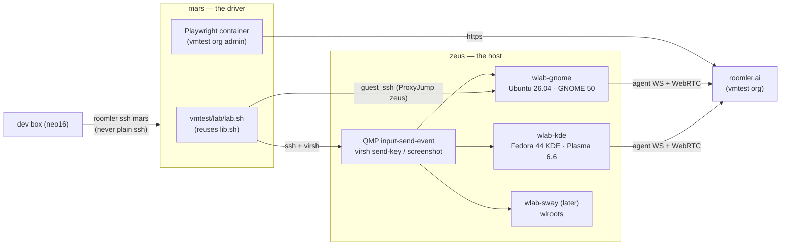
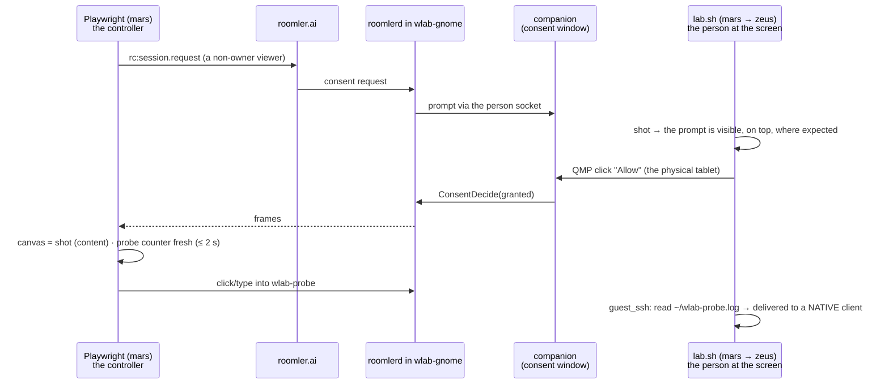

# FR-93: Linux Wayland out of the box — a stock desktop install is seen, driven and told, and a lab proves it

**Issue:** [#1972](https://github.com/gjovanov/roomler-ai/issues/1972) · **Status:** P1 merged 2026-10-11 and
field-verified on the lab: GNOME 50, and KDE Plasma 6.7 on Fedora 44. P2a (mutter only, #2019), P2b (the
desktop brief and the server's count, #2028) and P2c (#2020) shipped in **0.4.130** (2026-10-12), with the server
promoted. P2d is decided (operator, 2026-10-12): the portal waits for it. P2d-1, the agent half, shipped in
**0.4.131**; P2d-2, the viewer half, is lab-verified on prod's viewer (2026-10-13). P2d-3, the flip (the portal
automatic where mutter is absent), shipped in **0.4.132** with P2d-2's agent half and P4a; P4b in **0.4.133**; P3c
in **0.4.134** (2026-10-13). P3d, P5a, P5b (#2145), P3e and P5c are in **0.4.135** (tagged 2026-10-14 from
`bb6ea90ee`); P5d, P5e (#2183), P5f (#2192), P5g (#2194) and P1a (#2210, the kill switch covers the
input-reach warning, AC11) merged after it; P3h and P2d-4 (AC6's three refusals with no reason) are lab-verified.
Ticked: AC1–AC5, AC8, AC9, AC13, AC14. The operator approved the
plan and P0 (the
lab on zeus, enrolled in the vmtest org: D2, D8). **D1 is decided: split.** Per-user installs go auto, system installs
stay opt-in until a non-Debian companion ships. D3 waits for P3 · **Owner:** remote desktop (agent + viewer), vmtest (`roomler-ai-deploy`) ·
**Anchors:** master `8098ebbe3`, fleet 0.4.124 (0.4.125 bumped, not yet released) · **Builds on:** [FR-36](FR-36-wayland-capture.md) (DRM + uinput),
[FR-45](FR-45-portal-capture.md) (portal + mutter), [FR-56](FR-56-remote-apps-on-wayland.md) (Remote Apps),
[FR-27](FR-27-consent-surfaces-and-desktop-companion.md) P10/P11 (companion, person socket),
[FR-61](FR-61-vmtest-matrix.md) (vmtest), [FR-80](FR-80-a-session-with-no-pixels-says-why.md) (capture reason) ·
**Unblocks:** FR-45 AC8 + P5b, FR-56 AC7/AC9/AC10, FR-85's Wayland rows, FR-92 AC9 · **Absorbs:** #1719, #1945

## 1. Goal

A Linux desktop on Wayland — the only session current GNOME ships, and from Plasma 6.8 the only one KDE
ships — works the way a Windows or macOS host does: install, enroll, connect, and it just works.

- A **stock** install (`install.sh`, which is per-user by default, or the `--system`/`.deb` root install) on
  Ubuntu 24.04/26.04 GNOME, Fedora GNOME and Plasma 6 shows **the real desktop with no configuration key**.
- The controller **drives native Wayland windows**, not only Xwayland ones, and **sees the remote cursor**.
- When something cannot work, the viewer says **what and why in one sentence** — never a black stream,
  never "headless" for a machine with a person sitting at it.
- The **person at the screen is told** they are being viewed, on every surface where pixels leave the box.
- It **keeps working** across lock/unlock, logout/login, user switch, resolution change and suspend/resume.
- Every claim is proven on a **Wayland lab whose harness plays the person at the screen**, before and after,
  and on real hardware wherever a VM cannot stand in.

## 2. Evidence (master `8098ebbe3`, fleet 0.4.124, 2026-10-11)

### 2.1 What a stock install does on a Wayland desktop today (no capture or input keys set)

| | **per-user** — the desktop default (`SYSTEM=0`, `scripts/install.sh:63`; `README.Debian:12-13`) | **system** — `--system` / `.deb` root unit |
|---|---|---|
| Capture | scrap connects to Xwayland's `DISPLAY` and streams Xwayland's empty root: **a live black stream, no reason** (#1719 measured `backend=scrap`, ~1.2 KB/s of black VP9) | the root unit has no `DISPLAY` (`packaging/linux/roomlerd.service:20-53`), scrap's `xcb_connect(NULL)` fails, and the FR-80 classifier says **`no_display` — "headless, or no desktop session"**, false for this host (`capture/mod.rs:610-618`, hint `:489-490`). DRM and the portal are skipped without a log line (`:808-869`) |
| Input | enigo/XTest reaches **Xwayland clients only**; native windows (Settings, Files, the shell) get nothing and nothing says so (`input/mod.rs:344-346`) | no `DISPLAY` ⇒ `NoopInjector`, which returns `Ok(())` for every event (`input/mod.rs:279-288`) |
| What the viewer is told about input | `has_input_permission = true`, hard-coded off macOS (`encode/caps.rs:1412-1414`, `:815-824`, `:843-852`) | the same |
| Cursor | none — the Linux cursor tracker is unwired (`capture/cursor.rs:88-94`); the viewer paints the controller's initials badge | none |
| Clipboard | arboard over X11 into Xwayland's selection bridge (unmeasured) | **off** — `clipboard.rs` has no session discovery; `supports_clipboard` is compile-time (`caps.rs:1416`) |
| Consent / indicator | the X11 panel over Xwayland — "it shows; it just cannot guarantee stacking above native Wayland clients" (`indicator/x11.rs:33-37`), never field-run; the companion fallback launches through the **system** manager (`companion.rs:484`), which its own doc says asks polkit for a password nobody types (`:507-518`) | the companion over the P11 person socket — GREEN on vmtest Ubuntu 24.04 (FR-27 P10/P11). **x86_64 only**: no aarch64 companion is built (`.github/workflows/release-agent.yml:872-994`) |

The vmtest Ubuntu lane never saw this because it sets the opt-in keys itself
(`roomler-ai-deploy:vmtest/guest/linux-lane.sh:149-169`). Its per-user cell set an inert one
(`mutter_capture` without `portal_capture`), streamed black for weeks, and `rd` read green (#1719).

### 2.2 What works today — every arm opt-in

| Arm | Sees | Asks the person | Proven on | Gate (default **off**) |
|---|---|---|---|---|
| DRM/KMS (FR-36) | the scanout, incl. the greeter and a locked screen | no | Asahi (apple-drm, 4K, real); vmtest virtio-gpu (`lit=92.1 %`) | `drm_capture` |
| uinput (FR-36 P4) | — input below the compositor, host-global | no | Asahi | `uinput` |
| portal ScreenCast (FR-45 P1–P3) | a user session only | yes, once (restore token) | Asahi | `portal_capture` |
| portal RemoteDesktop input (FR-45 P4) | — | the same dialog **and** its *Allow Remote Interaction* toggle, off by default | Asahi | `portal_input` |
| mutter direct (FR-45 P5) | a user session (or a PAM-rigged headless one) | no; GNOME only; **no input** | WSL2 rig; Asahi | `portal_capture` + `mutter_capture` |
| Remote Apps on Xwayland windows (FR-56) | — | — | Asahi | — |
| companion banner + Disconnect on a system install (FR-27 P10/P11) | — | — | vmtest 24.04 | — |

### 2.3 Defects found while surveying for this plan (each read on master)

1. **Capture says "headless" to a Wayland desktop** (§2.1). The classifier keys on the *daemon's* env only.
2. **Per-user + Wayland streams black with no reason** (§2.1, #1719).
3. **Input drops silently, or reaches Xwayland only, while advertising `has_input_permission=true`**;
   `docs/remote-control.md:371` promises a view-only notice that does not exist.
4. **DRM leaks a GEM handle per frame.** `grab()` calls `get_planar_framebuffer` (GETFB2) on every frame
   (`drm_backend.rs:363-365`); drm-rs returns the raw handles with no `Drop`
   (`drm-0.15.0/src/control/mod.rs:296-318`) and nothing calls `close_buffer`. The kernel mints a handle per
   call (my reading — §6.4 measures it), so a session pins every scanout buffer the compositor has since
   freed until its fd closes. FFmpeg's kmsgrab closes these.
5. **DRM selection is first-wins and its failures are mute**: the first card with a CRTC (`:116-137`), the
   first bound plane with no `type` check (`:146-164`), `monitor_count()` = 1; a non-linear modifier, no
   scanout or no `CAP_SYS_ADMIN` never reaches the viewer — only the last arm's error is classified
   (`capture/mod.rs:876-895`); a blanked panel **freezes the last frame** instead of saying so
   (`drm_backend.rs:359-361` → the keepalive).
6. DRM's mapping cache is keyed on `(fb id, len)` (`:384`) — a recycled id for a new same-size buffer reuses a
   stale mapping (inference).
7. **No cursor from DRM**: only the primary plane is read. In a virtio-gpu VM *and* on real GPUs mutter and
   KWin keep the pointer on the cursor plane (§2.5), so it is absent from every DRM frame; the live cursor
   channel is Windows-only (`cursor.rs:88-94`).
8. **The portal negotiates no buffer type** — no `SPA_PARAM_Buffers`, no modifier in EnumFormat
   (`portal/pipewire.rs:1100-1113`, `pod.rs:290-350`). That yields MemFd from GNOME and KWin today (§2.5); a
   DmaBuf-only producer costs a 15 s timeout and a silent fall-through (`pipewire.rs:787-791`, `:1173-1185`).
9. **Mutter records `monitors[0]`, not the primary** (`portal/mutter.rs:268-289`; `primary` parsed, unread, `:317`).
10. **`graphical_session()` is first-match**: any `Active` x11/wayland session in list order, the greeter
    accepted for capture, `Seat`/`Remote` ignored, and `WAYLAND_DISPLAY` guessed as `wayland-0`
    (`companion.rs:625-688`, `:683`).
11. **Mutter-direct capture has no input at all** (`portal/mod.rs:604-606`, `:650`); no
    `org.gnome.Mutter.RemoteDesktop`, libei or `ConnectToEIS` code exists. A headless-mutter host is view-only.
12. **Release-all warps the pointer to (0,0)** — GNOME's Activities hot corner — on **both** injectors: #1945
    names enigo; uinput also moves before every button (`uinput_backend.rs:365-372`).
13. uinput types **US layout only**, detected from root's view (`keylayout.rs:43-58`, `:138-155`) rather than the
    session's active input source; `mon` is ignored and nothing maps per output (`uinput_backend.rs:361`).
14. The companion was never field-run as a **consent** window on Wayland; its banner cannot auto-hide there
    (`agents/roomler-desktop/src/panels.rs:188-191`); `pgrep -x` has no `-u` (`companion.rs:477`).
15. `capture-smoke` ignores `config.toml` (the bridge is registered only in `run_cmd`, `main.rs:2851-2914`)
    and parks ~1 h on `NoopCapture` (`capture/mod.rs:567-571`).
16. Keep busy (FR-92, every phase merged 2026-10-11, unreleased) reports a Wayland desktop `unavailable`
    with reason `wayland` (`keep_busy/engine.rs:197-198`) — right, and a **fifth** hand-rolled logind
    parser (`keep_busy/logind.rs:91-110`).
17. Docs drift: `docs/linux-capture.md` anchors (`open_default` is `capture/mod.rs:682`, not `:665`;
    `spawn_child` is `portal/mod.rs:764`, not `:755`); `README.Debian:86-91`; `docs/remote-control.md:159,175`
    name files that do not exist; `CLAUDE.md` says GNOME/KDE Wayland get "no native overlay" while
    `indicator/x11.rs:33-37` describes the Xwayland one.

### 2.4 Leftovers elsewhere that the same test bed unblocks

| Where | What is open | Why it was stuck |
|---|---|---|
| FR-45 #1041 (board: Ready) | AC8 "the spec and the UI both say attended-only"; P5b session resolution for hosts with no graphical logind session | no capture backend on the wire; no seatless-session rule |
| FR-56 #1157 (admitted) | AC7 a window streamed and switched; AC9 rewrite; AC10 a refusal rendered in the dialog; AC5 wlroots | "needs a human at the host to answer the picker"; no wlroots host |
| FR-27 #854 (in progress elsewhere) | the Linux native panel untested; the Wayland surface decision | vmtest never prompts (`FR-61:228-229`) |
| FR-85 #1634 | the Wayland recording rows | the Ubuntu cell was black |
| FR-92 #1942 | AC9 — Wayland reports `unavailable` with a reason the viewer shows | built (reason `wayland`), unreleased, not field-verified |
| FR-36 (closed) | P2 detiling, cursor plane, multi-monitor, P3 privilege split | no host with tiled scanout |
| #1719 | content check + lane fix — both branches pushed 10-07, no PRs | stalled |
| #1945 | release-all warps to (0,0) | unconfirmed on a GNOME host |

### 2.5 The ecosystem this targets (research 2026-10-11, sources in §12)

- **GNOME is Wayland-only.** Ubuntu 25.10 and **26.04 LTS** ship no "Ubuntu on Xorg" session — "GNOME Shell can
  no longer run as an X.org session". GNOME 50 (2026-03) dropped mutter's X11 backend and gnome-session's X11
  sessions. Fedora 43+ removed the GNOME Xorg session; Fedora 44 ships GNOME 50 and Plasma 6.6.
- **KDE follows.** Plasma 6.8 — release scheduled **2026-10-14** — is Wayland-exclusive; Fedora KDE has been
  Wayland-only since F40. Debian 13 still packages a GNOME Xorg session (GNOME 48, Plasma 6.3).
- **Prior art converged on DRM + uinput for unattended Wayland.** RustDesk 1.4.9 (2026-08) ships it as a
  separate opt-in package: KMS scanout through a `cap_sys_admin` helper, **the DRM cursor plane read with
  `HOTSPOT_X/Y`**, tiled scanout via **EGL import** (Intel CCS verified), uinput input, the login screen
  included; "the opt-in package *is* the consent". Sunshine's kmsgrab does the same (EGLImage detile,
  cursor plane CPU-blended).
- **Mutter's private APIs** (version 1, "no compatibility promised"): `org.gnome.Mutter.RemoteDesktop.Session`
  has `NotifyPointerMotionAbsolute(stream, x, y)` — which **requires** a ScreenCast session created with
  `remote-desktop-session-id` — plus `NotifyKeyboardKeycode/Keysym`, `ConnectToEIS`, the clipboard methods
  (`EnableClipboard`, `SelectionRead/Write`), and new `SetKeymap`/`SetKeymapLayoutIndex`.
- **Portals**: RemoteDesktop v2 `ConnectToEIS` and the Clipboard portal (1.17+). GNOME and KDE implement
  RemoteDesktop, ScreenCast and Clipboard; **wlr and Hyprland have no RemoteDesktop**. KWin offers DMA-BUF
  with modifiers *and* SHM; a consumer that advertises no modifier gets MemFd — today's consumer is safe there.
- **VMs as a test bed**: virtio-gpu advertises **LINEAR only** and has a **cursor plane** that mutter and KWin
  use (they set `DRM_CLIENT_CAP_CURSOR_PLANE_HOTSPOT`; kernel ≥ 6.6 hides the plane from clients that don't).
  `virsh screenshot` (QMP `screendump`) **omits the cursor**. `heads=N` gives multi-monitor. QMP
  `input-send-event` takes absolute 0–0x7fff on a tablet device; `virsh send-key` presses ≤ 16 keys at once.
  `MUTTER_DEBUG_DISABLE_HW_CURSORS=1` forces a software cursor for an A/B.
- **GNOME's own headless path**: GDM 50 added `gnome-headless-session@<user>.service`, and gnome-remote-desktop
  drives a headless greeter via `org.gnome.DisplayManager.RemoteDisplayFactory` — RDP-shaped; a possible
  Wayland-native successor to the Xvfb virtual desktop, **out of scope here**.

## 3. The test bed

### 3.1 Where — and where not

| Candidate | Verdict | Why |
|---|---|---|
| **mars / zeus / jupiter** as desktops | ✗ | production hypervisors (two k8s VMs each; jupiter's `k8s-worker-3` holds roomler.ai's storage-pinned pods, so its outage is a full outage); no display — mars has no DRM device, jupiter/zeus `amdgpu` with zero connected outputs (FR-36 host survey); a desktop is hundreds of packages plus a compositor on a prod host. Their role is the vmtest one: **zeus hosts lab VMs, mars drives them** |
| **KVM guests on zeus — the lab** | ✅ primary | measured 2026-10-11: 125 GB RAM (57 GB available), 32 threads, 1.4 TB free, QEMU 8.2.2 + libvirt 10.0, the vmtest host role already in place (`vmtest-net` NAT on virbr2, cached noble images incl. `ubuntu-gui-noble.qcow2`). virtio-gpu gives a real CRTC (DRM capture proven there); the harness can be the person at the screen (QMP) and the ground truth (`virsh screenshot`) |
| **Apple-Asahi** (`scw-m2-asahi`) | ✅ real-hardware cell | online on 0.4.124; Fedora Asahi Remix 42, GNOME Shell 48.8 Wayland (lightdm autologin), `drm_capture` + `uinput` already on; a real 4K apple-drm scanout (LINEAR). It is also the FR-19 peer relay ⇒ a dead-man switch before any daemon change, never left on another session, no casual reboot. aarch64 ⇒ no companion |
| **neo16 WSL2** | ✅ narrow | FR-45 P5b only (tty-only logind, headless mutter) and the NVENC number. Not a Wayland desktop: no `/dev/dri`, WSLg's Weston is ancient (no linux-dmabuf; nested mutter hangs) |
| **MacBook** (M5 Pro, 24 GB, macOS 27.0.1) | ⚠️ optional | could run an aarch64 Linux VM (UTM's QEMU backend reproduces the KVM guest; tart/AVF is 2D llvmpipe with unverified cursor-plane behaviour), but it is the operator's daily machine and the macOS vmtest host, aarch64 has no companion, and Asahi already covers aarch64 on real hardware |
| a **real x86 desktop** with an Intel/AMD GPU and a display | ⚠️ **operator decision D3 — nothing in the fleet is one** | the only cell for tiled/compressed scanout (FR-36 P2), a cursor plane on a real GPU, GPU-backed PipeWire buffers, fractional scaling and multi-monitor on real outputs. **A VM proves none of these** — virtio-gpu scans out LINEAR. Cheapest: an N100-class mini-PC (Intel ⇒ CCS-tiled scanout, the case RustDesk verified) + an HDMI dummy plug at the operator's home |

### 3.2 The Wayland lab — persistent guests on zeus (`wlab-*`)

**Guests.** One runs at a time by default; the others stay shut off.

| Guest | Image | Compositor | Why |
|---|---|---|---|
| `wlab-gnome` | Ubuntu 26.04 LTS | GNOME 50, Wayland only | the forward default; the `.deb` path |
| `wlab-kde` | Fedora 44 KDE | Plasma 6.6, SDDM | KDE's portal and KWin buffers; the `install.sh` tarball path; SELinux enforcing |
| `wlab-sway` (later, D7) | Ubuntu 26.04 + sway | wlroots | FR-56 AC5; the wlr portal (ScreenCast only) |
| — | vmtest's noble golden | GNOME 46 | the installed base — stays throwaway in vmtest |

**Domain shape** — deliberately different from vmtest's `virt-install` (`lanes/ubuntu/cell.sh:58-62`):

- `--video virtio,heads=2` — the second head stays off in-guest until a test turns it on
- `--input tablet,bus=usb --input keyboard,bus=usb` — the absolute device QMP injects into
- `--graphics vnc,listen=127.0.0.1` — `virsh screenshot`, and VNC for the operator over an ssh tunnel
- SeaBIOS (internal qcow2 snapshots without pflash NVRAM), 4 vCPU, 6 GiB, a guest-agent channel
- a **full-copy** qcow2, never an overlay of vmtest's golden — a vmtest re-bake must not break the lab

**In the guest** (one bake script per image, the `lanes/ubuntu/bake.sh` shape):

- autologin user `wlab` and a second user `wlab2`, both with passwords, so lock/unlock, the greeter and user
  switching are real; lock **on** with a long idle delay, DPMS **off** by default — a test toggles each
  (a blanked screen stops scanout, FR-36)
- `xdg-desktop-portal-gnome` / `-kde` / `-wlr`, PipeWire, `wayland-utils`, `foot` (native Wayland terminal),
  `xterm` (Xwayland), `gnome-text-editor`/`kate`, `tmux`, `wmctrl`, extra XKB layouts
- **`wlab-probe`** — a ~150-line GTK4 app (python3-gi; native Wayland, `--x11` runs the same app on Xwayland),
  full-screen. It paints a **block code encoding a counter that ticks every 250 ms** — the freshness oracle,
  decodable from the viewer's canvas without OCR — draws a crosshair where it last saw the pointer, and logs
  every motion, button, scroll and key (keyval + Unicode) with coordinates and a monotonic timestamp to
  `~/wlab-probe.log` — the input oracle. It proves an event reached a **native** client, which is exactly
  what XTest cannot do

**Snapshots**: `clean` (baked) and `enrolled-<agent version>`. Every test starts with `snapshot-revert`;
reverting keeps the device identity.

**Enrollment** (D8): the **vmtest org** (business plan, isolated, admin credentials already on mars),
**non-ephemeral** — FR-51 deletes an ephemeral row on every daemon stop, which is wrong for a lab that
restarts daemons all day.

**Driver**: `roomler-ai-deploy:vmtest/lab/lab.sh`, run on mars like vmtest, reusing `lib.sh`
(`guest_ssh`, `screendump`, `vm_ip`):

| Command | Does |
|---|---|
| `up` · `down` · `status` · `revert <snap>` · `snapshot <name>` | lifecycle |
| `install <.deb\|tarball>` | a candidate from a CI artifact — the kept-guest upgrade flow, `auto_update=false` first |
| `shot` | `virsh screenshot` → PNG — the ground truth of what is on the guest's screen (cursor excluded) |
| `move X Y` · `click X Y [btn]` · `key KEY_…` · `type <text>` | **the person at the screen**: QMP `input-send-event` on the USB tablet, `virsh send-key` |

🔑 **Why host-side input.** FR-45 P4 crossed GNOME's consent dialog with the agent's own uinput — the
product approving its own consent, which proves the mechanism and nothing about the experience. QMP input
arrives as the VM's physical tablet and keyboard, independent of every roomler code path. It can answer the
portal dialog (and flip *Allow Remote Interaction*), the companion's consent prompt, the lock screen and the
greeter — the human actions FR-61 scoped out (`FR-61-vmtest-matrix.md:228-229`).

**Rules**

- Prefix `wlab-`, never `vmtest-`: `vmtest-audit`'s leftover check and `vmtest.sh destroy --all` must never
  see it. The audit reads `MemAvailable`, so a running lab guest is accounted for automatically; one ≤ 8 GiB
  vmtest slot must always remain free.
- Never touch the k8s domains. Never jupiter (`lib.sh:39-43` already refuses it).
- Shut a guest off when idle.

### 3.3 The vmtest lane — throwaway regression (FR-61's harness)

1. **Finish #1719 first** — commit the uncommitted lane fix (`portal_capture` beside `mutter_capture`) and
   the `config.rs` doc comment, run B, open both PRs (branches `fix-1719-rd-content` in both repos, pushed
   10-07), then remove `~/w1719` on mars.
2. **`default` cells** for system and user — no capture or input keys. Red on 0.4.124 (black or a false
   "headless"), green after P2: the negative control for this whole FR.
3. **Content oracle v2**: the viewer's canvas against `virsh screenshot` taken at the same moment (a
   downscaled grayscale correlation) — "the picture is *the guest's* screen", not "≥ 1 % lit" — plus the probe
   counter for freshness.
4. **Input oracle**: the viewer clicks and types into `wlab-probe`; the cell reads `~/wlab-probe.log`.
   Closes FR-61's open decision 3 (`FR-61-vmtest-matrix.md:221`).
5. A 26.04 golden beside noble, then a Fedora KDE golden.
6. A `lifecycle` cell type with the lock enabled (the plain cells keep it off, `bake.sh:68-79`).

### 3.4 Real hardware

- **Asahi** after every agent release: DRM at 4K, uinput, the Mutter paths; no companion.
- **The x86 cell** (D3). Until it exists, every DRM claim in this FR reads "linear scanout only".

### 3.5 Building and installing candidates

A PR's CI agent artifact → `lab.sh install` (the kept-guest flow). For quick iteration a WSL build
(`cargo build -p roomlerd --release --features full`), copied via mars — never a `CARGO_TARGET_DIR` shared
between worktrees or inside one. Every capture/input knob flip forces a fresh caps probe
(`docs/linux-capture.md` §7): flip with the guest unloaded.

## 4. Design

### 4.1 One desktop-session resolver

`desktop::session()` replaces the five ad-hoc lookups (`companion.rs:625`, `recording/launch.rs:1442-1470`,
`apps/linux.rs:501-511`, `keep_busy/logind.rs:91-110`, and the scrap arm's reliance on the daemon's own
`DISPLAY`):

- logind over **D-Bus** (`org.freedesktop.login1`, zbus — already a dependency and pure Rust) instead of
  parsing `loginctl` columns, which changed between systemd 255 and 257 (FR-45 P2a's shipped bug);
- the console is **`seat0`'s `ActiveSession`**, not the first `Active` row. The greeter (`Class=greeter`), a
  seatless session (P5b's headless mutter) and a remote one (`Remote=yes`) are distinct answers, never "the
  console";
- `WAYLAND_DISPLAY`, `DISPLAY` and `XAUTHORITY` come from the session user's systemd manager environment
  (GNOME and KDE import them), else a scan of `/run/user/<uid>/wayland-*` — never the `wayland-0` guess;
- it returns `{class: user|greeter|headless|none, type: wayland|x11|tty, desktop, uid, locked, displays}`;
- it is live: `PropertiesChanged` on the seat and session drives §4.7. A decision is never cached (FR-45's rule).

### 4.2 Honest failure (P1)

- **Capture**: a new FR-80 code `wayland_not_enabled` (additive — an old viewer shows its generic text)
  that names the session and the fix. Under P2 it appears only when every arm refused, carrying each arm's
  one-line reason.
- **The Xwayland guard**: on a Wayland session scrap refuses an X server that advertises the `XWAYLAND`
  extension. Never a black stream. The daemon's own Xvfb is unaffected.
- **Input reach** on the hello: `input_reach: full | xwayland_only | none` plus a reason; `NoopInjector` ⇒
  `none`. The viewer renders the view-only notice `remote-control.md:371` already promises. P1's kill switch
  covers this notice too: it sends none and asks no X server for it (P1a, AC11).
- `supports_clipboard` becomes a runtime answer.
- `capture-smoke` and `input-smoke` register the config bridge; `NoopCapture` waits are bounded.

### 4.3 The Wayland auto-cascade (P2, operator decision D1)

| Session | Install | → capture | → input |
|---|---|---|---|
| Wayland user session | system | **opt-in until a non-Debian companion ships (D1)**; armed: DRM if a LINEAR CRTC, else mutter (GNOME), else portal | uinput · Mutter RemoteDesktop · portal RemoteDesktop |
| Wayland user session | per-user | mutter (GNOME — same bus, no root, no dialog), else portal | Mutter RemoteDesktop · portal RemoteDesktop |
| greeter / locked | system | DRM (D1b) | uinput |
| greeter / locked | per-user | refused with the reason — a per-user daemon cannot see the greeter | — |
| headless seatless (WSL2, `mutter --headless` as a service) | any | mutter (P5b) | Mutter RemoteDesktop |
| X11 | any | **unchanged** | **unchanged** |

Rules: auto applies only when the resolver says Wayland, so an X11 host keeps FR-29's idle numbers
byte-for-byte; an explicit key always wins (`drm_capture = false` removes the arm, `= true` forces it); kill
switch `ROOMLERD_WAYLAND_AUTO=0`; the choice is logged once per session and put on the wire
(`capture_arm`, `attended`) — FR-45 AC8 option (b).

**As built (P2a, then P2d-3; D1): mutter, else the portal.** Only the per-user half switches itself on. A
root daemon never does (`capture::wayland_plan`; mechanics in [`linux-capture.md`](../linux-capture.md) §1.2).
P2a switched on mutter alone; P2d-3 adds the portal where mutter does not answer (KDE and the rest).

⚠️ **The portal waited for P2d, although D1 asked for "the portal elsewhere" from the start.** The lab ran it
automatically on KDE (2026-10-11) and measured three problems that the explicit `portal_capture` path had
always had, and that automatic use would have put in front of every KDE user:

- The viewer's media watchdog re-creates a session that has shown no frames for 10 s, and each new session
  opened its own portal request: four "Share screen with" dialogs were stacked within a minute.
- Answering a stale dialog late started a capture for a session already gone, for a minute or two, with the
  sharing indicator on.
- Each pending open parked a runtime worker for up to 120 s, and four of them starved the daemon until its
  watchdog killed it (step log 46).

That became **P2d** (the table below). ✅ **Decided 2026-10-12 (operator): the portal waits for P2d.** Its agent
half (P2d-1, `linux-capture.md` §4.6) came first, because it also fixed the explicit `portal_capture` path; the
viewer half (P2d-2, §4.7) followed; the flip (P2d-3) was sized by P2b's counts first: on 2026-10-13 prod's 14
briefs held no customer device it would change, only this lab's KDE guests. The choices the flowchart leaves
open:

- **"Any capture key" means set to anything.** `drm_capture`, `portal_capture`, `mutter_capture` and
  `window_capture` count, so `portal_capture = false` keeps the portal off as before. A virtual desktop also
  keeps the cascade as configured.
- **An automatic arm that fails is `backend_error` with its reason**, not `wayland_not_enabled`: the arm was
  switched on, so "switch it on" would be the wrong sentence (the rule P1c gives an arm the operator switched
  on). That covers mutter that answered and still failed, a portal that cannot capture this desktop, and a
  person who did not share. So a per-user daemon in its own Wayland session reads `wayland_not_enabled` only
  when the operator switched the automatic arm off, and its hint says how to give the choice back.
- **mutter first, the portal only where mutter does not answer.** A GNOME session whose mutter screencast
  answered and failed is not handed to the portal: that would trade an unattended arm's error for a dialog.

⚠️ **The policy coupling is the decision, not a detail.** DRM and mutter capture without asking anyone.
FR-36 made it a precondition that the viewer indicator is reachable on those surfaces before DRM leaves
opt-in (`FR-36-wayland-capture.md:308-313`). Today: x86_64 system installs have the companion banner (P11);
per-user installs have an untested Xwayland panel and a broken companion launch (§2.3 #14); the greeter and
the lock screen have none; aarch64 has no companion. RustDesk's answer is that installing the separate
package is the consent. Roomler's equivalent is enrolment plus the per-session consent mode
(`auto_grant_session`, FR-27's chain), which this FR does not change — it changes only whether pixels flow
once a session is allowed.

### 4.4 DRM hardening (P3)

| | What | Why |
|---|---|---|
| a | GETFB2 only when the plane's fb id changed; `close_buffer` every handle after export (kmsgrab's shape) | §2.3 #4 |
| b | the plane's `type` = Primary; the card by `boot_vga`/seat0, not first-found | §2.3 #5 |
| c | **the cursor plane**: set `DRM_CLIENT_CAP_ATOMIC` + `CURSOR_PLANE_HOTSPOT` (on virtio/qxl/vmwgfx the kernel hides the plane otherwise), read its ARGB fb + `CRTC_X/Y` + `HOTSPOT_X/Y`, ship it on the **existing cursor DC** (`cursor:pos`/`cursor:shape`, Windows-only today) — not a per-frame blend | §2.3 #7; RustDesk/Sunshine both read it |
| d | idle cost, Wayland-only and measure-first: an unchanged primary fb id **and** an unchanged hash of sampled rows ⇒ unchanged; a forced refresh every 1 s (FR-29's bound) | the header's objection (`drm_backend.rs:19-27`) covers X11 front-buffer rendering (excluded) and "new handle, identical content" (a wasted encode, not a stale frame); the hash covers a double-buffered A→B→A |
| e | refusals and "the display is off" reach the viewer through FR-80 | §2.3 #5 |
| f | the mapping cache keyed on the dma-buf's identity, not the fb id | §2.3 #6 |
| g | tiled scanout = FR-36 P2: EGL dma-buf import, `dlopen`ed (the PipeWire rule — no `DT_NEEDED`) | real x86 hardware only (D3) |

**As built (P3c, 2026-10-13): the cursor plane** (`capture/drm_cursor.rs`, its I/O in `drm_backend.rs`;
[`linux-capture.md`](../linux-capture.md) §3.1). The worker sets `ATOMIC` and then `CURSOR_PLANE_HOTSPOT` after
`UNIVERSAL_PLANES`, neither of them fatal, and reads each plane's `type` once. On every frame it grabs it reads the
cursor plane bound to the captured CRTC: `CRTC_X/Y`, `HOTSPOT_X/Y` where the driver has them, and the ARGB buffer,
again on a new framebuffer and every 250 ms. It straightens the premultiplied pixels, crops them to the visible
image, ids the shape by a hash of the pixels and the hotspot (the viewer never replaces a cached id), and publishes
it to the cursor channel's tracker. Only the DRM arm publishes: mutter's and the portal's streams embed the pointer.
The primary plane is now chosen by its `type`, which P3b listed, because a bound cursor plane would otherwise win on
enumeration order. Not in P3c: P3b's card choice (`boot_vga`/seat0), multi-monitor, and a DRM recording's pointer
(`capture::pointer` still reports none for DRM).

**As built (P3d + P3f, 2026-10-13): an unchanged screen is skipped** (`capture/drm_idle.rs`, its I/O in
`drm_backend.rs`; [`linux-capture.md`](../linux-capture.md) §3.2). Measured first: on 0.4.133 an idle GNOME desktop
over DRM cost 57.9 % of a core, every frame read, converted and encoded at 30 fps. On a Wayland seat the worker now
skips a frame when the primary plane shows the same framebuffer over the same buffer, 32 sampled rows hash the same,
and the last delivered frame is under 1 s old (FR-29's bound). The buffer is named by its dma-buf's inode as well as
its framebuffer id, and the mapping cache is keyed on both (P3f, §2.3 #6); the export now carries `DRM_CLOEXEC`.
`next_frame` waits a still screen out for 250 ms before it says "no frame", the portal arm's `FRAME_WAIT`: the
data-channel pumps answer every "no frame" with a keepalive re-encode of their last frame (every 60 ms at most), so a
"no frame" each frame period would have spent on keepalives what the skip saves. The rule is Wayland-only, decided
at open from the seat's session (`desktop_brief::seen_is_wayland`): an X server and the console draw in place, where
no buffer check sees a change. Kill switch `ROOMLERD_DRM_IDLE_SKIP=0`.

**As built (P3e, 2026-10-14): a display switched off is waited out, and said** (`capture/drm_backend.rs`,
the pumps in `peer.rs`; [`linux-capture.md`](../linux-capture.md) §3.3). Measured first on the released 0.4.134:
GNOME's idle blank switches the CRTC off (`enable=0 active=0`, every plane `fb=0`) and leaves the connector
`connected` with `dpms=Off`. Two failures followed:
- a running session's grab found no plane and said "no frame", and the pumps' keepalives kept the last frame on
  screen with no reason;
- a session that opened during the blank failed the DRM open and read `backend_error`.

The worker now tells a dark display from a passing modeset: no plane bound, a connected connector, and no CRTC
driving a mode. The pumps tell the controller through `rc:media-waiting` (`for: "display_wake"`), again every
30 minutes while it lasts, and send no keepalive meanwhile. An open during the blank waits for the wake, through P5b's
wait generalised (`open_through_wait` with `DISPLAY_OFF`). Row e's refusals stay FR-80's. A dark display is a wait,
not a refusal, so it takes P2d-2's message instead. Kill switch `ROOMLERD_DRM_WAKE_WAIT=0`.

### 4.5 Input (P4)

- **Mutter RemoteDesktop** in the helper, paired with the mutter ScreenCast session through
  `remote-desktop-session-id` (absolute motion needs the stream path): `NotifyPointerMotionAbsolute`,
  `NotifyPointerButton`, `NotifyPointerAxis`, `NotifyKeyboardKeycode`/`Keysym`. This is unattended input for
  mutter capture, per-user installs (no root) and headless mutter (WSL2), in the portal `input.rs` mapper's
  shape. `ConnectToEIS` (libei, shared with the portal's v2 path) is the alternative to evaluate; the API is
  private and unversioned, so detect at session time.
- **#1945**: a release-without-move form on both injectors, plus the test that a release-all injects no motion.
- **Layouts verified in the lab**: set a layout per guest, type a fixed string through the viewer, compare
  against the probe log — the "host on that layout" FR-36 lacked. Detect from the session's input sources
  (GNOME `org.gnome.desktop.input-sources`, KDE `kxkbrc`), not root's `localectl`. Mutter's new `SetKeymap`
  may remove the keysym-not-in-keymap drop (FR-45 #1132).
- uinput per-output mapping once §4.4 lists CRTCs; fractional scaling verified on `wlab-gnome` at 125 %/150 %.

**As built (P4a, 2026-10-13): mutter's RemoteDesktop, over D-Bus.** The helper creates the RemoteDesktop session
first and names it in the screencast's `remote-desktop-session-id`, so the session starts the screencast and
takes the viewer's input: absolute motion addressed to the recorded stream, buttons, the wheel (flag 2, a wheel,
since mutter assumes a touchpad finger otherwise) and evdev keycodes (`portal/input.rs` `MutterCall`;
mechanics in [`linux-capture.md`](../linux-capture.md) §5.2). The automatic mutter arm carries it, kill switch
`mutter_input`; a configured `mutter_capture` arm carries it only with `portal_input`. `ConnectToEIS` was not
needed. The D-Bus `Notify*` calls reach native Wayland windows on GNOME 50, and gnome-remote-desktop's own move to
libei leaves them in place. Not in P4a: the portal's input on KDE (still `portal_input`), layouts, and per-output
mapping.

**As built (P4b, 2026-10-13): the automatic portal asks for remote control** (operator: the one dialog should ask
for seeing and controlling). Where mutter is absent, the automatic portal opens a RemoteDesktop session unless
`portal_input = false` (`capture::auto_portal_input`); a configured `portal_capture` keeps `portal_input` opt-in,
because a screen share it already holds would be asked again. KDE's dialog is titled *Remote Control*, names both
privileges and restores its answer. A refusal is asked again for the screen only (input never costs capture), and
is not remembered: the next session asks for remote control again. Two faults stood in the way, both found with the
AC4 oracle and a new input trace (`ROOMLERD_PORTAL_INPUT_TRACE=1`) lined up against the probe's log
([`linux-capture.md`](../linux-capture.md) §1.2, §4.3):

- KDE's backend negates the vertical smooth scroll. The helper negates first where KDE's backend owns its bus name
  (`for_backend`; kill switch `ROOMLERD_PORTAL_KDE_SCROLL_FIX=0`).
- **The lost keystrokes were ours, not KDE's** (step log 58 had blamed KDE). xdg-desktop-portal runs every
  RemoteDesktop method call on its own worker thread, and the helper's calls had been fire-and-forget since FR-45's
  self-review (`call_noreply`). So a key's release could reach the backend before its press. KWin drops that
  release, the key stays held, and the letter's next press is dropped as a repeat: 41 of 452 typed characters came
  out wrong. Each portal call now waits for its reply (`Target::delivery`), which keeps the calls in order for
  0.5 ms a call. Mutter keeps fire-and-forget: it handles its session's calls in order on its main loop. The fault
  sat in the portal's input on every desktop, GNOME's included, wherever `portal_input` was on.

Not in P4b: KDE's dialog says "An application" (a host app id, registered through the portal's host Registry,
would let it name Roomler); `rc:media-waiting`'s hint still says "share their screen" where KDE asks for remote
control; and a refusal is not remembered across sessions.

### 4.6 Session lifecycle (P5)

The §4.1 watcher re-selects the arm, instead of today's error → backoff → reopen. Each cell must recover
within 10 s or name its reason; a frozen frame with no reason is a failure.

| Event | DRM | mutter | portal |
|---|---|---|---|
| lock → unlock | keeps streaming (the lock screen is pixels) | measure: an existing session expected to survive; creation is inhibited while locked | must not burn the restore token |
| logout → greeter → login (GDM VT switch) | new fb handles → remap | the helper dies with the bus → a new one for the new session | a new user ⇒ a new dialog |
| user switch (`wlab2`) | the scanout follows the active VT | the old session's stream ends; re-select | — |
| DPMS blank → wake | "display off" reason, then resume | damage-driven: zero frames is normal | — |
| resolution change / second head | size follows | re-record | re-pick |
| suspend → resume (`virsh dompmsuspend`) | re-open | re-open | re-open |
| compositor crash (kill `gnome-shell`) | new scanout | re-open | re-open |

**Measured first (2026-10-13, step log 66): the lifecycle oracle.** A lab-only spec holds one viewer session and
samples it every 500 ms; the harness drives the guest from outside (QMP keys, `loginctl`, GNOME's own idle blank)
and dates each event. On the releases: **DRM** (GNOME 50 system, 0.4.133) recovers from lock, unlock, wake,
logout and login in 0.7–2.9 s, but an **idle blank** leaves the last frame with no reason (P3e's case). **mutter**
(GNOME 50 per-user, 0.4.132) **freezes at the first lock for good** (#2145: GNOME closes both mutter sessions at
a lock), and after a logout and a login **the daemon never comes back** (#2144). The **portal** (Plasma 6.7.5
per-user, 0.4.133) streams the lock screen, but shows the last frame through a logout and about 30 s of black after
the login, with no reason either time.

**As built (P5a, #2144): the per-user unit is wanted by the graphical session it stops with.** It was `PartOf=` the
session but wanted by `default.target` alone, which a user manager that outlives a logout (a lingering user, an SSH
login) reached long ago. Both per-user units now name `graphical-session.target` too, and a daemon enabled before
that line enables itself again once at start, through `systemctl --user enable` (the sandbox leaves
`~/.config/systemd/user` read-only to it). Kill switch `ROOMLERD_UNIT_REPAIR=0`
([`installation.md`](../installation.md#linux)).

**As built (P5b, #2145): a GNOME lock is waited out, and said.** GNOME closes every remote-desktop and screen-cast
session when its screen locks, and refuses new ones until the unlock: asked directly, `CreateSession` answered
`Session creation inhibited`. A PipeWire consumer whose source vanished goes `idle`, never `error`. The helper now
ends the capture on the driving session's `Closed` signal (exit status 3), and the pump's rebuild reopens. The
automatic mutter open then waits out the lock (`open_through_wait` with `GNOME_LOCK`, as P3e generalised it):
- the controller is told once, through `rc:media-waiting` (`for: "screen_unlock"`), with a hint saying where the
  screen gets unlocked;
- GNOME's lock screen is polled every second, and the open is tried again as it lifts (every 30 s if GNOME and
  mutter disagree);
- the wait lasts up to an hour, and is dropped when its session ends.

The viewer titles the notice by `for`, and shows no "if nobody answers" deadline for a lock
([`linux-capture.md`](../linux-capture.md) §5.3).

**As built (P5c, 2026-10-14): mutter's capture records the monitor again after its mode changes.** Measured first:
a resolution change froze the mutter arm on its last frame for good, with nothing said, even after the mode went
back. Mutter ends a monitor's recording when that monitor's configuration changes. Its ScreenCast Stream object and
PipeWire node vanish, both sessions stay open, and no `Closed` is sent, so P5b's watcher never fires; our stream
just goes from *streaming* to *paused*. The PipeWire consumer now exposes its stream state, and the mutter helper
ends the capture once its stream has been outside *streaming* for 2 s (exit status 4): the reopen records the monitor
at its new size. The DRM scanout and KDE's portal follow the same change in about a second on their own
([`linux-capture.md`](../linux-capture.md) §5.4).

**Measured (2026-10-14): KDE's logout and login is #2144.** The oracle's `loginctl terminate-session` is not a logout
on Plasma 6, where KWin and plasma run as user services that outlive the session scope. With KDE's own logout
(`org.kde.Shutdown.logout`) on a lingering user, the released 0.4.133 stopped with the session and never started
again. P5a's unit file and start-time repair bring it back: *Reconnecting* during the logout, and a new picture
11.9 s after the login (step log 70).

**As built (P5d, 2026-10-14): the portal arm ends a stream whose compositor restarted.** Measured first: a KWin
crash (`kill -9 kwin_wayland`; its wrapper restarts it) froze the KDE portal arm on its last frame for good, with
nothing said. The restarted KWin took the portal's stream with it and left ours paused, P5c's case on the other arm.
Both arms now share one frame loop with P5c's stream-state check, and the portal's reopen restores from its token
([`linux-capture.md`](../linux-capture.md) §4.8).

**As built (P5e, 2026-10-14): a still desktop shows at once.** Measured first: with the lab's ticking probe stopped,
a mutter session showed no picture until the viewer's mouse moved. The PipeWire consumer waited for the producer's
first frame to learn the format and dropped it, and mutter sends the next frame only when something on screen
changes. GNOME's shell crash hit the same case after the login: the daemon came back, the session connected, and
no picture followed. The first frame is now kept and sent first ([`linux-capture.md`](../linux-capture.md) §5.5).
KDE's portal showed a picture 0.5 s in on a still desktop already: KWin sends more than one frame.

**As built (P5f, 2026-10-14): a user switch names its reason.** Measured first: GDM's login screen held the seat
for 40 s, and the mutter arm kept the owner's last frame the whole time with nothing said. Mutter stops drawing a
session that is not on its seat, but nothing ends, and the stream stays *streaming*. A per-user capture now watches
its user's sessions in logind once a second, and the pumps tell the controller `session_away` and hold their
keepalives. The lab then found three more defects, each fixed in P5f. A still desktop's return told "away" again, so
a frame now outweighs an older logind read. A keepalive sent just before the notice cleared it at the viewer, so the
pump tells only after 2 s with nothing sent, and the viewer counts only media after the notice settles. A held pump
could not be aborted, so a viewer that left during the switch left the screencast running; the hold now yields
([`linux-capture.md`](../linux-capture.md) §5.6).

**As built (P5g, 2026-10-14): a session opened during a user switch waits for it.** Measured first: a viewer that
connected while the login screen held the seat read `wayland_not_enabled`, which is false on an install that captures by
itself, and got no picture after the switch back either. The plan counted only an active Wayland session as the
daemon's own, and the helper refuses a session in the background at once. logind's `State` now tells a session in the
background (`online`, not active) from a logout (`closing`); the plan still goes automatic for it, and the open waits
for the session to be on screen again, the controller told `session_away`. GNOME's own *Switch User* locks first, so
the same open then waits for the unlock and says so: an open's hook now fires once per wait
([`linux-capture.md`](../linux-capture.md) §5.6).

### 4.7 Consent and the indicator (P6 — with FR-27's owner)

- Field-run the companion's consent window and banner on GNOME 50 and Plasma 6.6: QMP answers, and
  `virsh screenshot` proves it was visible and above the focused app.
- Fix the per-user launch: `user_manager = euid != 0`, as `launch_once.rs:585` already does; `pgrep -u`.
- A freedesktop **Notifications-with-actions** surface where no companion runs (aarch64; per-user without it) —
  nothing of the kind exists (`crates/agent-core/src/notify.rs:21-24` "deferred") (D6).
- An aarch64 companion build (D5).
- The greeter and lock-screen indicator question is D1b.

### 4.8 Clipboard (P7)

A root daemon runs the clipboard in the session, the helper pattern: Mutter RemoteDesktop's clipboard on
GNOME, the Clipboard portal on KDE (Plasma ≥ 6.4). For a per-user install on GNOME, measure Xwayland's
bridge for text and images in the lab before deciding.

### 4.9 Wire (all additive — unknown fields ignored, the `RpcCap` rule)

- hello `desktop: {session, type, desktop, capture_arm, input_reach}` — the server can count Wayland hosts and
  what serves them, which an exec sweep cannot (a biased sample). **As built (P2b):** a field of the hello's
  caps (`AgentCaps.desktop`), not of the hello itself, so it rides the stored `capabilities` blob and the device
  listing returns it with no server change. `capture_arm` is the arm a session opened now would try first
  (`capture::planned_arm`, in the cascade's order). logind is read by a refresher thread, and the hello and the
  heartbeat read only its cache. The counts are `desktops` in the tenant overview and in the platform-admin org
  rollup ([`linux-capture.md`](../linux-capture.md) §1.3)
- `rc:media-unavailable` code `wayland_not_enabled`
- `rc:video-info` `capture_arm`, `attended`
- the cursor DC on Linux (the existing messages)

## 5. Phases

| Phase | What | Kill switch | Proven on | Size |
|---|---|---|---|---|
| **P0** | the lab (§3.2), #1719 finished, the 0.4.124 baseline recorded red | — | lab, vmtest, Asahi | M |
| **P1** | honest failure (§4.2), #1945, the GEM-handle fix (§4.4a), `capture-smoke` reads config | `ROOMLERD_WAYLAND_AWARE=0` | lab, vmtest `default` cells | S–M |
| ↳ P1a | P1's kill switch covers the input-reach notice (AC11): on Linux, `wayland_aware = false` sends no `rc:input-reach` and asks no X server for it (`input::reach::told`, `linux-capture.md` §1.1), as the agent did before FR-93. The lab's lifecycle specs sample the warning's words | `wayland_aware` | ✅ lab (`4d5890105`), GNOME 50 per-user, both kill switches. **🔴 0.4.135:** the old black XShm picture under the warning (59 of 60 samples). The candidate: the same picture, no warning (0 of 58). `mutter_input = false` alone still warns (59 of 59), and with no switch mutter is unchanged | S |
| **P2** | the auto-cascade (§4.3) + the wire (§4.9) | `ROOMLERD_WAYLAND_AUTO=0`; explicit keys | lab ×2, vmtest, Asahi | M |
| ↳ P2a | the per-user automatic arm, **mutter** (D1), and `rc:video-info` `capture_arm` + `attended` | `wayland_auto`; any capture key | lab: GNOME per-user red/green, KDE per-user unchanged, GNOME system unchanged | S |
| ↳ P2d | the attended portal flow, then the portal goes automatic (D1's "elsewhere") | `wayland_auto`; any capture key | lab: KDE per-user, first use with nobody at the screen | M |
| ↳↳ P2d-1 | the agent half (`linux-capture.md` §4.6): one pending request per host, handed to the newest session; an open that holds no runtime worker; a late answer for a dead session dropped. It fixes the explicit `portal_capture` path as it stands | — (behaviour-preserving for a request that is answered) | ✅ lab, KDE per-user, `portal_capture`, nobody answering. **🔴 0.4.130** (two runs): 4 dialogs stacked in 30 s, then the runtime starved and the watchdog forced an exit. **P2d-1** (two runs): 1 request and 1 helper; the daemon stayed up. An answer reached the live session in 1.6 s with one request in all, and an answer after the last session left was dropped | S |
| ↳↳ P2d-2 | the viewer half (`linux-capture.md` §4.7): `rc:media-waiting` when an open is still parked 2 s in, a "waiting for the person at the screen" notice, and a media watchdog that waits until the dialog's deadline instead of re-creating the session every 10 s | `ROOMLERD_MEDIA_WAITING=0`; an older viewer ignores the message | ✅ lab, prod's viewer (`hosted-20261012-f07ba2c`), KDE per-user, `portal_capture`, the answer at +75 s. **🔴 0.4.131:** 5 sessions (the watchdog re-created it 4 times), the notice in 0 of 51 samples, the answer reached a session already gone, and the picture came 48 s later from the restore token. **P2d-2 (master `b5871e47f`):** 1 session, the notice in every sample until the answer, the capture about 2 s after the click, in that session, 1 request | S |
| ↳↳ P2d-3 | the flip: the portal goes automatic where mutter is absent (`open_auto_portal`, `linux-capture.md` §1.2), sized by P2b's counts (operator, 2026-10-12): on 2026-10-13 prod's 14 desktop briefs held no customer device it would change | `wayland_auto` | ✅ lab (`ba6ab497f`), KDE per-user with no key. **🔴 0.4.131:** brief `none`, `wayland_not_enabled`, no dialog. **P2d-3:** brief `portal`; one dialog while the viewer waits, the picture in that session after the answer; the restore token silently after, and KDE's lock screen from it while locked; `wayland_auto = false` gives the refusal back, with the new hint; GNOME per-user is still mutter. The fleet after a release | S |
| ↳↳ P2d-4 | a helper that fails before its stream says why: one marked line on stdout (`ROOMLER_PORTAL_STREAM_FAILED:`), handed on by the daemon's handshake, so a person who declined and a portal that ended the request reach the viewer in words (`linux-capture.md` §4.2); a request the portal ends itself names what to restart. Each reason fits FR-80's 200-character cap whole, prefix included (a test per reason) | — (a daemon from before skips the line; an older helper reads as an exit) | ✅ lab (`3229eb226`, then `234aca8e0`), KDE per-user, no restore token. **🔴 0.4.135:** declined twice, and the backend masked, both read *"…the portal helper exited before announcing a stream"*. **P2d-4:** *"…the person at the screen declined the request"*; the masked backend: *"…the portal ended the request on its own: its backend (xdg-desktop-portal-kde, -gnome) may be stopped; restart it, then xdg-desktop-portal"*, whole (the first candidate's longer text lost its end to the cap) (AC6) | S |
| ↳ P2b | the hello's `desktop` object, and the server's count of Wayland hosts and the arm serving each (AC13) | additive wire | lab, then the fleet | S |
| ↳ P2c | the viewer names the arm and whether it asked (FR-45 AC8 option b) | — | lab, after a promote | S |
| **P3** | DRM hardening (§4.4 b–f) | `ROOMLERD_DRM_CURSOR=0`, `ROOMLERD_DRM_IDLE_SKIP=0` | lab, Asahi | M |
| ↳ P3c | the cursor plane: the DRM worker reads the CRTC's cursor plane (`ATOMIC` + `CURSOR_PLANE_HOTSPOT`; `CRTC_X/Y`, `HOTSPOT_X/Y`, the ARGB buffer), and the cursor data channel carries it (`linux-capture.md` §3.1). With it, P3b's half that P3c needs: the primary plane chosen by its type | `ROOMLERD_DRM_CURSOR=0` | ✅ lab (`dbf514a3f`; built before a rebase, the same changes), the GNOME 50 and Plasma 6.7.5 system installs with `drm_capture` + `uinput`, AC5's `cursor` plan. **🔴 0.4.132:** no overlay at either target. **P3c:** the overlay at both targets, on both compositors. `ROOMLERD_DRM_CURSOR=0` gives the badge back. Owed: a real GPU, with no hotspot property (Asahi) | S |
| ↳ P3d | an unchanged frame skipped on a Wayland seat: the same framebuffer over the same buffer, the same 32 sampled rows, under 1 s since the last delivered frame; a still screen waited out for 250 ms, as the portal waits on its stream (`linux-capture.md` §3.2). With it P3f: the buffer named by its dma-buf's inode, and the mapping cache keyed on it | `ROOMLERD_DRM_IDLE_SKIP=0` | ✅ lab (`cac2d7c43`), the GNOME 50 system guest with `drm_capture` + `uinput`, an idle desktop on the viewer's default path. **🔴 0.4.133:** 57.9 % of a core. **P3d:** 5.5 % and 5.3 %; the probe's counter as fresh as AC1's (0.42–0.70 s old), the cursor overlay at both of AC5's targets, AC4's 8 checks. `ROOMLERD_DRM_IDLE_SKIP=0`: 64.3 % and 60.7 %. KWin (the Plasma 6.7.5 system guest) the same: 4.7 % and 4.7 %, against 46.1 % and 44.5 % with the kill switch | S |
| ↳ P3e | a display switched off (§4.4 e): the worker tells it from a passing modeset (no plane bound, a connected connector, no CRTC driving a mode); the pumps tell the controller (`rc:media-waiting`, `display_wake`) and send no keepalive while it lasts; an open during the blank waits for the wake (`linux-capture.md` §3.3) | `ROOMLERD_DRM_WAKE_WAIT=0` | ✅ lab (`39a238b3e`), the GNOME 50 system install with `drm_capture` + `uinput`, the lifecycle oracle, every wake the viewer's mouse. **🔴 0.4.134:** a running session kept its last frame with no reason; a session opened during the blank read `backend_error` and showed no picture through the wake and the unlock. **P3e:** the notice 0.0 s after the screen went dark; a new picture 1.0 s after the viewer's mouse; opened during the blank: the notice at once, the first frame 1.5 s after the mouse, the desktop live 2.0 s after the unlock | S |
| ↳ P3h | a scanout this daemon may not read is refused at open: GETFB2 gives a caller without `CAP_SYS_ADMIN` the geometry and no buffer handle, so a per-user daemon with `drm_capture` set opened, failed every frame, and re-created its session with no reason (`linux-capture.md` §3) | — | ✅ lab (`234aca8e0`), GNOME 50 per-user with `drm_capture` set. **🔴 0.4.135:** *Reconnecting* three times, then *"No video from this device after 3 attempts"*, no reason (0.4.124's open has the same gap). **P3h:** the refusal at once, *"…reading the scanout needs CAP_SYS_ADMIN (root), which this daemon lacks: on a per-user install run roomler config clear drm_capture"* (AC6) | S |
| **P3g** | tiled scanout via EGL import | `ROOMLERD_DRM_EGL=0` | the x86 cell (D3) | L |
| **P4** | Mutter RemoteDesktop input, layouts, per-output mapping (§4.5) | `ROOMLERD_MUTTER_INPUT=0` | lab, WSL2 | M |
| ↳ P4a | mutter's own RemoteDesktop drives the mutter screencast and takes the viewer's input; the route carries its kind, so `rc:input-reach` and the brief name it | `mutter_input` | ✅ lab (`3f9ad6464`), GNOME 50 per-user, no key, the AC4 oracle. **🔴 0.4.131:** the picture, and 0 events at the probe, all 7 input checks failed. **P4a:** all 7 passed: the three points exact, click, wheel down, "hello 123", Shift+a as "A"; the brief `input_reach=full`. `mutter_input = false` gives the view-only arm back | S |
| ↳ P4b | the automatic portal asks for remote control (`linux-capture.md` §1.2); KDE's negated smooth scroll corrected; every portal input call waits for its reply, which keeps the calls in order (§4.3) | `portal_input = false`; `ROOMLERD_PORTAL_KDE_SCROLL_FIX=0` | ✅ lab (`9a8e20699`, then `64f00509f`), KDE per-user, no key: KDE's *Remote Control* dialog; the AC4 oracle 7/7, three runs; a typing stress's 113 characters exact, four runs. **🔴 the first candidate (`fe0c3ae93`, calls unawaited):** the oracle typed `helo 123A`, and the stress got 41 of 452 characters wrong. A denial: KDE asked again for the screen only, the session ran view-only, and its reach banner named reconnecting to allow remote control | S |
| **P5** | lifecycle (§4.6) | — | lab | M |
| ↳ P5a | the per-user unit is wanted by `graphical-session.target` as well as `default.target`, and a daemon enabled before that enables itself again once at start (#2144) | `ROOMLERD_UNIT_REPAIR=0` | ✅ lab (`91017d9e4`), GNOME 50 per-user, a lingering user. **🔴 0.4.132:** after a logout and a login the daemon never came back (step log 66). **P5a:** the new unit file laid down as an upgrade does, then the candidate's start repaired the enablement (one log line; a restart repaired nothing more); the logout read *reconnecting* within 1.4 s, and after the login the daemon started with the session and the viewer had a new picture 4.9 s after the final Enter. **KDE** (Plasma 6.7.5 per-user, a lingering user, KDE's own logout; step log 70): 🔴 0.4.133 never started again after the login; with P5a, *Reconnecting* +3.6 s into the logout and a new picture 11.9 s after the login | S |
| ↳ P5b | a GNOME screen lock waited out: the helper ends on mutter's `Closed`, the reopen waits for the unlock with the controller told why (`rc:media-waiting`, `screen_unlock`); `OpenWait` names what it waits for (the dialog's hint names remote control, P4b's follow-up); the viewer words the notice by it (#2145) | — (the wait engages only where the open already failed); `ROOMLERD_MEDIA_WAITING=0` silences the notice | ✅ lab (`f48b66615`: the branch's production code; later commits reword log lines and comments), GNOME 50 per-user, mutter. **🔴 0.4.132:** frozen at the first lock for good, no reason (step log 66). **P5b:** lock → the notice within 1.6 s; unlock → the desktop live 2.8 s after the Enter; GNOME's idle blank (which locks) → the notice within 0.5 s; wake → the notice held (still locked); unlock → live in 2.2 s. The journal: `mutter closed the session` → the rebuild → `GNOME's screen is locked … waiting for the unlock` → the screencast back ~2 s after the unlock | S |
| ↳ P5c | mutter's capture records the monitor again after its mode changes: the PipeWire consumer exposes its stream state, and the mutter helper ends the capture once the stream has been outside *streaming* for 2 s, so the reopen records the monitor at its new size (`linux-capture.md` §5.4) | — (it acts only on a stream that already stopped) | ✅ lab (`304cff554`), GNOME 50 per-user, mutter, the lifecycle oracle through 1280×800 → 1024×768 → 1280×800 with the stream size logged. **🔴 before** (the P5b build, whose frame loop is the release's): the stream stayed 1280×800 and froze at the first switch for good, no reason; mutter's Stream object and node gone, both sessions open. **P5c:** `mutter ended the stream`, a new node, 1024×768 4.4 s after the switch and 1280×800 4.5 s after the switch back, live both times | S |
| ↳ P5d | the portal arm ends a stream whose compositor restarted: both arms share P5c's frame loop and its stream-state check, and the portal's reopen restores from its token (`linux-capture.md` §4.8) | — (it acts only on a stream that already stopped) | ✅ lab (`91f736404`), Plasma 6.7.5 per-user, the automatic portal. **🔴 before** (the P3e build, whose portal loop is the release's): a KWin crash froze the last frame for good, no reason. **P5d:** `the portal's stream ended`, the reopen restored without a dialog, a new picture 4.0 s after the crash; a resolution change there and back still renegotiates in place (1.3 s each way, no reopen) | S |
| ↳ P5e | a still desktop shows at once: the PipeWire consumer keeps the frame that settled the format, and the frame loop sends it first (`linux-capture.md` §5.5) | — | ✅ lab (`b61a86760`), GNOME 50 per-user, mutter, the lab's ticking probe stopped. **🔴 before** (the P5c build): a session on a still desktop had no picture for 10 s, until the viewer's mouse moved; after GNOME's shell crash and the login, no picture at all. **P5e:** the first picture 0.6 s into the session; after the shell crash and the login, a picture 9.6 s after the login (most of it the viewer's reconnect backoff). KDE's portal on a still desktop, before P5e: a picture 0.5 s in (KWin sends more than one frame) | S |
| ↳ P5f | a user switch names its reason: a per-user capture watches its user's sessions in logind (`session-watch`, 1 s), and the pumps tell the controller `session_away` after a 2 s quiet spell, holding their keepalives. A frame newer than logind's read means the session is back; the hold yields, so the pump ends with its session; the viewer ends a wait only on media counted after the notice settles (`linux-capture.md` §5.6) | `ROOMLERD_SESSION_WATCH=0` | ✅ lab (`a93932156`), GNOME 50 per-user, mutter, GDM's login screen for 40 s. **🔴 before** (the P5e build): the owner's last frame for the whole switch, no reason. **P5f:** the notice 4.3 s after the switch (3.9 s on a still desktop), held for the whole switch; a new frame 0.4–0.5 s after the switch back. A viewer leaving during the switch left no helper behind (🔴 `3c5ed08d2`, before the hold yielded: one still running 63 s later). `ROOMLERD_SESSION_WATCH=0` gives the frozen frame back | S |
| ↳ P5g | a session opened during a user switch waits for it: logind's `State` tells a session in the background from a logout, the plan goes automatic for it (`OwnSession::Away`), and the open waits for the session to be on screen again before either arm (`wait_while_away`), the controller told `session_away`; an open's hook fires once per wait, so the unlock that GNOME's *Switch User* adds is told too (`linux-capture.md` §5.6) | `wayland_auto` (the automatic plan); the wait engages only where both arms would refuse | ✅ lab (`2156850a5`), GNOME 50 per-user, the viewer connecting while GDM's login screen held the seat. **🔴 before** (`b7d33af1e`, the release's plan): `wayland_not_enabled`, and no picture after the switch back. **P5g:** `session_away` at connect, held 45 s, a picture 1.6 s after the switch back; GNOME's *Switch User* (a lock, then the login screen): `session_away`, then the unlock notice 1.1 s after the switch back, then a picture 1.2 s after the unlock | S |
| **P6** | consent and indicator (§4.7) | FR-27's switches | lab GNOME + KDE | M |
| **P7** | clipboard (§4.8) | `ROOMLERD_SESSION_CLIPBOARD=0` | lab | M |
| **P8** | leftovers: FR-45 AC8 + P5b, FR-56 AC7/AC9/AC10, FR-92 AC9, FR-85's Wayland rows | each FR's own | lab, WSL2 | S each |
| **P9** | docs: a new `docs/wayland.md` (the support matrix — desktop × install × session state × capability, attended vs unattended), `docs/linux-capture.md` refreshed, the lab runbook in `docs/vmtest.md`, a `docs/README.md` row, `README.Debian` | — | — | S |
| ↳ P9a | `docs/wayland.md`: the support matrix (desktop × install → picture, input, cursor, who is asked, the lock screen, the release each cell was verified on), the session states with their measured recoveries, the viewer's reasons and what to do, choosing an install; its `docs/README.md` row and index node; the `linux-capture.md` row naming §3.1–3.3, §4.8 and §5.3–5.6 | — | ✅ written from the measured record (every number cites a lab run) | S |
| ↳ P9b | the lifecycle oracle, the idle-cost sampler and the guest lock, out of a working directory on the lab host and into roomler-ai-deploy's `vmtest/lab` (`lifecycle/run.sh` + `body.sh`, `verdict.py`, `said.py`, `timeline.py`, `dims.py`; `measure/idle-cost.sh`; `guest-lock.sh`; roomler-ai-deploy#30); their viewer specs into `ui/e2e`, each aborting `purestat.ai` (as `vmtest-remote.spec.ts` now does too); the runbook in `docs/vmtest.md` | — | ✅ lab: the ported oracle, run from a clean checkout of its branch, passed a lock and an unlock on 0.4.135 (the notice 1.6 s after the lock, the desktop 2.4 s after the unlock), sharing its lock directory with the old copy | S |
| ↳ P9c | `README.Debian`: what a stock Wayland install does, and the two system keys | — | ✅ its stale "Wayland note" (capture X11-only, "the agent will fail at session start") replaced: the user unit captures GNOME (0.4.130, input 0.4.132) and KDE (0.4.132, input 0.4.133) by itself; the system unit with `drm_capture` + `uinput`, and the viewer's words until then; the unit table's capture row and the smoke test's X11-only note corrected | S |

Each phase ships in an agent release (next `0.4.125`; the `ship-it` skill owns the mechanics) and is
field-verified before the next one depends on it.

## 6. Test plan

### 6.1 Unit / CI (`cargo test -p roomlerd --lib --features full`, the CI clippy lines verbatim)

- the resolver over **real captured** `login1` replies — Ubuntu 24.04/26.04, Fedora 44 KDE, Asahi, WSL2 tty-only,
  a GDM greeter, a seatless headless session — never invented samples (FR-45 P2a's lesson);
- the cascade as a pure function: (session, install, DRM probe, mutter on the bus, portal status, keys, consent
  mode) → (arm, input, reason), table-driven, every row named;
- DRM handle accounting (every handle opened is closed), cursor-plane extraction, the idle skip;
- #1945: a release-all injects no motion, on both injectors;
- the Mutter RemoteDesktop mapper (pure, like `portal/input.rs`'s `plan()`);
- every new test **red with its fix reverted** (the house rule; prove the revert applied).

### 6.2 Lab smoke (agent level, scripted by `lab.sh`)

`capture-smoke --dump` against `lab.sh shot`; `input-smoke` against the probe log; the resolver's verdict
printed on each guest. Five minutes per guest, no browser.

### 6.3 vmtest e2e (Playwright on mars against prod + the vmtest org)

| Cell | GNOME 46 (24.04) | GNOME 50 (26.04) | Plasma 6.6 | Checks |
|---|---|---|---|---|
| `system/default` | ✓ | ✓ | ✓ | content vs shot, freshness, input to a native client, cursor on DRM |
| `user/default` | ✓ | ✓ | ✓ | the same (mutter on GNOME; portal + QMP-answered dialog on KDE) |
| `system/consent` | — | ✓ | ✓ | a non-owner viewer; QMP clicks Allow / Deny; a timeout ⇒ `no_prompt_surface` on aarch64 |
| `system/lifecycle` | — | ✓ | — | lock/unlock, logout/login, user switch mid-session |
| `user/clipboard` | — | ✓ | ✓ | text both ways |
| `conference` | — | ✓ | — | Firefox in the guest screen-shares into a room via the portal; a participant on mars decodes frames (pillar 3 on a Wayland desktop) |

New cells run three times before they are trusted. An entry in `expected-failures.txt` carries its reason.

### 6.4 Field protocol

- **Fail first**: every field check runs on the current release (0.4.124) and is recorded red before the fix.
- **Hosts**: the lab guests, Asahi (dead-man switch armed), the x86 cell (D3), NEO16-WSL (P5b only).
- **Numbers recorded**: fps, `avg_capture_ms`, `avg_encode_ms` (the `DC pump heartbeat`), idle CPU against
  FR-29's X11 figure, input latency (probe-log timestamps against viewer send times), time to first frame,
  recovery time per lifecycle event.
- **The GEM leak, measured**: a `bpftrace` count of `drm_gem_handle_create` against `drm_gem_handle_delete`
  for `comm == "roomlerd"` over a 60 s DRM session — today creates ≈ frames and deletes ≈ 0; after P1, equal.
- **After every roll**: the hello's `desktop` field gives the denominator from the server; an exec sweep reaches
  only what is online.

## 7. Acceptance criteria

- [x] **AC1** — a default **per-user** install on GNOME 50 Wayland, no keys: the viewer shows the real desktop
  (canvas ≈ `virsh screenshot`, the probe counter fresh within 2 s). Red on 0.4.124 first.
  ⏳ 0.4.130 (the guest's own updater from 0.4.129): `lit=90.0 %` and `100.0 %` in two sessions,
  `capture: backend=portal via org.gnome.Mutter.ScreenCast, AUTOMATIC`, and the pill reads
  "GNOME screencast · asks nobody". 🔴 first on 0.4.125: `BLACK (lit=0.0%)`, `backend=scrap` (step log 3).
  ✅ **The released 0.4.132**, no keys, mutter AUTOMATIC: the viewer decoded the probe's block code from
  **112 of 112** frames read every 250 ms for 30 s, **112 distinct counters**, each dated by the probe's own
  tick log. The counter shown was **0.42–0.68 s old** (median 0.54 s); with the lab's clock uncertainty
  (±0.43 s) the worst case is 1.1 s, inside the 2 s. A decoded live counter is the canvas showing the guest's
  own desktop. The earlier "draws no counter" was the guest, not the probe: it lacked `python3-gi-cairo`, so
  every draw raised *"Couldn't find foreign struct converter for 'cairo.Context'"* and the window stayed
  blank while its tick log ran. It also ran a probe from before the startup guard that refuses to start
  without that package (`lab.sh update-probe` brought it current). Step log 61.
- [x] **AC2** — a default **system** install on GNOME 50 Wayland, no keys: the viewer reads
  `wayland_not_enabled` with the root hint naming `drm_capture` + `uinput` (never "headless"), and once those
  two keys are set it shows the real desktop (canvas ≈ `virsh screenshot`). Red on 0.4.124 first ("headless").
  *Re-worded 2026-10-12 (operator), because D1 keeps system installs opt-in. Switching them on by default is
  [FR-95](FR-95-system-installs-on-by-default-on-wayland.md) (#2041), gated on the person at the screen being able
  to see it on every distro.*
  ✅ **0.4.130**, the GNOME 50 system guest, updated by its own updater from 0.4.129
  (`SucceededVerified`):
  - **No keys** (two sessions): the viewer reads *"This computer is showing a Wayland desktop, and capturing
    it is switched off on this device. On the host an administrator can run `sudo roomler config set
    drm_capture true` and `sudo roomler config set uinput true` …"*, with code `wayland_not_enabled`. The word
    "headless" appears nowhere on the page.
  - **With the two keys:** `lit=89.8 %` (pill "DRM scanout · asks nobody", 29 fps), and `95.3 %` in the
    standard baseline run. The canvas shows the probe at `counter=66`, the guest's own `virsh screenshot`
    shows it at `counter=71` a few seconds later, and the layout is the same.
  - 🔴 first on 0.4.125, the release then and 0.4.124's code: *"This host has no display to capture
    (headless, or no desktop session)"* (step log 3).
  - Step log 43 on #1972.
- [x] **AC3** — Plasma 6.6 Wayland, per-user and system: a picture (attended where the only path is attended,
  the dialog answered by the harness).
  ✅ On the lab's Plasma 6.7.5, newer than the 6.6 named here. **System** (`drm_capture` + `uinput`, FR-36's
  arms, opt-in there by D1): `lit` 95–97 % on the release 0.4.126 (step log 23). **Per-user, no keys:** the
  automatic portal (P2d-3) asked once, the harness answered, and the picture came in the session that waited
  (step log 53); on the release 0.4.132 the restore token brought the picture back in 4 s with no dialog
  (step log 60).
- [x] **AC4** — input reaches a **native** Wayland client (the probe log): pointer within ±2 px at three points,
  click, scroll sign, typed ASCII, a held modifier — on GNOME (both install types) and KDE.
  ✅ **Complete on released builds for every install** (step log 63). KDE per-user on the released 0.4.133: all 8
  checks, the input through the RemoteDesktop session the automatic portal reopened from its restore token. The
  earlier cells, below, cover the rest. System installs, with `drm_capture` + `uinput` (FR-36's arms, opt-in there by D1): ✅ GNOME, `points` 8/8
  on 0.4.125 and again on the release 0.4.128 (step logs 16, 31); ✅ KDE, 8/8 on the release 0.4.126 (step log
  23). GNOME per-user: ✅ in the lab on P4a (`3f9ad6464`), all 7 checks, 🔴 first on 0.4.131 (0 events), and ✅
  again on the released 0.4.132, all 7 checks (step log 60). KDE per-user: ✅ in the lab on P4b (`9a8e20699`,
  then `64f00509f`), all 7 checks three times, through the remote control the automatic portal asks for; 🔴
  first on the release (0 events through KWin's gate, `remote-control.md`), and on P4b's first candidate
  (`helo 123A`, calls unawaited); ✅ on the released 0.4.133 (step log 63).
- [x] **AC5** — the remote cursor is visible in the viewer on DRM and mutter/portal sessions.
  ✅ **Complete on released builds** (step log 67). DRM on the released 0.4.134 (P3c, the cursor plane on the
  cursor channel), the GNOME 50 system install with `drm_capture` + `uinput`, the release's `.deb` checked against
  its digest and its signature: the viewer's overlay at (0.295, 0.592) and (0.695, 0.592) for the targets (0.3, 0.6)
  and (0.7, 0.6), and `cursor_planes=1 atomic=true hotspot=true`. The earlier cells, below, cover the rest.
  DRM: ✅ in the lab on P3c (`dbf514a3f`), the GNOME 50 and Plasma 6.7.5 system installs. The person at the
  screen moved the pointer over QMP and the viewer's overlay followed it to both targets (AC5's `cursor` plan);
  🔴 first on 0.4.132, with no overlay at either target and no arrow in the DRM stream. ✅ **mutter and the
  portal, on released builds** (step log 64): these streams draw the pointer into the frames, so the oracle counts
  the arrow's pixels in the viewer's decoded picture at each target and in the box the pointer just left. GNOME
  per-user on the released 0.4.132 (mutter): 40 and 46 dark pixels where the pointer is, 0 where it left. KDE
  per-user on the released 0.4.133 (the automatic portal's RemoteDesktop session, restored from its token): 90 and
  90, then 0. The same check read no arrow in the DRM stream on 0.4.132, so it can fail. The real GPU is AC12's
  (Asahi passes AC5 there).
- [ ] **AC6** — every refusal names its reason in the viewer; no black stream, no "headless" for a seat with a
  session. Each refusal row shown red on 0.4.124 first.
  ⏳ **The sweep** (step log 77). Every arm was switched by a unit drop-in's environment, never by editing a config.
  The reds are the lab's stock snapshots, 0.4.125 (GNOME) and 0.4.126 (KDE). P1 first shipped in 0.4.127, and
  nothing in between changed how a refusal is classified, so these run 0.4.124's code. They were recorded in step
  logs 3, 21 and 22: per-user, a black stream with no reason; system, "headless".

  Named on the released 0.4.135 (KDE system: its install, 0.4.133):
  - per-user GNOME, `wayland_auto` off: `wayland_not_enabled`, and the hint to run
    `roomler config clear wayland_auto`;
  - system GNOME and KDE, `drm_capture` and `uinput` off: `wayland_not_enabled` and the two
    `sudo roomler config set` commands, never "headless";
  - DRM without `uinput` (GNOME and KDE), and per-user GNOME with `mutter_input` off: the picture, and the input
    warning saying why;
  - KDE, nobody answers the dialog: the waiting notice with its deadline, then *"…did not start a stream within
    120s — a consent dialog left unanswered, most likely"*;
  - the display off and the screen locked: on the release, step log 74.

  Three did not, and are fixed in the lab:
  - 🔴 the person at the screen declines (KDE's dialog, then the screen-only picker), *"…the portal helper
    exited before announcing a stream"* → ✅ P2d-4, *"…the person at the screen declined the request"*;
  - 🔴 KDE's portal backend stopped, the same words → ✅ P2d-4, the portal's own words: what to restart;
  - 🔴 a per-user daemon with `drm_capture` set: the session re-created itself, *"No video from this device
    after 3 attempts"* → ✅ P3h, *"…reading the scanout needs CAP_SYS_ADMIN (root)… run roomler config clear
    drm_capture"*.

  A user switch is P5f and P5g, unreleased (red on 0.4.135, step log 74). Owed: the release that carries P2d-4,
  P3h, P5f and P5g, with those rows run on it.
- [ ] **AC7** — lifecycle (§4.6): each event recovers within 10 s or names its reason.
  ⏳ Measured first on the releases (step log 66, §4.6): DRM passes every event but the idle blank (the last
  frame, no reason); mutter freezes at a lock for good (#2145), and its daemon did not come back after a logout and
  a login (#2144); the portal passes lock and unlock, but not logout and login (the last frame, then ~30 s of black,
  no reason). ✅ #2144 fixed in the lab by P5a (the daemon back, a picture 4.9 s after the login). ✅ #2145 fixed in
  the lab by P5b (the unlock notice within 1.6 s of a lock, the desktop live 2.2–2.8 s after the unlock). ✅ The DRM
  blank fixed in the lab by P3e (the notice 0.0 s after the screen went dark, a picture 1.0 s after the viewer's
  mouse woke it; a session opened during the blank told at once, and live after the wake). ✅ The portal's logout and
  login is #2144 (the oracle's `terminate-session` was no KDE logout), fixed in the lab by P5a on KDE too
  (*Reconnecting* +3.6 s, a picture 11.9 s after the login; step log 70). ✅ A resolution change: the DRM scanout
  and KDE's portal follow it in 1.1–1.6 s; mutter froze for good, fixed in the lab by P5c (the new size 4.4–4.5 s
  after each switch). ✅ A compositor crash: KWin's froze the KDE portal arm for good, fixed in the lab by P5d (a new
  picture 4.0 s after the crash, restored from the token); GNOME's shell crash ends the session like a logout, and
  after the login the daemon comes back (P5a) with a picture 9.6 s later (P5e: before it, none at all). ✅ A user
  switch: the DRM arm follows the seat (the login screen in 3.3 s, back in 0.4 s); mutter kept the owner's last frame
  with no reason, fixed in the lab by P5f (the notice 3.9–4.3 s after the switch, a new frame 0.4–0.5 s after the
  switch back). ✅ A session opened during a switch read a false `wayland_not_enabled` and never recovered, fixed in
  the lab by P5g (`session_away` at connect, a picture 1.6 s after the switch back; through GNOME's *Switch User*,
  the unlock notice in turn and a picture 1.2 s after the unlock). **On the released 0.4.135** (2026-10-14), the
  per-user GNOME guest passes the lock (the notice 1.2 s after it, the desktop 1.8 s after the unlock), a resolution
  change (the new size 4.2 s and 4.6 s after each switch) and a logout and login (*Reconnecting* 1.4 s into the
  logout, a picture 5.1 s after the login); its user switch froze with no reason (P5f and P5g are unreleased). On the
  system guest, a session opened during GNOME's idle blank was told at once and had a picture 1.1 s after the
  viewer's mouse; a running session's notice was lost once to the race P5f fixed (#2192): the viewer re-created the
  session, whose open told it 10.8 s after the blank. KDE on the released 0.4.135 (Plasma 6.7.5 per-user, a clean
  snapshot, the served installer's tarball path, no key): KDE's *Remote Control* dialog once, approved at the screen
  (the viewer said so while it was up), then every row from the restore token: the lock streams the lock screen (a
  new picture 1.5 s in, 0.9 s after the unlock), a resolution change renegotiates in place (the new size 1.1 s and
  1.2 s after each switch), and KDE's own logout and login (*Reconnecting* 3.4 s in, a picture 11.7 s after the
  login). Owed: suspend (the lab guests have suspend-to-RAM off), and a release carrying P5d–P5g.
- [x] **AC8** — an idle DRM session's CPU, measured before and after, within 2× of FR-29's X11 figure.
  ✅ in the lab on P3d (`cac2d7c43`): the GNOME 50 system guest, an idle desktop on the viewer's default path,
  every `roomlerd` process's CPU over two 60 s windows. **57.9 %** of a core on the released 0.4.133, **5.5 % and
  5.3 %** with P3d, inside 2 × 3.4 % = 6.8 %; `ROOMLERD_DRM_IDLE_SKIP=0` gives 64.3 % and 60.7 % back. KWin, on the
  Plasma 6.7.5 system guest: **4.7 % and 4.7 %**, against 46.1 % and 44.5 % with the kill switch. FR-29's 3.4 %
  was taken on H.264 over the RTP track, which the lab cannot reproduce: its Chromium has no H.264, and the RTP
  track carried no video there even with VP9. These numbers are on the VP9-444 data-channel pump, whose keepalives
  P3d had to wait out (§4.4). ✅ **On the released 0.4.135** (2026-10-14), the same guest and path: **6.3 % and
  6.3 %** of a core, inside 6.8 %; the daemon with no session 0.2 %.
- [x] **AC9** — the GEM handle count stays flat over a 30-minute DRM session (red on 0.4.124).
  ✅ 0.4.128, the GNOME system guest: `@create 51143 / @delete 51143` over 30 minutes, every minute with a
  changing picture. 🔴 first on 0.4.125, the same code: `124 / 0` in one session. Step log 31 on #1972.
- [ ] **AC10** — the person at the screen sees the indicator and the consent prompt on GNOME and KDE Wayland,
  system and per-user — proven with QMP and a screenshot.
- [ ] **AC11** — X11 hosts unchanged (FR-29's idle numbers), Windows and macOS unchanged; the kill switch
  restores 0.4.124's behaviour exactly.
  ⏳ **The kill switch, in the lab** (P1a, step log 76). On the released 0.4.135, both switches gave the lab's
  0.4.125 baseline: `backend=scrap` on Xwayland, black, no reason. But the viewer also showed the input-reach
  warning that P1 added in 0.4.127 (59 of 60 samples), which 0.4.124 never sent, and the switch still asked
  the X server for it. On P1a's candidate the picture is the same and there is no warning (0 of 58).
  **Windows and macOS, in the code:**
  - The pumps' wait hold (P3e, P5f) engages only when a capture backend reports a wait. Only the Linux DRM and
    portal backends do; the trait's default is `None` (`capture/mod.rs:393`).
  - The reach verdict is `full` on Windows, so a session there is told nothing. On macOS the warning comes only
    while Accessibility is not granted. That is P1's own, deliberate: before it, such a session looked
    interactive and did nothing.
  - `rc:video-info`'s `capture_arm` is absent from Windows and macOS agents, so the viewer names no arm there.

  Owed: FR-29's idle numbers on an X11 host, and a Windows and a macOS session on a release that carries P1a.
- [ ] **AC12** — Asahi (real scanout) passes AC1/AC4/AC5/AC7 on the released build.
- [x] **AC13** — the server reports how many Linux hosts are Wayland and which arm serves each.
  ✅ Prod (`hosted-20261012-d31e3c7`) reports the vmtest org's overview from hellos sent by released
  **0.4.130** devices:

  `"desktops":[{"total":2,"type":"wayland","capture_arm":"drm"},{"total":1,"type":"wayland","capture_arm":"mutter"}]`

  That matches the three Wayland guests:
  - the GNOME system and KDE system guests, each with `drm_capture` set (`drm`);
  - the GNOME per-user guest, whose P2a arm is `mutter`.

  Fleet-wide, the same pipeline backs `admin_orgs`; `stats_tests::desktops_are_counted_by_type_and_arm_per_org_and_fleet_wide`
  covers it. P2b, #2028; step log 43 on #1972.
- [x] **AC14** — Docs: `docs/wayland.md`, `docs/linux-capture.md` refreshed with anchors re-verified, the lab
  runbook, and the `docs/README.md` index row.
  ✅ `docs/wayland.md`, its index row and node, and the `linux-capture.md` row (P9a); `linux-capture.md`'s anchors
  re-verified by name with each phase through P5g. The lab runbook: `docs/vmtest.md` §*The Wayland lab*, and the
  tooling it documents in roomler-ai-deploy's `vmtest/lab` (P9b). ✅ With P9c's `README.Debian`, every docs item P9
  named is on master.

## 8. Open decisions (operator)

| # | Decision | Recommendation |
|---|---|---|
| **D1** | Default policy on Wayland: the auto-cascade, unattended arms included | ✅ **Decided 2026-10-11: split.** **Per-user installs: on.** Mutter on GNOME, the portal elsewhere (on KDE, the person picks the screen once, and the restore token renews each session now that #1998 lets the per-user daemon write it). Explicit keys override, X11 untouched, kill switch. **System installs: DRM + uinput stay opt-in** until a desktop companion ships for non-Debian hosts. The companion is a `.deb` only, so on Fedora, RHEL, SUSE and Arch a system install has no "being viewed" banner and no Disconnect (P6). *(Recommended was: yes for both install types.)* |
| **D1b** | Does an auto system install capture the greeter and the lock screen? | ⏸ **Deferred with D1's system half**: moot while system installs are opt-in. *(Recommended: yes on system installs, for parity with Windows SystemContext.)* |
| **D2** | The lab on zeus (a prod cluster host) | ✅ **approved 2026-10-11** (the operator's go-ahead on this plan) — `wlab-*` prefix, 6 GiB guests, one running by default, never jupiter |
| **D3** | A real x86 Wayland box | ⏸ **Deferred 2026-10-11: decide when P3 starts.** It blocks only P3g (tiled scanout); everything else in this FR runs on the lab. *(Recommended: an N100-class mini-PC + an HDMI dummy plug, at the operator's home, enrolled. Without it DRM stays "linear only".)* |
| **D4** | FR-45 AC8 | Option (b): the capture arm on the wire (P2) and viewer copy |
| **D5** | An aarch64 companion | Yes — `build-linux-arm64` builds `roomlerd` only today; Asahi-class hosts otherwise have no prompt and no banner |
| **D6** | A Notifications-with-actions consent surface | Yes, as the fallback where no companion runs — coordinate with FR-27's owner |
| **D7** | wlroots (sway/Hyprland) in scope? | Best effort: portal ScreenCast (attended, no RemoteDesktop) + uinput; `wlab-sway` and FR-56 AC5 only if yes |
| **D8** | Which org the lab enrols in | ✅ **approved 2026-10-11** — the vmtest org (isolated; Playwright already signs in there) |

## 9. Out of scope

- Native-window enumeration on GNOME — refused by GNOME itself (FR-56 P3).
- A Wayland-native virtual desktop (`gnome-headless-session@`, GDM `RemoteDisplayFactory`) to replace Xvfb —
  a separate FR if wanted.
- The controller running on a Wayland desktop beyond the §6.3 conference smoke — the browser's job.
- X11 behaviour changes, except where the shared resolver fixes a shared lookup.
- GPU-accelerated VMs (virgl); NVIDIA-proprietary specifics; FR-36 P3's privilege split (stays FR-36's).
- System installs on by default (D1's system half): [FR-95](FR-95-system-installs-on-by-default-on-wayland.md)
  (#2041), split out 2026-10-12 with AC2's re-wording.

## 10. Risks

- **Default-on unattended capture is a policy change** — D1, D1b, the audit row and the indicator
  precondition exist for exactly this.
- **zeus is a production cluster host** — the guest caps, the prefix rule, nothing on jupiter.
- **A VM is not hardware** — LINEAR-only scanout, llvmpipe, a host-composited cursor; that is what Asahi and
  D3 are for.
- **Mutter's APIs are private and unversioned** — detect at session time, fall through with a reason, and
  pin each GNOME version the lab covers.
- **Parallel sessions** own FR-27 (in progress) and may pick up FR-45/FR-56/FR-61 from the board: claim the
  cards or tell the autopilot to skip them while this runs, and hand the consent work to FR-27's owner.
- **Knob flips re-run the caps probe** (`docs/linux-capture.md` §7) — flip on an unloaded guest.

## 11. Field-verification log

| Date | Host | Build | What | Result |
|---|---|---|---|---|
| — | — | 0.4.124 | **the baseline (fail-first)**: per-user and system `default` cells on `wlab-gnome`, `wlab-kde` and vmtest noble — capture, input (probe log), cursor, clipboard, the consent surface | capture recorded (next row); input, cursor, clipboard and the consent surface are owed |
| 2026-10-11 | `wlab-gnome`, `wlab-gnome-sys` | 0.4.125 (0.4.124's code) | fail-first, capture: AC1 per-user stock, AC2 system stock | 🔴 AC1 `BLACK (lit=0.0%)`, `backend=scrap`; 🔴 AC2 *"no display to capture (headless …)"*. Step log 3 |
| 2026-10-11 | `wlab-gnome-sys` | 0.4.128 | AC9: GEM handles over a 30-minute DRM session | ✅ `@create 51143 / @delete 51143`; 🔴 first on 0.4.125, `124 / 0`. Step log 31 |
| 2026-10-12 | `wlab-gnome-sys` | 0.4.130, its own updater | AC2 (re-worded): no keys, then `drm_capture` + `uinput` | ✅ `wayland_not_enabled` + the root hint, never "headless"; with the keys `lit=89.8 %` / `95.3 %`, canvas ≈ `virsh screenshot`. Step log 43 |
| 2026-10-12 | `wlab-gnome` | 0.4.130, its own updater | AC1: no keys | ⏳ `lit=90–100 %`, mutter AUTOMATIC; the probe draws no counter, so freshness is unmeasured and AC1 stays open. Step log 43 |
| 2026-10-12 | prod, the vmtest org | `hosted-20261012-d31e3c7` + 0.4.130 devices | AC13: the overview's `desktops` | ✅ `wayland/drm ×2`, `wayland/mutter ×1`, matching the three guests. Step log 43 |
| 2026-10-12 | `wlab-kde` (4 cores) | 0.4.130, then P2d-1 `bbb065e` | P2d-1: one viewer, three sessions in ~60 s plus the viewer's watchdog, nobody answering; then an answer (`linux-capture.md` §4.6) | 🔴 0.4.130 ×2: 4 requests, 4 helpers alive at once, the third session never answered, then `watchdog-of-watchdog … forcing exit(2)`. ✅ P2d-1 ×2: 1 request, 1 helper, `NRestarts=0`. ✅ An answer while a session waits: the capture 1.6 s later, one request in all. ✅ An answer after the last session left: dropped. Step log 46 |
| 2026-10-13 | `wlab-kde` (per-user, `portal_capture`) | 0.4.131, then master `b5871e47f`; prod's viewer `hosted-20261012-f07ba2c` | P2d-2: one viewer, nobody answers for 75 s, then the lab answers (`linux-capture.md` §4.7) | 🔴 0.4.131: 5 sessions (4 re-creates), the notice in 0 of 51 samples, the answer landed with no session live, and the picture came 48 s later from the restore token. ✅ P2d-2: 1 session, the notice in every sample until the answer, the capture about 2 s after the click in that session, 1 request. Step log 52 |
| 2026-10-13 | `wlab-kde` (per-user, no capture key), `wlab-gnome` (per-user) | 0.4.131, then P2d-3 `ba6ab497f` | P2d-3: the flip (`linux-capture.md` §1.2) | 🔴 0.4.131: brief `capture_arm=none`; a session reads `wayland_not_enabled`, 0 requests, no dialog. ✅ P2d-3: brief `portal`; one dialog, the viewer told at +2 s, and after the lab's answer the picture in that session (`lit=81.7 %`, "desktop portal · allowed at the screen"); the next session on the restore token in 85 ms; with the screen locked, KDE's lock screen from the token, which survived; `wayland_auto = false`: `wayland_not_enabled` with the new hint; GNOME per-user: still mutter, `lit=90.0 %`, no portal request. Step log 53 |
| 2026-10-13 | `wlab-gnome` (per-user, no key) | 0.4.131, then P4a `3f9ad6464` | P4a / AC4: the lab's input oracle (`measure/viewer-input.sh … points`) against the probe, a native GTK4 window (`linux-capture.md` §5.2) | 🔴 0.4.131: the picture, 0 events at the probe, all 7 input checks failed, brief `input_reach=none`. ✅ P4a: all 7 passed (three points exact, click, wheel down, "hello 123", Shift+a as "A"), brief `full`. ✅ `mutter_input = false`: view-only again, 0 events. A wrong turn, kept: the first kill-switch run wrote the key while 0.4.131 ran, and its shutdown save erased it (#2078). Step logs 55–56 |
| 2026-10-13 | `wlab-kde` (per-user, no capture key) | P4b: `fe0c3ae93` (calls unawaited), then `9a8e20699` and `64f00509f` (calls awaited) | P4b / AC4: KDE's *Remote Control* dialog; the AC4 oracle; a typing stress (112 keystrokes, 40 of them the second of a doubled letter, 80 ms apart) into the probe's focused text entry; the helper's input trace lined up against the probe's log on the guest's clock (`linux-capture.md` §1.2, §4.3) | 🔴 unawaited: the oracle passed once, then typed `helo 123A`; the stress got 10, 17, 6 and 8 of 113 characters wrong, with KDE's input method (plasma-keyboard) on or off. The trace showed every call sent, and the window missing a key's release, then a lone release at that letter's next keystroke: a release that overtook its press. xdg-desktop-portal runs each call on a worker thread (`HANDLE_METHOD_INVOCATIONS_IN_THREAD`). ✅ awaited: the oracle 7/7 three times, the stress exact four times, 0.5 ms a call at the median. ✅ The wheel notch down arrives down. ✅ A denial: KDE asked again for the screen only; the session ran view-only with its picture and a reach banner naming the fix. Wrong turn, kept: plasma-keyboard's keyboard grab looked guilty (every key round-trips through it) and was not. Step log 59 |
| 2026-10-13 | `wlab-gnome` (per-user), `wlab-gnome-sys`, `wlab-kde` (per-user) | 0.4.132, the release | the release in the lab: each guest's update path, then AC4 on GNOME per-user, a session to the no-key system guest, and the automatic portal on KDE | GNOME per-user: the 0.4.131 updater verified the `.asc`, then could not install a `.deb` as uid 1000 (no pkexec, no passwordless sudo; FR-96 P1's root helper starts with 0.4.132), so the verified package went in by hand; ✅ the AC4 oracle 7/7 on the released build. GNOME system: ✅ its own updater, `SucceededVerified`, the live daemon on 0.4.132 within seconds; a session refuses with `wayland_not_enabled` and the admin's fix. KDE per-user (a tarball install, #2046), by hand after gpg reported a good signature: ✅ the screen share restored from its token, the picture at +4 s, no dialog, view-only, since P4b is not in 0.4.132. Step log 60 |
| 2026-10-13 | `wlab-gnome` (per-user, no key) | 0.4.132, the release | AC1: the viewer decodes the probe's block code from the frame every 250 ms for 30 s; each counter is dated by the probe's own tick log, on mars's clock with the guest's offset measured over the lab's ssh | The first run decoded nothing: the probe window was blank. The guest lacked `python3-gi-cairo` (it predates that bake line), so every draw raised a TypeError while the tick log ran on, and its probe predated the startup guard that refuses to start without the package. ✅ With it installed (and the probe updated afterwards): 112 of 112 frames decoded, 112 distinct counters, the counter shown 0.42–0.68 s old (median 0.54 s), clock uncertainty ±0.43 s. Step log 61 |
| 2026-10-13 | `wlab-gnome-sys`, `wlab-kde-sys` (system, `drm_capture` + `uinput`) | 0.4.132, then P3c `dbf514a3f` (built before a rebase, the same changes) | P3c / AC5: the person at the screen (QMP) moves the pointer to two targets, and the viewer oracle's `cursor` plan reads where the viewer draws it | 🔴 0.4.132 (GNOME): no overlay at either target, and no arrow in the DRM stream. ✅ P3c: the overlay at (0.295, 0.592) / (0.695, 0.592) on GNOME and at (0.299, 0.597) / (0.699, 0.597) on KWin, for targets (0.3, 0.6) / (0.7, 0.6). The worker logged `planes=2 cursor_planes=1 atomic=true hotspot=true` on both. ✅ `ROOMLERD_DRM_CURSOR=0`: no overlay again, and "the cursor plane is not read". Step log 62 |
| 2026-10-13 | `wlab-kde` (per-user, no capture key) | 0.4.133, the release (the tarball by hand, #2046; gpg a good signature) | AC4: the lab's input oracle (`points`) on a released build with P4b | ✅ All 8 checks: the picture, three points exact, the click, the wheel notch down, "hello 123", Shift+a as "A". The automatic portal reopened its RemoteDesktop session from the restore token, KDE's scroll correction engaged, and the input went through the portal. AC4 ticked. Step log 63 |
| 2026-10-13 | `wlab-gnome` (per-user), `wlab-kde` (per-user) | 0.4.132 and 0.4.133, the releases | AC5: the `cursor` plan on the mutter and portal arms, whose streams draw the pointer into the frames | ✅ the arrow in the decoded picture at both targets: GNOME (mutter) 40 and 46 dark pixels, KDE (the automatic portal's RemoteDesktop) 90 and 90, then 0 where the pointer left; no overlay of the viewer's own, none expected. Step log 64 |
| 2026-10-13 | `wlab-gnome-sys` (system, `drm_capture` + `uinput`); `wlab-gnome` (per-user) | 0.4.133; 0.4.132, the releases | AC8 fail-first: an idle desktop, the probe stopped, one viewer session on the default path (the VP9-444 data-channel pump); every `roomlerd` process's CPU over two 60 s windows from `/proc` | 🔴 DRM: 57.9 % and 57.9 % of a core, 30 frames read and encoded a second, ~1.2 MB per 30. For comparison, mutter: 8.6 % and 8.8 %; mutter sent 3 frames, and the pump re-encoded its last frame ~4 times a second, on each 250 ms "no frame" (`FRAME_WAIT`). Wrong turns, kept: FR-29's configuration (H.264 over the RTP track) shows no picture in the lab's Chromium, which has no H.264, and the RTP track carried no video with VP9 either; and the harness's start marker first matched the source line Playwright quotes in its error report. Step log 65 |
| 2026-10-13 | `wlab-gnome-sys` | P3d `cac2d7c43` | P3d / AC8: idle CPU as above; freshness with the probe ticking (`ac1-fresh`); AC5's `cursor` plan; AC4's `points`; then `ROOMLERD_DRM_IDLE_SKIP=0` | ✅ 5.5 % and 5.3 %: ~1 frame read and ~4 encoded a second, ~2 KB per 30, `idle_skip=true`. Fresh: 111 of 111 frames decoded, 109 distinct counters, 0.42–0.70 s old. The cursor overlay at both targets; AC4 8 of 8. Kill switch: 64.3 % and 60.7 %, `idle_skip=false`. Step log 65 |
| 2026-10-13 | `wlab-kde-sys` (system, `drm_capture` + `uinput`) | P3d `cac2d7c43` | the same A/B on KWin (Plasma 6.7.5) | ✅ 4.7 % and 4.7 %, `idle_skip=true`; fresh: 111 of 111 decoded, 0.39–0.67 s old; the cursor overlay at (0.299, 0.597) and (0.699, 0.597); AC4 8 of 8. Kill switch: 46.1 % and 44.5 %, `idle_skip=false`. Step log 65 |
| 2026-10-13 | `wlab-gnome-sys` (system, DRM); `wlab-gnome` (per-user, mutter); `wlab-kde` (per-user, portal) | 0.4.133; 0.4.132; 0.4.133, the releases | AC7 fail-first: the lifecycle oracle (§4.6), one viewer session through lock, unlock, GNOME's idle blank, wake, logout and login | DRM: lock 1.0 s, unlock 1.1, wake 0.7, logout 2.9, login 2.0 ✅; **the idle blank ❌** (the guest's screen black, the viewer's last frame, no reason). mutter: **lock ❌ frozen for good** (#2145), unlock, blank, wake ❌; logout *reconnecting* in 1.4 s; **the daemon never back after the login** (#2144). portal: lock 1.4 s, unlock 0.7 ✅; **logout ❌** (the last frame for 40 s, no reason), **login ❌** (black ~30 s, no reason); the blank not measured (`kscreen-doctor --dpms off` never darkened the guest). Wrong turns, kept: a hand-set `PowerSaveMode` (nothing wakes it), a stale lab password, a frame in flight read as recovery. Step log 66 |
| 2026-10-13 | `wlab-gnome` (per-user, a lingering user) | P5a `91017d9e4` | #2144: the new unit file laid down as an upgrade does, the candidate started, then a logout and a login | ✅ the start logged its one repair and both `.wants` links stood; a restart repaired nothing more; the logout read *reconnecting* within 1.4 s; after the login the daemon started with the session (2 s after the Enter) and the viewer had a new picture 4.9 s after it. 🔴 0.4.132: the daemon never came back (step log 66) |
| 2026-10-13 | `wlab-gnome-sys` (system, `drm_capture` + `uinput`) | 0.4.134, the release (sha256 = the release's digest, gpg a good signature) | AC5 on a released build: AC5's `cursor` plan | ✅ the overlay at (0.295, 0.592) and (0.695, 0.592); `cursor_planes=1 atomic=true hotspot=true`. AC5 ticked. Step log 67 |
| 2026-10-13 | `wlab-gnome` (per-user, mutter) | P5b `f48b66615` | #2145: the lifecycle oracle through lock, unlock, GNOME's idle blank, wake, unlock | ✅ every event named its reason or came back within 10 s: the lock notice at +1.6 s and +0.5 s, the desktop live at +2.8 s and +2.2 s after each unlock. 🔴 0.4.132: frozen for good (step log 66) |
| 2026-10-14 | `wlab-gnome-sys` (system, `drm_capture` + `uinput`) | 0.4.134, the release | P3e fail-first: what GNOME's idle blank does to KMS. The connector's sysfs, the atomic state in debugfs and a root `capture-smoke` through DRM, before the blank, during it and after a wake | the blank switches the CRTC off (`enable=0 active=0`, both planes `fb=0`), the connector stays `connected` with `dpms=Off`, and the screen measures 0.07 % lit; `capture-smoke` fails the DRM open (`no plane is bound…`), then scrap: `backend_error`. After the wake: `enable=1 active=1`, new framebuffers, 15 frames |
| 2026-10-14 | `wlab-gnome-sys` (as above) | 0.4.134, then P3e `39a238b3e` | P3e / AC7: the lifecycle oracle through GNOME's idle blank, a wake by the viewer's own mouse and the unlock, for a session running through the blank and for one opened during it | 🔴 0.4.134: running, the last frame with no reason; opened during the blank, `backend_error` and no picture through the wake and the unlock. ✅ P3e: running, the notice at +0.0 s, a picture +1.0 s after the viewer's mouse, the unlock +1.2 s; opened during the blank, the notice at once, the first frame +1.5 s after the mouse, live +2.0 s after the unlock |
| 2026-10-14 | `wlab-kde` (per-user, portal, a lingering user) | 0.4.133, the release; then P5a's unit file + the P3e candidate `39a238b3e` | AC7: KDE's own logout (`org.kde.Shutdown.logout`) and a login at the greeter, the user manager's units read over ssh, then the lifecycle oracle | 🔴 0.4.133: plasma, KWin and `graphical-session.target` stop and come back, `roomler.service` stops and **never starts again**. ✅ P5a: the start's one repair, *Reconnecting* +3.6 s into the logout, a new picture 11.9 s after the login. The step-66 reading (the last frame, ~30 s of black) was the oracle's `terminate-session`, which Plasma's user services outlive. Step log 70 |
| 2026-10-14 | `wlab-gnome-sys` (DRM), `wlab-kde` (portal), `wlab-gnome` (mutter) | P3e `39a238b3e`; P3e; P5b `f48b66615`, then P5c `304cff554` | AC7: a resolution change, 1280×800 → 1024×768 → 1280×800 through each compositor's own display configuration, the viewer's stream size logged every 500 ms | ✅ DRM followed in 1.1 s and 1.2 s; ✅ KDE's portal in 1.1 s and 1.6 s. 🔴 mutter froze at the first switch for good, no reason: mutter's Stream object and node gone, both sessions open, our stream paused. ✅ P5c: 4.4 s and 4.5 s, live both times |
| 2026-10-14 | `wlab-kde` (per-user, the automatic portal) | P3e `39a238b3e`, then P5d `91f736404` | AC7: a compositor crash, `kill -9 kwin_wayland` (its wrapper restarts KWin); then a resolution change there and back, which must not end the stream | 🔴 the P3e build (the portal loop is the release's): frozen for good, no reason. ✅ P5d: `the portal's stream ended`, the reopen restored from the token without a dialog, a new picture 4.0 s after the crash; the resolution change renegotiated in place (1.3 s each way, no reopen) |
| 2026-10-14 | `wlab-gnome` (per-user, mutter), the lab's probe stopped; `wlab-kde` | P5c `304cff554`, then P5e `b61a86760`; P5d on KDE | AC7: a session on a still desktop; GNOME's shell crash (`kill -9 gnome-shell`) and the login | 🔴 mutter on a still desktop: no picture for 10 s, until the viewer's mouse moved; after the shell crash and the login, the daemon back (P5a) but no picture at all. ✅ P5e: the first picture 0.6 s in; after the crash and the login, a picture 9.6 s after the login. KDE on a still desktop (P5d): a picture 0.5 s in. A P5e KWin-crash re-run on KDE was voided by a lab collision with another session's run on the same guest (the guest reverted under it); P5d's own KWin evidence stands |
| 2026-10-14 | `wlab-gnome` (per-user, mutter); `wlab-gnome-sys` (system, DRM) | P5e `b61a86760`; 0.4.134, the release | AC7 fail-first: a user switch, GDM's login screen for 40 s (`switch-user`), then `loginctl activate` back | 🔴 mutter: the owner's last frame for the whole switch, no reason; a new frame 0.7 s after the switch back. ✅ DRM: the login screen in 3.3 s, back in 0.4 s |
| 2026-10-14 | `wlab-gnome` (per-user, mutter) | P5f `b7d33af1e`, `3c5ed08d2`, then `a93932156` | AC7 / P5f: the same switch, with the probe ticking and on a still desktop; the kill switch; the viewer leaving during the switch | `b7d33af1e`: the notice 0.5 s after the last frame, a new frame 0.4 s after the switch back; a still desktop's return told "away" a second time; `ROOMLERD_SESSION_WATCH=0` froze as before. 🔴 `3c5ed08d2`: a keepalive counted after the notice cleared it, the viewer re-created the session 10 s in, and the reconnects followed a held pump that had outlived its session (a portal helper still running 63 s after the viewer left). ✅ `a93932156`: one notice, 4.3 s after the switch (3.9 s on a still desktop), held; a new frame 0.5 s (0.4 s) after the switch back; a viewer leaving during the switch left no helper at 5 s or 20 s, and the next viewer was live in 1.6 s |
| 2026-10-14 | `wlab-gnome` (per-user, mutter) | P5f `b7d33af1e` (the release's plan), then P5g `8ef858771` and `2156850a5` | AC7 / P5g: the viewer connecting while GDM's login screen held the seat (`LC_PRE=switch-user`, the dark-open spec); then GNOME's own *Switch User* (`lock-switch`: Super+L, then the login screen), the switch back to the lock screen, and the unlock | 🔴 `b7d33af1e`: `wayland_not_enabled` 22 ms into the open (the plan saw no active Wayland session, and the Xwayland guard answered), no picture in the 40 s after the switch back; `capture-smoke` on the configured mutter arm: refused in 13 ms by the helper's attended-only rule. ✅ P5g: `session_away` at connect, held 45 s, a picture 1.6 s after the switch back (both builds); through *Switch User*: `session_away`, the unlock notice 1.1 s after the switch back, a picture 1.2 s after the unlock |
| 2026-10-14 | `wlab-gnome` (per-user, mutter); `wlab-gnome-sys` (system, `drm_capture` + `uinput`) | **0.4.135, the release** (its `.deb`, sha256 + signature checked, `dpkg -V` clean) | AC7 and AC8 on a release: the lock, a resolution change, a user switch, a logout and login (per-user); GNOME's idle blank with a running session and with one opened during it, and AC8's idle cost (system) | ✅ the lock: the notice 1.2 s after it, the desktop 1.8 s after the unlock. ✅ a resolution change: 1024×768 4.2 s after the switch, 1280×800 4.6 s after the switch back. 🔴 the user switch: the last frame, no reason (P5f/P5g unreleased); the oracle first read this PASS from frames still in flight during GDM's 2 s hand-over, and now requires the counter moving at the window's end. ✅ the logout and login: *Reconnecting* 1.4 s in, a picture 5.1 s after the login; the unit wanted by `graphical-session.target` and `default.target` (P5a). ✅ an open during the blank: the notice at once, a picture 1.1 s after the viewer's mouse. ⚠️ a running session through the blank: the notice lost to the race (#2192), the viewer re-created the session, and its open told it 10.8 s after the blank. ✅ AC8: **6.3 % and 6.3 %** of a core idle (no session: 0.2 %) |
| 2026-10-14 | `wlab-kde` (Plasma 6.7.5 per-user, reverted to `stock-0.4.128`) | **0.4.135, the release**, by the served installer (Fedora's tarball path), no key | AC7 on a release, KDE: the automatic portal's first use, then a lock, a resolution change, and KDE's own logout and login | ✅ the brief planned `capture_arm=portal input_reach=full`; KDE's *Remote Control* dialog (see the screen, control input, "allow restoring" ticked), approved over QMP: the viewer said the person was being asked, then had the picture when they allowed it; the token `portal-restore-token-rd`. ✅ the lock: a new picture (the lock screen) 1.5 s in, 0.9 s after the unlock. ✅ a resolution change: 1024×768 1.1 s after the switch, 1280×800 1.2 s after the switch back. ✅ KDE's logout and login: *Reconnecting* 3.4 s in, a picture 11.7 s after the login |
| 2026-10-14 | `wlab-gnome` (per-user, GNOME 50) | **0.4.135, the release**, then P1a `4d5890105`; the release put back after (its checksum checked) | AC11 / P1a: both kill switches (`ROOMLERD_WAYLAND_AWARE=0`, `ROOMLERD_WAYLAND_AUTO=0`) through a user-unit drop-in; the dark-open spec, which samples the reach warning's words; then `ROOMLERD_MUTTER_INPUT=0` alone (the positive control), then no switch | 🔴 0.4.135: `capture: backend=scrap` on Xwayland, lit 0 % for 30 s, no reason (the lab's 0.4.125 baseline), and the warning *"Your mouse and keyboard do not reach this device's desktop. This is a Wayland desktop whose Xwayland sends XTest through the EI portal…"* in 59 of 60 samples, with the journal's `telling the controller … reach="none"`. ✅ P1a: the same black XShm picture, the warning in 0 of 58 samples, no `rc:input-reach` in the journal. ✅ `mutter_input = false` alone: mutter, AUTOMATIC, lit 95.6–96.8 %, the warning in 59 of 59, so the notice still comes where input reaches nothing. ✅ no switch: mutter, lit 95.5–96.8 %, no warning |
| 2026-10-14 | `wlab-gnome` (per-user), `wlab-gnome-sys` (system, `drm_capture` + `uinput`) | **0.4.135, the release** | AC6 sweep, GNOME, one viewer per row (the dark-open spec), every arm switched by a unit drop-in's environment and the drop-in removed after: `wayland_auto` off; `mutter_input` off; `drm_capture` on a per-user daemon; both system keys off; `uinput` off | ✅ `wayland_auto` off: *"This computer is showing a Wayland desktop, and capturing it is switched off on this device. On the host, run roomler config clear wayland_auto…"*, with the input warning. ✅ `mutter_input` off: lit 96 %, the input warning in 58 of 58 (the EI portal). 🔴 `drm_capture` per-user: `backend=drm` opened every 2–4 s, *Reconnecting* three times, then *"No video from this device after 3 attempts"*, no reason, no picture. ✅ both system keys off: *"…capturing it is switched off on this device. On the host an administrator can run sudo roomler config set drm_capture true and sudo roomler config set uinput true"*, never "headless". ✅ `uinput` off: lit 95–97 %, the input warning (*"no X display, no uinput"*) |
| 2026-10-14 | `wlab-kde` (per-user, its restore token moved aside), `wlab-kde-sys` (system, its install: 0.4.133) | **0.4.135** (`wlab-kde`), **0.4.133** (`wlab-kde-sys`) | AC6 sweep, KDE: the person declines KDE's *Remote Control* dialog, then closes the screen-only picker (QMP); nobody answers; KDE's portal backend masked (`plasma-xdg-desktop-portal-kde`, the portal restarted); both system keys off; `uinput` off | 🔴 declined twice: *"…the desktop portal did not share the screen: the portal helper exited before announcing a stream"*, while the helper's journal said *"the person at the screen declined the request"*. ✅ nobody answers: the waiting notice with its deadline at +4 s, then at +122 s *"…did not start a stream within 120s — a consent dialog left unanswered, most likely (the portal is attended)"*. 🔴 the backend masked: the frontend still offered ScreenCast and ended the request at once; the viewer read the same *"…exited before announcing a stream"*. ✅ both system keys off: `wayland_not_enabled` and the two commands. ✅ `uinput` off: lit 95–97 %, the input warning. The tokens, the portal and the drop-ins were put back after |
| 2026-10-14 | `wlab-gnome`, `wlab-kde` (as above) | P3h + P2d-4: `3229eb226`, then `234aca8e0` (each reason inside FR-80's 200-character cap; the PR's code); the release put back on both after (checksum checked) | AC6: the three rows 0.4.135 did not name, on the candidates. The person's two refusals by QMP clicks at the positions measured on the release, a shot before each | `3229eb226`: ✅ declined twice, *"…the desktop portal did not share the screen: the person at the screen declined the request"*. ⚠️ `drm_capture` per-user and the masked backend were named, but cut at FR-80's 200 characters (*"…run roomler config clear"*, *"…Check that it runs (system"*): the fix, at the end, was the part lost. ✅ `234aca8e0`, the reasons shortened and each test checking the whole detail fits: *"drm_capture is on, but DRM capture could not open: reading the scanout needs CAP_SYS_ADMIN (root), which this daemon lacks: on a per-user install run roomler config clear drm_capture"*, at +4 s; the masked backend *"…the portal ended the request on its own: its backend (xdg-desktop-portal-kde, -gnome) may be stopped; restart it, then xdg-desktop-portal"*; with no switch, mutter unchanged (lit 95–97 %) |

## 12. Related

- Issues: #1041 (FR-45), #1157 (FR-56), #854 (FR-27), #1199 (FR-61), #1942 (FR-92), #1634 (FR-85), #1719, #1945, #1911 (closed — P11).
- Docs: [`../linux-capture.md`](../linux-capture.md), [`../remote-apps.md`](../remote-apps.md),
  [`../desktop-companion.md`](../desktop-companion.md), [`../vmtest.md`](../vmtest.md).
- Sources for §2.5: Ubuntu 25.10 / 26.04 release notes (documentation.ubuntu.com/release-notes/25.10/,
  /26.04/summary-for-lts-users/); GNOME 50 mutter, gnome-session and GDM `NEWS` (gitlab.gnome.org); Fedora
  Changes/WaylandOnlyGNOME; KDE "Going all-in on a Wayland future" (blogs.kde.org, 2025-11-26) and the
  Plasma 6 schedule; `org.gnome.Mutter.RemoteDesktop.xml` and `meta-remote-desktop-session.c`;
  xdg-desktop-portal `NEWS.md` and the RemoteDesktop/Clipboard docs; KWin `screencaststream.cpp`;
  `drivers/gpu/drm/virtio/virtgpu_plane.c` and the `CURSOR_PLANE_HOTSPOT` series; QEMU `qapi/ui.json`,
  `ui/ui-qmp-cmds.c`; libvirt `formatdomain`; RustDesk's unattended-Wayland post (2026-08-14), PR #15420 and
  discussion #15417; Sunshine `kmsgrab.cpp`.
