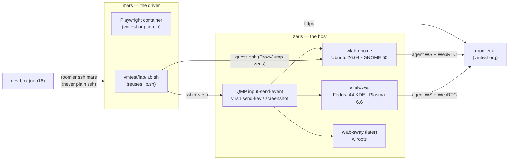
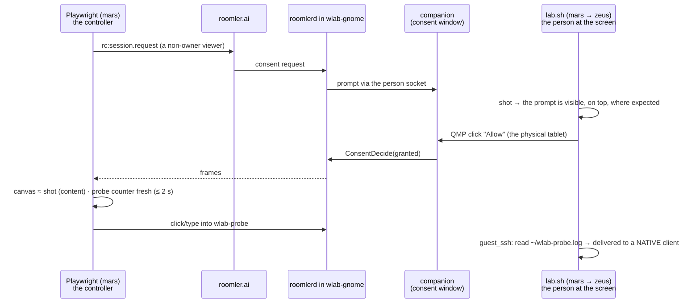
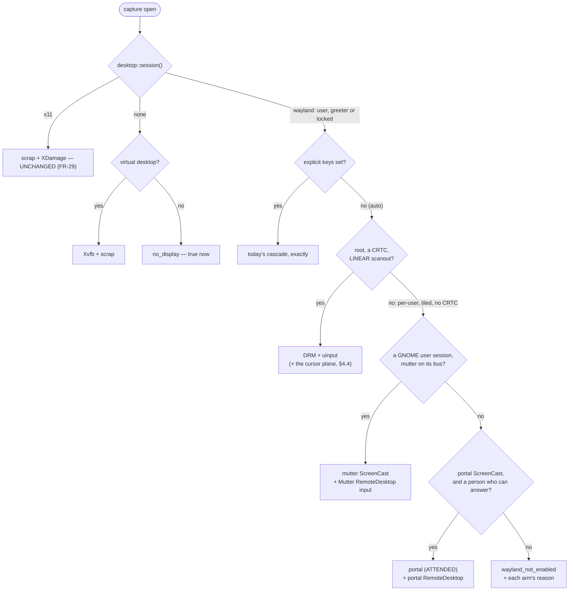

# FR-93: Linux Wayland out of the box — a stock desktop install is seen, driven and told, and a lab proves it

**Issue:** [#1972](https://github.com/gjovanov/roomler-ai/issues/1972) · **Status:** proposed 2026-10-11 — spec and claim. The operator approved the plan
and P0 (the lab on zeus, enrolled in the vmtest org — D2, D8); D1 (default-on policy) and D3 (x86
hardware) stay open · **Owner:** remote desktop (agent + viewer), vmtest (`roomler-ai-deploy`) ·
**Anchors:** master `8098ebbe3`, fleet 0.4.124 (0.4.125 bumped, not yet released) · **Builds on:** [FR-36](FR-36-wayland-capture.md) (DRM + uinput),
[FR-45](FR-45-portal-capture.md) (portal + mutter), [FR-56](FR-56-remote-apps-on-wayland.md) (Remote Apps),
[FR-27](FR-27-consent-surfaces-and-desktop-companion.md) P10/P11 (companion, person socket),
[FR-61](FR-61-vmtest-matrix.md) (vmtest), [FR-80](FR-80-a-session-with-no-pixels-says-why.md) (capture reason) ·
**Unblocks:** FR-45 AC8 + P5b, FR-56 AC7/AC9/AC10, FR-85's Wayland rows, FR-92 AC9 · **Absorbs:** #1719, #1945

## 1. Goal

A Linux desktop on Wayland — the only session current GNOME ships, and from Plasma 6.8 the only one KDE
ships — works the way a Windows or macOS host does: install, enroll, connect, and it just works.

- A **stock** install (`install.sh`, which is per-user by default, or the `--system`/`.deb` root install) on
  Ubuntu 24.04/26.04 GNOME, Fedora GNOME and Plasma 6 shows **the real desktop with no configuration key**.
- The controller **drives native Wayland windows**, not only Xwayland ones, and **sees the remote cursor**.
- When something cannot work, the viewer says **what and why in one sentence** — never a black stream,
  never "headless" for a machine with a person sitting at it.
- The **person at the screen is told** they are being viewed, on every surface where pixels leave the box.
- It **keeps working** across lock/unlock, logout/login, user switch, resolution change and suspend/resume.
- Every claim is proven on a **Wayland lab whose harness plays the person at the screen**, before and after,
  and on real hardware wherever a VM cannot stand in.

## 2. Evidence (master `8098ebbe3`, fleet 0.4.124, 2026-10-11)

### 2.1 What a stock install does on a Wayland desktop today (no capture or input keys set)

| | **per-user** — the desktop default (`SYSTEM=0`, `scripts/install.sh:63`; `README.Debian:12-13`) | **system** — `--system` / `.deb` root unit |
|---|---|---|
| Capture | scrap connects to Xwayland's `DISPLAY` and streams Xwayland's empty root: **a live black stream, no reason** (#1719 measured `backend=scrap`, ~1.2 KB/s of black VP9) | the root unit has no `DISPLAY` (`packaging/linux/roomlerd.service:20-53`), scrap's `xcb_connect(NULL)` fails, and the FR-80 classifier says **`no_display` — "headless, or no desktop session"**, false for this host (`capture/mod.rs:610-618`, hint `:489-490`). DRM and the portal are skipped without a log line (`:808-869`) |
| Input | enigo/XTest reaches **Xwayland clients only**; native windows (Settings, Files, the shell) get nothing and nothing says so (`input/mod.rs:344-346`) | no `DISPLAY` ⇒ `NoopInjector`, which returns `Ok(())` for every event (`input/mod.rs:279-288`) |
| What the viewer is told about input | `has_input_permission = true`, hard-coded off macOS (`encode/caps.rs:1412-1414`, `:815-824`, `:843-852`) | the same |
| Cursor | none — the Linux cursor tracker is unwired (`capture/cursor.rs:88-94`); the viewer paints the controller's initials badge | none |
| Clipboard | arboard over X11 into Xwayland's selection bridge (unmeasured) | **off** — `clipboard.rs` has no session discovery; `supports_clipboard` is compile-time (`caps.rs:1416`) |
| Consent / indicator | the X11 panel over Xwayland — "it shows; it just cannot guarantee stacking above native Wayland clients" (`indicator/x11.rs:33-37`), never field-run; the companion fallback launches through the **system** manager (`companion.rs:484`), which its own doc says asks polkit for a password nobody types (`:507-518`) | the companion over the P11 person socket — GREEN on vmtest Ubuntu 24.04 (FR-27 P10/P11). **x86_64 only**: no aarch64 companion is built (`.github/workflows/release-agent.yml:872-994`) |

The vmtest Ubuntu lane never saw this because it sets the opt-in keys itself
(`roomler-ai-deploy:vmtest/guest/linux-lane.sh:149-169`). Its per-user cell set an inert one
(`mutter_capture` without `portal_capture`), streamed black for weeks, and `rd` read green (#1719).

### 2.2 What works today — every arm opt-in

| Arm | Sees | Asks the person | Proven on | Gate (default **off**) |
|---|---|---|---|---|
| DRM/KMS (FR-36) | the scanout, incl. the greeter and a locked screen | no | Asahi (apple-drm, 4K, real); vmtest virtio-gpu (`lit=92.1 %`) | `drm_capture` |
| uinput (FR-36 P4) | — input below the compositor, host-global | no | Asahi | `uinput` |
| portal ScreenCast (FR-45 P1–P3) | a user session only | yes, once (restore token) | Asahi | `portal_capture` |
| portal RemoteDesktop input (FR-45 P4) | — | the same dialog **and** its *Allow Remote Interaction* toggle, off by default | Asahi | `portal_input` |
| mutter direct (FR-45 P5) | a user session (or a PAM-rigged headless one) | no; GNOME only; **no input** | WSL2 rig; Asahi | `portal_capture` + `mutter_capture` |
| Remote Apps on Xwayland windows (FR-56) | — | — | Asahi | — |
| companion banner + Disconnect on a system install (FR-27 P10/P11) | — | — | vmtest 24.04 | — |

### 2.3 Defects found while surveying for this plan (each read on master)

1. **Capture says "headless" to a Wayland desktop** (§2.1). The classifier keys on the *daemon's* env only.
2. **Per-user + Wayland streams black with no reason** (§2.1, #1719).
3. **Input drops silently, or reaches Xwayland only, while advertising `has_input_permission=true`**;
   `docs/remote-control.md:371` promises a view-only notice that does not exist.
4. **DRM leaks a GEM handle per frame.** `grab()` calls `get_planar_framebuffer` (GETFB2) on every frame
   (`drm_backend.rs:363-365`); drm-rs returns the raw handles with no `Drop`
   (`drm-0.15.0/src/control/mod.rs:296-318`) and nothing calls `close_buffer`. The kernel mints a handle per
   call (my reading — §6.4 measures it), so a session pins every scanout buffer the compositor has since
   freed until its fd closes. FFmpeg's kmsgrab closes these.
5. **DRM selection is first-wins and its failures are mute**: the first card with a CRTC (`:116-137`), the
   first bound plane with no `type` check (`:146-164`), `monitor_count()` = 1; a non-linear modifier, no
   scanout or no `CAP_SYS_ADMIN` never reaches the viewer — only the last arm's error is classified
   (`capture/mod.rs:876-895`); a blanked panel **freezes the last frame** instead of saying so
   (`drm_backend.rs:359-361` → the keepalive).
6. DRM's mapping cache is keyed on `(fb id, len)` (`:384`) — a recycled id for a new same-size buffer reuses a
   stale mapping (inference).
7. **No cursor from DRM**: only the primary plane is read. In a virtio-gpu VM *and* on real GPUs mutter and
   KWin keep the pointer on the cursor plane (§2.5), so it is absent from every DRM frame; the live cursor
   channel is Windows-only (`cursor.rs:88-94`).
8. **The portal negotiates no buffer type** — no `SPA_PARAM_Buffers`, no modifier in EnumFormat
   (`portal/pipewire.rs:1100-1113`, `pod.rs:290-350`). That yields MemFd from GNOME and KWin today (§2.5); a
   DmaBuf-only producer costs a 15 s timeout and a silent fall-through (`pipewire.rs:787-791`, `:1173-1185`).
9. **Mutter records `monitors[0]`, not the primary** (`portal/mutter.rs:268-289`; `primary` parsed, unread, `:317`).
10. **`graphical_session()` is first-match**: any `Active` x11/wayland session in list order, the greeter
    accepted for capture, `Seat`/`Remote` ignored, and `WAYLAND_DISPLAY` guessed as `wayland-0`
    (`companion.rs:625-688`, `:683`).
11. **Mutter-direct capture has no input at all** (`portal/mod.rs:604-606`, `:650`); no
    `org.gnome.Mutter.RemoteDesktop`, libei or `ConnectToEIS` code exists. A headless-mutter host is view-only.
12. **Release-all warps the pointer to (0,0)** — GNOME's Activities hot corner — on **both** injectors: #1945
    names enigo; uinput also moves before every button (`uinput_backend.rs:365-372`).
13. uinput types **US layout only**, detected from root's view (`keylayout.rs:43-58`, `:138-155`) rather than the
    session's active input source; `mon` is ignored and nothing maps per output (`uinput_backend.rs:361`).
14. The companion was never field-run as a **consent** window on Wayland; its banner cannot auto-hide there
    (`agents/roomler-desktop/src/panels.rs:188-191`); `pgrep -x` has no `-u` (`companion.rs:477`).
15. `capture-smoke` ignores `config.toml` (the bridge is registered only in `run_cmd`, `main.rs:2851-2914`)
    and parks ~1 h on `NoopCapture` (`capture/mod.rs:567-571`).
16. Keep busy (FR-92, every phase merged 2026-10-11, unreleased) reports a Wayland desktop `unavailable`
    with reason `wayland` (`keep_busy/engine.rs:197-198`) — right, and a **fifth** hand-rolled logind
    parser (`keep_busy/logind.rs:91-110`).
17. Docs drift: `docs/linux-capture.md` anchors (`open_default` is `capture/mod.rs:682`, not `:665`;
    `spawn_child` is `portal/mod.rs:764`, not `:755`); `README.Debian:86-91`; `docs/remote-control.md:159,175`
    name files that do not exist; `CLAUDE.md` says GNOME/KDE Wayland get "no native overlay" while
    `indicator/x11.rs:33-37` describes the Xwayland one.

### 2.4 Leftovers elsewhere that the same test bed unblocks

| Where | What is open | Why it was stuck |
|---|---|---|
| FR-45 #1041 (board: Ready) | AC8 "the spec and the UI both say attended-only"; P5b session resolution for hosts with no graphical logind session | no capture backend on the wire; no seatless-session rule |
| FR-56 #1157 (admitted) | AC7 a window streamed and switched; AC9 rewrite; AC10 a refusal rendered in the dialog; AC5 wlroots | "needs a human at the host to answer the picker"; no wlroots host |
| FR-27 #854 (in progress elsewhere) | the Linux native panel untested; the Wayland surface decision | vmtest never prompts (`FR-61:228-229`) |
| FR-85 #1634 | the Wayland recording rows | the Ubuntu cell was black |
| FR-92 #1942 | AC9 — Wayland reports `unavailable` with a reason the viewer shows | built (reason `wayland`), unreleased, not field-verified |
| FR-36 (closed) | P2 detiling, cursor plane, multi-monitor, P3 privilege split | no host with tiled scanout |
| #1719 | content check + lane fix — both branches pushed 10-07, no PRs | stalled |
| #1945 | release-all warps to (0,0) | unconfirmed on a GNOME host |

### 2.5 The ecosystem this targets (research 2026-10-11, sources in §12)

- **GNOME is Wayland-only.** Ubuntu 25.10 and **26.04 LTS** ship no "Ubuntu on Xorg" session — "GNOME Shell can
  no longer run as an X.org session". GNOME 50 (2026-03) dropped mutter's X11 backend and gnome-session's X11
  sessions. Fedora 43+ removed the GNOME Xorg session; Fedora 44 ships GNOME 50 and Plasma 6.6.
- **KDE follows.** Plasma 6.8 — release scheduled **2026-10-14** — is Wayland-exclusive; Fedora KDE has been
  Wayland-only since F40. Debian 13 still packages a GNOME Xorg session (GNOME 48, Plasma 6.3).
- **Prior art converged on DRM + uinput for unattended Wayland.** RustDesk 1.4.9 (2026-08) ships it as a
  separate opt-in package: KMS scanout through a `cap_sys_admin` helper, **the DRM cursor plane read with
  `HOTSPOT_X/Y`**, tiled scanout via **EGL import** (Intel CCS verified), uinput input, the login screen
  included; "the opt-in package *is* the consent". Sunshine's kmsgrab does the same (EGLImage detile,
  cursor plane CPU-blended).
- **Mutter's private APIs** (version 1, "no compatibility promised"): `org.gnome.Mutter.RemoteDesktop.Session`
  has `NotifyPointerMotionAbsolute(stream, x, y)` — which **requires** a ScreenCast session created with
  `remote-desktop-session-id` — plus `NotifyKeyboardKeycode/Keysym`, `ConnectToEIS`, the clipboard methods
  (`EnableClipboard`, `SelectionRead/Write`), and new `SetKeymap`/`SetKeymapLayoutIndex`.
- **Portals**: RemoteDesktop v2 `ConnectToEIS` and the Clipboard portal (1.17+). GNOME and KDE implement
  RemoteDesktop, ScreenCast and Clipboard; **wlr and Hyprland have no RemoteDesktop**. KWin offers DMA-BUF
  with modifiers *and* SHM; a consumer that advertises no modifier gets MemFd — today's consumer is safe there.
- **VMs as a test bed**: virtio-gpu advertises **LINEAR only** and has a **cursor plane** that mutter and KWin
  use (they set `DRM_CLIENT_CAP_CURSOR_PLANE_HOTSPOT`; kernel ≥ 6.6 hides the plane from clients that don't).
  `virsh screenshot` (QMP `screendump`) **omits the cursor**. `heads=N` gives multi-monitor. QMP
  `input-send-event` takes absolute 0–0x7fff on a tablet device; `virsh send-key` presses ≤ 16 keys at once.
  `MUTTER_DEBUG_DISABLE_HW_CURSORS=1` forces a software cursor for an A/B.
- **GNOME's own headless path**: GDM 50 added `gnome-headless-session@<user>.service`, and gnome-remote-desktop
  drives a headless greeter via `org.gnome.DisplayManager.RemoteDisplayFactory` — RDP-shaped; a possible
  Wayland-native successor to the Xvfb virtual desktop, **out of scope here**.

## 3. The test bed

### 3.1 Where — and where not

| Candidate | Verdict | Why |
|---|---|---|
| **mars / zeus / jupiter** as desktops | ✗ | production hypervisors (two k8s VMs each; jupiter's `k8s-worker-3` holds roomler.ai's storage-pinned pods, so its outage is a full outage); no display — mars has no DRM device, jupiter/zeus `amdgpu` with zero connected outputs (FR-36 host survey); a desktop is hundreds of packages plus a compositor on a prod host. Their role is the vmtest one: **zeus hosts lab VMs, mars drives them** |
| **KVM guests on zeus — the lab** | ✅ primary | measured 2026-10-11: 125 GB RAM (57 GB available), 32 threads, 1.4 TB free, QEMU 8.2.2 + libvirt 10.0, the vmtest host role already in place (`vmtest-net` NAT on virbr2, cached noble images incl. `ubuntu-gui-noble.qcow2`). virtio-gpu gives a real CRTC (DRM capture proven there); the harness can be the person at the screen (QMP) and the ground truth (`virsh screenshot`) |
| **Apple-Asahi** (`scw-m2-asahi`) | ✅ real-hardware cell | online on 0.4.124; Fedora Asahi Remix 42, GNOME Shell 48.8 Wayland (lightdm autologin), `drm_capture` + `uinput` already on; a real 4K apple-drm scanout (LINEAR). It is also the FR-19 peer relay ⇒ a dead-man switch before any daemon change, never left on another session, no casual reboot. aarch64 ⇒ no companion |
| **neo16 WSL2** | ✅ narrow | FR-45 P5b only (tty-only logind, headless mutter) and the NVENC number. Not a Wayland desktop: no `/dev/dri`, WSLg's Weston is ancient (no linux-dmabuf; nested mutter hangs) |
| **MacBook** (M5 Pro, 24 GB, macOS 27.0.1) | ⚠️ optional | could run an aarch64 Linux VM (UTM's QEMU backend reproduces the KVM guest; tart/AVF is 2D llvmpipe with unverified cursor-plane behaviour), but it is the operator's daily machine and the macOS vmtest host, aarch64 has no companion, and Asahi already covers aarch64 on real hardware |
| a **real x86 desktop** with an Intel/AMD GPU and a display | ⚠️ **operator decision D3 — nothing in the fleet is one** | the only cell for tiled/compressed scanout (FR-36 P2), a cursor plane on a real GPU, GPU-backed PipeWire buffers, fractional scaling and multi-monitor on real outputs. **A VM proves none of these** — virtio-gpu scans out LINEAR. Cheapest: an N100-class mini-PC (Intel ⇒ CCS-tiled scanout, the case RustDesk verified) + an HDMI dummy plug at the operator's home |

### 3.2 The Wayland lab — persistent guests on zeus (`wlab-*`)

**Guests.** One runs at a time by default; the others stay shut off.

| Guest | Image | Compositor | Why |
|---|---|---|---|
| `wlab-gnome` | Ubuntu 26.04 LTS | GNOME 50, Wayland only | the forward default; the `.deb` path |
| `wlab-kde` | Fedora 44 KDE | Plasma 6.6, SDDM | KDE's portal and KWin buffers; the `install.sh` tarball path; SELinux enforcing |
| `wlab-sway` (later, D7) | Ubuntu 26.04 + sway | wlroots | FR-56 AC5; the wlr portal (ScreenCast only) |
| — | vmtest's noble golden | GNOME 46 | the installed base — stays throwaway in vmtest |

**Domain shape** — deliberately different from vmtest's `virt-install` (`lanes/ubuntu/cell.sh:58-62`):

- `--video virtio,heads=2` — the second head stays off in-guest until a test turns it on
- `--input tablet,bus=usb --input keyboard,bus=usb` — the absolute device QMP injects into
- `--graphics vnc,listen=127.0.0.1` — `virsh screenshot`, and VNC for the operator over an ssh tunnel
- SeaBIOS (internal qcow2 snapshots without pflash NVRAM), 4 vCPU, 6 GiB, a guest-agent channel
- a **full-copy** qcow2, never an overlay of vmtest's golden — a vmtest re-bake must not break the lab

**In the guest** (one bake script per image, the `lanes/ubuntu/bake.sh` shape):

- autologin user `wlab` and a second user `wlab2`, both with passwords, so lock/unlock, the greeter and user
  switching are real; lock **on** with a long idle delay, DPMS **off** by default — a test toggles each
  (a blanked screen stops scanout, FR-36)
- `xdg-desktop-portal-gnome` / `-kde` / `-wlr`, PipeWire, `wayland-utils`, `foot` (native Wayland terminal),
  `xterm` (Xwayland), `gnome-text-editor`/`kate`, `tmux`, `wmctrl`, extra XKB layouts
- **`wlab-probe`** — a ~150-line GTK4 app (python3-gi; native Wayland, `--x11` runs the same app on Xwayland),
  full-screen. It paints a **block code encoding a counter that ticks every 250 ms** — the freshness oracle,
  decodable from the viewer's canvas without OCR — draws a crosshair where it last saw the pointer, and logs
  every motion, button, scroll and key (keyval + Unicode) with coordinates and a monotonic timestamp to
  `~/wlab-probe.log` — the input oracle. It proves an event reached a **native** client, which is exactly
  what XTest cannot do

**Snapshots**: `clean` (baked) and `enrolled-<agent version>`. Every test starts with `snapshot-revert`;
reverting keeps the device identity.

**Enrollment** (D8): the **vmtest org** (business plan, isolated, admin credentials already on mars),
**non-ephemeral** — FR-51 deletes an ephemeral row on every daemon stop, which is wrong for a lab that
restarts daemons all day.

**Driver**: `roomler-ai-deploy:vmtest/lab/lab.sh`, run on mars like vmtest, reusing `lib.sh`
(`guest_ssh`, `screendump`, `vm_ip`):

| Command | Does |
|---|---|
| `up` · `down` · `status` · `revert <snap>` · `snapshot <name>` | lifecycle |
| `install <.deb\|tarball>` | a candidate from a CI artifact — the kept-guest upgrade flow, `auto_update=false` first |
| `shot` | `virsh screenshot` → PNG — the ground truth of what is on the guest's screen (cursor excluded) |
| `move X Y` · `click X Y [btn]` · `key KEY_…` · `type <text>` | **the person at the screen**: QMP `input-send-event` on the USB tablet, `virsh send-key` |

🔑 **Why host-side input.** FR-45 P4 crossed GNOME's consent dialog with the agent's own uinput — the
product approving its own consent, which proves the mechanism and nothing about the experience. QMP input
arrives as the VM's physical tablet and keyboard, independent of every roomler code path. It can answer the
portal dialog (and flip *Allow Remote Interaction*), the companion's consent prompt, the lock screen and the
greeter — the human actions FR-61 scoped out (`FR-61-vmtest-matrix.md:228-229`).

**Rules**

- Prefix `wlab-`, never `vmtest-`: `vmtest-audit`'s leftover check and `vmtest.sh destroy --all` must never
  see it. The audit reads `MemAvailable`, so a running lab guest is accounted for automatically; one ≤ 8 GiB
  vmtest slot must always remain free.
- Never touch the k8s domains. Never jupiter (`lib.sh:39-43` already refuses it).
- Shut a guest off when idle.

### 3.3 The vmtest lane — throwaway regression (FR-61's harness)

1. **Finish #1719 first** — commit the uncommitted lane fix (`portal_capture` beside `mutter_capture`) and
   the `config.rs` doc comment, run B, open both PRs (branches `fix-1719-rd-content` in both repos, pushed
   10-07), then remove `~/w1719` on mars.
2. **`default` cells** for system and user — no capture or input keys. Red on 0.4.124 (black or a false
   "headless"), green after P2: the negative control for this whole FR.
3. **Content oracle v2**: the viewer's canvas against `virsh screenshot` taken at the same moment (a
   downscaled grayscale correlation) — "the picture is *the guest's* screen", not "≥ 1 % lit" — plus the probe
   counter for freshness.
4. **Input oracle**: the viewer clicks and types into `wlab-probe`; the cell reads `~/wlab-probe.log`.
   Closes FR-61's open decision 3 (`FR-61-vmtest-matrix.md:221`).
5. A 26.04 golden beside noble, then a Fedora KDE golden.
6. A `lifecycle` cell type with the lock enabled (the plain cells keep it off, `bake.sh:68-79`).

### 3.4 Real hardware

- **Asahi** after every agent release: DRM at 4K, uinput, the Mutter paths; no companion.
- **The x86 cell** (D3). Until it exists, every DRM claim in this FR reads "linear scanout only".

### 3.5 Building and installing candidates

A PR's CI agent artifact → `lab.sh install` (the kept-guest flow). For quick iteration a WSL build
(`cargo build -p roomlerd --release --features full`), copied via mars — never a `CARGO_TARGET_DIR` shared
between worktrees or inside one. Every capture/input knob flip forces a fresh caps probe
(`docs/linux-capture.md` §7): flip with the guest unloaded.

## 4. Design

### 4.1 One desktop-session resolver

`desktop::session()` replaces the five ad-hoc lookups (`companion.rs:625`, `recording/launch.rs:1442-1470`,
`apps/linux.rs:501-511`, `keep_busy/logind.rs:91-110`, and the scrap arm's reliance on the daemon's own
`DISPLAY`):

- logind over **D-Bus** (`org.freedesktop.login1`, zbus — already a dependency and pure Rust) instead of
  parsing `loginctl` columns, which changed between systemd 255 and 257 (FR-45 P2a's shipped bug);
- the console is **`seat0`'s `ActiveSession`**, not the first `Active` row. The greeter (`Class=greeter`), a
  seatless session (P5b's headless mutter) and a remote one (`Remote=yes`) are distinct answers, never "the
  console";
- `WAYLAND_DISPLAY`, `DISPLAY` and `XAUTHORITY` come from the session user's systemd manager environment
  (GNOME and KDE import them), else a scan of `/run/user/<uid>/wayland-*` — never the `wayland-0` guess;
- it returns `{class: user|greeter|headless|none, type: wayland|x11|tty, desktop, uid, locked, displays}`;
- it is live: `PropertiesChanged` on the seat and session drives §4.7. A decision is never cached (FR-45's rule).

### 4.2 Honest failure (P1)

- **Capture**: a new FR-80 code `wayland_not_enabled` (additive — an old viewer shows its generic text)
  that names the session and the fix. Under P2 it appears only when every arm refused, carrying each arm's
  one-line reason.
- **The Xwayland guard**: on a Wayland session scrap refuses an X server that advertises the `XWAYLAND`
  extension. Never a black stream. The daemon's own Xvfb is unaffected.
- **Input reach** on the hello: `input_reach: full | xwayland_only | none` plus a reason; `NoopInjector` ⇒
  `none`. The viewer renders the view-only notice `remote-control.md:371` already promises.
- `supports_clipboard` becomes a runtime answer.
- `capture-smoke` and `input-smoke` register the config bridge; `NoopCapture` waits are bounded.

### 4.3 The Wayland auto-cascade (P2, operator decision D1)

| Session | Install | → capture | → input |
|---|---|---|---|
| Wayland user session | system | DRM if a LINEAR CRTC, else mutter (GNOME), else portal | uinput · Mutter RemoteDesktop · portal RemoteDesktop |
| Wayland user session | per-user | mutter (GNOME — same bus, no root, no dialog), else portal | Mutter RemoteDesktop · portal RemoteDesktop |
| greeter / locked | system | DRM (D1b) | uinput |
| greeter / locked | per-user | refused with the reason — a per-user daemon cannot see the greeter | — |
| headless seatless (WSL2, `mutter --headless` as a service) | any | mutter (P5b) | Mutter RemoteDesktop |
| X11 | any | **unchanged** | **unchanged** |

Rules: auto applies only when the resolver says Wayland, so an X11 host keeps FR-29's idle numbers
byte-for-byte; an explicit key always wins (`drm_capture = false` removes the arm, `= true` forces it); kill
switch `ROOMLERD_WAYLAND_AUTO=0`; the choice is logged once per session and put on the wire
(`capture_arm`, `attended`) — FR-45 AC8 option (b).

⚠️ **The policy coupling is the decision, not a detail.** DRM and mutter capture without asking anyone.
FR-36 made it a precondition that the viewer indicator is reachable on those surfaces before DRM leaves
opt-in (`FR-36-wayland-capture.md:308-313`). Today: x86_64 system installs have the companion banner (P11);
per-user installs have an untested Xwayland panel and a broken companion launch (§2.3 #14); the greeter and
the lock screen have none; aarch64 has no companion. RustDesk's answer is that installing the separate
package is the consent. Roomler's equivalent is enrolment plus the per-session consent mode
(`auto_grant_session`, FR-27's chain), which this FR does not change — it changes only whether pixels flow
once a session is allowed.

### 4.4 DRM hardening (P3)

| | What | Why |
|---|---|---|
| a | GETFB2 only when the plane's fb id changed; `close_buffer` every handle after export (kmsgrab's shape) | §2.3 #4 |
| b | the plane's `type` = Primary; the card by `boot_vga`/seat0, not first-found | §2.3 #5 |
| c | **the cursor plane**: set `DRM_CLIENT_CAP_ATOMIC` + `CURSOR_PLANE_HOTSPOT` (on virtio/qxl/vmwgfx the kernel hides the plane otherwise), read its ARGB fb + `CRTC_X/Y` + `HOTSPOT_X/Y`, ship it on the **existing cursor DC** (`cursor:pos`/`cursor:shape`, Windows-only today) — not a per-frame blend | §2.3 #7; RustDesk/Sunshine both read it |
| d | idle cost, Wayland-only and measure-first: an unchanged primary fb id **and** an unchanged hash of sampled rows ⇒ unchanged; a forced refresh every 1 s (FR-29's bound) | the header's objection (`drm_backend.rs:17-25`) covers X11 front-buffer rendering (excluded) and "new handle, identical content" (a wasted encode, not a stale frame); the hash covers a double-buffered A→B→A |
| e | refusals and "the display is off" reach the viewer through FR-80 | §2.3 #5 |
| f | the mapping cache keyed on the dma-buf's identity, not the fb id | §2.3 #6 |
| g | tiled scanout = FR-36 P2: EGL dma-buf import, `dlopen`ed (the PipeWire rule — no `DT_NEEDED`) | real x86 hardware only (D3) |

### 4.5 Input (P4)

- **Mutter RemoteDesktop** in the helper, paired with the mutter ScreenCast session through
  `remote-desktop-session-id` (absolute motion needs the stream path): `NotifyPointerMotionAbsolute`,
  `NotifyPointerButton`, `NotifyPointerAxis`, `NotifyKeyboardKeycode`/`Keysym`. This is unattended input for
  mutter capture, per-user installs (no root) and headless mutter (WSL2), in the portal `input.rs` mapper's
  shape. `ConnectToEIS` (libei, shared with the portal's v2 path) is the alternative to evaluate; the API is
  private and unversioned, so detect at session time.
- **#1945**: a release-without-move form on both injectors, plus the test that a release-all injects no motion.
- **Layouts verified in the lab**: set a layout per guest, type a fixed string through the viewer, compare
  against the probe log — the "host on that layout" FR-36 lacked. Detect from the session's input sources
  (GNOME `org.gnome.desktop.input-sources`, KDE `kxkbrc`), not root's `localectl`. Mutter's new `SetKeymap`
  may remove the keysym-not-in-keymap drop (FR-45 #1132).
- uinput per-output mapping once §4.4 lists CRTCs; fractional scaling verified on `wlab-gnome` at 125 %/150 %.

### 4.6 Session lifecycle (P5)

The §4.1 watcher re-selects the arm, instead of today's error → backoff → reopen. Each cell must recover
within 10 s or name its reason; a frozen frame with no reason is a failure.

| Event | DRM | mutter | portal |
|---|---|---|---|
| lock → unlock | keeps streaming (the lock screen is pixels) | measure: an existing session expected to survive; creation is inhibited while locked | must not burn the restore token |
| logout → greeter → login (GDM VT switch) | new fb handles → remap | the helper dies with the bus → a new one for the new session | a new user ⇒ a new dialog |
| user switch (`wlab2`) | the scanout follows the active VT | the old session's stream ends; re-select | — |
| DPMS blank → wake | "display off" reason, then resume | damage-driven: zero frames is normal | — |
| resolution change / second head | size follows | re-record | re-pick |
| suspend → resume (`virsh dompmsuspend`) | re-open | re-open | re-open |
| compositor crash (kill `gnome-shell`) | new scanout | re-open | re-open |

### 4.7 Consent and the indicator (P6 — with FR-27's owner)

- Field-run the companion's consent window and banner on GNOME 50 and Plasma 6.6: QMP answers, and
  `virsh screenshot` proves it was visible and above the focused app.
- Fix the per-user launch: `user_manager = euid != 0`, as `launch_once.rs:585` already does; `pgrep -u`.
- A freedesktop **Notifications-with-actions** surface where no companion runs (aarch64; per-user without it) —
  nothing of the kind exists (`crates/agent-core/src/notify.rs:21-24` "deferred") (D6).
- An aarch64 companion build (D5).
- The greeter and lock-screen indicator question is D1b.

### 4.8 Clipboard (P7)

A root daemon runs the clipboard in the session, the helper pattern: Mutter RemoteDesktop's clipboard on
GNOME, the Clipboard portal on KDE (Plasma ≥ 6.4). For a per-user install on GNOME, measure Xwayland's
bridge for text and images in the lab before deciding.

### 4.9 Wire (all additive — unknown fields ignored, the `RpcCap` rule)

- hello `desktop: {session, type, desktop, capture_arm, input_reach}` — the server can count Wayland hosts and
  what serves them, which an exec sweep cannot (a biased sample)
- `rc:media-unavailable` code `wayland_not_enabled`
- `rc:video-info` `capture_arm`, `attended`
- the cursor DC on Linux (the existing messages)

## 5. Phases

| Phase | What | Kill switch | Proven on | Size |
|---|---|---|---|---|
| **P0** | the lab (§3.2), #1719 finished, the 0.4.124 baseline recorded red | — | lab, vmtest, Asahi | M |
| **P1** | honest failure (§4.2), #1945, the GEM-handle fix (§4.4a), `capture-smoke` reads config | `ROOMLERD_WAYLAND_AWARE=0` | lab, vmtest `default` cells | S–M |
| **P2** | the auto-cascade (§4.3) + the wire (§4.9) | `ROOMLERD_WAYLAND_AUTO=0`; explicit keys | lab ×2, vmtest, Asahi | M |
| **P3** | DRM hardening (§4.4 b–f) | `ROOMLERD_DRM_CURSOR=0`, `ROOMLERD_DRM_IDLE_SKIP=0` | lab, Asahi | M |
| **P3g** | tiled scanout via EGL import | `ROOMLERD_DRM_EGL=0` | the x86 cell (D3) | L |
| **P4** | Mutter RemoteDesktop input, layouts, per-output mapping (§4.5) | `ROOMLERD_MUTTER_INPUT=0` | lab, WSL2 | M |
| **P5** | lifecycle (§4.6) | — | lab | M |
| **P6** | consent and indicator (§4.7) | FR-27's switches | lab GNOME + KDE | M |
| **P7** | clipboard (§4.8) | `ROOMLERD_SESSION_CLIPBOARD=0` | lab | M |
| **P8** | leftovers: FR-45 AC8 + P5b, FR-56 AC7/AC9/AC10, FR-92 AC9, FR-85's Wayland rows | each FR's own | lab, WSL2 | S each |
| **P9** | docs: a new `docs/wayland.md` (the support matrix — desktop × install × session state × capability, attended vs unattended), `docs/linux-capture.md` refreshed, the lab runbook in `docs/vmtest.md`, a `docs/README.md` row, `README.Debian` | — | — | S |

Each phase ships in an agent release (next `0.4.125`; the `ship-it` skill owns the mechanics) and is
field-verified before the next one depends on it.

## 6. Test plan

### 6.1 Unit / CI (`cargo test -p roomlerd --lib --features full`, the CI clippy lines verbatim)

- the resolver over **real captured** `login1` replies — Ubuntu 24.04/26.04, Fedora 44 KDE, Asahi, WSL2 tty-only,
  a GDM greeter, a seatless headless session — never invented samples (FR-45 P2a's lesson);
- the cascade as a pure function: (session, install, DRM probe, mutter on the bus, portal status, keys, consent
  mode) → (arm, input, reason), table-driven, every row named;
- DRM handle accounting (every handle opened is closed), cursor-plane extraction, the idle skip;
- #1945: a release-all injects no motion, on both injectors;
- the Mutter RemoteDesktop mapper (pure, like `portal/input.rs`'s `plan()`);
- every new test **red with its fix reverted** (the house rule; prove the revert applied).

### 6.2 Lab smoke (agent level, scripted by `lab.sh`)

`capture-smoke --dump` against `lab.sh shot`; `input-smoke` against the probe log; the resolver's verdict
printed on each guest. Five minutes per guest, no browser.

### 6.3 vmtest e2e (Playwright on mars against prod + the vmtest org)

| Cell | GNOME 46 (24.04) | GNOME 50 (26.04) | Plasma 6.6 | Checks |
|---|---|---|---|---|
| `system/default` | ✓ | ✓ | ✓ | content vs shot, freshness, input to a native client, cursor on DRM |
| `user/default` | ✓ | ✓ | ✓ | the same (mutter on GNOME; portal + QMP-answered dialog on KDE) |
| `system/consent` | — | ✓ | ✓ | a non-owner viewer; QMP clicks Allow / Deny; a timeout ⇒ `no_prompt_surface` on aarch64 |
| `system/lifecycle` | — | ✓ | — | lock/unlock, logout/login, user switch mid-session |
| `user/clipboard` | — | ✓ | ✓ | text both ways |
| `conference` | — | ✓ | — | Firefox in the guest screen-shares into a room via the portal; a participant on mars decodes frames (pillar 3 on a Wayland desktop) |

New cells run three times before they are trusted. An entry in `expected-failures.txt` carries its reason.

### 6.4 Field protocol

- **Fail first**: every field check runs on the current release (0.4.124) and is recorded red before the fix.
- **Hosts**: the lab guests, Asahi (dead-man switch armed), the x86 cell (D3), NEO16-WSL (P5b only).
- **Numbers recorded**: fps, `avg_capture_ms`, `avg_encode_ms` (the `DC pump heartbeat`), idle CPU against
  FR-29's X11 figure, input latency (probe-log timestamps against viewer send times), time to first frame,
  recovery time per lifecycle event.
- **The GEM leak, measured**: a `bpftrace` count of `drm_gem_handle_create` against `drm_gem_handle_delete`
  for `comm == "roomlerd"` over a 60 s DRM session — today creates ≈ frames and deletes ≈ 0; after P1, equal.
- **After every roll**: the hello's `desktop` field gives the denominator from the server; an exec sweep reaches
  only what is online.

## 7. Acceptance criteria

- [ ] **AC1** — a default **per-user** install on GNOME 50 Wayland, no keys: the viewer shows the real desktop
  (canvas ≈ `virsh screenshot`, the probe counter fresh within 2 s). Red on 0.4.124 first.
- [ ] **AC2** — the same for a default **system** install. Red on 0.4.124 first ("headless").
- [ ] **AC3** — Plasma 6.6 Wayland, per-user and system: a picture (attended where the only path is attended,
  the dialog answered by the harness).
- [ ] **AC4** — input reaches a **native** Wayland client (the probe log): pointer within ±2 px at three points,
  click, scroll sign, typed ASCII, a held modifier — on GNOME (both install types) and KDE.
- [ ] **AC5** — the remote cursor is visible in the viewer on DRM and mutter/portal sessions.
- [ ] **AC6** — every refusal names its reason in the viewer; no black stream, no "headless" for a seat with a
  session. Each refusal row shown red on 0.4.124 first.
- [ ] **AC7** — lifecycle (§4.6): each event recovers within 10 s or names its reason.
- [ ] **AC8** — an idle DRM session's CPU, measured before and after, within 2× of FR-29's X11 figure.
- [ ] **AC9** — the GEM handle count stays flat over a 30-minute DRM session (red on 0.4.124).
- [ ] **AC10** — the person at the screen sees the indicator and the consent prompt on GNOME and KDE Wayland,
  system and per-user — proven with QMP and a screenshot.
- [ ] **AC11** — X11 hosts unchanged (FR-29's idle numbers), Windows and macOS unchanged; the kill switch
  restores 0.4.124's behaviour exactly.
- [ ] **AC12** — Asahi (real scanout) passes AC1/AC4/AC5/AC7 on the released build.
- [ ] **AC13** — the server reports how many Linux hosts are Wayland and which arm serves each.
- [ ] **AC14** — Docs: `docs/wayland.md`, `docs/linux-capture.md` refreshed with anchors re-verified, the lab
  runbook, and the `docs/README.md` index row.

## 8. Open decisions (operator)

| # | Decision | Recommendation |
|---|---|---|
| **D1** | Default policy on Wayland — the auto-cascade, unattended arms included | **Yes**, for both install types, X11 untouched, explicit keys override, kill switch. Enrolment plus the per-session consent mode is the consent; the indicator is the precondition (§4.3) |
| **D1b** | Does an auto system install capture the greeter and the lock screen? | **Yes on system installs** — parity with Windows SystemContext, and the reason unattended access exists; an audit row records `capture_arm` and the surface |
| **D2** | The lab on zeus (a prod cluster host) | ✅ **approved 2026-10-11** (the operator's go-ahead on this plan) — `wlab-*` prefix, 6 GiB guests, one running by default, never jupiter |
| **D3** | A real x86 Wayland box | Buy an N100-class mini-PC + HDMI dummy plug, at the operator's home, enrolled. Without it P3g cannot start and DRM stays "linear only" |
| **D4** | FR-45 AC8 | Option (b): the capture arm on the wire (P2) and viewer copy |
| **D5** | An aarch64 companion | Yes — `build-linux-arm64` builds `roomlerd` only today; Asahi-class hosts otherwise have no prompt and no banner |
| **D6** | A Notifications-with-actions consent surface | Yes, as the fallback where no companion runs — coordinate with FR-27's owner |
| **D7** | wlroots (sway/Hyprland) in scope? | Best effort: portal ScreenCast (attended, no RemoteDesktop) + uinput; `wlab-sway` and FR-56 AC5 only if yes |
| **D8** | Which org the lab enrols in | ✅ **approved 2026-10-11** — the vmtest org (isolated; Playwright already signs in there) |

## 9. Out of scope

- Native-window enumeration on GNOME — refused by GNOME itself (FR-56 P3).
- A Wayland-native virtual desktop (`gnome-headless-session@`, GDM `RemoteDisplayFactory`) to replace Xvfb —
  a separate FR if wanted.
- The controller running on a Wayland desktop beyond the §6.3 conference smoke — the browser's job.
- X11 behaviour changes, except where the shared resolver fixes a shared lookup.
- GPU-accelerated VMs (virgl); NVIDIA-proprietary specifics; FR-36 P3's privilege split (stays FR-36's).

## 10. Risks

- **Default-on unattended capture is a policy change** — D1, D1b, the audit row and the indicator
  precondition exist for exactly this.
- **zeus is a production cluster host** — the guest caps, the prefix rule, nothing on jupiter.
- **A VM is not hardware** — LINEAR-only scanout, llvmpipe, a host-composited cursor; that is what Asahi and
  D3 are for.
- **Mutter's APIs are private and unversioned** — detect at session time, fall through with a reason, and
  pin each GNOME version the lab covers.
- **Parallel sessions** own FR-27 (in progress) and may pick up FR-45/FR-56/FR-61 from the board: claim the
  cards or tell the autopilot to skip them while this runs, and hand the consent work to FR-27's owner.
- **Knob flips re-run the caps probe** (`docs/linux-capture.md` §7) — flip on an unloaded guest.

## 11. Field-verification log

| Date | Host | Build | What | Result |
|---|---|---|---|---|
| — | — | 0.4.124 | **the baseline (fail-first)**: per-user and system `default` cells on `wlab-gnome`, `wlab-kde` and vmtest noble — capture, input (probe log), cursor, clipboard, the consent surface | owed |

## 12. Related

- Issues: #1041 (FR-45), #1157 (FR-56), #854 (FR-27), #1199 (FR-61), #1942 (FR-92), #1634 (FR-85), #1719, #1945, #1911 (closed — P11).
- Docs: [`../linux-capture.md`](../linux-capture.md), [`../remote-apps.md`](../remote-apps.md),
  [`../desktop-companion.md`](../desktop-companion.md), [`../vmtest.md`](../vmtest.md).
- Sources for §2.5: Ubuntu 25.10 / 26.04 release notes (documentation.ubuntu.com/release-notes/25.10/,
  /26.04/summary-for-lts-users/); GNOME 50 mutter, gnome-session and GDM `NEWS` (gitlab.gnome.org); Fedora
  Changes/WaylandOnlyGNOME; KDE "Going all-in on a Wayland future" (blogs.kde.org, 2025-11-26) and the
  Plasma 6 schedule; `org.gnome.Mutter.RemoteDesktop.xml` and `meta-remote-desktop-session.c`;
  xdg-desktop-portal `NEWS.md` and the RemoteDesktop/Clipboard docs; KWin `screencaststream.cpp`;
  `drivers/gpu/drm/virtio/virtgpu_plane.c` and the `CURSOR_PLANE_HOTSPOT` series; QEMU `qapi/ui.json`,
  `ui/ui-qmp-cmds.c`; libvirt `formatdomain`; RustDesk's unattended-Wayland post (2026-08-14), PR #15420 and
  discussion #15417; Sunshine `kmsgrab.cpp`.
