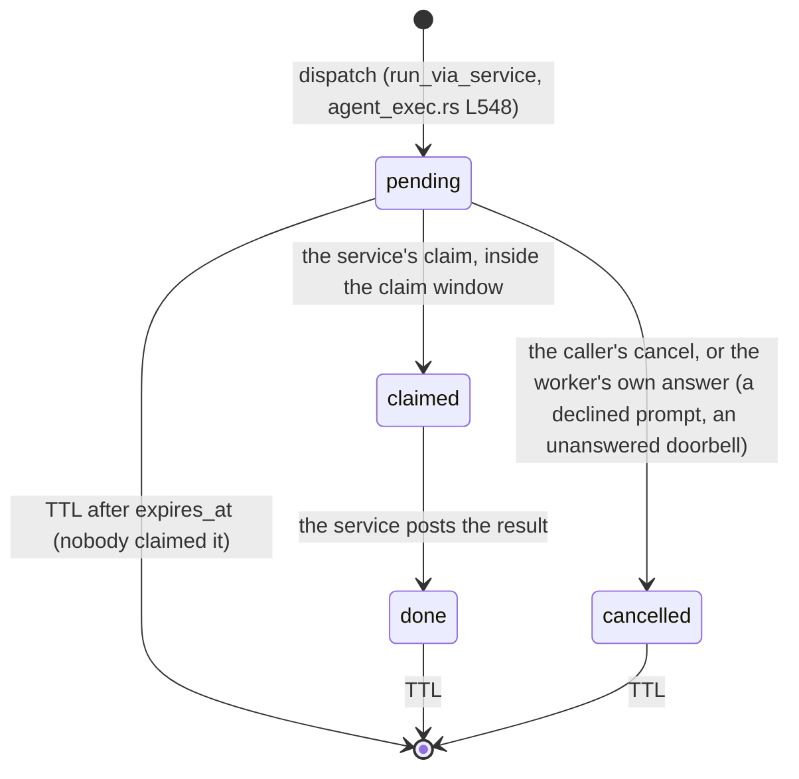

# FR-94: Windows Fleet RPC runs as SYSTEM — a machine trust anchor, a doorbell, and an explicit `console_user`

**Issue:** [#2035](https://github.com/gjovanov/roomler-ai/issues/2035) · **Status:** in progress — P0 done (spec
#2036, wording #2039, measurements #2086); P1's server half and P2 built (§6); next the agent half (P1's
`roomlerd anchor` + P3) · **Owner:** fleet (the anchor, the pending store, the claim and result
routes), the Windows agent (the service runner) · **Anchors:** §2 master `d31e3c729`; §5 the FR-94
server PR (rebased on `7d20cd817`) · **Builds on:**
[Fleet RPC](../fleet-rpc.md), [roomler SSH account modes](../roomler-ssh.md),
[FR-43](FR-43-macos-single-enrollment.md) (the supervised-daemon delegation model), #2021

## 1. Goal

`roomler exec` on Windows runs as **SYSTEM by default**, on every install type, with an explicit
**`console_user`** mode chosen per device policy and audited, as SSH's `account_mode` already is.

Today it runs as whatever the console-session worker happens to be (§2). On an attended install that is the
signed-in user. The operator approved SYSTEM-by-default on 2026-10-12 ("do per recommendation and proceed").

The design must keep one invariant (§4): **nothing the signed-in user can write may decide what SYSTEM runs**.

## 2. Evidence (master `d31e3c729`, 2026-10-12)

| What | Where | Consequence |
|---|---|---|
| The session-0 service only preps the firewall and runs the supervisor | `agents/roomlerd/src/win_service/mod.rs` L501–512 (`firewall_prep`, `spawn_supervisor` → `supervisor::run`) | Nothing in session 0 can run a command today |
| The console-session **worker** holds the agent socket and runs exec, SSH and LocalAPI | process list on 0.4.129; SSH interception installed at `overlay.rs` L332, its services built at `signaling.rs` L1366 | Every remote action has the worker's identity |
| Fleet RPC always asks for `RunAs::Daemon` | `agents/roomlerd/src/signaling.rs` L4107 | "Daemon" means the worker |
| An attended worker runs on the signed-in user's token: the elevated linked token when they are an admin, their filtered token otherwise | `win_service/supervisor.rs` L392 `worker_elevation_requested`, L447 `elevated_primary_token` | Measured on 0.4.129: `<host>\<user>`, session 1, **High** integrity |
| SystemContext mode runs a SYSTEM worker in the console session from cold start | `supervisor.rs` L869 `peer_presence_is_signaled` = L885 `system_swap_enabled` (`ROOMLERD_ENABLE_SYSTEM_SWAP`) | A controller connecting swaps nothing (since 0.3.0-rc.7; #2032) |
| Attended, nobody signed in: no worker at all | `supervisor.rs` L1634 (no user token: idle), L1689 (logout terminates the worker) | The device is offline; there is no exec |
| `console_user` needs `WTSQueryUserToken`, so SeTcbPrivilege, so SYSTEM | `exec.rs` L3128–3205 (`win_console`), `pty/windows.rs` L686–705, `ssh.rs` L755–758 | Refused on **every attended install**, Fleet RPC and SSH alike, with a message blaming "not a perMachine service install" (`exec.rs` L3205). That is the wrong diagnosis on a perMachine attended install |
| An attended worker's config is the **user's** `%APPDATA%` | `agents/roomlerd/src/main.rs` L839 `pick_config_path` (the machine-global path applies to SystemContext workers only) | The agent token, the server origin and `exec_enabled` are **user-writable** on attended installs |
| The machine-global dir is SYSTEM + Administrators only, where the installer hardened it | `agents/roomler-setup/src/orchestrator_agent.rs` L799 `harden_machine_global_dir` | A SYSTEM-protected anchor exists only where an elevated installer wrote one |
| The agent WS never uses a proxy; reqwest is on its defaults | `Cargo.toml` L293 (`tokio-tungstenite`, `rustls-tls-native-roots`), L194 (reqwest 0.12 defaults: native TLS, per-user system proxy) | A session-0 HTTPS client needs the same direct egress the WS already needs (P0 (c)) |
| The exec waiter is pod-local | `crates/modules/fleet/src/hub.rs` L2190 `exec_on_agent`, L349 `exec_waiters` | A claim or result from the service can land on any pod, so the pending store must be shared |
| Redis is optional in Core; Mongo is always there | `crates/core/src/state.rs` L73 | The pending store lives in Mongo (TTL + `find_one_and_delete`), not Redis |
| The four gates | `crates/modules/fleet/src/agent_exec.rs` L10–25, `authorize` L257, `dispatch` L339 | Unchanged by this FR |
| The claim "SYSTEM on Windows" | `exec.rs` L37–39 and L736, `roomler-cli/src/cli.rs` L401, `ui/src/utils/permissions.ts` L105, `ui/src/stores/agents.ts` L354, `fleet/src/agent_exec.rs` L32–35; CLAUDE.md and `docs/fleet-rpc.md` (annotated by #2022, #2032) | P0's wording PR makes them say what happens **today** |

## 3. Why SYSTEM by default

1. **On an attended corporate laptop, exec acts as the employee.** It carries their network identity:
   Kerberos/NTLM single sign-on to file shares, intranet sites and M365.
   - Corporate audit logs then record an admin's commands as something *that person* did.
   - That is the "silent pivot into a corporate network" CLAUDE.md §3 names.
   - It is also not the grant device owners opted into: the admin UI says SYSTEM.
2. **On a standard-user corporate desktop, exec has no admin rights at all.** That desktop is in the
   acceptance bar. Diagnosis is weakest exactly where it is needed most, and so is our own field
   verification, which runs through `roomler exec`.
3. **The identity depends on a hidden install choice and on admin status.** The same command behaves
   differently across the fleet.

## 4. The invariant

> ⚠️ **Nothing the signed-in user can write may decide what SYSTEM runs.** That covers the command,
> the server it comes from, whose request it is, and the gate that admits it.

On a standard-user host, any process of that user can read and tamper with the worker. That includes
reading its memory and calling what it calls. Each of these is a local privilege escalation, and the
design rules them out by construction:

| Attack | Why it fails under the design |
|---|---|
| A "worker asks the service to run X" channel | There is none. The doorbell carries a request id, never a command (§5c) |
| Point the service at another server, through the user's `%APPDATA%` config | The service never reads the user's config. Its origin and credential come only from the **machine anchor** (§5a) |
| Hand the service a credential for the attacker's **own** device, in the attacker's **own** tenant (tenants are free; `machine_id` is not a secret), then issue exec there as that tenant's admin | The anchor is written only by an elevated actor. The claim is bound to the anchor's device and refused for any other device (§5b) |
| Read a SYSTEM command's output from user space | Output goes from the service **to the server**, never to a local pipe (§5c) |

The last row departs from the first sketch on #2021, which returned output over the local pipe. That
would hand SYSTEM-level *read* access to any process of the signed-in user. Output confidentiality is a
privilege issue too.

## 5. Design

### 5a. Options

| | D1' — doorbell + authoritative claim (**recommended**) | D2 — server-signed requests | D3 — the service owns the socket |
|---|---|---|---|
| How | The worker relays a request id. The service claims the request from the server with its own credential, runs it, and posts the result | The worker relays an Ed25519-signed `rc:rpc.request`. The service verifies signature, device, expiry and nonce | The session-0 service holds the agent WS. The worker becomes a delegated GUI helper, as on the supervised Mac |
| Trust anchor needed | origin + a **device-bound service credential** | origin + the server's **public key** + this device's id | origin + credential |
| New secret | one per device; a compromise affects one device | one **server signing key**; a compromise means SYSTEM on every Windows device | one per device |
| Outbound from session 0 | yes: claim + result over HTTPS | none | yes: the WS |
| Server work | a TTL'd pending store + two routes | signing, key storage shared across pods, rotation, self-host configuration | large (FR-43-sized, Windows) |
| Fixes besides exec | `console_user` works on attended installs (the service holds SeTcb) | the same | standard-user Wintun, self-update as a standard user, nobody-signed-in offline |
| Verdict | **This FR** | Rejected: a fleet-wide SYSTEM key is the wrong blast radius, and the anchor problem is the same | The long-term direction; its own FR (§9) |

All three need the **machine trust anchor**. That is the real prerequisite, and it is P1.

### 5b. The sequence (D1')

```mermaid
sequenceDiagram
  participant A as admin (roomler exec / UI)
  participant S as server (any pod)
  participant W as worker (session 1, the user)
  participant V as service (session 0, SYSTEM)
  A->>S: POST /api/tenant/{tid}/agent/{id}/exec
  S->>S: gates 1–3 (authorize); exec_pending {request_id, agent_id, command, run_as, state: pending, claim_by}
  S->>W: rc:rpc.exec {request_id, …, via_service: true}
  W->>W: consent, as today
  W->>V: doorbell {request_id} (local pipe, carries no authority)
  V->>S: POST /api/agent/service/rpc/{request_id}/claim (the anchor's service credential)
  S->>S: pending → claimed, iff agent_id = the credential's device and claim_by > now
  S-->>V: the command (single use)
  V->>V: gate 4 (exec_enabled from the anchor), run as SYSTEM or console_user, same bounds as exec.rs
  V->>S: POST /api/agent/service/rpc/{request_id}/result (the same credential)
  S->>S: claimed → done; this pod's waiter, or the caller's pod polling the row
  S->>A: 200 {outcome, ran_as}
```

The caller's pod resolves on whichever comes first: its own waiter (the worker's `rc:rpc.result`, or the
result route on that pod) or the row turning `done` after a result posted to any other pod
(`exec_service.rs` L418 `await_service_result`).



### 5c. The pieces

- **P1 — the machine trust anchor.** `%PROGRAMDATA%\roomler\…\service.toml` holds:
  - the server origin, this device's id, and a **service credential**: a new `TokenType::AgentService`
    audience (`crates/services/src/auth/mod.rs` L37), verified like the agent token with the same
    status check;
  - its directory hardened before the write: SYSTEM + Administrators, inheritance removed, well-known
    SIDs. That's the `harden_machine_global_dir` pattern.

  Written **only by an elevated actor**:
  - the wizard's install, minted from the same fresh, admin-issued enrollment;
  - or `roomlerd anchor --token <enrollment-token> --device <agent_id>`, run elevated.

  ⚠️ **The anchor names the device explicitly** (corrected from this spec's first draft, which had it
  re-enroll "the known machine"). `machine_id` hashes the config path, and on an attended install that
  path is in the enrolling user's profile, so an elevated administrator re-enrolling "this machine" would
  mint a **different** row (§10 row 6 measured two rows for one machine). `POST /api/agent/anchor`
  (`fleet/src/exec_service.rs` L121) therefore takes the device id, and checks:
  - the token is a single-use enrollment token, and the org is not archived;
  - the device is live in that org, and is Windows;
  - the host name matches the device's, unless `force` (a host renamed since it enrolled).

  Only then is the token burned, so a mistake does not cost one.

  ⚠️ **Never derived from the user's config.** The self-updater runs as SYSTEM but has only the
  user-writable token, so it cannot anchor a device. That would be the third attack in §4. An unanchored
  device keeps today's behaviour, and says so (§5c P5).

  **One live anchor per device.** The service credential (`AgentServiceClaims`,
  `crates/services/src/auth/mod.rs` L97) carries a required `anchor_id`, and the device row records it
  (`exec_anchor`, `remote_control/src/models.rs` L3424: who anchored, when, and the id, never the
  credential). A credential is accepted only while its `anchor_id` is the row's current one
  (`fleet/src/auth_agent.rs` L185), so:
  - anchoring again revokes every credential the earlier anchor minted;
  - `DELETE /api/tenant/{tid}/agent/{id}/exec-anchor` (`MANAGE_AGENTS`, `exec_service.rs` L250) revokes
    the service without removing the device;
  - `POST /api/agent/service/renew` (L226) re-mints it under the **same** anchor. A lost response costs
    nothing, and the one-year lifetime is a renewal interval, not the anchor's life.
- **P2 — the pending store and the routes (fleet).**
  - `exec_pending` (`models.rs` L3447) holds `request_id` (unique), the device, the command, `run_as`,
    `state` (`pending` → `claimed` → `done`, or `cancelled`), `claim_by` and `expires_at`. A TTL index
    on `expires_at` only keeps it small. The claim checks `claim_by > now` itself, because the TTL
    monitor runs only every ~60 s.
  - The index set belongs to the fleet module (`fleet/src/lib.rs` L499), not
    `crates/db/src/indexes.rs`. Only `request_id` is indexed besides the TTL: the doorbell names the
    request, and nothing lists a device's rows.
  - `POST /api/agent/service/rpc/{request_id}/claim` and `…/result` take only `AgentService`
    (`auth_agent.rs` L153).
  - The claim (`exec_pending.rs` L45) is single-use and bound to the credential's device. Anything else
    is a 404 plus a `claim_refused` audit row, the reasons not told apart.
  - **The claim window** (`agent_exec.rs` L538): the consent window if a prompt comes first, then 10 s.
    That is shorter than the result grace, so a command claimed at the last moment still gets its whole
    `timeout_ms` before the caller gives up. (The first draft let a claim come up to the caller's
    deadline, which would start commands nobody would hear the end of.)
  - **The worker's own answer withdraws the row** (`exec_service.rs` L471). A declined prompt or an
    unanswered doorbell comes back as `rc:rpc.result` and resolves the caller, so a late claim must not
    then run what the caller was told did not run. If the service claimed first, the command **is**
    running, and the caller waits for the service's result instead.
  - The result resolves the caller's pod-local waiter when it lands on that pod, and otherwise the
    caller's pod polls the row every 400 ms. That works with or without Redis, so no ctrl-bus fan-out
    was needed.
  - Routing (`exec_service.rs` L62) needs **both** halves: the server's anchor record and the device's
    `exec-system` word. Either alone would route a command into a timeout.
  - Server kill switch: `rc.exec_via_service` (`ROOMLER__RC__EXEC_VIA_SERVICE=false` ⇒ never routes via a
    service; default on, inert until a device is anchored **and** advertises the word).
  - The org's `exec_require_system` (decision 4; `TenantSettings`, default off): a Windows command that
    cannot take the service path is refused as `system_required` (`agent_exec.rs` L341) rather than run
    as the user. A `PUT …/exec-settings` that omits the field leaves it alone.
- **P3 — the doorbell and the runner (agent).**
  - The service listens on a pipe that admits the worker's session. The doorbell carries no authority, so
    the pipe's ACL is about spam, not escalation.
  - On a doorbell the service claims, checks `exec_enabled` **from the anchor**, and runs the command with
    the bounds of `exec.rs` (timeout, output ceiling, tree kill, redaction).
  - It posts the result itself.
  - The worker advertises an `rpc` cap word `exec-system` only after the service answers a health ring.
    The server routes `via: service` only to such devices; matching is by equality, and unknown words are
    ignored.
- **P4 — `console_user` for Fleet RPC.**
  - `ExecPolicy.run_as` is `system` (default) or `console_user`, chosen per device policy and audited.
  - The service runs `console_user` through `WTSQueryUserToken`, which it can call.
  - With nobody signed in it refuses with that reason.
  - While here, correct the misleading refusal text at `exec.rs` L3205 and in `pty/windows.rs`.
- **P5 — saying which identity ran.**
  - Every `exec_audit` row records `ran_as`: `system`, `console_user` or `worker` (legacy).
  - The admin UI shows each Windows device's exec identity.
  - An unanchored device keeps working as today.

## 6. Phases

| P | Scope | Kill switch | Status |
|---|---|---|---|
| P0 | This spec, the issue and the registry row. The wording PR, so today's identity is said truthfully. The P0 measurements (§10) | docs only | ✅ #2036, #2039, #2086 |
| P1 | The machine trust anchor. **Server:** `AgentService` credentials bound to an `anchor_id`, `POST /api/agent/anchor` (explicit device), renew, un-anchor. **Agent:** `roomlerd anchor` (elevated) writing the anchor under a hardened dir; the wizard doing the same | no anchor ⇒ today's behaviour | server half built (the FR-94 server PR); agent half next |
| P2 | Server: `exec_pending`, the claim and result routes, dispatch writing the row, the claim window, the worker-answer withdrawal, `exec_require_system`, the composition baseline | `rc.exec_via_service = false` ⇒ never routes via the service | built (the FR-94 server PR) |
| P3 | Agent: the service runner, the doorbell, the `exec-system` cap word | `ROOMLERD_EXEC_VIA_SERVICE=0` withdraws the cap word ⇒ the server never routes | — |
| P4 | `console_user` for Fleet RPC: policy, UI, audit; the refusal text | the policy defaults to `system` | — |
| P5 | `ran_as` everywhere, the device's identity in the UI, docs, field | — | — |

## 7. Acceptance criteria

- [ ] **AC1:** on an anchored attended Windows device with an admin signed in, `roomler exec <dev> -- whoami`
  runs as `NT AUTHORITY\SYSTEM` in session 0, at System integrity. The negative control comes first: the
  same device unanchored runs as the signed-in user, session 1, High.
- [ ] **AC2:** the same on an attended install with a **standard** user signed in, if P0 (a) shows such an
  install runs at all.
- [ ] **AC3:** a SystemContext-mode device runs exec as SYSTEM through the service too, so the identity is
  the same on every install type.
- [ ] **AC4 (the invariant, on a standard-user vmtest VM):**
  - (i) a user process ringing the doorbell with a forged or stale request id runs nothing, and the
    refusal is audited;
  - (ii) pointing the user's `%APPDATA%` config at another server or token changes nothing the service
    does;
  - (iii) a genuine request for **another** device, the tester's own tenant included, is refused at the
    claim;
  - (iv) no SYSTEM output reaches any local process.
- [ ] **AC5:** a claim is single-use, bound to its device, and expires no later than the exec deadline. A
  claim and a result that land on the **other** pod still complete (an integration test with two servers,
  then prod).
- [ ] **AC6:** with `console_user`, an exec runs as the signed-in user through the service, on an attended
  install and in SystemContext mode, audited `run_as = console_user`. With nobody signed in it is refused,
  naming why.
- [ ] **AC7:** every `exec_audit` row records `ran_as`. The admin UI shows each Windows device's exec
  identity. An unanchored device keeps working and reports `worker`.
- [ ] **AC8:** docs updated with mermaid diagrams (`docs/fleet-rpc.md`: the anchor, the
  doorbell → claim → run → result sequence, the identity per install type) and linked from
  `docs/README.md`. CLAUDE.md's Fleet RPC line and the CLI and UI copy name the identity per mode.

## 8. Open decisions

Decisions 1–4 were **taken as recommended** when the operator asked for the remaining items to be built
(2026-10-13: "leaf roomler exec on win run as sys. do the remaining items"). The server half implements
D1', the doorbell, and `exec_require_system` default off.

1. **D1' over D2 and D3** (§5a). Recommended: D1', with D3 as the long-term direction in its own FR.
2. **Doorbell, or a service long-poll?** A long-poll takes the worker out of the path entirely, at the
   cost of one idle connection per Windows device. Recommended: the doorbell.
3. **Existing attended devices.** No automatic migration exists that a standard user cannot subvert
   (§5c P1). Each device is anchored by an elevated `roomlerd anchor` or by re-running the wizard, or it
   stays on the worker identity, reported as such. Recommended: report, and let the org require SYSTEM
   (decision 4).
4. **May an org REQUIRE SYSTEM?** That would be a tenant setting `exec_require_system`, default off, under
   which unanchored devices refuse exec. Recommended: yes, default off.
5. **SSH.** Its `daemon` mode is the worker too, and its `console_user` is refused on attended installs.
   Route SSH sessions through the service as a follow-up FR, and fix the refusal text here (P4).
6. **Linux and macOS:** no change. A systemd daemon is root; a supervised Mac's root daemon runs exec.
   Confirm in P5's docs.

## 9. Out of scope

- **D3, the service owning the socket.** It is the long-term direction for Windows. It would also fix
  standard-user Wintun, self-update as a standard user, and a device going offline when nobody is signed
  in. It gets its own FR.
- Hardware-bound anchors (TPM).
- Changing the four gates or the audit model.
- Platforms other than Windows.

## 10. P0 measurements (planned) and the field-verification log

Throwaway vmtest VMs only (FR-61, the `vmtest` skill), never a machine someone uses. Each cell records its
negative control first.

| # | Measurement | Cell | Expected (by the code) |
|---|---|---|---|
| (a) | An attended install with a **standard** user: does the worker start at all, given its config in the user's `%APPDATA%` and a hardened `%PROGRAMDATA%`? Then the exec identity, the overlay (Wintun needs admin) and self-update (a perMachine MSI) | Win11 × attended × standard user | Exec as the user at Medium integrity; the overlay is unclear; self-update is unclear. **Measured (rows 4–6):** the worker crash-loops until that user enrolls, because the device is per user. After that, exec runs as the user at Medium. The overlay fails (no Wintun adapter without admin, and no netstack fallback). Self-update's check works; its install step needs a UAC credentials prompt (by the code) |
| (b) | SystemContext mode: the exec identity | Win11 × SystemContext | SYSTEM, session N |
| (c) | Can a session-0 SYSTEM process reach the server where the worker can? A SYSTEM scheduled task fetching `/health`, beside the worker's WS; on a proxied or TLS-inspecting network if one is available | Win11 × attended | Yes with direct egress. A corporate root installed only in the user's store would break it |
| (d) | Attended, nobody signed in | Win11 × attended, signed out | Offline; logout terminates the worker |

Field-verification log:

| # | Cell | Host | Result |
|---|---|---|---|
| 1 | **(b): SystemContext mode's exec identity** | vmtest `win11/installer/system`, 0.4.129 and 0.4.131, 2026-10-12 (FR-92 §9 rows 50–51) | Exec through `POST …/agent/{id}/exec` printed `NT AUTHORITY\SYSTEM`, **session 1**, on both versions. That is SYSTEM in the console session, as the code says: the worker is a winlogon-token SYSTEM process, and Fleet RPC runs as the worker |
| 2 | **(c): a session-0 SYSTEM process reaches the server** | vmtest `win11/installer/attended`, 0.4.131, 2026-10-13, an admin signed in | A scheduled task running as SYSTEM in **session 0** fetched `https://roomler.ai/health`: **HTTP 200 in 69 ms**, then 9 ms and 8 ms. WinHTTP said "Direct access (no proxy server)", and SYSTEM's own default proxy for the URL is direct. The admin's SSH session (session 0) got 58, 8 and 7 ms, while the worker's WS was connected (`server connected`). ⚠️ The vmtest network has direct egress, so a corporate proxy, PAC or TLS-inspecting network is **not** covered |
| 3 | **(d): attended, nobody signed in** | the same guest, measured on both an admin's ephemeral enrollment and a standard user's standard enrollment | After `logoff` of the console session, within 15 s only `service-run` (SYSTEM, session 0) remained. The worker and the companion were gone, and the console sat at the sign-in screen (session 2, no user), with no LocalAPI to answer `roomler status`. The device row **stayed**, `online=false`; logoff does not unenroll even an ephemeral device. Exec answered HTTP 200 with `error: device is offline`, at +15 s and again at +95 s |
| 4 | **(a): a signed-in user without their own enrollment** | the same guest; a local **standard** account (Users only) made the autologon user, then a reboot | The supervisor spawned the worker with `elevated=false` (no linked admin token). It exited with **code 1 within ~0.5 s, every time**, backing off from 2 s to 60 s (ten failures logged). Run by hand as that user, its error was: "no config found at `C:\Users\<user>\AppData\Roaming\roomler\roomler\config\config.toml`. Run `roomlerd enroll` first." On an attended install the device belongs to the user who enrolled. **Any** other user, admin or not, gets a crash-looping worker and an offline device until they enroll |
| 5 | **(a): the standard user, enrolled** | the same guest, after a per-user enrollment with a standard token (`FreshPrimary`) | The next respawn ran (`elevated=false`), and the device came online (`server connected`). **Exec ran as the standard user, in session 1, at Medium integrity**: no admin rights. **The overlay is down**: `WintunCreateAdapter failed` (attempts 2–4), then `TUN bring-up failed; aborting runtime`, although a lease had arrived (`self_v4` assigned). `overlay_mode` stays `tun` (no netstack fallback), and no Wintun adapter exists. **Self-update:** `--check-only` works ("Up to date (current: 0.4.131, latest: agent-v0.4.131)"). The install step was **not exercised**, because no newer release existed. By the code (master `700822c2b`), a perMachine update goes `spawn_installer_inner` (`updater.rs` L1739, L1758) → `spawn_installer_as_flavour` (L1823) → `spawn_installer_for_flavour_with_properties` (L1950) → `spawn_msiexec_elevated` (L1978; defined L2346, `ShellExecuteExW` verb `runas`). For a Medium-integrity standard user that is a UAC **credentials** prompt that nobody can answer unattended, and the function returns an error when it is declined or there is no session to show it (L2341) |
| 6 | **(a): one machine, two device rows** | the same guest | The admin's ephemeral enrollment (`machine_id` `6dc61705…`) and the standard user's (`4be009b4…`) are **two device rows with different `machine_id`s** for one physical machine. Whether the per-user derivation or the ephemeral flag makes the difference was not isolated. Both rows were deleted afterwards |

## 11. Related

- #2021: the finding, and the operator's decision.
- #2022 and #2032: the docs that now say what happens.
- FR-92 §3g: P10's local-On gate admits exec on Windows because exec runs in the console session. Under
  this FR it would arrive as SYSTEM in session 0 and be refused by that gate's existing session-0 rule.
- `docs/fleet-rpc.md`, `docs/roomler-ssh.md`, FR-43 (the delegation model D3 would copy), FR-61 (vmtest).
