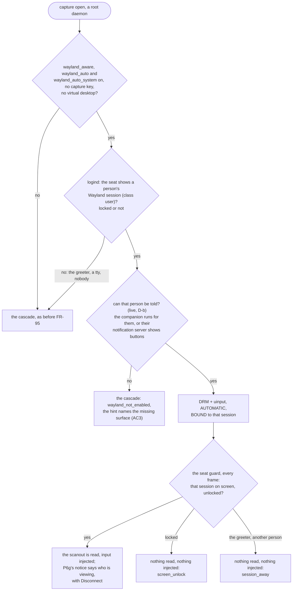

# FR-95: A system install shows a Wayland desktop by default, once the person at the screen can see it on every distro

**Issue:** [#2041](https://github.com/gjovanov/roomler-ai/issues/2041) · **Status:** P1 delivered by FR-93 P6d–P6g; P2 lab-verified 2026-10-15; **P2 verified on the released 0.4.141**
2026-10-17 (GNOME 50 and Plasma 6.7 system installs: AC1–AC4 and AC7 ticked; both kill switches pass); AC5 ticked
2026-10-18 on 0.4.143 (an X11 system install is unchanged; the gap that leaves is FR-113, #2458); AC6 amended by the
operator 2026-10-18 to the after count, since the "before" count was never snapshotted and cannot be recovered. ✅
**Closed 2026-10-18**, every criterion ticked; proposed 2026-10-12 · **Owner:** remote desktop (agent),
consent surfaces (FR-27) · **Split from:** [FR-93](FR-93-wayland-out-of-the-box.md) (its AC2, re-worded the same
day) · **Builds on:** [FR-36](FR-36-wayland-capture.md) (DRM + uinput), [FR-27](FR-27-consent-surfaces-and-desktop-companion.md)
(the companion and the prompt-surface chain), FR-93 P2b (the hello's desktop brief, to measure who this serves)

## 1. Goal

A **system** (root) install on a GNOME or KDE Wayland desktop shows the real desktop to an authorised controller
with **no capture key set**, the way a per-user install has since FR-93 P2a. It does that **only where the person
at the screen can see that they are being viewed, and can end it**.

Today it does neither by default. FR-93's decision D1 (`FR-93-wayland-out-of-the-box.md:558`) split the policy:

| install | on a Wayland desktop, no keys | why |
|---|---|---|
| per-user | mutter switches itself on (GNOME) | D1's per-user half, FR-93 P2a |
| **system** | `wayland_not_enabled`, naming `drm_capture` + `uinput` | D1's system half: **opt-in until a desktop companion ships for non-Debian hosts** |

## 2. Why the system half waits (the evidence)

The unattended arms that serve a root daemon, DRM below the compositor and uinput below the input stack, **ask
nobody**. FR-36 measured what that means and set the precondition (`FR-36-wayland-capture.md:308-313`). The
greeter capture contains the display manager's **password field**, and the locked capture contains the **unlock
dialog**. So the viewer indicator must be reachable on those surfaces before this leaves opt-in.

Where an indicator exists today, by install:

| host | "being viewed" banner + Disconnect | source |
|---|---|---|
| Debian family, x86_64, system | ✅ the companion (FR-27 P11) | the companion ships as **one x86_64 `.deb`** (`release-agent.yml:871`) |
| any non-Debian (Fedora, Arch, openSUSE), system | ❌ none | `install.sh` skips it: "no dpkg here, the desktop companion ships as a .deb only" (`scripts/install.sh:794`) |
| aarch64, any distro | ❌ none | no `.deb` for the arch (`scripts/install.sh:801`) |
| the greeter and the lock screen, anywhere | ❌ none | FR-93 D1b (`FR-93-wayland-out-of-the-box.md:559`), deferred |

A root daemon whose prompt has nowhere to show already says so: `no_prompt_surface`
(`agents/roomlerd/src/signaling.rs:234`, `companion.rs:224`). That is the hook this FR uses.

## 3. Key design

> **As built (P2).** The design below was the proposal. What P2 built differs in one place: the surface is
> FR-93 P6g's **being-viewed notice** (the companion's banner, else a notification with Disconnect), not FR-27's
> consent chain. A default-on capture is unattended, so what the person needs is to be **told and able to end
> it**, not asked. See §3.1.

1. **Default-on where the person can see it, not per distro.** The root branch of `capture::wayland_plan`
   (`agents/roomlerd/src/capture/mod.rs:793`, `root` ⇒ `AsConfigured`) gains a third answer. If FR-27's chain
   finds a surface for the session a controller would see, DRM + uinput switch themselves on, the way the keys
   would. If not, nothing changes. A Debian x86_64 host then goes default-on the day this ships, and every other
   host the day it gets a surface.
2. **A surface for the hosts that have none.** FR-93's decision D6 already said yes to a freedesktop
   **Notifications-with-actions** surface "as the fallback where no companion runs" (`FR-93-…md:564`, `:433`):
   a "being viewed by …" notification with a Disconnect action, raised in the user's session by the
   privilege-dropped helper pattern the portal already uses. The alternative is packaging the companion for
   non-Debian hosts (an RPM, a tarball companion) and aarch64. That is decision D-a.
3. **The greeter and the lock screen stay opt-in.** D1b stays deferred. A default-on system install captures a
   *user* session only: the session a controller would see must be of class `user` (P2b's brief already tells
   them apart), and a greeter or locked session keeps today's answer unless the keys are set.
4. **Measure the population first.** After 0.4.130, P2b's counts give, per org and fleet-wide, how many Linux
   hosts are Wayland and which arm serves each. The system installs among them answering `none` are the
   population this FR serves.

### 3.1 As built (P2)

| Piece | Where | What it does |
|---|---|---|
| `system_plan` | `agents/roomlerd/src/capture/mod.rs` | D1's system half as a pure function. Cheap checks first: a root daemon that may not go automatic never reads logind, and one with nobody on screen never starts the probe |
| `person_on_screen` | `agents/roomlerd/src/capture/mod.rs` | the seat's active session, when it is a person's (`class user`) Wayland session. Never the greeter |
| `notify::can_tell` | `agents/roomlerd/src/indicator/notify.rs` | D-b, live: the companion runs for that uid, or `portal-helper --notify-probe` in their session finds a notification server with the `actions` capability. `false` with P6g's notice off |
| `seat_guard` | `agents/roomlerd/src/capture/seat_guard.rs` | the seat's active session from logind's D-Bus (`PropertiesChanged`, plus a read every second), and the guard: `Open` only for the bound session, on screen, unlocked. ⚠️ Fail closed: a reading older than 5 s is `Away` |
| `DrmCapture::guarded` | `agents/roomlerd/src/capture/drm_backend.rs` | the automatic capture asks the worker for nothing while the guard is closed, so the greeter's and the lock screen's pixels never leave the card. The controller is told `screen_unlock` or `session_away` |
| the automatic uinput | `agents/roomlerd/src/input/mod.rs`, `uinput_backend.rs` | the injector while an automatic capture is alive (`seat_guard::live`), locked or not, injecting only while one views a person's unlocked session (`seat_guard::viewing`) and dropping every event otherwise. Swapped in by the arbiter when such a capture starts, never swapped out while one is alive: what would replace it is enigo, whose XTest reaches Xwayland windows behind a lock screen |

⚠️ **The surface is the being-viewed notice, not the consent chain.** The proposal above checked FR-27's
prompt chain. But a default-on capture asks nobody: what the person at the screen needs is to know, and to be
able to end it. That is FR-93 P6g's notice: the companion's banner where one runs, else a critical notification,
*This screen is being viewed*, with **Disconnect**. So the check is whether that notice can reach this person,
and `ROOMLERD_VIEWING_NOTICE=0` makes every host one with no surface.

⚠️ **Bound to a session, not a user.** A second login of the same person is a different session, told nothing,
so the guard compares logind's session id. A user switch to someone else therefore reads `session_away` until
the person who was told is back. Their own new viewer session re-plans, and tells them.

## 4. Phases

| Phase | What | Kill switch | Proven on | Size |
|---|---|---|---|---|
| **P0** | the population: system installs on Wayland with `capture_arm: none`, from P2b's counts after 0.4.130 | — | the server | S |
| **P1** | the surface where none exists (D-a): Notifications-with-actions, or the companion packaged for non-Debian and aarch64 | the surface's own switch | ✅ **delivered by FR-93** P6d–P6g (2026-10-15): the companion `.rpm` and aarch64 packages, the notification surface, the being-viewed notice. On aarch64 too: FR-93 AC12 on the released 0.4.139 (2026-10-16), with the aarch64 companion `.rpm` | M |
| **P2** | `system_plan`: default-on DRM + uinput where the person can be told, for their `user` session only, read only while it is on screen, unlocked (§3.1) | `wayland_auto_system` (FR-95, default on), and `wayland_auto` (FR-93) | the lab: GNOME and KDE system installs, red first on 0.4.137 (§8) | S |
| **P3** | docs: `docs/linux-capture.md` §1.2's table gains the system rows; `docs/desktop-companion.md`; the `docs/README.md` index row | — | — | S |

## 5. Acceptance criteria

- [x] **AC1**: a default **system** install on GNOME 50 Wayland, no keys, with a prompt surface: the viewer shows
  the real desktop, and the person at the screen sees the banner and can Disconnect. Red on the release before P2
  first (`wayland_not_enabled`).
  ✅ Red on 0.4.137 (§8); green on the released **0.4.141** (2026-10-17): the picture at +10 s (`lit=91.5 %`),
  and the companion's banner *Being viewed by vmtest admin · Disconnect* on the guest's screen (QMP).
- [x] **AC2**: the same on Plasma 6.7 (Fedora 44), whose surface is P1's.
  ✅ On the released 0.4.141: the picture (`lit=81.0 %`), and KDE's notification *This screen is being viewed* with
  **Disconnect** (QMP).
- [x] **AC3**: a system install with **no** surface: unchanged, `wayland_not_enabled`, and the hint names the missing
  surface rather than only the keys.
  ✅ On the released 0.4.141 with `ROOMLERD_VIEWING_NOTICE=0`: `wayland_not_enabled`, and the hint says *"…not
  captured by itself because nobody at the screen could be told they are being viewed: the session on screen has
  no desktop companion and no notification service. Install the desktop companion…"*.
- [x] **AC4**: the greeter and a locked session are never captured by default (`user` sessions only), shown with
  QMP on both lab desktops.
  ✅ On the released 0.4.141, both desktops: at a lock the guard read nothing (QMP: GNOME's blanked lock screen,
  KDE's lock screen), and the lifecycle harness passed lock, unlock, logout and login 4/4 on each. The
  greeter was never read. One mostly black transition frame reached the viewer just after GNOME's logout, before
  the guard flipped (§8).
- [x] **AC5**: either kill switch gives back the behaviour before this FR exactly, and X11 hosts are unchanged.
  ⏳ Both kill switches pass on the released 0.4.141 (`wayland_auto_system = false` on both desktops,
  `wayland_auto = false` on GNOME): 0.4.137's overlay, word for word. X11 is unchanged by construction (the plan
  needs a Wayland session on screen). An X11 host was run on the release on 2026-10-17 (FR-93 AC11: a vmtest
  Ubuntu cell, GNOME on Xorg, the scrap arm, an idle RTP session at 1.4 % of a core), but as a **per-user**
  install, which this FR does not change. Owed: a system install on an X11 host.
  ✅ **A system install on an X11 host, the released 0.4.143** (2026-10-18). The host was a vmtest Ubuntu 24.04
  cell with GDM on Xorg (`WaylandEnable=false`): `loginctl` showed seat0's session `type=x11`. The system daemon
  was re-enrolled on a default config, with no `drm_capture` and no `uinput`.
  - The plan did not engage. The desktop brief read `kind=x11 capture_arm=x11`, and nothing was switched.
  - The X11 arm then failed exactly as it did before this FR: `scrap enumeration failed … connection refused`,
    then `NoopCapture`, `no_display`, because a system unit has none of the session's variables
    (`linux-capture.md` §1).
  - X11 is unchanged. What "unchanged" means there is a gap of its own: a system install on an X11 desktop shows
    no picture by default. It is filed as #2450.
  - The same cell with the lane's own `drm_capture = true` captured the X11 session through DRM (84 of 84
    samples with a picture). Explicit keys are the operator's, and this FR leaves them alone.
- [x] **AC6** *(amended 2026-10-18, the operator: "do per your recommendation")*: ~~P0's counts recorded before and
  after the roll~~ → P0's count **after** the roll, from the server (not an exec sweep), with the reason the
  **before** count cannot exist.
  ✅ **After** (prod, 2026-10-17 19:03Z, §8): no customer device answers `none` on Wayland.
  **Before** was never snapshotted at the 0.4.139 roll, and it cannot be recovered after the fact:
  - the server stores only each device's **current** desktop brief (`capabilities.desktop.capture_arm`), never its
    history (`crates/api/src/routes/stats.rs` reads only that field);
  - prod has no Mongo backup job (the deploy repo has none) from which a pre-roll copy could be read.
  The devices still on releases older than 0.4.139 are what is left of "before", and none of them answers `none`
  either. Recorded as unrecoverable rather than pinned as debt, because a pin is not how an FR closes
  (`scripts/fr-ac-debt-baseline.txt`).
- [x] **AC7**: Docs: `docs/linux-capture.md` and `docs/desktop-companion.md` updated in the house style, and the
  `docs/README.md` index row.
  ✅ `linux-capture.md` §1.2.1 (the plan, its mermaid, the guard, the kill switches), `desktop-companion.md`
  (the four Linux packages, the being-viewed notification), and `docs/README.md`'s rows for both, on master.

## 6. Open decisions (operator)

| | decision | recommendation |
|---|---|---|
| **D-a** | the surface for hosts with none: Notifications-with-actions, or the companion packaged for non-Debian and aarch64 | ✅ **Decided: both** (operator, 2026-10-15: *"AC10. non-debian companion package. D5 and D6 per recommendation"*). FR-93 shipped them: the companion as an `.rpm` and on aarch64 (P6d, P6e), the notification as the last consent surface (P6f), and the being-viewed notice (P6g). So P1 is FR-93's, and done |
| **D-b** | is a working surface enough, or does default-on also need the surface proven reachable for that session at open time (a live check, not an installed one)? | ✅ **The live check**, at every capture open (`notify::can_tell`): the companion running for that person, or a notification server with buttons in their session. An installed companion that is not running does not count on its own |
| **D-c** | D1b, the greeter and the lock screen | stays deferred; this FR never captures them by default. The guard reads nothing while either is on screen (§3.1) |

## 7. Out of scope

- Per-user installs: FR-93 P2 covers them.
- The portal going automatic: FR-93 P2d.
- The greeter and the lock screen by default: D1b / D-c.

## 8. Field-verification log

| date | build | host | result |
|---|---|---|---|
| 2026-10-15 | **0.4.137, the release** (its `.deb`'s sha256 checked against the release) | `wlab-gnome-sys` (GNOME 50, system install, no capture key) | 🔴 **red, as expected**: the viewer's overlay *"This device cannot capture its screen. This computer is showing a Wayland desktop, and capturing it is switched off on this device…"* (`wayland_not_enabled`) at +4 s, `lit=0.0 %` throughout; the journal's `code="wayland_not_enabled"` and `reach="none"` |
| 2026-10-15 | 0.4.137, the release | `wlab-kde-sys` (Plasma 6.7 on Fedora 44, system install, no capture key) | 🔴 **red, as expected**: the same overlay at +4 s, `lit=0.0 %`, `wayland_not_enabled`, `reach="none"` |
| 2026-10-15 | candidate `f70823ebd` | `wlab-gnome-sys`, the companion installed | 🟢 **AC1**: the picture at +4 s (`lit=91.4 %`), the pill *DRM scanout · asks nobody*; the journal's `capture: backend=drm, switched on by itself for the person's session on screen…`; the guest's screen shows the companion's banner *Being viewed by vmtest admin · keyboard + mouse* with **Disconnect** |
| 2026-10-15 | `f70823ebd` | `wlab-gnome-sys`, a long session | 🟢 **AC4, the lock** (`loginctl lock-sessions` at 21:32:23.267): the guard saw `locked=true` 55 ms later and read nothing from then on; the viewer got the unlock notice. After the typed unlock: `locked=false` at 21:33:12.390, frames again 150 ms later. ⚠️ The overlay was the per-user sentence (*"GNOME shares no locked screen with this per-user install"*), so the guard now has its own waits and words (`0d90bc897`). ⚠️ The session then closed at 21:33:23: not FR-95, a promote rolled the server (the agent's control socket reset, then `502 Bad Gateway`) |
| 2026-10-15 | `f70823ebd` | `wlab-gnome-sys`, the companion moved aside | 🟢 **D-b's live check, the notification half**: `portal-helper --notify-probe` found GNOME's notification server, the picture at +4 s (`lit=89.8 %`), and the guest's screen shows *This screen is being viewed — vmtest admin is viewing this screen and can use its keyboard and mouse. Disconnect ends the session.* with **Disconnect** |
| 2026-10-15 | `f70823ebd` | `wlab-gnome-sys` | 🟢 **AC5**: `wayland_auto_system = false` gives 0.4.137's answer exactly: the same overlay, `lit=0.0 %`, `wayland_not_enabled`, `reach="none"` |
| 2026-10-15 | candidate `0d90bc897` | `wlab-kde-sys`, no companion | 🟢 **AC2**: the picture at +4 s (`lit=81.1 %`), and the guest's screen shows KDE's notification *This screen is being viewed — vmtest admin is viewing this screen and can use its keyboard and mouse. Disconnect ends the session.* with **Disconnect** |
| 2026-10-15 | `0d90bc897` | `wlab-kde-sys`, the lifecycle harness: lock, unlock, logout, login | 🟢 **AC4, verdict PASS 4/4.** Lock (Super+L): no new picture, and the system install's sentence at +3.7 s; the journal's guard `locked=true` 1.8 s after the key, nothing read from then on. Unlock: a new picture +0.6 s. Logout (`terminate-session`): no new picture, *"…showing the login screen or another person's session"* at +3.5 s; the guard saw nobody, then the greeter `c1`, and read nothing. Login (a NEW session, `39`): still no picture, by design (§3.1: bound to a session, not a user) |
| 2026-10-15 | `0d90bc897` | `wlab-kde-sys`, rebooted: lock, a viewer move, unlock, a viewer move | 🟢 the picture, PASS 4/4, but 🔴 **a real gap in the input**: the viewer's move during the lock (21:55:03) opened the injector while no automatic capture VIEWED, so `open_default` fell through to enigo, whose XTest reaches Xwayland windows behind a lock screen. The arbiter swapped the automatic uinput in after the unlock (21:55:49). Fixed in `8718f5258`: the automatic uinput is chosen while an automatic capture is ALIVE, and injects only while one views |
| 2026-10-15 | candidate `8718f5258` | `wlab-kde-sys`, rebooted: the same plan | 🟢 **the fix, PASS 4/4.** The viewer's move during the lock (22:04:03.898) opened the automatic uinput, which said *dropping input while the person's session is not on screen, unlocked*; the unlock at 22:04:28.892, the picture +0.8 s; the move after it, *injecting again, the person's session is on screen* (22:04:49.019) |
| 2026-10-16 | candidate `83af5cce2` (master + FR-93 P4c, built natively on the host) | **real hardware**: FR-93 AC12's Apple M2 Pro Mac mini (Fedora Asahi Remix 42), a system install by the served `install.sh --system`, no capture key, Plasma 6.6 then GNOME 48 | 🟢 **KDE**: *"switched on by itself for the person's session on screen"*, a picture at +4 s; the lifecycle harness PASS 4/4 (lock: the system install's sentence +3.5 s and nothing read; unlock +0.7 s; logout +5.5 s; login withheld, by design). 🟢 **GNOME**: a picture at +4 s, the input oracle 8/8 through the automatic uinput, the cursor in the stream, and the same lifecycle PASS 4/4 |
| 2026-10-16 | **0.4.139, the release** (the service's binary checked: `/usr/bin/roomlerd`) | real hardware (FR-93 AC12's box), the served `install.sh --system`, no capture key, Plasma 6.6 then GNOME 48 | 🟢 **KDE**: *switched on by itself*; the input oracle 8/8, twice, through the automatic uinput; the cursor in the DRM stream; the lifecycle harness 4/4 (locked and away named, nothing read). 🟢 **GNOME**: the same: 8/8, the cursor, 4/4. ⚠️ The first runs measured a lab build that a leftover unit drop-in still started; they were re-run on the release. ⚠️ GNOME's post-login overview took one oracle's input (the lab, not the product: reproduced on purpose, and libinput's trace showed every event delivered). **Still owed for the ticks:** the lab's GNOME 50 and Plasma 6.7 guests on the release |
| 2026-10-17 | **0.4.141, the release**: the guest self-updated (`roomlerd self-update`, the service's running binary checked), and its companion updated to the release's `roomler-desktop` 0.4.141 `.deb` (sha256 checked) | `wlab-gnome-sys` (GNOME 50, Ubuntu 26.04, system install, no capture key) | 🟢 **AC1**: the picture at +10 s (`lit=91.5 %`), the pill *DRM scanout · asks nobody*; `capture: backend=drm, switched on by itself for the person's session on screen…` and `being viewed: the companion's banner says so`; QMP shows the banner *Being viewed by vmtest admin · keyboard + mouse* with **Disconnect** (and the 0.4.141 companion's first-run tour). 🟢 **AC3** (`ROOMLERD_VIEWING_NOTICE=0` in a unit drop-in, removed after): `wayland_not_enabled`, and the overlay names the missing surface (AC3's quote). 🟢 **AC4**: `loginctl lock-sessions` → the guard `locked=true`, nothing read, the viewer told *Waiting for this computer's screen to be unlocked*; QMP: the display blanked. The lifecycle harness, lock / unlock / logout / login: **PASS 4/4**; after the logout the guard read nothing from +1.4 s (`guard=Away`), the viewer told *This computer is showing another session* at +4.0 s. ⚠️ One frame reached the viewer at +1.85 s, before the guard's flip: mostly black, a few dim cells top-left (a console's text), not the greeter. 🟢 **AC5**: `wayland_auto_system = false` and, separately, `wayland_auto = false` each give 0.4.137's overlay word for word, `lit=0.0 %`, `reach="none"` |
| 2026-10-17 | 0.4.141, the release (`roomlerd self-update` installed the tarball's binary; the running daemon kept the old one until a restart, as a self-update run from the CLI does) | `wlab-kde-sys` (Plasma 6.7, Fedora 44, system install, no capture key, no companion) | 🟢 **AC2**: the picture at +10 s (`lit=81.0 %`), *DRM scanout · asks nobody*; `being viewed: a notification says so, with Disconnect`; QMP shows KDE's popup *This screen is being viewed — vmtest admin is viewing this screen and can use its keyboard and mouse. Disconnect ends the session.* with **Disconnect**. 🟢 **AC4**: the lock → `locked=true`, nothing read (QMP: KDE's lock screen); the lifecycle harness, lock / unlock / KDE's own logout / login: **PASS 4/4**, the logout named *showing another session* at +5.9 s with nothing new read. 🟢 **AC5**: `wayland_auto_system = false` → 0.4.137's overlay. ⚠️ The lab's `p2d3` spec first failed *"never reported online"*: it read one page of the device listing (25 rows of 41); 22 lab spec copies now ask for 100 |
| 2026-10-17 19:03Z | — | the fleet: prod's `agents`, each device's stored desktop brief (`capabilities.desktop`) | **AC6, after the roll.** Customer orgs: Wayland **4** (DRM 3: two on 0.4.135 with the keys set by hand, one on 0.4.141 switched on by itself; mutter 1, on 0.4.132), no desktop 8 (headless), **none answering `none`**. The lab org: DRM 2, mutter 4, portal 1, and 1 answering `none` (`wlab-gnome-sys` mid-AC3, its notice switched off on purpose). 54 devices send no brief (Windows, macOS, older agents). ⚠️ The "before" count was not taken at the 0.4.139 roll. What is left of it is the devices still on older versions, and none of them answers `none`. As far as the server can see, this FR shipped ahead of its users: the population it serves was the lab |
