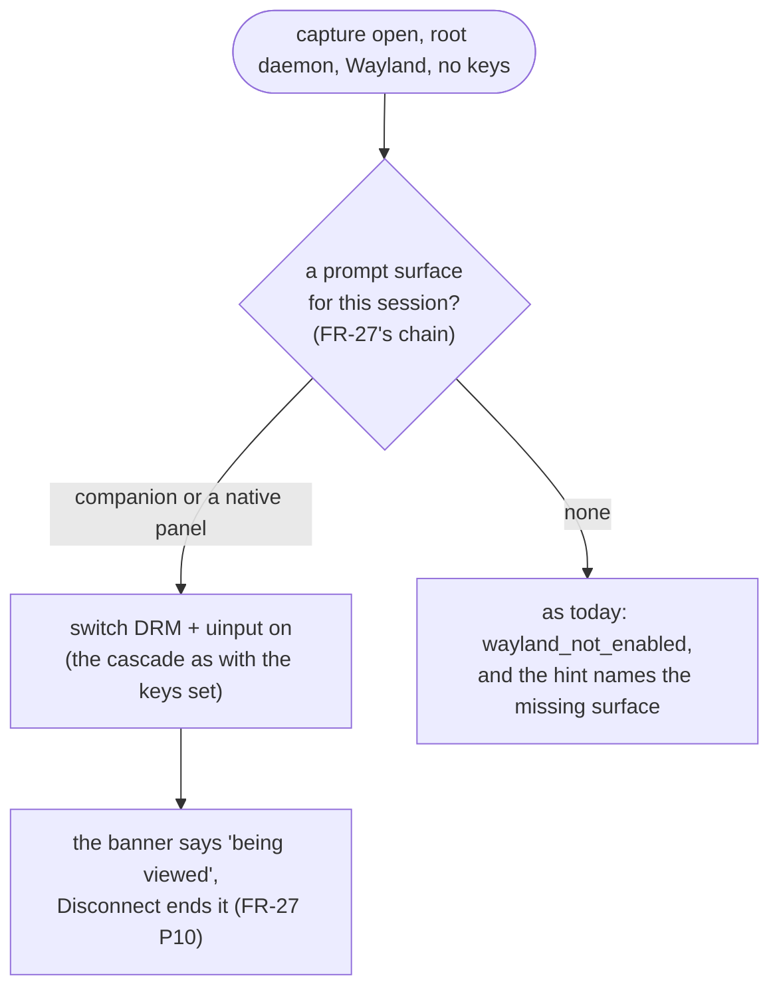

# FR-95: A system install shows a Wayland desktop by default, once the person at the screen can see it on every distro

**Issue:** [#2041](https://github.com/gjovanov/roomler-ai/issues/2041) · **Status:** proposed 2026-10-12, spec and claim · **Owner:** remote desktop (agent),
consent surfaces (FR-27) · **Split from:** [FR-93](FR-93-wayland-out-of-the-box.md) (its AC2, re-worded the same
day) · **Builds on:** [FR-36](FR-36-wayland-capture.md) (DRM + uinput), [FR-27](FR-27-consent-surfaces-and-desktop-companion.md)
(the companion and the prompt-surface chain), FR-93 P2b (the hello's desktop brief, to measure who this serves)

## 1. Goal

A **system** (root) install on a GNOME or KDE Wayland desktop shows the real desktop to an authorised controller
with **no capture key set**, the way a per-user install has since FR-93 P2a. It does that **only where the person
at the screen can see that they are being viewed, and can end it**.

Today it does neither by default. FR-93's decision D1 (`FR-93-wayland-out-of-the-box.md:558`) split the policy:

| install | on a Wayland desktop, no keys | why |
|---|---|---|
| per-user | mutter switches itself on (GNOME) | D1's per-user half, FR-93 P2a |
| **system** | `wayland_not_enabled`, naming `drm_capture` + `uinput` | D1's system half: **opt-in until a desktop companion ships for non-Debian hosts** |

## 2. Why the system half waits (the evidence)

The unattended arms that serve a root daemon, DRM below the compositor and uinput below the input stack, **ask
nobody**. FR-36 measured what that means and set the precondition (`FR-36-wayland-capture.md:308-313`). The
greeter capture contains the display manager's **password field**, and the locked capture contains the **unlock
dialog**. So the viewer indicator must be reachable on those surfaces before this leaves opt-in.

Where an indicator exists today, by install:

| host | "being viewed" banner + Disconnect | source |
|---|---|---|
| Debian family, x86_64, system | ✅ the companion (FR-27 P11) | the companion ships as **one x86_64 `.deb`** (`release-agent.yml:830`) |
| any non-Debian (Fedora, Arch, openSUSE), system | ❌ none | `install.sh` skips it: "no dpkg here, the desktop companion ships as a .deb only" (`scripts/install.sh:621`) |
| aarch64, any distro | ❌ none | no `.deb` for the arch (`scripts/install.sh:628`) |
| the greeter and the lock screen, anywhere | ❌ none | FR-93 D1b (`FR-93-wayland-out-of-the-box.md:559`), deferred |

A root daemon whose prompt has nowhere to show already says so: `no_prompt_surface`
(`agents/roomlerd/src/signaling.rs:234`, `companion.rs:174`). That is the hook this FR uses.

## 3. Key design

1. **Default-on where the person can see it, not per distro.** The root branch of `capture::wayland_plan`
   (`agents/roomlerd/src/capture/mod.rs:692`, `root` ⇒ `AsConfigured`) gains a third answer. If FR-27's chain
   finds a surface for the session a controller would see, DRM + uinput switch themselves on, the way the keys
   would. If not, nothing changes. A Debian x86_64 host then goes default-on the day this ships, and every other
   host the day it gets a surface.
2. **A surface for the hosts that have none.** FR-93's decision D6 already said yes to a freedesktop
   **Notifications-with-actions** surface "as the fallback where no companion runs" (`FR-93-…md:564`, `:433`):
   a "being viewed by …" notification with a Disconnect action, raised in the user's session by the
   privilege-dropped helper pattern the portal already uses. The alternative is packaging the companion for
   non-Debian hosts (an RPM, a tarball companion) and aarch64. That is decision D-a.
3. **The greeter and the lock screen stay opt-in.** D1b stays deferred. A default-on system install captures a
   *user* session only: the session a controller would see must be of class `user` (P2b's brief already tells
   them apart), and a greeter or locked session keeps today's answer unless the keys are set.
4. **Measure the population first.** After 0.4.130, P2b's counts give, per org and fleet-wide, how many Linux
   hosts are Wayland and which arm serves each. The system installs among them answering `none` are the
   population this FR serves.

## 4. Phases

| Phase | What | Kill switch | Proven on | Size |
|---|---|---|---|---|
| **P0** | the population: system installs on Wayland with `capture_arm: none`, from P2b's counts after 0.4.130 | — | the server | S |
| **P1** | the surface where none exists (D-a): Notifications-with-actions, or the companion packaged for non-Debian and aarch64 | the surface's own switch | FR-93's lab (Fedora KDE, Ubuntu GNOME), then aarch64 | M |
| **P2** | `wayland_plan`'s third answer: default-on DRM + uinput where a surface exists, for a `user` session only | `wayland_auto` (FR-93), plus a system-specific `wayland_auto_system` | the lab: GNOME and KDE system installs, red first on the release before | S |
| **P3** | docs: `docs/linux-capture.md` §1.2's table gains the system rows; `docs/desktop-companion.md`; the `docs/README.md` index row | — | — | S |

## 5. Acceptance criteria

- [ ] **AC1**: a default **system** install on GNOME 50 Wayland, no keys, with a prompt surface: the viewer shows
  the real desktop, and the person at the screen sees the banner and can Disconnect. Red on the release before P2
  first (`wayland_not_enabled`).
- [ ] **AC2**: the same on Plasma 6.7 (Fedora 44), whose surface is P1's.
- [ ] **AC3**: a system install with **no** surface: unchanged, `wayland_not_enabled`, and the hint names the missing
  surface rather than only the keys.
- [ ] **AC4**: the greeter and a locked session are never captured by default (`user` sessions only), shown with
  QMP on both lab desktops.
- [ ] **AC5**: either kill switch gives back the behaviour before this FR exactly, and X11 hosts are unchanged.
- [ ] **AC6**: P0's counts recorded before and after the roll (the server, not an exec sweep).
- [ ] **AC7**: Docs: `docs/linux-capture.md` and `docs/desktop-companion.md` updated in the house style, and the
  `docs/README.md` index row.

## 6. Open decisions (operator)

| | decision | recommendation |
|---|---|---|
| **D-a** | the surface for hosts with none: Notifications-with-actions, or the companion packaged for non-Debian and aarch64 | Notifications first (FR-93 D6 already chose it as the fallback); packaging later if the counts warrant it |
| **D-b** | is a working surface enough, or does default-on also need the surface proven reachable for that session at open time (a live check, not an installed one)? | the live check: an installed companion that cannot reach the root daemon is no surface (as #1911 was, until its fix) |
| **D-c** | D1b, the greeter and the lock screen | stays deferred; this FR never captures them by default |

## 7. Out of scope

- Per-user installs: FR-93 P2 covers them.
- The portal going automatic: FR-93 P2d.
- The greeter and the lock screen by default: D1b / D-c.

## 8. Field-verification log

| date | build | host | result |
|---|---|---|---|
| | | | |
