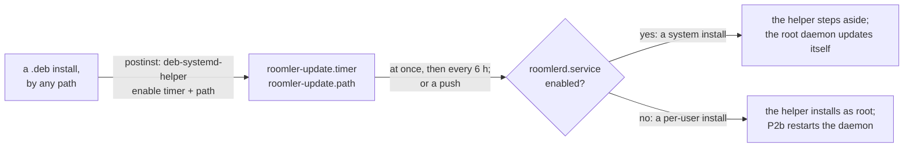

# FR-96: Per-user Linux installs update themselves — a root update half beside the daemon, as macOS has

**Issue:** [#2052](https://github.com/gjovanov/roomler-ai/issues/2052) · **Status:** **CLOSED 2026-10-15** — P1 shipped in
0.4.133; P2a (#2132), P2b (#2184) and P3 + P4 (#2225) in 0.4.137, with P3's `install.sh` served since the promote of
`hosted-20261015-3df732f`; P5 (#2249) in 0.4.138. All ten acceptance criteria are field-verified on the lab's guests,
the last ones on 0.4.138's own `.deb` (§8). D3, a devices-page note for hosts that were stuck before this, stays open
as the server's half (spec and claim 2026-10-12, #2046, on the operator's
"do per recommendation") · **Owner:** the agent updater and the Linux installers ·
**Builds on:** [FR-5](FR-5-macos-unattended-update-chain.md) (the macOS update half this mirrors),
[FR-67](FR-67-update-outcome-observability.md) (what an install reports) · **Fixes:** #2046

## 1. Goal

A **per-user** Linux install takes every release by itself, the way a system install and a Mac already do. That
is `install.sh`'s default, with no `--system`. The update needs no password prompt, and no person at the machine.

- Every distro: Debian and Ubuntu (the `.deb`), and Fedora, Arch, openSUSE (the universal tarball).
- **One owner** of check → download → verify → install: a root, single-shot helper. The per-user daemon only
  wakes it, as the macOS agent wakes `com.roomler.update`.
- The per-user daemon ends up running the new binary, and is not restarted under a session someone is using.
- An operator can opt out, with the same marker as on macOS.

## 2. Evidence

The released **0.4.130**, on the FR-93 lab's four Linux guests, 2026-10-12:

| Guest | Install | Package | The guest's own updater |
|---|---|---|---|
| GNOME 50 | per-user | `.deb` | `SucceededVerified`, through `sudo -n` (the lab user has passwordless sudo) |
| GNOME 50 | system | `.deb` | `SucceededVerified` |
| Plasma 6.7 (Fedora 44) | system | tarball | `SucceededVerified` |
| **Plasma 6.7 (Fedora 44)** | **per-user** | **tarball** | 🔴 *"the tarball install needs root (euid 1000); run the agent as a system service, or install … manually"* |

The code agrees, line by line (master `b82001355`):

- **The tarball has no way up.** `install_tarball_linux` refuses any `euid != 0`
  (`agents/roomlerd/src/updater.rs:1826-1835`), and has since the tarball path landed (#462, 2026-08-15).
- **The `.deb` ladder asks a person.** A non-root daemon tries `pkexec apt-get install`, then `sudo -n`
  (`updater.rs:1761-1775`). On a desktop with a polkit agent that is a password prompt in front of whoever is
  at the screen, every 4 h. Without one, it is `sudo -n`, which works only where sudo needs no password.
- **The installer already admits it.** `install.sh:371` prints *"a per-user daemon cannot install its own
  updates (writing /usr needs root, whichever format). Re-run with --system for unattended self-update."*
  `README.Debian:19,46-48` says the same.
- **The docs promise otherwise:**
  - `docs/linux-self-update.md:88-89` promises the tarball *"the same privilege ladder (root direct; otherwise
    `sudo -n`, then `pkexec`)"*, and `:197` says *"the tarball makes self-update work everywhere"*.
  - `docs/installation.md:497` says the updater *"hands off to MSI / `dpkg` / `installer` and restarts"*.
- **Nothing restarts a per-user daemon onto a replaced binary.** There is no restart-on-replace anywhere
  (`strip_deleted_suffix`, `updater.rs:2208-2216`, only fixes up a path for the watcher). So even an admin's
  `apt upgrade` leaves the per-user daemon on the old, unlinked image until something restarts it.

**Who this serves.** Not yet measured, and partly unmeasurable from the server: FR-93 P2b's hello reports
`desktop.session = "user"` for a per-user daemon, but only from 0.4.130, and a frozen tarball host never reaches
0.4.130. P0 counts Linux devices by version, from the server's own rows.

## 3. Key design

### 3.1 The update half: `roomlerd update-helper` on Linux

```mermaid
sequenceDiagram
    autonumber
    participant D as per-user roomlerd (the user)
    participant W as /var/tmp/roomler-update-check
    participant U as roomler-update.service (root, one-shot)
    participant R as the release feed
    D->>W: touch (on rc:agent.update) — a WAKE, content never read
    Note over U: also woken by roomler-update.timer (boot + every 6 h)
    W-->>U: roomler-update.path fires
    U->>R: check_once: the latest agent-v*
    U->>U: download_asset: size floor, digest, PGP (the pinned key)
    U->>U: install as root: dpkg / apt-get, or the tarball
    U->>D: RestartDaemon, over /run/user/<uid>/roomler.sock (deferred while busy, D1)
    Note over D: exits 9; systemd --user relaunches the new binary
```

| piece | reused or new | where |
|---|---|---|
| the release check, with no config (the feed is `ROOMLERD_UPDATE_URL`, else the proxy) | reused | `check_once`, `updater.rs:1531-1572`; `DEFAULT_PROXY_URL` `:37` |
| download and verify: size floor, digest, the pinned release key | reused | `download_asset` `:1269-1432`, PGP `:1358-1393` |
| the install-storm cooldown (root's own marker) | reused | `recent_update_attempt` / `record_update_attempt` `:424-457`, `STARTUP_UPDATE_COOLDOWN` `:71` |
| the install, as root | reused | `linux_install_candidates(0, …)` `:2009-2023`; `install_tarball_linux(0, …)` `:2075-2198` |
| the opt-out, `/etc/roomler/disable-auto-update` | reused | the helper's `OPT_OUT` `:3527-3534` (shared by macOS and Linux) |
| the wake file: content ignored, never followed through a symlink | generalised | `MACOS_UPDATE_TRIGGER` `:3028`, `LINUX_UPDATE_TRIGGER` `:3033`, `queue_update_check` / `queue_update_check_at` `:3248-3267` (was `macos_queue_update_check`) |
| `roomlerd update-helper` on Linux | new (P1) | the `Command::UpdateHelper` arm, macOS and Linux (`main.rs:1634-1649`) |
| `roomler-update.{service,timer,path}` | new (P1) | shipped in the `.deb` (`agents/roomlerd/Cargo.toml` assets `:848-887`) and the tarball (`scripts/stage-linux-tarball.sh:55-58`, `TARBALL_INSTALL_IF_ABSENT` `updater.rs:2052-2062`) |
| the download's private staging dir (mkdtemp, 0755, `O_EXCL` write) — the security review's finding 1 | new | `stage_dir` / `write_installer` / `discard_staging` (`updater.rs`) |
| the run-spacing gate — launchd's `ThrottleInterval` twin, the security review's finding 2 | new | `UPDATE_HELPER_MIN_GAP` / `helper_gate_wait` / `stamp_helper_gate` (`updater.rs`) |
| consuming the wake: a symlink unlinked NOT followed, a planted directory moved aside into a fresh root-owned dir | new | `consume_wake` (`updater.rs`) |

The three units are the systemd twins of the macOS plist's wake sources
(`agents/roomlerd/packaging/macos/com.roomler.update.plist`):

| macOS (`com.roomler.update`) | Linux |
|---|---|
| `RunAtLoad` | `roomler-update.timer`: `OnBootSec=5min`. A timer started after boot fires at once, because an `OnBootSec` already in the past elapses immediately (§8, 2026-10-15) |
| `StartInterval` 21600 | `roomler-update.timer`: `OnUnitActiveSec=6h`, `RandomizedDelaySec=30min` |
| `WatchPaths` `/private/var/tmp/roomler-update-check` | `roomler-update.path`: `PathExists=/var/tmp/roomler-update-check` |
| the program | `roomler-update.service`: `Type=oneshot`, `ExecStart=/usr/bin/roomlerd update-helper` |

⚠️ **One owner per host.** A system install's root daemon keeps updating itself in-process, so two updaters must
never race. `install.sh` enables the timer and the path for a **per-user** install only (P3). From P5 the `.deb`
enables them on every install, and the helper steps aside on a system install by itself (§3.6). So the rule no
longer depends on how the package arrived.

### 3.2 The per-user daemon wakes the helper instead of installing (P2a, as built)

`run_periodic` forks once, at the daemon's start (`updater.rs:2792-2837`). macOS takes `forward_triggers` (the
shared successor of `macos_forward_triggers`, `:3279-3361`) as before. Linux asks a pure
`decide_update_owner(euid, kill switch, enable link)` (`:3220-3238`):

| daemon | `ROOMLERD_UPDATE_HELPER` | helper enabled | owner |
|---|---|---|---|
| root | any | no | in-process |
| root | any | yes | in-process, and a WARN: two updaters race on the package manager (AC4: a system install is unchanged) |
| per-user | `0` | any | in-process — the kill switch, today's path exactly |
| per-user | unset / on | no | in-process |
| per-user | unset / on | **yes** | **the helper**: forward each push to the wake file, install nothing, run no periodic check |

- **"Enabled"** is the `.wants` link `systemctl enable` (or `enable --runtime`) leaves for either unit, under
  `/etc` or `/run` (`UPDATE_HELPER_ENABLE_LINKS`, `:3052-3057`), FOLLOWED: a link left dangling by a removed
  package is not an enabled helper. A file check, not `systemctl is-enabled` — no bus, no child, and it reads the
  same inside the per-user unit's sandbox.
- ⚠️ **On doubt, in-process.** A wrong "helper" answer freezes the host (it forwards wakes nobody hears — #2046
  again); a wrong "in-process" answer costs a failed `pkexec`, and the helper's own timer still runs if it exists.
- As on macOS, a pinned version does not cross the boundary; the helper installs the latest.
- ⚠️ **The per-user unit's sandbox had to be opened for one file.** `roomler.service` runs under
  `ProtectSystem=strict`, which leaves `/var/tmp` read-only wherever the user manager applies the sandbox —
  **measured** on the lab's Fedora 44 KDE guest (§8): `touch /var/tmp/…` in the daemon's own mount namespace
  answered `Read-only file system`, while its runtime dir answered writable. Every push there would have failed
  `EROFS`. P2a adds `ReadWritePaths=-/var/tmp` (only the directory can be granted: a `ReadWritePaths` entry binds
  what exists when the sandbox is built, and the helper deletes the wake file each run). A daemon whose unit
  predates P2a logs the failure and names the cure; the push then waits for the helper's 6 h timer. CI guards
  the grant in both sandbox cells. The system-unit cell (`ci.yml:804-829`) has the sandboxed unit write
  `/var/tmp`, and a negative control (the same sandbox without the grant) must come back read-only. The
  user-manager cell (Fedora's configuration, `ci.yml:883-887`) requires a read-write `/var/tmp` mount in the
  daemon's namespace. Both directions were measured on systemd 255 before landing (§8).
- **Decided at the start.** Enabling or disabling the helper takes effect at the daemon's next start — `install.sh`
  (P3) must refresh `roomler.service`, then `systemctl --user daemon-reload` and restart the per-user daemon after
  enabling the units (the user manager keeps a changed unit's old sandbox until it reloads; the updater's own
  tarball install writes units only where absent, `TARBALL_INSTALL_IF_ABSENT`, while `install.sh`'s plain
  `tar -xzf` overwrites them).
- **`auto_update = false`** in the per-user config switches the updater off entirely, forwarding included — a push
  is dropped, as before. The helper's own timer still installs: on a helper host the opt-out is
  `/etc/roomler/disable-auto-update`, as on macOS.

A host without the helper (an install from before this FR) keeps today's path unchanged.

### 3.3 Onto the new binary (P2b, as built)

The per-user daemon notices for itself (D2): `agents/roomlerd/src/replaced_binary.rs`, spawned beside the updater
(`main.rs:4569-4570`) on a Linux, non-root daemon whose kill switch is unset and whose supervisor will relaunch it
(`spawn`, `replaced_binary.rs:241-265`). ONE mechanism serves the helper's install, an admin's `apt upgrade` and a
hand install alike, and the helper never speaks to a daemon.

| step | what | where |
|---|---|---|
| baseline | at start, the exec path (`argv[0]` when absolute: systemd passes `ExecStart=`'s) and `/proc/self/exe` must be ONE file by `(st_dev, st_ino)`, or the watch stands down — this filesystem cannot tell a replacement | `baseline`, `replaced_binary.rs:270-287` |
| replaced | every minute, the path's identity against the running image's. Not a ` (deleted)` check: the tarball's install renames the old binary to `.prev`, which `/proc/self/exe` then names | `watch` `:342-503`, `CHECK_EVERY` `:41` |
| settled | the same new identity for 2 min: an install places the binary before its libraries and units | `SETTLE` `:45` |
| answers | the new binary's `--version` must be `roomlerd <another version>`. One that cannot load (a missing shared library) is never restarted onto, so the daemon stays online on the old image; the same version is not worth cutting anything for | `verdict_from` `:196-211` |
| idle (D1) | no remote-control session, no SSH connection, no transfer or recording — work a restart CUTS, cut after the 24 h ceiling. A network transition in the last 10 min, or an install of the daemon's own in flight — states a restart could WEDGE, never forced. Agent turns are waited for as an install waits for them | `Busy` `:82-107`, `decide` `:164-190`, `CEILING` `:48` |
| restart | FR-84 D3's door: a supervisor that relaunches, the persisted record that makes a loop impossible, systemd's own read-back of the unit's policy. These are "Apply now"'s gates, minus the owner's switch for LOCAL CLIENTS' requests: nobody is asking. A refusal is retried after 10 min | `RestartHandle::arm_from_within`, `localapi_state.rs:326-385`; `RETRY_AFTER`, `replaced_binary.rs:52` |

- ⚠️ **An SSH session counts as a session.** The likeliest replacement outside the helper is an admin's
  `apt upgrade` typed into a roomler SSH session on that very device. `ssh.rs` now counts its open connections
  (`live_connections`, `ssh.rs:2539-2545`), and the restart waits for them.
- **`auto_update = false` does not stop it.** Running what is already installed is not an update. The kill switch
  is the FR's, `ROOMLERD_UPDATE_HELPER=0` (AC7).
- **Root daemons are unchanged** (AC4). An admin's `apt upgrade` on a system install still leaves the root daemon
  on its old image until something restarts it, because the postinst never restarts anything. Taking D2 to root
  daemons is a separate decision, not made here.
- **Why not the helper asking each daemon** (this section's first sketch, over `Request::RestartDaemon` on
  `/run/user/<uid>/roomler.sock`): root would connect to a socket a user owns and have to distrust every answer,
  and it would miss every replacement the helper did not make.

### 3.4 What it must never do

- **Read the wake file's content.** A local user who could pin a version could make root install a genuine but
  old release, the downgrade class `artifact_version` closed on Windows. The macOS rule carries over as-is.
- **Install for a system install.** That host has one owner already. From P5 the helper checks for itself, after
  its gate: with `roomlerd.service` enabled it steps aside (§3.6).
- **Restart a daemon mid-session** before D1's 24 h ceiling (P2b's `decide`, `replaced_binary.rs:164-190`), nor
  ever beside a network transition.
- **Run as non-root.** It refuses, as macOS's helper does (`updater.rs:3429-3436`).
- **Stage a download at a fixed or shared name** (security review, finding 1). `/tmp` is sticky but a
  *subdirectory* of it is not, so the old fixed `/tmp/roomlerd-update/<asset>` let any local user own the
  directory, wait for root's verified `.deb` to land, and `rename` an attacker package over it in the window
  before `apt-get install <path>` / `tar -xzf <path>` re-read the path — root then installs it (dpkg maintainer
  scripts run as root). Each download now goes to a FRESH private directory (mkdtemp, 0755, owned by the caller;
  `O_EXCL` write), which a non-owner cannot create, rename or unlink inside. The verified bytes are the installed
  bytes. macOS (per-user `_CS_DARWIN_USER_TEMP_DIR`) and Windows (SYSTEM `GetTempPath2`) keep the shared dir;
  Windows 10's `C:\Windows\Temp` has the same shape and is a separate follow-up.
- **Let a wake storm or a planted entry FAIL the units** (security review, finding 2). `PathExists=` is
  level-triggered and the service had systemd's default start limit (5/10 s), so a local user could permanently
  fail `roomler-update.path` with a touch burst or one `mkdir` at the wake path — a pushed update then silently
  degrades to the 6 h timer. The helper now spaces its own runs ≥60 s (`UPDATE_HELPER_MIN_GAP`, launchd's
  `ThrottleInterval` twin), consumes a planted entry (a symlink unlinked unfollowed, a directory moved aside),
  and the unit carries `StartLimitIntervalSec=0` + `Restart=on-failure`/`RestartSec=60s` so neither a burst nor an
  exec-failing helper can fail the path unit. Never `PrivateTmp=` — it would hide `/var/tmp` and the wake could
  never be consumed.

### 3.5 The installers (P3, as built)

`install.sh` turns the helper on for a per-user install and off for `--system` (`scripts/install.sh:291-367`, called
at `:452` and `:461-469`):

| install | the helper | the daemon |
|---|---|---|
| per-user; the release's daemon lists `step-aside` | enabled (`roomler-update.timer` + `.path`), BEFORE the daemon starts, because it decides at start who installs | a fresh install starts it; a re-run restarts it only when nothing else will (below) |
| per-user; a release without `step-aside` | left off, with a NOTE: beside a daemon that still installs its own updates, two updaters would race | as before FR-96 |
| `--system` | turned off, if a per-user install left it on | the root daemon installs its own updates |

- **The gate is the binary's own word, not a version.** `roomlerd update-helper --capabilities` prints `wake-file`,
  `step-aside`, `restart-on-replace` and exits; any user may ask (the words at `updater.rs:3697`). `install.sh` is
  served by the server and ships with a promote, while the daemon ships with an agent release, and the two need not
  arrive in order. A word is never renamed or removed: `the_capabilities_are_the_words_install_sh_matches` pins
  the pair.
- ⚠️ **The query is read off argv before clap parses anything** (`main.rs:1203-1213`, `updater.rs:3707-3732`),
  and only its exact form (`only_the_exact_capabilities_query_is_answered_before_parsing`). It was a clap flag at
  first, a `--capabilities` field on `Command::UpdateHelper`, and CI's Windows recorder lane (FR-85) went red: the
  debug binary died before printing a line, twice on the same commit, while the parent PR passed on the same base.
  The derived parser builds the whole command tree at start. In an unoptimized build every temporary keeps its own
  stack slot, so the field cost the main thread ~9 KB more at start: measured on Linux with `ulimit -s`, ~1000 KB
  without it and ~1009 KB with it. Windows gives the main thread 1 MB. Read off argv, it costs nothing measurable
  (~1000 KB again), and the lane is the one place a Windows debug binary runs at all (§8).
- **A re-run restarts the running daemon only when nothing else will.** It compares the RUNNING image
  (`/proc/<pid>/exe --version`, and `update-helper --capabilities` for `restart-on-replace`) with the installed one,
  and reads the helper's state before and after, by the daemon's own test (`helper_on`, the four enable links of
  `UPDATE_HELPER_ENABLE_LINKS`, pinned by the same unit test):

  | the running daemon | the helper | a re-run |
  |---|---|---|
  | the installed version | unchanged | leaves it; nothing is stale |
  | the installed version | just turned on | restarts it: it decided at its start who installs, and P2b restarts only onto ANOTHER version (`Verdict::Same` is `Step::Nothing`) |
  | another version, lists `restart-on-replace` | either | leaves it: P2b restarts it once idle, and it decides again then |
  | another version, older | either | restarts it, and first says that anyone connected drops for a few seconds |
  | any, while the installed binary does not answer `--version` | either | leaves it, with a WARNING: never restarted onto (P2b's own rule) |

  The first cut asked only for `restart-on-replace`. A re-run that turned the helper on beside a daemon of the same
  version then left it installing its own updates, while the script said it would restart by itself. A harness
  runs the script's own functions against fake daemons (a compiled stand-in per version, the running image deleted
  as a real install leaves it). It failed that row and restarted onto a binary that cannot run on the first cut,
  and passes all 14 cases on this one (§8).
- **`roomlerd self-update`**, run by a non-root user on a host whose helper owns updates, wakes the helper instead
  of failing (`main.rs:5157-5173`). It asks the daemon's own decision, `helper_owns_updates`
  (`updater.rs:3741-3749`), so the CLI and the daemon never disagree. Root keeps the direct path; `--check-only`
  touches nothing. On a daemon host `roomler self-update` already refuses and names `roomlerd self-update`.
- **`README.Debian`**'s manual desktop flow enables the helper before the daemon starts, and says to leave it off
  with the system unit.

### 3.6 The package turns on its own update half (P5, as built)

**The finding (AC2's red, 2026-10-15).** A per-user daemon cannot install a release in any way, on any distro.
`roomler.service` carries `NoNewPrivileges=true`, so the kernel ignores the setuid bit of everything the daemon
spawns. On Ubuntu 26.04 the ladder's `pkexec` said *"must be setuid root"* (exit 127) and `sudo -n` said *"the
'no new privileges' flag is set"* (exit 1). P3 turns the helper on, but only through `install.sh`. A per-user
`.deb` installed any other way (`apt install ./roomlerd.deb`, the Software app, `dpkg -i`) never updated again.
A host already in the field cannot be reached by any release, because its daemon cannot install one.



| piece | what | where |
|---|---|---|
| `postinst` | enables `roomler-update.timer` and `.path` through `deb-systemd-helper`. That happens on the first configure of a version that ships it, which is an existing host's first upgrade too, and never again over an administrator who disabled them (`was-enabled` / `update-state`). It starts only enabled units. The daemon units stay untouched, as before | `packaging/linux/debian/postinst:37-54`, `:61-69` |
| `prerm`, `postrm` | the bookkeeping `dh_installsystemd` writes: the timer and path are stopped on removal (never on upgrade, since the helper may be the process upgrading), masked on removal, purged and unmasked on purge | `packaging/linux/debian/prerm`, `postrm` |
| the helper steps aside | after its 60 s gate, so a flood of wakes is still paced: with `roomlerd.service` enabled it exits. One updater per host, however the units got enabled | `updater.rs:3497-3510`, `SYSTEM_DAEMON_ENABLE_LINKS` `:3073-3076` |
| the timer's first run | the timer the `postinst` starts fires at once: an `OnBootSec` already in the past elapses immediately (`systemd.timer(5)`, measured in §8). The unit is unchanged. P5 first added `OnActiveSec=5min` on a misread lab run, which only added a second run 5 min later, and it came out before the merge | `roomler-update.timer:14` |
| a daemon that cannot install says so | a non-root daemon with `no_new_privs`, the helper off and the kill switch unset downloads nothing. It logs the one command that turns updates on, then hands over to the helper the moment one is enabled, on a push or within 10 min, with no restart. A daemon started by hand keeps the ladder, and `ROOMLERD_UPDATE_HELPER=0` keeps AC7's "today's behaviour exactly" | `updater.rs:2816-2823`; `no_new_privs` `:3084-3087`; `can_install_in_process` `:3094-3096`; `wait_for_the_helper` `:3117-3136`, `_with` `:3141-3188` |

- ⚠️ **The postinst rule changes, for the update half only.** "Never enable, start, restart or stop anything" stays
  the rule for both daemon units. A package upgrade is still not permission to change what runs. But the update
  helper is the package's own update mechanism, and on a per-user install it is the only one that can work.
  `deb_postinst_is_a_unix_shell_script` pins both halves: the daemon units never appear outside a comment, and
  nothing is restarted or stopped.
- ⚠️ **What it cannot do: reach a host that is already stuck.** That host's daemon cannot install the release that
  carries this. One install by a person heals it: `sudo apt install ./roomlerd.deb`, the Software app, or a re-run
  of `install.sh`. D3, a devices-page note pointing at that install, is the server's half and stays open.
  After that install the package half runs by itself, and the helper takes every later release as root. The
  RUNNING daemon follows on its own only if it has P2b. It restarts onto the new binary once idle, but first
  waits out the 10 min that its own last attempt leaves in `update_in_flight` (§3.3). On a stuck host that attempt
  is a failed ladder, often only minutes old (measured in §8). A daemon older than P2b runs its old image until its
  next start, a re-login or a reboot; `install.sh` restarts it.

## 4. Phases

| Phase | What | Kill switch | Proven on | Size |
|---|---|---|---|---|
| **P0** | the population: Linux devices by version, and per-user ones by P2b's `session`, from the server's rows | — | the server | S |
| **P1** | `roomlerd update-helper` on Linux, and the three units in the `.deb` and the tarball | the opt-out marker; the units disabled | the lab: the KDE per-user (tarball) and GNOME per-user (`.deb`) guests, red first on the release | M |
| **P2a** | the per-user daemon wakes the helper instead of installing (§3.2), and its unit may write the wake file | `ROOMLERD_UPDATE_HELPER=0` | the lab: the KDE per-user guest, a real push → the helper's install (§8) | S |
| **P2b** | the daemon onto the new binary once idle, after ANY replacement (§3.3, D1, D2) | `ROOMLERD_UPDATE_HELPER=0` | the lab: the KDE per-user guest, a viewer session held across a real push, which was not cut; the restart came once it ended (§8, 2026-10-14) | M |
| **P3** | the installers (§3.5): `install.sh` enables the units for a per-user install, gated on the installed binary listing `step-aside`, and turns them off for `--system`; a re-run restarts the daemon only when nothing else will (too old to restart itself, or it must decide again because the helper was just turned on); a non-root `roomlerd self-update` wakes the helper | a release without `step-aside` leaves the helper off; `ROOMLERD_UPDATE_HELPER=0` on the daemon | the lab: the KDE per-user guest, the served script red first, the branch's script green (§8) | S |
| **P4** | docs: `docs/linux-self-update.md` (status, the ladder claim, the helper), `docs/installation.md` (a per-user update bullet in the Linux section, and the updater row), `README.Debian` (the table, the manual flow, the note), the `docs/README.md` index row. Landed WITH P3, so no doc ever described an installer that did not exist | — | — | S |
| **P5** | the package turns on its own update half (§3.6, D5). `postinst` enables the timer and the path the Debian way; `prerm`/`postrm` do the bookkeeping. The helper steps aside on a system install. A per-user daemon that cannot install says so and waits for the helper (D4) | `/etc/roomler/disable-auto-update`; `systemctl disable` (held across upgrades); `ROOMLERD_UPDATE_HELPER=0` on the daemon | the lab: the GNOME per-user guest, a plain `apt install` red first on a `.deb` whose scripts predate P5; the GNOME system guest for the step-aside (§8) | S |

Each phase ships in an agent release (the `ship-it` skill owns the mechanics) and is field-verified before the
next depends on it.

## 5. Acceptance criteria

- [x] **AC1**: a per-user **tarball** install (the lab's Fedora KDE guest) goes from release N to N+1 with no
  human action: on its timer, or within a minute of a pushed `rc:agent.update`. Red first on 0.4.130 (§2).
  Field-verified 2026-10-14 on `wlab-kde` (§8, the P3 candidate), red first on the served `install.sh`, which
  leaves the units off.
  - The branch's `install.sh` enabled the units itself.
  - A real push installed 0.4.135 51 s later.
  - P2b restarted the daemon onto it once idle, and the server's row read `0.4.135 online=true`.
  - From the push on, nothing was done on the device.
- [x] **AC2**: a per-user **`.deb`** install (the lab's GNOME guest) does the same, with no `pkexec` or `sudo` and
  no password prompt on its screen. Field-verified on 2026-10-15 on `wlab-gnome` (Ubuntu 26.04.1). The candidate
  `.deb` carried the merge head's code (§8).
  - Red first, on the stock 0.4.129: the ladder ran `pkexec` (*"pkexec must be setuid root"*, exit 127), then
    `sudo -n` (*"the 'no new privileges' flag is set"*, exit 1). It ended with *"no usable way to install the
    .deb as uid 1000"*, and the device never moved off 0.4.129.
  - Green: the branch's `install.sh` enabled the helper. A real push then installed 0.4.136 **as root through
    the helper**, P2b restarted the daemon onto it, and the row read `0.4.136 online=true`.
  - Nothing ran `pkexec`, polkit or `sudo apt-get` from the push on. A screenshot taken while the helper
    installed shows only the desktop.
- [x] **AC3**: after the install, the per-user daemon runs the new version (the server's row reports it). A remote
  session open across the install is not cut by the restart, which waits for it to end (D1). Field-verified
  2026-10-14 on `wlab-kde` (§8, the P2b candidate), red first on the stock build.
  - A viewer session was held across a real push and the helper's install of 0.4.134.
  - The daemon logged `restart deferred busy=1 remote-control session(s)`.
  - The viewer stayed connected at all 32 checks, with 0 cuts.
  - The restart came 44 s after the viewer let go, and the row read `0.4.134 online=true`.
- [x] **AC4**: a system install is unchanged. Its root daemon updates itself in-process, and the helper's units
  are not enabled. Field-verified (§8):
  - The units, red first, on 2026-10-14: the served `install.sh --system` left both units enabled beside its root
    daemon. The branch's turns them off and says why.
  - The root daemon, on 2026-10-15 on `wlab-kde-sys` (system tarball, enrolled), with the merge head's candidate.
    It decided `this daemon installs its own updates why=a root daemon installs its own updates`, and had no
    replaced-binary watch. It installed 0.4.136 in-process from its own startup check (`.asc` verified,
    `tarball installed`, `SucceededVerified`), and systemd restarted it onto the release.
  - The helper logged nothing that boot, and both of its units read `disabled`.
- [x] **AC5**: `/etc/roomler/disable-auto-update` stops the helper, and removing it resumes updates (a round
  trip, like `installer-smoke.yml`'s macOS one at `:1203-1252`). Field-verified on `wlab-kde` (§8).
  - STOP: the journal line `auto-update opted out — exiting`, on 2026-10-13. On 2026-10-14 it showed again for a
    wake from a non-root `roomlerd self-update`.
  - RESUME, on 2026-10-14 in the P3 run: with the marker removed, the next wake (a real push) installed 0.4.135.
- [x] **AC6**: the wake file is advisory only. Its content is never read; a symlink planted at its path is
  unlinked, not followed; a directory planted there is moved aside and removed; and a burst of touches (or a
  planted entry) leaves `roomler-update.path` `active (waiting)`, never `failed` (unit tests, plus one lab check).
  Field-verified 2026-10-12/13 on `wlab-kde` — see §8. "Content never read" rests on the unit tests and direct
  code inspection (`consume_wake` never opens the file for reading); every other clause has a direct field log
  line.
- [x] **AC7**: `ROOMLERD_UPDATE_HELPER=0` gives back today's behaviour exactly. Field-verified on `wlab-kde`, both
  halves (§8).
  - P2a (2026-10-13): with the helper enabled, the switch keeps the daemon on the in-process path, and the log
    says why.
  - P2b (2026-10-14): the switch logs `replaced-binary watch: off (ROOMLERD_UPDATE_HELPER=0)`. With the binary
    replaced underneath it, the daemon kept its pid and ran the deleted image for 4 min, as the stock build does.
- [x] **AC8**: Docs: `docs/linux-self-update.md`, `docs/installation.md` and `README.Debian` updated in the house
  style (a mermaid diagram, tables, `file:line` anchors), and the `docs/README.md` index row. Done with P3 + P4
  (#2225):
  - `docs/linux-self-update.md`: the update half's sequence diagram, P2a's decision flowchart, P2b's state
    diagram, P3's two tables, and anchors throughout;
  - `docs/installation.md`: the Linux bullet and the updater row;
  - `README.Debian`: the table, the manual flow, the self-update note;
  - the `docs/README.md` index row.
- [x] **AC9** (security review, #2055): the download is staged in a fresh private directory — a new 0755
  caller-owned dir per download, the write refuses a planted symlink (not followed) or file (not truncated), and
  the dir is removed once the installer has read it (unit tests, plus one lab check: during an install
  `/tmp/roomlerd-update.*` is `root root` 0755 and a pre-existing `/tmp/roomlerd-update/` is untouched).
  Field-verified 2026-10-12/13 on `wlab-kde` — see §8: three independent real installs each staged at a fresh
  dotted mkdtemp path (never the fixed name) and left none behind afterward; a pre-existing bare
  `/tmp/roomlerd-update/` from an unrelated unfixed baseline was never touched. The `root:root 0755` ownership
  and the planted-symlink/file refusal **at the staging path itself** (as opposed to the wake path, which IS
  field-verified under AC6) are unit-test-confirmed (`staging_dir_is_fresh_private_and_ours`,
  `write_installer_refuses_a_planted_symlink_and_a_planted_file`) — polling never caught a live install in the
  narrow window to additionally stat it mid-flight.
- [x] **AC10** (P5): a per-user `.deb` installed **without** `install.sh` (a plain `sudo apt install ./roomlerd.deb`)
  turns on the update half by itself and then takes the next release with no human action. Red first, on a `.deb`
  whose maintainer scripts predate P5. On a system `.deb` install the helper steps aside, and the root daemon
  still updates itself. An administrator's `systemctl disable` survives a reinstall. Field-verified on 2026-10-15
  with a candidate built from #2249, on `wlab-gnome` (two runs; in run 2 a stuck daemon followed by itself, then
  the release) and on `wlab-gnome-sys` (§8).

## 6. Open decisions (operator)

| | decision | recommendation |
|---|---|---|
| **D1** | the restart onto the new binary: at once, or when the daemon is idle | **Decided 2026-10-13 (operator), as recommended: when idle, with a 24 h ceiling** (P2b, §3.3). A restart under a live session cuts it, and the update is not urgent enough for that |
| **D2** | a backstop for every other replacement (an admin's `apt upgrade`, a hand install): the daemon notices its executable was replaced and restarts when idle | **Decided 2026-10-13 (operator), as recommended: yes** — and it became the ONE mechanism (§3.3): without it a replaced binary waits for a reboot |
| **D3** | hosts installed before this FR cannot receive it by themselves | say so where the operator looks: a devices-page note for a Linux row more than N releases behind, pointing at re-running `install.sh` |
| **D4** | the `.deb` ladder's `pkexec`, once the helper ships | **Settled by the evidence, 2026-10-15 (P5):** under its unit no rung can elevate (`NoNewPrivileges=true`: pkexec exits 127, sudo 1), so a daemon there no longer tries the ladder, and waits for the helper instead (§3.6). The ladder stays only for a daemon started by hand, and under the kill switch |
| **D5** | how a per-user `.deb` installed without `install.sh` gets its update half | **Decided 2026-10-15 (operator: "propose a fix. merge, field test")**: the package turns it on itself. `postinst` enables the timer and the path the Debian way, so an administrator's disable holds, and the helper steps aside on a system install (§3.6). The postinst rule "never enable anything" stays for the daemon units |

## 7. Out of scope

- An `.rpm` lane (`docs/linux-self-update.md`'s own out-of-scope).
- The tunnel CLI's separate `roomler self-update` on tunnel-only hosts (its own known issue in `CLAUDE.md`).
- Windows and macOS, which have their own update halves.

## 8. Field-verification log

| date | build | host | result |
|---|---|---|---|
| 2026-10-12 | 0.4.128 → 0.4.130 | the FR-93 lab's KDE guest (Fedora 44, per-user, tarball) | 🔴 refused: *"the tarball install needs root (euid 1000)"* (#2046). The other three lab guests took 0.4.130 through their own updaters |
| 2026-10-12 | P1 branch | systemd 255 (WSL), the units' exact directives | 🔴→🟢 security-review finding 2 reproduced and fixed. RED (default start limit): 6 touches of the wake file in 10 s, or one `mkdir` at it, left the path unit `failed (unit-start-limit-hit)`; a wake 15 s later was not consumed. GREEN (`StartLimitIntervalSec=0` + `Restart=on-failure`/`RestartSec`): an 8-touch burst left the path unit `active` and the service `Result=success`; an exec-failing helper (`/nonexistent`) left the path unit `active` and the service `auto-restart`, never `failed`. A bare `Type=oneshot` shows `TimeoutStartUSec=infinity`, so the 60 s gate + download is not a start timeout |
| 2026-10-12 | P1 branch | WSL, `cargo test -p roomlerd --lib updater::` | 🟢 90 tests (76 pre-existing + 14 new): the private staging dir (fresh/0755/owned, `O_EXCL` refuses a planted symlink and file, cleanup removes only our own dir), the gate arithmetic + its equality to the plist's `ThrottleInterval`, and `consume_wake` (file / nothing / symlink-unfollowed / planted-dir-moved-aside). `--features full,…` clippy (`ci.yml:341`) and default `--all-targets` clippy clean |
| 2026-10-12 | candidate 0.4.1 → released 0.4.131 | `wlab-kde` (Fedora 44 KDE, per-user tarball; zeus, `~/wwlab/fr96-lab-secfix.sh` on mars) | 🟢 **F1 and F2's two headline properties, confirmed on a real root systemd deployment, not just WSL.** Red first: a stock 0.4.131 refuses `update-helper` (`"this platform's updater runs inside the agent itself"`), reproducing #2046 unchanged. The security-fixed candidate's units carry both markers (`StartLimitIntervalSec=0`, `Restart=on-failure`, confirmed by `grep` on the installed files). A real wake → gate → install, **verbatim from the unit's own journal**: `spacing this run from the last (ThrottleInterval twin) wait_secs=60` at `22:05:26`, then at `22:06:27` (61 s later) `installing as root … package=/tmp/roomlerd-update.yjHckQ/roomlerd-0.4.131-x86_64-unknown-linux-gnu.tar.gz` — a **mkdtemp-style dotted name**, never the old fixed `/tmp/roomlerd-update/` — followed by `installed and verified`. A 6-touch burst in ~3 s left `roomler-update.path` `active`/`Result=success` and the service `Result=success, NRestarts=0` — no unit ever failed. |
| 2026-10-13 | same candidate, `fr96-lab-secfix-v2.sh` | same guest, re-run after fixing three bugs in the TEST script (not the code): `mkdir -p /etc/roomler` before the opt-out touch, and waiting for `roomler-update.service` to go `inactive` before each new wake instead of a blind `sleep 8` left over from before this review's 60 s gate existed | 🟢 **Opt-out and the symlink scenario now cleanly confirmed, unconfounded.** Opt-out: direct journal line `auto-update opted out — exiting marker=/etc/roomler/disable-auto-update`. The symlink scenario (AC6): a second real wake → gate → install, this time correctly isolated — `spacing this run … wait_secs=54` (the **remainder** since the prior stamp, not a flat 60 — the gate's arithmetic, not just its presence, confirmed live) → `installing as root … package=/tmp/roomlerd-update.ztDLkg/…` (a second, independent mkdtemp path) → `installed and verified` → **`link gone: yes, canary: canary`** — the planted symlink was unlinked, its target never touched. ⚠️ A side effect surfaced an edge case worth keeping: once the candidate self-upgraded to the real (unfixed) 0.4.131, every later invocation in this same run was that OLDER binary, which has no `update-helper` on Linux at all and fails immediately — `roomler-update.path` stayed `active`/`Result=success` throughout anyway, a harder version of F2's no-unit-ever-fails claim than planned, even though it meant the planted-DIRECTORY check that followed answered from the wrong binary (untouched, not a code finding) |
| 2026-10-13 | same candidate, `fr96-lab-secfix-v3.sh` (one focused re-run, ordered correctly: plant-and-check immediately after installing the candidate, before anything can upgrade past it) | same guest | 🟢 **The planted-directory case (F2, `consume_wake`), closed.** Exact journal lines, consume-before-gate in the same millisecond: `22:40:52.995185 WARN update-helper: a non-file was planted at the wake path; moved aside and removed` then `22:40:52.995216 INFO update-helper: spacing this run from the last (ThrottleInterval twin) wait_secs=60`. The directory was gone, no `.aside` leftover, `roomler-update.path` stayed `active`/`Result=success`. Every check originally planned for this review is now field-verified: F1 (three independent real installs, three different dotted mkdtemp paths, none left behind, the bare pre-fix name from an unrelated earlier baseline never touched), F2's gate (flat and remainder), F2's burst immunity, F2's planted-symlink and planted-directory handling, and the opt-out stop |
| 2026-10-13 | P2a candidate (0.4.1), run 1 | `wlab-kde`, `~/wwlab/fr96-p2a-lab.sh` on mars | ⚪ **Measured nothing past setup — a confound in the TEST, kept because it is a real behaviour.** The guest's `config.toml` carries `auto_update = false`, so `run_periodic` never ran and the push was dropped: the per-user switch gates forwarding too (§3.2). Re-run with the updater armed through the user manager's environment (`ROOMLERD_AUTO_UPDATE=1`, not a config edit — #2078: a clean shutdown erases keys the old binary does not know), and with each step asserting `auto-updater armed` before it measures anything |
| 2026-10-13 | P2a candidate (0.4.1) → released 0.4.133, run 2 | same guest, reverted to `stock-0.4.128` first | 🔴→🟢 **P2a end to end, on a real push.** RED on the stock 0.4.128 unit: `touch` in the daemon's own mount namespace → `cannot touch '/var/tmp/fr96-p2a-probe': Read-only file system`, while its runtime dir (the control) is writable — every forwarded push would have failed `EROFS`. The two controls on the candidate log their reason: `ROOMLERD_UPDATE_HELPER=0` → `this daemon installs its own updates why=ROOMLERD_UPDATE_HELPER=0 — the in-process path, as before FR-96`; the helper disabled → `why=the root update helper is not enabled on this host (roomler-update.path / .timer)`. GREEN with only `roomler-update.path` enabled (the timer left disabled — either link is enough): `the root update helper (roomler-update.service) owns updates on this host — forwarding rc:agent.update to its wake file, installing nothing here enabled_by=/etc/systemd/sys…`, and `/var/tmp` writable in the new unit's namespace. Then a **real push** from the server (`POST …/agent/{id}/update` → `delivered:true`): the daemon at `20:48:15.765` `rc:agent.update queued for the root update helper`; the helper 16 ms later `spacing this run … wait_secs=60` (a reverted guest has no stamp, so the full gap); at `20:49:16.691` `installing as root current=0.4.1 latest=agent-v0.4.133 package=/tmp/roomlerd-update.hePzZM/…tar.gz`; `installed and verified`; `/usr/bin/roomlerd` = 0.4.133, 61 s after the push. The candidate logged no install attempt of its own (0 lines). ⚠️ The contrast count was ALSO 0 — the stock daemon was not armed, and each control ran ~9 s before the next restart — so it proves nothing either way; the split rests on the decision lines above and the unit tests. The daemon itself stays on 0.4.1 until its next restart, which the helper's own line says: P2b's job |
| 2026-10-13 | the P2a CI guard | systemd 255 (WSL), the two sandbox cells' logic | 🔴→🟢 **The grant's CI guard can fail, measured before it landed.** PR #2132's first CI run went red in FR-85's system-unit sandbox cell, which requires every optional (`-`) path to be missing, and `/var/tmp` exists on every host. That cell now exempts `/var/tmp` and asserts it is WRITABLE instead. Under `roomler.service`'s sandbox as a system unit with `User=`, the probe answered `VARTMP_WRITABLE`. The same sandbox without `ReadWritePaths=-/var/tmp` answered `VARTMP_READ_ONLY`, which is the negative control. Under a user manager that applies the sandbox (the #1997 cell's configuration; the unit in its own mount namespace), the grant gave `/var/tmp rw,nosuid,relatime` as a mount of its own, while without it there was no `/var/tmp` entry and `/` was `ro` |
| 2026-10-14 | P2b candidate (0.4.1), run 1 | `wlab-kde` | ⚪ **Void: a lab collision, not a result.** Another session's FR-93 P5e run started on the same guest 4 s after this one, and both had passed a "is the guest off?" check. Its candidate swap restarted the stock daemon at 06:31:54, which read like a red that was not one: the stock daemon restarting after its binary was replaced. Every step after that ran on the other session's binary. This run was stopped at 06:33:55, and the other session was told exactly what had changed on the guest; both runs were voided. The lab now has a claim both sessions honour: `flock -n ~/wwlab/locks/<guest>.lock` around the whole run, plus a re-check for other users right after the revert |
| 2026-10-14 | P2b candidate (0.4.1) → released 0.4.134, run 2 | `wlab-kde` under the lab lock (`~/wwlab/fr96-p2b-lab.sh` on mars), reverted to `stock-0.4.128`, the automatic portal off for the run (`ROOMLERD_WAYLAND_AUTO=0`: a reverted guest has no portal grant, and nobody answers the dialog) | 🔴→🟢 **P2b end to end, D1 included.**<br>• **RED**, the stock 0.4.128 daemon: four minutes after `sudo install` replaced its binary, it was the same pid (1255), running `/usr/bin/roomlerd (deleted)`. Nothing restarts a per-user daemon (§2).<br>• **The candidate** came up `replaced-binary watch: armed … path=/usr/bin/roomlerd supervisor="systemd"`, in P2a's helper mode.<br>• **A viewer session**, held 8 min from 06:43:41. The push was delivered at 06:43:43 and the daemon logged `queued for the root update helper`. The helper installed **0.4.134**, which was released in the meantime, at 06:44:47.<br>• **The watch** logged `the binary was replaced — waiting for it to settle` at 06:45:26, then `the new binary answers — restarting onto it once idle new=0.4.134 running="0.4.1"` at 06:47:26, then `restart deferred busy=1 remote-control session(s)` at 06:48:26.<br>• **The viewer** was connected at all 32 of its 15-s checks, with **0 CUT**, and released at 06:51:42.<br>• **The restart**: at 06:52:26, the very next check, `restart decided by this daemon: armed reason=FR-96 P2b: /usr/bin/roomlerd was replaced (0.4.1 -> 0.4.134) supervisor="systemd" exit_code=9`, then `restart: committed`, then `marking graceful`. systemd logged `Main process exited, code=exited, status=9/n/a` and `Started` at 06:52:31. The new pid 4811 runs `/usr/bin/roomlerd` = 0.4.134, and the server row reads **`0.4.134 online=true`**.<br>• **AC7**: the candidate again under `ROOMLERD_UPDATE_HELPER=0` logged `replaced-binary watch: off (ROOMLERD_UPDATE_HELPER=0)`. Four minutes after the release replaced its binary, it kept its pid (5050) on the deleted image.<br>• The run ended with no `ROOMLERD_*` left in the user manager |
| 2026-10-14 | P3 branch, `install.sh` | WSL: the script's own `helper_on` and `restart_old_user_daemon` (extracted verbatim, paths pointed at a work dir, `systemctl` stubbed) against compiled stand-in daemons, the running image deleted as a real install leaves it; `dash -n` on the whole script | 🔴→🟢 **A re-run's restart decision, every row of §3.5's table.** RED on the first cut (`d381e9cc4`): 4 of 14 failed. The same version with the helper just turned on was NOT restarted, so it would have kept installing its own updates. A broken installed binary WAS restarted onto. `helper_on` did not exist. GREEN on this one: 14 of 14 — both same-version rows, a P2b daemon left to restart itself onto a new version (with and without the helper change), a pre-P2b daemon restarted, a binary that does not answer `--version` never restarted onto, no daemon (empty pid, `MainPID=0`), a daemon that exited meanwhile, and `helper_on` for no link, a dangling link (off, as the daemon's `exists()`), an `/etc` path link and a `/run` timer link |
| 2026-10-14 | P3 candidate (0.4.1, `410488d4`) in 0.4.135's tarball with the branch's units → released 0.4.135 | `wlab-kde` under the lab lock (`~/wwlab/fr96-p3-lab.sh` on mars), reverted to `stock-0.4.128`; the candidate served from a local `file://` feed; the updater armed and the automatic portal off through the user manager, as in P2b | 🔴→🟢 **P3 end to end, and AC1.**<br>• **RED, the served `install.sh`** (prod, no `helper_on`) over the stock per-user install: it installed 0.4.135, printed *"a per-user daemon cannot install its own updates … Re-run with --system"*, left `roomler-update.timer`/`.path` **disabled**, and left the 0.4.128 daemon running its deleted image (pid 1271).<br>• **GREEN, the branch's `install.sh`**: `sha256 verified`, *"enabling the root update helper … installs unattended, as root"*, the opt-out NOTE (the marker held the helper for the next steps), then *"restarting the running daemon (pid 1271): it runs 0.4.128, which cannot restart onto a new binary by itself"*. The new pid 3741 runs 0.4.1 and logged `the root update helper … owns updates on this host` and `replaced-binary watch: armed`; both units `enabled`/`active`.<br>• **A re-run, the same version, the helper unchanged**: *"already runs 0.4.1: nothing to restart"*; still pid 3741 after P2b's settle (`replaced by the same version — nothing to restart for`).<br>• **A re-run, the same version, the helper just turned on** (disabled by hand and the daemon restarted first, so it decided to install its own updates): *"restarting … the root update helper was just turned on"*; pid 7421 → 7986, back to `owns updates on this host`.<br>• **A non-root `roomlerd self-update`**: *"Queued for the root update helper (roomler-update.service, enabled by /etc/systemd/system/paths.target.wants/roomler-update.path)"*, rc 0; the path unit started the helper 1 s later, which consumed the wake file and logged `auto-update opted out — exiting` (the marker).<br>• **AC1, with AC5's resume half: the marker removed, a REAL push** at 21:34:01 (`delivered:true`). The daemon logged `rc:agent.update queued for the root update helper`; the helper spaced its run 49 s, then `installing as root current=0.4.1 latest=agent-v0.4.135` from a fresh `/tmp/roomlerd-update.*` and `installed and verified` at 21:34:52, **51 s after the push**. P2b: `the binary was replaced` (21:35:38), `the new binary answers — restarting onto it once idle new=0.4.135` (21:37:38), `restart decided by this daemon: armed reason=FR-96 P2b: /usr/bin/roomlerd was replaced (0.4.1 -> 0.4.135)` (21:38:38). The new pid 9006 runs 0.4.135, and the server's row read **`0.4.135 online=true`** at 21:38:49. From the push on, nothing was done on the device. The state it ran from was `install.sh`'s, plus the marker's removal (the round trip under test); the updater was armed through the user manager only because this lab's config says `auto_update = false`, where a real install's built-in default is on.<br>• **`--system`**: RED, the served script installed a system unit and left both helper units `enabled` beside its root daemon. GREEN, the branch's script printed *"disabling roomler-update.timer: this system install's root daemon installs its own updates"* (and `.path`), and both read `disabled`. Cleanup: the environment unset, the guest shut off, the lock released. |
| 2026-10-14/15 | P3 branch (#2225), CI, then WSL | GitHub's Windows runner (`windows-2025-vs2026` 20260901.588), the FR-85 recorder identity lane; WSL for the measurement | 🔴→🟢 **The capabilities flag overflowed the Windows debug binary's main stack.** On #2225, `the recorder said nothing` and `left: None`, both in 0.05 s, twice on one commit (a re-run). #2184 passed on the same master base, and passed again when re-run as a control the same hour. So the cause was P3's code. Measured on Linux, same features, the debug binary run under `ulimit -s`: P2b needs ~1000 KB of main stack at start, and P3 with a `--capabilities` clap field ~1009 KB. Windows gives the main thread 1 MB. With the query read off argv before clap instead, P3 needs ~1000 KB again, exactly P2b's figure. With a 1 MB stack both `update-helper --capabilities` and `record --whoami` answer, and the near-miss forms fall through to clap's usual error |
| 2026-10-15 | merge-head candidate (0.4.1, `2a2a996e`, built from `82a0a7d80`) in 0.4.136's tarball with the branch's units → released 0.4.136 | `wlab-kde-sys` (Fedora 44 KDE, a SYSTEM tarball install, enrolled), reverted to `updated-0.4.128`, under the lab lock (`~/wwlab/fr96-ac4-lab.sh`); the updater armed through a `/run` drop-in (the lab config says `auto_update = false`) | 🟢 **AC4: a system install is unchanged.**<br>• The branch's `install.sh --system` brought in the helper's units (absent from 0.4.128) and left them `disabled`.<br>• Restarted onto the candidate, the root daemon logged, verbatim: `agent starting version="0.4.1"`, then `auto-updater: this daemon installs its own updates why=a root daemon installs its own updates`, and no replaced-binary watch line.<br>• Its startup check then installed the release IN-PROCESS: `installer .asc verified against the pinned release signing key`, `new release available — spawning installer and exiting current=0.4.1 latest=agent-v0.4.136` from a fresh `/tmp/roomlerd-update.*`, the unit files kept, `tarball installed installed=9`, `post-install verdict: SucceededVerified (… roomlerd 0.4.136)`.<br>• systemd restarted it 5 s later as 0.4.136, and the row read `0.4.136 online=true`. The push sent after that was `suppressed by recent-install cooldown`, as it should be.<br>• `roomler-update.service` logged nothing that boot (read afterwards from the persistent journal, `fr96-ac4-journal.sh`), and both units still read `disabled` |
| 2026-10-15 | merge-head candidate (0.4.1, `2a2a996e`) as a `.deb` (0.4.136's, with the candidate binary, the branch's units, `Version: 0.4.1-1`, md5sums regenerated) → released 0.4.136 | `wlab-gnome` (Ubuntu 26.04.1 LTS, glibc 2.43, a per-user `.deb` install), reverted to `stock-0.4.129`, under the lab lock (`~/wwlab/fr96-ac2-lab.sh`); the updater armed and the automatic portal off through the user manager; the screen captured with `lab.sh shot` | 🔴→🟢 **AC2: a per-user `.deb` updates with no `pkexec`, no `sudo`, and nothing on the screen.**<br>• **RED, the stock 0.4.129**, verbatim. Its startup check found 0.4.136 and ran the ladder: `pkexec must be setuid root` then `candidate failed bin="pkexec" code=127`; `sudo: The "no new privileges" flag is set, which prevents sudo from running as root` then `candidate failed bin="sudo" code=1`; then `installer spawn failed; will retry next cycle error=no usable way to install the .deb as uid 1000`. A push 13 s later was suppressed by the cooldown, and 9 min later the row still read `0.4.129`. The user unit's `NoNewPrivileges` blocks both rungs, so there is no prompt either, and no update. ⚠️ This contradicts §2's GNOME row (2026-10-12: the update went through `sudo -n`) for this guest image and unit; §2 stays as it was recorded.<br>• **GREEN, the branch's `install.sh`.** It printed `sha256 verified`, then *"enabling the root update helper"*, then *"restarting the running daemon (pid 3199): it runs 0.4.129, which cannot restart onto a new binary by itself"*. The new pid runs 0.4.1 (package `0.4.1-1`) and logged `the root update helper … owns updates on this host` and `replaced-binary watch: armed`.<br>• **A real push**, at 00:27:24: `rc:agent.update queued for the root update helper`. The helper spaced its first run the full 60 s, then logged `installing as root current=0.4.1 latest=agent-v0.4.136` from a fresh `/tmp/roomlerd-update.*`, and `installed and verified` at 00:28:29. P2b followed: `the binary was replaced` (00:29:12), `the new binary answers … new=0.4.136` (00:31:12), `restart decided by this daemon: armed reason=FR-96 P2b: /usr/bin/roomlerd was replaced (0.4.1 -> 0.4.136)` (00:32:12). The row read **`0.4.136 online=true`** at 00:32:21, with package `0.4.136-1`.<br>• From the push on: 0 `pkexec` lines, 0 polkit lines, 0 `sudo … apt-get install` lines in the system journal. The screenshot at 00:28, during the helper's install, shows the desktop and nothing else |
| 2026-10-15 | P5 branch, `roomler-update.timer` | systemd 255 (WSL): two throwaway user timers, started 12.6 h after boot | 🔴→🟢 **A wrong turn, caught before the merge: `OnActiveSec=5min` was never needed.** P5's first cut added it on the belief that a timer started after boot never fires. That was read off AC2's run, where `install.sh` enabled the timer at 00:27 and the helper's first run was the push's. Measured: a timer with only `OnBootSec=5min` and `OnUnitActiveSec=6h`, started at 12.6 h of uptime, ran its service **at once** (`LAST` = the start second, next run 6 h on), as `systemd.timer(5)` says of an `OnBootSec` already in the past. The `OnActiveSec` twin ran at once too, and was due again ~12 min later. AC2's guest had been booted minutes before, so its `OnBootSec` plus up to 30 min of random delay had not yet come; the AC10 runs show the same shape, at 21–46 s of uptime when the package was installed. `OnActiveSec` came out, and the unit test pins `OnBootSec` |
| 2026-10-15 | P5 candidate (0.4.2, `0e5e652a`) as a `.deb`: 0.4.136's, with the candidate binary, the branch's units, `postinst`/`prerm`/`postrm` and README, `Version: 0.4.2-1`, md5sums regenerated | `wlab-gnome-sys` (Ubuntu 26.04.1 LTS, a SYSTEM `.deb` install, `roomlerd.service` enabled), reverted to `stock-0.4.125`, under the lab lock (`~/wwlab/fr96-ac10s-lab.sh`); the updater armed through a `/run` drop-in | 🟢 **AC10, the system half: the package turns the update half on, and on a system install the helper steps aside.**<br>• A plain `sudo apt-get install` over 0.4.125-1 (`--allow-downgrades` only because the candidate reports 0.4.2) printed `Setting up roomlerd (0.4.2-1)`. `roomler-update.timer` and `.path` then read `enabled`/`active`, with `deb-systemd-helper`'s state written (4 entries). The guest had been up 21 s, so the timer waited for its `OnBootSec` (next run 10:05:31).<br>• The helper, started by hand while `/usr/bin/roomlerd` was the candidate, logged `spacing this run from the last (ThrottleInterval twin) wait_secs=60` (its first run), then at 09:53:56 `a system install — its root daemon (roomlerd.service) installs its own updates; stepping aside enabled_by=/etc/systemd/system/…`.<br>• The root daemon, restarted onto the candidate, logged `agent starting version="0.4.2"`, then the INFO `this root daemon installs its own updates; the root update helper is enabled here too (the .deb enables it) and steps aside …`. Its startup check installed the release in-process: `new release available — spawning installer and exiting current=0.4.2 latest=agent-v0.4.136` from a fresh `/tmp/roomlerd-update.*`, then `package installed bin="apt-get" euid=0`, then `post-install verdict: SucceededVerified (… roomlerd 0.4.136)`. It came back as 0.4.136 at 09:54:07, and the row read **`0.4.136 online=true`**. `roomler-update.service` logged nothing during that update, and both units stayed `enabled` |
| 2026-10-15 | the same P5 candidate, and a RED `.deb`: 0.4.136's with its own scripts (they predate P5), the P3-era candidate (0.4.1, `2a2a996e`) and P3's units, `Version: 0.4.1-1` | `wlab-gnome` (Ubuntu 26.04.1 LTS, a per-user `.deb` install), reverted to `stock-0.4.129`, under the lab lock (`~/wwlab/fr96-ac10u-lab.sh`); the updater armed and the automatic portal off through the user manager. Run 1 | 🔴→🟢 **AC10, the per-user half, run 1: the package half works, and two things were measured on the way.**<br>• **RED**: a plain `sudo apt-get install` of the RED `.deb` left both units `disabled`. The daemon, restarted onto 0.4.1, logged `this daemon installs its own updates why=the root update helper is not enabled on this host`, then `candidate failed bin="pkexec" code=127` and `bin="sudo" code=1`, then `no usable way to install the .deb as uid 1000`.<br>• **GREEN**: a plain `sudo apt-get install` of the P5 `.deb` turned both units `enabled`/`active` (state written; uptime 46 s, next timer run 10:11:49). At **10:11:55 the timer fired by itself**. The helper spaced its first run 60 s, then logged `installing as root current=0.4.2 latest=agent-v0.4.136` from a fresh `/tmp/roomlerd-update.*`, then `package installed bin="apt-get" euid=0` and `installed and verified … installed=roomlerd 0.4.136` at 10:12:59. Nothing was done on the device. The screenshot at 10:07 shows the desktop and nothing else.<br>• **The admin's disable holds**: after `systemctl disable --now` of both units, a `dpkg -i` of the same `.deb` left them `disabled` (`was-enabled` false → `update-state`).<br>• **A P5 daemon with the helper off** logged `this daemon cannot install updates — it runs with no_new_privs (its unit's NoNewPrivileges), so pkexec and sudo cannot elevate — and the root update helper is not enabled …`. A push got `rc:agent.update received, but this daemon cannot install updates and the root update helper is not enabled how="sudo systemctl enable --now roomler-update.timer roomler-update.path (or reinstall the .deb, or re-ru…`, with no wake file and 0 downloads. With both units enabled by hand, the next push (10:16:04) logged `the root update helper is enabled now — handing updates to it enabled_by=/etc/systemd/system/paths.target.wants/roomler-update.path` and `rc:agent.update queued for the root update helper`, with no restart. The helper started the same second and answered `suppressed by recent-install cooldown cooldown_secs=300`: it had installed 3 min earlier. That is the designed install-storm bound, not a miss.<br>• **Measured: P2b waits out a failed ladder.** The stuck 0.4.1 daemon (P2b, not P5) saw its binary replaced and logged `the new binary answers — restarting onto it once idle new=0.4.2` (10:03:05), then `restart deferred busy=an install of this daemon's own is in flight` (10:04:05). `update_in_flight` holds for 10 min after any attempt, and a failed ladder is one (its 10:00:06 attempt). The script then pushed to it at 10:06:25. Still deciding for itself, it ran the ladder again, which refreshed the window. Its `restarting onto it once idle new=0.4.136` (10:15:05) was overtaken by step 3's manual restart. §3.6 now says what a stuck daemon does after the person's install. With P2b it follows once idle and 10 min past its last attempt; older ones follow at their next start. Run 2 sends no push until a P5 daemon runs.<br>• The journals were read afterwards from the guest's persistent journal (`~/wwlab/fr96-ac10u-journal.sh`, booted without a revert). A `pkexec` session at 10:02:53 belongs to the desktop, not to roomlerd: every `pkexec` roomlerd ran says `must be setuid root` |
| 2026-10-15 | the same two `.deb`s | `wlab-gnome`, reverted to `stock-0.4.129`, under the lab lock (`~/wwlab/fr96-ac10u2-lab.sh`). Run 2: nothing is sent until a P5 daemon runs | 🔴→🟢 **AC10, the per-user half end to end: after the person's one `apt-get install`, the stuck host takes the next release with no further action.**<br>• **RED**: the RED `.deb` left both units `disabled`. The daemon, restarted onto 0.4.1, failed the ladder at 11:00:44 (`candidate failed bin="pkexec" code=127`, `bin="sudo" code=1`).<br>• **The person's install, 11:00:59**: a plain `sudo apt-get install` of the P5 `.deb` turned both units `enabled`/`active` (uptime 44 s).<br>• **The stuck daemon followed by itself.** It logged `the binary was replaced — waiting for it to settle` (11:01:43), then `the new binary answers — restarting onto it once idle new=0.4.2` (11:03:43), then `restart deferred busy=an install of this daemon's own is in flight` (11:04:43; the attempt was its 11:00:44 ladder). At 11:11:43, once that attempt was 10 min old: `restart decided by this daemon: armed reason=FR-96 P2b: /usr/bin/roomlerd was replaced (0.4.1 -> 0.4.2)`. The new pid ran 0.4.2 and logged `the root update helper (roomler-update.service) owns updates on this host — forwarding rc:agent.update to its wake file`.<br>• **A real push, 11:12:15**: `rc:agent.update queued for the root update helper`. The helper spaced its first run 60 s, then logged `installing as root current=0.4.2 latest=agent-v0.4.136` from a fresh `/tmp/roomlerd-update.*`, and `installed and verified` at 11:13:19. P2b then logged `the binary was replaced` (11:13:49), `the new binary answers … new=0.4.136` (11:15:49), `restart decided by this daemon: armed reason=FR-96 P2b: /usr/bin/roomlerd was replaced (0.4.2 -> 0.4.136)` (11:16:49), and `agent starting version="0.4.136"` (11:16:54). The row read **`0.4.136 online=true`** at 11:16:59.<br>• Since the person's install: 0 `pkexec` runs by a daemon, and the only `sudo apt-get` line is that install itself. The screenshots (10:07 in run 1, 11:17 here) show the desktop and nothing else. Cleanup: the environment unset, the guest shut off, the lock released |
| 2026-10-15 | master `b4b1f4900` (P5 merged): its `.deb`, built as the release builds it | WSL: `cargo deb --no-build --no-strip` in `agents/roomlerd` (cargo-deb 3.7.0), on an LF export of master, with prebuilt binaries | 🟢 **The package ships exactly what AC10 tested.** `postinst`, `prerm` and `postrm` ship executable, byte-identical to the lab's copies (sha256 `eaa99f0d…`, `9a06cdfb…`, `cd35b14b…`). The units ship LF and 0644, and `roomler-update.service`, `.timer`, `roomlerd.service` and `roomler.service` are byte-identical to the lab's. The timer is `OnBootSec=5min`, `OnUnitActiveSec=6h`, `RandomizedDelaySec=30min`. Two differences, both understood. `README.Debian` was amended after the runs. `roomler-update.path` went to the lab with CRLF line ends: it was copied from a worktree that `core.autocrlf` had rewritten, and the CR check before the upload was blind. systemd and `deb-systemd-helper` parsed it all the same: the unit read `enabled`/`active` and started the helper on a wake. The package ships it LF. Owed: the same check on the released 0.4.138 `.deb` |
| 2026-10-15 | **promote** `hosted-20261015-3df732f` (run 38777667330), on the operator's "promote and test"; the SERVED `install.sh` with the released agent 0.4.137 | production; then `wlab-gnome` (Ubuntu 26.04.1, per-user `.deb`, from 0.4.129) and `wlab-kde` (Fedora 44, per-user tarball, from 0.4.128), under the lab lock (`~/wwlab/fr96-postrel-lab.sh`) | 🟢 **P3 is live, and it works with the released agent.**<br>• The promoted image was the newest one whose master CI, integration-tests and installer-smoke were all green. Before the roll the pods were healthy, and the checks were compared with a baseline taken just before. Both pods ran the new image with 0 restarts. The device list was unchanged (9 online, 8 offline), and so were the overlay peers (10 direct, 1 DERP). An RC session to mars decoded an H.265 1600×900 stream, and a QUIC tunnel forward returned mars's SSH banner. The served `install.sh` was byte-identical to master's.<br>• On both guests the served script, run as a person runs it (`--role daemon --no-enroll --no-desktop`), printed `sha256 verified` and *"enabling the root update helper … installs unattended, as root"*, then *"restarting the running daemon (pid …): it runs 0.4.12x, which cannot restart onto a new binary by itself"*. 0.4.137 lists `wake-file step-aside restart-on-replace`, both units read `enabled`/`active`, and the new daemon logged `the root update helper … owns updates on this host`. A real push was `queued for the root update helper`, and the helper started the same second; after its 60 s spacing it logged `up to date current=0.4.137 latest=agent-v0.4.137`. No failed `pkexec` from any daemon, the screens showed only the desktop, and the rows read `0.4.137 online=true` |
| 2026-10-15 | **0.4.138's own `.deb`**, built by the release rehearsal of master `97f60a7c0` (run 38810471654, the tree the tag was cut from), against the released 0.4.137 `.deb`; both unmodified (sha256 `a2eabb2f…` and `adb63d80…`, each matching its sidecar) | `wlab-gnome` (per-user, from 0.4.129) and `wlab-gnome-sys` (system, from 0.4.125), under the lab lock (`~/wwlab/fr96-rel138-lab.sh`) | 🔴→🟢 **P5 on the real package, before the tag.** Its `postinst`, `prerm` and `postrm` ship 0755 and byte-identical to master's, and its five units are byte-identical too.<br>• **RED**: a plain `apt-get install` of the released 0.4.137 left both units `disabled`. Its daemon logged `this daemon installs its own updates why=the root update helper is not enabled on this host`.<br>• **GREEN**: a plain `apt-get install` of 0.4.138 turned both units `enabled`/`active`. The 0.4.137 daemon followed **by itself**: `the binary was replaced` (21:45:51), `the new binary answers … new=0.4.138` (21:47:51), and `restart decided by this daemon: armed reason=FR-96 P2b: /usr/bin/roomlerd was replaced (0.4.137 -> 0.4.138)` (21:48:51), three minutes after the install. There was no 10-min wait here: with nothing newer to fetch, 0.4.137 had made no attempt. The new daemon logged `the root update helper … owns updates on this host`, and the row read `0.4.138 online=true`. A push was queued for the helper, which logged `up to date current=0.4.138 latest=agent-v0.4.137`. No failed `pkexec`.<br>• **An administrator's disable**: the first reinstall exited `dpkg rc=2`. The guest's own `apt-daily-upgrade` was upgrading `bpftool` at 21:50:02 and held the dpkg lock, as read from `/var/log/dpkg.log` after the run. Redone: rc 0, and both units stayed `disabled`.<br>• **System install**: a plain `apt-get install` turned both units `enabled`/`active`. The helper logged `a system install — its root daemon (roomlerd.service) installs its own updates; stepping aside`. The root daemon, on 0.4.138, logged `this root daemon installs its own updates; the root update helper is enabled here too (the .deb enables it) and steps aside …`, and its row read `0.4.138 online=true` |
| 2026-10-15 | **released 0.4.138** (`agent-v0.4.138`, published 22:12:14Z) | its published `roomlerd-0.4.138-x86_64-unknown-linux-gnu.deb` | 🟢 **The release ships the bytes AC10 was tested on.** The published `.deb`'s sha256 is `a2eabb2fde3b…`, the same as the rehearsal artifact the lab ran, and its `.sha256` sidecar agrees. Its `.asc` sidecar is present, which a Linux agent requires before installing. The maintainer scripts are 0755, and they and the five units are byte-identical to master's. The binary reports `roomlerd 0.4.138` and lists `wake-file step-aside restart-on-replace` |
