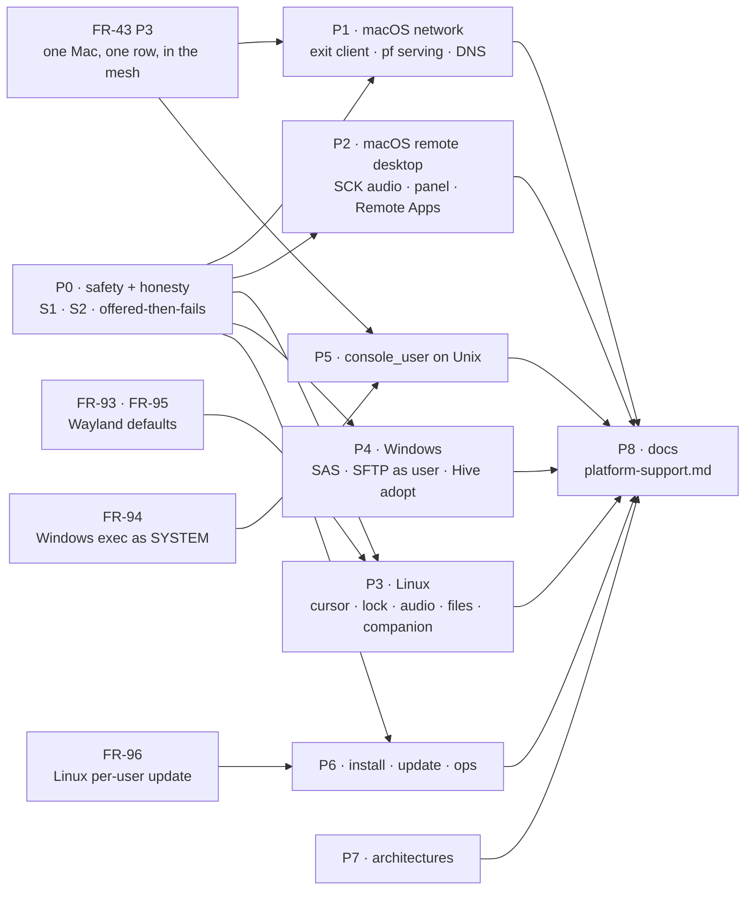
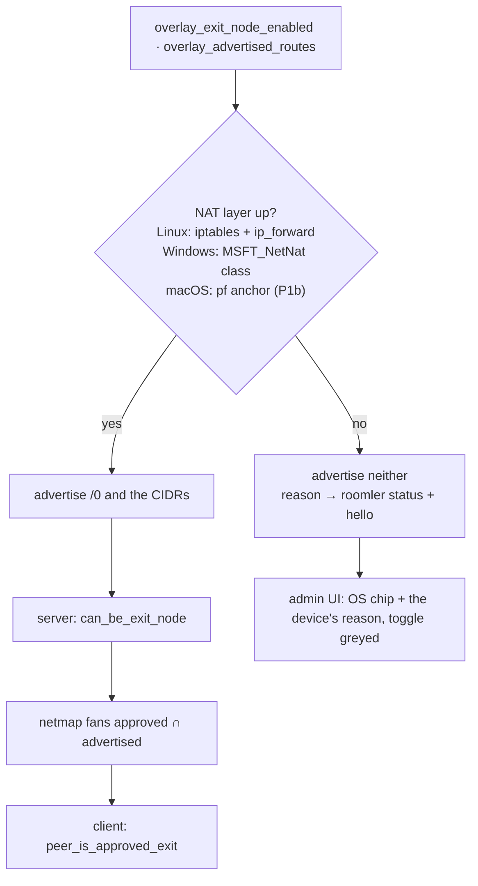

# FR-97: OS parity — what one OS does, the other two do, or the device says why not

**Issue:** [#2082](https://github.com/gjovanov/roomler-ai/issues/2082) · **Status:** in progress.
- Shipped by 0.4.135 and field-verified: P0a, P0b, P0e, and the macOS exit client P1a + P1c (AC1, AC2, AC4, AC6,
  AC17).
- The macOS exit, P1b (#2362), shipped in 0.4.141. Its pf-reference and Internet Sharing fix (#2377) rides 0.4.142.
  AC5 is field-verified on a candidate of that fix and on the 0.4.142 release (§8).
- P0d, the measurement, merged (#2397): the native architecture in the hello, and `scripts/fr97-caps-census.sh`.
  It reaches the fleet with the next agent release and server promote. The count before P0c was taken on
  2026-10-17 (§8, AC15).
- P0c, honest caps (§3.3a), merged: P0c-1, the map and the daemon's decision (#2400); P0c-2, the viewer and the
  enroll dialog (#2401); P0c-3, a netstack node's exit status, DNS and route offer, measured first (D12, #2404).
  P0c-1 and P0c-2 shipped in 0.4.142; P0c-3 rides the next release. AC3's field sessions follow.
- P3i, the host firewall, merged (#2414): measured first (§8), decided as report-never-change (D13). Its status
  line rides the next release.
- P3c-1, Linux session audio that is never a microphone, merged (#2419): measured first (§8), and the premise was
  wrong, since the microphone was the only thing a Linux session ever captured (§3.8). P3c-2, the session's
  monitor through Pulse's client library on per-user and root installs (D14), merged (#2426), field-verified on
  both (§8). Both ride the next release.
- P3b, the Linux lock hint (advisory) and a live session's logind block inhibitor (FR-55 P3), merged (#2431),
  field-verified red → green on a root daemon (§8).
- P4d, a clean stop for a per-user Windows install (`roomlerd service stop`, sign-out, shutdown), merged (#2435),
  field-verified red → green on a perUser Win11 guest (§8).
- P4a, a real Ctrl+Alt+Del (`SendSAS` from the SCM host, asked by the SystemContext worker, where the policy lets
  services), merged (#2437), field-verified red → green on a Win11 lock screen that requires it (§8).
- P4b, SFTP and `scp` as the signed-in Windows user (`sftp-server` through `exec`'s console-user spawn, in the
  person's profile), merged (#2438), field-verified red → green on a Win11 SystemContext guest (§8).
- P4c, Hive adopt on Windows (a named pipe whose client is named by its token, and a hook that sends nothing to
  a pipe it does not trust), merged (#2439), field-verified red → green on a Win11 SystemContext guest (§8).
- P5a, `console_user` on Linux and macOS (the person at logind's seat0 or owning `/dev/console`, by the drop a
  `named` account takes; refused while nobody is there), for SSH and for Fleet RPC's `run_as`, is in review.
- The rest of P2–P7 is open.

**Owner:** the agent on all
three platforms; the network module for the route gate (P0b) ·
**Depends on:** [FR-43](FR-43-macos-single-enrollment.md) P3 (one Mac, one row, in the mesh),
[FR-94](FR-94-fleet-rpc-system-on-windows.md) (Windows exec as SYSTEM),
[FR-96](FR-96-per-user-linux-installs-update-themselves.md) (Linux per-user updates),
[FR-93](FR-93-wayland-out-of-the-box.md) / [FR-95](FR-95-system-installs-on-by-default-on-wayland.md) (Wayland
defaults, the root clipboard) · **Fixes:** #2081 (§2.1 S1), the black hole and the forwarding leak of #2077 (not
"Windows Home can serve", which stays #2077's), #1538

## 1. Goal

Roomler is one product on three operating systems. A feature that ships on one of them ships on the other two, or
the device says, in its hello and on screen, why it cannot. It never offers something that then fails silently.

- Every gap in §2 ends in one of three states: **implemented** on all three; **refused honestly**, with the
  device's own reason reaching the viewer, the admin UI and `roomler status`; or **out of scope by OS design**,
  written down in `docs/platform-support.md` (new, P8) with the reason.
- Two latent safety defects come first (§2.1). Both sit inside pillar 2's never-self-wedge contract, and one is on
  the macOS exit-node path, the gap that prompted this inventory.
- No phase regresses an OS that already works. Each one is shown red on the OS that lacks it, and green on the two
  that have it, before and after.



## 2. Evidence

An inventory of master `e00fba126` (2026-10-13): four read-only sweeps (remote desktop; desktop and companion;
network; SSH, install and update), plus a direct read of every claim marked ✔. Release feature sets per OS, from
`.github/workflows/release-agent.yml`: Linux x86_64 `:530`, Linux arm64 `:925` (no `ffmpeg-encoder`), Windows x64
`:1381`, macOS arm64 `:2414` (no `viewer-indicator-macos`, by the decision written at `:2396-2412`). A feature that
compiles but is not in an OS's release set does not ship there, and is counted as missing.

Legend: ✅ shipped · 🟡 partial · ❌ missing (the OS can do it) · ⛔ not applicable by OS design · ❓ code exists,
never run.

### 2.1 Safety — two defects to fix before any parity work

**S1 (#2081) — a Mac exit-node client installs the split-default with nothing pinned.** ✔
`TunIo::add_host_exemption` defaults to `Ok(())` (`crates/tunnel-core/src/overlay/tun.rs:162-164`), and
`SystemTun` overrides it only on Linux and Windows (`tun.rs:4248-4249`, `cfg(any(linux, windows))`). On macOS every
carrier exemption therefore "succeeds" without installing a route (`runtime/route_guard.rs:552-555`), the v4 gate
passes (`route_guard.rs:570-585`), and the `/1` halves go in through the real macOS route arm
(`route_guard.rs:595-599` → `tun.rs:3876-3925`). The coordination server, coturn and the exit peer's own endpoint
then route into the utun that is supposed to carry them. That is the self-wedge the withhold gate exists to
prevent, and the guard re-asserts it on every tick.

- A restart does not heal it: `purge_split_default` runs at boot, then the runtime re-installs from the persisted
  `overlay_exit_node`.
- Reach: a Mac running the opt-in root daemon whose operator sets `overlay_exit_node`. The key is not in
  `DesiredConfig` (`crates/remote_control/src/models.rs:2486`), so no server push can set it; a local
  `sudo roomler config set` can, and so can an `exec` on the daemon's row. Once it lands, the control WS that the
  `exec` came in on is captured too, so the same channel cannot undo it.
- `NetstackTun` inherits the same default. It installs no OS routes, so it cannot wedge, but `roomler status`
  reported the exit `active, v6 on` for the whole host. The reading that nothing reaches the exit was wrong:
  measured 2026-10-17 (§8), its SOCKS5 front's IPv4 dials do, because the split-default lives in the userspace
  router, and nothing else does. P0c-3 makes the status say so (§3.3a, D12).
- This is a reading of the code path, not yet reproduced on a Mac. P0a reproduces it, red, on a throwaway VM first.

**S2 — exit and subnet serving is offered where nothing NATs, and an approval outlives the offer.** ✔

- The `/0` advertisement is unconditional (`crates/agent-core/src/config.rs:2088-2068`) and independent of NAT setup
  (`runtime.rs:2149-2172`; the setup's success only picks a log level, `nat.rs:80-94`). macOS has no NAT arm at all
  (`nat.rs:376-378` returns `false`), and because the guard is armed only on Linux and Windows (`nat.rs:87`), it logs
  nothing. Windows Home fails `New-NetNat` silently and leaves IPv4 forwarding on after the revert (#2077).
- The server derives `can_be_exit_node` from the advertisement alone
  (`crates/modules/network/src/routes/overlay_route.rs:63`), and the admin row carries no OS (`overlay_route.rs:28-59`)
  although every agent row has one (`models.rs:1989`).
- `approved_routes` survives a rejoin on purpose (`crates/services/src/dao/overlay_node.rs:239-241`), and the netmap
  fans `approved_routes` without intersecting what the node still advertises
  (`crates/modules/network/src/overlay.rs:2549`). A client accepts any peer whose fanned routes hold `/0`
  (`route_guard.rs:303-304`). So an exit that stops offering, on any OS, stays an exit in its clients' netmaps until
  an admin un-approves it. ⚠️ A device-side fix alone cannot close the black hole.

### 2.2 Pillar 2 — network

| # | Feature | Windows | Linux | macOS | Where it stops | Phase / owner |
|---|---|---|---|---|---|---|
| N1 | In the mesh on a default install | ✅ | ✅ | ❌ | The default `.pkg` installs the per-user half, which cannot create a utun; the mesh needs `--daemon-token`, a second enrollment and a second device row (`scripts/install.sh:508-511`, `packaging/macos/com.roomler.daemon.plist` header) | FR-43 P3 |
| N2 | Exit node, client | ✅ | ✅ | ✅ P1a + P1c (AC4, AC6 field-verified) | S1; no original-default capture (`tun.rs:1931-1939`, `3471-3503` are `cfg(any(linux, windows))`) | P0a, P1a |
| N3 | Exit node, serving v4 | 🟡 WinNAT; Home ❌ | ✅ iptables | ✅ P1b: pf, in our own anchor (0.4.141; #2377 in 0.4.142; AC5, §8) | Silent no-op (`nat.rs:376-378`); Home: #2077 | P0b, P1b, P4e |
| N4 | Exit node, serving v6 | ⛔ WinNAT has no v6 (`nat.rs:268-274`) | ✅ ip6tables | ✅ P1b: pf NAT66 to a stable address (global first, else a ULA), where an unscoped v6 default exists (0.4.141; AC5, §8) | — | P1b; Windows: D1 |
| N5 | Subnet router, serving | 🟡 WinNAT; Home ❌ | ✅ | ✅ P1b (0.4.141; AC5, §8) | Same no-op; routes still advertised and approvable | P0b, P1b |
| N6 | MagicDNS OS steer | ✅ NRPT | 🟡 systemd-resolved only (`dns.rs:408-429`) | ✅ P1c (AC6) | A TUN-mode Mac resolves names only with the opt-in hosts ladder. *P1c:* a temporary SCDynamicStore supplemental resolver per utun | P1c, P3h |
| N7 | Exit DNS steer (no leak) | ✅ NRPT `.` | 🟡 resolved only | ✅ P1c (AC6) | Reported honestly as `DNS NOT steered`. *P1c:* a temporary catch-all key (`SupplementalMatchDomains = [""]`) | P1c, P3h |
| N8 | Host firewall admits the daemon's inbound UDP | ✅ Defender rule + WFP (`winfw.rs`, `wfp.rs`) | 🟡 firewalld / ufw untouched by decision (D13), and reported | ❌ ALF untouched | Linux, firewalld (§8, 2026-10-17): punched and LAN-direct carriers pass via conntrack, so no UDP allow is needed; services on the overlay IP are refused by the zone that governs the adapter, which `roomler status` now names (P3i) | P3i |
| N9 | LAN-direct egress pin; own-route repair | ✅ `IP_UNICAST_IF` (`direct.rs:466-507`), `lan_repair.rs` | ❌ | ❌ | The field case was Windows + AnyConnect | §7 (evidence first) |
| N10 | Per-org TUN (multi-org) | ✅ | ✅ | ❓ | One utun per org in code (`agents/roomlerd/src/overlay.rs:303-316`), never run on a Mac; `roomler org join` still warns it is unsupported (`org_join.rs:561-566`, stale) | P1d |
| N11 | Port-holder diagnostics | ✅ | ✅ | 🟡 `Unknown` (`port_holder.rs:316-323`) | Diagnostics only | P1d |
| N12 | Exit client: the pins follow the uplink | ✅ P0e | ✅ P0e | ✅ P1a | *P0e part 2 (field-verified on a candidate, red on 0.4.134, §8):* `stale_host_exemptions` re-reads each family's uplink on Linux (`ip route show`) and Windows (a FIB snapshot ranked as the OS ranks, our own adapters excluded, because the exit's `/1`s out-match a lookup toward the unspecified address) and adopts one that moved; a pin through the old uplink, or gone from the table, is re-pinned, and a Windows pin's old route is removed once the new one is in. Found in P1a. Linux and Windows pin through the default captured once at bring-up and never re-read it (`TunIo::stale_host_exemptions` keeps its empty default there). After a network change under an active exit, a pin the OS did not flush with the old interface still points at a next hop that no longer answers: the exit's carrier dies, the teardown removes the `/1`s, and a stale `/32` for the coordination server keeps the control WS from coming back until a restart. Reproduced on 0.4.134, Linux and Windows (§8) | P0e |
| N13 | Exit client: no pin outlives the daemon | ✅ P0e | ✅ P0e | ✅ P0e | *P0e part 1 (field-verified on a candidate, §8: a crash and a clean stop on a Mac; a crash plus a network change on Linux and Windows, red on 0.4.134):* every pin is recorded in the host ledger when it is made and forgotten when it is removed; `host_ledger::purge` removes what is left at boot, before every `process::exit`, and after every exit of `roomlerd run` (`docs/overlay-exit-nodes.md`, "Exit-client pins"). Found in P1a. `purge_exit_routes` (boot and every pre-`process::exit` path) removes the `/1`s and the DNS steer, never the `/32`/`/128` pins through the physical uplink, and nothing records which host routes were ours. Harmless on the same network; after a network change the OS did not flush them with, a black hole for the endpoint, the coordination server's included. On a Mac, P1a repoints a leftover pin in place if the next run is an exit client again; nothing removes one otherwise. **Field, 0.4.134 (§8): a CLEAN stop leaks them too.** No shutdown path calls `teardown_exit_routing`; the `/1`s only go because the TUN does. A daemon stopped and then moved to another network comes back with the server's `/32` on a next hop that no longer answers, so its control WS cannot reconnect, and the overlay runtime that would re-pin never starts | P0e |
| N14 | Exit client: a network change under the exit is a network change | ✅ P0e | ✅ P0e | ✅ P0e (a gateway move under the exit on tart, 0.4.136 and 0.4.137: a Major and a re-pin; an interface switch is not reproducible on a Wi-Fi-only host, §8) | *P0e part 3 (#2188, merged `d9f6680c3`; field-verified on Linux and Windows, red on 0.4.135, §8):* while netstate's default lookup lands on one of our adapters, it also samples the uplink beneath (`tun::uplink_beneath`, the reader the pins use), and a move there is a Major (`netstate::uplink_beneath_own`). Found in the AC17 field run (§8). netstate samples "the default" by looking up a far address, and an exit's `/1`s answer that lookup with our own TUN. So `eth0` going down under an active exit logged `severity=Minor … default_moved=false v4_default=roomler0`, and no Major consumer ran: no control-WS probe, no carrier revalidation, no tunnel re-dial. The old WS, its source address on the downed `eth0`, died silently, and only the keepalive found it, **56 s** in, on 0.4.134 and the candidate alike. Without an exit, the same switch is a Major and the WS is probed at once. Windows got away with it: a disabled NIC takes its address, so its socket fails at once. **Field, the first candidate (§8):** the move WAS seen (`uplink=eth1`), but demoted by the 120 s flap cooldown, which the exit's own activation 13 s earlier had opened. So a Major that is only our exit's capture coming or going (`own_capture_only`) is now damped only by its own kind (`netstate::major_demoted`). With the cooldown out of the way, the move was a Major 0.8 s after the switch and the WS came back at +22.6 s | P0e |

At parity already: TUN bring-up; v4 and v6 ULA addressing (the exit-node doc's "utun v4-only" is stale,
`tun.rs:4704-4737`); route-change subscriptions (`NotifyRouteChange2` · `ip monitor` · `route -n monitor`);
PathMonitor; every carrier (disco, direct, netcheck, relays, DERP, QUIC); peer-relay serving; tunnels, SOCKS5 and
declared routes; the in-daemon overlay ACL; key rotation; ephemeral nodes; the subnet-router *client* role.

### 2.3 Pillar 1 — remote desktop

| # | Feature | Windows | Linux | macOS | Where it stops | Phase / owner |
|---|---|---|---|---|---|---|
| R1 | System audio in a session | ✅ WASAPI loopback | ❌ **the default microphone, always**: cpal lists only ALSA devices, so the `.monitor` pick never matched (measured, §8). Since P3c-1 a named device only, else no track and the reason (`audio_source.rs:253`) | ❌ | macOS: no capture backend; since P0c no `opus` either (`encode/caps.rs:700`) ✔. Linux: nothing captures the session's monitor (P3c-2) | P0c, P2a, P3c |
| R2 | Native consent panel | ✅ | ✅ X11 · ⛔ Wayland → companion | ❌ | Built (`indicator/mac.rs`), not in the release set (`release-agent.yml:2564-2580`) | P2b (D3) |
| R3 | Remote Apps | ✅ | ✅ X11 · 🟡 Wayland: Xwayland windows (FR-56) | ❌ | `Unavailable::Platform` (`apps/mod.rs:347`); no `apps/macos.rs` | P2c |
| R4 | Live cursor shape | ✅ | ❌ | ❌ | `capture/cursor.rs:90`; an XFixes decoder already exists for recordings (`capture/pointer.rs:187-230`) | P3a, P2d |
| R5 | "Host is locked" consent hint | ✅ | ✅ since P3b: advisory, from logind's `LockedHint`, and input passes (`lock_state.rs:331`) | ❌ | `LockState` is always `Unlocked` off Windows (`lock_state.rs:290-311`), on purpose for Linux: the hint never becomes one | P2d, P3b |
| R6 | Keyboard layout report / switch | ✅ | ❌ | ❌ | Windows-only cap (`caps.rs:1570-1574`) | P2d, P3e |
| R7 | Match remote display | ✅ | ❌ | ❌ | `display_match.rs:247` | P2d, P3e |
| R8 | Clipboard: host → viewer image sync | ✅ | ❌ | ❌ | Forced off (`clipboard.rs:818-822`) ✔ while advertised (`caps.rs:1547-1555`) | P0c, P2e, P3e |
| R9 | Clipboard: RTF lane | ✅ | ❌ | ❌ | `clipboard.rs:792` | P2e, P3e |
| R10 | Clipboard on a system (root) install | ✅ | ❌ | ✅ | No `DISPLAY`, advertised anyway (`peer.rs:9646-9649`) | FR-93 P7 |
| R11 | Typing text on a non-US layout (uinput) | ✅ | 🟡 US table only | ✅ | `keylayout.rs:40-46`, `uinput_backend.rs:628-634` | P3f |
| R12 | Recording with audio | ✅ system + mic | ✅ | 🟡 picture only | No SCK audio; cpal is not a macOS dependency (`agents/roomlerd/Cargo.toml:321-322`) | P2a, P2f |
| R13 | Dirty-rect capture (idle CPU) | ✅ WGC | ✅ X11 · ❌ Wayland | ❌ | `Damage::Unknown` (`scrap_backend.rs:222`) | D2 |
| R14 | "Being viewed" banner kept out of the stream | ✅ | ❌ | ❌ | CGDisplayStream ignores `NSWindowSharingNone` (`desktop-companion.md:514-517`) | D2 |
| R15 | Greeter, nobody signed in | ✅ SystemContext | 🟡 DRM, opt-in | ⛔ | macOS loginwindow: §7 | FR-93 / FR-95 |
| R16 | Ctrl+Alt+Del | ❌ | ⛔ | ⛔ | §2.7 item 3 | P0c, P4a |

At parity already: capture of the primary display, HiDPI, the hardware encoder families each OS has (VideoToolbox
ships on macOS, whatever the user docs say, §2.8), keep-busy (FR-92), recording video, file transfer, the TCC flow,
and the consent chain's fallbacks.

### 2.4 Desktop, companion, power, files

| # | Feature | Windows | Linux | macOS | Where it stops | Phase / owner |
|---|---|---|---|---|---|---|
| D1 | Companion: tray, banner, consent, Apply now | ✅ | 🟡 | ✅ | One x86_64 `.deb` (`release-agent.yml:744-871`); Fedora, Arch and arm64 have none | P3g (with FR-93 D5/D6, FR-95) |
| D2 | Companion pages on a system install | ✅ | 🟡 safety pages only | ❓ | Person socket (`crates/localapi/src/lib.rs:2602-2646`); a two-half Mac may answer Routes and Devices from the user half | #1911; FR-43 P3 |
| D3 | Keep the host awake during a session | ✅ `PowerCreateRequest` | ✅ since P3b: a logind block inhibitor (`power.rs:670`) | ✅ IOPMAssertion | Was a stub whose reason, "zbus is in no shipped Linux feature set", had gone stale: `portal-capture` ships zbus in `full` | P3b |
| D4 | Received files land as the signed-in user (system install) | ✅ | ❌ | ✅ | Root's home or `/tmp` (`files.rs:182-206`, `2483-2521`) | P3d |
| D5 | The setup wizard installs the daemon | ✅ | ❌ | ❌ | Tunnel client only (`agents/roomler-setup/src/commands.rs:79-103`) ✔, yet the enroll dialog offered it for agents. P0c-2 offers it for agents on Windows only (`ui/src/utils/enrollCommands.ts:136`) | P0c, D5 |
| D6 | Hive: adopt a terminal session | 🟡 built (P4c) | ✅ | ✅ | Was: `hive_adopt` read off on Windows. P4c adopts through a named pipe (`hive/supervisor/adopt.rs:573`) | P4c |

### 2.5 SSH and Fleet RPC

| # | Feature | Windows | Linux | macOS | Where it stops | Phase / owner |
|---|---|---|---|---|---|---|
| X1 | `exec` and SSH `daemon` mode run as the machine | 🟡 the console worker: the signed-in user on attended installs (#2021) | ✅ root | 🟡 root on the `-daemon` row, the user on the other | Two identities, one per row | FR-94; FR-43 P3 |
| X2 | `console_user` account mode | 🟡 SystemContext, or the SYSTEM service (FR-105) | 🟡 built (P5a) | 🟡 built (P5a) | Was: "a Windows concept". P5a drops to the person at seat0 or owning the console (`exec.rs:802`), for SSH and exec's `run_as` | P5a |
| X3 | SFTP / scp as the signed-in user | 🟡 built (P4b), where `sftp-server.exe` is installed | ✅ | ✅ | Was refused: `tokio::process` cannot take a token. P4b takes `exec`'s console-user spawn (`ssh.rs:1353`) | P4b |

### 2.6 Install, update, ops, architectures

| # | Feature | Windows | Linux | macOS | Where it stops | Phase / owner |
|---|---|---|---|---|---|---|
| O1 | A per-user install updates itself | ✅ | ❌ | ✅ | #2046 | FR-96 |
| O2 | The artifact's own version checked against the manifest | ✅ MSI `ProductVersion` | ❌ | ❌ | `Unsupported` → the install proceeds (`artifact_version.rs:272-289`, `updater.rs:1404`): a signed older package under a newer manifest installs | P6a |
| O3 | Tunnel CLI `roomler self-update` | ✅ | ❌ | ❌ | `agents/roomler-cli/src/update.rs:96-101` | P6b |
| O4 | One CLI verb registers the system service | ✅ `service install --as-service` | ❌ | ❌ | `main.rs:4932` | P6c |
| O5 | Uninstall | ✅ MSI, `install.ps1 -Uninstall` | 🟡 apt only; the tarball has none | ❌ | A pasted recipe (`docs/installation.md:394-420`) | P6d |
| O6 | An update's outcome is recorded | 🟡 written, never read | ❌ the watcher dies with the unit (#1239) | ❌ none | — | FR-67 |
| O7 | A supervisor records a worker that dies before its own hook | ✅ | ⛔ journald | ❌ | `macos_supervisor.rs` never calls `crash_recorder` | P6e |
| O8 | The daemon survives a failed stdout write | ✅ | ✅ | ❌ | #1538 | P6e |
| O9 | A private per-download staging dir | 🟡 shared `%TEMP%\roomlerd-update` | ✅ mkdtemp | 🟡 shared | `updater.rs:1170-1179` | P6f |
| O10 | An ephemeral device removes itself on a clean stop | ✅ since P4d: the SCM service, and a per-user install on `service stop`, sign-out and shutdown | ✅ | ✅ | Was: a Scheduled-Task install had no stop signal. Now its own event and a session-end window (`main.rs:3088`, `session_end.rs:220`) | P4d |
| A1 | Daemon + companion on Intel Macs | — | — | ❌ | arm64 only (`release-agent.yml:2312-2318`); the CLI and the wizard are universal | D6 |
| A2 | Daemon on Windows ARM64 | ❌ | — | — | x64 MSI only (`wix-perMachine/main.wxs:80-81`); behaviour under emulation unverified | D6 |
| A3 | Hardware encode on Linux arm64 | — | ❌ | — | No `ffmpeg-encoder` (`release-agent.yml:1093`); recordings write Opus, not AAC | P7a |
| A4 | Tunnel CLI and wizard on Linux arm64 | — | ❌ | — | x86_64 only (`release-tunnel.yml:127-131`, `release-setup.yml:184-189`) | P7b |

The server records `os` on every agent row but no architecture (`models.rs:14-18`, `:1968`), so it cannot count the
devices A1 and A2 would serve. P0d adds the native machine architecture to the hello. On Windows that is
`IsWow64Process2`'s native machine, because an x64 build under emulation would otherwise report x86_64.

### 2.7 Offered, then fails

1. macOS advertises `opus` audio and streams silence (R1).
2. Linux and macOS advertise clipboard image events they never send (R8); a root Linux daemon advertises a clipboard
   it cannot reach (R10).
3. The Ctrl+Alt+Del button shows for every host. It sends three ordinary key events
   (`ui/src/composables/useRemoteControl.ts:11449-11461`) ✔, and nothing in the agent calls `SendSAS` (grep: none) ✔.
   Windows does not treat a synthesised Ctrl+Alt+Del as the secure attention sequence, so the button does nothing at
   a lock screen that requires it; on Linux and macOS the chord means something else, or nothing.
4. The enroll dialog offers the setup wizard for agents on Linux and macOS, where it installs only the tunnel client
   (D5).
5. An admin can approve a Mac or a Windows Home device as an exit or subnet router (S2).

### 2.8 Docs that say otherwise (fixed in P8)

| Doc | Says | Code |
|---|---|---|
| `docs/overlay-exit-nodes.md:228` | macOS utun is v4-only; exit routing not wired | v6 is assigned (`tun.rs:4704-4737`); the client half is wired except for the exemptions (S1). **Fixed with P1a:** a per-OS table and a macOS client section |
| `ui/docs/content/network/exit-nodes.md` | no platform caveat; v4, v6 and DNS all routed | Windows exits are v6 fail-closed; macOS and Windows Home cannot serve |
| `docs/overlay-exit-nodes.md:250-252` | approval needs a re-join | the server re-fans at once (`overlay_route.rs:301,375`) |
| `ui/docs/content/network/multi-org.md:87`, `org_join.rs:561-566` | a Mac cannot run a per-org TUN | the per-org utun code is unconditional (N10) |
| `docs/multi-org.md` §4.4, §4b | the shared-TUN mux and mux NAT | deleted in W7c (`overlay.rs:310-316`) |
| `docs/magicdns.md:88` | Mac names resolve through the SOCKS path | only in netstack mode |
| `ui/docs/content/remote-desktop/codecs-and-performance.md:43-50` | macOS encodes in software; VideoToolbox not wired | VideoToolbox ships (`encode/ffmpeg/encoder.rs:97-105`) |
| `docs/remote-control.md:264,341` | macOS captures with ScreenCaptureKit; dirty rects from SCK | CGDisplayStream through scrap (`scrap_backend.rs:8`); no SCK code anywhere |
| `docs/remote-control.md:389-392` | the installer adds the `input` group and a udev rule | no packaging does |
| `docs/remote-control.md:1611-1616` | VideoToolbox deferred; the audio-input entitlement is covered | VideoToolbox ships; no entitlement or usage-description key exists |
| `docs/roomler-ssh.md:22-23` | `ssh-server` is not in the release sets | all four lanes build it |
| `docs/roomler-ssh.md:311-325` | Windows `daemon` → SYSTEM | the console worker (#2021, FR-94) |
| `docs/installation.md:21-22`, `ui/docs/content/start/install/macos.md:51-53` | install the macOS daemon with the wizard | the wizard's daemon roles are Windows-only |
| `docs/installation.md:43-44`, `ui/docs/content/troubleshooting/install-problems.md:37-40` | downloads come from roomler.ai | true for the MSI proxy, the CLI and the wizard; `install.sh`'s `.deb`/tarball/`.pkg` and every self-update fetch from GitHub (`updater.rs:1276,1360`) |
| `ui/docs/content/remote-desktop/files-and-clipboard.md:14,63`; the tooltip at `RemoteControl.vue:3180` | the clipboard is text; images sync automatically | images and HTML on all three; host → viewer images from Windows only; nothing on a root Linux daemon. ✅ Both say so since P0c-2 |
| `ui/docs/content/remote-desktop/per-os-permissions.md:76-103`, `unattended-access.md:58-59` | Wayland input supported; a root service has nothing to capture | input is `xwayland_only` by default (`input/reach.rs:181-224`); DRM captures from root (opt-in) |
| `ui/docs/content/start/install/windows.md:95` | machine-global config at `%PROGRAMDATA%\roomler\config.toml` | `%PROGRAMDATA%\roomler\roomler\config.toml` (`appdirs.rs:41-44`) |
| `packaging/linux/README.Debian` | capture is X11-only; Wayland fails | FR-36, FR-45, FR-93 |
| code comments: `power.rs`'s Linux stub (rewritten in P3b), `lock_overlay.rs:32-34`, `code_signature.rs:36-43`, `post_install.rs:80-81`, `caps.rs:1827`, `tun.rs:3249-3254` | — | stale, each named in its row above or in the sweeps |

### 2.9 Equal on all three: not parity, recorded so nobody files them here

Multi-monitor streaming and switching (the viewer always sends `mon: 0`, `useRemoteControl.ts:9701`), a curtain or
privacy mode, touch injection, a live microphone (two-way audio), OS toast notifications
(`crates/agent-core/src/notify.rs:21-24`), file copy-paste through the clipboard, minidumps, and SSH agent and X11
forwarding. Several deserve FRs of their own; none is a platform gap.

## 3. Key design

### 3.1 The rule: parity, or an honest no

A capability word in the hello (`encode/caps.rs`) promises that this device serves it on this OS, and a test where
the word is computed proves it. Where an OS cannot, or cannot yet, the device sends the word with a reason. That is
the shape FR-80 gave capture (`rc:media-unavailable`), FR-93 gave input (`rc:input-reach`), FR-92 gave keep-busy and
FR-56 gave Remote Apps (`unavailable`). The viewer and the admin UI grey the control and show the device's reason.
They hide it only where the feature means nothing on that OS (Ctrl+Alt+Del on a Mac).

⚠️ Do not gate on `agent.os` in the UI to cover a missing capability. A Windows Home host is Windows, a Mac
without its root daemon is macOS, and a later release closes the gap without a UI release. The device says what it
can do.

### 3.2 P0a — fail toward withhold (#2081)

`SystemTun` refuses an exemption wherever it has no arm: a `cfg(not(any(linux, windows)))` `add_host_exemption`
returns `ErrorKind::Unsupported`, so on macOS the gate at `route_guard.rs:574-585` withholds and `roomler status`
says why. The trait default stays `Ok(())`, now documented as safe only for a device that installs no OS routes
(the in-memory mocks, netstack); changing it would move every mock and netstack for no safety gain. Netstack's untrue
`active` belongs to P0c. The test that fails on master is
`macos_kernel_tests::an_exemption_it_cannot_pin_is_refused_not_reported_pinned`, run on a real utun by CI's macOS job.

### 3.3 P0b — offer only what you serve, fan only what is offered



- **Device.** Probe the NAT layer before advertising `/0` or any subnet CIDR: on Linux the iptables/ip6tables
  binaries answer and `ip_forward` is writable; on Windows the `MSFT_NetNat` class exists (Home answers
  `Invalid class`); on macOS nothing until P1b. When it is down, advertise neither and say so in `roomler status`
  (`exit node offer withheld — <reason>`) and in a hello field the admin UI reads. ⚠️ *Field, 2026-10-13:* the
  class comes with the **Hyper-V feature, not the edition**. A Windows 11 Enterprise eval VM answered `Not found`
  with Hyper-V and Containers off, still did with Containers on, and had the class once Hyper-V was enabled. The
  probe's verdict was right; its reason blamed Home, and P0b-2c rewords it.
- **Device.** The Windows revert restores the `Forwarding` value it found on both interfaces, rather than only
  running `Remove-NetNat` (#2077). *P0b-2b:* the setup script reports each interface's adapter GUID and its state
  before; `host_ledger::ForwardingHolds` refcounts per interface (two orgs can share an egress adapter, and the
  first holder's observation decides); the last holder of an interface we turned on switches it off in `Drop`; and
  a ledger at `HKLM\SOFTWARE\Roomler\Overlay` (value `HostLedger`) lets `purge_exit_routes()` do the same after
  an unclean exit (`nat::purge_forwarding`). Not a file under `%ProgramData%`, where any account may create one:
  SYSTEM acts on the ledger at boot, so a planted file would choose the adapter it switches forwarding off on.
  `New-NetNat` failures now log WinNAT's own message. *P0b-2c (the P0b-2b field run's two findings, present on
  0.4.134 too):* our adapter comes up not forwarding, because after a crash it is recreated with its old setting
  where the boot purge could not reach it; and the ledger records our WinNAT instances so the purge removes the
  one a crash leaves. The WinNAT reason now names Hyper-V.
- **Server.** Fan `approved_routes ∩ advertised_routes` (`overlay.rs:2549`). The approval stays stored, because a
  flapping join must not cost an admin's decision, but it takes effect only while the device still offers the route.
  An agent older than P0b keeps advertising what it always did, so the intersection changes nothing for it.
- **Admin UI.** An OS chip on the routes row (`OverlayNodeResponse` gains `os`, read from `Agent.os`), and the
  device's reason when it offers nothing.

### 3.3a P0c — honest caps

The count before P0c (§8) found the hello's words compile-time constants. `opus` sat on every Mac, which streams
silence (R1). Clipboard image events sat on every Linux and macOS agent, whose watchers never send them (R8).
`supports_clipboard` sat on root Linux daemons that have no clipboard to reach (R10). No word governed
Ctrl+Alt+Del at all.

**The shape (D10).** A word stays a promise. What a host cannot keep, the daemon takes out and explains in a new map,
`AgentCaps.unavailable: {feature → {code, reason}}` (`crates/remote_control/src/models.rs:534`). The keys are
matched by equality (`Unavailable::KEYS`, `:548`), and the wire shape is locked by
`unavailable_wire_shape_is_locked`. The viewer's rule:

- It shows `reason` on the control.
- It **hides** the control only for `not-applicable`, a feature that means nothing on that OS (Ctrl+Alt+Del on a
  Mac). That keeps the UI from gating on `agent.os`.
- Whether a control works still follows the lists, as today. An empty `audio` list already disables the toggle;
  `unavailable` adds the why.

An agent before P0c sends no map, and an absent key never means "unavailable": its lists say what it claims.

**The decision** is one daemon-side seam, `with_honest_words` (`agents/roomlerd/src/encode/caps.rs:745`), applied
in `detect()` (`:624`) after the config lists, over plain `HostFacts` (`:636`). It runs, and is tested, on every
OS: FR-43's practice of keeping the decision out of `cfg(target_os)`.

| Feature | When | What the hello says |
|---|---|---|
| `audio` | the `audio` feature is built but the OS has no capture backend: macOS until P2a (`audio/mod.rs:78`) | the `audio` list is empty, so the daemon's session gate offers no track (`signaling.rs:3076`); `unavailable.audio = no-backend` |
| `clipboard` | a root Linux daemon with neither `DISPLAY` nor `WAYLAND_DISPLAY` (`caps.rs:726`), the test capture makes before `no_display` | `supports_clipboard: false` and an empty `clipboard`; `unavailable.clipboard = no-session`. FR-93 P7 makes it reachable through the session |
| `clipboard-image-events` | everywhere but Windows, whose watcher alone keeps image events (`clipboard.rs:817-822`) | `events` and `images` stay: text still syncs, and an image moves on request. `not-watched` |
| `sas` | Windows | `keys-only`: the button types three ordinary keys, which apps on the desktop get and the lock screen does not. Since P4a a SystemContext worker on a host whose policy lets services says `input: sas` instead, and the button sends the real sequence (D11) |
| `sas` | Linux | `keys-only`: the same keys, which the desktop binds (GNOME and KDE to log out), so the button says so rather than going |
| `sas` | macOS | `not-applicable`: the chord means nothing there, and the viewer hides the button |

The census (`scripts/fr97-caps-census.sh`) counts the map as `key:code` by OS, so AC15's "after" shows each no
beside the words.

**Out of the hello:**
- **The wizard (D5).** The enroll dialog stops offering it for agents off Windows (`ui/src/utils/enrollCommands.ts:136`,
  used at `:176` and `:192`). There it installs only the tunnel client.
- **A netstack node's exit (D12, P0c-3).** Measured first (§8, 2026-10-17). The front dials an IPv4 literal as
  given (`crates/tunnel-core/src/overlay/netstack_socks.rs:75`), and the exit install puts the split-default in the
  userspace router, so a literal does reach the exit. Names the front is handed resolve only to overlay peers, it
  refuses IPv6 destinations, and nothing else on the host uses the exit. So:
  - `ExitNodeStatus.socks5_port` (`crates/localapi/src/lib.rs:107`): `roomler status` says "active for SOCKS5
    clients of 127.0.0.1:1080 only", and never `v6 on`.
  - The host's DNS is never steered from a netstack node
    (`crates/tunnel-core/src/overlay/runtime/route_guard.rs:363`): on Windows and macOS the steer is host-wide and
    would route nothing through the exit.
  - A netstack node withholds every route offer (`crates/tunnel-core/src/overlay/nat.rs:179`): its stack forwards
    nothing. On 0.4.141, a netstack node on a host where iptables worked offered `/0`.

**Order.**
- **P0c-1:** the map and the daemon (this section).
- **P0c-2:** the viewer and the enroll dialog read it.
- **P0c-3:** a netstack node's exit status, its DNS and its route offer.

The server stores the map as it stores every caps field, so P0c-2 needs a promoted server, and the honest no's
reach a viewer from agents on the release after P0c-1.

### 3.4 P1a — the macOS exit client

Mirror the Linux arm with the BSD tools the macOS code already drives, and close two gaps the Linux arm has (N12):

1. **The uplink, per family.** At bring-up, `route -n get [-inet6] default` gives the next hop and the interface
   (`tun.rs:3878`). It is kept in a mutex rather than a fixed field like `orig_default`, because it is RE-READ before
   every pin (`current_uplink`, `tun.rs:5441`): a Mac that booted without a network still pins once it has one, and
   one that changed networks pins through the new uplink. `bsd_default_uplink` (`tun.rs:316`) refuses a route on our
   own utun, one narrower than `/0` (a `/1` also prints `destination: default`; only the mask tells), and one with no
   next-hop address (another VPN's interface route). A family with no usable default keeps what it had, so a network
   in transit does not move the pins.
2. **A pin is read from the routing TABLE** (`netstat -rnW -f inet[6]`, `bsd_table` `tun.rs:5343`), never from a
   lookup. A destination a connection has used keeps an interface-scoped clone of the default route
   (`WASCLONED,IFSCOPE`), and an unscoped `route -n get` answers with that clone even after the pin is in (field,
   §8: the first P1a read back by lookup and refused every pin for the server). The pin is the UNSCOPED static host
   route for exactly the address (`bsd_pin_row`, `tun.rs:398`: flags `H` and `S`, never `W` or `I`), and it holds
   when it is flagged `G` through the uplink's next hop on its interface (`bsd_pin_holds`, `tun.rs:411`).
3. **`add_host_exemption`** (`tun.rs:4740`) looks first, because BSD `route` has no idempotent write (#1856): a pin
   that holds is left alone; one that does not (the old uplink, a crashed run's, an interface route) is deleted, then
   added; anything else gets `route add -host <ip> <gw>` (`-inet6` and a zoned `fe80::1%en0` for v6). Never `route
   change`: it resolves its target the way the lookup does, and on the field Mac it left the pin untouched. The table
   then decides; a pin that does not hold comes out again and the call errs.
4. **The pins follow the uplink.** `TunIo::stale_host_exemptions` (new; `tun.rs:4838` on macOS, an empty default
   elsewhere) names the pins the table does not show through the current uplink. The gate (`route_guard.rs:599`)
   asks at most every 3 s, re-pins each, and DELETES one it cannot re-pin before forgetting it, so an untracked
   route never outlives the exit. Then the usual rule applies: a v4 pin missing means WITHHOLD.
5. **`del_host_exemption`** removes only the pin the table shows, never a route on our utun (a peer route): with no
   unscoped pin left, `route -n delete -host` removed something else on the field Mac. The boot purge already
   removes the `/1`s (`tun.rs:4603-4646` at the time of writing); pins an unclean exit leaves behind are N13, all
   three OSes.
6. **The two 0.4.132 follow-ups.** The pin WARN fires once per (endpoint, cause) (`note_exemption_failure`,
   `route_guard.rs:393`), and the withheld reason carries the device's own cause for the lowest missing v4 endpoint
   (`exemption_withheld_reason`, `route_guard.rs:405`) instead of `no original default route?`.

Kill switch: `ROOMLERD_EXIT_CLIENT_MACOS=0` refuses every exemption, as 0.4.132 did. DNS is not steered yet (P1c):
`roomler status` says `DNS NOT steered`.

```mermaid
sequenceDiagram
    autonumber
    participant G as route_guard
    participant T as SystemTun (macOS)
    participant K as kernel routes
    Note over T,K: at bring-up — route -n get default / -inet6 default → gateway + uplink
    G->>T: add_host_exemption(server, coturn, exit endpoint)
    T->>K: route -n add -host ip gw
    T->>K: netstat -rnW (the table: a lookup answers with a scoped clone)
    alt every v4 pin holds through the uplink
        G->>T: add_cidr_route(0.0.0.0/1, 128.0.0.0/1, ::/1, 8000::/1)
        G->>G: steer DNS (P1c); set_v6_exit only when the v6 exemptions hold
    else a pin fails, or the table shows it elsewhere
        G->>G: WITHHOLD — egress stays on the uplink, the reason goes to roomler status
    end
```

⚠️ A Wi-Fi ↔ Ethernet change moves the default gateway. Step 4 is what follows it: the re-check reads the uplink
again and re-pins with the `/1`s left in place. A pin that cannot follow is removed, and the gate withholds until one
can.

⚠️ **N14: the pins following is not enough; the network monitor has to see the change too.** netstate samples the
default with a lookup of a far address, which the `/1`s answer with our own TUN. So a change under an active exit was
a Minor and no Major consumer ran: no control-WS probe, no carrier revalidation. While the lookup lands on one of our
adapters, netstate now also reads the uplink beneath it, with the reader the pins use (`tun::uplink_beneath`):
- Windows: the FIB view;
- Linux: the main table's best `/0`;
- macOS: `route -n get default`, which answers with the `/0` itself while the `/1`s are in, where a lookup of a far
  address answers with a `/1` (a tart VM with `/1`s on another interface, 2026-10-14). The same behaviour keeps step
  4's re-read sound.

A move there is a Major. Our own exit's capture coming or going (the lookup moving onto or off our adapter, with the
uplink unchanged) stays a Major too, but it no longer spends the flap cooldown a real move needs: the first candidate
saw the move and demoted it, because the exit's activation 13 s earlier had opened the window.

⚠️ **The daemon's own lookups follow the exit's DNS steer too, so they must never wait on it** (#2187). An exit whose
DNS stopped answering stalled the overlay loop 48 s on a network change. After a control-WS drop it kept the device
offline until the exit's DNS came back.

`tunnel_core::ctl_dns` (#2212) now serves the last good answer for the daemon's own names (the server, STUN, the relay
workers) and refreshes it in the background, and the control WS and `/derp` dial the remembered address. A steer
bypass was rejected: it leaks DNS around the exit. On Windows with MagicDNS, the steer's own resolver first had to
survive an ICMP-driven 10054 (#2213, #2214). Behaviour table: `docs/overlay-exit-nodes.md`.

### 3.5 P1b — serving on macOS (exit and subnet router) — D1

Kernel NAT through pf, the macOS twin of the iptables arm:

- Rules live in our own anchor under the stock wildcard (`/etc/pf.conf` carries `nat-anchor "com.apple/*"` and
  `anchor "com.apple/*"`), so `pf.conf` is never edited: `nat on <uplink> inet from <overlay CIDRs> to any ->
  (<uplink>)`, the v6 equivalent for the overlay ULA, and `pass` for the utun.
- Enable with `pfctl -E` and keep the reference token; release it with `pfctl -X <token>`, never `pfctl -d`, which
  would also disable pf for every other user of it (Internet Sharing, a VPN client).
- Record the `net.inet.ip.forwarding` / `net.inet6.ip6.forwarding` values found and restore them.
- Persist {token, sysctl values, anchor} in the state dir. A boot purge beside `purge_exit_routes` flushes the
  anchor and restores the sysctls after a crash.
- Re-render on an uplink change; the `(uplink)` form follows an address, not a new interface.
- A kill switch, `ROOMLERD_PF_NAT=0`, makes the probe refuse, so the Mac offers nothing, as before.

**Verified on hardware before the code** (§8, 2026-10-16 and 2026-10-17):

| Question | Answer |
|---|---|
| Is a sub-anchor under `com.apple/*` evaluated without touching `pf.conf`? | **Yes.** A fresh boot loads the stock ruleset with pf **disabled**; it carries `nat-anchor "com.apple/*"` and `anchor "com.apple/*"`, and our anchor's `nat` and `pass` applied the moment our `pfctl -E` token enabled pf. On a Mac where pf was already enabled, a NAT66 and a filter rule in such an anchor applied too |
| Does it carry an exit client? | **Yes**, by hand on a throwaway Mac VM: a Linux client's egress was the Mac's uplink; 227 packets forwarded, up to 40 overlay NAT states |
| Does `pfctl -X <token>` put pf back? | **Yes**: Disabled again, the stock ruleset intact, forwarding back to 0 |
| `(uplink)` for v6? | **No.** For `inet6` pf round-robins over every address of the interface, link-local included, so the v6 `nat` names a stable global address |
| v6 on a Mac whose primary service has no v6? | **No route.** Every v6 default is ifscoped there, so a forwarded packet has nowhere to go; v6 is served only where an unscoped default exists |

So the code (`overlay/pf.rs`) renders one `nat` per egress interface (every `en*` with an address, plus a non-tunnel
default; never another VPN's utun), keeps the tokens, holds forwarding process-wide across orgs, and leaves it on
while Internet Sharing runs. A task re-asserts the anchor every 30 s against a `pfctl -F all` or `-d` from someone
else, and re-renders when the interfaces change. Still unmeasured: the common corporate VPN clients' effect on pf.
The Application Firewall was measured on 2026-10-17 (§8). Forwarded flows pass under every setting, but stealth
mode stops the Mac's own overlay address answering a ping.

**Verified on hardware after the code**, beside Internet Sharing and another user of pf (§8, 2026-10-17). Internet
Sharing is driven through vmnet's shared mode: on current macOS the same `InternetSharing` daemon is the NAT behind
every VM in NAT mode, and a small vmnet client behind it pinged out the whole time:

| Question | Answer |
|---|---|
| Is a token's value unique? | **No.** It is a hash of the kernel allocation's address, and a freed one comes straight back: after a `pfctl -d` the next `pfctl -E` got the old value **20 times out of 20**, and after a plain release too. Releasing by value alone can drop another program's reference |
| Does Internet Sharing hold pf the same way? | **Yes**, through `pfd`, which holds its own reference; its rules live in `com.apple.internet-sharing/shared_v4` and `shared_v6`, and the main ruleset gains `nat-anchor "com.apple.internet-sharing"` beside `com.apple/*` |
| Does our serve, stop or crash purge break its NAT? | **No**, in either order: the client behind it pinged through our serve, our stop, and a crash plus purge, with pf held on by `pfd` |
| Does its stop leave forwarding alone? | **No.** When its last share stops it sets `net.inet.ip.forwarding` to 0, **a serving exit's included**: our anchor stayed loaded and pf enabled, and the exit stopped forwarding |
| Does `pgrep -x InternetSharing` mean it is sharing? | **No.** The process outlives its last share, by 40 s to a minute in these runs |

The fix (#2377): a reference is released only while `pfctl -s References` lists it with the pid of the `pfctl` that
took it, and the re-assert drops freed references and always holds one; the re-assert switches forwarding back on,
after which our stop leaves it off, as whoever switched it off wanted; and "Internet Sharing runs" is now "its anchor
holds `nat` rules".

**The alternative (D1):** a userspace egress in the daemon, where the overlay netstack terminates forwarded flows
and re-originates them from host sockets. One implementation would also cover Windows Home (#2077) and Windows v6,
with no OS NAT at all; it is slower, and it has to carry ICMP and arbitrary UDP itself.

### 3.6 P1c — macOS DNS

Prefer the SCDynamicStore to files: a supplemental resolver (`SupplementalMatchDomains = [<magic domain>]`, server
`self_v4`) for MagicDNS, and a service-level override for the exit catch-all. Keys written with
`SCDynamicStoreAddTemporaryValue` should disappear when the daemon's store session ends, which would make the steer
crash-safe by construction (unverified; P1c's first task). The fallback for the split zone is `/etc/resolver/<domain>`
(honoured by the system resolver, not by `dig`), purged at boot. Keep the existing bound-resolver gate
(`runtime.rs:2431-2451`): never steer at a `:53` that did not bind.

*Done first, 2026-10-14, on throwaway tart VMs with `scutil` only, before any code (§8):* a temporary key's holder
SIGKILLed → the key is gone within 1–4 s (two keys in one session: both); the same key without the flag survives its
writer. With an unreachable resolver as the oracle, a zone key routes exactly its names, and **`[""]` is the
catch-all** (resolver #1 for every name, a more specific zone still wins). The "service-level override"
(`OverridePrimary`) did nothing, so it is not used, and with it no routing side effect is possible. No
`/etc/resolver` fallback is needed. Built that way: one store session per process, owned by a thread (`mod scdns`,
`dns.rs`), every key added temporary; two `macos_kernel_tests` run it on CI's Mac as root, one of them a regression
test of the SIGKILL property itself.

### 3.7 P2 — macOS remote desktop

- **P2a, system audio through ScreenCaptureKit** (`SCStreamConfiguration.capturesAudio`, macOS 13+; the agent's floor
  is 15, `docs/installation.md:267-282`), in the GUI worker, under the Screen Recording grant it already holds. The
  same stream feeds FR-85's recorder (R12). Until it ships, P0c stops advertising `opus` on macOS.
- **D2, video through SCK as well.** It would bring dirty rects (R13), keep the banner out of the stream (R14), and
  cursor metadata (R4), but it replaces a backend that works. Decide on a measured A/B of latency and CPU.
- **P2b, the native consent panel.** Follow the procedure written at `release-agent.yml:2564-2580`: a dispatch
  build on a real Mac where the daemon starts and a prompt appears and answers, then add `viewer-indicator-macos` to
  the release set. It moves tokio off the main thread on every Mac, and a Mac that fails to start cannot pull its own
  fix, so it goes to one Mac, then the field Macs, then a release.
- **P2c, Remote Apps without AppKit.** List with `CGWindowListCopyWindowInfo` (titles need the Screen Recording grant
  already held), focus with the Accessibility API (`AXUIElement` raise and `kAXFrontmostAttribute`), launch
  allowlisted apps through LaunchServices (`open -b <bundle id>`). It runs in the GUI worker and crosses FR-43's
  delegate channel like the other `rc:*` kinds.
- **P2d, the small ones.** `host_locked` from the session dictionary's lock flag (`CGSessionCopyCurrentDictionary`),
  which keep-busy already reads (`keep_busy/host_mac.rs:15-19`): advisory only, never an input gate (FR-92's rule,
  `FR-92-keep-busy.md:53`). Layout through TIS (`TISCopyCurrentKeyboardInputSource` / `TISSelectInputSource`).
  Display-match through `CGDisplaySetDisplayMode` with a restore guard: macOS has no `CDS_FULLSCREEN`-style
  auto-revert, so the daemon owns the restore, after a crash too. The cursor shape needs AppKit and follows D3.
- **P2e, clipboard.** Image watching on the `NSPasteboard` change count (the Windows sequence-number shape); RTF as
  `public.rtf` beside the HTML lane.
- **P2f, a microphone for recordings.** cpal on macOS, `NSMicrophoneUsageDescription` in the bundle (a missing key
  ends the process at first access), and the audio-input entitlement.

### 3.8 P3 — Linux

- **P3a, cursor.** On X11, `XFixesGetCursorImage`, wiring the recorder's decoder (`capture/pointer.rs:187-230`) into
  the live channel. On portal and mutter, PipeWire cursor metadata (`SPA_META_Cursor`).
- **P3b, lock and sleep** (built). `rc:host_locked` from logind's `LockedHint` for seat0's active session, polled
  every 2 s, **advisory only**. It never becomes a `LockState`: the Windows overlay and input suppression would blank
  a lock screen the viewer can see and stop the keystrokes that unlock it. The message carries `input: "passes"`, so
  the viewer's chip says input reaches the lock screen (`docs/remote-control.md` §5.1d). Kill switch:
  `ROOMLERD_LOCK_HINT=0`. Sleep: the power keeper's Linux backend takes a logind block inhibitor over the zbus that
  ships, from a plain thread (zbus's blocking API panics in the runtime). It takes `sleep:idle` as root and `idle`
  only for a per-user daemon, which polkit refuses a `sleep` block. This is FR-55 P3, whose deferral reasons, no
  D-Bus and no Linux desktops, both lapsed.
- **P3c, audio.** Measured first (2026-10-17, §8), and the premise was wrong: the fallback to a microphone was not
  a corner case, it was the only path. cpal 0.15 has one Linux host, ALSA, which lists `pipewire`, `pulse` and
  `default` and never a sound server's sources, so neither the `.monitor` auto-pick nor the documented
  `ROOMLERD_AUDIO_SOURCE=<sink>.monitor` ever matched. Every Linux session fell back to `default`: the microphone.
  - **P3c-1, never a microphone; the viewer is told why** (built). The live path opens what a recording's computer
    audio opens (`Source::SystemOnly`, one rule in `audio_source.rs`): a device named in `ROOMLERD_AUDIO_SOURCE`
    (an ALSA name), else one named as a monitor, else nothing. A Linux hello offers no `opus` without a named
    device (`no-monitor`). A track that carries no sound says why, `rc:audio-unavailable {code, detail, hint}` over
    the control DC with FR-80's retry, from every exit of the pump; the viewer shows it once and keeps it on the
    audio control. An owner names `pulse` with `PULSE_SOURCE=@DEFAULT_MONITOR@` to capture the speakers today
    (measured; `docs/remote-control.md` §5.1c).
  - **P3c-2, capture the session's monitor on every Linux host** (D14, built). Pulse's own client library, loaded
    at run time like libpipewire, recording `@DEFAULT_MONITOR@`, which PulseAudio and PipeWire's Pulse server both
    resolve (`audio/pulse.rs`). In the daemon for a per-user install; for a root daemon, in the session helper it
    already drops privileges into (`portal-helper --audio`, run as the seat's user, PCM on its stdout). One route
    function (`audio_source::linux_route`) decides for the hello and for each session: a named device wins, then
    the kill switch, then the library, then root or not. The hello asks the disk, never the loader. The recorder's
    computer audio takes the same route, in its own process, since it already runs as the person.
- **P3d, files on a system install.** Resolve the seat's user (`companion::graphical_session`) and write into their
  Downloads *as that user*, the twin of `active_user_downloads_path` on Windows (`files.rs:2467-2480`).
  ⚠️ Never as root followed by a `chown`: in a directory the user owns, a root path operation can be redirected
  through a swapped-in symlink to any file root can reach. Do every path step on a thread switched with
  `setfsuid`/`setfsgid`, the pattern FR-27 P11's person socket already uses (`crates/localapi/src/lib.rs:3663-3694`),
  so the file is born theirs. ⚠️ "The user" is the seat owner, never whoever asked over the person socket.
- **P3e, X11 polish.** Layout (`XkbGetState` / `XkbLockGroup`; Wayland has no cross-compositor API, so refuse with a
  reason), display-match through RandR (`x11rb` is linked) with a restore guard, clipboard image watching (XFixes
  selection events, or a `TARGETS` poll) and `text/rtf`.
- **P3f, uinput text on any layout.** `dlopen` libxkbcommon (the libpipewire pattern) and map char → keycode under the
  host's keymap.
- **P3g, a companion where there is none** (with FR-93 D5/D6 and FR-95): an arm64 `.deb` and a tarball build;
  `install.sh` already has the hook (`scripts/install.sh:742-750`).
- **P3h, DNS without systemd-resolved.** NetworkManager when it owns `resolv.conf`, else a managed `resolv.conf` with a
  restore. Evidence first: which fleet distros lack resolved.
- **P3i, host firewall.** The evidence (§8, 2026-10-17) answered the question this phase opened on:
  - Punched and LAN-direct carriers do not fall to relay behind firewalld. Both ends probe, so conntrack lets each
    side's reply in (`tier=Lan`, 497 ms). The UDP allow first specced here is unnecessary.
  - The overlay adapter is in no zone, so the default zone governs it, and a service on the overlay address is
    refused unless that zone admits it. Putting the adapter in `trusted` opened exactly the mesh; the LAN stayed as
    its zone said.

  So P3i reports and never changes (D13): the overlay runtime asks firewalld, then ufw, what governs its adapter, at
  bring-up and every ten minutes (`crates/tunnel-core/src/overlay/hostfw.rs`), and `roomler status` prints a
  `host fw` line when the firewall limits what a mesh peer reaches. Kill switch: `ROOMLERD_HOST_FW_PROBE=0`.
  Opening the mesh stays the host owner's call (`docs/overlay-communication.md` §5). macOS's Application Firewall
  passes forwarded traffic (§8) and filters per application, so it is not asked.

### 3.9 P4 — Windows

- **P4a, a real Ctrl+Alt+Del** (built). `SendSAS(FALSE)` from the SCM host, where the `SoftwareSASGeneration` policy
  lets services (1 or 3). Measured first: all three corporate laptops in the fleet set it to 1 (§8).
  - ⚠️ **Measured: the SystemContext worker cannot send it itself.** It is SYSTEM, but in the person's session, and
    its own call returned while the lock screen stayed put (§8). Only the service process's call works.
  - So the worker asks: it signals the host's relay, `Global\roomler-sas-<host pid>`, a SYSTEM-only, auto-reset event
    handed to it as `--sas-event` (`sas_relay.rs:43`). The host re-checks the policy, then sends.
  - The hello says `input: sas` and drops the `keys-only` entry only when the worker can ask and the policy allows
    (`sas.rs:97`, decided at every announcement; the heartbeat re-announces a change). Elsewhere the reason names the
    missing half. An attended worker cannot open the relay, so it stays `keys-only`.
  - The viewer sends `{t: "sas"}` only to an agent that advertises it; the injector checks again before it asks.
  - `sas.dll` is loaded at send time from System32 only, never imported. `docs/remote-control.md` §5.1e.
- **P4b, SFTP as `console_user`** (built). `sftp-server` runs through the `CreateProcessAsUserW` + three-pipe path
  the exec code already uses (`exec::run_console_user_program`, `exec.rs:902`), instead of `tokio::process`
  (`ssh.rs:1353`).
  - The command line is the quoted path alone: no shell stands in front, and nothing a client sends becomes an
    argument.
  - The bytes are raw. The streamed shell path redacts, and redaction inside a binary SFTP stream is corruption.
  - It starts in the person's profile, read from the token the child runs under (`exec.rs:3412`). A service starts
    in System32, where a bare `put` cannot land.
  - The client gets the exit status, then EOF, then close (`scp`'s verdict), and its abort sits with the exec
    channels', so a closed channel or a dropped session kills the tree.
  - A `named` account still refuses on Windows. Kill switch: `ROOMLERD_SFTP_AS_USER=0` restores the refusal
    (`ssh.rs:1155`). `docs/roomler-ssh.md` (*File transfer*) has the details.
- **P4c, Hive adopt** (built). The adopt socket is a named pipe, `\\.\pipe\roomler-hive-adopt`
  (`hive/supervisor/adopt.rs:573`), and each end checks the other through the kernel (D16):
  - The daemon names a client by its token, impersonating it just long enough after its first line
    (`hive_win.rs:376`), never by its pid. SYSTEM, LOCAL SERVICE, NETWORK SERVICE and the anonymous logon are refused
    as root is.
  - A person gets `0x12008b`, read and write data. Only SYSTEM, Administrators and the daemon's own account add
    instances (`hive_win.rs:941`). The first instance is the first, retried every 30 s while another process holds the
    name.
  - The hook opens the pipe with exactly that mask, at identification level, and sends nothing unless the pipe is
    owned by SYSTEM, Administrators or the hook's own account (`hive_adopt.rs:226`). The owner, not the server
    process's token, which a person may not open for a SYSTEM process (measured, §8).
  - A record keeps the account's SID where Unix keeps the uid, and `hive_accounts` names the account as a start's
    gate does.
  - The hook entry is the bare `roomler.exe hive hook` on PATH, and the terminal is found past the shells and the shim
    (`procs.rs:51`).
  - Not in P4c: making an ended adopted session a managed one (FR-90 P2f-4a) on Windows, whose history import runs
    through Unix tools.
  - Kill switch: `hive_adopt`, the device's own key, default off. `docs/hive.md` §8 (*On Windows*).
- **P4d, a clean stop for Scheduled-Task installs** (built). Two channels into the arm the SCM host's event already
  reaches (`main.rs:3088`):
  - **`roomlerd service stop`** signals a `Local\` event keyed by the config's instance id (`stop_event.rs:338`),
    waits up to 15 s for the daemon to leave, and only then ends the task (`service.rs:558`).
  - **A hidden top-level window** turns `WM_ENDSESSION` into the stop and holds the session's end for at most 5 s,
    until the clean shutdown is on disk (`session_end.rs:220`). A console handler hears no sign-out once `user32` is
    loaded.
  - Restart Manager's `ENDSESSION_CLOSEAPP`, `WM_CLOSE` and `service uninstall` are never a leave (D15).
  - `service stop --as-service` stops the SCM service (`environment.rs:355`).
  - Kill switch: `ROOMLERD_SESSION_END=0`.
  - The design is not the companion setting the event, as first planned (D15). `docs/ephemeral-nodes.md` has the
    per-user section.
- **P4e, Windows Home and Windows v6 serving.** Only through D1's userspace egress; until then P0b refuses honestly.

### 3.10 P5 — SSH and exec identity

`console_user` on Linux and macOS: resolve the active seat's user (Linux: logind's seat0 active session) or the
console user (macOS: `SCDynamicStoreCopyConsoleUser`) and route into the existing `unix_priv::drop_to`
(`exec.rs:930-946`). Refuse when nobody is at the screen. It is a privilege drop, never a gain. It waits for FR-94's
model on Windows, so the three agree on what the mode means.

**P5a (built).** One rule for SSH's `account_mode` and Fleet RPC's `run_as`, through `apply_run_as`
(`exec.rs:802`), so exec, the pty and `sftp` all take it:

- **Who is at the screen.** Linux: the user of logind's `ActiveSession` on `seat0`, when that session's class is
  `user` (`companion::seat0_user`, `companion.rs:809`). It is not `graphical_session`, which takes the first
  active graphical session anywhere: logind calls every seatless session active, so a remote desktop's user would
  read as the person at the screen. A text-console login on the machine's own VT counts (D7). macOS: the owner of
  `/dev/console`, read as the pkg's postinstall reads it (`companion::console_user_name`, `companion.rs:537`),
  which names the same person `SCDynamicStoreCopyConsoleUser` does and keeps the companion's launch, the
  postinstall and this rule on one reading. Nobody, when: no logind or seat0, an empty seat, a greeter, the login
  window, or a system account (`_mbsetupuser` during Setup Assistant).
- **A drop, never a gain** (`unix_priv::drop_to_console`, `exec.rs:1355`). A root daemon drops to the person;
  uid 0 is refused, as for `named`. A per-user daemon whose own account is at the screen runs the command as
  itself, which changes no identity; it could not drop anyway, since `setgroups` needs root even to keep its own
  groups. A per-user daemon whose owner is not at the screen is refused.
- **The person's account, not their desktop session.** Their uid, groups, `HOME`, `USER` and `LOGNAME`, as for
  `named`; not `DISPLAY` or the session bus, and on macOS not their GUI login's launchd domain.
- **Exec's `run_as` reaches the daemon in the frame** (`rc:rpc.exec`'s `run_as`), the one field an older agent
  must never see: it would ignore it and run the command as root. So the agent advertises `console-user` (every
  Unix build, never Windows), the policy `PUT` stores `console_user` off Windows only for an agent whose hello
  carried it, `authorize` checks the live connection, and the hub refuses to push the field to a connection
  without the word (`hub.rs:3304`). SSH's half fails closed on its own: an older agent refuses the mode.

### 3.11 P6 — install, update, ops

- **P6a, the artifact's own version.** `.deb` `control` (`dpkg-deb -f`, or `ar` + `tar` in-process), `.pkg`
  `PackageInfo` (`pkgutil --expand`), the tarball's top directory; refuse a mismatch exactly as the MSI reader does.
  ⚠️ A wrong reader refuses every update fleet-wide: land each reader behind its kill switch and prove it against the
  last three real releases first.
- **P6b, `roomler self-update` on Unix.** Download → verify → `rename(2)` over the binary. The pinned PGP check moves to
  `tunnel-core` so the CLI can share it (CLAUDE.md's known issue; mind the `windows-sys` 0.59 / 0.61 split).
- **P6c, `roomlerd service install --system`** on Linux (`systemctl enable --now roomlerd.service`) and macOS (bootstrap
  `com.roomler.daemon`, keeping the postinstall's enable marker in step).
- **P6d, `install.sh --uninstall`** for the tarball and the `.pkg`.
- **P6e, macOS supervision.** The FR-43 supervisor records a worker that dies before its own panic hook (stderr tail →
  `record_with_log_tail`); drop the launchd `StandardOutPath` duplication and the daemon's `eprintln!`s (#1538).
- **P6f, a fresh private staging directory per download** on Windows and macOS, as Linux has had since FR-96's
  security review.

### 3.12 P7 — architectures

- **P7a, Linux arm64 hardware encode.** A vendored aarch64 FFmpeg (VAAPI, V4L2 M2M, Vulkan) in the existing arm64 lane;
  recordings then write AAC.
- **P7b, arm64 tunnel CLI and wizard.** Two more matrix rows.
- Intel Macs and Windows ARM64 are decisions (D6), measured by P0d's architecture field.

### 3.13 Proving it

- Unit tests wherever the logic can run on every OS (FR-43's practice: keep `decide()` out of `cfg(macos)`), and a
  macOS `cargo test` lane for `tunnel-core` with `overlay-l3`. Today macOS only compiles, plus the real-utun kernel
  test (`ci.yml:1173-1189`).
- Extend `macos_kernel_tests` on the runner's real utun: an exemption pinned and read back, the pf anchor loaded and
  flushed, the resolver keys installed and purged.
- Field: the `vmtest` macOS, Win11 (Home and Pro) and Ubuntu cells; one exit cell per (client OS × exit OS) pair;
  `meshstress` with an exit arm. Every exit-client cell runs under a dead-man switch that clears `overlay_exit_node`
  and restarts the daemon after four failed probes (the #2077 session's recipe). Never run the exit cells on a
  production cluster node.
- Red first: every criterion below is shown failing on the current release before it is ticked.

## 4. Phases

| Phase | What | Kill switch | Proven on | Size |
|---|---|---|---|---|
| **P0a** | `SystemTun` refuses an exemption it has no arm for, so a Mac withholds (S1, #2081) | — (a safety fix) | the macOS kernel test in CI, red on master; a throwaway macOS VM, red on 0.4.131, then green | S |
| **P0b** | The NAT probe gates the offer; the server fans approved ∩ advertised; the Windows revert restores forwarding; an OS chip and the reason in the admin UI (S2, #2077) | device `ROOMLERD_ROUTE_OFFER_UNPROBED=1`; a server flag for the plain fan | Win11 Home and Pro, Linux, macOS cells | S–M |
| **P0c** | Honest caps: `opus` only with a capture backend; the image-event cap only where watched; no clipboard cap on a root Linux daemon without a display; Ctrl+Alt+Del saying what its keys reach, and gone where the chord means nothing; the wizard offered only where it installs the agent; a netstack node's exit status naming its SOCKS5 front, and no route offered from it | — | a test per word, failing on master | S |
| **P0d** | Measure: the native architecture in the hello; a server count of capability words by OS and architecture | — | the server | S |
| **P0e** | Exit-client pins on all three: they follow the uplink on Linux and Windows too (N12), and a ledger lets the boot and pre-exit purge remove the ones an unclean exit left (N13). *Part 1 = N13* (the pins in the host ledger, and a purge after every exit of the daemon); *part 2 = N12*; *part 3 = N14* (netstate sees the uplink beneath the exit, so the control WS is probed at once) | — (a safety fix); N14: `ROOMLERD_OVERLAY_NETMON_UPLINK=0` | a Linux and a Windows client changing networks under an active exit, red first; `kill -9`, then a network change | M |
| **P1a** | macOS exit client | `overlay_exit_node` unset; `ROOMLERD_EXIT_CLIENT_MACOS=0` | the macOS kernel tests in CI (a staged capture of TEST-NET-3); vmtest: a macOS client of a Linux exit | M |
| **P1b** | macOS exit + subnet serving through pf (D1) | `ROOMLERD_PF_NAT=0` | vmtest: a macOS exit for Linux and Windows clients | M–L |
| **P1c** | macOS DNS: MagicDNS + the exit catch-all | `ROOMLERD_MACOS_DNS_STEER=0` | vmtest | M |
| **P1d** | A macOS per-org utun run once; the stale warning; the port holder | — | vmtest, two orgs | S |
| **P2a** | macOS system audio (SCK) | `ROOMLERD_SCK_AUDIO=0` | a field Mac | M–L |
| **P2b** | macOS native consent panel (D3) | the release feature set | one Mac, then the field Macs | S–M |
| **P2c** | macOS Remote Apps | `[apps] enabled` | a field Mac | M–L |
| **P2d** | macOS lock hint, layout, display-match | per-verb caps | a field Mac | M |
| **P2e** | macOS clipboard images + RTF | `ROOMLERD_CLIPBOARD_NATIVE=0` | a field Mac | S–M |
| **P2f** | macOS microphone for recordings | the recording's `mic` option | a field Mac | S–M |
| **P3a** | Linux cursor shape (X11, then PipeWire) | `ROOMLERD_CURSOR_CHANNEL=0` | the FR-93 lab, Xorg + Wayland | S → M |
| **P3b** | Linux lock hint (advisory, `input: "passes"`) + a logind block inhibitor (FR-55 P3) (built) | `ROOMLERD_LOCK_HINT=0`; `power_policy` | a vmtest Ubuntu guest, red on 0.4.142 | S |
| **P3c** | Linux audio. *P3c-1*: never a microphone; no `opus` without a named device; `rc:audio-unavailable` says why (built). *P3c-2*: the session's monitor through Pulse's client library, per-user and root (D14, built) | P3c-1: — (a privacy fix; an owner names a device to opt back in); P3c-2: `ROOMLERD_AUDIO_SESSION=0` | a Linux host with a microphone and a sound server, red on 0.4.141 | M |
| **P3d** | Linux system-install files land as the seat user | `ROOMLERD_FILES_AS_SEAT_USER=0` | the lab | M |
| **P3e** | Linux X11 layout, display-match, clipboard images + RTF | per-verb | the lab | M |
| **P3f** | uinput text on any layout | `ROOMLERD_UINPUT_XKB=0` | the lab, German and French layouts | M |
| **P3g** | Linux companion for arm64 + tarball | — (a package) | the FR-93 lab, an arm64 vmtest guest | M |
| **P3h** | Linux DNS without systemd-resolved | `ROOMLERD_DNS_NM=0` | evidence first | M |
| **P3i** | Linux host firewall: what governs the overlay adapter, reported in `roomler status`, never changed (D13) | `ROOMLERD_HOST_FW_PROBE=0` | a firewalld node (zone `public`) and a ufw node, red then green | S |
| **P4a** | Windows `SendSAS` from the SCM host, which the SystemContext worker asks through a SYSTEM-only relay, where the policy lets services (built) | its cap word: no `sas` in the hello, no frame | Win11 SystemContext, red on 0.4.142; the corporate laptops' policy measured | S–M |
| **P4b** | Windows SFTP as `console_user`: `sftp-server` through `exec`'s console-user spawn, raw, in the person's profile (built) | `ROOMLERD_SFTP_AS_USER=0` | Win11 SystemContext, red on 0.4.142 | S–M |
| **P4c** | Windows Hive adopt: a named pipe, its client named by its token, a hook that checks the server first (D16, built) | `hive_adopt` (the device's own key, default off) | Win11 SystemContext, red on 0.4.142 | M |
| **P4d** | Windows per-user clean stop: `service stop` and a session-end window (D15, built) | `ROOMLERD_SESSION_END=0` (the window); `service stop` acts only when run | Win11, a perUser ephemeral device, red on 0.4.142 | S |
| **P4e** | Windows Home + v6 serving (only if D1 picks the userspace egress) | its own | Win11 Home | L |
| **P5a** | `console_user` on Linux + macOS: the person at seat0 or owning the console, by the `named` drop, for SSH and exec's `run_as` (built) | the device's `ssh_account_mode`; the exec policy's `run_as` | the lab + a Mac | S–M |
| **P5b** | A person's SSH session on Linux + macOS starts in their home: the pty and `sftp` for `named` and `console_user`, where sshd starts them (they start in `/`, the daemon's directory; Windows `console_user` `sftp` starts in the profile since P4b) | — | the lab | S |
| **P6a** | Artifact version binding: `.deb`, `.pkg`, tarball | `ROOMLERD_ARTIFACT_VERSION_CHECK=0` | the last three releases, offline | S–M |
| **P6b** | `roomler self-update` on Unix + the pinned PGP check | — | Linux + Mac tunnel-only hosts | M |
| **P6c** | `service install --system` on Linux + macOS | — | vmtest | S |
| **P6d** | `install.sh --uninstall` | — | vmtest | S |
| **P6e** | macOS supervisor crash capture; #1538 | — | a field Mac | S |
| **P6f** | Private staging dir on Windows + macOS | — | Win10, Win11, a Mac | S |
| **P7a** | Linux arm64 hardware encode | the release feature set | an arm64 lab host | M |
| **P7b** | arm64 tunnel CLI + wizard | — | an arm64 vmtest guest | S |
| **P8** | Docs: `platform-support.md`, the user page, every §2.8 correction | — | — | M |

Kill switches named `ROOMLERD_*`, and `ssh_sftp_as_user`, are proposed names. `[apps] enabled`, `hive_adopt`,
`power_policy` and `ssh_account_mode` exist today.

**Order.** P0 ships in one release before anything else; P0a can go out ahead of the FR on its own issue (D9). P0e
was found while building P1a and follows it. Then P1, the headline and the only place a Mac can be wedged. Then P2, P3 and P4 in the order field demand sets, P5 after
FR-94, and P6 and P7 alongside. A phase sized L splits into its own FR when it starts, as FR-95 split from FR-93.
Each phase ships in an agent release (the `ship-it` skill owns the mechanics) and is field-verified before the next
one depends on it.

## 5. Acceptance criteria

- [x] **AC1 (S1):** a macOS root daemon with `overlay_exit_node` set and no exemption surface withholds the exit,
  `roomler status` says why, and the control WS stays up. Red first on 0.4.131 in a throwaway macOS VM, under a
  dead-man switch. *(Field: red on 0.4.131, green on 0.4.132, 2026-10-13, §8 and #2081.)*
- [x] **AC2 (S2):** a Mac (before P1b) and a Windows Home device with exit or subnet serving enabled advertise
  nothing and say why, on the device and in the admin UI. A client of a previously approved exit whose device stopped
  offering returns to its own uplink within one netmap fan-out. The Windows revert leaves both interfaces' forwarding
  as it found them. Red first on 0.4.131 (#2077's reproduction).
  *(Field-verified, §8. **Windows Home:** red on 0.4.132 (forwarding on, `can_be_exit_node: true`), green on 0.4.134
  (withheld on the device, the reason verbatim in the admin row), 2026-10-14. **The Windows revert:** both
  interfaces' forwarding as found after a stop and after a crash, on the P0b-2b/2c candidates, 2026-10-13/14.
  **A Mac that cannot serve:** the device side on 0.4.133, before P1b. Then, with P1b's kill switch
  (`ROOMLERD_PF_NAT=0`) on a serving Mac exit, 2026-10-17: the device and the admin row give the reason, and its
  exit client is back on its own uplink 8 s after the restart. It is back on the exit 4 s after the Mac offers
  again.)*
- [ ] **AC3 (honesty):** every hello word P0c touches has a test that fails on master, and a field session per OS
  shows no offered control failing silently: audio, clipboard images, Ctrl+Alt+Del, the wizard.
- [x] **AC4 (P1a):** a Mac routes v4, and v6 when its uplink has v6, through a Linux exit, with DNS steered and the WS,
  coturn and exit endpoint on the uplink (`route -n get` names the physical interface). It survives a Wi-Fi ↔
  Ethernet switch, and `kill -9` plus a reboot leaves no `/1`, no exemption and no DNS override.
  *(Field-verified on 0.4.139, 2026-10-16, §8. The switch clause rests on an uplink move to a second gateway that
  carried the traffic, accepted by the operator in place of a two-interface switch: no Mac here has a second NIC,
  and the pin check compares the interface as well as the gateway.)*
- [x] **AC5 (P1b):** a Mac serves as an exit for a Linux and a Windows client (v4 + v6) and as a subnet router. After
  a stop, and after `kill -9` plus a reboot, pf and the forwarding sysctls are as found, and Internet Sharing on the
  same Mac keeps working.
  *(Field-verified 2026-10-17, §8, on a #2377 candidate (master @ `30356ee17`, the code 0.4.142 ships), every clause
  on that code.*
  - *Clients: a Linux client v4 + v6, a Windows client v4 + v6, and a subnet router.*
  - *Stop and reboot: pf and forwarding as found after a stop, after a crash and its purge, and after `kill -9` plus
    a reboot.*
  - *Internet Sharing, driven through vmnet's shared mode with a client behind it: it kept working through the
    exit's serve, crash, purge and stop. Its own stop no longer cuts the exit's forwarding, and a recycled pf token
    of another program's stayed held.*

  *The first pass, on P1b's own candidate, found the three gaps #2377 fixes. They were red on the code 0.4.141 ships.)*
- [x] **AC6 (P1c):** MagicDNS names resolve on a TUN-mode Mac with the hosts ladder off; after a stop or a crash the
  steer is gone. *(Field-verified on 0.4.137, 2026-10-15, §8.)*
- [ ] **AC7 (P2a, P2f):** a Mac session plays the host's audio; a Mac recording carries system audio and the
  microphone.
- [ ] **AC8 (P2b–P2e):** on a Mac, the native consent panel answers; Remote Apps lists, focuses and launches; the
  locked-host hint arrives; layout switching and display-match work and restore; copied images reach the viewer.
- [ ] **AC9 (P3a–P3f):** on the Linux lab, the cursor shape follows; the locked hint arrives; a session holds sleep
  off; session audio is never a microphone; received files land as the seat user; layout, display-match and image
  sync work on X11; uinput types a German and a French string.
- [ ] **AC10 (P3g):** a Fedora system install and an arm64 install show the "being viewed" banner and answer a
  consent prompt.
- [ ] **AC11 (P4a–P4d):** Ctrl+Alt+Del reaches a Windows lock screen that requires it; SFTP as `console_user` writes
  files owned by the signed-in user; Hive adopts a terminal session on Windows; a perUser ephemeral device removes
  itself on a clean stop.
- [ ] **AC12 (P5a):** `console_user` runs as the person at the screen on Linux and macOS, and refuses when nobody is
  there.
- [ ] **AC13 (P6):** a signed older `.deb` or `.pkg` under a newer manifest version is refused; `roomler self-update`
  updates a Linux and a macOS tunnel-only host; `service install --system` and `install.sh --uninstall` round-trip on
  vmtest; a SIGKILLed Mac worker leaves a crash record; a closed stdout no longer kills the macOS daemon.
- [ ] **AC14 (P7):** an arm64 Linux host advertises a hardware cell and records AAC; the arm64 CLI and wizard
  install.
- [ ] **AC15 (the rule):** P0d's server count of advertised capability words by OS, taken before P0 and after the
  last phase, shows no word advertised on an OS that cannot serve it.
  *(The count before P0c, 2026-10-17, §8. P0a, P0b and P0e changed no word, so it stands for "before P0". It
  shows `opus` on every macOS agent and clipboard image events on every Linux and macOS agent, neither of which
  those OSes serve.)*
- [ ] **AC16 (docs):** `docs/platform-support.md` (a mermaid map, the per-pillar tables, the reason for every ⛔,
  `file:line` anchors), the user-facing `ui/docs/content/reference/platform-support.md`, every row of §2.8
  corrected, and the `docs/README.md` index row.
- [x] **AC17 (P0e):** a Linux and a Windows exit client that change networks under an active exit re-pin through the
  new uplink within one sweep, and the control WS stays up; after a `kill -9` and a network change, no exemption
  route is left on any of the three OSes. Red first on the current release. *(Linux and Windows red on 0.4.134 →
  green, 2026-10-14, the WS clause with N14; macOS on 0.4.136 and 0.4.137, 2026-10-15; §8.)*

## 6. Open decisions (operator)

| | Decision | Recommendation |
|---|---|---|
| **D1** | Serving where no kernel NAT exists (macOS, Windows Home, Windows v6) | pf on macOS for P1b (kernel speed, the same model as Linux and Windows); a userspace egress only if Windows Home exits are wanted, after P0d counts them |
| **D2** | macOS capture: SCK for audio only, or video too | Audio first (P2a); move video only on a measured win in latency or CPU |
| **D3** | Ship `viewer-indicator-macos` (tokio off the main thread on every Mac) | Yes, through the written real-Mac procedure: one Mac, then the field, then a release |
| **D4** | One umbrella FR, or a family | One umbrella that owns the matrix, P0 and the docs; L-sized phases split into their own FRs when they start |
| **D5** | Setup-wizard daemon roles on Linux and macOS | Stop offering the wizard for agents now (P0c); build the macOS role only if onboarding data shows people reach for it |
| **D6** | Intel Macs; Windows ARM64 | Decide on P0d's counts. Apple has said macOS 26 is the last release for Intel Macs, which argues against A1 unless a customer needs it |
| **D7** | What `console_user` means off Windows | The active graphical seat's user (logind seat0, the macOS console user); refuse when nobody is at the screen. P5a: seat0's active session of class `user`, graphical or a text console on the machine's own VT; never a seatless session, which logind always calls active |
| **D8** | Order after P0 | P1 (macOS networking), then by field demand |
| **D9** | S1 | **Decided (operator, 2026-10-13):** filed as #2081; P0a ships ahead of the rest of the FR |
| **D10** | How a device says "not here" | **Decided (per recommendation, 2026-10-17):** `AgentCaps.unavailable`, a map of feature → `{code, reason}` beside the lists; the viewer shows the reason and hides only `not-applicable`; the lists still decide what works (§3.3a) |
| **D11** | Ctrl+Alt+Del until P4a | **Decided (per recommendation, 2026-10-17):** Windows and Linux keep the button and say what the keys reach (Linux desktops bind the chord, so hiding it would take a working key away); macOS hides it. P4a's `SendSAS` brings an `input: sas` word |
| **D12** | A netstack node's exit status | **Decided (measured, 2026-10-17):** it is `active` for the SOCKS5 front's IPv4 dials and nothing else, so the status names the front instead of reading "never active" (the plan before the measurement, which would itself have been wrong). The DNS steer and the route offer follow from the same fact (P0c-3) |
| **D13** | A host firewall that refuses services on the overlay address | **Decided (per recommendation, 2026-10-17):** report, never change. The firewall is the host owner's, and trusting the adapter would open every service on the host to every peer the overlay ACL admits, an ACL not yet field-proven under `enforce`. Carriers need no allow (measured). The status names the zone and what it admits; the owner opens the mesh (`firewall-cmd --zone=trusted --add-interface=roomler0`, `ufw allow in on roomler0`) |
| **D14** | How Linux captures the computer's sound (P3c-2) | **Decided (per recommendation, 2026-10-17):** Pulse's client library (`libpulse-simple.so.0`), loaded at run time, recording `@DEFAULT_MONITOR@`: PulseAudio and PipeWire's Pulse server both resolve it, and the library is on nearly every desktop, where the ALSA `pulse` plugin often is not. Rejected: ALSA `pulse` with `PULSE_SOURCE` set by the daemon (an environment variable is process-wide and unsafe to set in a threaded process, and it would also redirect a recording's microphone); a `parec` child (one more binary to depend on). A root daemon records in the seat user's session helper, because PulseAudio admits a client by uid or cookie |
| **D15** | How a per-user Windows daemon hears a stop (P4d) | **Decided (per recommendation, 2026-10-18):** the daemon hears both stops itself: its own config-keyed event for `roomlerd service stop`, and a hidden window for the session's end. It is not the companion setting the event, as first planned: the companion has no stop action, it need not be running, and the session's end, the case it would have covered, reaches the daemon directly. Never a leave: Restart Manager's `ENDSESSION_CLOSEAPP` (or a manual MSI upgrade would unenroll an ephemeral device), `WM_CLOSE` (`taskkill` without `/F`), and `service uninstall`, which a major upgrade runs from the outgoing binary |
| **D16** | How a Windows hook reaches the daemon, and whom each end trusts (P4c) | **Decided (per recommendation, 2026-10-18):** a named pipe, `\\.\pipe\roomler-hive-adopt`, checked from both ends through the kernel. The daemon names a client by its token, taken by impersonation after its first line, never by its pid: the pipe admits every person, and a pid can name another process by the time it is read. The hook reads the pipe's owner and sends nothing unless it is SYSTEM, Administrators or the hook's own account, because a pipe name is global and can be taken first, and a person cannot make SYSTEM or Administrators the owner of a pipe they create. (The first candidate read the server process's token instead, which a person may not open for a SYSTEM process: it refused the real daemon in the field.) A person gets `0x12008b`, never `FILE_CREATE_PIPE_INSTANCE`; SYSTEM, Administrators and the daemon's own account add instances. The hook entry is the bare `roomler.exe hive hook` on PATH: Claude Code runs a hook through Git Bash, or PowerShell without it, and no quoted absolute path runs in both. Considered and not taken: `"shell": "powershell"` with `& '<path>'`, since a Claude Code that ignores the field runs bash, which rejects `&`; and the toolbelt pipe's pid-based identity, whose DACL admits one account where this one admits every person |

## 7. Out of scope

- The equal-on-all-three gaps of §2.9.
- macOS capture before login (a LoginWindow-session agent and an MDM privacy profile): XL, and a different product
  posture; reopen on a customer ask.
- An `.rpm` lane, musl/Alpine: the universal tarball covers them by decision (`docs/linux-self-update.md:311-318`).
- By design, with the reasons in the code: SystemContext (Windows has a session-0 service with `SetThreadDesktop`;
  macOS has no equivalent, FR-43); the daemon's own Xvfb and the desktop brief (Linux); the mutter arm carries no
  input; no probe cache on macOS; `ssh -R`; `named:<account>` on Windows; the route-war machinery, Wintun's stable
  GUID and stray-adapter sweep (Windows); the companion's self-refresh (Windows only, since apt and the `.pkg` own it
  elsewhere); WFP and the Defender rule (Windows); `--machine-global`, `set-service-env-var` and `restart-service`
  (Windows verbs whose outcomes Linux and macOS reach through `/etc/roomler`, unit files and `launchctl`).
- LAN-direct egress pinning and own-route repair on Linux and macOS (N9), until a field case shows the need.

## 8. Field-verification log

| date | build | host | result |
|---|---|---|---|
| 2026-10-13 | master `e00fba126` | — (code reading) | S1 and S2 traced line by line (§2.1); nothing run on hardware yet |
| 2026-10-13 | CI, #2085 | the macOS job's real utun | 🔴→🟢 P0a. The test-only commit failed `macos_kernel_tests::an_exemption_it_cannot_pin_is_refused_not_reported_pinned` ("… never reported pinned: ()"); the fix passed it, 4 of 4 kernel tests |
| 2026-10-13 | released 0.4.131 | a throwaway tart macOS VM (vmtest org), root daemon, `overlay_exit_node` set before its one start; a throwaway Linux exit, approved | 🔴 **S1 reproduced (AC1 red).** `roomler status` said `active`; `0/1` and `128.0/1` sat on `utun4`; `route -n get 94.130.141.98` answered `utun4` in every sample while the daemon logged "pinned carrier-endpoint exemption … ip=94.130.141.98". `GET /health` failed in 14 of 16 samples. The failure flaps rather than staying solid: the exit's carrier dies inside the captured routes, the guard tears the split-default down ("no live carrier"), and it is re-installed within a second, every ~45 s. The 300 s dead-man booted the daemon out |
| 2026-10-13 | released 0.4.132 (carries `c2e79221b`) | the same setup; the exit confirmed `is_exit_node: true, online: true` just before the run | 🟢 **AC1.** `withheld — carrier-endpoint exemption unavailable …` in every sample; no `/1` routes; the server via `en0`; health 200 throughout; the row online. The daemon logs `FAILED to pin a carrier exemption … no host-exemption route support on this platform`. Follow-ups: that WARN repeats every ~5 s (log once per reason), and the status reason should name the platform, not "no original default route?" (both go away with P1a) |
| 2026-10-13 | CI, #2098 | unit + integration lanes | 🔴→🟢 P0b-1. Tests-only commit: 2 unit tests failed ("a /0 the device no longer offers must not reach a single peer") and the end-to-end `an_exit_that_stops_offering_its_default_route_stops_being_one` failed ("no delta without 0.0.0.0/0 arrived after the rejoin"); the fix passed all three (552 integration tests) |
| 2026-10-13 | CI, #2122 | the macOS job's real utun | 🔴→🟢 P1a. The tests-only commit `19eb919c1` failed `an_exemption_pins_through_the_uplink_and_outranks_an_overlay_capture` at "the exemption pins: Unsupported … cannot exempt 203.0.113.7", after parsing the runner's real default route into an uplink, and `a_v6_exemption_needs_a_v6_uplink` on the refusal's wording; the arm `cda067f94` passed 6 of 6 |
| 2026-10-13 | released 0.4.133 | throwaway Linux exit containers in the vmtest org: the anchor image as is (no iptables), then with iptables and `ip_forward` | 🟢 **#2104, Linux.** Without iptables: `routes offer withheld — iptables cannot use the nat table (iptables could not start: No such file or directory (os error 2)), so this host cannot forward or NAT for its peers`, nothing advertised, `can_be_exit_node: false`; on 0.4.132 the same image was approved as an exit (the P0a rows above). With iptables: offered, approved, one MASQUERADE rule |
| 2026-10-13 | released 0.4.133 | a throwaway tart Mac, root daemon; `overlay_exit_node` (the iptables exit) and `overlay_exit_node_enabled` set before its one start | 🟢 **#2104, macOS:** `routes offer withheld — this platform has no NAT for the overlay yet … (FR-97 P1b)`. 🔴 **AC4 red**, as on 0.4.132: `withheld — carrier-endpoint exemption unavailable (no original default route?)`, no `/1`s, health 200 in 12 of 12 samples, egress the Mac's own address. The pin WARN fired up to three times within 250 ms during carrier bursts. **Finding:** `route -n get <server>` answered with an interface-scoped clone (`WASCLONED,IFSCOPE`) in every sample |
| 2026-10-13 | the same VM, by hand | `route -n add/change/delete -host` on the server's address | 🔴 **P1a as merged (#2122) would refuse in the field.** After `route -n add -host` (rc 0) `netstat -rnW` listed the pin (`UGHS en0`) while `route -n get` still answered with the clone; `route -n change` (rc 0) left the pin unchanged; `route -n delete -host` removed exactly the pin. #2122 read pins back by lookup, so it would refuse every pin for the server and leave each in the table untracked. #2125 reads them from the table, before any release carried #2122 |
| 2026-10-13 | promote `hosted-20261013-b180d92` | throwaway Linux exits in the vmtest org, without and with iptables | 🟢 **#2108 on prod.** The admin row of the device without iptables reads `os: linux`, `can_be_exit_node: false` and `route_offer_withheld: "iptables cannot use the nat table … so this host cannot forward or NAT for its peers"`, verbatim from the device; the one with iptables reads `os: linux`, offered, approved |
| 2026-10-13 | released 0.4.134 | a throwaway tart Mac, root daemon, client of the iptables exit; `overlay_exit_node_enabled` also set | 🟢 **AC4, all but DNS.** `active, v6 on, DNS NOT steered`; `0/1` and `128.0/1` on utun4; the server's route a STATIC host route through `192.168.64.1` on en0, and the table pin `UGHS en0`; egress the exit's public address; health 200 through t+110 s. A stale pin staged by hand (delete, then add via `127.0.0.1` on lo0) read back through the uplink 2 s later. After `kill -9`, launchd restarted the daemon and it resumed with the same pins. 🔴 **Two findings.** (a) At t+100 s the exit peer's carrier was rebuilt (a TURN allocation to a relay that was not pinned went out bound to the physical uplink), and egress, and DNS with it (the golden pins a public resolver), stayed down for at least 20 s, until the `kill -9` restart; not yet attributed. (b) The clean stop removed the `/1`s (they die with the TUN) but left the server's pin in the table: N13 holds for clean stops too |
| 2026-10-13 | released 0.4.134 vs the P0b-2b candidate (run 38481614784 @ `abf5a6b11`) | two clones of the vmtest win11 golden (Windows 11 Enterprise eval), perMachine + SystemContext, ephemeral, `overlay_exit_node_enabled` | ⚠️ **First, both withheld the offer**: `MSFT_NetNat` `Not found` with Hyper-V and Containers off, and the reason said "Windows Home cannot be…" on an Enterprise build. Enabling Containers left the class absent; enabling **Hyper-V** registered it and started `winnat`. The decision was right, the reason wrong (→ P0b-2c). Then, serving (NAT `roomler-overlay=100.65.20.0/22`, Ethernet + `roomler` forwarding Enabled): 🔴 **0.4.134**: the graceful revert (exit off, `roomler restart`) removed the NAT and left forwarding **Enabled** on both adapters, and after a crash (`taskkill /F`, exit off, start) Ethernet stayed Enabled. 🟢 **Candidate**: the graceful revert left both **Disabled** and removed the `HKLM` ledger; after the crash the boot purge read the ledger and switched Ethernet **Disabled**. 🔴 **Two findings on both builds** (→ P0b-2c): after the crash the `roomler` adapter came back **Enabled** (it is recreated with its old setting, after the purge ran), and the `roomler-overlay` NAT instance was left behind |
| 2026-10-14 | — (P1c's first task, before the code) | three throwaway tart VMs from the vmtest golden; `scutil` only, as root | 🟢 **The steer design holds.** A temporary DNS key held by a `scutil` session: SIGKILL the holder and the key is gone (`No such key`) within 1–4 s, both keys of a two-key session within 1–3 s; a key written without the flag survives its writer. With an unreachable resolver (192.0.2.53) as the oracle: the catch-all (`SupplementalMatchDomains = [""]`) made it resolver #1 and `www.apple.com` stopped resolving, then came back after the SIGKILL; a zone key for `apple.com` failed `www.apple.com` while `www.google.com` still resolved, with no search-list entry under `NoSearch = 1`. `OverridePrimary` on a service changed neither the resolver nor the default route. One dead end: a packet-capture oracle missed most lookups, and the outcome oracle replaced it |
| 2026-10-14 | the P0b-2c candidate (run 38487145344 @ `3730c09c8`) | the same Hyper-V VM, after uninstalling the P0b-2b candidate (its `roomler-overlay` left behind) | 🟢 **P0b-2c.** Bring-up: `WARN … our adapter came up forwarding … switched it off` for the recreated adapter. Serving: the ledger now carries `"nat":["roomler-overlay"]`. Crash (`taskkill /F`, exit off, start): Ethernet **and** `roomler` Disabled, NAT count 0, ledger gone |
| 2026-10-14 | 0.4.132 vs released 0.4.134 vs the P0b-2c candidate | three clones of a new **Windows 11 Home** golden (`Core`; `MSFT_NetNat` `Not found`; Hyper-V and Containers not offered at all), perMachine + SystemContext, ephemeral, `overlay_exit_node_enabled` | 🔴 **0.4.132**: forwarding turned **on** for Ethernet and `roomler` with no WinNAT to NAT through, and the admin row reads `can_be_exit_node: true` (#2077). 🟢 **0.4.134**: forwarding off; `routes offer withheld — WinNAT is not available on this edition of Windows (Not found); Windows Home cannot be …`; the admin row reads `os: windows`, `can_be_exit_node: false`, the reason verbatim. 🟢 **P0b-2c**: the same, with the Hyper-V wording. The Windows Home and admin-row checks owed since #2104 are done |
| 2026-10-14 | a field candidate (run 38491553502: P0e + P0b-2c + P1c) | a throwaway tart Mac, client of the iptables exit, sampled every 10 s (carrier, every host pin, our DNS keys) | 🟢 **P1c**: `(active, v6 on, DNS steered)`; our catch-all key present and names resolving through the exit; **1 s after `kill -9` the key count was 0**, and the restarted daemon re-added it. 🟢 **N13 crash path**: the restarted daemon's boot purge logged `removed the exit-client pins an earlier run left … count=4`. 🔴 **The t+100 s outage, attributed**: after the restart, the exit peer was installed, then re-installed 20 s later (`dropped advertised default route(s) … peer=<exit>`), and from then on egress was empty and DNS failed while status said `active`. The 0.4.134 outage had the same WARN at its start. The generic `install_subnets` REPLACES the peer's allowed-IPs and drops the `/1`s the reconcile set once, so all v4 egress is black-holed until a restart. Fixed by re-asserting them every reconcile (red-first test `a_reinstalled_exit_peer_gets_its_split_default_back`). ⚠️ That cell's clean stop still showed the pin and a four-pin ledger at +6 s, because its shutdown ran inside the black-holed state |
| 2026-10-14 | the same candidate, a second cell polled 0–46 s after the clean stop | as above | 🟢 **N13 clean stop**: `bootout` returned at once, and by **+3 s** the daemon was gone, `pin=[]`, the ledger file was absent and our DNS keys were 0. The post-exit purge logged at +1 s (`removed the exit-client pins … count=4`). 🟢 **N13 crash path** again (the boot purge, count=4). 🟢 **P1c** again: 1 s after `kill -9` the keys were 0, then 1 after the restart. No exit-peer re-install happened in this cell, and egress held throughout |
| 2026-10-14 | released 0.4.134 vs the field candidate (run 38491553502) | two throwaway dual-NIC Win11 VMs, clients of the iptables exit, sampled over the second NIC | **AC17, Windows.** (a) The uplink NIC disabled. 🔴 **0.4.134**: `withheld — carrier-endpoint exemption … Element not found. (os error 1168)` from +10 s to +120 s, still pinning through the adapter it captured at bring-up. 🟢 **Candidate**: `carrier exemptions now pin through this uplink … was=Some("… on 6") … interface=10` **3 s** after the disable, four re-pins, `active` at every sample. (b) Both NICs up, the uplink moved by interface metric. 🟢 Re-pinned through the preferred NIC, but only after 48 s: the loop the re-check runs on was stalled (`handler ran long … stage="rebuild_direct_plane" ms=48176`, ending in `no resolvable STUN server`). The daemon's own lookups went through this candidate's black-holed exit (#2173) → #2187. (c) `kill -9` every `roomlerd`, the uplink moved with the old NIC still up, the service started. 🔴 **0.4.134**: the server's `/32` still through the OLD NIC beside the new pins at +30 s. 🟢 **Candidate**: every pin through the new NIC, none through the old. The control WS: `hello` again 8 s after the disable (the NIC took its address, so the socket failed at once); no reconnect at all across the metric move |
| 2026-10-14 | released 0.4.134 vs the candidate's `.deb` | docker exit clients on the lab host, two networks each | **AC17, Linux.** (a) `eth0` down, default via `eth1`. 🔴 **0.4.134**: `active` with **no pins** for 75 s (the kernel flushed them with `eth0`, so WS and carrier traffic went into the TUN), then `withheld — … Nexthop has invalid gateway` for the rest of the run. 🟢 **Candidate**: `carrier exemptions now pin through this uplink … interface=eth1` and four re-pins **5 s** after the switch, `active` at every sample. (b) `kill -9`, default to `eth1` with `eth0` still UP, a restart. 🔴 **0.4.134**: two pins still through `eth0` at +30 s. 🟢 **Candidate**: none through `eth0`, all four through `eth1`, and the ledger names `eth1`. 🔴 **N14 found, both builds**: across (a) the old control WS died silently; the keepalive's second strike found it **56 s** after the switch, and it reconnected 60 ms later. netstate had logged the switch as `severity=Minor … default_moved=false v4_default=roomler0` |
| 2026-10-14 | — (N14's first task, before the code) | a throwaway tart VM; `0/1` and `128.0/1` added on `lo0` standing in for our utun (the connected `/24` keeps SSH up) | 🟢 **The macOS reader holds.** `route -n get default` → `mask: default … interface: en0`, the `/0` itself, before, during and after. `route -n get 8.8.8.8` → `mask: 128.0.0.0 … interface: lo0`, the `/1`. `State:/Network/Global/IPv4` kept `PrimaryInterface: en0`. So P1a's uplink re-read is sound under an active exit, and N14's macOS arm can use the same command |
| 2026-10-14 | released **0.4.135** vs the N14 candidate (run 38529694233 @ `f7f374a37`: #2188 + #2190) | docker exit clients on the lab host, two networks each; `eth0` down + default via `eth1` | **N14, Linux, first run (the switch ~13 s after the exit came up).** 🔴 **0.4.135**: `severity=Minor … default_moved=false v4_default=roomler0`; the WS waited for the keepalive (59 s). 🟡 **Candidate**: the move WAS seen (`default_moved=true v4_default=roomler0 uplink=eth1`) but published as a **Minor**, demoted by the 120 s flap cooldown that the exit's own activation Major had opened 13 s earlier. The WS took 68 s. → the cooldown classes (`own_capture_only`, `major_demoted`). Both builds: #2173's `re-asserted` WARN fired, and pins were re-made through `eth1` within 5 s |
| 2026-10-14 | the same two builds | as above, with 130 s of settle before the switch | **N14, Linux, settled.** 🟢 **Candidate**: `severity=Major … v4_default=roomler0 uplink=eth1` **0.8 s** after the switch, then `MAJOR network change — probing the control WS now`; two 10 s probe windows went unanswered, and `hello` came back **22.6 s** after the switch. 🔴 **0.4.135**: nothing at the switch. The WS was probed only because the exit's carrier died and its teardown (+19 s) happened to publish a Major; `hello` came back at +39.6 s, and with a carrier that survives it is the keepalive's 56 s |
| 2026-10-14 | released 0.4.135 vs the same N14 candidate (MSI) | the two dual-NIC Win11 VMs, reinstalled (`reinstall` phase), exit clients again; both NICs stay up and the uplink moves by interface metric | **N14, Windows.** 🟢 **Candidate**: `severity=Major absorbed=0 … v4_default=8 uplink=7` **1 s** after the metric change, `probing the control WS now` (answered: the strong host model kept the old socket's path), and pins re-made through the new NIC 1 s later. 🔴 **0.4.135**: no netstate line at all; pins re-made after 4 s (N12) and the WS was never probed. Both read `egress=94.130.141.98` (the exit) before and 25 s after. **#2173 on Windows**: every earlier Windows build read `egress=NONE` through this exit, and both 0.4.135-era builds route through it. ⚠️ The first try moved nothing: the default routes carried route metrics 50/900 from earlier cells, and Windows ranks by route plus interface metric |
| 2026-10-14 | released 0.4.135 vs the same candidate (it carries #2190) | the same two VMs; the exit's forwarded port 53 dropped (the Windows steer is NRPT `.` → 1.1.1.1 through the exit; a lookup then takes 11.4 s and fails), 6 min for every STUN cache entry to expire, then a spare address on one NIC to rebuild the direct plane | **#2187 / #2190.** 🔴 **0.4.135**: `rebuilding the direct plane` → `no resolvable STUN server — srflx tier OFF` → `handler ran long … stage="rebuild_direct_plane" ms=48152`: the overlay loop stalled **48 s**, the original finding to the millisecond. 🟢 **Candidate**: `ms=10013` (two lookups at the 5 s bound), with no `srflx tier OFF`; the last good answer kept the tier up |
| 2026-10-14 | released 0.4.135 vs a candidate of #2188's head (`9bb6e4165`, run 38555712159: the cooldown classes) | docker exit clients on the lab host; `eth0` down **20 s** after the exit came up, with no settle: the case the first candidate lost | **N14's cooldown classes.** 🟢 **Candidate**: the activation was `Major … uplink=eth0` (`own_capture_only`). The switch published `severity=Major … v4_default=roomler0 uplink=eth1` **1.7 s** later, **not demoted**, and probed the control WS at once. `hello` came back at **+22.2 s**, pins at +3.9 s. 🔴 **0.4.135**: `Minor … default_moved=false` at the switch, and the exit's own teardown at +19 s was demoted too. The keepalive found the dead WS, and `hello` came back at **+59.3 s**. #2188 merged as `d9f6680c3` after this cell |
| 2026-10-14 | released 0.4.135 vs a #2212 + #2214 candidate (run 38576731451), each on a fresh machine. `binhas` (a log literal only each fix carries) proves which build is installed: a same-version MSI over an installed product replaces nothing and exits 0, which voided the first attempt | two Win11 exit clients of a Linux exit on the same LAN (direct carrier); the vmtest org with MagicDNS on | **#2213.** 🔴 **0.4.135**: `magicdns: recv failed; resolver exiting … (os error 10054)` **6 s** after `resolver up`. Host lookups then failed in 0 ms, and after a control-WS reset the device stayed offline (`No such host is known`), still offline 2 min after the exit's DNS came back. 🟢 **Candidate**: the resolver stayed bound through the `.` steer; host lookups ok. **#2187**, the exit's forwarded DNS dropped. 🟢 **Candidate**: `hello` 49 ms after a reset 2 min into the outage; dial → `hello` 51 ms 6 min in (past the 300 s freshness, host DNS timing out at 12 s); a NIC hot-plug's `rebuild_direct_plane` under 250 ms (48 152 ms on 0.4.135, 10 013 ms with #2190). 🔴 **0.4.135**: offline throughout. #2212 merged as `2eb4db28b`; #2187 and #2213 closed |
| 2026-10-14 | the #2212 + #2214 candidate | the same rig; the exit host REJECTs a client's UDP with ICMP port-unreachable for 40 s | **#2220 found.** With Defender Firewall's default rules, nothing happened: the ICMP never reaches the socket. With ICMPv4 destination-unreachable allowed in: 🔴 `carrier plane: recv ended; loop exiting … (os error 10054)` 16 s in, the socket's `rx` frozen, and the pair on DERP for 107 s, until the srflx watchdog rebuilt the whole plane |
| 2026-10-14 | a combined #2222 + #2224 candidate (run 38643849783) vs the #2212 + #2214 candidate | the same rig, both firewalls open to ICMPv4 destination-unreachable; the exit REJECTs both clients' UDP for 40 s, with traffic through the exit | **#2220 / #2222.** 🟢 **Candidate**: the plane's loop never ended, `rx` kept climbing (421 → 3 073), and the pair was back to `direct 1 ms` within 30 s of the rule going. 🔴 **Without it**: `recv ended … 10054` 33 s in, then off direct **~4 min** with **two** whole-plane rebuilds. The rebuilt socket's loop died again 23 s after the first rebuild, on a port-unreachable for a now-stale endpoint after the reject was gone. #2222 merged as `eb2b9561c`; #2220 closed |
| 2026-10-14 | the same two builds | the same two clients. An outbound firewall block on the server (adding it resets the WS) is held 70 s, so the reconnect ladder reaches its 60 s cap, then lifted; each session then lived ~110 s; then one more reset | **#2221 / #2224.** 🟢 **Candidate**: the first retry came **1.0 s** after the reset. 🔴 **Without it**: **60.0 s**, the step the climb left. Both climbed identically while blocked (1, 2, 4, 8, 16, 32, 60 s) |
| 2026-10-15 | — (finding a second uplink for a Mac) | throwaway tart VMs from the vmtest golden, on a Wi-Fi-only MacBook | **No second working uplink is available to a tart guest on this host:** (a) `--net-bridged=en0` twice gives the guest a second NIC, but it is `status: inactive` (one bridged NIC per Wi-Fi interface); (b) in NAT mode, a software NIC (an `feth` pair bridged with en0 in the guest) gets only link-local (the NAT switch drops foreign MACs); (c) in NAT mode, two VMs cannot reach each other at L2 (`sendto: No route to host` to the other VM; macOS waits ~60 s for the manual router before installing the route anyway). So the network change is simulated as a **gateway move on one interface** (`networksetup -setmanual Ethernet <ip> <mask> <other>`, then `-setdhcp`): netstate's uplink is `(ifref, gateway)`, so it is a move. With (c), the new gateway carries no traffic |
| 2026-10-15 | released 0.4.136, then 0.4.137 | a throwaway tart Mac, root daemon, client of the iptables exit (rebuilt on the latest release); the vmtest org with MagicDNS on; the gateway move above | **N14 / N12 on macOS.** 🟢 The move under the exit: `netstate … severity=Major … uplink=-` then `MAJOR network change — probing the control WS now`. The exit's own activation Major 19 s earlier did not demote it. `carrier exemptions now pin through this uplink was=Some("192.168.64.1 on en0") gateway=192.168.64.61` 2.9 s after the new default appeared, and back to `.1` 5.4 s after the return. Moves inside the 120 s cooldown came through as Minor (`major demoted: flap cooldown`) and still re-pinned. With the new gateway dead, the client **withheld** the exit (`exit node has no live carrier yet`) instead of black-holing, and recovered (health 200, egress the exit's) within 15 s of the return. **AC17, macOS half.** 🟢 `kill -9`, then the move: launchd restarted the daemon in under 1 s, its boot purge logged `removed the exit-client pins an earlier run left … count=3`, and after the move **0** exemption pins remained on the old gateway (0.4.136 and 0.4.137). **AC6.** 🟢 on 0.4.137: the exit's MagicDNS name resolved through our own resolver, with `/etc/hosts` holding no roomler block. **1 s after `kill -9` the steer keys were 0** and the system resolver was back (launchd restarted the daemon even under `launchctl disable` and re-added them by +2 s). After a clean stop: `OS split-DNS reverted`, 0 keys, the name unresolvable, no `/1`s, no pins. **AC4 stays open:** traffic through a *working* new uplink needs hardware (a USB Ethernet adapter) or a second VM network (`softnet`), and v6 (none on tart NAT) and the reboot clause are untested |
| 2026-10-16 | — (a second uplink for a Mac, again) | the same MacBook with an iPhone on USB tethering (an Ethernet-class interface with carrier IPv6, active beside Wi-Fi once "Disable unless needed" is off); softnet, tried on 10-15 | **The iPhone cannot reach a guest:** `tart run --net-bridged=list` offers only `en0 (or "Wi-Fi")`. softnet gives each VM its own `/29` and no route between VMs. The MacBook itself is no subject either: its daemon runs `service (per-user)` with the overlay off. **What works:** two VMs *bridged* over the same Wi-Fi reach each other (NAT mode could not), so a second VM can be a real router: forwarding, `ip.redirect=0`, pf NAT in an anchor under `com.apple/`. It forwarded the client's probe on the first try |
| 2026-10-16 | released 0.4.139 | a throwaway tart Mac bridged over Wi-Fi, root daemon, client of the iptables exit; a second throwaway VM as its NAT router on the same LAN; MagicDNS on | **AC4, the move with traffic.** 🟢 `networksetup -setmanual` to the router VM moved the default within 5 s; a bridged LAN has no ~60 s wait. `carrier exemptions now pin through this uplink was=Some("<gateway> on en0") gateway=<router VM>` came 3 s after the move, and the control WS was back 3 s after it (`network changed during reconnect backoff — retrying immediately`, then `rc:agent.hello sent`). The NAT gives every flow a new 5-tuple, so the WS had to reconnect; the DERP socket did too, in 1 s. The router VM forwarded ~18,000 packets while it was the uplink. 🟢 The old gateway was then made unreachable for 60 s (a bogus static ARP entry): **0** pins were left on it, health was 200 and egress was the exit's at every 5 s sample. 🟢 Back to DHCP: re-pinned 6 s after the move, the WS back in 8 s. **The reboot clause.** 🟢 `kill -9`, with the launchd program moved aside so nothing could respawn it: at +1 s there was no `/1` (v4 or v6) and no DNS key, and egress fell back to the uplink, not into a black hole. The pins stayed, through the live gateway, until the reboot. After the reboot, with the daemon still disabled: no `/1`s, no pins, no DNS keys, no `/etc/hosts` block, no `/etc/resolver` file, no additional route and no pf anchor. The service's DNS servers are the golden's own: its bake sets them on every service. Put back, the daemon came up `active, v6 on, DNS steered`, and a clean stop then left nothing. **AC4 stays open.** v6 needs a v6 uplink on the guest and an exit with v6 egress; roomler.ai has no AAAA, so the v6 exemption list is empty and `v6 on` holds on any client, and the docker exit has no v6. A switch between *two interfaces* needs a second NIC on the Mac; the pin check compares the interface as well as the gateway (`tun.rs:412`), so it is the same path, but unproven. Log nit: after the reboot the purge said `removed … count=4` with the table already empty, because the count is ledger records, not routes removed (`tun.rs:5627`) |
| 2026-10-16 | released 0.4.139 | a throwaway tart Mac bridged over Wi-Fi with a **real v6 uplink**: a static ULA, the MacBook as its v6 router, NAT66 out through the MacBook's iPhone USB link. Everything host-side sat in one pf anchor and came out afterwards. The Linux exit ran in a container with no docker network, its v4 and v6 given by `pasta` through the host's sockets | **AC4, v6.** 🟢 Before the daemon, v6 left with the carrier's address. Through the exit (`active, v6 on, DNS steered`), `::/1` and `8000::/1` sat on the utun, a v6 destination routed into it, and **v6 egress was the exit's address**, with the uplink's own v6 working underneath. After a clean stop the carrier's address came back. **Two traps on the way, neither in the client.** (1) The MacBook has *no* unscoped v6 default: its primary service, Wi-Fi, has no v6, so every v6 default is ifscoped and a forwarded packet has no route. `route-to` in the anchor fixed it, behind a quick pass for on-link, multicast and link-local traffic, because without that pass the VM's Neighbor Solicitations went out the iPhone. (2) The exit image had no `iproute2`: `derived-IPv6 assign failed; node stays v4-only` and `no IPv6 default route; v6 exit egress will stay fail-closed`, so v6 went *into* the tunnel and died at the exit. roomlerd's `.deb` does not depend on `iproute2` (`agents/roomlerd/Cargo.toml:800`), so a minimal container host runs a v4-only overlay and an exit that cannot serve v6 |
| 2026-10-17 | 0.4.140 | a Fedora Asahi Remix host (aarch64, GNOME), firewalld active with default zone `FedoraServer` (only the wired NIC assigned), on the mesh in two orgs | **N8 / P3i, the evidence P3i asks for.** Neither roomler adapter is in a zone, so the default zone governs both, and it admits only ssh, cockpit and dhcpv6-client. 🟢 **Carriers:** a hole-punched path works through conntrack, so the first answer to P3i's question ("do punched carriers fall to relay?") is no. 🔴 **Services on the overlay IP:** ICMP and :22 pass, but a test HTTP server bound to the node's overlay address was **refused** from a fleet host over the mesh, in 17 ms (firewalld's reject). A runtime `firewall-cmd --add-port` made the same GET return 200, 256 MiB at ~314 Mbit/s, and the rule came out again straight after. So on a stock Server-zone host, a mesh peer reaches nothing but ssh and cockpit until someone opens the port or puts the adapters in a zone. That is a scope question for P3i, which as specced opens only the daemon's UDP port. LAN-direct carriers remain unmeasured |
| 2026-10-17 | released 0.4.140 vs 0.4.139 | throwaway `ubuntu:22.04` containers on a fleet host: a bare one for the package, and an exit client of the iptables exit whose daemon is not PID 1, so a `kill -9` keeps the netns | **#2340, `iproute2`.** 🔴 0.4.139 has no `Recommends`; after an `apt install` of the `.deb`, `iproute2` is absent. 🟢 0.4.140 carries `Recommends: iproute2`, and the same `apt install` installs it (the image's `APT::Install-Recommends "1"`). 🟢 The updater's path: `dpkg --install` of 0.4.140 over 0.4.139 on a host without `iproute2` returns 0 and leaves the package installed, `iproute2` still absent. **#2319, the purge line.** 🔴 0.4.139: after a `kill -9` with the pins dropped, as a reboot drops them, it logs `removed the exit-client pins an earlier run left in the routing table count=3` with **none** in the table; after a `kill -9` with all three still there, it logs the identical line. 🟢 0.4.140: `recorded=1 removed=0` after the reboot case, `recorded=4 removed=4` after the crash |
| 2026-10-17 | released 0.4.140, its NAT set up by hand | a throwaway tart Mac bridged over Wi-Fi as an exit, the offer probe skipped (`ROOMLERD_ROUTE_OFFER_UNPROBED=1`) and the pf NAT done by hand the way P1b would do it; a throwaway Linux exit client on a fleet host | **P1b, the evidence before the code.** 🟢 A fresh boot: pf `Disabled`, the main ruleset loaded and carrying `nat-anchor "com.apple/*"` and `rdr-anchor "com.apple/*"`, forwarding 0. 🟢 Our anchor `com.apple/roomler-proto` (`nat on en0 inet from 100.64.0.0/10 to any -> (en0)` and `pass quick on utun4 all`) took effect once `pfctl -E` returned a token, with `pf.conf` untouched. 🟢 The client's egress was the Mac's uplink, not its own host's; the Mac forwarded 227 packets, with up to 40 overlay NAT states. 🟢 Flushing the anchor and `pfctl -X <token>` put pf back to `Disabled` with the stock ruleset intact, and forwarding back to 0. The code followed (`overlay/pf.rs`) |
| 2026-10-17 | a P1b candidate (run 39014325393, the code of #2362) | a throwaway tart Mac bridged over Wi-Fi as an exit and a subnet router, with a v6 uplink from the MacBook (a ULA it NATs to); a second throwaway Mac VM as the LAN host behind it; two Linux clients on a fleet host; a throwaway Win11 client | **AC5.** 🟢 The probe passed on its own: the Mac offered `/0` and the LAN host's `/32` with no withheld reason, and its anchor `com.apple/roomler-utun4` held `nat on en0 inet from 100.65.20.0/22 to any -> (en0)`, `nat on en0 inet6 from fd72:6f6f:6d6c::/96 to any -> fd00:ac4::2` (the ULA fallback) and `pass quick on utun4`. 🟢 The Linux exit client's v4 egress was the Mac's uplink and its v6 egress the carrier's, through the Mac's NAT66; the Mac forwarded 182 v4 and 91 v6 packets. 🟢 The subnet client reached the LAN host's SSH (`SSH-2.0-OpenSSH_9.9`) through the Mac, its own egress unchanged. 🟢 The Windows client: `active, v6 on, DNS steered`, egress the Mac's uplink, its pins through its own gateway. 🟢 `kill -9` with no respawn left pf enabled on our token and forwarding on, as a crash would; the restart's boot purge logged `a pf exit left its anchor … flushed it, released its pf reference and put forwarding back`, then served again. After `kill -9` plus a reboot: pf `Disabled`, forwarding 0/0, as found; the next start purged and served. A clean stop: `pf NAT for the overlay reverted`, pf `Disabled`, forwarding 0/0, the ledger empty. **Not yet:** the Windows client's v6, and Internet Sharing on the same Mac. Two bugs in the field scripts, neither in the product: the first Windows install died on DNS right after the rename reboot (and the rig's step returns 0 anyway); and the anchor check listed only top-level anchors (`pfctl -s Anchors`), so it printed `[]` while the NAT worked |
| 2026-10-17 | no roomlerd: P1b's pf and forwarding steps done by hand | throwaway tart Mac VMs, one per run, bridged over Wi-Fi. Internet Sharing came from vmnet's shared mode, driven by a 200-line C client of the vmnet framework. It sat behind the share as `.200` of its subnet, answered ARP, and pinged 1.1.1.1 through the share every 3 s | **AC5, Internet Sharing's side, and the token question.** ⚪ The user-facing toggle could not be driven from a script: this macOS's `InternetSharing` no longer reads `com.apple.nat.plist`, and a link-less second NIC or a `feth` pair got no share. vmnet's shared mode needs no NIC and keeps every packet inside the VM. 🔴 **Tokens:** after a `pfctl -d`, the next `pfctl -E` got the previous token's value 20 times out of 20, and after a plain `-X` too, so a stop that releases by value can drop the new holder's reference. 🟢 **Internet Sharing first, then an exit:** its own reference is held by `pfd`, with its rules in `com.apple.internet-sharing/shared_v4`. The client kept pinging through an exit's serve and stop, and through a crash plus the purge. 🔴 **An exit first, then Internet Sharing comes and goes:** when its last share stopped, forwarding went to **0** with our anchor still loaded, so the exit stopped forwarding. 🔴 The `InternetSharing` process **outlived** every share, by 40 s to a minute, so a stop in that window would leave forwarding on (the stop's `pgrep` test). All three are fixed in #2377 |
| 2026-10-17 | the P1b candidate (run 39014325393: the pf code 0.4.141 ships) | a throwaway tart Mac VM bridged over Wi-Fi as an exit, with Internet Sharing from vmnet's shared mode and the vmnet client behind it; a Linux exit client on a fleet host, its egress sampled every 5 s | **#2377, red first.** 🟢 Internet Sharing came up beside the serving exit: `pfd` took its own reference, the client behind the share pinged out, and the exit client kept the Mac's egress. 🔴 **Internet Sharing's stop switched forwarding off under the exit:** `fwd4=0` at +5 s, still 0 at +65 s, our anchor loaded and our reference held. The exit client's egress went dark 8 s after the stop and came back only when the rig switched forwarding on by hand, 59 s later. ⚪ Another program's `pfctl -d` + `pfctl -E`: this time its token got a fresh value, so the stop released nothing of theirs. But from then on the exit served with **no reference of its own** (only theirs was listed), so their release would have switched pf off under it. ⚪ The `InternetSharing` process exited 40–65 s after the share. The `pgrep` gap cannot show alone: Internet Sharing zeroes forwarding itself, and only a re-assert that switches it back on leaves forwarding on at a stop inside that window. ⚪ Rig: a clean stop removes the ephemeral exit, so the crash-and-purge phase after it never served; the green run puts it first |
| 2026-10-17 | the P1b candidate | a throwaway tart Mac VM bridged over Wi-Fi as an exit; a Linux exit client on a fleet host, its egress sampled every 5 s; the exit's admin row polled every 3 s | **AC2, first run: void, a rig bug.** The device logged `route offer WITHHELD … ROOMLERD_PF_NAT=0`, but the row never moved, and after the switch was removed the Mac never served again. The code explains neither: the exit serves on its local config and probe alone, and the server keeps the approval and fans approved ∩ advertised (`OverlayNode::effective_routes`), so nothing blocks a re-offer. The rig did `launchctl disable` + `kill -9`, and **`disable` does not stop KeepAlive relaunching a loaded job**: launchd started a fresh daemon at once, and the rig's `bootout` stopped that one cleanly, which **removes an ephemeral node's row**. Nothing could join after that |
| 2026-10-17 | the P1b candidate | the same, with the program parked before the `kill -9` (as the AC5 cells do), so nothing respawns it | **AC2, the Mac.** 🟢 **It stops offering, online throughout.** P1b's kill switch `ROOMLERD_PF_NAT=0` went into its launchd job. At the restart the boot purge logged `a pf exit left its anchor … flushed it, released its pf reference and put forwarding back`, and `roomler status` printed `routes offer withheld — the macOS pf NAT is switched off (ROOMLERD_PF_NAT=0), so this Mac cannot be an exit node or a subnet router`. Within 3 s the admin row read `can_be_exit_node: false` with that reason verbatim, the approval kept. pf and forwarding were back as found, and **the exit client was back on its own uplink 8 s after the restart**. 🟢 **It offers again:** it served again within 4 s, the row read `can_be_exit_node: true` with no reason, and the client was back on the exit 4 s later. 🟢 A clean stop: pf and forwarding as found, the ephemeral row gone |
| 2026-10-17 | released 0.4.141 (its `.pkg` and `.deb`) | the same, twice: once as above, once with a 3-minute hold after the Mac offers again | **AC2 on the release.** 🟢 The same as on the candidate, both runs. The restart's purge; `routes offer withheld — …` on the device; `can_be_exit_node: false` and the reason in the admin row within 3 s; the exit client back on its own uplink 6–7 s after the restart; serving again on the re-offer, and the client back on the exit within 6 s. On the 3-minute hold the client kept the exit's egress throughout. ⚪ **Not explained:** in the first run, 25 s after the re-offer, the exit's row went offline for 3 s and the client's egress stayed dark for the 36 s until the clean stop, while the Mac still served (pf on, forwarding on, the anchor loaded). The second run's 3-minute hold did not reproduce it, and no promote rolled the pods then. The client's own log was not kept; the green run keeps it. ⚪ `roomler status` as root prints `note: a second roomler daemon is running`: that is the per-user half (`com.roomler.agent`), by design on macOS |
| 2026-10-17 | a #2377 candidate (run 39026213502, master @ `30356ee17`) | a throwaway tart Mac exit bridged over Wi-Fi, with the ULA v6 uplink the MacBook NATs; a Linux exit client on a fleet host; a throwaway Win11 exit client | 🟢 The Linux client: v4 + v6 through the exit (`dev roomler0 src fd72:…`). 🟢 **The Windows client's v6, AC5's owed clause:** no v6 egress before the exit. Through it, `active, v6 on, DNS steered`, v4 egress the Mac's uplink and **v6 egress over the `roomler` adapter, 3 samples of 3**; none after its stop. ⚪ The run's phases never started. From 11:07 to 11:28 the MacBook's default route moved to the iPhone's USB link and its Wi-Fi lost its address (the host daemon's own netstate log: `default_moved=true v4_default=en7`, then back to `en0`), so the host could not reach the bridged VM to hand it the go. The VM kept serving its client throughout |
| 2026-10-17 | the same candidate | the same exit (v4 only), with Internet Sharing from vmnet's shared mode and the vmnet client behind it; a Linux exit client | **#2377 green; AC5's Internet Sharing clause.** 🟢 Internet Sharing came up under the serving exit: `pfd` held its own reference, and the client behind it pinged out. 🟢 **Its stop zeroed forwarding. 10 s later the exit logged `IPv4 forwarding was switched off under a serving exit — switched it back on`.** The exit client lost egress for ~10 s, against ≥ 59 s on the code 0.4.141 ships. 🟢 Beside a live share, a `kill -9` and a restart: the purge released only our old reference, logged `internet_sharing=true` and left forwarding alone, and the client behind the share kept pinging. 🟢 **The recycled token, in the field:** another program's `pfctl -d` + `pfctl -E` got our old value back. The re-assert logged `another program dropped our pf reference … took a new one`, and the clean stop released only ours, so pf stayed `Enabled` for them. On #2362's code that stop releases theirs. 🟢 The stop came while the `InternetSharing` process was still up but not NATing: `internet_sharing=false`, forwarding back to 0/0, as found. ⚪ The exit client's egress classifier took its reference sample while the path was still settling, so this run's EXIT/NONE labels read inverted. Read as answered/unanswered, they match the phases |
| 2026-10-17 | the same candidate | the full AC5 cell, as for the P1b candidate: the exit + subnet router with its v6 uplink, a second throwaway Mac VM as the LAN host, a Linux exit client, a Linux subnet client, a Win11 exit client | **AC5's remaining clauses, on the fixed code.** 🟢 The anchor NATs v4 and v6 and passes the adapter, `routes=["<the LAN host>/32", "0.0.0.0/0"]`. The Linux exit client got v4 + v6 through the Mac, the subnet client reached the LAN host's SSH through it, and the Windows client was `active, v6 on, DNS steered` with the Mac's egress. The Mac forwarded ~2,450 v4 and 142 v6 packets. 🟢 **`kill -9`, no respawn:** pf and forwarding as a crash leaves them; the restart's purge flushed the anchor, released our reference and put forwarding back (`internet_sharing=false`), then served again. 🟢 **`kill -9` plus a reboot:** pf `Disabled`, forwarding 0/0, as found; the next start purged and served. 🟢 **A clean stop:** `pf NAT for the overlay reverted`, pf `Disabled`, forwarding 0/0, the ledger empty |
| 2026-10-17 | the same candidate | the exit VM; macOS's Application Firewall (ALF) switched on, then stealth mode, then "block all incoming", then off again, 75 s each; a Linux exit client sampled every 5 s (egress, a ping to the exit's overlay address, its path) | **P1b's open note on ALF.** 🟢 Forwarded traffic is untouched: the client kept the Mac's egress through all three settings. ⚠️ **Stealth mode silences the Mac's own overlay address:** the client's ping to it failed from the moment stealth went on until ALF was off again. So a ping is no test of a Mac exit's health. ⚪ Not measured: ALF against an inbound DIRECT carrier. The exit VM sat behind the home NAT, and no direct carrier formed even with ALF off, so the path was the relay throughout |
| 2026-10-17 | prod, read-only: `scripts/fr97-caps-census.sh 30` | every agent seen in the last 30 days and not removed: 24 Linux, 4 macOS, 41 Windows; none yet reports its architecture | **P0d, the count before P0c (AC15).** ⛔ `audio: opus` on **4 of 4** macOS agents, with no capture backend behind it (R1, §2.7). ⛔ `clipboard: events` + `images` on **24 of 24** Linux and **4 of 4** macOS agents, whose watchers never send image events (R8); clipboard `native` only on Windows. ⛔ `supports_clipboard` on every Linux agent. The census cannot tell a root daemon from a per-user one, so R10 is proven in the field, not by count. ⛔ No word governs Ctrl+Alt+Del: it is in no list, and the button shows for every host. Honest gaps, each with its phase: `apps` absent on macOS (P2c), `layout` only on Windows (P2d, P3e), `privacy-*` only on Windows (FR-99) |
| 2026-10-17 | released 0.4.141 | mars: a throwaway Linux exit (a container with iptables, approved) and two netstack clients (no `/dev/net/tun`, no `NET_ADMIN`, `ROOMLERD_OVERLAY_NETSTACK_SOCKS=1080`), one with `overlay_exit_node` and one without | **D12 measured.** 🔴 No exit: a SOCKS5 connect to `1.1.1.1` times out. 🟢 With the exit: it completes; the exit's tcpdump shows the client's SYN from its overlay address on `roomler0`, and its MASQUERADE counts one new flow; a name curl resolves itself goes through too. A name handed to the front (`socks5h`) and an IPv6 literal are refused. Meanwhile `roomler status` said `active, v6 on, DNS NOT steered` for the whole host. The positive control (an HTTP listener on the exit's overlay address) answered in neither phase, a rig fault (`python3-minimal` has no `http.server`); the result rests on the tcpdump and NAT counts. A first take was void: a clean stop between its phases unenrolled the ephemeral client |
| 2026-10-17 | released 0.4.141 | mars: one netstack node on a host where iptables works (`NET_ADMIN`, iptables), `overlay_exit_node_enabled = true`, never approved | 🔴 **It offers `/0`**: the server row says `can_be_exit_node: true`, `route_offer_withheld: null`, though its userspace stack forwards nothing, so every client of it would black-hole. P0c-3 withholds every route offer from a netstack node; the green check rides the release that carries it |
| 2026-10-17 | released 0.4.141 | mars: two throwaway TUN nodes on one docker bridge (a LAN). FW ran firewalld 1.1.1, default zone `public` (ssh, dhcpv6-client), nothing putting `roomler0` in a zone; P ran no firewall | **P3i's question, the LAN half.** 🟢 **Carriers:** FW and P see each other `direct`; FW's log has `direct carrier promoted … tier=Lan probe_ms=497`. LAN-direct does not fall to relay behind firewalld, as the punched path did not on the Fedora host. 🔴 **Services:** HTTP to FW's overlay address refused (rc 7), as on the Fedora host; HTTP to its LAN address refused too (the same zone, a control). 🟢 **The remedy, scoped:** with `roomler0` in `trusted` (runtime only) the overlay address answered 200 while the LAN address stayed refused; removed, refused again. The ping probe never ran (the plain client image has no `ping`). So the UDP allow P3i was specced as is unnecessary, and what remains is saying which zone governs the adapter (D13) |
| 2026-10-17 | cpal 0.15.3, the version the agent links | WSL (Ubuntu 24.04; WSLg's PulseAudio 17 with one sink, `RDPSink`, and one source, `RDPSource`, the microphone). A replica of the Linux pick (`pick_device` before P3c-1), then the stream it opens, with `pactl list source-outputs` while it ran | **P3c measured; its premise was wrong.** cpal's input devices were exactly `pipewire`, `pulse` and `default`, and no name ended in `.monitor`. 🔴 With nothing set, the pick fell back to `default`. 🔴 With the documented `ROOMLERD_AUDIO_SOURCE=RDPSink.monitor`: "not found among inputs", then `default` again. 🔴 Through the `pulse` device the capture sat on **`RDPSource`, the microphone, RUNNING**, while `RDPSink.monitor` stayed suspended. 🟢 `pulse` with `PULSE_SOURCE=@DEFAULT_MONITOR@`: **`RDPSink.monitor` RUNNING**, the microphone suspended. So every Linux session with audio carried the microphone (R1). The recorder's computer audio could never open there either: its refusal by name was right, and its remedy text was not. P3c-1 follows |
| 2026-10-17 | released 0.4.142 | mars, a throwaway Debian container: a per-user agent (vmtest org, ephemeral) beside a PulseAudio server. Its default source is `mic` (a 440 Hz sine source standing in for a microphone); its speakers are a null sink, `speakers`. The production viewer, with "Receive host audio" on; the server's recording clients sampled every 3 s | 🔴 **P3c-1 red: the session carried the microphone.** The agent logged `capturing the DEFAULT INPUT (likely a microphone, not desktop audio)` on `device=default`. PulseAudio showed `ALSA plug-in [roomlerd]` recording **`mic`, RUNNING**, while `speakers.monitor` stayed SUSPENDED in all 19 samples. The viewer held a live audio track: 1,204 Opus packets in 24 s |
| 2026-10-17 | the #2419 candidate (`ced1f472d`, built on Debian bookworm) | the same container, three cells; the candidate viewer bundle (served on the real origin) for the third | 🟢 **P3c-1 green.** *Nothing named:* the hello carries no `opus` and `unavailable.audio = no-monitor`, and the session recorded nothing, with both sources SUSPENDED in all 12 samples. *`pulse` + `PULSE_SOURCE=@DEFAULT_MONITOR@`:* `ALSA plug-in [roomlerd]` recorded **`speakers.monitor`** (RUNNING), and `mic` stayed SUSPENDED in all 14 samples. *`ROOMLERD_AUDIO_SOURCE=nope`:* nothing was recorded. The agent sent `rc:audio-unavailable` with `source_not_found` and the reason "`ROOMLERD_AUDIO_SOURCE=nope` is not a capture device here (devices: pulse, default)". The candidate viewer received it and logged "the host sends no sound (source_not_found)" with the agent's hint |
| 2026-10-17 | the P3c-2 branch, a debug build | WSL, against WSLg's PulseAudio 17: `roomlerd portal-helper --audio` run directly, its stdout counted | 🟢 **The Pulse route, alone.** The marked line `ROOMLER_AUDIO_STREAM:{"rate":48000,"channels":2}`, then 754,609 bytes in 3.9 s (48 kHz stereo s16 in real time). PulseAudio showed client `roomlerd` recording **`RDPSink.monitor`**, RUNNING, with the microphone SUSPENDED. With no server: `ROOMLER_AUDIO_FAILED` with `no_sound_server` and "Connection refused" |
| 2026-10-17 | the P3c-2 candidate (built on Debian bookworm) | mars, the P3c-1 container: a per-user agent beside PulseAudio, `mic` the default source, `speakers` a null sink; the production viewer with audio on | 🟢 **P3c-2 green, per-user.** *Nothing named:* the hello carries `opus`. The agent logged `recording the sound server's monitor device="@DEFAULT_MONITOR@"`, and PulseAudio showed client **`roomlerd`** (libpulse itself, not the ALSA plugin) recording **`speakers.monitor`**, RUNNING, with `mic` SUSPENDED in 12/12 samples. The pump captured 2,305 frames (10 ms) and sent 1,152 Opus packets in 25 s. *`ROOMLERD_AUDIO_SESSION=0`:* the hello has no `opus` and says `no-monitor` with the kill switch's words, and nothing was recorded |
| 2026-10-17 | released 0.4.142, then the P3c-2 candidate | zeus: a throwaway vmtest Ubuntu 24.04 guest (GNOME on Wayland, PipeWire 1.0.5 with no sound card, so the default sink is `auto_null`; GDM autologin). roomlerd runs as a root system service, enrolled ephemeral. A 440 Hz tone played in the session (`speaker-test`), and PipeWire's recording clients were sampled | 🔴 **Root red on 0.4.142.** The daemon tried the default input (`capturing the DEFAULT INPUT…`), which as root failed: `cpal loopback capture failed to open — falling back to silence`. The viewer held a silent track and no reason. PipeWire showed no recording client at all, while the tone played. 🟢 **P3c-2 green, root.** The seat user's helper logged `portal-helper: recording @DEFAULT_MONITOR@` (its own PID), and the daemon logged `the session helper records the sound server's monitor`. PipeWire showed client `roomlerd` recording **`auto_null.monitor`**, RUNNING, in every sample. The pump captured 5,014 frames in 50 s. Once the tone played, the Opus bytes climbed from 2,256 to 392,607, about 96 kb/s of sound reaching the viewer |
| 2026-10-17 | released 0.4.142 | zeus: a throwaway vmtest Ubuntu 24.04 guest (GNOME on Wayland, GDM autologin), roomlerd a root system service, enrolled ephemeral. The production viewer held a session while seat0's session was locked and unlocked through logind; `LockedHint` and logind's inhibitors were read at every step | 🔴 **P3b red.** The lock set `LockedHint=yes`, and the viewer received no `rc:host_locked`: its chip stayed hidden throughout. During the session logind held only FR-93 P5h's `delay` inhibitor, and the daemon logged `cannot ask this OS to stay awake … no sleep-inhibit backend on this platform` |
| 2026-10-17 | the P3b candidate (built from `0cd47f13d` on Debian bookworm), with its viewer bundle served on the real origin | the same guest, the candidate in place of the release (enrolled again), the session held 200 s | 🟢 **P3b green.** The lock reached the viewer 1 s later as `{"t":"rc:host_locked","locked":true,"input":"passes"}`, and the chip showed with the title that says input reaches the lock screen. The unlock came back as `locked:false` 1 s after it, and the chip hid. 🟢 The daemon took `sleep:idle` as a **block** inhibitor when the session began (`power: logind inhibitor taken`), held it while the screen was locked, and released it when the session ended. That was under the default `power_policy`, `never`, which a live session outranks (FR-55's first rule). ⚪ A first green run's viewer left before the unlock, so it never saw `locked:false`; the 200 s rerun saw both. ⚪ Not run: a per-user daemon, which takes `idle` only, because polkit refuses it a `sleep` block |
| 2026-10-18 | released 0.4.142 | zeus: a throwaway vmtest Win11 guest with the perUser MSI (the Scheduled Task, as the signed-in person in session 1), enrolled ephemeral. After each stop the server's device listing was sampled | 🔴 **P4d red.** `schtasks /End`: the row stayed, offline, at +15, +45 and +90 s, and the same id came back online on `schtasks /Run`. A sign-out: the row stayed at +15, +45 and +90 s. A restart with the daemon running: the same id came back online after the reboot. `taskkill` without `/F`: "can only be terminated forcefully". Restart Manager without force (`RmShutdown` on the installed exe, as the person): `351` (`ERROR_FAIL_SHUTDOWN`), and the daemon and its row stayed |
| 2026-10-18 | the P4d candidate (`d12d86b07`, a release build without the FFmpeg, VP9 and hive features), in place of the release | the same guest; a fresh ephemeral enrollment as the person before each stop | 🟢 **P4d green.** `roomlerd service stop` as the person: "The daemon stopped cleanly in 0.8 s.", and the row was gone at +5 s. The daemon logged the ask, the graceful stop and `ephemeral device unenrolled itself on shutdown` within 230 ms. 🟢 **A sign-out:** the row was gone at +10 s: `kind=SignOut`, unenrolled 260 ms after `WM_ENDSESSION`. 🟢 Restart Manager without force: `351` again, and the daemon and its row stayed: `ENDSESSION_CLOSEAPP` is not a leave. ⚪ From the SSH login (session 0), `service stop` cannot see the person's event. It said so, fell back to `schtasks /End`, and the row stayed, as designed. ⚪ A first restart proved only the path: the task's daemon still held the identity deleted at the sign-out, so `IgnoreNew` dropped the start after the re-enrollment and the device never came online. Its stop (`kind=Shutdown`, unenrolled 500 ms later) removed the identity on disk. The rig now ends the task before it enrolls |
| 2026-10-18 | the same candidate | the same guest: a fresh enrollment, online | 🟢 **A restart with the device online:** `kind=Shutdown`, unenrolled 345 ms after `WM_ENDSESSION`, and the row was gone at +15 s. 🟢 **`taskkill` without `/F`, in the person's session:** "SUCCESS: Sent termination signal…", and the daemon kept running (the same PID) with its row online: the window ignores `WM_CLOSE`. From session 0, taskkill sees no window there and refuses, as on the release |
| 2026-10-18 | released 0.4.142 | the fleet, read-only over `roomler exec`: `reg query` of `HKLM\SOFTWARE\Microsoft\Windows\CurrentVersion\Policies\System` on the three online corporate laptops (GPO-managed), and on the dev box | **P4a measured before the build.** `SoftwareSASGeneration` is `1` (services may send a SAS) on **all three corporate laptops**, and on the dev box. So `SendSAS(FALSE)` from a SYSTEM worker works on the hosts P4a was asked about, and the daemon has no reason ever to write the policy |
| 2026-10-18 | released 0.4.142 (its `.pkg`; the clients' `.deb` and MSI) | the full AC5 cell, as for the #2377 candidate: a throwaway tart Mac exit + subnet router bridged over Wi-Fi, with the ULA v6 uplink the MacBook NATs; a second Mac VM as the LAN host; a Linux exit client, a Linux subnet client, a Win11 exit client | **AC5's release check.** 🟢 The anchor NATs v4 and v6, `routes=["<the LAN host>/32", "0.0.0.0/0"]`. The Linux exit client's v4 and v6 egress were the Mac's, over `roomler0`, 3 samples of 3. The subnet client reached the LAN host's SSH through the Mac, 3 of 3. The Windows client was `active, v6 on, DNS steered` with the Mac's egress. Over the 15-minute hold the Mac forwarded 1,987 v4 and 138 v6 packets, pf `Enabled` throughout. 🟢 **`kill -9`:** pf and forwarding as a crash leaves them; the restart's purge flushed the anchor, released our reference and put forwarding back (`internet_sharing=false`), then served again. 🟢 **`kill -9` plus a reboot:** pf `Disabled`, forwarding 0/0, as found; the next start purged and served. 🟢 **A clean stop:** `pf NAT for the overlay reverted`, pf `Disabled`, forwarding 0/0, the ledger empty. ⚪ This cell has no re-offer, the clause in which the 36 s blackout appeared on 10-17; that one stays unexplained |
| 2026-10-18 | released 0.4.142 | zeus: a throwaway vmtest Win11 guest with the perMachine MSI and SystemContext (the worker runs as SYSTEM in the person's session), enrolled ephemeral. `DisableCAD=0`, so the sign-in and unlock screens require Ctrl+Alt+Del, and `SoftwareSASGeneration=1`. The viewer clicked the button on the locked screen; the guest's console was screendumped before and after | 🔴 **P4a red.** The hello carried no `sas` and the `keys-only` entry. The click typed the three keys, which the worker dispatched into the lock screen (`dispatch=ok`, foreground `LockApp.exe`), and the screen still said "Press Ctrl+Alt+Delete to unlock" |
| 2026-10-18 | the first P4a candidate (`441d117d8`: the worker calls `SendSAS(FALSE)` itself), with its viewer served on the real origin | the same guest, the candidate in place of the release (a fresh enrollment) | ❌ **The worker's own `SendSAS` is ignored.** The hello said `input: sas`, the button's title said so, and the click reached the worker, which logged `sent the secure attention sequence`. The lock screen never moved. The worker is SYSTEM, but in the person's session, a child of the service rather than the service. Hence the relay (`6928f5e1e`). 🟢 The re-check held: with the policy unset, a stale hello still said `sas`, and the injector refused (`refusal=Policy(EaseOfAccess)`) and sent nothing. That stale hello is why the heartbeat now compares the word (`2e7be4cf2`) |
| 2026-10-18 | the P4a candidate (`6928f5e1e`: the worker asks, the SCM host sends), with its viewer | the same guest | 🟢 **P4a green.** The click reached the worker, which logged `asked the service to send the secure attention sequence`. 3 ms later the host logged `sas relay: sent the secure attention sequence`, and the screendump showed the sign-in prompt, the account and a password box, where "Press Ctrl+Alt+Delete to unlock" had been. 🟢 **The policy unset:** within a beat, with no reconnect, the hello said `keys-only` with the policy's reason. The button typed the three keys, and the lock screen stayed |
| 2026-10-18 | released 0.4.142 | the fleet, read-only over `roomler exec`: `dir /b C:\Windows\System32\OpenSSH` on the three online corporate laptops | **P4b measured before the field run.** Two of the three have `sftp-server.exe` (beside `sshd.exe`: the OpenSSH Server feature); the third has only the client. So P4b gives `sftp`/`scp` as the signed-in user to two of them, and the third keeps refusing with "install the OpenSSH server package" |
| 2026-10-18 | released 0.4.142 | zeus: a throwaway vmtest Win11 guest, the perMachine MSI with SystemContext, enrolled ephemeral with the overlay, `ssh_enabled`, one test key in `ssh_authorized_keys` and `ssh_account_mode = "console_user"`. The client: stock OpenSSH 10.3 in a throwaway container sharing the vmtest anchor's mesh, dialling roomler's port 2222 | 🔴 **P4b red.** The key authenticated (`ssh_authorized_keys`), and `ssh … whoami` answered as the person (`<guest>\vmtest`). The `sftp` subsystem was refused (`refused an unsupported request request=sftp`), so `sftp` and `scp` exited 255 in both directions. ❌ **The first try dialled port 22** and met the guest's own `sshd` (`Permission denied (publickey,password,keyboard-interactive)`); `docs/roomler-ssh.md` now says how to tell the two apart |
| 2026-10-18 | the P4b candidate (`f8e305c27`) | the same guest, the candidate in place of the release (a fresh enrollment) | 🟢 **P4b green.** `sftp` exited 0: `pwd` said `/C:/Users/vmtest`, a relative `put` of 8 MiB landed there, and `get` returned it byte-identical. `scp` exited 0 up and down, byte-identical. On the device both files were owned by `<guest>\vmtest`, not SYSTEM, and nothing landed in System32. The daemon logged `sftp session started (CreateProcessAsUserW) … run_as="console_user" privileged=false` |
| 2026-10-18 | the same candidate | the same guest | 🟢 **The kill switch:** with `ROOMLERD_SFTP_AS_USER=0` put in the service's environment by `roomlerd set-service-env-var`, and a restart, `sftp` and `scp` were refused again while commands still ran. 🟢 **A client killed 4 s into a 256 MiB upload** left 40 MiB on disk, owned by the person; the daemon logged `cancelled by the caller`, and no `sftp-server` was running 2 s later. ❌ **A wrong turn, recorded:** the first kill-switch run REPLACED the service's registry `Environment` value, which held `ROOMLERD_ENABLE_SYSTEM_SWAP=1`. The service fell back to a user-context worker, which found no per-user config and exited 1, in a loop. The SystemContext worker inherits the service's environment, so the switch belongs there, set one entry at a time (`docs/roomler-ssh.md`) |
| 2026-10-18 | released 0.4.142 | zeus: a throwaway vmtest Win11 guest, the perMachine MSI with SystemContext, enrolled ephemeral, `hive_adopt = true` and the test org's admin mapped to `vmtest` in `hive_accounts`. The person's side ran in their session through scheduled tasks: `roomler hive adopt`, and the hooks Claude Code would run, fed hook input over stdin | 🔴 **P4c red.** No adopt pipe opened, and `roomler.exe hive adopt` as the person said "adopting terminal sessions is not available on Windows yet" (exit 1) and wrote no hooks. ❌ **A wrong turn, recorded:** the first try put the mapping in an inline `hive_accounts = {…}` beside the `[hive_accounts]` table an enrollment writes, which defined the key twice. The daemon logged "config unreadable – RECOVERED from the previous good copy" and ran on the old config |
| 2026-10-18 | the first P4c candidate (the hook checked the server PROCESS's token) | the same guest, the candidate in place of the release (a fresh enrollment) | ❌ **The hook refused the real daemon.** The pipe opened (`hive: adopting terminal sessions … pipe="\\.\pipe\roomler-hive-adopt"`) and `adopt` wrote its three `roomler.exe hive hook` entries, but said "this device does not adopt yet", and the hooks sent nothing. A person may not open a SYSTEM process's token, so the check could never pass for the daemon. My unit test had served the pipe from its own process. Fixed: the hook reads the pipe's OWNER instead (D16). 🟢 The daemon's side already held: a client running as SYSTEM got `{"ok":false,"refused":"root"}`, and the person's .NET client asking for `GENERIC_WRITE` was denied access |
| 2026-10-18 | the P4c candidate (the pipe's owner checked) | the same guest | 🟢 **P4c green.** `roomler hive adopt` as the person: "this device adopts terminal sessions". A `SessionStart` hook adopted the session (`hive: a terminal session adopted`). The device's record held the account `<guest>\vmtest` and `sid = S-1-5-21-…-1000`, `vmtest`'s own, and no uid. `offset` went 313 → 621 and `turns` 0 → 1 over two turns' hooks, and `SessionEnd` moved it to the ended ones. The server listed it as `origin=adopted`, the account `<guest>\vmtest`, idle and then `ended`. 🟢 The identity rule again: SYSTEM refused `root`, and a person's `GENERIC_WRITE` was denied |
| 2026-10-18 | the same candidate | the same guest | 🟢 **A killed terminal ends its session.** A stand-in for Claude Code, a `cscript` that runs the hook through `cmd` as Claude Code does and then stays alive, was taken for the terminal: `terminal_pid` was its pid, past the `cmd` and the `roomler.exe` shim. Killed at 05:46:29, it was found by the sweep at 05:46:42 ("an adopted session's terminal closed"), and the device and the server ended the session. ⚠️ A hook run straight from a scheduled task found no terminal: the guest's clock stepped back nine hours after boot, so Task Scheduler's `svchost` reads as created after the `cmd` it started, and the walk refuses a parent created after its child. Under Claude Code the walk ends at `claude.exe` and never reaches boot-time processes. 🟢 **A squatter:** with the daemon stopped, a LOCAL SERVICE process took the pipe's name, open to everyone. The person's hook connected and sent 0 bytes |
| 2026-10-18 | released 0.4.141 (the refusal is byte-identical in 0.4.142) | the FR-93 lab's GNOME guest (Ubuntu, GDM; `wlab` signed in on seat0, a Wayland session), a system install: the root daemon, `ssh_enabled`, one test key in `ssh_authorized_keys` and `ssh_account_mode = "console_user"`. The client: stock OpenSSH in a throwaway container on the vmtest anchor's mesh, dialling roomler's port 2222 | 🔴 **P5a red, a root daemon.** The key authenticated. Exec, the pty and `sftp` were all refused: "account_mode `console_user` is a Windows concept — there is no console session token to assume here" (exec and pty exit 1, `sftp` 255) |
| 2026-10-18 | the P5a candidate (`505783e99`, a bookworm build with `full,overlay-l3,overlay-netstack,ssh-server`) | the same guest, the candidate in place of the release | 🟢 **P5a green, a root daemon.** Exec answered `user=wlab uid=1000 gid=1000 groups=wlab,adm,sudo HOME=/home/wlab USER=wlab LOGNAME=wlab`, the pty `wlab`, and an `sftp` upload landed owned `wlab wlab`. The daemon logged `run_as=console_user privileged=false` for each. 🟢 **Nobody at the screen:** with the session terminated, seat0's active session became GDM's greeter (`c1`, class `greeter`; the screendump showed the login screen), while `wlab`'s seatless sessions stayed, the harness's own SSH among them. Exec, the pty and `sftp` were refused: "nobody is signed in at this machine's screen (the login screen is showing, session c1)". 🟢 **Signed in again** (a new seat0 session): `wlab` again, for all three. ⚠️ All three start in `/`, the daemon's directory, as `named` does; sshd starts in the account's home (P5b) |
| 2026-10-18 | released 0.4.142, then the same candidate | the lab's per-user GNOME guest: the daemon runs as `wlab` under its user manager, and `wlab` is at the screen | 🔴 **Red:** the same "a Windows concept" refusal. 🟢 **Green, a per-user daemon:** the command ran as the daemon itself, uid 1000, with the unit's own groups (`wlab,nogroup,nogroup`) and no `setgroups` attempted, which would fail there; `HOME=/home/wlab`, and `pwd` the unit's `/home/wlab`. Both guests were put back afterwards: their release binary and their own `ssh_enabled = false` and key lines, then shut off |
| 2026-10-18 | released 0.4.142 (its `.pkg`) | a throwaway tart Mac on the MacBook (NAT; the mesh reaches it through the server), the root daemon (the `-daemon` row), enrolled ephemeral with the overlay, the test key under `ssh_account_mode = "console_user"`; `admin` signed in at the GUI (the golden image logs in automatically), so `/dev/console` is `admin`'s | 🔴 **P5a red, macOS.** Exec and the pty exited 1 and `sftp` 255: "account_mode `console_user` is a Windows concept" |
| 2026-10-18 | the P5a candidate's `.pkg` (release-lane run 39104938748, `publish_release=false`) | the same VM, the candidate installed over the release and enrolled afresh | 🟢 **P5a green, macOS.** Exec answered `user=admin uid=501 gid=20 HOME=/Users/admin USER=admin LOGNAME=admin`, the pty `admin`, and an `sftp` upload landed owned `admin`. 🟢 **Nobody at the screen:** with auto-login off and `admin`'s GUI session booted out, `/dev/console` went to `root` (loginwindow), and exec, the pty and `sftp` were refused: "nobody is signed in at this Mac's screen (the login window is showing)". ❌ **Wrong turns, recorded:** macOS `nohup` refuses outside a console session ("can't detach from console"), so the first VM never booted (fixed with `trap '' HUP` and a subshell, as the AC5 cell does). The candidate's ephemeral enrollment needs a fresh config, so the first green attempt failed to enroll until the earlier phase's config was removed. With auto-login still on, the first logout came straight back to `admin`, so that run's "nobody" step ran as `admin`, correctly |
