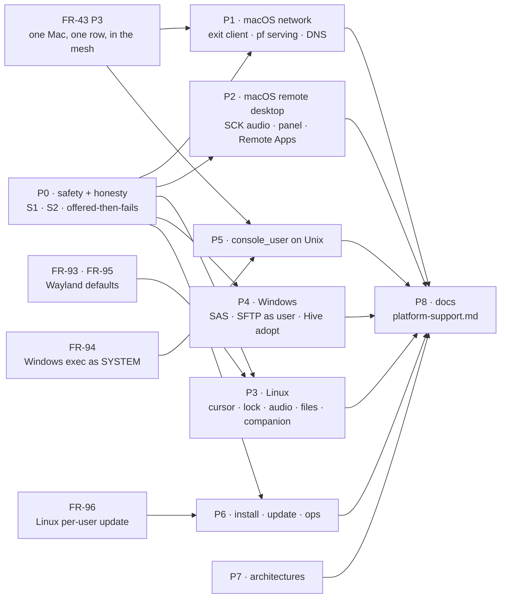
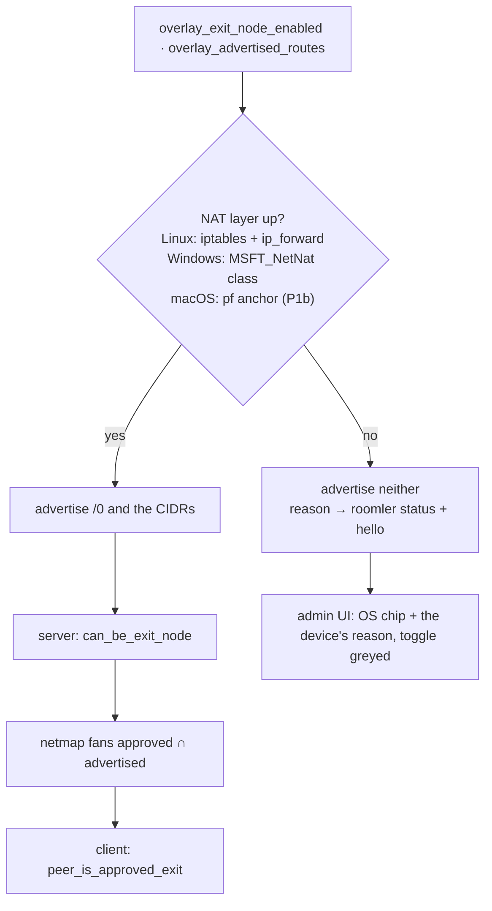

# FR-97: OS parity — what one OS does, the other two do, or the device says why not

**Issue:** [#2082](https://github.com/gjovanov/roomler-ai/issues/2082) · **Status:** in progress — P0a (#2081, #2085)
shipped in 0.4.132 and field-verified (AC1); P0b-1 (#2098, server) live since the hosted promote of `c6bcdb2de`;
P0b-2a (#2104, device) ships in 0.4.133; P0b-3 (#2108, admin row) live since the promote of `b180d92d4`; P0b-2b
(the Windows forwarding restore) in review; P1a (the macOS exit client, #2122 and its field fix #2125) shipped in
0.4.134 and is field-verified except DNS (P1c) · **Owner:** the agent on all
three platforms; the network module for the route gate (P0b) ·
**Depends on:** [FR-43](FR-43-macos-single-enrollment.md) P3 (one Mac, one row, in the mesh),
[FR-94](FR-94-fleet-rpc-system-on-windows.md) (Windows exec as SYSTEM),
[FR-96](FR-96-per-user-linux-installs-update-themselves.md) (Linux per-user updates),
[FR-93](FR-93-wayland-out-of-the-box.md) / [FR-95](FR-95-system-installs-on-by-default-on-wayland.md) (Wayland
defaults, the root clipboard) · **Fixes:** #2081 (§2.1 S1), the black hole and the forwarding leak of #2077 (not
"Windows Home can serve", which stays #2077's), #1538

## 1. Goal

Roomler is one product on three operating systems. A feature that ships on one of them ships on the other two, or
the device says, in its hello and on screen, why it cannot. It never offers something that then fails silently.

- Every gap in §2 ends in one of three states: **implemented** on all three; **refused honestly**, with the
  device's own reason reaching the viewer, the admin UI and `roomler status`; or **out of scope by OS design**,
  written down in `docs/platform-support.md` (new, P8) with the reason.
- Two latent safety defects come first (§2.1). Both sit inside pillar 2's never-self-wedge contract, and one is on
  the macOS exit-node path, the gap that prompted this inventory.
- No phase regresses an OS that already works. Each one is shown red on the OS that lacks it, and green on the two
  that have it, before and after.



## 2. Evidence

An inventory of master `e00fba126` (2026-10-13): four read-only sweeps (remote desktop; desktop and companion;
network; SSH, install and update), plus a direct read of every claim marked ✔. Release feature sets per OS, from
`.github/workflows/release-agent.yml`: Linux x86_64 `:530`, Linux arm64 `:925` (no `ffmpeg-encoder`), Windows x64
`:1381`, macOS arm64 `:2414` (no `viewer-indicator-macos`, by the decision written at `:2396-2412`). A feature that
compiles but is not in an OS's release set does not ship there, and is counted as missing.

Legend: ✅ shipped · 🟡 partial · ❌ missing (the OS can do it) · ⛔ not applicable by OS design · ❓ code exists,
never run.

### 2.1 Safety — two defects to fix before any parity work

**S1 (#2081) — a Mac exit-node client installs the split-default with nothing pinned.** ✔
`TunIo::add_host_exemption` defaults to `Ok(())` (`crates/tunnel-core/src/overlay/tun.rs:162-164`), and
`SystemTun` overrides it only on Linux and Windows (`tun.rs:4248-4249`, `cfg(any(linux, windows))`). On macOS every
carrier exemption therefore "succeeds" without installing a route (`runtime/route_guard.rs:523-526`), the v4 gate
passes (`route_guard.rs:541-556`), and the `/1` halves go in through the real macOS route arm
(`route_guard.rs:566-570` → `tun.rs:3876-3925`). The coordination server, coturn and the exit peer's own endpoint
then route into the utun that is supposed to carry them. That is the self-wedge the withhold gate exists to
prevent, and the guard re-asserts it on every tick.

- A restart does not heal it: `purge_split_default` runs at boot, then the runtime re-installs from the persisted
  `overlay_exit_node`.
- Reach: a Mac running the opt-in root daemon whose operator sets `overlay_exit_node`. The key is not in
  `DesiredConfig` (`crates/remote_control/src/models.rs:1768-1797`), so no server push can set it; a local
  `sudo roomler config set` can, and so can an `exec` on the daemon's row. Once it lands, the control WS that the
  `exec` came in on is captured too, so the same channel cannot undo it.
- `NetstackTun` inherits the same default. It installs no OS routes, so it cannot wedge, but `roomler status`
  reports the exit `active` although its userspace stack has no route off the overlay prefixes
  (`netstack.rs:1176-1186`), so nothing reaches the exit (P0c).
- This is a reading of the code path, not yet reproduced on a Mac. P0a reproduces it, red, on a throwaway VM first.

**S2 — exit and subnet serving is offered where nothing NATs, and an approval outlives the offer.** ✔

- The `/0` advertisement is unconditional (`crates/agent-core/src/config.rs:2046-2055`) and independent of NAT setup
  (`runtime.rs:2108-2113`; the setup's success only picks a log level, `nat.rs:80-94`). macOS has no NAT arm at all
  (`nat.rs:353-355` returns `false`), and because the guard is armed only on Linux and Windows (`nat.rs:87`), it logs
  nothing. Windows Home fails `New-NetNat` silently and leaves IPv4 forwarding on after the revert (#2077).
- The server derives `can_be_exit_node` from the advertisement alone
  (`crates/modules/network/src/routes/overlay_route.rs:63`), and the admin row carries no OS (`overlay_route.rs:28-59`)
  although every agent row has one (`models.rs:1386`).
- `approved_routes` survives a rejoin on purpose (`crates/services/src/dao/overlay_node.rs:239-241`), and the netmap
  fans `approved_routes` without intersecting what the node still advertises
  (`crates/modules/network/src/overlay.rs:2549`). A client accepts any peer whose fanned routes hold `/0`
  (`route_guard.rs:303-304`). So an exit that stops offering, on any OS, stays an exit in its clients' netmaps until
  an admin un-approves it. ⚠️ A device-side fix alone cannot close the black hole.

### 2.2 Pillar 2 — network

| # | Feature | Windows | Linux | macOS | Where it stops | Phase / owner |
|---|---|---|---|---|---|---|
| N1 | In the mesh on a default install | ✅ | ✅ | ❌ | The default `.pkg` installs the per-user half, which cannot create a utun; the mesh needs `--daemon-token`, a second enrollment and a second device row (`scripts/install.sh:408-411`, `packaging/macos/com.roomler.daemon.plist` header) | FR-43 P3 |
| N2 | Exit node, client | ✅ | ✅ | 🟡 withheld since 0.4.132; routes with P1a, DNS with P1c | S1; no original-default capture (`tun.rs:1931-1939`, `3471-3503` are `cfg(any(linux, windows))`) | P0a, P1a |
| N3 | Exit node, serving v4 | 🟡 WinNAT; Home ❌ | ✅ iptables | ❌ | Silent no-op (`nat.rs:353-355`); Home: #2077 | P0b, P1b, P4e |
| N4 | Exit node, serving v6 | ⛔ WinNAT has no v6 (`nat.rs:245-251`) | ✅ ip6tables | ❌ | — | P1b; Windows: D1 |
| N5 | Subnet router, serving | 🟡 WinNAT; Home ❌ | ✅ | ❌ | Same no-op; routes still advertised and approvable | P0b, P1b |
| N6 | MagicDNS OS steer | ✅ NRPT | 🟡 systemd-resolved only (`dns.rs:408-429`) | 🟡 P1c (code; field owed) | A TUN-mode Mac resolves names only with the opt-in hosts ladder. *P1c:* a temporary SCDynamicStore supplemental resolver per utun | P1c, P3h |
| N7 | Exit DNS steer (no leak) | ✅ NRPT `.` | 🟡 resolved only | 🟡 P1c (code; field owed) | Reported honestly as `DNS NOT steered`. *P1c:* a temporary catch-all key (`SupplementalMatchDomains = [""]`) | P1c, P3h |
| N8 | Host firewall admits the daemon's inbound UDP | ✅ Defender rule + WFP (`winfw.rs`, `wfp.rs`) | ❌ firewalld / ufw / nft untouched | ❌ ALF untouched | Effect on carriers unmeasured | P3i (evidence first) |
| N9 | LAN-direct egress pin; own-route repair | ✅ `IP_UNICAST_IF` (`direct.rs:466-507`), `lan_repair.rs` | ❌ | ❌ | The field case was Windows + AnyConnect | §7 (evidence first) |
| N10 | Per-org TUN (multi-org) | ✅ | ✅ | ❓ | One utun per org in code (`agents/roomlerd/src/overlay.rs:303-316`), never run on a Mac; `roomler org join` still warns it is unsupported (`org_join.rs:561-566`, stale) | P1d |
| N11 | Port-holder diagnostics | ✅ | ✅ | 🟡 `Unknown` (`port_holder.rs:316-323`) | Diagnostics only | P1d |
| N12 | Exit client: the pins follow the uplink | 🟡 P0e | 🟡 P0e | ✅ P1a | *P0e part 2 (code, field owed):* `stale_host_exemptions` re-reads each family's uplink on Linux (`ip route show`) and Windows (a FIB snapshot ranked as the OS ranks, our own adapters excluded, because the exit's `/1`s out-match a lookup toward the unspecified address) and adopts one that moved; a pin through the old uplink, or gone from the table, is re-pinned, and a Windows pin's old route is removed once the new one is in. Found in P1a. Linux and Windows pin through the default captured once at bring-up and never re-read it (`TunIo::stale_host_exemptions` keeps its empty default there). After a network change under an active exit, a pin the OS did not flush with the old interface still points at a next hop that no longer answers: the exit's carrier dies, the teardown removes the `/1`s, and a stale `/32` for the coordination server keeps the control WS from coming back until a restart. Code reading; not reproduced yet | P0e |
| N13 | Exit client: no pin outlives the daemon | 🟡 P0e | 🟡 P0e | 🟡 P0e | *P0e part 1 (code, field owed):* every pin is recorded in the host ledger when it is made and forgotten when it is removed; `host_ledger::purge` removes what is left at boot, before every `process::exit`, and after every exit of `roomlerd run` (`docs/overlay-exit-nodes.md`, "Exit-client pins"). Found in P1a. `purge_exit_routes` (boot and every pre-`process::exit` path) removes the `/1`s and the DNS steer, never the `/32`/`/128` pins through the physical uplink, and nothing records which host routes were ours. Harmless on the same network; after a network change the OS did not flush them with, a black hole for the endpoint, the coordination server's included. On a Mac, P1a repoints a leftover pin in place if the next run is an exit client again; nothing removes one otherwise. **Field, 0.4.134 (§8): a CLEAN stop leaks them too.** No shutdown path calls `teardown_exit_routing`; the `/1`s only go because the TUN does. A daemon stopped and then moved to another network comes back with the server's `/32` on a next hop that no longer answers, so its control WS cannot reconnect, and the overlay runtime that would re-pin never starts | P0e |

At parity already: TUN bring-up; v4 and v6 ULA addressing (the exit-node doc's "utun v4-only" is stale,
`tun.rs:4704-4737`); route-change subscriptions (`NotifyRouteChange2` · `ip monitor` · `route -n monitor`);
PathMonitor; every carrier (disco, direct, netcheck, relays, DERP, QUIC); peer-relay serving; tunnels, SOCKS5 and
declared routes; the in-daemon overlay ACL; key rotation; ephemeral nodes; the subnet-router *client* role.

### 2.3 Pillar 1 — remote desktop

| # | Feature | Windows | Linux | macOS | Where it stops | Phase / owner |
|---|---|---|---|---|---|---|
| R1 | System audio in a session | ✅ WASAPI loopback | 🟡 a Pulse `.monitor`, else **the default microphone** (`audio/cpal_backend.rs:277-304`) | ❌ | macOS: `NoopAudioCapture` (`audio/mod.rs:78-98`) while `opus` is advertised (`encode/caps.rs:1343`) ✔ | P0c, P2a, P3c |
| R2 | Native consent panel | ✅ | ✅ X11 · ⛔ Wayland → companion | ❌ | Built (`indicator/mac.rs`), not in the release set (`release-agent.yml:2396-2412`) | P2b (D3) |
| R3 | Remote Apps | ✅ | ✅ X11 · 🟡 Wayland: Xwayland windows (FR-56) | ❌ | `Unavailable::Platform` (`apps/mod.rs:347`); no `apps/macos.rs` | P2c |
| R4 | Live cursor shape | ✅ | ❌ | ❌ | `capture/cursor.rs:90`; an XFixes decoder already exists for recordings (`capture/pointer.rs:187-230`) | P3a, P2d |
| R5 | "Host is locked" consent hint | ✅ | ❌ | ❌ | Always `Unlocked` off Windows (`lock_state.rs:290-311`) | P2d, P3b |
| R6 | Keyboard layout report / switch | ✅ | ❌ | ❌ | Windows-only cap (`caps.rs:1375-1383`) | P2d, P3e |
| R7 | Match remote display | ✅ | ❌ | ❌ | `display_match.rs:203` | P2d, P3e |
| R8 | Clipboard: host → viewer image sync | ✅ | ❌ | ❌ | Forced off (`clipboard.rs:818-822`) ✔ while advertised (`caps.rs:1356-1364`) | P0c, P2e, P3e |
| R9 | Clipboard: RTF lane | ✅ | ❌ | ❌ | `clipboard.rs:792` | P2e, P3e |
| R10 | Clipboard on a system (root) install | ✅ | ❌ | ✅ | No `DISPLAY`, advertised anyway (`peer.rs:9446-9449`) | FR-93 P7 |
| R11 | Typing text on a non-US layout (uinput) | ✅ | 🟡 US table only | ✅ | `keylayout.rs:40-46`, `uinput_backend.rs:431-437` | P3f |
| R12 | Recording with audio | ✅ system + mic | ✅ | 🟡 picture only | No SCK audio; cpal is not a macOS dependency (`agents/roomlerd/Cargo.toml:321-322`) | P2a, P2f |
| R13 | Dirty-rect capture (idle CPU) | ✅ WGC | ✅ X11 · ❌ Wayland | ❌ | `Damage::Unknown` (`scrap_backend.rs:212`) | D2 |
| R14 | "Being viewed" banner kept out of the stream | ✅ | ❌ | ❌ | CGDisplayStream ignores `NSWindowSharingNone` (`desktop-companion.md:514-517`) | D2 |
| R15 | Greeter, nobody signed in | ✅ SystemContext | 🟡 DRM, opt-in | ⛔ | macOS loginwindow: §7 | FR-93 / FR-95 |
| R16 | Ctrl+Alt+Del | ❌ | ⛔ | ⛔ | §2.7 item 3 | P0c, P4a |

At parity already: capture of the primary display, HiDPI, the hardware encoder families each OS has (VideoToolbox
ships on macOS, whatever the user docs say, §2.8), keep-busy (FR-92), recording video, file transfer, the TCC flow,
and the consent chain's fallbacks.

### 2.4 Desktop, companion, power, files

| # | Feature | Windows | Linux | macOS | Where it stops | Phase / owner |
|---|---|---|---|---|---|---|
| D1 | Companion: tray, banner, consent, Apply now | ✅ | 🟡 | ✅ | One x86_64 `.deb` (`release-agent.yml:744-830`); Fedora, Arch and arm64 have none | P3g (with FR-93 D5/D6, FR-95) |
| D2 | Companion pages on a system install | ✅ | 🟡 safety pages only | ❓ | Person socket (`crates/localapi/src/lib.rs:2542-2586`); a two-half Mac may answer Routes and Devices from the user half | #1911; FR-43 P3 |
| D3 | Keep the host awake during a session | ✅ `PowerCreateRequest` | ❌ | ✅ IOPMAssertion | A stub whose reason, "zbus is in no shipped Linux feature set" (`power.rs:505-516`), is stale: `portal-capture` ships zbus in `full` | P3b |
| D4 | Received files land as the signed-in user (system install) | ✅ | ❌ | ✅ | Root's home or `/tmp` (`files.rs:182-206`, `2483-2521`) | P3d |
| D5 | The setup wizard installs the daemon | ✅ | ❌ | ❌ | Tunnel client only (`agents/roomler-setup/src/commands.rs:79-103`) ✔, yet the enroll dialog offers it for agents (`ui/src/utils/enrollCommands.ts:114-119,148,164`) ✔ | P0c, D5 |
| D6 | Hive: adopt a terminal session | ❌ | ✅ | ✅ | `hive/supervisor/adopt.rs:404` | P4c |

### 2.5 SSH and Fleet RPC

| # | Feature | Windows | Linux | macOS | Where it stops | Phase / owner |
|---|---|---|---|---|---|---|
| X1 | `exec` and SSH `daemon` mode run as the machine | 🟡 the console worker: the signed-in user on attended installs (#2021) | ✅ root | 🟡 root on the `-daemon` row, the user on the other | Two identities, one per row | FR-94; FR-43 P3 |
| X2 | `console_user` account mode | 🟡 SystemContext only | ❌ | ❌ | "a Windows concept" (`exec.rs:829`) | P5a, after FR-94 |
| X3 | SFTP / scp as the signed-in user | ❌ | ✅ | ✅ | Refused (`ssh.rs:942`); `tokio::process` cannot take a token | P4b |

### 2.6 Install, update, ops, architectures

| # | Feature | Windows | Linux | macOS | Where it stops | Phase / owner |
|---|---|---|---|---|---|---|
| O1 | A per-user install updates itself | ✅ | ❌ | ✅ | #2046 | FR-96 |
| O2 | The artifact's own version checked against the manifest | ✅ MSI `ProductVersion` | ❌ | ❌ | `Unsupported` → the install proceeds (`artifact_version.rs:272-289`, `updater.rs:1404`): a signed older package under a newer manifest installs | P6a |
| O3 | Tunnel CLI `roomler self-update` | ✅ | ❌ | ❌ | `agents/roomler-cli/src/update.rs:96-101` | P6b |
| O4 | One CLI verb registers the system service | ✅ `service install --as-service` | ❌ | ❌ | `main.rs:4562` | P6c |
| O5 | Uninstall | ✅ MSI, `install.ps1 -Uninstall` | 🟡 apt only; the tarball has none | ❌ | A pasted recipe (`docs/installation.md:394-420`) | P6d |
| O6 | An update's outcome is recorded | 🟡 written, never read | ❌ the watcher dies with the unit (#1239) | ❌ none | — | FR-67 |
| O7 | A supervisor records a worker that dies before its own hook | ✅ | ⛔ journald | ❌ | `macos_supervisor.rs` never calls `crash_recorder` | P6e |
| O8 | The daemon survives a failed stdout write | ✅ | ✅ | ❌ | #1538 | P6e |
| O9 | A private per-download staging dir | 🟡 shared `%TEMP%\roomlerd-update` | ✅ mkdtemp | 🟡 shared | `updater.rs:1170-1179` | P6f |
| O10 | An ephemeral device removes itself on a clean stop | 🟡 SCM installs only | ✅ | ✅ | A Scheduled-Task install has no stop signal (`main.rs:2680-2686`) | P4d |
| A1 | Daemon + companion on Intel Macs | — | — | ❌ | arm64 only (`release-agent.yml:2144-2150`); the CLI and the wizard are universal | D6 |
| A2 | Daemon on Windows ARM64 | ❌ | — | — | x64 MSI only (`wix-perMachine/main.wxs:80-81`); behaviour under emulation unverified | D6 |
| A3 | Hardware encode on Linux arm64 | — | ❌ | — | No `ffmpeg-encoder` (`release-agent.yml:925`); recordings write Opus, not AAC | P7a |
| A4 | Tunnel CLI and wizard on Linux arm64 | — | ❌ | — | x86_64 only (`release-tunnel.yml:127-131`, `release-setup.yml:184-189`) | P7b |

The server records `os` on every agent row but no architecture (`models.rs:14-18`, `:1386`), so it cannot count the
devices A1 and A2 would serve. P0d adds the native machine architecture to the hello. On Windows that is
`IsWow64Process2`'s native machine, because an x64 build under emulation would otherwise report x86_64.

### 2.7 Offered, then fails

1. macOS advertises `opus` audio and streams silence (R1).
2. Linux and macOS advertise clipboard image events they never send (R8); a root Linux daemon advertises a clipboard
   it cannot reach (R10).
3. The Ctrl+Alt+Del button shows for every host. It sends three ordinary key events
   (`ui/src/composables/useRemoteControl.ts:11218-11230`) ✔, and nothing in the agent calls `SendSAS` (grep: none) ✔.
   Windows does not treat a synthesised Ctrl+Alt+Del as the secure attention sequence, so the button does nothing at
   a lock screen that requires it; on Linux and macOS the chord means something else, or nothing.
4. The enroll dialog offers the setup wizard for agents on Linux and macOS, where it installs only the tunnel client
   (D5).
5. An admin can approve a Mac or a Windows Home device as an exit or subnet router (S2).

### 2.8 Docs that say otherwise (fixed in P8)

| Doc | Says | Code |
|---|---|---|
| `docs/overlay-exit-nodes.md:228` | macOS utun is v4-only; exit routing not wired | v6 is assigned (`tun.rs:4704-4737`); the client half is wired except for the exemptions (S1). **Fixed with P1a:** a per-OS table and a macOS client section |
| `ui/docs/content/network/exit-nodes.md` | no platform caveat; v4, v6 and DNS all routed | Windows exits are v6 fail-closed; macOS and Windows Home cannot serve |
| `docs/overlay-exit-nodes.md:250-252` | approval needs a re-join | the server re-fans at once (`overlay_route.rs:301,375`) |
| `ui/docs/content/network/multi-org.md:87`, `org_join.rs:561-566` | a Mac cannot run a per-org TUN | the per-org utun code is unconditional (N10) |
| `docs/multi-org.md` §4.4, §4b | the shared-TUN mux and mux NAT | deleted in W7c (`overlay.rs:310-316`) |
| `docs/magicdns.md:88` | Mac names resolve through the SOCKS path | only in netstack mode |
| `ui/docs/content/remote-desktop/codecs-and-performance.md:43-50` | macOS encodes in software; VideoToolbox not wired | VideoToolbox ships (`encode/ffmpeg/encoder.rs:97-105`) |
| `docs/remote-control.md:264,341` | macOS captures with ScreenCaptureKit; dirty rects from SCK | CGDisplayStream through scrap (`scrap_backend.rs:8`); no SCK code anywhere |
| `docs/remote-control.md:389-392` | the installer adds the `input` group and a udev rule | no packaging does |
| `docs/remote-control.md:1611-1616` | VideoToolbox deferred; the audio-input entitlement is covered | VideoToolbox ships; no entitlement or usage-description key exists |
| `docs/roomler-ssh.md:22-23` | `ssh-server` is not in the release sets | all four lanes build it |
| `docs/roomler-ssh.md:311-325` | Windows `daemon` → SYSTEM | the console worker (#2021, FR-94) |
| `docs/installation.md:21-22`, `ui/docs/content/start/install/macos.md:51-53` | install the macOS daemon with the wizard | the wizard's daemon roles are Windows-only |
| `docs/installation.md:43-44`, `ui/docs/content/troubleshooting/install-problems.md:37-40` | downloads come from roomler.ai | true for the MSI proxy, the CLI and the wizard; `install.sh`'s `.deb`/tarball/`.pkg` and every self-update fetch from GitHub (`updater.rs:1276,1360`) |
| `ui/docs/content/remote-desktop/files-and-clipboard.md:14,63`; the tooltip at `RemoteControl.vue:2798` | the clipboard is text; images sync automatically | images and HTML on all three; host → viewer images from Windows only; nothing on a root Linux daemon |
| `ui/docs/content/remote-desktop/per-os-permissions.md:76-103`, `unattended-access.md:58-59` | Wayland input supported; a root service has nothing to capture | input is `xwayland_only` by default (`input/reach.rs:181-224`); DRM captures from root (opt-in) |
| `ui/docs/content/start/install/windows.md:95` | machine-global config at `%PROGRAMDATA%\roomler\config.toml` | `%PROGRAMDATA%\roomler\roomler\config.toml` (`appdirs.rs:41-44`) |
| `packaging/linux/README.Debian` | capture is X11-only; Wayland fails | FR-36, FR-45, FR-93 |
| code comments: `power.rs:505-510`, `lock_overlay.rs:32-34`, `code_signature.rs:36-43`, `post_install.rs:80-81`, `caps.rs:1623`, `tun.rs:3249-3254` | — | stale, each named in its row above or in the sweeps |

### 2.9 Equal on all three: not parity, recorded so nobody files them here

Multi-monitor streaming and switching (the viewer always sends `mon: 0`, `useRemoteControl.ts:9535`), a curtain or
privacy mode, touch injection, a live microphone (two-way audio), OS toast notifications
(`crates/agent-core/src/notify.rs:21-24`), file copy-paste through the clipboard, minidumps, and SSH agent and X11
forwarding. Several deserve FRs of their own; none is a platform gap.

## 3. Key design

### 3.1 The rule: parity, or an honest no

A capability word in the hello (`encode/caps.rs`) promises that this device serves it on this OS, and a test where
the word is computed proves it. Where an OS cannot, or cannot yet, the device sends the word with a reason. That is
the shape FR-80 gave capture (`rc:media-unavailable`), FR-93 gave input (`rc:input-reach`), FR-92 gave keep-busy and
FR-56 gave Remote Apps (`unavailable`). The viewer and the admin UI grey the control and show the device's reason.
They hide it only where the feature means nothing on that OS (Ctrl+Alt+Del on a Mac).

⚠️ Do not gate on `agent.os` in the UI to cover a missing capability. A Windows Home host is Windows, a Mac
without its root daemon is macOS, and a later release closes the gap without a UI release. The device says what it
can do.

### 3.2 P0a — fail toward withhold (#2081)

`SystemTun` refuses an exemption wherever it has no arm: a `cfg(not(any(linux, windows)))` `add_host_exemption`
returns `ErrorKind::Unsupported`, so on macOS the gate at `route_guard.rs:545-556` withholds and `roomler status`
says why. The trait default stays `Ok(())`, now documented as safe only for a device that installs no OS routes
(the in-memory mocks, netstack); changing it would move every mock and netstack for no safety gain. Netstack's untrue
`active` belongs to P0c. The test that fails on master is
`macos_kernel_tests::an_exemption_it_cannot_pin_is_refused_not_reported_pinned`, run on a real utun by CI's macOS job.

### 3.3 P0b — offer only what you serve, fan only what is offered



- **Device.** Probe the NAT layer before advertising `/0` or any subnet CIDR: on Linux the iptables/ip6tables
  binaries answer and `ip_forward` is writable; on Windows the `MSFT_NetNat` class exists (Home answers
  `Invalid class`); on macOS nothing until P1b. When it is down, advertise neither and say so in `roomler status`
  (`exit node offer withheld — <reason>`) and in a hello field the admin UI reads.
- **Device.** The Windows revert restores the `Forwarding` value it found on both interfaces, rather than only
  running `Remove-NetNat` (#2077). *P0b-2b:* the setup script reports each interface's adapter GUID and its state
  before; `host_ledger::ForwardingHolds` refcounts per interface (two orgs can share an egress adapter, and the
  first holder's observation decides); the last holder of an interface we turned on switches it off in `Drop`; and
  a ledger at `HKLM\SOFTWARE\Roomler\Overlay` (value `HostLedger`) lets `purge_exit_routes()` do the same after
  an unclean exit (`nat::purge_forwarding`). Not a file under `%ProgramData%`, where any account may create one:
  SYSTEM acts on the ledger at boot, so a planted file would choose the adapter it switches forwarding off on.
  `New-NetNat` failures now log WinNAT's own message.
- **Server.** Fan `approved_routes ∩ advertised_routes` (`overlay.rs:2549`). The approval stays stored, because a
  flapping join must not cost an admin's decision, but it takes effect only while the device still offers the route.
  An agent older than P0b keeps advertising what it always did, so the intersection changes nothing for it.
- **Admin UI.** An OS chip on the routes row (`OverlayNodeResponse` gains `os`, read from `Agent.os`), and the
  device's reason when it offers nothing.

### 3.4 P1a — the macOS exit client

Mirror the Linux arm with the BSD tools the macOS code already drives, and close two gaps the Linux arm has (N12):

1. **The uplink, per family.** At bring-up, `route -n get [-inet6] default` gives the next hop and the interface
   (`tun.rs:3878`). It is kept in a mutex rather than a fixed field like `orig_default`, because it is RE-READ before
   every pin (`current_uplink`, `tun.rs:5441`): a Mac that booted without a network still pins once it has one, and
   one that changed networks pins through the new uplink. `bsd_default_uplink` (`tun.rs:316`) refuses a route on our
   own utun, one narrower than `/0` (a `/1` also prints `destination: default`; only the mask tells), and one with no
   next-hop address (another VPN's interface route). A family with no usable default keeps what it had, so a network
   in transit does not move the pins.
2. **A pin is read from the routing TABLE** (`netstat -rnW -f inet[6]`, `bsd_table` `tun.rs:5343`), never from a
   lookup. A destination a connection has used keeps an interface-scoped clone of the default route
   (`WASCLONED,IFSCOPE`), and an unscoped `route -n get` answers with that clone even after the pin is in (field,
   §8: the first P1a read back by lookup and refused every pin for the server). The pin is the UNSCOPED static host
   route for exactly the address (`bsd_pin_row`, `tun.rs:398`: flags `H` and `S`, never `W` or `I`), and it holds
   when it is flagged `G` through the uplink's next hop on its interface (`bsd_pin_holds`, `tun.rs:411`).
3. **`add_host_exemption`** (`tun.rs:4740`) looks first, because BSD `route` has no idempotent write (#1856): a pin
   that holds is left alone; one that does not (the old uplink, a crashed run's, an interface route) is deleted, then
   added; anything else gets `route add -host <ip> <gw>` (`-inet6` and a zoned `fe80::1%en0` for v6). Never `route
   change`: it resolves its target the way the lookup does, and on the field Mac it left the pin untouched. The table
   then decides; a pin that does not hold comes out again and the call errs.
4. **The pins follow the uplink.** `TunIo::stale_host_exemptions` (new; `tun.rs:4838` on macOS, an empty default
   elsewhere) names the pins the table does not show through the current uplink. The gate (`route_guard.rs:570`)
   asks at most every 3 s, re-pins each, and DELETES one it cannot re-pin before forgetting it, so an untracked
   route never outlives the exit. Then the usual rule applies: a v4 pin missing means WITHHOLD.
5. **`del_host_exemption`** removes only the pin the table shows, never a route on our utun (a peer route): with no
   unscoped pin left, `route -n delete -host` removed something else on the field Mac. The boot purge already
   removes the `/1`s (`tun.rs:4603-4646` at the time of writing); pins an unclean exit leaves behind are N13, all
   three OSes.
6. **The two 0.4.132 follow-ups.** The pin WARN fires once per (endpoint, cause) (`note_exemption_failure`,
   `route_guard.rs:370`), and the withheld reason carries the device's own cause for the lowest missing v4 endpoint
   (`exemption_withheld_reason`, `route_guard.rs:382`) instead of `no original default route?`.

Kill switch: `ROOMLERD_EXIT_CLIENT_MACOS=0` refuses every exemption, as 0.4.132 did. DNS is not steered yet (P1c):
`roomler status` says `DNS NOT steered`.

```mermaid
sequenceDiagram
    autonumber
    participant G as route_guard
    participant T as SystemTun (macOS)
    participant K as kernel routes
    Note over T,K: at bring-up — route -n get default / -inet6 default → gateway + uplink
    G->>T: add_host_exemption(server, coturn, exit endpoint)
    T->>K: route -n add -host ip gw
    T->>K: netstat -rnW (the table: a lookup answers with a scoped clone)
    alt every v4 pin holds through the uplink
        G->>T: add_cidr_route(0.0.0.0/1, 128.0.0.0/1, ::/1, 8000::/1)
        G->>G: steer DNS (P1c); set_v6_exit only when the v6 exemptions hold
    else a pin fails, or the table shows it elsewhere
        G->>G: WITHHOLD — egress stays on the uplink, the reason goes to roomler status
    end
```

⚠️ A Wi-Fi ↔ Ethernet change moves the default gateway. Step 4 is what follows it: the re-check reads the uplink
again and re-pins with the `/1`s left in place. A pin that cannot follow is removed, and the gate withholds until one
can.

### 3.5 P1b — serving on macOS (exit and subnet router) — D1

Kernel NAT through pf, the macOS twin of the iptables arm:

- Rules live in our own anchor under the stock wildcard (`/etc/pf.conf` carries `nat-anchor "com.apple/*"` and
  `anchor "com.apple/*"`), so `pf.conf` is never edited: `nat on <uplink> inet from <overlay CIDRs> to any ->
  (<uplink>)`, the v6 equivalent for the overlay ULA, and `pass` for the utun.
- Enable with `pfctl -E` and keep the reference token; release it with `pfctl -X <token>`, never `pfctl -d`, which
  would also disable pf for every other user of it (Internet Sharing, a VPN client).
- Record the `net.inet.ip.forwarding` / `net.inet6.ip6.forwarding` values found and restore them.
- Persist {token, sysctl values, anchor} in the state dir. A boot purge beside `purge_exit_routes` flushes the
  anchor and restores the sysctls after a crash.
- Re-render on an uplink change; the `(uplink)` form follows an address, not a new interface.

⚠️ Verify on hardware before writing code; none of this is checked against Apple's documentation yet. Is a
sub-anchor under the stock `com.apple/*` wildcard evaluated without touching `pf.conf`? What do Internet Sharing and
the common corporate VPN clients do to pf? (A `pfctl -F all` would erase our rules, so a guard must re-assert them,
as the route guard does for routes.) Does the Application Firewall's stealth mode touch forwarded flows?

**The alternative (D1):** a userspace egress in the daemon, where the overlay netstack terminates forwarded flows
and re-originates them from host sockets. One implementation would also cover Windows Home (#2077) and Windows v6,
with no OS NAT at all; it is slower, and it has to carry ICMP and arbitrary UDP itself.

### 3.6 P1c — macOS DNS

Prefer the SCDynamicStore to files: a supplemental resolver (`SupplementalMatchDomains = [<magic domain>]`, server
`self_v4`) for MagicDNS, and a service-level override for the exit catch-all. Keys written with
`SCDynamicStoreAddTemporaryValue` should disappear when the daemon's store session ends, which would make the steer
crash-safe by construction (unverified; P1c's first task). The fallback for the split zone is `/etc/resolver/<domain>`
(honoured by the system resolver, not by `dig`), purged at boot. Keep the existing bound-resolver gate
(`runtime.rs:2372-2392`): never steer at a `:53` that did not bind.

*Done first, 2026-10-14, on throwaway tart VMs with `scutil` only, before any code (§8):* a temporary key's holder
SIGKILLed → the key is gone within 1–4 s (two keys in one session: both); the same key without the flag survives its
writer. With an unreachable resolver as the oracle, a zone key routes exactly its names, and **`[""]` is the
catch-all** (resolver #1 for every name, a more specific zone still wins). The "service-level override"
(`OverridePrimary`) did nothing, so it is not used, and with it no routing side effect is possible. No
`/etc/resolver` fallback is needed. Built that way: one store session per process, owned by a thread (`mod scdns`,
`dns.rs`), every key added temporary; two `macos_kernel_tests` run it on CI's Mac as root, one of them a regression
test of the SIGKILL property itself.

### 3.7 P2 — macOS remote desktop

- **P2a, system audio through ScreenCaptureKit** (`SCStreamConfiguration.capturesAudio`, macOS 13+; the agent's floor
  is 15, `docs/installation.md:267-282`), in the GUI worker, under the Screen Recording grant it already holds. The
  same stream feeds FR-85's recorder (R12). Until it ships, P0c stops advertising `opus` on macOS.
- **D2, video through SCK as well.** It would bring dirty rects (R13), keep the banner out of the stream (R14), and
  cursor metadata (R4), but it replaces a backend that works. Decide on a measured A/B of latency and CPU.
- **P2b, the native consent panel.** Follow the procedure written at `release-agent.yml:2396-2412`: a dispatch
  build on a real Mac where the daemon starts and a prompt appears and answers, then add `viewer-indicator-macos` to
  the release set. It moves tokio off the main thread on every Mac, and a Mac that fails to start cannot pull its own
  fix, so it goes to one Mac, then the field Macs, then a release.
- **P2c, Remote Apps without AppKit.** List with `CGWindowListCopyWindowInfo` (titles need the Screen Recording grant
  already held), focus with the Accessibility API (`AXUIElement` raise and `kAXFrontmostAttribute`), launch
  allowlisted apps through LaunchServices (`open -b <bundle id>`). It runs in the GUI worker and crosses FR-43's
  delegate channel like the other `rc:*` kinds.
- **P2d, the small ones.** `host_locked` from the session dictionary's lock flag (`CGSessionCopyCurrentDictionary`),
  which keep-busy already reads (`keep_busy/host_mac.rs:15-19`): advisory only, never an input gate (FR-92's rule,
  `FR-92-keep-busy.md:53`). Layout through TIS (`TISCopyCurrentKeyboardInputSource` / `TISSelectInputSource`).
  Display-match through `CGDisplaySetDisplayMode` with a restore guard: macOS has no `CDS_FULLSCREEN`-style
  auto-revert, so the daemon owns the restore, after a crash too. The cursor shape needs AppKit and follows D3.
- **P2e, clipboard.** Image watching on the `NSPasteboard` change count (the Windows sequence-number shape); RTF as
  `public.rtf` beside the HTML lane.
- **P2f, a microphone for recordings.** cpal on macOS, `NSMicrophoneUsageDescription` in the bundle (a missing key
  ends the process at first access), and the audio-input entitlement.

### 3.8 P3 — Linux

- **P3a, cursor.** On X11, `XFixesGetCursorImage`, wiring the recorder's decoder (`capture/pointer.rs:187-230`) into
  the live channel. On portal and mutter, PipeWire cursor metadata (`SPA_META_Cursor`).
- **P3b, lock and sleep.** `host_locked` from logind's `LockedHint` (`keep_busy/logind.rs`), advisory only; sleep
  inhibited with logind `Inhibit("sleep:idle", …)` over the zbus that already ships.
- **P3c, audio.** On the live path, refuse rather than fall back to a microphone, as the recorder already does
  (`Source::SystemOnly`). A root daemon captures the session's monitor through the session helper it already drops
  privileges into.
- **P3d, files on a system install.** Resolve the seat's user (`companion::graphical_session`) and write into their
  Downloads *as that user*, the twin of `active_user_downloads_path` on Windows (`files.rs:2467-2480`).
  ⚠️ Never as root followed by a `chown`: in a directory the user owns, a root path operation can be redirected
  through a swapped-in symlink to any file root can reach. Do every path step on a thread switched with
  `setfsuid`/`setfsgid`, the pattern FR-27 P11's person socket already uses (`crates/localapi/src/lib.rs:3579-3622`),
  so the file is born theirs. ⚠️ "The user" is the seat owner, never whoever asked over the person socket.
- **P3e, X11 polish.** Layout (`XkbGetState` / `XkbLockGroup`; Wayland has no cross-compositor API, so refuse with a
  reason), display-match through RandR (`x11rb` is linked) with a restore guard, clipboard image watching (XFixes
  selection events, or a `TARGETS` poll) and `text/rtf`.
- **P3f, uinput text on any layout.** `dlopen` libxkbcommon (the libpipewire pattern) and map char → keycode under the
  host's keymap.
- **P3g, a companion where there is none** (with FR-93 D5/D6 and FR-95): an arm64 `.deb` and a tarball build;
  `install.sh` already has the hook (`scripts/install.sh:620-628`).
- **P3h, DNS without systemd-resolved.** NetworkManager when it owns `resolv.conf`, else a managed `resolv.conf` with a
  restore. Evidence first: which fleet distros lack resolved.
- **P3i, host firewall.** A best-effort allow for the daemon's UDP port in firewalld, ufw or nft where one is active,
  like the Windows Defender pass. Evidence first: do punched and LAN-direct carriers actually fall to relay there?

### 3.9 P4 — Windows

- **P4a, a real Ctrl+Alt+Del.** `SendSAS(FALSE)` from the SYSTEM side (the SCM host, or the SystemContext worker).
  It needs the `SoftwareSASGeneration` policy to allow services; check what GPO-locked corporate laptops set. The
  viewer shows the button only when the host says it can send one.
- **P4b, SFTP as `console_user`.** Spawn `sftp-server` through the `CreateProcessAsUserW` + three-pipe path the exec
  code already uses, instead of `tokio::process` (`ssh.rs:926-948`).
- **P4c, Hive adopt.** A named pipe whose server reads `GetNamedPipeClientProcessId` → token → SID and maps it to the
  session's account, asking for no credentials (`hive_win.rs:6-11`).
- **P4d, a stop signal for Scheduled-Task installs.** A named event that `roomlerd service stop` and the companion set,
  so an ephemeral device removes itself as SCM installs do.
- **P4e, Windows Home and Windows v6 serving.** Only through D1's userspace egress; until then P0b refuses honestly.

### 3.10 P5 — SSH and exec identity

`console_user` on Linux and macOS: resolve the active seat's user (Linux: logind's seat0 active session) or the
console user (macOS: `SCDynamicStoreCopyConsoleUser`) and route into the existing `unix_priv::drop_to`
(`exec.rs:872-888`). Refuse when nobody is at the screen. It is a privilege drop, never a gain. It waits for FR-94's
model on Windows, so the three agree on what the mode means.

### 3.11 P6 — install, update, ops

- **P6a, the artifact's own version.** `.deb` `control` (`dpkg-deb -f`, or `ar` + `tar` in-process), `.pkg`
  `PackageInfo` (`pkgutil --expand`), the tarball's top directory; refuse a mismatch exactly as the MSI reader does.
  ⚠️ A wrong reader refuses every update fleet-wide: land each reader behind its kill switch and prove it against the
  last three real releases first.
- **P6b, `roomler self-update` on Unix.** Download → verify → `rename(2)` over the binary. The pinned PGP check moves to
  `tunnel-core` so the CLI can share it (CLAUDE.md's known issue; mind the `windows-sys` 0.59 / 0.61 split).
- **P6c, `roomlerd service install --system`** on Linux (`systemctl enable --now roomlerd.service`) and macOS (bootstrap
  `com.roomler.daemon`, keeping the postinstall's enable marker in step).
- **P6d, `install.sh --uninstall`** for the tarball and the `.pkg`.
- **P6e, macOS supervision.** The FR-43 supervisor records a worker that dies before its own panic hook (stderr tail →
  `record_with_log_tail`); drop the launchd `StandardOutPath` duplication and the daemon's `eprintln!`s (#1538).
- **P6f, a fresh private staging directory per download** on Windows and macOS, as Linux has had since FR-96's
  security review.

### 3.12 P7 — architectures

- **P7a, Linux arm64 hardware encode.** A vendored aarch64 FFmpeg (VAAPI, V4L2 M2M, Vulkan) in the existing arm64 lane;
  recordings then write AAC.
- **P7b, arm64 tunnel CLI and wizard.** Two more matrix rows.
- Intel Macs and Windows ARM64 are decisions (D6), measured by P0d's architecture field.

### 3.13 Proving it

- Unit tests wherever the logic can run on every OS (FR-43's practice: keep `decide()` out of `cfg(macos)`), and a
  macOS `cargo test` lane for `tunnel-core` with `overlay-l3`. Today macOS only compiles, plus the real-utun kernel
  test (`ci.yml:1097-1113`).
- Extend `macos_kernel_tests` on the runner's real utun: an exemption pinned and read back, the pf anchor loaded and
  flushed, the resolver keys installed and purged.
- Field: the `vmtest` macOS, Win11 (Home and Pro) and Ubuntu cells; one exit cell per (client OS × exit OS) pair;
  `meshstress` with an exit arm. Every exit-client cell runs under a dead-man switch that clears `overlay_exit_node`
  and restarts the daemon after four failed probes (the #2077 session's recipe). Never run the exit cells on a
  production cluster node.
- Red first: every criterion below is shown failing on the current release before it is ticked.

## 4. Phases

| Phase | What | Kill switch | Proven on | Size |
|---|---|---|---|---|
| **P0a** | `SystemTun` refuses an exemption it has no arm for, so a Mac withholds (S1, #2081) | — (a safety fix) | the macOS kernel test in CI, red on master; a throwaway macOS VM, red on 0.4.131, then green | S |
| **P0b** | The NAT probe gates the offer; the server fans approved ∩ advertised; the Windows revert restores forwarding; an OS chip and the reason in the admin UI (S2, #2077) | device `ROOMLERD_ROUTE_OFFER_UNPROBED=1`; a server flag for the plain fan | Win11 Home and Pro, Linux, macOS cells | S–M |
| **P0c** | Honest caps: `opus` only with a capture backend; the image-event cap only where watched; no clipboard cap on a root Linux daemon without a display; Ctrl+Alt+Del only where the host can send it; the wizard offered only where it installs the agent; a netstack node's exit status never `active` | — | a test per word, failing on master | S |
| **P0d** | Measure: the native architecture in the hello; a server count of capability words by OS and architecture | — | the server | S |
| **P0e** | Exit-client pins on all three: they follow the uplink on Linux and Windows too (N12), and a ledger lets the boot and pre-exit purge remove the ones an unclean exit left (N13). *Part 1 = N13* (the pins in the host ledger, and a purge after every exit of the daemon); *part 2 = N12* | — (a safety fix) | a Linux and a Windows client changing networks under an active exit, red first; `kill -9`, then a network change | M |
| **P1a** | macOS exit client | `overlay_exit_node` unset; `ROOMLERD_EXIT_CLIENT_MACOS=0` | the macOS kernel tests in CI (a staged capture of TEST-NET-3); vmtest: a macOS client of a Linux exit | M |
| **P1b** | macOS exit + subnet serving through pf (D1) | `ROOMLERD_PF_NAT=0` | vmtest: a macOS exit for Linux and Windows clients | M–L |
| **P1c** | macOS DNS: MagicDNS + the exit catch-all | `ROOMLERD_MACOS_DNS_STEER=0` | vmtest | M |
| **P1d** | A macOS per-org utun run once; the stale warning; the port holder | — | vmtest, two orgs | S |
| **P2a** | macOS system audio (SCK) | `ROOMLERD_SCK_AUDIO=0` | a field Mac | M–L |
| **P2b** | macOS native consent panel (D3) | the release feature set | one Mac, then the field Macs | S–M |
| **P2c** | macOS Remote Apps | `[apps] enabled` | a field Mac | M–L |
| **P2d** | macOS lock hint, layout, display-match | per-verb caps | a field Mac | M |
| **P2e** | macOS clipboard images + RTF | `ROOMLERD_CLIPBOARD_NATIVE=0` | a field Mac | S–M |
| **P2f** | macOS microphone for recordings | the recording's `mic` option | a field Mac | S–M |
| **P3a** | Linux cursor shape (X11, then PipeWire) | `ROOMLERD_CURSOR_CHANNEL=0` | the FR-93 lab, Xorg + Wayland | S → M |
| **P3b** | Linux lock hint + sleep inhibit | `power_policy`; per-verb | the lab | S |
| **P3c** | Linux audio: no microphone fallback; session capture for root | `ROOMLERD_AUDIO_SESSION=0` | the lab | M |
| **P3d** | Linux system-install files land as the seat user | `ROOMLERD_FILES_AS_SEAT_USER=0` | the lab | M |
| **P3e** | Linux X11 layout, display-match, clipboard images + RTF | per-verb | the lab | M |
| **P3f** | uinput text on any layout | `ROOMLERD_UINPUT_XKB=0` | the lab, German and French layouts | M |
| **P3g** | Linux companion for arm64 + tarball | — (a package) | the FR-93 lab, an arm64 vmtest guest | M |
| **P3h** | Linux DNS without systemd-resolved | `ROOMLERD_DNS_NM=0` | evidence first | M |
| **P3i** | Linux / macOS host-firewall allow | `ROOMLERD_HOST_FW=0` | evidence first | S–M |
| **P4a** | Windows `SendSAS` | its cap word | Win11 Pro + a GPO-locked laptop | S–M |
| **P4b** | Windows SFTP as `console_user` | `ssh_sftp_as_user` | Win11 SystemContext | S–M |
| **P4c** | Windows Hive adopt | `hive_adopt` | Win11 | M |
| **P4d** | Windows Scheduled-Task clean stop | — | Win11, a perUser ephemeral device | S |
| **P4e** | Windows Home + v6 serving (only if D1 picks the userspace egress) | its own | Win11 Home | L |
| **P5a** | `console_user` on Linux + macOS | `ssh_account_mode` | the lab + a Mac | S–M |
| **P6a** | Artifact version binding: `.deb`, `.pkg`, tarball | `ROOMLERD_ARTIFACT_VERSION_CHECK=0` | the last three releases, offline | S–M |
| **P6b** | `roomler self-update` on Unix + the pinned PGP check | — | Linux + Mac tunnel-only hosts | M |
| **P6c** | `service install --system` on Linux + macOS | — | vmtest | S |
| **P6d** | `install.sh --uninstall` | — | vmtest | S |
| **P6e** | macOS supervisor crash capture; #1538 | — | a field Mac | S |
| **P6f** | Private staging dir on Windows + macOS | — | Win10, Win11, a Mac | S |
| **P7a** | Linux arm64 hardware encode | the release feature set | an arm64 lab host | M |
| **P7b** | arm64 tunnel CLI + wizard | — | an arm64 vmtest guest | S |
| **P8** | Docs: `platform-support.md`, the user page, every §2.8 correction | — | — | M |

Kill switches named `ROOMLERD_*`, and `ssh_sftp_as_user`, are proposed names. `[apps] enabled`, `hive_adopt`,
`power_policy` and `ssh_account_mode` exist today.

**Order.** P0 ships in one release before anything else; P0a can go out ahead of the FR on its own issue (D9). P0e
was found while building P1a and follows it. Then P1, the headline and the only place a Mac can be wedged. Then P2, P3 and P4 in the order field demand sets, P5 after
FR-94, and P6 and P7 alongside. A phase sized L splits into its own FR when it starts, as FR-95 split from FR-93.
Each phase ships in an agent release (the `ship-it` skill owns the mechanics) and is field-verified before the next
one depends on it.

## 5. Acceptance criteria

- [x] **AC1 (S1):** a macOS root daemon with `overlay_exit_node` set and no exemption surface withholds the exit,
  `roomler status` says why, and the control WS stays up. Red first on 0.4.131 in a throwaway macOS VM, under a
  dead-man switch. *(Field: red on 0.4.131, green on 0.4.132, 2026-10-13, §8 and #2081.)*
- [ ] **AC2 (S2):** a Mac (before P1b) and a Windows Home device with exit or subnet serving enabled advertise
  nothing and say why, on the device and in the admin UI. A client of a previously approved exit whose device stopped
  offering returns to its own uplink within one netmap fan-out. The Windows revert leaves both interfaces' forwarding
  as it found them. Red first on 0.4.131 (#2077's reproduction).
- [ ] **AC3 (honesty):** every hello word P0c touches has a test that fails on master, and a field session per OS
  shows no offered control failing silently: audio, clipboard images, Ctrl+Alt+Del, the wizard.
- [ ] **AC4 (P1a):** a Mac routes v4, and v6 when its uplink has v6, through a Linux exit, with DNS steered and the WS,
  coturn and exit endpoint on the uplink (`route -n get` names the physical interface). It survives a Wi-Fi ↔
  Ethernet switch, and `kill -9` plus a reboot leaves no `/1`, no exemption and no DNS override.
- [ ] **AC5 (P1b):** a Mac serves as an exit for a Linux and a Windows client (v4 + v6) and as a subnet router. After
  a stop, and after `kill -9` plus a reboot, pf and the forwarding sysctls are as found, and Internet Sharing on the
  same Mac keeps working.
- [ ] **AC6 (P1c):** MagicDNS names resolve on a TUN-mode Mac with the hosts ladder off; after a stop or a crash the
  steer is gone.
- [ ] **AC7 (P2a, P2f):** a Mac session plays the host's audio; a Mac recording carries system audio and the
  microphone.
- [ ] **AC8 (P2b–P2e):** on a Mac, the native consent panel answers; Remote Apps lists, focuses and launches; the
  locked-host hint arrives; layout switching and display-match work and restore; copied images reach the viewer.
- [ ] **AC9 (P3a–P3f):** on the Linux lab, the cursor shape follows; the locked hint arrives; a session holds sleep
  off; session audio is never a microphone; received files land as the seat user; layout, display-match and image
  sync work on X11; uinput types a German and a French string.
- [ ] **AC10 (P3g):** a Fedora system install and an arm64 install show the "being viewed" banner and answer a
  consent prompt.
- [ ] **AC11 (P4a–P4d):** Ctrl+Alt+Del reaches a Windows lock screen that requires it; SFTP as `console_user` writes
  files owned by the signed-in user; Hive adopts a terminal session on Windows; a perUser ephemeral device removes
  itself on a clean stop.
- [ ] **AC12 (P5a):** `console_user` runs as the person at the screen on Linux and macOS, and refuses when nobody is
  there.
- [ ] **AC13 (P6):** a signed older `.deb` or `.pkg` under a newer manifest version is refused; `roomler self-update`
  updates a Linux and a macOS tunnel-only host; `service install --system` and `install.sh --uninstall` round-trip on
  vmtest; a SIGKILLed Mac worker leaves a crash record; a closed stdout no longer kills the macOS daemon.
- [ ] **AC14 (P7):** an arm64 Linux host advertises a hardware cell and records AAC; the arm64 CLI and wizard
  install.
- [ ] **AC15 (the rule):** P0d's server count of advertised capability words by OS, taken before P0 and after the
  last phase, shows no word advertised on an OS that cannot serve it.
- [ ] **AC16 (docs):** `docs/platform-support.md` (a mermaid map, the per-pillar tables, the reason for every ⛔,
  `file:line` anchors), the user-facing `ui/docs/content/reference/platform-support.md`, every row of §2.8
  corrected, and the `docs/README.md` index row.
- [ ] **AC17 (P0e):** a Linux and a Windows exit client that change networks under an active exit re-pin through the
  new uplink within one sweep, and the control WS stays up; after a `kill -9` and a network change, no exemption
  route is left on any of the three OSes. Red first on the current release.

## 6. Open decisions (operator)

| | Decision | Recommendation |
|---|---|---|
| **D1** | Serving where no kernel NAT exists (macOS, Windows Home, Windows v6) | pf on macOS for P1b (kernel speed, the same model as Linux and Windows); a userspace egress only if Windows Home exits are wanted, after P0d counts them |
| **D2** | macOS capture: SCK for audio only, or video too | Audio first (P2a); move video only on a measured win in latency or CPU |
| **D3** | Ship `viewer-indicator-macos` (tokio off the main thread on every Mac) | Yes, through the written real-Mac procedure: one Mac, then the field, then a release |
| **D4** | One umbrella FR, or a family | One umbrella that owns the matrix, P0 and the docs; L-sized phases split into their own FRs when they start |
| **D5** | Setup-wizard daemon roles on Linux and macOS | Stop offering the wizard for agents now (P0c); build the macOS role only if onboarding data shows people reach for it |
| **D6** | Intel Macs; Windows ARM64 | Decide on P0d's counts. Apple has said macOS 26 is the last release for Intel Macs, which argues against A1 unless a customer needs it |
| **D7** | What `console_user` means off Windows | The active graphical seat's user (logind seat0, the macOS console user); refuse when nobody is at the screen |
| **D8** | Order after P0 | P1 (macOS networking), then by field demand |
| **D9** | S1 | **Decided (operator, 2026-10-13):** filed as #2081; P0a ships ahead of the rest of the FR |

## 7. Out of scope

- The equal-on-all-three gaps of §2.9.
- macOS capture before login (a LoginWindow-session agent and an MDM privacy profile): XL, and a different product
  posture; reopen on a customer ask.
- An `.rpm` lane, musl/Alpine: the universal tarball covers them by decision (`docs/linux-self-update.md:311-318`).
- By design, with the reasons in the code: SystemContext (Windows has a session-0 service with `SetThreadDesktop`;
  macOS has no equivalent, FR-43); the daemon's own Xvfb and the desktop brief (Linux); the mutter arm carries no
  input; no probe cache on macOS; `ssh -R`; `named:<account>` on Windows; the route-war machinery, Wintun's stable
  GUID and stray-adapter sweep (Windows); the companion's self-refresh (Windows only, since apt and the `.pkg` own it
  elsewhere); WFP and the Defender rule (Windows); `--machine-global`, `set-service-env-var` and `restart-service`
  (Windows verbs whose outcomes Linux and macOS reach through `/etc/roomler`, unit files and `launchctl`).
- LAN-direct egress pinning and own-route repair on Linux and macOS (N9), until a field case shows the need.

## 8. Field-verification log

| date | build | host | result |
|---|---|---|---|
| 2026-10-13 | master `e00fba126` | — (code reading) | S1 and S2 traced line by line (§2.1); nothing run on hardware yet |
| 2026-10-13 | CI, #2085 | the macOS job's real utun | 🔴→🟢 P0a. The test-only commit failed `macos_kernel_tests::an_exemption_it_cannot_pin_is_refused_not_reported_pinned` ("… never reported pinned: ()"); the fix passed it, 4 of 4 kernel tests |
| 2026-10-13 | released 0.4.131 | a throwaway tart macOS VM (vmtest org), root daemon, `overlay_exit_node` set before its one start; a throwaway Linux exit, approved | 🔴 **S1 reproduced (AC1 red).** `roomler status` said `active`; `0/1` and `128.0/1` sat on `utun4`; `route -n get 94.130.141.98` answered `utun4` in every sample while the daemon logged "pinned carrier-endpoint exemption … ip=94.130.141.98". `GET /health` failed in 14 of 16 samples. The failure flaps rather than staying solid: the exit's carrier dies inside the captured routes, the guard tears the split-default down ("no live carrier"), and it is re-installed within a second, every ~45 s. The 300 s dead-man booted the daemon out |
| 2026-10-13 | released 0.4.132 (carries `c2e79221b`) | the same setup; the exit confirmed `is_exit_node: true, online: true` just before the run | 🟢 **AC1.** `withheld — carrier-endpoint exemption unavailable …` in every sample; no `/1` routes; the server via `en0`; health 200 throughout; the row online. The daemon logs `FAILED to pin a carrier exemption … no host-exemption route support on this platform`. Follow-ups: that WARN repeats every ~5 s (log once per reason), and the status reason should name the platform, not "no original default route?" (both go away with P1a) |
| 2026-10-13 | CI, #2098 | unit + integration lanes | 🔴→🟢 P0b-1. Tests-only commit: 2 unit tests failed ("a /0 the device no longer offers must not reach a single peer") and the end-to-end `an_exit_that_stops_offering_its_default_route_stops_being_one` failed ("no delta without 0.0.0.0/0 arrived after the rejoin"); the fix passed all three (552 integration tests) |
| 2026-10-13 | CI, #2122 | the macOS job's real utun | 🔴→🟢 P1a. The tests-only commit `19eb919c1` failed `an_exemption_pins_through_the_uplink_and_outranks_an_overlay_capture` at "the exemption pins: Unsupported … cannot exempt 203.0.113.7", after parsing the runner's real default route into an uplink, and `a_v6_exemption_needs_a_v6_uplink` on the refusal's wording; the arm `cda067f94` passed 6 of 6 |
| 2026-10-13 | released 0.4.133 | throwaway Linux exit containers in the vmtest org: the anchor image as is (no iptables), then with iptables and `ip_forward` | 🟢 **#2104, Linux.** Without iptables: `routes offer withheld — iptables cannot use the nat table (iptables could not start: No such file or directory (os error 2)), so this host cannot forward or NAT for its peers`, nothing advertised, `can_be_exit_node: false`; on 0.4.132 the same image was approved as an exit (the P0a rows above). With iptables: offered, approved, one MASQUERADE rule |
| 2026-10-13 | released 0.4.133 | a throwaway tart Mac, root daemon; `overlay_exit_node` (the iptables exit) and `overlay_exit_node_enabled` set before its one start | 🟢 **#2104, macOS:** `routes offer withheld — this platform has no NAT for the overlay yet … (FR-97 P1b)`. 🔴 **AC4 red**, as on 0.4.132: `withheld — carrier-endpoint exemption unavailable (no original default route?)`, no `/1`s, health 200 in 12 of 12 samples, egress the Mac's own address. The pin WARN fired up to three times within 250 ms during carrier bursts. **Finding:** `route -n get <server>` answered with an interface-scoped clone (`WASCLONED,IFSCOPE`) in every sample |
| 2026-10-13 | the same VM, by hand | `route -n add/change/delete -host` on the server's address | 🔴 **P1a as merged (#2122) would refuse in the field.** After `route -n add -host` (rc 0) `netstat -rnW` listed the pin (`UGHS en0`) while `route -n get` still answered with the clone; `route -n change` (rc 0) left the pin unchanged; `route -n delete -host` removed exactly the pin. #2122 read pins back by lookup, so it would refuse every pin for the server and leave each in the table untracked. #2125 reads them from the table, before any release carried #2122 |
| 2026-10-13 | promote `hosted-20261013-b180d92` | throwaway Linux exits in the vmtest org, without and with iptables | 🟢 **#2108 on prod.** The admin row of the device without iptables reads `os: linux`, `can_be_exit_node: false` and `route_offer_withheld: "iptables cannot use the nat table … so this host cannot forward or NAT for its peers"`, verbatim from the device; the one with iptables reads `os: linux`, offered, approved |
| 2026-10-13 | released 0.4.134 | a throwaway tart Mac, root daemon, client of the iptables exit; `overlay_exit_node_enabled` also set | 🟢 **AC4, all but DNS.** `active, v6 on, DNS NOT steered`; `0/1` and `128.0/1` on utun4; the server's route a STATIC host route through `192.168.64.1` on en0, and the table pin `UGHS en0`; egress the exit's public address; health 200 through t+110 s. A stale pin staged by hand (delete, then add via `127.0.0.1` on lo0) read back through the uplink 2 s later. After `kill -9`, launchd restarted the daemon and it resumed with the same pins. 🔴 **Two findings.** (a) At t+100 s the exit peer's carrier was rebuilt (a TURN allocation to a relay that was not pinned went out bound to the physical uplink), and egress, and DNS with it (the golden pins a public resolver), stayed down for at least 20 s, until the `kill -9` restart; not yet attributed. (b) The clean stop removed the `/1`s (they die with the TUN) but left the server's pin in the table: N13 holds for clean stops too |
| 2026-10-14 | — (P1c's first task, before the code) | three throwaway tart VMs from the vmtest golden; `scutil` only, as root | 🟢 **The steer design holds.** A temporary DNS key held by a `scutil` session: SIGKILL the holder and the key is gone (`No such key`) within 1–4 s, both keys of a two-key session within 1–3 s; a key written without the flag survives its writer. With an unreachable resolver (192.0.2.53) as the oracle: the catch-all (`SupplementalMatchDomains = [""]`) made it resolver #1 and `www.apple.com` stopped resolving, then came back after the SIGKILL; a zone key for `apple.com` failed `www.apple.com` while `www.google.com` still resolved, with no search-list entry under `NoSearch = 1`. `OverridePrimary` on a service changed neither the resolver nor the default route. One dead end: a packet-capture oracle missed most lookups, and the outcome oracle replaced it |
