# FR-98: Input-to-photon budget — make "under 50 ms" true on a direct path, and prove it

**Issue:** [#2090](https://github.com/gjovanov/roomler-ai/issues/2090) · **Status:** proposed 2026-10-13 — spec
and claim · **Owner:** the agent's capture and encode path, the viewer's input and paint path · **Anchors:**
master `c2e79221b` · **Program:** [StarDesk teardown](../plans/stardesk-teardown-program.md), wave 1 ·
**Builds on:** [FR-16](FR-16-rc-quality-benchmark.md) (L0 and L4, the instrument this FR is accepted on),
[FR-1](FR-1-remote-desktop-drag-smoothness.md), [FR-70](FR-70-media-pipeline-leaves-the-runtime.md),
[FR-74](FR-74-text-clarity-on-direct-paths.md)

## 1. Goal

A controller's input reaches the host and comes back as painted pixels fast enough that a person cannot
tell the machine is remote. Measure it **input to photon**, as a distribution, and cut it stage by stage.

StarDesk advertises "under 50 ms" against "200–300 ms" for its competitors. We cannot say whether
Roomler beats that, matches it or loses to it, because nothing in the product measures it (§2). FR-16's
L4 builds the measurement. This FR spends it.

The target is set from the L4 baseline, not before it. The expected shape is a direct LAN pair at 60 fps
with p50 ≤ 50 ms and p95 ≤ 80 ms, and no regression on a relay pair.

## 2. Evidence (master `c2e79221b`)

| What | Where | Consequence |
|---|---|---|
| The only clock probe measures **paint age**, not input to photon | `rc:clock` → `rc:clock.echo`: `ui/src/composables/useRemoteControl.ts` L5509, `agents/roomlerd/src/peer.rs` L3036, L8874; consumed in `rc:decodestat` L8739 | Age starts at capture. Input coalescing, injection, the host's own compositor and the capture gate are all invisible to it |
| The §12 latency budget has never been measured | `docs/remote-control.md` §12 (L970–981): ~50 ms LAN at 60 Hz, "up to 16 ms" for injection → next capture | A table of targets, not of numbers |
| Direct-path paint age is already small | FR-74's Regal-Elena-PZ cell (2026-09-10): 1920×1080 HEVC, direct, 6–11 ms | On direct paths the sender and the wire are **not** where the time goes |
| WGC is event-driven, but a minimum-period sleep runs **before** the slot is checked | `agents/roomlerd/src/capture/wgc_backend.rs` L293–297 (sleep), L302 (slot), L309–311 (`FrameArrived` notify); period in whole ms at L259 | A frame already waiting can pay up to one period (16.7 ms at 60 fps). `1000/144` truncates to 6 ms |
| The same gate in the scrap backend | `capture/scrap_backend.rs` L352, L505–509 | Same cost on macOS and X11 |
| The pump deliberately has no second pacer | `peer.rs` L5340–5350 (the rc.92/93 lesson), once-per-open config L5353–5391 | Pacing changes belong in the capture backend, not the pump |
| An idle NVIDIA GPU encodes at ~20 ms/frame until its clocks ramp | `agents/roomlerd/src/gpu_clock.rs` L3–12; the pin is **default OFF** (`ROOMLERD_GPU_CLOCK_PIN`, L16) | The first seconds of every session, and every light-motion session, pay it |
| Mouse moves are coalesced to one per 8 ms | `useRemoteControl.ts` L5552 (`INPUT_MOVE_GAP_MS`), fed by `pointerrawupdate` (L10075–10113) | Up to 8 ms before an input leaves the browser |
| The cursor poller runs at 125 Hz | `peer.rs` L9019 (`interval(8 ms)`) | Up to 8 ms before a cursor shape or position change is seen |
| NVENC low-latency settings: `delay=0` shipped; preset and tune are knobs | `encode/ffmpeg/encoder.rs` L329–330 (`p4` / `ll` defaults, `ROOMLERD_FFMPEG_PRESET` / `_TUNE` at L281–282), L362–363 (`delay=0`, rc.130) | Only `p1`–`p3` and `ull` are untested |
| The RTP fallback never sends the `playout-delay` header extension | the vendored `rtp` crate has `PlayoutDelayExtension`; the agent writes with `write_sample` (`peer.rs` L2913), not `write_sample_with_extensions` (`crates/vendored/webrtc/src/track/track_local/track_local_static_sample.rs` L80) | Chrome's jitter buffer is not told to render ASAP on that path |
| That path is the fallback, not the default | `pickAutoTransport` (`useRemoteControl.ts` L2787) ranks every data-channel cell above the H.264 track; the `<video>` render path is the default for the track (L1897–1906) | Only agents or browsers without a DC cell take it. It carries the open Known Issue "Chrome's ~80 ms jitter-buffer floor" |

## 3. Where the time goes (to be replaced by L4's numbers)

At 60 Hz on both ends, a direct pair today, before any cut:

```mermaid
flowchart LR
  A["input event<br/>(browser)"] -->|"0–8 ms coalescer"| B["input DC"]
  B -->|"wire, ~1 ms LAN"| C["injection<br/>(SendInput / uinput)"]
  C -->|"0–16.7 ms<br/>host compositor vsync"| D["frame composed"]
  D -->|"0–16.7 ms capture gate<br/>(sleep before slot)"| E["captured"]
  E -->|"4–8 ms encode<br/>(~20 ms GPU idle P-state)"| F["encoded"]
  F -->|"DC + wire"| G["decoded<br/>(3–5 ms)"]
  G -->|"paint in output callback"| H["canvas"]
  H -->|"0–16.7 ms<br/>viewer vsync"| I["photon"]
```

The sum lands at roughly 45–70 ms. **The two vsyncs and the capture gate dominate**, followed by the GPU's
idle P-state on NVENC hosts. A higher refresh rate shrinks both vsyncs. That is the job of the wave-2
high-refresh FR, not this one.

## 4. Design: cuts, each one attributed by L4

Every cut is a separate change behind its own switch, A/B'd on the **same cells** with L4. A cut that
does not move L4 is reverted, not kept "for later". FR-79's lesson applies: knobs that move no measurement
are not a result.

| # | Cut | Anchor | Switch (default for one release) |
|---|---|---|---|
| C1 | **Slot-first capture gate.** Check the slot first; sleep only when the source is outrunning the target; period in µs | `wgc_backend.rs` L259, L293–302; `scrap_backend.rs` L352, L505–509 | `capture_gate` = `slot_first` / `legacy` (legacy) |
| C2 | **GPU clock pin on for NVENC sessions** | `gpu_clock.rs` | `ROOMLERD_GPU_CLOCK_PIN` (unchanged); the flip is a default change after the A/B |
| C3 | **Input gap 8 → 4 ms** (0 and 2 measured too) | `useRemoteControl.ts` L5552 | viewer knob `roomler-rc-input-gap` |
| C4 | **Cursor poller 8 → 4 ms**, or event-driven where the OS offers it | `peer.rs` L9019 | `ROOMLERD_CURSOR_POLL_MS` (2–50 ms) |
| C5 | **NVENC preset `p1`–`p3` × tune `ull`** | `encoder.rs` L329–330 | the existing `ROOMLERD_FFMPEG_PRESET` / `_TUNE`; bake the winner per backend |
| C6 | **`playout-delay` min = max = 0 on the RTP fallback track.** `register_header_extension` on the media engine, `write_sample_with_extensions`, and the SDP echo checked | `peer.rs` L2913 | `rtp_playout_delay_zero` |

⚠️ **No new per-frame reads in the pump.** FR-70 M3 makes the media thread read an immutable plan. Until
then, every switch above is read once per open (`peer.rs` L5353–5391), never per frame.

⚠️ **Intra-refresh is not on this list.** It spreads an IDR's bytes over frames, which is a loss-recovery
property. It belongs to [FR-17](FR-17-partial-reliability-video.md) stage C, whose spec already says it
"stops being optional" there.

## 5. Phases

| P | Scope | Kill switch | Status |
|---|---|---|---|
| P0 | This spec and the claim. The **baseline**: L4 on the cells of §9, recorded before any cut | docs only | this PR |
| P1 | C1, the slot-first gate | `capture_gate=legacy` | — |
| P2 | C2, the GPU clock pin A/B, then the default decision | `ROOMLERD_GPU_CLOCK_PIN=0` | — |
| P3 | C3 + C4, the input and cursor cadences | `roomler-rc-input-gap` unset (8 ms); `ROOMLERD_CURSOR_POLL_MS` unset (8 ms) | **knobs built**, defaults unchanged: `storedInputGapMs` (0–16 ms, read once per viewer) and `capture::cursor::poll_interval` (2–50 ms, read once per session). The 0/2/4 ms A/B on L4 is owed, and open decision 3 waits on it |
| P4 | C5, the NVENC preset/tune A/B, baked per backend | `ROOMLERD_FFMPEG_PRESET` / `_TUNE` | — |
| P5 | C6, `playout-delay` on the RTP fallback, and the Known-Issue verdict | `rtp_playout_delay_zero=false` | — |
| P6 | Docs, and the final field table | — | — |

## 6. Acceptance criteria

- [ ] **AC1:** the P0 baseline exists: L4 p50/p95/p99 on every cell of §9, on the deployed build, before any
  cut ships. This is the red record every later AC is read against.
- [ ] **AC2:** each cut C1–C6 has an L4 A/B on the same cells, one switch flipped. A cut that does not move
  p50 or p95 beyond the cell's run-to-run spread is reverted, and the revert is recorded.
- [ ] **AC3:** C1 moves L0's capture→decode p50 by at least half a frame period in CI (gate on vs off). It
  also moves L4 on a direct field pair.
- [ ] **AC4:** a direct LAN pair at 60 fps meets the target fixed at P0 (expected: p50 ≤ 50 ms, p95 ≤ 80 ms).
  It is measured by L4, and cross-checked once against a 240 fps camera.
- [ ] **AC5:** no relay pair regresses: CORPLAP-1 → neo16 L4 p95 and freeze count stay within the baseline's
  spread, with every cut on.
- [ ] **AC6:** C6 either closes the "Chrome ~80 ms jitter-buffer floor" Known Issue with an L4 number on
  the `<video>` path, or rewrites it with the measured floor.
- [ ] **AC7:** **Docs:** `docs/remote-control.md` §12 replaces its target table with the measured budget (a
  mermaid diagram of the stages and their L4 shares) and each cut's switch. Linked from `docs/README.md`.

## 7. Open decisions

1. **The target.** Recommended: p50 ≤ 50 ms and p95 ≤ 80 ms, direct, 60 fps, fixed after the P0 baseline and
   written into AC4 then.
2. **The GPU clock pin default.** It costs idle power while a session is live. Recommended: on for NVENC
   sessions on perMachine installs, if P2 shows it moves L4. Per-user installs cannot pin (no admin rights,
   `gpu_clock.rs` L21–24), so they keep it off.
3. **Input gap 0.** One message per `pointerrawupdate` can mean 1 kHz input on a gaming mouse. Recommended:
   measure 0, 2 and 4 ms; ship the smallest gap that does not flood the input DC.

## 8. Out of scope

- Raising the frame rate: the high-refresh FR (wave 2).
- Congestion control and the transport: [FR-63](FR-63-one-delay-based-rate-controller.md),
  [FR-17](FR-17-partial-reliability-video.md), [FR-74](FR-74-text-clarity-on-direct-paths.md) P5.
- The GPU frame path (zero-copy): its own FR (wave 2). It is about CPU cost and 4K, and moves direct-path
  latency little.
- Building the instrument: [FR-16](FR-16-rc-quality-benchmark.md) L0/L4.

## 9. Field-verification log

Planned cells. Each records the deployed build first.

| # | Cell | Pair | Path |
|---|---|---|---|
| 1 | direct LAN, NVENC | neo16 → MacBook | direct |
| 2 | direct LAN, VideoToolbox | MacBook → neo16 | direct |
| 3 | direct, QSV | neo16 → CORPLAP-3 | direct where the VPN allows, else noted |
| 4 | relay, the no-regression cell | CORPLAP-1 → neo16 | structural relay |

| # | Date | Build | Result |
|---|---|---|---|
| — | — | — | — |

## 10. Related

- [FR-16](FR-16-rc-quality-benchmark.md): L0 and L4, the instrument.
- [FR-1](FR-1-remote-desktop-drag-smoothness.md) P6: the 8 ms input gap and `pointerrawupdate`.
- [FR-70](FR-70-media-pipeline-leaves-the-runtime.md) M3: why the switches are read once per open.
- [FR-17](FR-17-partial-reliability-video.md): where intra-refresh belongs.
- The program: [`docs/plans/stardesk-teardown-program.md`](../plans/stardesk-teardown-program.md).
