# FR-98: Input-to-photon budget — make "under 50 ms" true on a direct path, and prove it

**Issue:** [#2090](https://github.com/gjovanov/roomler-ai/issues/2090) · **Status:** proposed 2026-10-13 — spec
and claim; P1 (C1, the slot-first gate) built behind its switch, field A/B owed; P5 (C6) field-measured
2026-10-16 and on by default after it (§9); P0's baseline measured on cells 3 and 4 on 0.4.187 (2026-10-30),
cells 1 and 2 owed (§9, §4.3) · **Owner:** the agent's capture and encode path, the viewer's input and paint path · **Anchors:**
master `c689d26a0` · **Program:** [StarDesk teardown](../plans/stardesk-teardown-program.md), wave 1 ·
**Builds on:** [FR-16](FR-16-rc-quality-benchmark.md) (L0 and L4, the instrument this FR is accepted on),
[FR-1](FR-1-remote-desktop-drag-smoothness.md), [FR-70](FR-70-media-pipeline-leaves-the-runtime.md),
[FR-74](FR-74-text-clarity-on-direct-paths.md)

## 1. Goal

A controller's input reaches the host and comes back as painted pixels fast enough that a person cannot
tell the machine is remote. Measure it **input to photon**, as a distribution, and cut it stage by stage.

StarDesk advertises "under 50 ms" against "200–300 ms" for its competitors. We cannot say whether
Roomler beats that, matches it or loses to it, because nothing in the product measures it (§2). FR-16's
L4 builds the measurement. This FR spends it.

The target is set from the L4 baseline, not before it. The expected shape is a direct LAN pair at 60 fps
with p50 ≤ 50 ms and p95 ≤ 80 ms, and no regression on a relay pair.

## 2. Evidence (master `c689d26a0`)

| What | Where | Consequence |
|---|---|---|
| The only clock probe measures **paint age**, not input to photon | `rc:clock` → `rc:clock.echo`: `ui/src/composables/useRemoteControl.ts` L5509, `agents/roomlerd/src/peer.rs` L3036, L8874; consumed in `rc:decodestat` L8739 | Age starts at capture. Input coalescing, injection, the host's own compositor and the capture gate are all invisible to it |
| The §12 latency budget has never been measured | `docs/remote-control.md` §12 (L970–981): ~50 ms LAN at 60 Hz, "up to 16 ms" for injection → next capture | A table of targets, not of numbers |
| Direct-path paint age is already small | FR-74's WINHOST-K cell (2026-09-10): 1920×1080 HEVC, direct, 6–11 ms | On direct paths the sender and the wire are **not** where the time goes |
| WGC is event-driven, but a minimum-period sleep runs **before** the slot is checked | `agents/roomlerd/src/capture/wgc_backend.rs` L293–297 (sleep), L302 (slot), L309–311 (`FrameArrived` notify); period in whole ms at L259 | A frame already waiting can pay up to one period (16.7 ms at 60 fps). `1000/144` truncates to 6 ms |
| The same gate in the scrap backend | `capture/scrap_backend.rs` L352, L505–509 | Same cost on macOS and X11 |
| The pump deliberately has no second pacer | `peer.rs` L5340–5350 (the rc.92/93 lesson), once-per-open config L5353–5391 | Pacing changes belong in the capture backend, not the pump |
| An idle NVIDIA GPU encodes at ~20 ms/frame until its clocks ramp | `agents/roomlerd/src/gpu_clock.rs` L3–12; the pin is **default OFF** (`ROOMLERD_GPU_CLOCK_PIN`, L16) | The first seconds of every session, and every light-motion session, pay it |
| Mouse moves are coalesced to one per 8 ms | `useRemoteControl.ts` L5552 (`INPUT_MOVE_GAP_MS`), fed by `pointerrawupdate` (L10075–10113) | Up to 8 ms before an input leaves the browser |
| The cursor poller runs at 125 Hz | `peer.rs` L9019 (`interval(8 ms)`) | Up to 8 ms before a cursor shape or position change is seen |
| NVENC low-latency settings: `delay=0` shipped; preset and tune are knobs | `encode/ffmpeg/encoder.rs` L329–330 (`p4` / `ll` defaults, `ROOMLERD_FFMPEG_PRESET` / `_TUNE` at L281–282), L362–363 (`delay=0`, rc.130) | Only `p1`–`p3` and `ull` are untested |
| The RTP fallback never sends the `playout-delay` header extension | the vendored `rtp` crate has `PlayoutDelayExtension`; the agent writes with `write_sample` (`peer.rs` L2913), not `write_sample_with_extensions` (`crates/vendored/webrtc/src/track/track_local/track_local_static_sample.rs` L80) | Chrome's jitter buffer is not told to render ASAP on that path |
| That path is the fallback, not the default | `pickAutoTransport` (`useRemoteControl.ts` L2787) ranks every data-channel cell above the H.264 track; the `<video>` render path is the default for the track (L1897–1906) | Only agents or browsers without a DC cell take it. It carries the open Known Issue "Chrome's ~80 ms jitter-buffer floor" |

## 3. Where the time goes (to be replaced by L4's numbers)

At 60 Hz on both ends, a direct pair today, before any cut:

```mermaid
flowchart LR
  A["input event<br/>(browser)"] -->|"0–8 ms coalescer"| B["input DC"]
  B -->|"wire, ~1 ms LAN"| C["injection<br/>(SendInput / uinput)"]
  C -->|"0–16.7 ms<br/>host compositor vsync"| D["frame composed"]
  D -->|"0–16.7 ms capture gate<br/>(sleep before slot)"| E["captured"]
  E -->|"4–8 ms encode<br/>(~20 ms GPU idle P-state)"| F["encoded"]
  F -->|"DC + wire"| G["decoded<br/>(3–5 ms)"]
  G -->|"paint in output callback"| H["canvas"]
  H -->|"0–16.7 ms<br/>viewer vsync"| I["photon"]
```

The sum lands at roughly 45–70 ms. **The two vsyncs and the capture gate dominate**, followed by the GPU's
idle P-state on NVENC hosts. A higher refresh rate shrinks both vsyncs. That is the job of the wave-2
high-refresh FR, not this one.

## 4. Design: cuts, each one attributed by L4

Every cut is a separate change behind its own switch, A/B'd on the **same cells** with L4. A cut that
does not move L4 is reverted, not kept "for later". FR-79's lesson applies: knobs that move no measurement
are not a result.

| # | Cut | Anchor | Switch (default for one release) |
|---|---|---|---|
| C1 | **Slot-first capture gate.** Check the slot first; sleep only when the source is outrunning the target; period in µs | `wgc_backend.rs` L259, L293–302; `scrap_backend.rs` L352, L505–509 | `ROOMLERD_CAPTURE_GATE` = `slot_first` / `legacy` (legacy) |
| C2 | **GPU clock pin on for NVENC sessions** | `gpu_clock.rs` | `ROOMLERD_GPU_CLOCK_PIN` (unchanged); the flip is a default change after the A/B |
| C3 | **Input gap 8 → 4 ms** (0 and 2 measured too) | `useRemoteControl.ts` L5552 | viewer knob `roomler-rc-input-gap` |
| C4 | **Cursor poller 8 → 4 ms**, or event-driven where the OS offers it | `peer.rs` L9019 | `ROOMLERD_CURSOR_POLL_MS` (2–50 ms) |
| C5 | **NVENC preset `p1`–`p3` × tune `ull`** | `encoder.rs` L329–330 | the existing `ROOMLERD_FFMPEG_PRESET` / `_TUNE`; bake the winner per backend |
| C6 | **`playout-delay` min = max = 0 on the RTP fallback track.** `register_header_extension` on the media engine, `write_sample_with_extensions`, and the SDP echo checked | `peer.rs` L2913 | `ROOMLERD_RTP_PLAYOUT_DELAY_ZERO` (off for 0.4.134–0.4.138; on after P5's A/B, `=0` turns it off) |

⚠️ **No new per-frame reads in the pump.** FR-70 M3 makes the media thread read an immutable plan. Until
then, every switch above is read once per open (`peer.rs` L5353–5391), never per frame.

### 4.1 C1 before any measurement: what the slot-first gate is expected to buy

Working the legacy gate through on paper, before L4 exists, narrows what C1 can claim:

- **The legacy gate only bites when a frame is already in the slot**, that is, when it landed while the
  pump was encoding the previous one. A frame that lands after the pump has started waiting is taken at
  once, on either gate.
- **Its period truncates to whole milliseconds**, so its cadence runs slightly faster than a source at the
  target rate: 33 ms against 33.3 at 30 fps, 16 ms against 16.7 at 60. The phase between the two clocks
  slides about 0.3 ms (30 fps) or 0.7 ms (60 fps) a frame, a backlog drains on its own, and once the pump
  is the one waiting the legacy gate costs nothing either (`gate.rs`,
  `a_truncated_legacy_period_drifts_out_of_the_wait_on_its_own`).
- **It costs at an exact period** (25, 40, 50 or 125 fps), where the phase can lock, and **for the frames
  after a slow encode**. A real sleep overshoots, so even a "locked" phase drifts, and the wait saws through
  the period, averaging about half of it.
- **The prediction:** C1's steady-state gain on today's 30 and 60 fps targets is small, and L4 has to show
  otherwise for it to stay on (§4's rule). Its µs period matters more to the high-refresh FR, where
  `1000/144` truncates to 6 ms and caps at 166 fps.
- **Scope:** the WGC backend only. `scrap` and DRM grab on request, so their sleep sets the sampling
  cadence instead of stranding a frame that has already arrived. They keep the legacy gate.

⚠️ **Intra-refresh is not on this list.** It spreads an IDR's bytes over frames, which is a loss-recovery
property. It belongs to [FR-17](FR-17-partial-reliability-video.md) stage C, whose spec already says it
"stops being optional" there.

### 4.2 What P5's field cells found besides C6

C6's A/B (§9, 2026-10-16) ran the RTP track against a vmtest guest and turned up two faults on that track
that no cut in §4 covers. Each is its own issue, because each is a one-PR fix:

| Fault | Where (master `434a8cd0a`) | Measured | Issue |
|---|---|---|---|
| A Windows host with no H.264 hardware encodes the track on Microsoft's software MFT, the cascade's last Media Foundation fallback, and logs it as `mf-h264 (hardware)` | `encode/mf/activate.rs` L279, `encode/mod.rs` L1241 | L4 p50 ~850 ms and a quarter of probes unanswered in 2 s, against 37 ms on OpenH264 on the same guest. C6 empties Chrome's buffer and leaves L4 where it was | [#2283](https://github.com/gjovanov/roomler-ai/issues/2283) |
| The track's timestamps run one frame behind: a sample's `duration` is the gap *before* it, and the packetizer stamps a sample before advancing by it | `peer.rs` L3055–3075; `crates/vendored/rtp/src/packetizer/mod.rs` L127, L135 | The lag is measured: L0's `cadence` cell (§9) read each frame's RTP step 158.8 ms (p50) off its arrival step before the fix and 0.9 ms after. Its share of Chrome's hold (193 ms on average with C6 off, growing to 326, against Chrome's own ~53 ms target) is suspected, not proven, until the field A/B on a release carrying the fix | [#2284](https://github.com/gjovanov/roomler-ai/issues/2284) |

⚠️ **C6 only helps a browser that offers `playout-delay`.** Chrome does. Whether Firefox or Safari do has not
been checked, and they are the browsers the RTP track mostly serves, because Chrome and Edge take a
DataChannel cell wherever one exists. A browser without the extension is left with whatever #2284 costs it.

### 4.3 What P0's baseline cells found

The first two baseline cells (§9, 2026-10-30) turned up five things the cut list above did not expect.
Anchors are against master `787f03200`.

| Finding | Where | Consequence |
|---|---|---|
| **L4's target mode cannot see C3 or C4.** A target probe is a `mouse_move` written straight to the input channel, past the coalescer. Probes also go out ~250 ms apart, so even through the coalescer a lone probe would clear the 8 ms gap at once. The cursor poller only sends the viewer cursor shape and position messages; L4 reads a marker in the captured frame, which the poller never touches | `useRemoteControl.ts` L6962 (`sendBenchTargetMove`), L6777 (`schedulePendingMove`); `rcBench.ts` L35; `peer.rs` L10875, L10914 | An L4 A/B of either cut reads "no movement" by construction, and §4's rule would then revert it for the wrong reason. C3 needs a probe inside continuous motion: moves through the coalescer at the pointer's own rate, timing each cell change. C4 needs a probe that times a cursor change. Both are FR-16 instrument work, owed before either A/B (open decision 4) |
| **C1's switch reaches only a WGC host at 60 fps or below.** Both corporate cells capture through the system-context DXGI arm (`scrap`, FR-118 zero-copy on), a pull backend. That backend's gate is `pull_gate`: slot-first only above 60 fps, and it never reads `ROOMLERD_CAPTURE_GATE`. Above 60 fps, FR-119 P2b already runs slot-first on WGC whatever the switch says. The switch is also environment-only: `node_env`, not in the config bridge | `capture/gate.rs` L48, L65 (`at_fps`), L75, L92 (`pull_gate`); `scrap_backend.rs` L470; `wgc_backend.rs` L281, L427; `crates/agent-core/src/config.rs` L3311 (`env_fallbacks`) | AC3's field half cannot run on cell 3 or 4: the switch is not read there. Its host is a WGC capture at 60 fps, which is neo16's attended install, cell 1's host. Exec on both corporate cells is elevated, so the environment could have been set; it would have changed nothing |
| **The idle keepalive costs a full encode on `av1_qsv`.** The FFmpeg DataChannel pump re-encodes the last frame every 60 ms while nothing new is captured. It does that for two reasons: the browser decoder keeps painting, and a hardware encoder that holds a frame gets drained. Its comment expects ~16 fps of near-zero-byte deltas | `peer.rs` L6559–6569 (`media_pump_ffmpeg_dc`) | On cell 3's near-static screen the pump encoded ~18.5 frames a second from ~3.8 captured, so ~15 a second were keepalives. It still wrote 10.6 Mbit/s: 2.66 MB per 2 s window over 37 encodes, ~72 KB per encode on average, at a 34.6 Mbit/s target. Each encode cost ~10.8 ms of `av1_qsv`. A probe frame that lands during a keepalive encode waits for it. The heartbeat does not split keepalive bytes from real ones. **A candidate cut, not on the list yet**: it would have to keep the drain for an encoder that holds a frame (open decision 5) |
| **On QSV, encode is the direct cell's largest single stage.** `av1_qsv` at 1920×1200 takes 10.8 ms, 27 % of cell 3's p50; `hevc_qsv` on cell 4 takes 7.9 ms | the hosts' pump heartbeats, §9 | C5 covers NVENC presets only. A QSV latency setting is the obvious sibling, unmeasured |
| **The viewer's Wi-Fi sets the direct cell's tail.** In cell 3's run 3, the run with a gateway ping beside it, every probe over 80 ms fell inside a burst of the viewer's own Wi-Fi. A 10 Hz ping to its gateway shows the bursts every ~33 s, a few seconds each | §9, 2026-10-30 | Outside the bursts, cell 3 reads p95 49 ms against 82–90 ms with them. AC4's p95 bound is partly a property of the viewer's network, so every cell records the viewer's link, and a burst monitor runs beside L4 (`docs/testing.md`) |

**C2's default moved under this spec.** FR-119 P2b-16 ([#2920](https://github.com/gjovanov/roomler-ai/pull/2920))
changed `ROOMLERD_GPU_CLOCK_PIN`. Unset now pins the graphics and memory clocks while an NVENC session runs
above 60 fps; `1` pins every session, and `0` never pins (`gpu_clock.rs` L25–28). C2's A/B is therefore the
60 fps cell with `1` against unset, and §2's "default OFF" row describes the code before that change.

## 5. Phases

| P | Scope | Kill switch | Status |
|---|---|---|---|
| P0 | This spec and the claim. The **baseline**: L4 on the cells of §9, recorded before any cut | docs only | spec and claim merged (#2095). **Baseline measured on cells 3 and 4** on agent and server 0.4.187, 2026-10-30 (§9). Cells 1 and 2 are owed: cell 1 needs a viewer on the MacBook that a bench can drive, and cell 2 needs `probe-target` on macOS (FR-16) |
| P1 | C1, the slot-first gate | `ROOMLERD_CAPTURE_GATE` unset or `legacy` | **built**: `capture/gate.rs` (the token bucket, unit-tested on synthetic timelines); the WGC backend behind the switch, legacy branch unchanged; L0's `gate_lgcy` / `gate_slot` cells (§9). Field A/B owed |
| P2 | C2, the GPU clock pin A/B, then the default decision | `ROOMLERD_GPU_CLOCK_PIN=0` | — |
| P3 | C3 + C4, the input and cursor cadences | `roomler-rc-input-gap` unset (8 ms); `ROOMLERD_CURSOR_POLL_MS` unset (8 ms) | **knobs built**, defaults unchanged: `storedInputGapMs` (0–16 ms, read once per viewer) and `capture::cursor::poll_interval` (2–50 ms, read once per session). The 0/2/4 ms A/B on L4 is owed, and open decision 3 waits on it |
| P4 | C5, the NVENC preset/tune A/B, baked per backend | `ROOMLERD_FFMPEG_PRESET` / `_TUNE` | — |
| P5 | C6, `playout-delay` on the RTP fallback, and the Known-Issue verdict | `ROOMLERD_RTP_PLAYOUT_DELAY_ZERO=0` | **built**, and **on by default** after its A/B (`agents/roomlerd/src/rtp_playout.rs`; off for 0.4.134–0.4.138). Off, the extension is not registered, so the answer and every packet stay byte-identical. On, it is negotiated wherever the browser offers it and written on every video packet. L0's `playout0` cell (the switch unset) proves the default on the wire; every other cell forces it off and proves the off state. **Field-measured 2026-10-16** (§9): on the RTP track with OpenH264, Chrome's jitter buffer 193 → 0.1 ms and L4 p50 78–362 → 35–40 ms. **Field-checked on agent 0.4.139** (§9): with no switch set, the extension is negotiated on every session, Chrome's buffer is 0.1 ms and L4 p50 37 ms (median of 12 batches); the Known Issue is closed (AC6) |
| P6 | Docs, and the final field table | — | — |

## 6. Acceptance criteria

- [~] **AC1:** the P0 baseline exists: L4 p50/p95/p99 on every cell of §9, on the deployed build, before any
  cut ships. This is the red record every later AC is read against. **Half met, on 0.4.187 (§9, 2026-10-30):**
  cell 3 (direct, QSV) reads p50/p95/p99 40.0/90.1/149.9 ms over 1558 probes, and cell 4 (relay) reads
  131.3/206.0/304.5 ms over 1901. C6 had already shipped, but it changes only the RTP fallback track, and
  neither cell took that track. **Missing:** cell 1 (NVENC, viewed from the MacBook) needs a viewer on the
  MacBook that a bench can drive. Cell 2 (a VideoToolbox host) has no instrument on a release build, because
  `probe-target` is Windows-only (`probe_target.rs` L127–132).
- [ ] **AC2:** each cut C1–C6 has an L4 A/B on the same cells, one switch flipped. A cut that does not move
  p50 or p95 beyond the cell's run-to-run spread is reverted, and the revert is recorded. *(2026-10-30: L4's
  target mode cannot read C3 or C4 as built, so their A/B waits on the instrument, §4.3.)*
- [~] **AC3:** C1 moves L0's capture→decode p50 by at least **a quarter** of a frame period in CI (gate on
  vs off). It also moves L4 on a direct field pair. *(Amended 2026-10-13, before any measurement: the spec
  first said half a period. A real sleep overshoots, so the legacy wait saws through the period instead of
  locking, and half a period is the expected difference itself, not a bound with room. §4.1 has the
  reasoning.)* L0 measures it on an emulated source at 25 fps, whose 40 ms period is exact, with frames
  landing three quarters of a period ahead of the legacy cadence. Only there can L0 make the legacy gate
  pay at all (§4.1). **CI half met** ([#2114](https://github.com/gjovanov/roomler-ai/pull/2114): L0's p50
  fell 19.9 ms on the CI runner and 22.1 ms on the dev box, against a 10 ms bound). **Missing:** the L4 move
  on a direct field pair. Neither corporate cell can show it: both capture through the system-context DXGI
  arm, where the switch is never read. The pair for it is a WGC host at 60 fps, neo16 in cell 1 (§4.3).
- [ ] **AC4:** a direct LAN pair at 60 fps meets the target fixed at P0 (expected: p50 ≤ 50 ms, p95 ≤ 80 ms).
  It is measured by L4, and cross-checked once against a 240 fps camera.
- [ ] **AC5:** no relay pair regresses: CORPLAP-1 → neo16 L4 p95 and freeze count stay within the baseline's
  spread, with every cut on. *(The baseline is recorded, §9, 2026-10-30: p95 182.9 and 224.3 ms on two runs,
  and 2 and 8 arrival gaps over 200 ms. The run with every cut on is owed.)*
- [x] **AC6:** C6 either closes the "Chrome ~80 ms jitter-buffer floor" Known Issue with an L4 number on
  the `<video>` path, or rewrites it with the measured floor. **Closed, field-checked on agent 0.4.139**
  (§9). On the `<video>` path with no switch set, C6 is negotiated by default. Chrome's buffer reads 0.1 ms,
  and L4 batch p50s read 34–44 ms (median 37), p95 46–61 ms, with 0 of 480 probes lost. On 0.4.138 the same
  path read p50 78–362 ms with C6 off. Without the extension, #2284's fix keeps Chrome's buffer at 7.6 ms
  on average, where it was 193 ms. The Known Issue is gone from `CLAUDE.md`.
- [~] **AC7:** **Docs:** `docs/remote-control.md` §12 replaces its target table with the measured budget (a
  mermaid diagram of the stages and their L4 shares) and each cut's switch. Linked from `docs/README.md`.
  **Half met (2026-10-30):** §12.0 carries the measured budget of cells 3 and 4, with a mermaid diagram of the
  stages and their shares, and every cut's switch; `docs/README.md` links it. **Missing:** cells 1 and 2, and
  each cut's measured effect. The design-target table stays until the NVENC cell replaces its LAN column.

## 7. Open decisions

1. **The target.** Recommended: p50 ≤ 50 ms and p95 ≤ 80 ms, direct, 60 fps, fixed after the P0 baseline and
   written into AC4 then.
2. **The GPU clock pin default.** It costs idle power while a session is live. Recommended: on for NVENC
   sessions on perMachine installs, if P2 shows it moves L4. Per-user installs cannot pin (no admin rights,
   `gpu_clock.rs` L21–24), so they keep it off.
3. **Input gap 0.** One message per `pointerrawupdate` can mean 1 kHz input on a gaming mouse. Recommended:
   measure 0, 2 and 4 ms; ship the smallest gap that does not flood the input DC.
4. **C3 and C4's instrument** (§4.3). L4's target mode cannot read either cut. Recommended: build a
   continuous-motion probe (through the coalescer) and a cursor-change probe in FR-16 before either A/B.
   Until then neither cut can be kept or reverted on L4's evidence, and decision 3 waits too.
5. **The keepalive candidate** (§4.3). Does a 60 ms keepalive need a full encode on an encoder that holds no
   frame? Recommended: first add the keepalive bytes per window to the pump heartbeat, then A/B a cadence only
   where no frame needs draining.

## 8. Out of scope

- Raising the frame rate: the high-refresh FR (wave 2).
- Congestion control and the transport: [FR-63](FR-63-one-delay-based-rate-controller.md),
  [FR-17](FR-17-partial-reliability-video.md), [FR-74](FR-74-text-clarity-on-direct-paths.md) P5.
- The GPU frame path (zero-copy): its own FR (wave 2). It is about CPU cost and 4K, and moves direct-path
  latency little.
- Building the instrument: [FR-16](FR-16-rc-quality-benchmark.md) L0/L4.

## 9. Field-verification log

Planned cells. Each records the deployed build first.

| # | Cell | Pair | Host (its encoder) | Viewer | Path | Baseline |
|---|---|---|---|---|---|---|
| 1 | direct LAN, NVENC | neo16 → MacBook | neo16 (NVENC) | MacBook | direct | owed: no viewer on the MacBook that a bench can drive |
| 2 | direct LAN, VideoToolbox | MacBook → neo16 | MacBook (VideoToolbox) | neo16 | direct | owed: `probe-target` is Windows-only |
| 3 | direct, QSV | neo16 → CORPLAP-3 | CORPLAP-3 (QSV) | neo16 | direct where the VPN allows, else noted | 2026-10-30, 0.4.187 |
| 4 | relay, the no-regression cell | CORPLAP-1 → neo16 | CORPLAP-1 (QSV) | neo16 | structural relay; forced from the viewer when the VPN is down | 2026-10-30, 0.4.187 |

The pair's arrow points both ways across the table: cell 1's runs host → viewer, cell 3's viewer → host. The
host is the machine whose encoder the cell names.

| # | Date | Build | Result |
|---|---|---|---|
| L0 | 2026-10-13 | P1 branch, unoptimised, Windows dev box | **Wrong turn, recorded.** The first run read `gate_lgcy` p50 59.8 ms and `gate_slot` p50 45.5 ms, far above `clean`'s 12.6. The emulation stood a timer in for `FrameArrived`, and when the slot was empty it counted that timer's overshoot (up to a Windows timer tick) against both gates. Real WGC wakes the reader on the event itself. Fixed: a frame waited for lands when the wait ends; a frame already in the slot lands on schedule, and its wait is the gate's |
| L0 | 2026-10-13 | the same | **Green:** `clean` p50 12.8 ms · `gate_slot` p50 13.9 ms, p95 18.3, 25.1 fps from the 25 fps source · `gate_lgcy` p50 36.1 ms, p95 51.3, **21.9 fps**. So the slot-first gate cut p50 by **22.2 ms** (bound: ≥ 10, a quarter of 40 ms), and it also kept the frames the legacy gate dropped when its cadence fell a whole period behind |
| L0 | 2026-10-13 | the same | **Negative control, red:** a slot-first gate that always sleeps a period (one marked line in `SlotFirst::wait`) failed `gate_slot: 12.7 fps decoded from a 25 fps source` (exit 101). Its p50 difference was 4.9 ms (legacy 35.7, broken slot-first 30.8), which the C1 bound would have refused too. Restored from the commit; the diff was that one line |
| L0 | 2026-10-13 | P5 branch, unoptimised, Windows dev box | **C6, the wire, green.** The controller offers `playout-delay` the way Chrome does. With the switch off (every cell but one), the answer negotiates nothing, so the default stays byte-identical. `playout0` (switch on): negotiated, **217 of 217** video packets at 0/0 (0 other, 0 without), 30.2 fps, p50 11.9 ms, the same as `clean`. L0's controller has no jitter buffer, so this proves the wire, not the effect on Chrome |
| L0 | 2026-10-13 | the same | **Negative control, red:** with the switch on but the pump not writing the extension (one marked line), the test failed `playout0: want playout-delay 0/0 on every packet, saw PlayoutSeen { negotiated: true, zero: 0, other: 0, without: 217 }` (exit 101). Restored from the commit; the diff was that one line |
| P5 | 2026-10-16 | **Release build, field.** Agent **0.4.138** (MSI, service) on a throwaway vmtest Win11 guest (KVM on a fleet host, 1280×800, Microsoft Basic Render Driver only); the **production viewer** in headless Chromium on a LAN neighbour, forced onto the RTP track (`roomler-rc-video-transport.v2 = webrtc`), L4 target mode against `roomlerd probe-target`. C6 switched through the service's own `Environment` value and a restart | **Wrong turn, recorded.** C6 off, then on (the remote description carried the extension only in the second cell). Chrome's jitter buffer averaged 12.8 ms, then 0.7 ms, but L4 read batch p50s of 827–904 ms (median 859), then 825–872 ms (median 836). On top of that, 28 % and 25 % of probes went unanswered within the 2 s TTL. FR-16's DataChannel row on the same kind of guest had read 42–49 ms. The agent log said why: `encoder selected: mf-h264 (hardware)` over `pipeline ready backend="sw"`. That is Microsoft's software MFT, the cascade's last fallback when no hardware MFT opens. The encoder, not the browser: [#2283](https://github.com/gjovanov/roomler-ai/issues/2283) |
| P5 | 2026-10-16 | the same guest, with `ROOMLERD_ENCODER=software` (OpenH264) | **C6's A/B, green**, with C6 on first this time to reverse the order. **On:** Chrome's jitter buffer 0.1 ms (twelve 10 s windows, 0.0–0.2); L4 batch p50s 35.0–39.5 ms (median 36.9), p95 51–64 ms, 0 of 480 probes lost. **Off:** jitter buffer 192.7 ms on average, its windows climbing 46 → 326 ms and then easing to 113–189 ms; L4 batch p50s 78–362 ms (median 203), p95 206–556 ms, 2 of 482 lost. Chrome's own target (`jitterBufferTargetDelay` per emitted frame) sat at ~50–62 ms in both cells, so most of the off cell's hold sits above the target. [#2284](https://github.com/gjovanov/roomler-ai/issues/2284) is the suspected cause. Both cells: H.264, 4–7 fps of damage from the probes |
| P5 | 2026-10-16 | the same guest and settings; the viewer's own transport pick | **Control, the DataChannel path:** `data-channel-vp9-444` (libvpx 4:4:4, the WebCodecs worker). L4 batch p50s 43.8–51.9 ms (median 45.5), p95 59–75 ms, 0 of 480 lost, in line with FR-16's 10-13 row. With C6 on, the RTP track ran about 8 ms faster than the DataChannel on this guest. Not an AC cell: a VM, software encoders, headless Chromium. The jitter buffer is the browser's own logic, which headless runs unchanged, and the viewer's display is outside L4 either way |
| L0 | 2026-10-16 | C6 default-on branch, unoptimised, Windows dev box | **C6 on by default, green.** `playout0`, now run with the switch unset: negotiated, **246 of 246** video packets at 0/0, 30.2 fps, p50 7.5 ms. Every other cell forces it off and negotiates nothing (`clean` p50 7.7 ms) |
| L0 | 2026-10-16 | the same | **Negative control, red:** the parser's default turned back off (one marked line) failed `playout0: want playout-delay 0/0 on every packet, saw PlayoutSeen { negotiated: false, zero: 0, other: 0, without: 0 }` (exit 101). Restored from the commit; the diff was that one line |
| L0 | 2026-10-16 | #2284's branch, unoptimised, Windows dev box | **#2284, the timestamps, green.** The new `cadence` cell (frames at gaps of 33, 33 and 200 ms, repeated): 72 frames, each frame's RTP step within p50 **0.9 ms**, p95 5.6 ms of its arrival step. Every other cell prints the same error, 0.1–3.3 ms at p50 |
| L0 | 2026-10-16 | the same | **Negative control, red:** the pump's old write put back (one marked line: advance after the frame, by the gap before it) failed `cadence: … p50 158.8 ms, p95 176.5 ms (want … ≤ 10 ms and ≤ 40 ms)` (exit 101). At a fixed rate the old write hides: `clean` read p50 4.1 ms. Restored from the commit; the diff was that one line |
| R | 2026-10-16 | **Release build, field.** Agent **0.4.139** (MSI, service) on a kept vmtest Win11 guest (KVM, 1280×800, Microsoft Basic Render Driver only), **no `ROOMLERD_*` switch set**. P5's harness: the production viewer in headless Chromium on a LAN neighbour, forced onto the RTP track, with L4 in target mode against `roomlerd probe-target` | **The defaults, green: C6 and #2283 together.** The agent's log: the MF pipeline ended on `backend="sw-pure"`, then "ended on Microsoft's software MFT with no GPU behind it - using openh264 instead (#2283)", then `encoder selected: openh264 (software)`. Every session logged `rtp playout-delay 0/0 offered on the video track (FR-98 C6)`, and the remote description carried the extension. Chrome's jitter buffer: **0.1 ms** (twelve 10 s windows, 0.1–0.2). L4 batch p50s **34.2–43.8 ms** (median 37.2), p95 46.0–60.7 ms, **0 of 480** lost. P5's Auto pair on 0.4.138, on the same kind of guest, read batch-p50 medians of 836–859 ms, with 25–28 % of probes unanswered |
| R | 2026-10-16 | the same guest, `ROOMLERD_RTP_PLAYOUT_DELAY_ZERO=0` (and a restart) | **#2284, green: the track's timestamps.** The extension is not negotiated, so Chrome's jitter buffer runs on its own estimate. **7.6 ms** on average (median window 2.4 ms, 0.1–32.7). L4 batch p50s 46.0–73.5 ms (median 51.7), p95 66–222 ms, 1 of 480 lost. The red is P5's off cell on 0.4.138 with the same encoder: 193 ms on average, growing from 46 to 326, and L4 p50s 78–362 ms (median 203). So the off-by-one, not the browser, was most of Chrome's hold, and a browser that never offers `playout-delay` now gets a few ms of it |
| P0 | 2026-10-30 | **Release build, field: cell 3.** Agent **0.4.187** (a service install, not anchored) on CORPLAP-3: Intel QSV, 1920×1200 at 60 Hz, its corporate VPN client up. Server and viewer **0.4.187** (`index-Q-z97m5u.js`) in Chrome 156 on neo16, on the viewer's stored settings (priority `sharper`, the default). Display match was off for this device: on, it switches the host to a mode that fits the viewer and moves the window out of the corner. No `ROOMLERD_*` switch set. `roomlerd probe-target` started in the signed-in session through `roomler exec`, which runs as the signed-in user on this install. Auto took `data-channel-av1` on `av1_qsv`: 60 fps, not constrained. Capture through the system-context DXGI arm with FR-118 zero-copy on (`input_path=gpu`). ICE host ↔ host on one Wi-Fi LAN, RTT 3 ms | **The direct QSV baseline.** Two clean runs, **1558 probes, 0 lost: p50 40.0 ms, p95 90.1, p99 149.9** (runs: p50 39.2 and 40.8, p95 90.1 and 82.4, p99 152.9 and 148.8; batch p50s 35.5–50.3, median 39.8). The host's heartbeat medians: capture 1.0 ms, encode 10.8 ms, enqueue → paint 10 ms (transit 9, viewer 1). That leaves ~19 ms up to the encoder's input: the input leg, injection, the window's own paint, the compositor and the capture gate. **The tail is the viewer's Wi-Fi.** A 10 Hz ping from neo16 to its gateway, run beside L4, shows bursts up to 120–160 ms about every 33 s, a few seconds each, and in run 3 all 43 probes over 80 ms fell inside them. Outside the bursts, 618 probes read **p50 40.1, p95 49.1, p99 55.9**. The host saw the same from its side: its paint-age spikes (10 → 40–54 ms) were all transit, 33–35 s apart, while CORPLAP-3's own 10 Hz ping to the gateway stayed clean (p95 3 ms, max 33). No keyframe recoveries |
| P0 | 2026-10-30 | the same | **Wrong turn, recorded.** Four of a second run's batches came at one probe a second. The automation-driven tab went `hidden` about 20 s after the last call into it, and stayed hidden until the next one. Chrome then fired the page's timers once a second: a 250 ms timer chain in the page read 1000 ms gaps. The prober is a timer chain, so it probed at 1 Hz, and those batches read 3–8 ms higher at p50. The run is excluded. The two clean runs kept calls going into the page and carried a timer-gap monitor (largest gap 265 ms); `docs/testing.md` now says how |
| P0 | 2026-10-30 | the same build. Cell 4 on CORPLAP-1: Intel Iris Xe, 1920×1200 at 60 Hz. Its corporate VPN was down, so the pair would have gone direct. The viewer forced a relay instead (`iceTransportPolicy: "relay"`, loopback relays removed): browser relay (coturn, UDP) ↔ host srflx, RTT 80 ms. Auto took `data-channel-hevc` on `hevc_qsv`: 30 fps, constrained, 3 Mbit/s. Capture through the system-context DXGI arm with zero-copy off (`input_path=cpu`, `switch_off`) | **The relay baseline, AC5's reference.** Two runs, **1901 probes, 4 lost: p50 131.3 ms, p95 206.0, p99 304.5** (runs: p50 131.0 and 131.6, p95 182.9 and 224.3, p99 283.2 and 318.0; batch p50s 126.8–159.2, median 131.2). Outside the viewer's Wi-Fi bursts: p50 130.0 and 130.4, p95 144.2 and 149.2. Heartbeat medians: capture 4.8 ms, encode 7.9 ms, enqueue → paint 45 ms (transit 44). The freeze proxy, the viewer's arrival gaps over 200 ms on 50 ms sampling, read 2 in 181 s, then 8 in 247 s, one of those 8 a 0.4 s stall of the page's own main thread. Keyframe recoveries: none, then 4. Run 2's 4 lost probes came in two episodes. At 02:17:24Z, 3 were lost, with one keyframe recovery and a 127 ms paint age, the rate unchanged at 3.0 Mbit/s. At 02:20:22Z, 1 was lost, with three IDRs in 4 s while the rate fell 3.0 → 2.17 Mbit/s; it was back at 3.0 within 27 s. Two of run 1's batches overlapped a hidden stretch and are excluded |
| P0 | 2026-10-30 | — | **Cells 1 and 2 not measured.** Cell 1 (NVENC on neo16, viewed from the MacBook) needs a viewer on the MacBook that a bench can drive; the automation extension reached only Windows browsers that night. Cell 2 (VideoToolbox on the MacBook) has no instrument on a release build: `probe-target` is Windows-only (`probe_target.rs` L127–132), and a synthetic-source build is not the deployed one |

## 10. Related

- [FR-16](FR-16-rc-quality-benchmark.md): L0 and L4, the instrument.
- [FR-1](FR-1-remote-desktop-drag-smoothness.md) P6: the 8 ms input gap and `pointerrawupdate`.
- [FR-70](FR-70-media-pipeline-leaves-the-runtime.md) M3: why the switches are read once per open.
- [FR-17](FR-17-partial-reliability-video.md): where intra-refresh belongs.
- [#2283](https://github.com/gjovanov/roomler-ai/issues/2283) and [#2284](https://github.com/gjovanov/roomler-ai/issues/2284):
  the two RTP-track faults P5's cells found (§4.2).
- The program: [`docs/plans/stardesk-teardown-program.md`](../plans/stardesk-teardown-program.md).
