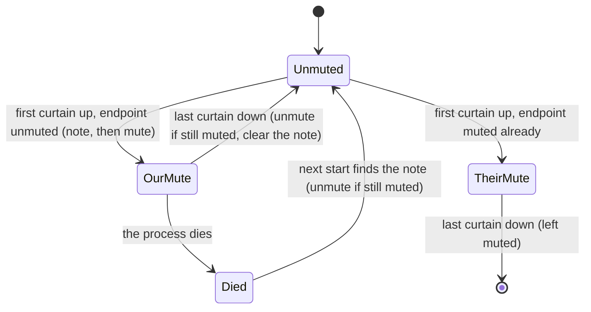

# FR-99: Privacy mode — the person at the host sees a notice instead of the desktop, and the session ends locked

**Issue:** [#2091](https://github.com/gjovanov/roomler-ai/issues/2091) · **Status:** proposed 2026-10-13 — spec
and claim · **Owner:** the Windows agent (the user-context worker, SystemContext), the hub (the permission
bit), the viewer (the toggle) · **Anchors:** master `4fc8ea7bb` · **Program:**
[StarDesk teardown](../plans/stardesk-teardown-program.md), wave 1 · **Builds on:**
[FR-27](FR-27-consent-surfaces-and-desktop-companion.md) (consent surfaces, P10 host Disconnect),
[FR-34](FR-34-locked-consent-and-stuck-capture.md) (the locked host), [FR-92](FR-92-keep-busy.md) (the
no-hooks rule)

## 1. Goal

An admin working on an unattended office PC should not show the room what they are doing. While a
privacy-mode session runs, the person at the host sees a notice ("this PC is being used remotely by …")
instead of the desktop, and cannot drive the session from the local keyboard and mouse. The controller sees
the real desktop. When the session ends, the PC is left locked if that is how it was found.

StarDesk ships this as "Privacy Mode" (black out the local displays, mute the host), "Turn Off Display" and
"Auto-lock after session". TeamViewer calls it "Show black screen". Roomler has none of it (§2).

**Nothing survives the session**, and the person at the screen can always take the machine back.

## 2. Evidence (master `4fc8ea7bb`)

| What | Where | Consequence |
|---|---|---|
| No privacy mode, curtain, blank screen or local-input block anywhere | greps for `privacy`, `curtain`, `BlockInput`, `black_screen` hit nothing relevant | A full gap |
| `WDA_EXCLUDEFROMCAPTURE` already keeps **our own** windows out of the stream | `agents/roomlerd/src/indicator/win.rs` L515, L519 (border and badge); `agents/roomler-desktop/src/panels.rs` L408–414 (consent panels) | The capture-exclusion half of a curtain is a call we already make |
| A locked host streams a padlock frame, because capture cannot see `winsta0\Winlogon` from the Default desktop | `agents/roomlerd/src/lock_overlay.rs` L1–20, `lock_state.rs` | An ordinary window cannot appear on the secure desktop (FR-34 §1) |
| Low-level hooks, raw-input sinks, key polling and key taps are **banned** | `docs/fr/FR-92-keep-busy.md` L120–126: "EDR flags each as a keylogger, and GPO-locked corporate desktops with EDR are in the acceptance bar"; AC8 is a source scan that fails on a planted `SetWindowsHookEx` | The obvious input block (`WH_KEYBOARD_LL`) is off the table |
| The `rc:*` wire carries `Permissions` as **names**; an unknown name fails the whole frame | `crates/remote_control/src/permissions.rs` L15–22, and the deserialiser notes below it | A new permission bit must never reach an agent that does not know it |
| Every host-side Disconnect goes through one arm, which reports `host_disconnect` first | `agents/roomlerd/src/signaling.rs` L1935 (`kill_rx`), L139 | The person's way out already exists; the curtain must not take it away |
| Device-owned settings are kept out of server pushes structurally | `crates/remote_control/src/models.rs` L1718 (`remote_config_enabled` "deliberately ABSENT") | The opt-in for this mode follows the same rule |
| The consent floor is the device's | `agents/roomlerd/src/consent.rs` L153 (`strictest_of`) | The lock-on-end policy follows the same shape |
| No lock on disconnect, no host mute | — | Gaps |

## 3. Design

### 3a. The curtain (Windows 10 2004 and later)

The curtain lives in the **user-context worker**, the process already on `winsta0\Default` in the console
session:

- One window per monitor: topmost, layered, **hit-test-transparent** (`WS_EX_TRANSPARENT`, so the
  controller's injected clicks reach the application underneath), no-activate.
- It carries `SetWindowDisplayAffinity(WDA_EXCLUDEFROMCAPTURE)`, the same call `indicator/win.rs` L515
  makes. The local person sees the curtain; DXGI duplication and WGC see through it.
- It paints a localized notice: who is connected, that privacy mode is on, and how to take the machine back
  (§3b). That last line reads **"Press Ctrl+Alt+Del to take this computer back"** (decision 4).
- Z-order is re-asserted on `WM_WINDOWPOSCHANGING` and on a slow timer, so a topmost window opened by an
  application cannot uncover the desktop.

⚠️ **The secure desktop cannot carry a curtain** (FR-34 §1). When the input desktop is `Winlogon` (lock
screen, UAC, Ctrl+Alt+Del), the person sees that screen, which shows no user content, and SystemContext
keeps streaming it. Documented, not fought.

**As built, P1b (2026-10-14).** The curtain lives in the overlay that already draws the "being viewed" border,
badge and consent panel (`agents/roomlerd/src/indicator/win.rs`), on its pump thread:

- **One window over the whole virtual desktop**, not one per monitor, with the notice painted centred on each
  monitor. One window keeps a single z-order to defend and a single affinity to verify. Monitors are
  enumerated without the paint DC, whose clip would shrink them to the update region and move the text on a
  partial repaint. It refits on `WM_DISPLAYCHANGE` and on the slow timer.
- **The capture exclusion is set before the window is shown and read back after.** A curtain the capture
  could see would hide the desktop from the controller too, so an affinity that does not read back
  `WDA_EXCLUDEFROMCAPTURE` destroys the window and the request is refused (`no_curtain`).
- **Z-order:** every fourth pump tick (≈ 0.5 s) the curtain re-takes the top, then the border, the badge and
  the consent panel go back above it. The badge's Disconnect is the person's way out while only the curtain
  is up, and a consent question must never sit behind it. This replaces the `WM_WINDOWPOSCHANGING` idea:
  another application raising itself sends the curtain no message at all.
- `set_privacy` waits up to 2 s for the pump to say the curtain is up, and treats no answer as no curtain. A
  session's end (`hide_session`) always takes its curtain down, whatever its channel managed to say first.
- **The notice** says who is connected, that privacy mode is on, and, while there is no input block, how to
  end the session: "move the pointer to the top edge of the screen and choose Disconnect". P2 changes the
  last line to decision 4's "Press Ctrl+Alt+Del to take this computer back". English only for now.

⚠️ **The curtain hides the screen; it does not stop a person at the keyboard.** It must be click-through, or
the controller's injected clicks would land on it, so the person's own mouse passes through too. The shell
draws the Start menu, notifications and Alt+Tab's thumbnails above every topmost window, so those show over
it. Blocking local input is P2.

### 3b. Blocking local input, without hooks

FR-92's ban rules out `SetWindowsHookEx`. The block uses **`BlockInput(TRUE)`** instead (Microsoft Learn,
`BlockInput`):

- Physical keyboard and mouse input stops reaching applications. **Only the thread that called
  `BlockInput` can still inject** with `SendInput`, so the controller's input must be injected on that
  thread.
- The OS lifts the block **when that thread exits** and **when the person presses Ctrl+Alt+Del**. That is a
  dead-man switch the OS provides, and it is the person's way out.
- A Ctrl+Alt+Del is the person taking the machine back. The agent audits it, tells the controller, turns
  the curtain off and **never silently re-arms** the block.

**P0 has to prove four things before any of this ships:**

1. the integrity level `BlockInput` needs: the attended worker runs at the user's level, so this may need
   the SYSTEM-in-session context;
2. that injection from the blocking thread lands, for every input kind the session sends;
3. that FR-27 P10's Disconnect stays reachable for the person;
4. that EDR stays quiet, using FR-92's EDR-window method.

If any of them fails, this FR ships the **curtain alone** and says so in the consent prompt and the docs.
FR-92's source scan is extended to this module either way, so a hook can never be added later by accident.

**P0's answers (vmtest Win11, agent 0.4.134, 2026-10-13 and 14; field log rows 1–6).** Standalone probes
ran as the signed-in person through an `/IT` scheduled task. The person was QMP input, and the controller was
the production viewer from a LAN neighbour.

| # | Question | Answer |
|---|---|---|
| 1 | Integrity level | **High.** A medium-integrity caller gets `BlockInput(TRUE) = FALSE`, `ERROR_ACCESS_DENIED` (5). The signed-in user's elevated token succeeds. So the attended worker, which runs at the user's medium level, **cannot** block. The block needs the SystemContext worker (SYSTEM in session, untested but above high) or an elevated helper |
| 2 | Injection from the blocking thread | **Only that thread's `SendInput` lands.** The blocking thread's own move did land. The agent's injection, from the SystemContext worker (another process), was blocked like the person's: 73 L4 probe moves were lost in the batch spanning a 20 s block, against 0 in the batch before and 0, then 2, in the two after as the session recovered. The injector must therefore be the blocking thread itself. **Keys and the wheel follow the same rule** (row 6): the blocking thread's own keys and wheel notch arrived during the block, the person's keys did not, and keys typed after the unblock did. Mouse moves, virtual-key keystrokes and the wheel were tested; mouse buttons and `KEYEVENTF_UNICODE` text under the block were not, and P2's field cells carry them |
| 3 | The way out, and P10 Disconnect | **Ctrl+Alt+Del lifts the block**, and nobody tells the blocking thread. After the secure-attention sequence and Esc, the person's moves landed again while the probe still thought it was blocking. Its `BlockInput(FALSE)` then returned FALSE. So the agent has to detect the lift itself, audit `local_override` and never re-arm silently. **P10's Disconnect is not reachable under the block**, because it needs a click. It is reachable after Ctrl+Alt+Del. Settled by decision 4 (2026-10-14): Ctrl+Alt+Del is the way out |
| 4 | EDR | **Not tested.** vmtest guests run Defender only; FR-92's EDR-window method is still owed |

**The curtain, on the deployed capture path.** A topmost, click-through, no-activate window over the
primary monitor was given `SetWindowDisplayAffinity(WDA_EXCLUDEFROMCAPTURE)` (the call succeeds,
affinity `0x11`). The host's screenshot (what the person sees) showed the curtain, and the viewer's stream
showed the desktop under it. **The red half:** the same window without the affinity showed in the stream.
It holds on **both** capture paths: SystemContext's DXGI duplication (row 1) and the attended worker's WGC
(row 5).

### 3c. Authorization and audit

- **A new `Permissions::PRIVACY` bit.** The hub adds it **only** for agents that advertise the
  `privacy-mode` verb in `AgentCaps.rpc` (equality match; unknown verbs ignored). Any other agent would fail
  the whole frame on the unknown name.
- **The device opts in.** `privacy_mode_allowed` is device-owned, default off, and absent from
  `DesiredConfig`, like `remote_config_enabled`.
- **The consent prompt says it.** A prompt that grants privacy mode says the local screen will be covered.
- **Audit:** `privacy_on` and `privacy_off {reason}`. The reasons are `controller`, `session_end`,
  `local_override` (Ctrl+Alt+Del), `worker_exit` and `secure_desktop`.
- **No new `EndReason`.** An older server drops a frame carrying an unknown one (the FR-27 P10 lesson).
  Privacy mode ending does not end the session.

**As built, P1a (the server's gate, 2026-10-14).** Nothing reaches a device yet: no agent advertises the
words, and no viewer asks.

| Piece | Where | What it does |
|---|---|---|
| `Permissions::PRIVACY` | `crates/remote_control/src/permissions.rs` | Bit `0b0100_0000`. It is in `requires_consent_prompt`, never in the default grant |
| `privacy-mode`, `privacy-available` | `RpcCap::PrivacyMode`, `RpcCap::PrivacyAvailable` (`crates/remote_control/src/models.rs`) | `privacy-mode`: the owner allowed it and the agent serves it. `privacy-available`: a curtain is possible, but the owner has not allowed it, so the viewer can explain rather than offer nothing (FR-85's `available` lesson). Equality-matched; neither is a prefix of the other |
| `PrivacySupport` | `crates/modules/fleet/src/hub.rs` | `None` / `NotOptedIn` / `Serves`, read from those words per CONNECTION at the hello and on every caps re-announcement (`socket.rs`), so an owner's OFF stops the next grant without a reconnect |
| `privacy_grant` | `hub.rs`, in `create_session_full` right after `record_grant` | Strips `PRIVACY` before `rc:request` is built. Reasons, first match wins: `device_cannot_curtain`, `break_glass`, `outside_the_org` (FR-52 decision 13, 2026-10-19), `device_not_opted_in` |
| The reason, twice | `SessionCreated.privacy_refused` (`signaling.rs`), `SessionRequested.privacy_stripped` (the audit) | A strip is never silent. Both are additive fields, so an older viewer and an older pod read past them |

- **Break-glass is the authz gate's `override_reason`.** The gate sets it only for a validated ADMINISTRATOR
  force. The hub ignores the wire's own field, and the cross-pod relay carries the gate's, so an owner pod
  applies decision 1 as well.
- **Stored grants tolerate a name they do not know.** `deserialize_stored` (and the raw-bson path) drops an
  unknown name instead of refusing the row, the fail-safe direction it already took for unknown bits. A
  session row holding `PRIVACY` must still read after a rollback. That protects only a rollback to a build
  that has the rule, which is why it ships here, before anything can write the name. The `rc:*` wire still
  refuses an unknown name.
- **The order of deployment is load-bearing.** P1a must be on every pod before an agent advertises the
  words (P1b) and before a viewer asks for `PRIVACY` (P1c): an older server cannot parse a request carrying
  the name, and an older agent fails the whole frame. The delegate crossing (`DelegateFrame::SessionParams`,
  service → worker) is the same wire inside one install, so P1b keeps both ends on one version or strips the
  bit at the crossing. *(P1b: moot. That delegation is macOS-only (FR-43), and a Mac never advertises the
  privacy words, so the hub never sends it `PRIVACY`.)*

Tests: `privacy_is_granted_only_off_break_glass_on_a_serving_device`,
`privacy_support_reads_the_rpc_words_by_equality` and `the_hub_strips_privacy_before_the_agent_can_see_it`
(`hub.rs`); `privacy_available_does_not_imply_privacy_mode` (`models.rs`); the storage-rule tests in
`permissions.rs`; and `crates/tests/src/privacy_gate_tests.rs`, four cells through real servers, each reading
the raw `rc:request` the agent received.

**As built, P1b (the device's half, 2026-10-14).**

| Piece | Where | What it does |
|---|---|---|
| `privacy_mode_allowed` | `crates/agent-core/src/config.rs`, `config_surface.rs` | The owner's switch, default off, live. Absent from `DesiredConfig` (named in `the_device_owned_refusals_are_not_pushable`, which also refuses any `privacy_*` key). Over the LocalAPI only the console person may set it (`crates/localapi/src/lib.rs`), as for keep busy: it is their screen |
| The words | `agents/roomlerd/src/privacy.rs` (`current_words`), appended in `signaling::stub_caps` | `privacy-available` where a curtain is possible here (Windows 10 2004+, i.e. build ≥ 19041, in a build whose overlay came up); `privacy-mode` only while the owner allows it too. Never in the memoized `detect()`, for the record words' reason; the heartbeat re-announces a change, so an OFF stops the next grant at the hub |
| The consent line | `signaling.rs`, the remote-control prompt's `detail` | "They may also cover this screen while they work." on every surface, and only when the grant holds `PRIVACY` and this device could act on it |
| The `privacy` channel | `privacy.rs` (`attach`, `attach_refusing`), routed in `peer.rs` beside `record` | Controller → `rc:privacy.set {id, on}` / `rc:privacy.status {id}`; device → `rc:privacy.state {id, on, reason?}` |
| `curtain-smoke` | `roomlerd curtain-smoke [--seconds N]` | Puts a curtain up through the production overlay and prints `possible=… up=…`: the field check that needs no server and no viewer |

The device decides again at every "on", in its own words:

| # | Gate | Refusal |
|---|---|---|
| 1 | The session's grant holds `PRIVACY` (when the channel opens) | `not_granted` |
| 2 | The owner's `privacy_mode_allowed`, read now (survives a compromised server) | `disabled_on_device` |
| 3 | A curtain is possible here | `unavailable` |
| 4 | The overlay put it up, verified out of capture | `no_curtain` |

Turning it off is never refused. The curtain also comes down when the session ends (the channel closes, or the
overlay drops the session) and when the owner switches the gate off, which the viewer is told unasked
(`disabled_on_device`).

Tests: `privacy::tests` (the gates, on/off, the owner's OFF, the end, the words, the consent line, the wire),
also run on the Windows build where a curtain can be possible; `tests/privacy_dc.rs`, the production handlers
over a loopback PeerConnection pair with a recorder for the overlay (named in CI's recorder step); and CI's
Windows clippy job now compiles `viewer-indicator`, which no PR lane had built. **Negative control:** with
gate 2 disabled, `the_owner_gate_refuses_before_the_overlay_is_asked` fails.

**As built, P1c (the viewer, 2026-10-14).** `ui/src/composables/usePrivacyMode.ts`, wired in
`useRemoteControl.ts` and drawn in `RemoteControl.vue`.

- **`PRIVACY` is asked for only when the device serves it** (`privacy-mode` in its caps, by equality;
  `privacy-available` earns nothing). Unlike RECORD, which every viewer asks for, a granted `PRIVACY` puts
  "may cover this screen" on the person's consent prompt, and a server before P1a cannot parse the name.
  The page's agent is read only when it is the one being asked, because a device switch can race the
  request.
- **The channel** opens from `rc:session.created`, only on a grant holding `PRIVACY`, for the reason
  `openRecordChannel` does. The toggle shows ON only when the device says so, keeps a refusal with its
  reason, shows the curtain coming down unasked (the owner's OFF, `disabled_on_device`), and reads a closed
  channel as the session ending the curtain.
- **The toolbar:** a toggle on a grant holding `PRIVACY`; a disabled control whose title gives the server's
  strip reason (`device_not_opted_in`, `break_glass`, or a code from a newer server); nothing at all where
  no curtain could ever be (`device_cannot_curtain`). A refusal or an unasked take-down is also said in a
  snackbar, because the icon alone changes too quietly.

Tests: `ui/src/__tests__/composables/usePrivacyMode.spec.ts` (11, through a fake channel); the whole vitest
suite and `vue-tsc` green.

**As built, P1d (the device's account, 2026-10-15).** The audit this section designed as `privacy_on` /
`privacy_off {reason}` is the device's **claim**, so it lives beside the decision, not in it: a
`privacy_activity` collection, as `recording_activity` (FR-85) and `transfer_activity` (FR-101) do. The
server never sees a curtain. It is drawn on the host, at a request that travels peer to peer, so writing
it into `remote_audit`, the server's own decisions, would have dressed a host's word as the server's.

| Piece | Where | What it does |
|---|---|---|
| `rc:privacy.activity` | `ClientMsg::PrivacyActivity` (`crates/remote_control/src/signaling.rs`), owner `remote` | `{session_id, kind: on \| off \| refused, reason?}`. Fire-and-forget: an older server drops an unknown frame with a debug line (`crates/modules/fleet/src/socket.rs`) |
| The device's reports | `Session::set`, `take_down`, `refuse` (`agents/roomlerd/src/privacy.rs`) | `on` once the curtain is up; `off` with `controller`, `session_end` or `disabled_on_device`; `refused` with gate 2–4's reason. Sent with `try_send`, so a struggling connection drops a line rather than stalls the curtain |
| The ledger | `Ledger` (`privacy.rs`), `privacy-curtains.json` in the process's own local data dir | Each curtain is written there **before** it goes up and dropped when it comes down. A process killed in between leaves an entry, never a curtain without one |
| `worker_exit` | `collect_leftovers` (at start-up, `main.rs`, before any connection) and `drain_leftovers` (`agents/roomlerd/src/signaling.rs`, on each org's connection) | The next process reports each leftover as `off {worker_exit}` on the connection of the org its session belonged to, because the server looks the session up within that org. One the queue refuses waits for the next connection |
| The server's check | `record_privacy` (`crates/modules/remote/src/agent_socket.rs`) | Kept only for a session of THIS device whose grant held `PRIVACY`: the live hub first, the stored row after the session ended (how a `worker_exit` is checked). A reason that is not a code (`a-z0-9_`, at most 64) is dropped and the row kept |
| The trail | `GET /api/tenant/{tid}/privacy-activity/{agent_id}` (`crates/modules/remote/src/routes.rs`) | Under `VIEW_REMOTE_AUDIT`, newest first, a removed device's trail included. 90-day TTL, like the audit it is read with |

`local_override` (Ctrl+Alt+Del) and `secure_desktop` arrive with P2. Until then nothing produces them.

Tests: `privacy::tests` (every report in order; the ledger holds a curtain exactly while it is up; the next
process reports each leftover on its own org's connection, and a full queue keeps it), `tests/privacy_dc.rs`
(each production channel cell now also reads what the device reported), the wire and model tests, and
`crates/tests/src/privacy_activity_tests.rs`, two cells through real servers. The first sends reports from
a granted session (kept), a session without `PRIVACY`, another device and another org (all dropped), plus
a free-text reason (row kept, text dropped). The second ends two sessions with `terminated: true`, then
reports `worker_exit` for both: kept for the one granted `PRIVACY`, dropped for the other. **Negative
controls**, each restored afterwards:
- the `PRIVACY` check made always true: both cells fail (5 rows for 4, 3 for 2);
- the reason filter removed: the first fails on the stored text;
- leftovers drained for every org: the leftover test fails;
- the ledger never written: the ledger test fails.

### 3d. Other platforms

- **macOS:** out. Since macOS 15 there is **no public API** that keeps a window out of screen capture. Apple
  DTS says so, and `NSWindow.sharingType = .none` is ignored by ScreenCaptureKit.
- **Linux X11:** a later phase may try DPMS-off. Injected input wakes the display, so it has to be
  re-asserted.
- **Wayland:** out.
- **The all-monitors-off variant** (stream a virtual display while the physical ones are dark) waits for
  the virtual-display FR (wave 2). It needs a topology dead-man and a boot reconciler, because unlike the
  curtain it changes persistent state.

### 3e. Lock when the session ends

`lock_on_end = auto | always | never`:

- **`auto`** restores what was found: lock if the session started on a locked screen or on an unattended
  desktop.
- The device's setting is a **floor**, as in `consent::strictest_of`. The server may ask for stricter,
  never looser.
- **Mechanisms:** Windows calls `LockWorkStation()` from the worker; Linux runs
  `loginctl lock-session <id>`. P0 picks the macOS mechanism.
- It runs on every end, including a host Disconnect and a controller crash.

**P0's answer for Windows (2026-10-15, §8 row 11).** `LockWorkStation` locks from the process that runs the
session. On a SystemContext install that process is SYSTEM in the console session, not the person's: it
locked from there, so no new process or token is needed.

**As built, P3a (the device's own policy, 2026-10-15)** (`agents/roomlerd/src/lock_on_end.rs`):

| Piece | What it does |
|---|---|
| `lock_on_end` | `never` (default) · `auto` · `always`, a device key (`crates/agent-core/src/config.rs`), live. Absent from `DesiredConfig` (named in `the_device_owned_refusals_are_not_pushable`), and set over the LocalAPI only by the console person, whose screen it locks. `LockOnEnd` (`crates/remote_control/src/models.rs`) is ordered, so `stricter` is a `max`, ready for P3b's directive. An unknown value reads as `always`, as an unknown `FeaturePolicy` reads as `off` |
| The decision, at the session's START | The indicator's `show_session_full` reads the policy and, for `auto`, what was found: the screen locked (`lock_state`), and nobody at the computer. On Windows that is no input for 5 minutes (`GetLastInputInfo`); on Linux it is logind's `IdleHint`, or no active session at all. A re-offer under the same session id keeps the first decision, because what `auto` found is what it must restore |
| The lock, at the LAST end | `hide_session` (every end: the viewer's hangup, the host's Disconnect, a limit, the connection dropping) asks the tracker. It locks only when no other session is live, and only if this end or an earlier one since the last lock asked for it. A session whose answer never left has no say (`session_aborted`). The OS call runs on a thread of its own |
| Mechanisms | Windows `LockWorkStation()`; Linux `loginctl lock-session` on seat0's active session; macOS none yet (an end that should lock logs that it could not) |

**The default, as built (decision 3, P3c, 2026-10-16).** P3a shipped `never` everywhere until AC7's field
cells passed (0.4.139, §8 row 16). Now a **fresh Windows service install** is written with
`lock_on_end = auto`. That covers the wizard's SystemContext flavour and `roomlerd enroll
--machine-global` (`install.ps1 -Role daemon-system`). Both call one helper,
[`enrollment.rs:721`](../../crates/agent-core/src/enrollment.rs#L721) `apply_service_install_defaults`,
from [`main.rs:2566`](../../agents/roomlerd/src/main.rs#L2566) and
[`orchestrator_agent.rs:574`](../../agents/roomler-setup/src/orchestrator_agent.rs#L574):

| Install | Starts at | Why |
|---|---|---|
| Windows service (SystemContext), fresh | `auto` | its worker is SYSTEM in the console session and reaches the secure desktop, so the next controller can lift the lock (§8 rows 12, 16) |
| Windows per-user, or perMachine without SystemContext | `never` | the worker cannot reach the secure desktop: a lock at the end would leave the next session at a padlock nobody can lift remotely |
| Linux root daemon | `never` | the operator's refinement named it, but no field cell has shown a remote unlock there yet (X11 and Wayland); the flip waits for one |
| any install already in the field, re-enrolled | what it had | a refresh, a rebind or an appended org keeps the existing config ([`enrollment.rs:705`](../../crates/agent-core/src/enrollment.rs#L705) `takes_service_install_defaults`), and a config that lacks the key reads `never` |

The wizard always writes a fresh config, so a wizard install counts as new.

⚠️ **`auto` also locks an unlocked computer that nobody had touched for 5 minutes**, because it restores
what it found. A kiosk that signs itself in and is left alone ends each session at a padlock. Someone has to
sign in, either at the machine or through the next session, which needs the account's password. Where
that is wrong, the person at the console sets `roomler config set lock_on_end never`.

⚠️ **`auto` restores what was found at the start.** A person who unlocked the computer during the session
is locked out at its end and signs in again. Telling their input from the controller's would need the
input hooks FR-92 bans. ⚠️ **On a per-user install, `always` cannot be undone remotely.** The per-user
worker cannot reach the secure desktop, so the next session sees a padlock until someone signs in at the
computer. The key's own description says so.

Tests: the decision table, cell by cell; the tracker (the lock waits for the last session and is taken
once; a re-offer keeps the first decision; an unknown end or an aborted session never locks); the policy's
spellings, order and unknown value; the key's set, echo and clear; the console-only gate on the LocalAPI.
CI's clippy lines pass on Linux, and so does the Windows build with the overlay, which compiles the
`LockWorkStation` path. **Negative controls**, each restored afterwards:
- `auto` reading only "locked": the decision table fails;
- the tracker locking without waiting for the last session: the waiting test fails;
- a re-offer overwriting the first decision: the re-offer test fails;
- the LocalAPI's console gate removed: the gate test fails.

**As built, P3b (the server's ask, 2026-10-16, #2280):** an admin may ask for stricter, never looser.

| Piece | What it does |
|---|---|
| `AccessPolicy.lock_on_end` | `auto` · `always`; `never` or unset asks nothing (`AccessPolicy::lock_on_end_ask`, `crates/remote_control/src/models.rs`). Set by a `MANAGE_AGENTS` admin from the device row. An unknown value reads as `always`, as `LockOnEnd` reads one everywhere |
| The gate | `resolve_session_authz` reads it on every allowed path, the owner and break-glass included: it describes the device, not who is asking (`crates/modules/remote/src/controller.rs`). The cross-pod relay carries it (`lock_ask_from_relay`, `relay.rs`); an older origin pod's body asks nothing |
| The hub | sends `Request.lock_on_end` only to an agent advertising `lock-on-end` (`honours_lock_on_end`, from the hello's and each heartbeat's caps). The `session_requested` audit row records `lock_on_end` and `lock_enforced` (`crates/modules/fleet/src/hub.rs`) |
| The agent | advertises `lock-on-end` only where the lock can be lifted remotely afterwards: the Windows service and the Linux root daemon (`can_honour_ask`). It keeps the ask with the session's metadata, hands it to a service install's worker in `SessionParams`, and registers it as the session goes live; `session_started` then decides under `effective_policy`, the stricter of the ask and the owner's own (`agents/roomlerd/src/lock_on_end.rs`) |
| The viewer | **Lock when sessions end** on the device row, both layouts, saved with the access policy (`ui/src/components/admin/AgentsSection.vue`) |

⚠️ **A per-user install never takes an ask.** Its worker cannot reach the secure desktop, so a lock an admin
asked for would leave every later session at a padlock no session can lift: a mesh feature costing the
operator remote access to the box. The owner's own `lock_on_end` stays theirs there.

Tests: the policy's old rows, `null` and `never` asking nothing, and an ask's round trip; the ask on the
wire (skipped when absent, its spellings, an older frame, an unknown value as `always`); the relay (as
asked, an older origin asking nothing); the agent (`effective_policy` cell by cell, an ask taken once at
the session's start); and the integration cell `the_lock_ask_reaches_only_a_device_that_honours_it`
through the real gate and hub (honoured: sent and enforced; not honoured: not sent, not enforced; `never`:
nothing). **Negative controls**, each restored afterwards:
- `effective_policy` ignoring the ask: the agent's table fails (`Never` where `Auto` was due);
- the relay dropping every ask: its test fails (`None` for `auto`);
- `never` read as an ask: the policy test fails (`Some(Never)`);
- the hub sending the ask to every agent: the integration cell fails where the device that does not honour
  it must receive nothing;
- the gate never reading the policy: the cell fails where the honouring device must be sent `always`.

### 3f. Host mute

**P0 measures** whether WASAPI loopback still captures with the render endpoint muted. StarDesk's own help
says muting the host silences the client too. The FR ships only the honest version:
- if loopback survives, "mute host" mutes the speakers and keeps remote audio;
- if it doesn't, the toggle says remote audio goes silent too.

**Measured (2026-10-16, §8 row 13): the loopback survives.** With the default render endpoint muted, the
controller received the same audio, byte for byte in rate and level, as unmuted. So P4 is the first
version: mute the speakers and keep remote audio. What P4 owes, from the measurement:
- **The mute is a machine-wide setting, and it persists.** P4 must restore the state it found, at the
  session's end and after a crash: a ledger and a boot reconciler, as the curtain has (`worker_exit`).
- **It is not a lock.** The person can unmute from the volume flyout, and the toggle says so.
- **The cell was a VM's HD Audio endpoint** (software volume). P4's own field cell re-checks a real
  device whose endpoint has hardware volume before the toggle ships.

**As built (P4a, 2026-10-16, #2300): Windows.** There is no toggle: the curtain mutes, because a person
who must not see the session must not hear it either. One guard per process, `host_mute::HostMute`:

| Step | What it does | Where |
|---|---|---|
| A curtain goes up | the guard is held: the first holder mutes the default render endpoint (`IAudioEndpointVolume::SetMute`), and only if it was unmuted | `Session::set`, `HostMute::hold` |
| Before the mute | a note, `host-mute.json`, beside the curtain ledger | `HostMute::write_note` |
| A curtain comes down | the last holder unmutes, unless the person unmuted in the meantime, and clears the note | `take_down`, `HostMute::release` |
| The next process starts | a note left by a process that died muted: unmute if still muted, clear it | `collect_leftovers`, `HostMute::restore_leftover` |
| The controller | `rc:privacy.state` carries `host_muted` while the curtain is up (`false` when the mute failed, absent with no endpoint); the toolbar's title says "Its speakers are muted too" | `StateMsg`, `usePrivacyMode.hostMuted` |

⚠️ **Not a lock.** A person who unmutes from the volume flyout stays unmuted: the restore finds the
endpoint unmuted and leaves it. ⚠️ **No endpoint, no mute.** The curtain still goes up and the answer
carries no `host_muted`. Linux and macOS have no endpoint here yet; the curtain is Windows-only too.
⚠️ **No test touches real speakers:** every cell drives a fake endpoint, because a test that muted
the machine it runs on would mute a developer's laptop.

## 4. Phases

| P | Scope | Kill switch | Status |
|---|---|---|---|
| P0 | This spec and the claim. The feasibility probes: `BlockInput` (the four questions in §3b), loopback under mute, the macOS lock mechanism | docs only | spec merged. **`BlockInput` and the curtain probed on vmtest 2026-10-13 and 14** (§3b's answers): high integrity needed, only the blocking thread injects (mouse, keys and the wheel alike), Ctrl+Alt+Del lifts the block, and the curtain stays out of both DXGI and WGC capture. **Loopback under mute measured 2026-10-16** (§3f, §8 row 13): it survives. Still owed: EDR, the macOS lock |
| P1 | The curtain + the permission bit + the device opt-in + audit (Windows), in four steps below | `privacy_mode_allowed=false` (default) | **merged** (P1a, P1b, P1c), and **field-verified end to end on 0.4.136** through the production viewer (§8 rows 9–10: AC1, AC5). P1d, the audit, follows |
| P1a | The server's gate: the bit, the two `rpc` words, the hub's strip with its reasons, break-glass excluded, the storage rule (§3c as built) | none needed: nothing advertises the words yet | **merged** #2186 (`bb5ad661d`): unit + `privacy_gate_tests`; the negative control (strip disabled) fails them |
| P1b | The agent: `privacy_mode_allowed`, the words, the consent line, the curtain, the `privacy` channel, and the device's own refusal (§3a and §3c as built) | `privacy_mode_allowed=false` | **merged** #2191 (`b04c1e549`): Linux unit + `privacy_dc` 6/6, Windows clippy and units with `viewer-indicator`; NC fails as it should. **Field-verified** with `curtain-smoke` under both capture paths (§8 rows 7 and 8) |
| P1c | The viewer: the toggle, the refusal reasons, asking for `PRIVACY` only from a device that serves it (§3c as built) | the toggle | **merged** #2199 (`8d03c9003`): `usePrivacyMode.spec.ts` (11), the vitest suite and `vue-tsc`. **Field-verified** (§8 rows 9–10): the toggle reaches the curtain through the channel on agent 0.4.136 |
| P1d | The device's account (§3c as built): `rc:privacy.activity`, the `privacy_activity` claims collection and its route, the ledger that lets the next process report a curtain this one died holding (`worker_exit`) | none needed: an older server drops the frame, an older agent sends none | **#2258**: unit, channel and integration tests with four negative controls (§3c). **Field-verified on 0.4.139** (§8 rows 15 and 17): killing the curtained worker (`Stop-Process -Force`) left no report on 0.4.138; on 0.4.139 the next worker sent `off {worker_exit}` |
| P2 | The input block, if P0 cleared it | `privacy_input_block=false` | — |
| P3 | Lock on end (Windows, Linux, macOS), in three steps below | `lock_on_end=never` | P3a and P3b merged, both in agent 0.4.139. **AC7 and AC9 are field-verified on 0.4.139** (§8 rows 16, 18–19), AC9 with prod at `hosted-20261016-32a9095`, which carries the server half (#2280) |
| P3a | The device's own `lock_on_end`: the decision at each session's start, the lock at the last end, Windows and Linux (§3e as built) | `lock_on_end=never` (default) | **#2272** merged `88e70fcf9`: unit tests in four crates. P0's mechanism and AC7's red are field-recorded (§8 rows 11–12). The green waits for the first agent release that carries it |
| P3b | The server's half: an admin may ask a device's sessions for stricter (`AccessPolicy`, forwarded on `rc:request`), never looser, and the device row's control (§3e as built) | the admin's `never` or unset: nothing is asked | **#2280** merged `0f535207d`: unit tests in four crates and an integration cell through the real gate and hub. AC9 is its field cell, on the release that carries it |
| P3c | The default (decision 3): a fresh Windows service install starts at `lock_on_end = auto`; per-user installs, the Linux root daemon and every existing config keep `never` (§3e "the default, as built") | per device: `roomler config set lock_on_end never` | **#2329, shipped in agent 0.4.140.** One unit test covers fresh service, fresh per-user, re-enroll, rebind and appended org. Three negative controls each failed it: a gate that admits per-user installs, one that ignores the outcome, and a no-op default. **AC11 is field-verified on 0.4.140** (§8 rows 20–21): a fresh service install read `never` on 0.4.139 and reads `auto` on 0.4.140, and a fresh per-user install on 0.4.140 reads `never` |
| P4 | Host mute (§3f), Windows first | none: the curtain mutes; with no endpoint nothing changes | **P4a #2300**: the guard, its note and the restore at the next start, `host_muted` on the channel, the viewer's title. Unit cells (fake endpoints), a `privacy_dc` cell over the real channel, vitest; Windows clippy with `viewer-indicator`. **Shipped in agent 0.4.140; AC10 field-verified there** (§8 row 22) |
| P5 | Docs and the field table | — | **#2240** (first part): `docs/privacy-mode.md` documents what P1 built. That covers the two parties who must agree, the request's sequence (mermaid), the server's strip reasons and the device's four gates, how the curtain works, the per-OS table and the honest limits. It is linked from `docs/README.md` and from `remote-control.md` §11.2. AC8 stays open until the page can show the block and Ctrl+Alt+Del as the way out, which wait for P2 |

## 5. Acceptance criteria

- [x] **AC1 (the curtain, red first):** on a vmtest Win11 guest during a session, `virsh screenshot` (what a
  person at the screen sees) shows the desktop on the deployed build. With privacy on it shows the curtain,
  while the Playwright viewer from mars sees lit desktop pixels in the same second. **Verified** on agent
  0.4.136 through the production viewer's toggle (§8 row 10). The host showed the desktop before the toggle
  and the curtain while it was on. The viewer showed the live desktop inside the same window: the host shot
  is at 00:41:18Z and the viewer's at 00:41:23Z, both within the 17 s the curtain was up. That is five
  seconds apart, not one.
- [ ] **AC2 (local input):** the "person" (QMP `input-send-event`, `virsh send-key`) does not reach
  `roomlerd probe-target` while privacy is on, and remote input does. The negative control comes first:
  without privacy, the person's input does reach it.
- [ ] **AC3 (the way out, reworded 2026-10-14 by decision 4):** Ctrl+Alt+Del lifts the block. The agent
  detects the lift itself (nobody tells the blocking thread, P0 row 4), audits `local_override`, tells the
  controller, and takes the curtain down. FR-27 P10's Disconnect is then one click away. With the curtain
  alone (no block), Disconnect works while privacy is on. *As first written, AC3 said Disconnect works
  "while privacy is on", which P0 showed cannot hold under the block: `BlockInput` swallows the click.*
- [ ] **AC4 (nothing survives):** `taskkill /F` on the worker clears the curtain and the block within 2 s,
  and `privacy_off {worker_exit}` is audited. After a session end, nothing of privacy mode remains. *Progress
  2026-10-15 (P1d):* the audit half is built, as `privacy_activity` `off {worker_exit}`, reported by the
  next process from a ledger written before each curtain goes up (§3c). *Progress 2026-10-16:* the curtain
  and audit halves are field-verified (§8 rows 15 and 17). With a curtain up, the session-1 worker was
  killed (`Stop-Process -Force`, which is `taskkill /F`).
  - **On 0.4.138:** the curtain went with the process and nothing was reported.
  - **On 0.4.139:** the next worker started 2 s after the kill and reported `off {worker_exit}` 3.7 s
    after it. The host's screenshot 2.6 s after the kill shows the desktop.

  The block half needs P2.
- [x] **AC5 (the gate holds):** an agent without the `privacy-mode` verb never receives `PRIVACY` (an
  integration test against the hub). A device that did not opt in refuses it, with a visible reason.
  **Verified.** The integration half is P1a's `privacy_gate_tests`: they read the agent's raw `rc:request`,
  and with the strip short-circuited all 4 cells fail. In the field on 0.4.136 (§8 rows 9–10), a device
  that has not opted in is never asked for `PRIVACY` and its grant holds none. A device whose owner switches
  privacy mode off mid-session takes the curtain down, and the viewer reads "this device's owner hasn't
  allowed privacy mode".
- [x] **AC6 (no hooks):** the FR-92-style source scan covers this module and fails on a planted
  `SetWindowsHookEx`. **Verified** (this PR): `privacy::tests::no_keylogger_shaped_api_in_privacy_mode` scans
  the curtain's code, `privacy.rs` and the overlay `indicator/win.rs`, for FR-92's Windows list (hooks,
  raw-input registration and reads, keyboard state, `GetAsyncKeyState`). It passed on master. With a real
  string constant, `"SetWindowsHookExW"`, planted at the end of `indicator/win.rs` it failed:
  `indicator/win.rs:1741: uses SetWindowsHookEx`. Restored to an identical file, it passed again.
- [x] **AC7 (lock on end):** with `auto`, a session that began on a locked guest leaves it locked
  (`Get-Process LogonUI` present). One that began unlocked and attended leaves it unlocked. `always` locks
  both. **Verified on agent 0.4.139** (§8 row 16), against the red on 0.4.137 (§8 row 12), where a session
  that began locked and was unlocked through the viewer left the guest unlocked. On 0.4.139, read 15 s
  after each session ended:
  - **`auto`, began locked** (the controller unlocked it through the viewer): locked.
  - **`auto`, began unlocked:** unlocked.
  - **`always`, began unlocked:** locked.
  - **`always`, began locked** (unlocked through the viewer): locked.
  - **`never`, the control** (began locked, unlocked through the viewer): unlocked.
- [ ] **AC8:** **Docs:** a `docs/privacy-mode.md` page with a mermaid diagram of the curtain, the block and
  the way out, the per-OS table, and the honest limits (secure desktop, macOS), linked from
  `docs/README.md`. `docs/remote-control.md`'s consent section links it.
- [x] **AC9 (the server's ask, P3b):** on a vmtest Win11 service install whose owner left `lock_on_end` at
  `never`, an admin's **Lock: always** on the device row locks the guest when the session ends
  (`Get-Process LogonUI`), and the request's `session_requested` audit row reads `lock_on_end: always`,
  `lock_enforced: true`. Red first: the same run against an agent without P3b leaves the guest unlocked,
  and the row reads `lock_enforced: false`. **Verified** (§8 rows 18–19), with prod at
  `hosted-20261016-32a9095`:
  - **0.4.139**, the owner at `never`: the session that began unlocked ended **locked**, and the row read
    `lock_on_end: always`, `lock_enforced: true`.
  - **0.4.138:** the same session ended **unlocked**, and the row read `lock_enforced: false`.
- [x] **AC10 (the host's speakers, P4):** on a vmtest Win11 guest given a sound device (§8 row 13's
  recipe), with the owner opted in: a curtain up mutes the default render endpoint (`GetMute` reads
  `True`) while the viewer keeps receiving the tone at the unmuted rate, and the viewer reads
  `host_muted: true`. The curtain's end unmutes it. An endpoint muted before the session stays muted
  after it; one the person unmuted during it stays unmuted. `taskkill /F` on the curtained worker leaves
  it unmuted once the next process starts. Red first: the same run against an agent without P4 leaves
  the endpoint unmuted under the curtain. **Verified** on agent 0.4.140 (§8 row 22), against row 14's red
  on 0.4.138. All four phases held: basic, muted before, unmuted by the person, and the killed worker,
  whose endpoint was unmuted 3 s after the next worker started.
- [x] **AC11 (the default, P3c):** a fresh vmtest Win11 `--type system` install reads `lock_on_end` as
  `auto` (`roomler config ls --json`, as the console user, and the config file), and a fresh `--type user`
  install reads `never`. Red first: a fresh `--type system` install on 0.4.139 reads `never` (§8 row 20).
  *(Corrected after the merge: first written as `roomler config get`, a verb the CLI does not have; its
  config verbs are `ls`, `set` and `clear`.)* **Verified** on agent 0.4.140 (§8 row 21). A fresh
  `--type system` install reads `auto` in its config file and from the daemon, where 0.4.139 read `never`.
  A fresh `--type user` install reads `never` in both.

## 6. Decisions

**All four were decided by the operator on 2026-10-14, as recommended.** Each entry keeps what was
weighed.

1. **ADMINISTRATOR break-glass.** May a break-glass session turn privacy on? Recording is never allowed
   under break-glass. Recommended: the same rule. A break-glass session is audited and the owner notified,
   and covering the screen would hide it from the one person who could object. **Decided: no.** The hub
   never grants `PRIVACY` under break-glass, as it never grants `RECORD`. The same reason later
   kept it from a controller outside the organization: FR-52 decision 13 (2026-10-19), `outside_the_org`.
2. **A whitelisted chord** besides Ctrl+Alt+Del, for the person to end privacy without the secure desktop.
   Recommended: no. `BlockInput` swallows it anyway, and Ctrl+Alt+Del is the one path that cannot be faked
   by software. **Decided: no.**
3. **Default `lock_on_end`.** Recommended: `auto` on new installs, `never` on existing ones until the field
   cells pass. **Decided: as recommended.** The refinement was confirmed on 2026-10-16: only installs that
   can unlock remotely, after AC7 is field-green. **As built (P3c):** fresh Windows service installs. The
   Linux root daemon waits for a field cell that shows a remote unlock (§3e).
4. **How the person reaches P10's Disconnect under the block** (raised by P0, 2026-10-13). `BlockInput`
   swallows the click, so Disconnect is reachable only after Ctrl+Alt+Del, which ends the block anyway.
   AC3 says "Disconnect works while privacy is on", which holds for the curtain alone but not under the
   block. The options:
   - Ctrl+Alt+Del is the person's path. It lifts the block, the agent sees the lift and audits
     `local_override`, and Disconnect is then one click away. AC3 is reworded to say so;
   - privacy without the block (the curtain alone) keeps Disconnect clickable, and the block becomes a
     separate, stricter level.

   Recommended: the first, and the curtain's notice says "Press Ctrl+Alt+Del to take this computer back".
   **Decided: the first.** AC3 is reworded, and §3a carries the notice's wording.

## 7. Out of scope

- macOS and Wayland curtains (no supported mechanism).
- The all-monitors-off variant (it needs the virtual display).
- Hiding the session from the device's owner: the on-host indicator rules are unchanged.

## 8. Field-verification log

| # | Date | Cell | Result |
|---|---|---|---|
| 1 | 2026-10-13 | **P0 probe, not the product.** vmtest Win11 guest, agent 0.4.134 (SystemContext), a standalone WinForms curtain run as the person; the production viewer from a LAN neighbour | **The curtain stays out of DXGI capture.** Without the affinity (the red half), the stream showed the magenta curtain. With `WDA_EXCLUDEFROMCAPTURE` (`SetWindowDisplayAffinity = True`, affinity `0x11`), the host's screenshot showed the curtain while the viewer's stream showed the companion's Welcome window under it |
| 2 | 2026-10-13 | The same guest, probe-target and the viewer in L4 target mode, `BlockInput` probes as the person | **The integrity level, and who may inject.** Elevated: `BlockInput(TRUE) = True`; the cursor froze for 20 s; the agent's injected probe moves were lost (73 in the batch spanning the block; 0 in the batch before, 0 and then 2 in the two after); the probe's own `SendInput` landed (cursor to 200,200). Not elevated: `BlockInput(TRUE) = False, err 5`, and the moves kept landing |
| 3 | 2026-10-13 | The same guest, no viewer, so the person (QMP `mouse_move`) is the only thing moving the cursor | **The person is blocked, with a control.** With no block, the person's move moved the cursor (to 1279,799). Under the block, two moves changed nothing (it stayed at 200,200) |
| 4 | 2026-10-13 | The same, then `virsh send-key` Ctrl+Alt+Del and Esc during the block | **The way out.** At Ctrl+Alt+Del the input desktop switched (`GetCursorPos` read 0,0). After Esc the person's next move landed (1279,799) while the probe still believed it was blocking. Its `BlockInput(FALSE)` then returned FALSE. The OS lifted the block and told no one |
| 5 | 2026-10-14 | A fresh guest, **attended**: the person signed in, so the agent captured through WGC (its log reads `wgc: capture session closed` at the viewer's disconnect). Agent 0.4.134, the same curtain probe, the production viewer from a LAN neighbour | **The curtain stays out of WGC capture too.** Without the affinity, the host's screenshot and the stream both showed the curtain. With it (`True`, affinity `0x11`), the host's screenshot showed the curtain, and the stream, sampled 11 s into the curtain's 30 s, showed the companion's Welcome window under it |
| 6 | 2026-10-14 | The same guest, no viewer. A focused window, elevated, blocks and injects from its UI thread: the keys O W N and one wheel notch. The person types over `virsh send-key`: P Q during the block, R S after it | **Keys and the wheel behave like the mouse.** Control (no block): the window received `ownpqrs` and the notch (120). Under the block (`BlockInput(TRUE) = True`), it held `own` and the notch at the unblock, so the person's P Q, typed about 3 s into the 13 s block, were dropped. R S, typed about 3 s after the unblock, arrived: `ownrs` |
| 7 | 2026-10-14 | **P1b's production overlay, SystemContext (DXGI) capture.** A vmtest Win11 guest whose installed agent (0.4.134) streamed to the production viewer from a LAN neighbour. `roomlerd curtain-smoke`, built from #2191 (sha256 `c35811fb…`), ran as the signed-in person | **The curtain is up for the person and out of the capture.** Before: the host's screenshot and the stream both showed the desktop. During, 11 s in: the host's screenshot showed the curtain and its notice, with the red border kept above it; the stream showed the desktop under it (the companion, and the console that ran the smoke). After: the desktop again. The guest's log: `privacy: curtain up, out of capture` at 08:05:42Z (the affinity read back), `curtain down` 40 s later; `curtain-smoke: possible=true up=true` |
| 8 | 2026-10-14 | The same check on an **attended** guest, so the agent captured through WGC | **The same, under WGC.** The host's screenshot showed the curtain, and the stream (VP9 4:4:4 on a direct path) showed the desktop under it: the companion, the console, the taskbar. `curtain up, out of capture` at 10:55:36Z, down 40 s later |
| 9 | 2026-10-15 | **AC5's field half: a device that has not opted in.** A kept vmtest Win11 **system** cell (vmtest signed in at the console), agent 0.4.136, the production viewer driven by Playwright from the vmtest harness host | The device advertises `privacy-available` and not `privacy-mode`. The viewer's `rc:session.request` asks `VIEW \| INPUT \| CLIPBOARD \| FILES \| RECORD`, with no `PRIVACY`. The grant in `rc:session.created` is `VIEW \| INPUT \| CLIPBOARD \| FILES`. The toolbar shows no privacy control and no refusal control |
| 10 | 2026-10-15 | **AC1, end to end, and the owner's withdrawal.** The same guest. The owner opts in (`roomler config set privacy_mode_allowed true`, run as the console user through an interactive task, because the LocalAPI takes it from the console only); 70 s later the device advertises `privacy-mode`. The viewer covers the screen with the toggle; the owner then switches it off mid-session. Host truth is `virsh screenshot` at each step | The request asks for `PRIVACY` and the grant holds it (`privacy_refused: null`). **Host:** the desktop before the toggle (the red); **"This computer is being used remotely, by vmtest admin. Privacy mode is on: the screen is hidden while they work. To end the session, move the pointer to the top edge of the screen and choose Disconnect."** while it is on; the desktop again once the owner withdraws. **Viewer:** the live desktop throughout (VP9 4:4:4 over the DataChannel), the toggle lit while on. After the withdrawal the toggle is off, titled "Privacy mode is off: this device's owner hasn't allowed privacy mode" |
| 11 | 2026-10-15 | **P3's mechanism on Windows (P0).** A kept vmtest Win11 `--type system` guest on agent 0.4.137, with autologon (`vmtest` Active in session 1). The call ran through Fleet RPC's HTTP route, whose identity on Windows is the console worker, with the vmtest org's exec switch opened and then restored to `false` | exec's identity was `nt authority\system`, session **1**. `rundll32.exe user32.dll,LockWorkStation` from it: exit 0, and **LogonUI 0 → 1**, read in-session and again from session 0. The host's screenshot went from the unlocked desktop to the lock screen with `vmtest`'s password prompt. So P3 locks from the process that already runs the session |
| 12 | 2026-10-15 | **AC7, the red (0.4.137).** The same guest, locked by row 11. The production viewer was driven by Playwright from the vmtest harness host. The oracle is LogonUI over SSH, and the surface is the host's own screenshot | Start: **locked** (LogonUI 1). A session connected and streamed the lock screen. The controller typed the guest's password through the viewer: **unlocked** (LogonUI 0), so SystemContext's input reaches the secure desktop. The viewer disconnected. 15 s later the guest was **still unlocked** (LogonUI 0, the host showing the desktop). **Wrong turns:** the first attempt pressed Space to wake the lock screen, but the password field already had the focus, so the space became the password's first character. The second pressed Enter to clear that error, but the dialog had gone, so it submitted an empty password. Both were harness bugs; the third typed straight into the field. Two failed attempts in all |
| 13 | 2026-10-16 | **P0: loopback under an endpoint mute.** A kept vmtest Win11 `--type system` guest on agent 0.4.138, given an ich9 HD Audio device (libvirt audio backend `none`; Windows lists "Speakers (High Definition Audio Device)"), `vmtest` signed in at the console. The production viewer with audio on, driven by Playwright from the vmtest harness host. A looped 440 Hz tone played in the person's session, and the default render endpoint was muted through `IAudioEndpointVolume::SetMute` (read back `True`) | **The loopback survives the mute.** The viewer's inbound audio per 5 s: with the tone unmuted, 12,050 B/s, mean power 0.134, level 0.366. With the endpoint muted, the same three numbers. Unmuted again, the same. With the tone stopped (the control), 0 B/s and 0 within one window. The agent's audio pump sent 250 packets per 5 s straight through the mute, and with nothing playing it sends no audio at all. So on this endpoint StarDesk's "muting the host silences the client too" does not hold: a host mute can silence the speakers and keep the controller's audio |
| 14 | 2026-10-16 | **AC10, the red (0.4.138).** A kept vmtest Win11 `--type system` guest pinned to the 0.4.138 MSI, given row 13's sound device, with `vmtest` Active at the console. The owner opted in as the console user. The production viewer, audio on, was driven by Playwright from the vmtest harness host. The page tapped the `privacy` channel itself, so it read the agent's own frames. A 440 Hz tone played in the person's session throughout. The oracle is `GetMute` over SSH; the surface is the host's own screenshot | **The curtain leaves the speakers on.** Before: `GetMute` False, the desktop on the host. Curtain up (`rc:privacy.state` `on:true`, **no `host_muted` field**): False 10 s in, with the curtain and its notice on the host's screen. Down: False. The viewer's audio stayed the same before, under and after the curtain: 12,050–12,146 B/s, level 0.366 |
| 15 | 2026-10-16 | **AC4, the red for its audit half (0.4.138).** The same guest: a curtain up, then `Stop-Process -Force` on the session-1 worker | **The curtain goes with the process, and no one reports it.** The `privacy` channel closed 40 ms after the kill, and the next worker started 2 s after it. The host's screenshot about 3 s after the kill shows the desktop. The device's `privacy_activity`: `total: 0`, with no `on` and no `off {worker_exit}`. P1d's agent half, the ledger and its report, first ships in 0.4.139 |
| 16 | 2026-10-16 | **AC7, the green (0.4.139).** A kept vmtest Win11 `--type system` guest on the 0.4.139 MSI, `vmtest` Active at the console. Before each cell, the owner's `lock_on_end` was set as the console user (`roomler config set`, read back from the daemon's config). A locked start came from `LockWorkStation` run as the person. The production viewer was driven by Playwright from the vmtest harness host: on a locked start it typed the guest's password at the lock screen (row 12's harness); on an unlocked start it connected, held 20 s and disconnected. The oracle is LogonUI over SSH 15 s after each end | **Every cell as specified.** `auto`, began locked, unlocked through the viewer: **locked** at the end. `never`, the same (the control): **unlocked**. `auto`, began unlocked: **unlocked**. `always`, began unlocked: **locked**. `always`, began locked, unlocked through the viewer: **locked**. **Wrong turn, recorded:** the first attempt failed every cell with "agent not online". The guest had sat idle for 1.5 h after its install, and Windows Update restarted it twice (`MoUsoCoreWorker.exe`, then `TrustedInstaller.exe`). On each clean stop the ephemeral device unenrolled itself, as FR-51 says it does, so its row was gone. The second attempt disabled the update services on the throwaway guest and re-enrolled it first |
| 17 | 2026-10-16 | **AC4, the green for its audit half (0.4.139).** The same guest as row 16, opted in; a curtain up through the viewer, then `Stop-Process -Force` on the session-1 worker | **The next worker reports the curtain the last one died holding.** Curtain up at 13:08:46.17Z, with its `on` row at 13:08:46.171Z. The kill at 13:09:02.391Z; the channel closed 257 ms later. The next worker started at 13:09:04, and the trail gained **`off {worker_exit}` at 13:09:06.098Z**, for the same session. The host's screenshot 2.6 s after the kill shows the desktop. While the worker restarted, the companion briefly read "Not enrolled yet" and "the Roomler service is not running", which is misleading for a two-second restart |
| 18 | 2026-10-16 | **AC9, the red (0.4.138).** A fresh kept vmtest Win11 `--type system` guest pinned to the 0.4.138 MSI, with prod at `hosted-20261016-32a9095` (it carries #2280). The admin's ask was set as the device row sets it: `PUT /api/tenant/{tid}/agent/{aid}` with the whole `access_policy`, read, modified and written back, `lock_on_end: "always"`. The production viewer connected to the unlocked guest, held 20 s and disconnected. The oracles are LogonUI over SSH 15 s after the end and the session's `session_requested` audit row | **Asked, not honoured, and the audit says so.** The owner has no `lock_on_end` on this build (`unknown or non-editable config key`). After the session: LogonUI **0**, unlocked. The audit row: `lock_on_end: always`, **`lock_enforced: false`**. The `access_policy` was put back (`lock_on_end: null`) |
| 19 | 2026-10-16 | **AC9, the green (0.4.139).** Row 16's guest, the owner's `lock_on_end` at `never` (read back from the daemon's config), the same ask and the same session | **The admin's ask is honoured.** After the session: LogonUI **1**, locked. The audit row: `lock_on_end: always`, **`lock_enforced: true`**. The `access_policy` was put back, and the guest was unlocked again through the viewer under `never` |
| 20 | 2026-10-17 | **AC11, the red (0.4.139).** A fresh vmtest Win11 `--type system` install pinned to agent 0.4.139, with `vmtest` Active at the console. It was provisioned 2026-10-16 18:21–18:31Z (harness PASS 18/20) and read 2026-10-17 04:10Z, from the config file (as admin) and with `roomler config ls --json` run as the console user | **A new service install starts at `never`.** The file: `lock_on_end = "never"`; the daemon: `never`. The green is owed on 0.4.140, which carries P3c: a fresh `--type system` install should read `auto`, and a fresh `--type user` one `never` |
| 21 | 2026-10-17 | **AC11, the green (0.4.140).** Two fresh vmtest Win11 installs of the released agent 0.4.140, each with `vmtest` Active at the console, read as row 20 was. `--type system`: `vmtest-w-ins-sys-053422`, harness run `20261017-053421`, provisioned 05:34–05:44Z. `--type user`: `vmtest-w-ins-use-060348`, run `20261017-060347`, 06:03–06:11Z. Each run scored 18 PASS of 20, plus two informational WARNs (the reverse ping and a teardown row pending the reaper) | **A new service install starts at `auto`; a new per-user install keeps `never`.** Service install: the file (`C:\ProgramData\roomler\roomler\config.toml`) has `lock_on_end = "auto"`, and the daemon says `auto`. It was read twice, about five minutes apart. The harness's own cells had restarted the service and changed two other keys, and left this one alone. Per-user install: the file (`%APPDATA%\roomler\roomler\config\config.toml`) has `lock_on_end = "never"`, and the daemon says `never` |
| 22 | 2026-10-17 | **AC10, the green (0.4.140).** Row 21's `--type system` guest (`vmtest-w-ins-sys-053422`), given row 13's sound device and re-enrolled after the shutdown. `vmtest` was Active at the console, and the owner opted in as the console user. For the run its `lock_on_end` went back to `never`: a re-enroll writes P3c's `auto`, and a lock at a session's end would have changed how the next phase started. The production viewer, audio on and driven by Playwright from the vmtest harness host, tapped the `privacy` channel. A 440 Hz tone played in the person's session. The oracle is `GetMute` over SSH, and the surface is the host's own screenshot. The four phases are row 14's | **The curtain silences the speakers, and the controller keeps the sound.** **basic:** `GetMute` was False before. Curtain up: `rc:privacy.state {on:true, host_muted:true}`, `GetMute` **True** 11 s in, and the host's screen showed the notice ("This computer is being used remotely, by vmtest admin"). Down: False. The viewer's audio held at 12,050–12,146 B/s, level 0.366, before, under and after. (Row 14's red: False under the curtain, and no `host_muted`.) **premuted:** muted before the session, and True before, under, after and at the end. **person:** the person unmuted under the curtain; it read False and stayed False after the curtain and at the end. **kill:** the curtained session-1 worker was killed (`Stop-Process -Force`) at 06:44:08.297Z with the endpoint muted. The next worker started at 06:44:10, and `GetMute` read **False** at 06:44:13. The device's trail gained `off {worker_exit}` at 06:44:12.911Z |

Attended runs happen on the operator's spare box, never on a machine someone is using.

## 9. Related

- [FR-27](FR-27-consent-surfaces-and-desktop-companion.md): consent surfaces, P10 host Disconnect.
- [FR-34](FR-34-locked-consent-and-stuck-capture.md): why the secure desktop cannot carry a window.
- [FR-92](FR-92-keep-busy.md): the no-hooks rule and its source scan.
- The program: [`docs/plans/stardesk-teardown-program.md`](../plans/stardesk-teardown-program.md).
