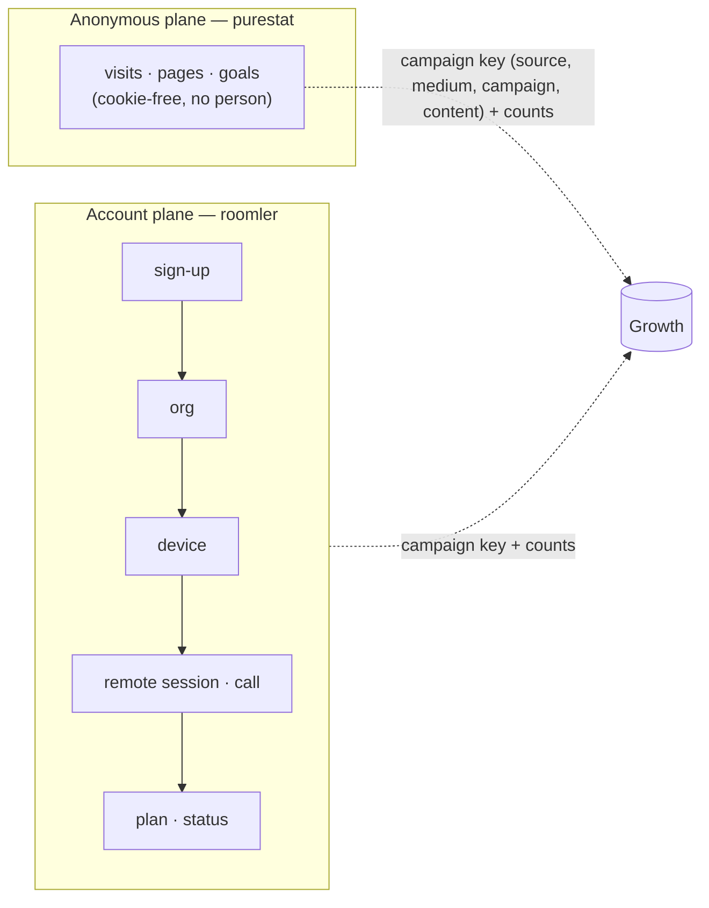
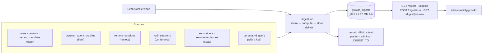
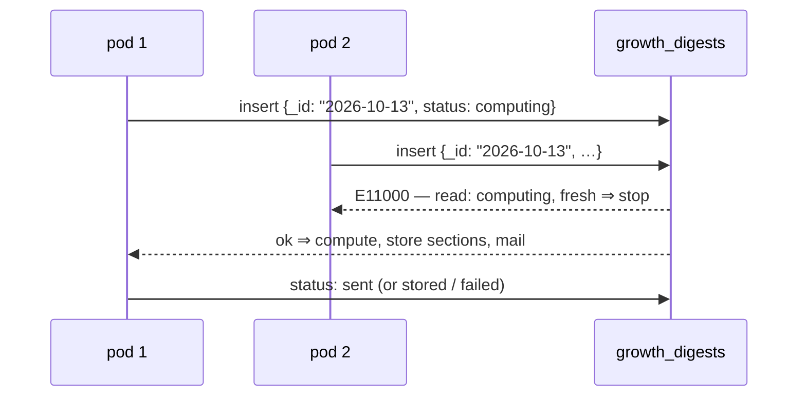

# Growth observability

How the project learns what a post, an article or an issue produced — visits, sign-ups,
orgs, devices, usage, revenue — **joined by the campaign key and never by a person**. This
page covers what FR-102 has shipped so far: the taxonomy (P1b), the exclusion set (P1c) and
the daily digest (P1d). Spec: [`docs/fr/FR-102-growth-observability.md`](fr/FR-102-growth-observability.md)
(#2127). It also places the existing `/observability` page, which no doc described before.

## Two planes, one key

- A purestat visitor is never joined to an account, and an account never gets a visitor id.
  The two planes meet at the key and at counts — one row of a campaigns table is two queries
  keyed alike.
- **Measured, not measured, and zero are three cells.** A source that is down, unset or not
  built yet renders `not_measured` with a reason (and the phase that brings it), never `0`.
- **Every rate carries its n.** Below n = 30 the digest shows counts and hides the percentage.
- **Self-hosted never phones home.** The analytics loader runs only on the hosted hostnames
  (P1a, [public-site.md](public-site.md)); the digest ships **off** and, without a purestat
  key, reads the web sections as "not measured" rather than asking anyone.

## The taxonomy (P1b) — `crates/core/src/campaign.rs`

One table, applied at ingress (`attribution::sanitize`,
[`crates/core/src/attribution.rs`](../crates/core/src/attribution.rs)) to `source` and
`medium` of every sign-up, and used by every report to group:

| Key | Canonical values | Normalisation |
|---|---|---|
| `utm_source` | `youtube` `tiktok` `x` `linkedin` `facebook` `reddit` `hn` `devto` `hashnode` `medium` `github` `newsletter` `blog` · `instagram` (retired, kept for history) | trim → lowercase → aliases `twitter`→`x`, `fb`→`facebook`, `yt` / `youtub`→`youtube`, `li`→`linkedin`, `ig`→`instagram` |
| `utm_medium` | `video` `post` `carousel` `comment` `community` `bio` `article` `email` | trim → lowercase |
| `utm_campaign` / `utm_content` | the operator's slugs | kept as sent |

> ⚠️ **An unknown value is kept verbatim (lowercased) and only *reported* under `other`** —
> never dropped. A new channel must show up in the numbers before it has a name in the table,
> or the table would decide what can be measured. `utm_source=YouTub&utm_medium=Video` stores
> `youtube` / `video` (AC5); `Mastodon` stores `mastodon`.

Organic channels come from the referrer host through `channel_for_referrer_host`: **search**
(`google.*`, `bing.com`, `duckduckgo.com`, `ecosia.org`, `yandex.*`), **ai_assistant**
(`chatgpt.com`, `chat.openai.com`, `perplexity.ai`, `gemini.google.com`,
`copilot.microsoft.com`, `claude.ai`), **social** (`t.co`, `x.com`, `linkedin.com`, `lnkd.in`,
`facebook.com`, `youtube.com`, `tiktok.com`, `reddit.com`, …), **community**
(`news.ycombinator.com`, `lobste.rs`, `dev.to`, `hashnode.com`, `medium.com`), **code**
(`github.com`), **self** (`roomler.ai` — navigation, never a source), **direct** (no
referrer), **other**. Matched by suffix, so `l.facebook.com` and `www.google.co.uk` land where
they should and `googleusercontent.com` does not.

## The exclusion set (P1c) — `roomler_core::growth::ExclusionSet`

Internal orgs and people must not count. `ExclusionSet::load(core)` is the **one** function
every growth number applies; it folds two kinds:

| Kind | Who | Record |
|---|---|---|
| implicit | every platform admin (`ROOMLER__STATS__PLATFORM_ADMINS`), and every org owned by an excluded user — tombstoned orgs included | none: the allowlist and the ownership graph are the record |
| explicit | the rows a platform admin writes: `{kind: tenant\|user, id, reason, by, at}` | `growth_exclusions`, unique `(kind, id)` |

`GET /api/admin/growth/exclusions` answers both, each marked `implicit: true|false`;
`PUT` replaces the explicit list (24-hex ids, a required reason of at most 200 printable
characters, duplicates folded). `include_internal=true` on a growth view is
`ExclusionSet::none()` — the raw totals, with the set empty rather than the filter skipped,
so it is the same code path either way (AC4).

## The daily digest (P1d)

A host job ([`crates/api/src/growth/digest.rs`](../crates/api/src/growth/digest.rs)) reports
every closed UTC day: it computes the day, stores it, and mails it to the platform admins.

### Sections

Every count is a **figure** `{day, d7, d28}`: the day, and the trailing 7 and 28 days ending
on it, so a quiet day is read against a baseline. A section whose source is not mounted on
this server, not reachable, or not built yet is `{"not_measured": "<reason>",
"arrives_with": "Pn"}` and is never rendered as 0.

| Section | Reports | Source | Available |
|---|---|---|---|
| `headline` | sign-ups, orgs created, devices enrolled, active orgs (a value event: a remote session that reached Active and lasted ≥ 30 s, or a call with ≥ 2 participants), coverage (`{purestat_signup_goals, server_signups}`; a ratio only at n ≥ 30) | all of the below | P1d; coverage with a purestat key |
| `signups` | provider, campaign key, landing path, referrer host, self-reported — **never the address, username or name**; at most 20 rows, else aggregated by source | `users` | P1d |
| `orgs_devices` | orgs created; devices enrolled by OS (tombstones count); orgs that enrolled their **first** device | `tenants`, `agents` | P1d; by install method P3 |
| `usage` | remote-desktop sessions started and session-minutes (each session's overlap with the window — a session spanning midnight counts only its part), calls and participant-minutes, active orgs, the top 10 orgs by remote-desktop minutes | `remote_sessions`, `call_sessions` | P1d |
| `website` | visitors, visits, pageviews; the day's visitors by organic channel; top 10 referrers and paths | purestat | with a key |
| `blog` | per post viewed that day: visitors, pageviews, reads, median read time (top 20); top sources | purestat | with a key |
| `campaigns` | per `(source, medium, campaign)`: visitors, pageviews, the four goals (`signup`, `subscribe`, `install-copy`, `github-outbound`), joined in code with the server's own sign-ups by the same normalised key | purestat + `users` | with a key |
| `newsletter` | new, confirmed and unsubscribed subscribers, by source; each issue sent that day with its counts | `subscribers`, `newsletter_issues` | P1d; delivery P5 |
| `revenue` | orgs by plan × subscription status; the list-price MRR, **labelled `estimate: true`** (the same formula as the cost view, `routes/cost.rs::mrr_estimate_cents`) | `tenants`, `tenant_members` | P1d; billed P4 |
| `quality` | sessions ended by `end_reason`, classed hang-up · refusal · failure; agent crashes by version | `remote_sessions`, `agent_crashes` | P1d |
| `install` · `social` · `search` | — | — | P3 · P8 · P7 |

A module that is not mounted (`[modules] remote = false`, a reduced profile) makes its part
`not_measured: "<module> module not mounted"`; the rest of the digest still completes. The
same holds for purestat: a 401, a timeout or an unreachable host costs the web sections —
with the reason stored — and nothing else. The client
([`purestat.rs`](../crates/api/src/growth/purestat.rs)) has a 15-second timeout, pages
`has_more` up to 1,000 rows, and never logs the key.

### Once, with two pods

- The **unique `_id`** is the claim. A `failed` day, or a `computing` one whose claim is older
  than 30 minutes (a pod that died mid-run), is re-claimed with a compare-and-set on exactly
  the status and `claimed_at` the reader saw, so two re-claimers cannot both win. A `sent` day
  is **never sent again**.
- Status ends `sent` (mailed to at least one recipient), `stored` (no recipients, or no mail
  service — the digest still exists) or `failed` (+ `error`; retried by the next tick).
- The scheduler ticks every 10 minutes; once the clock passes `today 00:00 +
  digest_hour_utc` it ensures **yesterday** exists. It never backfills older days — the run
  route does that on purpose.
- `POST …/digest/run?day=&send=false` recomputes and overwrites a closed day's sections and
  mails only with `send=true` **and** a day not already `sent`.
  `GET …/digest/preview?day=&include_internal=` computes live, stores nothing, mails nothing.

### Delivery and what the digest never carries

- Recipients: `ROOMLER__GROWTH__DIGEST_TO` when set, else the platform admins'
  `users.email` — proven addresses only (`.invalid` placeholders skipped). The stored row
  keeps a **count** of recipients, never the addresses. Subject:
  `Roomler daily digest — YYYY-MM-DD`; the HTML and plain-text bodies are rendered from the
  stored sections ([`render.rs`](../crates/api/src/growth/render.rs)), every string escaped,
  with a footer stating how many users and orgs were excluded and that the digest carries no
  personal addresses.
- The digest names **orgs** (as `/observability` does) and never a person's address, name or
  IP; the integration tests assert no seeded address survives into the stored JSON or either
  body. Dates in the JSON are RFC 3339 strings, never a `{"$date": …}` object.

### Settings

| Setting | Env | Default | Effect |
|---|---|---|---|
| `growth.enabled` | `ROOMLER__GROWTH__ENABLED` | `true` | the `/api/admin/growth/*` routes; `false` answers 404 on all of them |
| `growth.digest_enabled` | `ROOMLER__GROWTH__DIGEST_ENABLED` | **`false`** | the scheduler; a self-hosted server never starts mailing its admins a report they did not ask for |
| `growth.digest_hour_utc` | `ROOMLER__GROWTH__DIGEST_HOUR_UTC` | `6` | the UTC hour after which yesterday's digest is due (purestat closes a session 30 min after its last event) |
| `growth.digest_to` | `ROOMLER__GROWTH__DIGEST_TO` | empty | comma-separated recipients; empty ⇒ the platform admins |
| `growth.purestat_url` | `ROOMLER__GROWTH__PURESTAT_URL` | `https://purestat.ai` | the v1 query endpoint's base |
| `growth.purestat_api_key` | `ROOMLER__GROWTH__PURESTAT_API_KEY` | empty | a site-scoped key (`X-API-Key`); empty ⇒ website, blog, campaigns and coverage read "not measured" |

The hosted deployment turns the digest on with `ROOMLER__GROWTH__DIGEST_ENABLED=true` (and a
key once one is minted for `roomler.ai`); a mail backend must be configured
(`ROOMLER__EMAIL__*`) or every day ends `stored`.

### Routes and the Digest view

| Method | Path | Purpose |
|---|---|---|
| GET/PUT | `/api/admin/growth/exclusions` | the exclusion set (P1c) |
| GET | `/api/admin/growth/digest?day=` | a stored day; the latest when omitted |
| GET | `/api/admin/growth/digests?since=&limit=` | the list: day, status, times, headline |
| POST | `/api/admin/growth/digest/run?day=&send=false` | recompute a closed day; mail only when asked and not already sent |
| GET | `/api/admin/growth/digest/preview?day=&include_internal=` | compute live, store nothing |

All platform-admin only (`ROOMLER__STATS__PLATFORM_ADMINS`), **404** otherwise — the same
gate as `/admin/stats`. The SPA's `/observability/growth` (the Digest view) picks a day,
lists recent digests, recomputes without sending, and shows every section as cards; a
`not_measured` cell is a muted chip, never a 0, and every string is rendered as text.

## The `/observability` page as a whole

| Tab / surface | What it shows | Route family |
|---|---|---|
| Relay fleet | coturn + DERP load per region, availability and latency series | `/api/admin/stats/relay/*` |
| Cost & usage | per-org metered cost and the list-price MRR estimate ([relay-cost-metering.md](relay-cost-metering.md)) | `/api/admin/stats/cost` |
| Orgs, machines, calls, users | platform-wide inventories and series | `/api/admin/stats/{orgs,machines,calls,users}` |
| Usage | per-user minutes and bytes across every org | `/api/admin/stats/usage*` |
| Attribution (FR-88) | sign-ups by campaign key and how many activated | `/api/admin/stats/attribution` |
| **Growth** (FR-102) | the daily digest | `/api/admin/growth/*` |

## Field verification

The digest's counts for a closed day are to be checked against a hand count from Mongo on
production (AC23); the log of that check lives in the FR's spec. Until a purestat key exists
for `roomler.ai`, the web sections read "not measured" by design.
