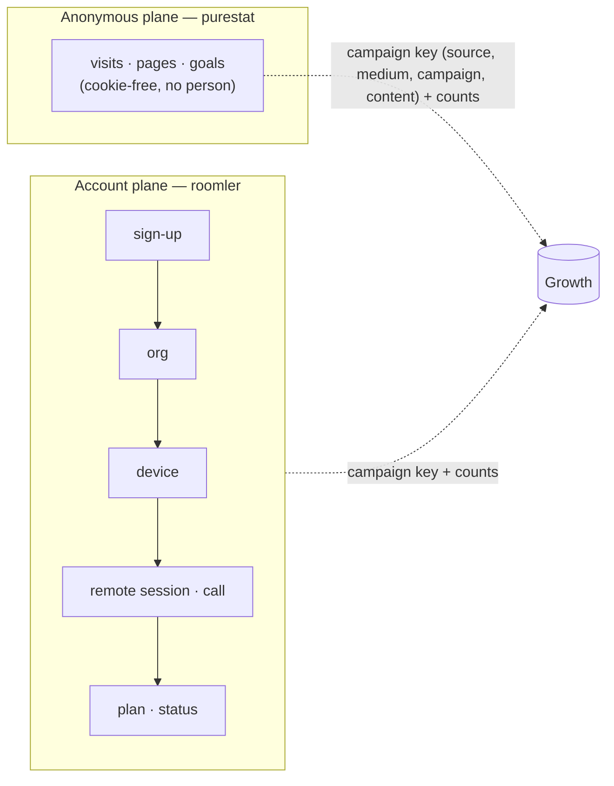
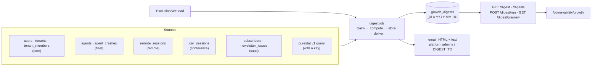
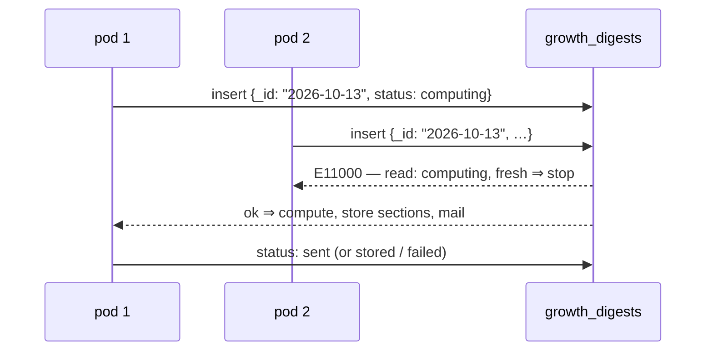
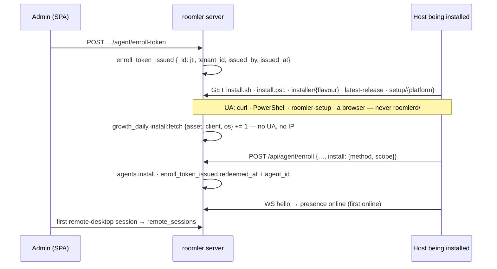

# Growth observability

How the project learns what a post, an article or an issue produced — visits, sign-ups,
orgs, devices, usage, revenue — **joined by the campaign key and never by a person**. This
page covers what FR-102 has shipped so far: the taxonomy (P1b), the exclusion set (P1c), the
daily digest (P1d) and the install trace (P3). Spec:
[`docs/fr/FR-102-growth-observability.md`](fr/FR-102-growth-observability.md) (#2127). It also
places the existing `/observability` page, which no doc described before.

## Two planes, one key

- A purestat visitor is never joined to an account, and an account never gets a visitor id.
  The two planes meet at the key and at counts — one row of a campaigns table is two queries
  keyed alike.
- **Measured, not measured, and zero are three cells.** A source that is down, unset or not
  built yet renders `not_measured` with a reason (and the phase that brings it), never `0`.
- **Every rate carries its n.** Below n = 30 the digest shows counts and hides the percentage.
- **Self-hosted never phones home.** The analytics loader runs only on the hosted hostnames
  (P1a, [public-site.md](public-site.md)); the digest ships **off** and, without a purestat
  key, reads the web sections as "not measured" rather than asking anyone.

## The taxonomy (P1b) — `crates/core/src/campaign.rs`

One table, applied at ingress (`attribution::sanitize`,
[`crates/core/src/attribution.rs`](../crates/core/src/attribution.rs)) to `source` and
`medium` of every sign-up, and used by every report to group:

| Key | Canonical values | Normalisation |
|---|---|---|
| `utm_source` | `youtube` `tiktok` `x` `linkedin` `facebook` `reddit` `hn` `devto` `hashnode` `medium` `github` `newsletter` `blog` · `instagram` (retired, kept for history) | trim → lowercase → aliases `twitter`→`x`, `fb`→`facebook`, `yt` / `youtub`→`youtube`, `li`→`linkedin`, `ig`→`instagram` |
| `utm_medium` | `video` `post` `carousel` `comment` `community` `bio` `article` `email` | trim → lowercase |
| `utm_campaign` / `utm_content` | the operator's slugs | kept as sent |

> ⚠️ **An unknown value is kept verbatim (lowercased) and only *reported* under `other`** —
> never dropped. A new channel must show up in the numbers before it has a name in the table,
> or the table would decide what can be measured. `utm_source=YouTub&utm_medium=Video` stores
> `youtube` / `video` (AC5); `Mastodon` stores `mastodon`.

Organic channels come from the referrer host through `channel_for_referrer_host`: **search**
(`google.*`, `bing.com`, `duckduckgo.com`, `ecosia.org`, `yandex.*`), **ai_assistant**
(`chatgpt.com`, `chat.openai.com`, `perplexity.ai`, `gemini.google.com`,
`copilot.microsoft.com`, `claude.ai`), **social** (`t.co`, `x.com`, `linkedin.com`, `lnkd.in`,
`facebook.com`, `youtube.com`, `tiktok.com`, `reddit.com`, …), **community**
(`news.ycombinator.com`, `lobste.rs`, `dev.to`, `hashnode.com`, `medium.com`), **code**
(`github.com`), **self** (`roomler.ai` — navigation, never a source), **direct** (no
referrer), **other**. Matched by suffix, so `l.facebook.com` and `www.google.co.uk` land where
they should and `googleusercontent.com` does not.

## The exclusion set (P1c) — `roomler_core::growth::ExclusionSet`

Internal orgs and people must not count. `ExclusionSet::load(core)` is the **one** function
every growth number applies; it folds two kinds:

| Kind | Who | Record |
|---|---|---|
| implicit | every platform admin (`ROOMLER__STATS__PLATFORM_ADMINS`), and every org owned by an excluded user — tombstoned orgs included | none: the allowlist and the ownership graph are the record |
| explicit | the rows a platform admin writes: `{kind: tenant\|user, id, reason, by, at}` | `growth_exclusions`, unique `(kind, id)` |

`GET /api/admin/growth/exclusions` answers both, each marked `implicit: true|false`;
`PUT` replaces the explicit list (24-hex ids, a required reason of at most 200 printable
characters, duplicates folded). `include_internal=true` on a growth view is
`ExclusionSet::none()` — the raw totals, with the set empty rather than the filter skipped,
so it is the same code path either way (AC4).

## The daily digest (P1d)

A host job ([`crates/api/src/growth/digest.rs`](../crates/api/src/growth/digest.rs)) reports
every closed UTC day: it computes the day, stores it, and mails it to the platform admins.

### Sections

Every count is a **figure** `{day, d7, d28}`: the day, and the trailing 7 and 28 days ending
on it, so a quiet day is read against a baseline. A section whose source is not mounted on
this server, not reachable, or not built yet is `{"not_measured": "<reason>",
"arrives_with": "Pn"}` and is never rendered as 0.

| Section | Reports | Source | Available |
|---|---|---|---|
| `headline` | sign-ups, orgs created, devices enrolled, active orgs (a value event: a remote session that reached Active and lasted ≥ 30 s, or a call with ≥ 2 participants), coverage (`{purestat_signup_goals, server_signups}`; a ratio only at n ≥ 30) | all of the below | P1d; coverage with a purestat key |
| `signups` | provider, campaign key, landing path, referrer host, self-reported — **never the address, username or name**; at most 20 rows, else aggregated by source | `users` | P1d |
| `orgs_devices` | orgs created; devices enrolled by OS (tombstones count); orgs that enrolled their **first** device; the day's devices by install method | `tenants`, `agents` | P1d; by install method P3 |
| `usage` | remote-desktop sessions started and session-minutes (each session's overlap with the window — a session spanning midnight counts only its part), calls and participant-minutes, active orgs, the top 10 orgs by remote-desktop minutes | `remote_sessions`, `call_sessions` | P1d |
| `website` | visitors, visits, pageviews; the day's visitors by organic channel; top 10 referrers and paths | purestat | with a key |
| `blog` | per post viewed that day: visitors, pageviews, reads, median read time (top 20); top sources | purestat | with a key |
| `campaigns` | per `(source, medium, campaign)`: visitors, pageviews, the four goals (`signup`, `subscribe`, `install-copy`, `github-outbound`), joined in code with the server's own sign-ups by the same normalised key | purestat + `users` | with a key |
| `newsletter` | new, confirmed and unsubscribed subscribers, by source; each issue sent that day with its counts | `subscribers`, `newsletter_issues` | P1d; delivery P5 |
| `revenue` | orgs by plan × subscription status; the list-price MRR, **labelled `estimate: true`** (the same formula as the cost view, `routes/cost.rs::mrr_estimate_cents`) | `tenants`, `tenant_members` | P1d; billed P4 |
| `quality` | sessions ended by `end_reason`, classed hang-up · refusal · failure; agent crashes by version | `remote_sessions`, `agent_crashes` | P1d |
| `install` | tokens issued → redeemed; fetches by `(asset, client class, OS)`; enrollments by `(method, OS)`; wizard steps not measured until P3b — [the install trace](#the-install-trace-p3) | `enroll_token_issued`, `growth_daily`, `agents.install` | P3 |
| `social` · `search` | — | — | P8 · P7 |

A module that is not mounted (`[modules] remote = false`, a reduced profile) makes its part
`not_measured: "<module> module not mounted"`; the rest of the digest still completes. The
same holds for purestat: a 401, a timeout or an unreachable host costs the web sections —
with the reason stored — and nothing else. The client
([`purestat.rs`](../crates/api/src/growth/purestat.rs)) has a 15-second timeout, pages
`has_more` up to 1,000 rows, and never logs the key.

### Once, with two pods

- The **unique `_id`** is the claim. A `failed` day, or a `computing` one whose claim is older
  than 30 minutes (a pod that died mid-run), is re-claimed with a compare-and-set on exactly
  the status and `claimed_at` the reader saw, so two re-claimers cannot both win. A `sent` day
  is **never sent again**.
- The scheduler ticks every 10 minutes; once the clock passes `today 00:00 +
  digest_hour_utc` it ensures **yesterday** exists. It never backfills older days — the run
  route does that on purpose.
- **Every run holds the day through the same claim**, the scheduler's and the admin's manual
  `POST …/digest/run?day=&send=` alike — that is what keeps them from colliding:

| `status` | Meaning | Scheduler | Manual `send=false` | Manual `send=true` |
|---|---|---|---|---|
| `computing` (fresh) | a run is in progress on some pod | leaves it | **409** | **409** |
| `computing` (stale, > 30 min) | a pod died mid-run | re-claims | re-claims | re-claims |
| `failed` | the compute or every send failed (`error`) | re-claims | re-claims | re-claims |
| `preview` | a manual `send=false` result — **not final** | re-claims (so a look at a day never cancels its email) | re-claims | re-claims |
| `stored` | a delivering run found nobody to mail (no recipients, or no mail service) | done | refreshed **in place**, stays `stored` | re-claims (it was never mailed) |
| `sent` | mailed to at least one recipient — **final** | done | refreshed in place, stays `sent` | refreshed in place, **never re-sent** |

  A claimed manual `send=false` run ends `preview`; a claimed `send=true` run delivers and
  ends `sent` / `failed` / `stored` exactly as the scheduler's would. An in-place refresh
  rewrites the sections and never touches the status, so a manual run cannot turn a mailed
  day back into one the scheduler would mail again.
  `GET …/digest/preview?day=&include_internal=` computes live, stores nothing, mails nothing.

### Delivery and what the digest never carries

- Recipients: `ROOMLER__GROWTH__DIGEST_TO` when set, else the platform admins'
  `users.email` — proven addresses only (`.invalid` placeholders skipped). The stored row
  keeps a **count** of recipients, never the addresses. Subject:
  `Roomler daily digest — YYYY-MM-DD`; the HTML and plain-text bodies are rendered from the
  stored sections ([`render.rs`](../crates/api/src/growth/render.rs)), every string escaped,
  with a footer stating how many users and orgs were excluded and that the digest carries no
  personal addresses.
- The digest names **orgs** (as `/observability` does) and never a person's address, name or
  IP; the integration tests assert no seeded address survives into the stored JSON or either
  body. Dates in the JSON are RFC 3339 strings, never a `{"$date": …}` object.

### Settings

| Setting | Env | Default | Effect |
|---|---|---|---|
| `growth.enabled` | `ROOMLER__GROWTH__ENABLED` | `true` | the `/api/admin/growth/*` routes; `false` answers 404 on all of them |
| `growth.digest_enabled` | `ROOMLER__GROWTH__DIGEST_ENABLED` | **`false`** | the scheduler; a self-hosted server never starts mailing its admins a report they did not ask for |
| `growth.digest_hour_utc` | `ROOMLER__GROWTH__DIGEST_HOUR_UTC` | `6` | the UTC hour after which yesterday's digest is due (purestat closes a session 30 min after its last event) |
| `growth.digest_to` | `ROOMLER__GROWTH__DIGEST_TO` | empty | comma-separated recipients; empty ⇒ the platform admins |
| `growth.purestat_url` | `ROOMLER__GROWTH__PURESTAT_URL` | `https://purestat.ai` | the v1 query endpoint's base |
| `growth.purestat_api_key` | `ROOMLER__GROWTH__PURESTAT_API_KEY` | empty | a site-scoped key (`X-API-Key`); empty ⇒ website, blog, campaigns and coverage read "not measured" |
| `growth.install_counters` | `ROOMLER__GROWTH__INSTALL_COUNTERS` | `true` | the install trace's fetch counters (P3); `false` writes none. The token ledger and the enroll's `install` have no switch — they are ids on rows that exist anyway |

The hosted deployment turns the digest on with `ROOMLER__GROWTH__DIGEST_ENABLED=true` (and a
key once one is minted for `roomler.ai`); a mail backend must be configured
(`ROOMLER__EMAIL__*`) or every day ends `stored`.

### Routes and the Digest view

| Method | Path | Purpose |
|---|---|---|
| GET/PUT | `/api/admin/growth/exclusions` | the exclusion set (P1c) |
| GET | `/api/admin/growth/digest?day=` | a stored day; the latest when omitted |
| GET | `/api/admin/growth/digests?since=&limit=` | the list: day, status, times, headline |
| POST | `/api/admin/growth/digest/run?day=&send=false` | recompute a closed day through the claim; mail only when asked and not already sent; 409 while a run of that day is in progress |
| GET | `/api/admin/growth/digest/preview?day=&include_internal=` | compute live, store nothing |

All platform-admin only (`ROOMLER__STATS__PLATFORM_ADMINS`), **404** otherwise — the same
gate as `/admin/stats`. The SPA's `/observability/growth` (the Digest view) picks a day,
lists recent digests, recomputes without sending, and shows every section as cards; a
`not_measured` cell is a muted chip, never a 0, and every string is rendered as text.

## The install trace (P3)

How a device gets from a minted token to a first session — each step recorded where it
already had to happen, joined by ids and counts, never by a person. The fleet module owns
every write (`crates/modules/fleet/src/install_trace.rs`, `agent.rs`); the digest reads.

| Step | Record | Written by | Kept |
|---|---|---|---|
| token minted | `enroll_token_issued {_id: jti, tenant_id, issued_by, issued_at, kind: standard, redeemed_at: null, agent_id: null}` — the jti, **never the token** | `POST …/agent/enroll-token` (`agent.rs::issue_enrollment_token`), best-effort | 90 d |
| fetch | `growth_daily {source: install, metric: fetch, dims: {asset, client, os}, day, value}` | the installer proxy, `/api/agent/latest-release`, `/api/setup/latest-release`, `/api/setup/install.sh`, `/api/setup/install.ps1`, `/api/setup/{platform}` (`install_trace::count_fetch`, spawned, best-effort) | indefinitely |
| enroll | `agents.install {method, scope, run?}`; `enroll_token_issued.redeemed_at`, `.agent_id` (an upsert from the token's claims, so a token minted before the ledger is on record too) | `POST /api/agent/enroll` | with the row; 90 d |
| first online · first session | already there: `stats_events` (presence), `remote_sessions` | — | — |

### Fetches by client class

The class comes from the **User-Agent and nothing else about the request**
(`install_trace::classify_user_agent`, a pure function with the real UAs as its tests):

| Class | User-Agent | Who |
|---|---|---|
| `wizard` | `roomler-setup/<ver>` | the wizard resolving and downloading its MSI |
| `script-sh` | `curl/…`, `Wget/…` | `install.sh`, or a person at a terminal |
| `script-ps1` | anything carrying `PowerShell` — Windows PowerShell 5.1 and pwsh 7 both send `Mozilla/5.0 (…) …PowerShell/…`, so this is decided **before** the browser rule | `install.ps1`, `irm … | iex`, or a person at a prompt |
| `browser` | any other `Mozilla/…` | a person on the site (the wizard download button) |
| `other` | everything else, a missing header included | — |

The `os` dimension is what the asset itself implies (an MSI, `install.ps1` and the Windows wizard
archive are `windows`; the macOS and Linux archives name theirs), else the UA's hint; a `curl`
fetch of `install.sh` is honestly `unknown`.

> ⚠️ **The updater is never counted.** `roomlerd/<ver>` is the daemon's own update check, and by
> default it asks `roomler.ai` from self-hosted devices as well
> (`agents/roomlerd/src/updater.rs`, `DEFAULT_PROXY_URL`). Counting it would be exactly the
> self-host telemetry the product promises not to collect (`LICENSING.md`,
> [business-model.md](business-model.md) §6). The rule covers every product token of ours that
> is not the wizard — `roomlerd/`, `roomlerd-*/`, `roomler-cli/`, `roomler-token-renewal/`, the
> updater's pre-rename spelling, whatever a later release adds — decided by the common prefix,
> as `UaClass::Updater`, whose counted value is `None`: a fetch with it writes nothing. Locked
> by a test per known spelling, plus one for an identity that does not exist yet.

- **Never a User-Agent, never an IP.** A row is three enum-like dimensions and a count; the
  integration test scans every row for the UAs it sent and the loopback address.
- The write is **spawned and best-effort**: an install script is served at wire speed whatever
  the database is doing. `ROOMLER__GROWTH__INSTALL_COUNTERS=false` switches the counters off.
- A fetch is a **lower bound on intent, not an install**: a self-hoster who downloads our build
  to enroll elsewhere fetches like anyone else, and only requests that reach this server count.

### The enroll says how

`POST /api/agent/enroll` gained `install: {method, scope, run?}` — additive, `#[serde(default)]`,
clamped server-side (`InstallInfo::clamped`: an unknown `method` is `other`, an unknown `scope`
`unknown`, a `run` that is not a short opaque token dropped) and **never a refusal**. The
vocabulary lives in `crates/remote_control/src/models.rs` (`InstallMethod`, `InstallScope`),
shared by both ends and locked by a test:

| Who enrolls | `method` | `scope` |
|---|---|---|
| the wizard, in-process | `wizard` | its role: `daemon-system` → `system`, `daemon-user` → `per-user`, `daemon-machine` → `attended` (a service without SystemContext, usable only beside a signed-in session) |
| `install.sh` | `script-sh` | `system` with `--system` and for the macOS root half; `per-user` otherwise |
| `install.ps1` | `script-ps1` | as the wizard's roles |
| `roomlerd enroll` by hand | `manual`, or `--install-method` / `ROOMLER_INSTALL_METHOD` | `unknown`, or `--install-scope` / `ROOMLER_INSTALL_SCOPE` |
| the companion's enroll form | `manual` | `unknown` |
| the k8s e2e agent image | `container` (its StatefulSet sets the env) | `system` |
| `roomlerd re-enroll`, a pushed org join, the companion's token refresh | nothing is sent; the row **keeps** what it has | |
| an agent from before P3 | recorded as `unknown` on a new row; a known row keeps its record | `unknown` |

Compatibility, both directions, is what the shape is built around:

- **A new agent against an old server**: the agent omits `install` when it has nothing to say,
  and the server's `EnrollRequest` carries no `deny_unknown_fields` (a comment there says it
  never may), so a pre-P3 server ignores the field. The agent-side test asserts the body without
  `install` is byte-for-byte the pre-P3 five-field shape.
- **An old agent against the new server**: no field ⇒ `install: {method: unknown}` on a new row,
  no change on a re-enrolled one. The device row's `install` is `None` only on rows created
  before P3; the digest reads both as `unknown`.
- ⚠️ **The served scripts set the environment, never the flag.** A script installs whatever
  release is current, and a daemon from before `--install-method` existed refuses an argument it
  does not know — which would have failed every scripted install until the next agent release.
  `ROOMLER_INSTALL_METHOD` / `ROOMLER_INSTALL_SCOPE` are the flag's fallbacks
  (`roomler_node_core::enrollment::resolve_install`: flag, then env, then `manual` / `unknown`;
  a misspelling is refused before the single-use token is spent); an older daemon ignores them.
  `install.sh` passes them through `env` so they survive `sudo`.

The row is shown on the device (`GET …/agent/{id}` → `install`), which is what a field check
reads (AC9).

### In the digest

`install` is a section of its own: `tokens {issued, redeemed}` (tokens issued in the window,
and how many of those an enroll spent; a redeemed share only at n ≥ 30), `fetches
[{asset, client, os, fetches}]`, `enrollments_by_method [{method, os, enrolled}]`, and
`wizard_steps` not measured until P3b. `orgs_devices.by_install_method` lists the day's devices
by method. Exclusions apply to tokens by the token's tenant and to enrollments by the device's
tenant; the fetch rows carry no tenant and cannot be filtered. All of it is "not mounted"
without the `fleet` module, never 0.

## The `/observability` page as a whole

| Tab / surface | What it shows | Route family |
|---|---|---|
| Relay fleet | coturn + DERP load per region, availability and latency series | `/api/admin/stats/relay/*` |
| Cost & usage | per-org metered cost and the list-price MRR estimate ([relay-cost-metering.md](relay-cost-metering.md)) | `/api/admin/stats/cost` |
| Orgs, machines, calls, users | platform-wide inventories and series | `/api/admin/stats/{orgs,machines,calls,users}` |
| Usage | per-user minutes and bytes across every org | `/api/admin/stats/usage*` |
| Attribution (FR-88) | sign-ups by campaign key and how many activated | `/api/admin/stats/attribution` |
| **Growth** (FR-102) | the daily digest | `/api/admin/growth/*` |

## Field verification

The digest's counts for a closed day are to be checked against a hand count from Mongo on
production (AC23); the log of that check lives in the FR's spec. Until a purestat key exists
for `roomler.ai`, the web sections read "not measured" by design.
