# Growth observability

How the project learns what a post, an article or an issue produced — visits, sign-ups,
orgs, devices, usage, revenue — **joined by the campaign key and never by a person**. This
page covers what FR-102 has shipped so far: the taxonomy (P1b), the exclusion set (P1c), the
daily digest (P1d), the account funnel, cohorts and org views (P2), the install trace (P3) with
the setup wizard's opt-in diagnostics (P3b) and the internal networks that keep the lab's own
installs out of its fetch counts (P3c), the
web plane — the purestat puller and the Campaigns table (P6) — social reach: the ingest
routes the promotion pipeline pushes to, and the Channels table (P8) — the newsletter's
delivery side: SendGrid's signed Event Webhook, the per-issue link tags and unsubscribes, and
the per-issue table (P5) — revenue: what Stripe billed, billed MRR month by month,
upgrade intent from plan-limit collisions, and margin against the cost to serve (P4) — the read
key, the weekly roll-up and the alert rules (P10) — and remote-desktop quality from what is already
recorded: sessions by outcome, the time to first frame frozen before its logs expire, crashes per
100 device-days, by agent version (P9a) — and the repository on GitHub: stars, forks and release
downloads as daily snapshots, and its traffic with a token (P7a) — and search: Google Search
Console per final day, the blog's posts with their URL Inspection verdict, and Bing at its own
grain (P7b), read by the Content table and the digest's Search section (P7c).
Spec: [`docs/fr/FR-102-growth-observability.md`](fr/FR-102-growth-observability.md) (#2127). It
also places the existing `/observability` page, which no doc described before.

## Two planes, one key

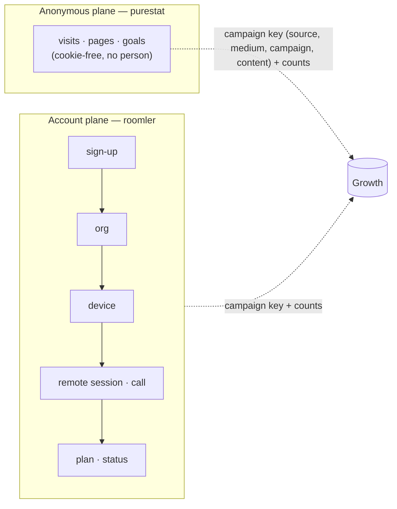

- A purestat visitor is never joined to an account, and an account never gets a visitor id.
  The two planes meet at the key and at counts — one row of a campaigns table is two queries
  keyed alike.
- **Measured, not measured, and zero are three cells.** A source that is down, unset or not
  built yet renders `not_measured` with a reason (and the phase that brings it), never `0`.
- **Every rate carries its n.** Below n = 30 the digest shows counts and hides the percentage.
- **Self-hosted never phones home.** The analytics loader runs only on the hosted hostnames
  (P1a, [public-site.md](public-site.md)); the digest ships **off** and, without a purestat
  key, reads the web sections as "not measured" rather than asking anyone.

## The taxonomy (P1b) — `crates/core/src/campaign.rs`

One table, applied at ingress (`attribution::sanitize`,
[`crates/core/src/attribution.rs`](../crates/core/src/attribution.rs)) to `source` and
`medium` of every sign-up, and used by every report to group:

| Key | Canonical values | Normalisation |
|---|---|---|
| `utm_source` | `youtube` `tiktok` `x` `linkedin` `facebook` `reddit` `hn` `devto` `hashnode` `medium` `github` `newsletter` `blog` · `instagram` (retired, kept for history) | trim → lowercase → aliases `twitter`→`x`, `fb`→`facebook`, `yt` / `youtub`→`youtube`, `li`→`linkedin`, `ig`→`instagram` |
| `utm_medium` | `video` `post` `carousel` `comment` `community` `bio` `article` `email` | trim → lowercase |
| `utm_campaign` / `utm_content` | the operator's slugs | kept as sent |

> ⚠️ **An unknown value is kept verbatim (lowercased) and only *reported* under `other`** —
> never dropped. A new channel must show up in the numbers before it has a name in the table,
> or the table would decide what can be measured. `utm_source=YouTub&utm_medium=Video` stores
> `youtube` / `video` (AC5); `Mastodon` stores `mastodon`.

Organic channels come from the referrer host through `channel_for_referrer_host`: **search**
(`google.*`, `bing.com`, `duckduckgo.com`, `ecosia.org`, `yandex.*`), **ai_assistant**
(`chatgpt.com`, `chat.openai.com`, `perplexity.ai`, `gemini.google.com`,
`copilot.microsoft.com`, `claude.ai`), **social** (`t.co`, `x.com`, `linkedin.com`, `lnkd.in`,
`facebook.com`, `youtube.com`, `tiktok.com`, `reddit.com`, …), **community**
(`news.ycombinator.com`, `lobste.rs`, `dev.to`, `hashnode.com`, `medium.com`), **code**
(`github.com`), **self** (`roomler.ai` — navigation, never a source), **direct** (no
referrer), **other**. Matched by suffix, so `l.facebook.com` and `www.google.co.uk` land where
they should and `googleusercontent.com` does not.

## The exclusion set (P1c) — `roomler_core::growth::ExclusionSet`

Internal orgs and people must not count. `ExclusionSet::load(core)` is the **one** function
every growth number applies; it folds two kinds:

| Kind | Who | Record |
|---|---|---|
| implicit | every platform admin (`ROOMLER__STATS__PLATFORM_ADMINS`), and every org owned by an excluded user — tombstoned orgs included | none: the allowlist and the ownership graph are the record |
| explicit | the rows a platform admin writes: `{kind: tenant\|user, id, reason, by, at}` | `growth_exclusions`, unique `(kind, id)` |

`GET /api/admin/growth/exclusions` answers both, each marked `implicit: true|false`;
`PUT` replaces the explicit list (24-hex ids, a required reason of at most 200 printable
characters, duplicates folded). `include_internal=true` on a growth view is
`ExclusionSet::none()` — the raw totals, with the set empty rather than the filter skipped,
so it is the same code path either way (AC4).

## The daily digest (P1d)

A host job ([`crates/api/src/growth/digest.rs`](../crates/api/src/growth/digest.rs)) reports
every closed UTC day: it computes the day, stores it, and mails it to the platform admins.

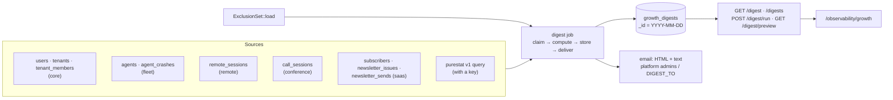

### Sections

Every count is a **figure** `{day, d7, d28}`: the day, and the trailing 7 and 28 days ending
on it, so a quiet day is read against a baseline. A section whose source is not mounted on
this server, not reachable, or not built yet is `{"not_measured": "<reason>",
"arrives_with": "Pn"}` and is never rendered as 0.

| Section | Reports | Source | Available |
|---|---|---|---|
| `headline` | sign-ups, orgs created, devices enrolled, active orgs (a value event: a remote session that reached Active and lasted ≥ 30 s, or a call with ≥ 2 participants), coverage (`{purestat_signup_goals, server_signups}`; a ratio only at n ≥ 30) | all of the below | P1d; coverage with a purestat key |
| `signups` | provider, campaign key, landing path, referrer host, self-reported — **never the address, username or name**; at most 20 rows, else aggregated by source | `users` | P1d |
| `orgs_devices` | orgs created; devices enrolled by OS (tombstones count); orgs that enrolled their **first** device; the day's devices by install method | `tenants`, `agents` | P1d; by install method P3 |
| `usage` | remote-desktop sessions started and session-minutes (each session's overlap with the window — a session spanning midnight counts only its part), calls and participant-minutes, active orgs, the top 10 orgs by remote-desktop minutes | `remote_sessions`, `call_sessions` | P1d |
| `website` | visitors, visits, pageviews; the day's visitors by organic channel; top 10 referrers and paths | purestat | with a key |
| `blog` | per post viewed that day: visitors, pageviews, reads, median read time (top 20); top sources | purestat | with a key |
| `campaigns` | per `(source, medium, campaign)`: visitors, pageviews, the four goals (`signup`, `subscribe`, `install-copy`, `github-outbound`), joined in code with the server's own sign-ups by the same normalised key | purestat + `users` | with a key |
| `newsletter` | new, confirmed and unsubscribed subscribers (and how many left through an issue's link), by source; each issue sent that day with its ledger counts, its delivery so far and its unsubscribes; the window's delivered, bounced, dropped, spam reports and suppressed addresses — [the newsletter](#the-newsletter-delivery-per-issue-tags-and-unsubscribes-p5) | `subscribers`, `newsletter_issues`, `newsletter_sends` | P1d; delivery P5 (`not_measured` without the webhook key) |
| `revenue` | orgs by plan × subscription status; the list-price MRR, **labelled `estimate: true`** (the same formula as the cost view, `routes/cost.rs::mrr_estimate_cents`) | `tenants`, `tenant_members` | P1d; billed P4 |
| `quality` | sessions **requested** → reached Active / never reached it (a share from n = 30), the ended ones by `end_reason` classed hang-up · refusal · failure; duration, peak frame rate and RTT as `{n, p50, p90}` per window; FR-22's **time to first frame** p50/p90 — the day exact, 7d/28d estimated from the frozen daily histograms, `not_measured` until the day is frozen; agent crashes by the version the payload named, device-days and crashes per 100 device-days (from 30); the day **by agent version** — [remote-desktop quality](#remote-desktop-quality-from-what-is-recorded-p9a); the viewer's **ratings** (`up` · `down` · `rated` per window, `up_share_28d` from 30 answers, `reasons_28d`), `not_measured` while the prompt is off — [the post-session rating](#the-post-session-rating-p9b) | `remote_sessions`, `agent_crashes`, `stats_machine_1d`, `growth_quality_daily`, `session_feedback` | P1d; TTFF, rates and versions P9a; ratings P9b |
| `install` | tokens issued → redeemed; fetches by `(asset, client class, OS)`; enrollments by `(method, OS)`; the wizard's steps — runs reaching each, their outcomes and the failures by code, **opted-in runs only, labelled with their n** — [the install trace](#the-install-trace-p3), [the wizard's diagnostics](#the-wizards-opt-in-diagnostics-p3b) | `enroll_token_issued`, `growth_daily`, `agents.install`, `setup_diagnostics` | P3; wizard steps P3b (`not_measured` while `growth.setup_diagnostics` is off) |
| `social` | posts published per platform `{day, d7, d28}`; the snapshots taken that day (at most 20), each with its post's campaign and the platform's own metric names — `not_measured` when nothing was pushed in 28 days | `growth_posts`, `growth_post_snapshots` | P8 |
| `github` | the repository's stars, forks, watchers and release downloads at the day's snapshot, each with its day / 7-day / 28-day change (`null` where a snapshot is missing), the week's downloads by release and by flavour; with a token, views and clones per window over the measured days and GitHub's 14-day referrer ranking — [GitHub](#github-the-repositorys-counters-and-traffic-p7a) | `growth_daily` (`github`, `github_traffic`), `growth_pulls` | P7a; traffic with `ROOMLER__GROWTH__GITHUB_TOKEN` |
| `search` | Google: the day it is final through, clicks and impressions per window over its final days (`days` pulled), the 28-day CTR and position from 30 impressions, the top queries and pages of 7 days; Bing: its daily totals and its newest weekly bucket's top rows — [the Search section](#the-search-section--the-digest-and-the-weekly-roll-up) | `growth_daily` (`search_console`, `bing`, `bing_weekly`), `growth_pulls` | P7c; `not_measured` per engine without its key |
| `alerts` | the alert rows that `fired` or `cleared` during the day, and the ones `open` at the compute — rule, key, times, the numbers behind it; `not_measured` while the alerts are off on this server — [alerts](#the-read-key-the-weekly-roll-up-and-alerts-p10) | `growth_alerts` | P10 (`ROOMLER__GROWTH__ALERTS`) |

A module that is not mounted (`[modules] remote = false`, a reduced profile) makes its part
`not_measured: "<module> module not mounted"`; the rest of the digest still completes. The
same holds for purestat: a 401, a timeout or an unreachable host costs the web sections —
with the reason stored — and nothing else. The client
([`purestat.rs`](../crates/services/src/purestat.rs), in `roomler-ai-services` since P6 so
the `saas` puller shares it) has a 15-second timeout, pages `has_more` up to 1,000 rows (and
says when that bound cut an answer), and never logs the key.

### Once, with two pods

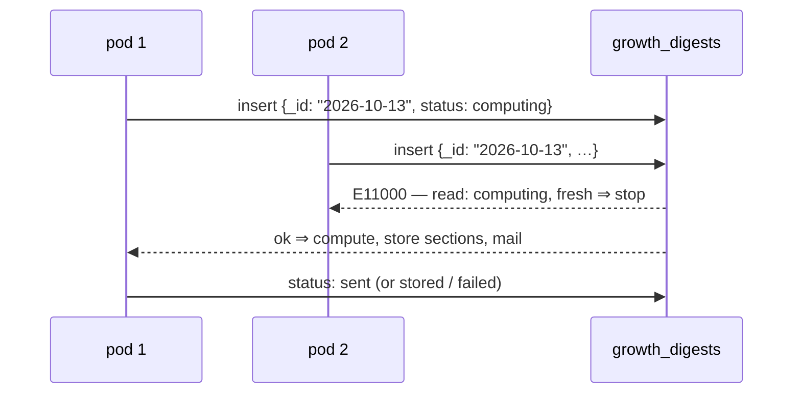

- The **unique `_id`** is the claim. A `failed` day, or a `computing` one whose claim is older
  than 30 minutes (a pod that died mid-run), is re-claimed with a compare-and-set on exactly
  the status and `claimed_at` the reader saw, so two re-claimers cannot both win. A `sent` day
  is **never sent again**.
- The scheduler ticks every 10 minutes; once the clock passes `today 00:00 +
  digest_hour_utc` it ensures **yesterday** exists. It never backfills older days — the run
  route does that on purpose.
- **Every run holds the day through the same claim**, the scheduler's and the admin's manual
  `POST …/digest/run?day=&send=` alike — that is what keeps them from colliding:

| `status` | Meaning | Scheduler | Manual `send=false` | Manual `send=true` |
|---|---|---|---|---|
| `computing` (fresh) | a run is in progress on some pod | leaves it | **409** | **409** |
| `computing` (stale, > 30 min) | a pod died mid-run | re-claims | re-claims | re-claims |
| `failed` | the compute or every send failed (`error`) | re-claims | re-claims | re-claims |
| `preview` | a manual `send=false` result — **not final** | re-claims (so a look at a day never cancels its email) | re-claims | re-claims |
| `stored` | a delivering run found nobody to mail (no recipients, or no mail service) | done | refreshed **in place**, stays `stored` | re-claims (it was never mailed) |
| `sent` | mailed to at least one recipient — **final** | done | refreshed in place, stays `sent` | refreshed in place, **never re-sent** |

  A claimed manual `send=false` run ends `preview`; a claimed `send=true` run delivers and
  ends `sent` / `failed` / `stored` exactly as the scheduler's would. An in-place refresh
  rewrites the sections and never touches the status, so a manual run cannot turn a mailed
  day back into one the scheduler would mail again.
  `GET …/digest/preview?day=&include_internal=` computes live, stores nothing, mails nothing.

### Delivery and what the digest never carries

- Recipients: `ROOMLER__GROWTH__DIGEST_TO` when set, else the platform admins'
  `users.email` — proven addresses only (`.invalid` placeholders skipped). The stored row
  keeps a **count** of recipients, never the addresses. Subject:
  `Roomler daily digest — YYYY-MM-DD`; the HTML and plain-text bodies are rendered from the
  stored sections ([`render.rs`](../crates/api/src/growth/render.rs)), every string escaped,
  with a footer stating how many users and orgs were excluded and that the digest carries no
  personal addresses.
- The digest names **orgs** (as `/observability` does) and never a person's address, name or
  IP; the integration tests assert no seeded address survives into the stored JSON or either
  body. Dates in the JSON are RFC 3339 strings, never a `{"$date": …}` object.

### Settings

| Setting | Env | Default | Effect |
|---|---|---|---|
| `growth.enabled` | `ROOMLER__GROWTH__ENABLED` | `true` | the `/api/admin/growth/*` routes; `false` answers 404 on all of them |
| `growth.digest_enabled` | `ROOMLER__GROWTH__DIGEST_ENABLED` | **`false`** | the scheduler; a self-hosted server never starts mailing its admins a report they did not ask for |
| `growth.digest_hour_utc` | `ROOMLER__GROWTH__DIGEST_HOUR_UTC` | `6` | the UTC hour after which yesterday's digest is due (purestat closes a session 30 min after its last event) |
| `growth.digest_to` | `ROOMLER__GROWTH__DIGEST_TO` | empty | comma-separated recipients; empty ⇒ the platform admins |
| `growth.purestat_url` | `ROOMLER__GROWTH__PURESTAT_URL` | `https://purestat.ai` | the v1 query endpoint's base |
| `growth.purestat_api_key` | `ROOMLER__GROWTH__PURESTAT_API_KEY` | empty | a site-scoped key (`X-API-Key`); empty ⇒ website, blog, campaigns and coverage read "not measured", the Campaigns table's web cells too, and the `saas` puller (P6) pulls nothing and says so once at boot |
| `growth.install_counters` | `ROOMLER__GROWTH__INSTALL_COUNTERS` | `true` | the install trace's fetch counters (P3); `false` writes none. The token ledger and the enroll's `install` have no switch — they are ids on rows that exist anyway |
| `growth.internal_networks` | `ROOMLER__GROWTH__INTERNAL_NETWORKS` | empty | comma-separated CIDRs or addresses of the operator's own networks (the lab's egress, self-hosted CI runners, never GitHub-hosted ranges, which are shared cloud space, and the operator's machines); a fetch from inside counts as `internal` instead of its class (P3c, [the lab's own fetches](#the-labs-own-fetches-p3c)); empty changes nothing and leaves the digest's internal line "not measured" |
| `growth.setup_diagnostics` | `ROOMLER__GROWTH__SETUP_DIAGNOSTICS` | `true` | accept the setup wizard's opt-in diagnostics at `POST /api/setup/diagnostics` (P3b); `false` makes the route the empty 404 of an absent path and the digest's `wizard_steps` "not measured". On for the counters' reason: the rows are this server's own, exist only when the person ticked the wizard's box, and name nobody — unlike the three mailing jobs, which default off because they mail people |

The hosted deployment turns the digest on with `ROOMLER__GROWTH__DIGEST_ENABLED=true` (and a
key once one is minted for `roomler.ai`); a mail backend must be configured
(`ROOMLER__EMAIL__*`) or every day ends `stored`.

### Routes and the Digest view

| Method | Path | Purpose |
|---|---|---|
| GET/PUT | `/api/admin/growth/exclusions` | the exclusion set (P1c) |
| GET | `/api/admin/growth/digest?day=` | a stored day; the latest when omitted |
| GET | `/api/admin/growth/digests?since=&limit=` | the list: day, status, times, headline |
| POST | `/api/admin/growth/digest/run?day=&send=false` | recompute a closed day through the claim; mail only when asked and not already sent; 409 while a run of that day is in progress |
| GET | `/api/admin/growth/digest/preview?day=&include_internal=` | compute live, store nothing |

All platform-admin only (`ROOMLER__STATS__PLATFORM_ADMINS`), **404** otherwise — the same
gate as `/admin/stats`; since P10 the GETs also answer a [read key](#the-read-key-d12).
The SPA's `/observability/growth` (the Digest view) picks a day,
lists recent digests, recomputes without sending, and shows every section as cards; a
`not_measured` cell is a muted chip, never a 0, and every string is rendered as text.

## The account funnel (P2)

The funnel runs across days, not within a visit (that is purestat's, PS4): sign-up →
org created → activated → first value → paid. **Acquisition belongs to the user**
(the owner's `signup_attribution`, normalised through the taxonomy), **value belongs to
the org**. Each step is a subset of the one before, and every windowed step carries
`pending` and `settled`, FR-88's semantics: a sign-up whose window is still open and has
no event yet is **pending**, not a failure, and `settled = signups − pending` is the only
denominator a rate may use.

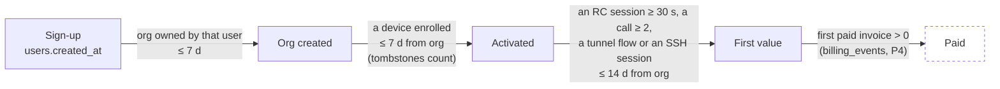

- **First value is one definition, in `crates/api/src/growth/value.rs`** — a remote-desktop
  session that reached Active and lasted ≥ 30 s (`remote`), a call with ≥ 2 participants
  (`conference`), a tunnel flow (`network`), or an SSH session (`network`). The digest's
  "active orgs", the nightly fold, the funnel, the cohorts and the north star all read it,
  so no two can disagree. An `exec` run is recorded on the org-day but is **not** value —
  it is an operator's diagnostic, not the product working for a user.
- **A step whose module is unmounted answers `null`, with the module named** (spec principle
  4). Without `fleet` the server cannot see devices, so `activated` — and, sequentially,
  `first_value` — are `null`; without a value module, `first_value` is. Never `0`.
- **Time to value**: median and p75, each with its `n`, for sign-up → first device and
  sign-up → first value.
- **North star (D2): weekly active orgs (WAO)** — the orgs with a value event in the ISO
  week, internal excluded.

### `growth_org_daily` and its nightly job

One row per org per UTC day with any activity, `_id = "{tenant}:{yyyy-mm-dd}"`, written whole
by a singleton nightly host job (`crates/api/src/growth/org_daily.rs`). It exists because
four of its sources (`tunnel_audit`, `ssh_audit`, `exec_audit`, `ws_sessions`) expire at 90
days while retention needs a year: the row **outlives the audit rows it was folded from**, so
a cohort chart longer than 90 days still sees tunnel and SSH use.

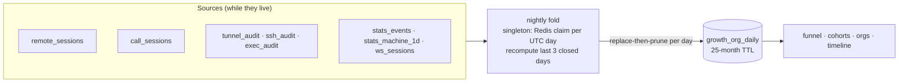

- **Singleton per UTC day** through the DB-name-scoped Redis `NX` claim the stats rollup
  uses; without Redis a pod runs it locally, once a day.
- **The last 3 closed days are recomputed every run** (a session open at midnight, a late
  audit row); **today is never written** — an open day would read as a quiet one. The fold is
  a derivation of durable rows, so recomputing it is idempotent.
- **Replace-then-prune per day**: each row is upserted on its `_id`, then the day's rows of
  orgs that no longer have activity are deleted, so a reader never meets an empty day.
- **The exclusion set is applied at read time, never in the fold** — every org's row is
  written, and every view filters — which is what makes `include_internal=true` the same
  code path as the default.
- **Bounded backfill.** `POST …/org-daily/backfill?since=&until=` fills a closed range in
  31-day chunks, never before `today − 25 months` and never today; the first run on an empty
  collection fills the sources' 730-day horizon once. Nothing here is unbounded.
- Fields: `rc_sessions`, `rc_session_minutes`, `rc_controllers`, `calls`,
  `call_participant_minutes`, `tunnel_flows`, `ssh_sessions`, `exec_runs`, `devices_online`,
  `members_active`, `value` (bool) and `value_kinds`. `roomler_core::growth::purge_tenant` is
  the one call an org deletion must make to take these rows (and the `growth_daily` rows whose
  `dims` carry the tenant) with it — aggregates may outlive rows, rows never outlive their
  owner. ⚠️ There is **no org hard-delete path today** (orgs are only archived, and reversibly),
  so nothing calls it yet and the **25-month TTL** is what bounds the collection for now;
  `purge_tenant` is the seam a deletion path will call when one lands, and it is deliberately
  kept out of the archive cascade (an archived org keeps everything it knows for `unarchive`).

### Cohorts and the org views

- **Cohorts** (`GET …/cohorts?unit=week`): orgs by creation ISO week × weeks since (W0..W12),
  active = ≥ 1 value event in that week, W1/W4/W12 highlighted. A cell past the current week
  is `null`; `closed_through` says how many weeks have fully closed, so the open cells read
  as provisional.
- **Orgs** (`GET …/orgs`): per org — created, the owner's channel and campaign key (never the
  address), devices (live/enrolled, tombstones counted), the last value day, the active weeks
  of the last 12, plan and billing status, and an `at_risk` flag: active in ≥ 3 of the 4 weeks
  before the last 2, and none in those last 2 — an org that had a habit and lost it.
- **Timeline** (`GET …/org/{tenant_id}/timeline`): one org's milestones — the owner's sign-up
  (attribution, never the address), org created, members as they joined, the first device
  (+ OS), the first value event and its kinds, a weekly activity strip, and the plan/invoice
  history as far as data allows (`not_measured` until P4).

### P2 routes

| Method | Path | Purpose |
|---|---|---|
| GET | `/api/admin/growth/funnel?since&until&by&include_internal` | the funnel, time to value, and a per-dimension breakdown (`by` = `source` · `medium` · `campaign` · `content` · `channel` · `self_reported` · `landing_path`). `since` and `until` take RFC 3339, `YYYY-MM-DD` or unix seconds. A bare-day `until` is the **whole day**, inclusive as on every other growth route; an instant is the exclusive end ([`parse_until`, funnel.rs:723](../crates/api/src/growth/funnel.rs)). Default: the 90 days to now |
| GET | `/api/admin/growth/cohorts?unit=week&since` | weekly cohorts W0..W12, and the WAO series |
| GET | `/api/admin/growth/orgs?limit&include_internal` | the per-org table |
| GET | `/api/admin/growth/org/{tenant_id}/timeline` | one org's milestones |
| POST | `/api/admin/growth/org-daily/backfill?since&until` | recompute a closed range of `growth_org_daily` |

All platform-admin only, **404** otherwise and when `growth.enabled = false` — the same gate
as the digest. The SPA's `/observability/growth` gains **Overview** (WAO trend, the funnel
with counts — a percentage only at n ≥ 30 —, time to value, coverage from the digest's
headline), **Orgs** (the table, with the timeline in a drawer) and **Cohorts** (the heatmap),
beside the existing **Digest** tab. Every attacker-chosen string (UTM values, org names) is
rendered as text, never `v-html`.

## The install trace (P3)

How a device gets from a minted token to a first session — each step recorded where it
already had to happen, joined by ids and counts, never by a person. The fleet module owns
every write (`crates/modules/fleet/src/install_trace.rs`, `agent.rs`); the digest reads.

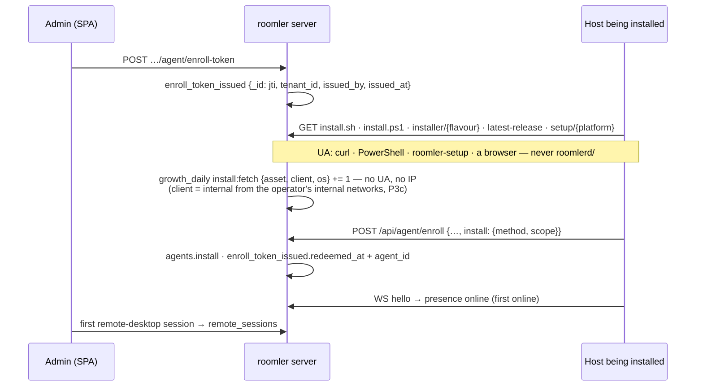

| Step | Record | Written by | Kept |
|---|---|---|---|
| token minted | `enroll_token_issued {_id: jti, tenant_id, issued_by, issued_at, kind: standard, redeemed_at: null, agent_id: null}` — the jti, **never the token** | `POST …/agent/enroll-token` (`agent.rs::issue_enrollment_token`), best-effort | 90 d |
| fetch | `growth_daily {source: install, metric: fetch, dims: {asset, client, os}, day, value}` — `client` the class, or `internal` for a fetch from the operator's internal networks (P3c) | the installer proxy, `/api/agent/latest-release`, `/api/setup/latest-release`, `/api/setup/install.sh`, `/api/setup/install.ps1`, `/api/setup/{platform}` (`install_trace::count_fetch`, spawned, best-effort) | indefinitely |
| enroll | `agents.install {method, scope, run?}`; `enroll_token_issued.redeemed_at`, `.agent_id` (an upsert from the token's claims, so a token minted before the ledger is on record too) | `POST /api/agent/enroll` | with the row; 90 d |
| wizard step boundary (**opt-in**) | `setup_diagnostics {run, step, outcome, elapsed_ms, error_code, os, wizard_version, ts}` — [below](#the-wizards-opt-in-diagnostics-p3b) | `POST /api/setup/diagnostics`, from the wizard, only when the box is ticked | 90 d; the daily counts frozen into `growth_daily` indefinitely |
| first online · first session | already there: `stats_events` (presence), `remote_sessions` | — | — |

### Fetches by client class

The class comes from the **User-Agent and nothing else about the request**
(`install_trace::classify_user_agent`, a pure function with the real UAs as its tests):

| Class | User-Agent | Who |
|---|---|---|
| `wizard` | `roomler-setup/<ver>` | the wizard resolving and downloading its MSI |
| `script-sh` | `curl/…`, `Wget/…` | `install.sh`, or a person at a terminal |
| `script-ps1` | anything carrying `PowerShell` — Windows PowerShell 5.1 and pwsh 7 both send `Mozilla/5.0 (…) …PowerShell/…`, so this is decided **before** the browser rule | `install.ps1`, `irm … | iex`, or a person at a prompt |
| `browser` | any other `Mozilla/…` | a person on the site (the wizard download button) |
| `other` | everything else, a missing header included | — |

The `os` dimension is what the asset itself implies (an MSI, `install.ps1` and the Windows wizard
archive are `windows`; the macOS and Linux archives name theirs), else the UA's hint; a `curl`
fetch of `install.sh` is honestly `unknown`.

> ⚠️ **The updater is never counted.** `roomlerd/<ver>` is the daemon's own update check, and by
> default it asks `roomler.ai` from self-hosted devices as well
> (`agents/roomlerd/src/updater.rs`, `DEFAULT_PROXY_URL`). Counting it would be exactly the
> self-host telemetry the product promises not to collect (`LICENSING.md`,
> [business-model.md](business-model.md) §6). The rule covers every product token of ours that
> is not the wizard — `roomlerd/`, `roomlerd-*/`, `roomler-cli/`, `roomler-token-renewal/`, the
> updater's pre-rename spelling, whatever a later release adds — decided by the common prefix,
> as `UaClass::Updater`, whose counted value is `None`: a fetch with it writes nothing. Locked
> by a test per known spelling, plus one for an identity that does not exist yet.

- **Never a User-Agent, never an IP.** A row is three enum-like dimensions and a count; the
  integration test scans every row for the UAs it sent and the loopback address.
- The write is **spawned and best-effort**: an install script is served at wire speed whatever
  the database is doing. `ROOMLER__GROWTH__INSTALL_COUNTERS=false` switches the counters off.
- A fetch is a **lower bound on intent, not an install**: a self-hoster who downloads our build
  to enroll elsewhere fetches like anyone else, and only requests that reach this server count.

### The lab's own fetches (P3c)

The exclusion set removes internal orgs and people, but a fetch happens before any enrollment
and carries no tenant, so it could not remove the vmtest lab's own installs. On 2026-10-16 those
were most of the install section's fetch counts. The operator names the internal source networks
instead, and a fetch from inside is counted as `internal` in place of its class.

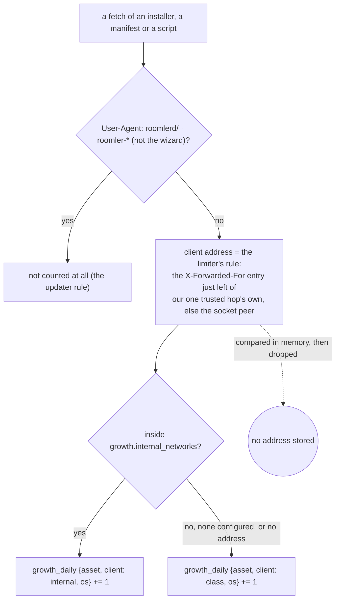

| Rule | Where |
|---|---|
| The setting: comma-separated CIDRs (`203.0.113.0/24`, `2001:db8::/32`) or bare addresses (their own `/32` / `/128`). A CIDR with host bits set, or a prefix shorter than /8 (IPv4) or /16 (IPv6), is refused, never widened. An IPv4-mapped IPv6 peer (`::ffff:a.b.c.d`) is compared as the IPv4 it carries | `InternalNetworks::parse` / `contains` ([`growth.rs:171`](../crates/core/src/growth.rs), [`:221`](../crates/core/src/growth.rs)) |
| Parsed once at boot. An entry it cannot use (not an address, host bits set, a prefix too short) is echoed in one warning with its reason and skipped, and the rest still apply. The networks in effect are logged as CIDRs | `internal_networks_from` ([`fleet/src/lib.rs:160`](../crates/modules/fleet/src/lib.rs)) |
| **One client-address rule.** The `X-Forwarded-For` entry just left of our trusted hops' own (`app.rate_limit_trusted_hops`, 1 in production), the client the edge recorded, else the socket peer; `X-Real-IP` is never read. It moved from the api crate to core so `fleet` reads it exactly as the per-IP governor and the credential gate do. A client that seeds `X-Forwarded-For` with a lab address moves nobody: that entry sits left of the one our hop recorded | `client_ip_or_peer` ([`client_ip.rs:67`](../crates/core/src/client_ip.rs)); the handlers take `PeerAddr` ([`:90`](../crates/core/src/client_ip.rs)), an extractor that never refuses |
| The class becomes `internal`; the asset and OS stay. The updater rule comes first, so a `roomlerd/` fetch from the lab still writes nothing | `fetch_dims` ([`install_trace.rs:188`](../crates/modules/fleet/src/install_trace.rs)), `count_fetch` ([`:211`](../crates/modules/fleet/src/install_trace.rs)) |
| **Still no IP, anywhere.** The address is compared in memory and dropped; the row stays three enum-like dimensions and a count. The integration test scans every row for each address it used (the lab's, the outsider's, our hop's, the peer's) | `install_trace_tests::fetches_from_internal_networks_count_as_internal_and_store_no_address` |
| Unset (the default) changes nothing: every fetch counts under its class | `ROOMLER__GROWTH__INTERNAL_NETWORKS` |

> ⚠️ A network that is too broad hides real users. The `internal` line in the digest shows how
> many fetches the setting reclassified, and the parser refuses the worst typos: a `/0`, a
> prefix shorter than /8 or /16, or host bits set. Name the lab's egress addresses and the
> operator's own, nothing wider. **Take them from the edge's access log for one lab run**, not from a
> guess. A guest on mars reaches the edge on its private VM-network address, not mars's public IP; a
> guest on zeus shows zeus's public IP.
>
> ⚠️ The rule trusts `app.rate_limit_trusted_hops` to match the proxies in front of the server. A
> self-hosted image exposed directly, with nothing in front, lets a client choose its address, for
> the rate limiter and for this count alike.
>
> For the first 28 days after the setting is applied, the 7d/28d internal counts start at that day,
> while the table's 7d/28d still hold the lab's earlier fetches. With `growth.install_counters`
> off, both fetch fields read "not measured".

### The enroll says how

`POST /api/agent/enroll` gained `install: {method, scope, run?}` — additive, `#[serde(default)]`,
clamped server-side (`InstallInfo::clamped`: an unknown `method` is `other`, an unknown `scope`
`unknown`, a `run` that is not a short opaque token dropped) and **never a refusal**. The
vocabulary lives in `crates/remote_control/src/models.rs` (`InstallMethod`, `InstallScope`),
shared by both ends and locked by a test:

| Who enrolls | `method` | `scope` |
|---|---|---|
| the wizard, in-process | `wizard` | its role: `daemon-system` → `system`, `daemon-user` → `per-user`, `daemon-machine` → `attended` (a service without SystemContext, usable only beside a signed-in session) |
| `install.sh` | `script-sh` | `system` with `--system` and for the macOS root half; `per-user` otherwise |
| `install.ps1` | `script-ps1` | as the wizard's roles |
| `roomlerd enroll` by hand | `manual`, or `--install-method` / `ROOMLER_INSTALL_METHOD` | `unknown`, or `--install-scope` / `ROOMLER_INSTALL_SCOPE` |
| the companion's enroll form | `manual` | `unknown` |
| the k8s e2e agent image | `container` (its StatefulSet sets the env) | `system` |
| `roomlerd re-enroll`, a pushed org join, the companion's token refresh | nothing is sent; the row **keeps** what it has | |
| an agent from before P3 | recorded as `unknown` on a new row; a known row keeps its record | `unknown` |

Compatibility, both directions, is what the shape is built around:

- **A new agent against an old server**: the agent omits `install` when it has nothing to say,
  and the server's `EnrollRequest` carries no `deny_unknown_fields` (a comment there says it
  never may), so a pre-P3 server ignores the field. The agent-side test asserts the body without
  `install` is byte-for-byte the pre-P3 five-field shape.
- **An old agent against the new server**: no field ⇒ `install: {method: unknown}` on a new row,
  no change on a re-enrolled one. The device row's `install` is `None` only on rows created
  before P3; the digest reads both as `unknown`.
- ⚠️ **The served scripts set the environment, never the flag.** A script installs whatever
  release is current, and a daemon from before `--install-method` existed refuses an argument it
  does not know — which would have failed every scripted install until the next agent release.
  `ROOMLER_INSTALL_METHOD` / `ROOMLER_INSTALL_SCOPE` are the flag's fallbacks
  (`roomler_node_core::enrollment::resolve_install`: flag, then env, then `manual` / `unknown`);
  an older daemon ignores them. `install.sh` passes them through `env` so they survive `sudo`;
  `install.ps1` removes them after the enroll, since an `irm | iex` run shares the caller's
  process.
- ⚠️ **A spelling the daemon does not know is refused from the FLAG and clamped from the ENV.**
  A flag is the operator's own command line, so a typo is refused before the single-use token
  is spent. The variables come from the scripts, which are compiled into the *server*
  (`include_str!`) and roll with a promote, while the daemon they install comes from the agent
  release channel — a script can know a spelling before the daemon does, and refusing it would
  fail every scripted enrollment until the next agent release. So an unknown env value enrolls
  as `other` / `unknown` with a warning, the same clamp the server applies.

The row is shown on the device (`GET …/agent/{id}` → `install`), which is what a field check
reads (AC9).

### The wizard's opt-in diagnostics (P3b)

Where a wizard run gets to, and where it stops — **only for runs whose operator ticked the
box** (spec §3e item 5; D4: opt-in, unticked). The Welcome page of `roomler-setup` carries
"Send anonymous setup diagnostics to `<server>`", unticked on every launch: the choice lives
in the wizard's memory for that run, is never written to its saved state and never restored
from an earlier run. Ticked, the wizard sends **one `POST /api/setup/diagnostics` per step
boundary**; unticked, it sends **nothing** — not one request (AC12).

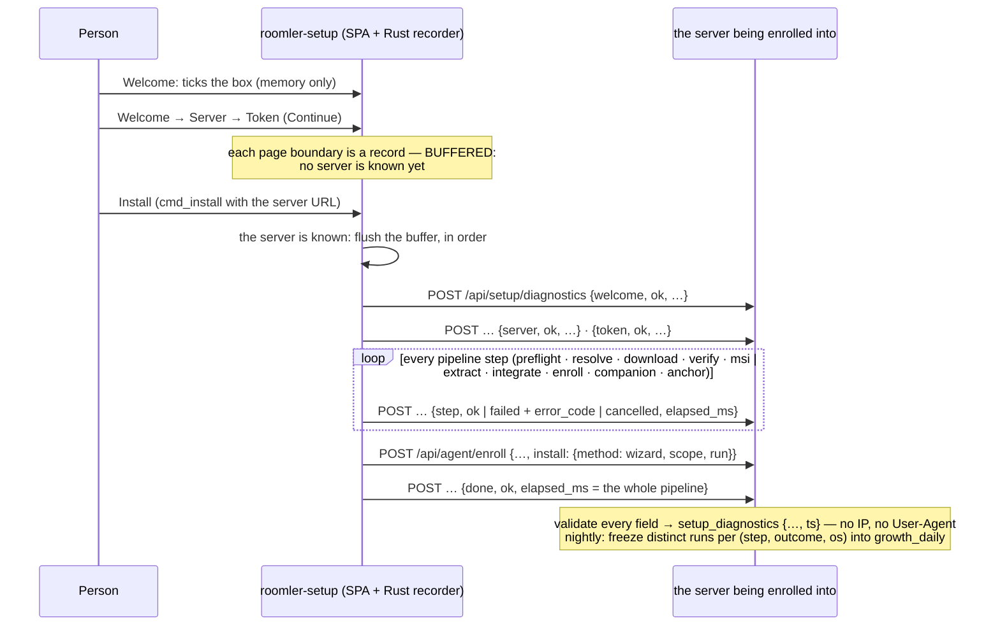

- **A record is exactly** `{run, step, outcome, elapsed_ms, error_code, os, wizard_version}`
  (`roomler_ai_remote_control::setup_diagnostics::SetupDiagnostic`, the one shape both ends
  share; every key always present, `error_code` as `null` on a step that did not fail).
  `run` is 32 random hex characters minted per wizard launch and kept in memory; `step` is one
  of `welcome` · `server` · `token` (the pages, measured by the SPA) · `preflight` · `resolve`
  · `download` · `verify` · `msi` (the daemon roles) · `extract` · `integrate` (the tunnel role)
  · `enroll` · `companion` · `anchor` (the two best-effort steps, recorded only where they
  apply) · `done`; `outcome` is `ok` · `failed` · `cancelled`; `error_code` is a **code from a
  fixed vocabulary** (`advanced_options`, `unsupported_platform`, `preflight`, `resolve`,
  `download`, `sha256_mismatch`, `msi_spawn`, `msi_wait`, `msi_user_cancel`,
  `msi_another_install`, `msi_fatal`, `msi_other`, `extract`, `integrate`, `enroll_rejected`,
  `enroll_network`, `config_write`, `companion`, `anchor`, `other`) — never the error text, a
  path, a hostname or a user name; `os` is the family; `wizard_version` the crate's version.
  The enroll's `enroll_rejected` / `enroll_network` is decided on the error's **types** (a
  `reqwest::Error` in the chain is a network failure), never on its message.
- **The diagnostics go to the server being enrolled into** — the URL `cmd_install` receives,
  read by the same TLS rule as the enroll — so a self-hosted server gets its own and roomler.ai
  never hears of them. The pages happen before the wizard knows that server, so their
  boundaries are buffered in the recorder and flushed, in order, when `cmd_install` names it;
  a run cancelled before then **sends nothing anywhere** — the buffer dies with the process,
  and unticking the box drops it too.
- **Fire-and-forget**: each send is spawned on the wizard's runtime with a 3-second timeout,
  never retried, never shown, never awaited by a step. A diagnostics failure — the server off,
  the switch off, a refusal — is a debug line and nothing else.
- **The run rides the enroll** (`agents.install.run`, P3's reserved field), so a ticked run
  joins the device it enrolled; unticked, the enroll carries no `run`.
- ⚠️ **The recorder is the gate, not the SPA**: a boundary reported while the box is unticked
  is dropped in Rust (`agents/roomler-setup/src/diagnostics.rs`), so the SPA cannot leak one by
  calling at the wrong time. Locked by the crate's unit tests: a full simulated run unticked
  makes zero sends; ticked, one per boundary with exactly the seven keys, each valid by the
  server's own check; buffered until the server is known; a cancel before then sends nothing.

**The server** (`crates/modules/fleet/src/setup_diagnostics.rs`) takes the route
**unauthenticated by necessity** — a wizard has no credential until its enroll succeeds, and
most of what this measures happens before that — so it trusts nothing:

| Check | Answer |
|---|---|
| body over 1 KiB (`DefaultBodyLimit` on the route) | 413 |
| not JSON, a missing key, **an eighth key** (`deny_unknown_fields`) | 422 `invalid_json` |
| `run` not 32 lowercase hex · `step`, `outcome`, `os` outside the vocabulary · `elapsed_ms` over a day · `error_code` outside the vocabulary, missing on `failed`, present on `ok`/`cancelled` · `wizard_version` not a short Cargo version | 422 `invalid_run` · `unknown_step` · `unknown_outcome` · `unknown_os` · `elapsed_out_of_range` · `unknown_error_code` · `missing_error_code` · `unexpected_error_code` · `invalid_wizard_version` — a code, never the value, and nothing stored |
| a `run` already holding 48 rows | 429 `run_capped`, nothing stored (counted before the insert, so N racing pods can exceed it by N − 1 — a bound, not a quota) |
| `growth.setup_diagnostics = false` | the **empty 404** of a path that does not exist, the same bytes as `POST /api/<absent>` |
| stored | 202, no body; the row is the record plus the server's `ts` |

The handler takes the body and **nothing else about the request** — no `HeaderMap`, no
`ConnectInfo` — so an address or a User-Agent cannot reach the row by construction; the
integration test scans every stored row for both. A refusal is logged by its code. The rows
carry no tenant, so the exclusion set cannot apply to them (like the fetch counters). The
static `/diagnostics` segment wins over the proxy's `/{platform}` for every method, which
makes `GET /api/setup/diagnostics` a 405 where it used to fall into the proxy and be refused
as an unknown platform (400); `GET /api/setup/diagnostics/health` still reaches the proxy.

**Retention**: 90 days (the TTL on `ts`), then daily counts. Under the org-day fold's nightly
claim, `org_daily::freeze_setup_diagnostics` writes `growth_daily
{source: install, metric: wizard_step, dims: {step, outcome, os}}` for the last three closed
days — the value the number of **distinct** runs that ended that step with that outcome (a
retry re-passing a step is one run), `$set` through `replace_daily`, so a rerun changes
nothing and a day with no runs holds no rows. A day past that window is never rewritten, so
the counts stand after the rows expire.

### In the digest

`install` is a section of its own: `tokens {issued, redeemed}` (tokens issued in the window,
and how many of those an enroll spent; a redeemed share only at n ≥ 30), `fetches
[{asset, client, os, fetches}]` — never the `internal` rows — and since P3c `internal_fetches`
(their sum per window, whatever the asset, on its own line in the email: "Fetches from internal
networks (not in the table)"; `not_measured` while this server names no network and the 28 days
hold no internal row, so a missing setting never reads as "the lab fetched nothing"; a digest
stored before P3c reads `arrives_with: P3c` there),
`enrollments_by_method [{method, os, enrolled}]`, and since
P3b `wizard_steps {runs, n_floor, done_share_28d?, steps [{step, reached, ok, failed,
cancelled}], errors [{step, error_code, failures}]}` — every number a count of **distinct
opted-in runs** per window, in run order, read from `setup_diagnostics` (its 90 days cover
every window the digest reads), `runs` the n every row is read against, and the share of
runs reaching `done` only once `runs.d28 ≥ 30`. ⚠️ Opted-in runs only: the section says nothing
about the runs that did not tick the box, and the email's note says so. With
`growth.setup_diagnostics = false` it is `not_measured` ("off on this server"), never a zero —
a zero is a day on which no run opted in. `orgs_devices.by_install_method` lists the day's
devices by method. Exclusions apply to tokens by the token's tenant and to enrollments by the
device's tenant; the fetch and wizard rows carry no tenant and cannot be filtered. All of it
is "not mounted" without the `fleet` module, never 0. The Growth page's Install panel renders
the same section (`GrowthNode`, a table per list).

## The web plane: the purestat puller and the Campaigns table (P6)

purestat is the anonymous plane — visits, pages, goals, no person. P6 reads it in two ways,
for two different questions, and never answers one with the other:

| Question | Read | Why that way |
|---|---|---|
| What did campaign X bring between two dates? | **live** — one purestat query for the exact range, by the Campaigns table | unique visitors do not add across days: a sum of daily rows counts a returning visitor once per day |
| What did the web plane hold on day D, long after purestat's 2-year TTL? | **frozen** — the `saas` puller's `growth_daily` rows (`source: purestat`) | a frozen day is what history says; it is never rewritten |

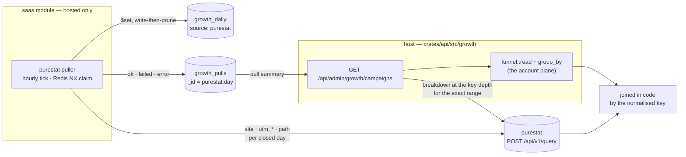

### The key both planes meet on

`roomler_core::campaign::CampaignKey` ([`campaign.rs:228`](../crates/core/src/campaign.rs))
is `(source, medium, campaign, content)`, and `CampaignKey::normalized`
([`campaign.rs:242`](../crates/core/src/campaign.rs)) is the ONE spelling: each value cleaned
exactly as a sign-up's is at ingress (`attribution::clean_value` — trimmed, printable ASCII
only, clamped to 64), then source and medium through the taxonomy and campaign and content
lowercased. A purestat row (`utm_source=YouTub&utm_campaign=20261019-Slug`) and a sign-up
stored by `attribution::sanitize` from the same link meet on one key — a unit test asserts it.
A row with no source is organic traffic, not a key.

`KeyDepth` ([`campaign.rs:164`](../crates/core/src/campaign.rs)) is how deep a breakdown
goes: `source` → `medium` → `campaign` → `content`, each one UTM dimension more.

### The puller — `saas`, hosted-only

[`crates/modules/saas/src/purestat_pull.rs`](../crates/modules/saas/src/purestat_pull.rs),
spawned from the module's `init` ([`lib.rs:111`](../crates/modules/saas/src/lib.rs)). No
self-host profile compiles `saas`, and without `ROOMLER__GROWTH__PURESTAT_API_KEY` (or with
`growth.enabled = false`) it starts nothing and logs that once.

| Rule | Value | Where |
|---|---|---|
| **The horizon** | the last 7 closed UTC days; today is never pulled | `FREEZE_DAYS` ([`purestat_pull.rs:76`](../crates/modules/saas/src/purestat_pull.rs)) |
| **Frozen** | a day older than the horizon is never pulled again and never rewritten — pulled or not | `due_days` ([`purestat_pull.rs:123`](../crates/modules/saas/src/purestat_pull.rs)) |
| **A cycle** | starts at 01:00 UTC (purestat closes a visit 30 min after its last event); every day of the horizon is re-pulled once per cycle, which is what catches a late event | `CYCLE_HOUR_UTC` |
| **A failure** | the day stays due, so the next hourly tick retries; after a fatal error (no key, 401, timeout, unreachable) the run stops asking and records the same reason for every day it owed | `run_once` ([`purestat_pull.rs:309`](../crates/modules/saas/src/purestat_pull.rs)) |
| **Once across pods** | a DB-name-scoped Redis `NX` claim per tick (`roomler:growth-purestat-pull:<db>`), as the stats rollup and the reapers; without Redis the pod runs locally | `spawn_puller` ([`purestat_pull.rs:370`](../crates/modules/saas/src/purestat_pull.rs)) |
| **Idempotent** | each row is `$set` on its own `_id` — a day pulled twice holds one copy; an unchanged row is not written; a row of the pulled metrics the pull no longer carries is deleted (write-then-prune, never an empty day) | `GrowthDao::replace_daily` ([`growth.rs:476`](../crates/services/src/dao/growth.rs)) |

A day is three purestat queries ([`pull_day`](../crates/modules/saas/src/purestat_pull.rs)),
each row's `dims.by` naming its breakdown:

| `dims.by` | other dims | metrics (`growth_daily.metric`) |
|---|---|---|
| `site` | — | `visitors` `visits` `pageviews` `reads` `goal.signup` `goal.subscribe` `goal.install-copy` `goal.github-outbound` |
| `campaign` | the normalised key: `source`, and `medium` / `campaign` / `content` when present | the same |
| `path` | `path` (trimmed, control characters dropped, ≤ 200 characters, must start with `/`) | `visitors` `pageviews` `reads` |

- **Spellings fold.** Raw rows that normalise to one key are **summed** (`YouTub` and
  `youtube`) — an upper bound on unique visitors, since a visitor who arrived by both
  spellings counts twice. purestat's own number for the key is the live table's. Since
  purestat v0.1.9 its v1 query answers `utm_source` / `utm_medium` already normalised (and
  counts their spellings as one, uniquely); our normalisation is a fixed point on its output,
  so both sides stay right against either version, and a fold is now mostly a campaign or
  content written in two cases.
- **A zero is not stored.** On a day whose `growth_pulls` row is `ok`, a missing row IS a
  measured zero; on a day with no pull row, or a `failed` one, it is "not pulled" (principle 4).
- **A goal the site does not define** costs the conversions, not the day: the breakdowns are
  retried without goals, `growth_pulls.missing_goal` names it, and the goal rows an earlier
  pull stored are left as they were.
- `reads` (pageviews visible ≥ 30 s) is the engagement purestat's v1 contract carries; it has
  **no engaged-visitor metric**, so the spec's "engaged visitors" are `reads` here.
- The `_id` is escaped ([`daily_id`, growth.rs:151](../crates/services/src/dao/growth.rs)):
  `%` `,` `=` `:` inside a value are percent-encoded, so a crafted UTM value cannot forge
  another row's id. P3's ids, which contain none of them, are unchanged.

**`growth_pulls`** — one row per `(source, day)` attempted, `_id = "purestat:YYYY-MM-DD"`
([`GrowthPull`, growth.rs:225](../crates/services/src/dao/growth.rs)):

| Field | Meaning |
|---|---|
| `status` | `ok` once a pull of the day succeeded — its rows ARE the day's rows; `failed` while none has. A later failed attempt **never** turns an `ok` day `failed` (one pipeline update decides it from the stored row) |
| `pulled_at` · `attempted_at` · `attempts` | the last success, the newest attempt, how many |
| `rows` | the `growth_daily` rows the last good pull left |
| `error` | what the newest attempt met (`purestat unreachable: unauthorized (401)`), never a credential; `null` when it succeeded |
| `missing_goal` · `truncated` | a goal the site did not define; a breakdown cut at the client's 1,000-row bound |

### The Campaigns table

`GET /api/admin/growth/campaigns?since&until&by&include_internal`
([`campaigns.rs:586`](../crates/api/src/growth/campaigns.rs)) — platform admins only, **404**
otherwise and when `growth.enabled = false`, like every growth route.

| Parameter | Values | Default |
|---|---|---|
| `since`, `until` | UTC days `YYYY-MM-DD`, **both inclusive**; `until` never after today; at most 366 days (purestat's own bound) | the 28 closed days ending yesterday |
| `by` | `source` · `medium` · `campaign` · `content` — the key depth | `campaign` |
| `include_internal` | `true` = the raw totals, exclusion set empty | `false` |

- **The web plane is live.** One purestat breakdown by exactly the depth's UTM dimensions
  over exactly the range, plus one totals query with no dimension — so a row's `visitors` is
  purestat's own number for that key and range (AC16), unless `spellings > 1` says several raw
  spellings were summed into it (from purestat v0.1.9 on, only a campaign or content written
  in two cases can still do that: source and medium arrive normalised).
- **A visit is credited to the key it LANDED with.** purestat reads the UTM dimensions at the
  visit level (`Dimension::is_session_level`, purestat `crates/services/src/analytics/sql.rs:294`):
  a closed visit carries its landing's `utm_*`. A tagged link opened in the middle of a visit
  (the visitor was already on the site) is credited to the visit's landing key, usually none.
  While that visit is still open (purestat closes it 30 min after its last event), its tagged
  events can show under their own key with `visits: 0`; once it closes they fold into the
  landing key. So a range that includes today, or a visit that just ended, can read differently
  half an hour later, and the digest's frozen day agrees with the closed read. The account plane
  takes the key from the URL at sign-up, so such a sign-up still counts under its key here while
  the web plane shows no visitor for it, which lowers that key's coverage.
  ⚠️ Measured on 2026-10-18 (FR-102 §8): each of the three visits that carried the AC5 links'
  events had started on `/` with no UTM, seconds before the tagged `/register` load. The keyed
  rows the open day showed at 19:57Z were gone from the closed day, while both accounts kept
  their keys.
- **The account plane is P2's** — `funnel::read` and `funnel::group_by`
  ([`funnel.rs:409`](../crates/api/src/growth/funnel.rs)), the same `outcome` the funnel
  tallies with, grouped by `CampaignKey::normalized` of the owner's `signup_attribution`; the
  exclusion set applies. A unit test asserts a grouping agrees with the funnel's own
  breakdown.
- **Joined in code by the key** ([`join`, campaigns.rs:391](../crates/api/src/growth/campaigns.rs)):
  a key on one plane only is still a row — a **measured zero** on the other when that plane
  answered. Sorted by visitors, then sign-ups; at most 500 rows (`rows_truncated` says so).

| Cell | What | Not measured when |
|---|---|---|
| `web.visitors` `visits` `pageviews` `reads` | purestat over the range | no key, 401, timeout, unreachable — **every** web cell then carries the reason, never 0 (`web_not_measured` at the top) |
| `web.goals` | `signup` `subscribe` `install_copy` `github_outbound`, as unique visitors | a goal the site does not define (`conversions` names it) |
| `web.spellings` | raw purestat rows folded into the key; 0 for a key purestat saw no visit of | — |
| `signups` · `org_created` · `activated` · `first_value` | the funnel's steps with `pending` / `settled` | `activated` / `first_value` are `null` without `fleet` (or a value module), and `not_measured` names it |
| `paid` | — | always, until P4 (`arrives_with: "P4"`) |
| `reach` | — | always, until P8 (`arrives_with: "P8"`) |
| `coverage` | purestat `signup` goals ÷ the server's sign-ups for the key; `ratio` only at n ≥ 30 | the web plane or the goal is not measured |
| `rates` | `signup_per_visitor` (n = visitors), `activation`, `first_value` (n = settled), each `{n, value}` with `value` only at n ≥ 30 | the side it rests on is not measured (`null`) |

`totals` carries the range's unique visitors (all traffic, keyed or not), the sign-ups and
those with a key, and the overall coverage. `pulls` summarises `growth_pulls` over the range —
`days`, `pulled`, `failed`, `not_pulled`, the newest error — and says `saas module not
mounted (the puller runs there)` when it is; the live table does not read the frozen rows,
but its reader can see whether they exist.

The SPA's `/observability/growth` gains a **Campaigns** tab
([`GrowthCampaigns.vue`](../ui/src/components/growth/GrowthCampaigns.vue)): the range, the
depth, include-internal, the totals, the pull state, and the table — a `not_measured` cell is
a muted chip with its reason on hover, a rate appears only with its n ≥ 30, and every UTM
value is rendered as text, never `v-html`.

## Social reach: the ingest routes and the Channels table (P8)

What a post on YouTube, X, LinkedIn, Facebook or TikTok produced beyond its own likes. The
private promotion pipeline already records each platform's numbers; it **pushes** them here
(D11 — the collector runs where its credentials live and needs nothing to be reachable), and
the Channels table puts them beside what the post's campaign key brought.

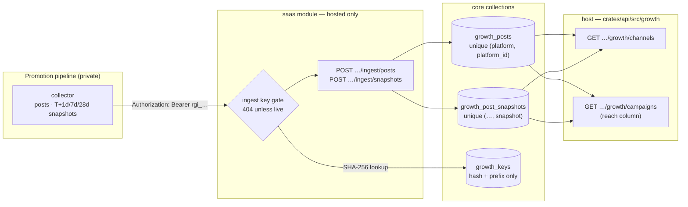

### The ingest key (D12)

A platform admin mints it on `/observability/growth` → **Channels** → *Ingest keys*, or with
`POST /api/admin/growth/keys` `{"kind": "ingest", "label": "…"}`
([`keys.rs:140`](../crates/api/src/growth/keys.rs)). The answer carries the key **once**:
`rgi_` and 32 random characters of nanoid's URL-safe alphabet (192 bits). The server stores
only `hex(SHA-256(key))` and a display prefix (`rgi_AbCd1234`) in `growth_keys`
([`growth_key.rs:97`](../crates/services/src/dao/growth_key.rs)); the list
(`GET /api/admin/growth/keys`) shows the prefix, the label, who minted it, when it was last
used and whether it is revoked — never the key or its hash. `DELETE …/keys/{key_id}` revokes
(a timestamp, so the row stays as the record); at most 10 live keys of a kind.

An ingest key opens the two ingest routes and **nothing else** — not a growth view (a
[read key](#the-read-key-d12) is the kind for that, P10), not any other route. ⚠️ Every way
of not holding a live one is the same **empty 404** a path that does
not exist answers ([`require_ingest_key`, growth_ingest.rs:467](../crates/modules/saas/src/growth_ingest.rs)),
decided in a gate that runs before the body is read and before the method is matched: no
`Authorization` header, a malformed key, an unknown one, a revoked one, a user's JWT,
`growth.enabled = false`, and a server without the `saas` module. Never 401 or 403 (AC18). A
database error during the lookup is a 503, so a Mongo blip never tells the pipeline its key
was revoked.

### The API, for the pipeline

| Route | Body | Idempotent on | Answers |
|---|---|---|---|
| `POST /api/admin/growth/ingest/posts` | `platform`, `platform_id`, `account`, `format`, `url`, `published_at`, `utm_source`, `utm_medium`?, `utm_campaign`, `utm_content`?, `cost_cents`? | `(platform, platform_id)` — a re-push replaces the mutable fields | `201 {"status": "created"}` · `200 "updated"` · `200 "unchanged"` |
| `POST /api/admin/growth/ingest/snapshots` | `platform`, `platform_id`, `snapshot` (`T+1d` · `T+7d` · `T+28d`), `taken_at`, `metrics` `{raw name: number}` | `(platform, platform_id, snapshot)` — **written once**: the first push's numbers stay | `201 "created"` · `200 "duplicate"` (nothing changed) |

```bash
KEY=rgi_XXXXXXXXXXXXXXXXXXXXXXXXXXXXXXXX   # from the mint answer; obviously fake here

curl -sS -X POST https://roomler.ai/api/admin/growth/ingest/posts \
  -H "Authorization: Bearer $KEY" -H 'Content-Type: application/json' \
  -d '{"platform": "linkedin", "platform_id": "urn:li:share:7123456789",
       "account": "roomler-ai", "format": "post",
       "url": "https://www.linkedin.com/feed/update/urn:li:share:7123456789/",
       "published_at": "2026-10-19T09:00:00Z",
       "utm_source": "linkedin", "utm_medium": "post",
       "utm_campaign": "20261019-ssh-without-port-forwar", "cost_cents": 0}'
# {"status":"created","platform":"linkedin","platform_id":"urn:li:share:7123456789"}

curl -sS -X POST https://roomler.ai/api/admin/growth/ingest/snapshots \
  -H "Authorization: Bearer $KEY" -H 'Content-Type: application/json' \
  -d '{"platform": "linkedin", "platform_id": "urn:li:share:7123456789",
       "snapshot": "T+7d", "taken_at": "2026-10-26T09:05:00Z",
       "metrics": {"impressionCount": 3120, "clickCount": 81, "likeCount": 44}}'
# {"status":"created","platform":"linkedin","platform_id":"urn:li:share:7123456789","snapshot":"T+7d"}
```

**Push the post before its snapshots** — a snapshot for a post never pushed is refused
(`unknown_post`). The routes sit inside the per-IP governor (1 request a second, bursts of
60), which a daily push is far below.

| Field | Rule ([`validate_post` / `validate_snapshot`](../crates/modules/saas/src/growth_ingest.rs)) |
|---|---|
| `platform` | `youtube` · `x` · `linkedin` · `facebook` · `tiktok`, and `instagram` (retired, kept for history) — through the taxonomy's aliases (`Twitter` → `x`, `yt` → `youtube`); anything else is `unknown_platform` |
| `platform_id` | 1–128 of `[A-Za-z0-9:_.-]` (a LinkedIn URN, a video id, a status id) |
| `account` | 1–64 of `[A-Za-z0-9_.@-]` — our own handle, never a person's |
| `format` | 1–32 of `[a-z0-9-]` (lowercased): `video`, `post`, `short`, … |
| `url` | `http(s)://` with a host, at most 512 characters, no whitespace |
| `published_at`, `taken_at` | RFC 3339; not before 2020, not more than a day (`taken_at`: an hour) ahead |
| `utm_*` | the post's link; `utm_source` and `utm_campaign` required; normalised by `CampaignKey::normalized` — the cleaning a sign-up's attribution gets at ingress — so the post meets its visits and sign-ups on one spelling |
| `cost_cents` | optional whole number 0–10,000,000 in the account's currency (an X post with a link is billed per post) |
| `metrics` | 1–50 entries; names 1–64 of `[A-Za-z0-9_.:-]`, **kept verbatim** (a metric is only comparable to itself); values finite numbers, \|v\| ≤ 10¹⁵ |
| anything else | refused — the shape is closed |

Refusals are `422 {"error": "<code>", "message": "…"}` and store nothing:

| `error` | When |
|---|---|
| `post_text_refused` | **any** field whose name looks like copy — `caption`, `text`, `title`, `body`, `description`, `message`, `content`, `postText`, `alt_text`, `hashtags`, … ([`TEXT_WORDS`, growth_ingest.rs:90](../crates/modules/saas/src/growth_ingest.rs)) — whatever its value, even `null`. The ingest stores ids, URLs, numbers and the key, **never content** (AC18) |
| `unknown_platform` | a platform outside the list (AC18) |
| `unknown_field` · `missing_field` · `invalid_field` | the closed shape |
| `invalid_platform_id` · `invalid_account` · `invalid_format` · `invalid_url` · `invalid_published_at` · `invalid_taken_at` · `invalid_key` · `invalid_cost` | a field outside its rule |
| `unknown_snapshot` · `invalid_metrics` · `metric_not_numeric` | a snapshot outside its rule |
| `unknown_post` | a snapshot before its post |

A body that is not JSON is `400 invalid_json`; one over 16 KiB is `413`. Each push is logged at
`info` with the key's display prefix, never the key.

### The Channels table

`GET /api/admin/growth/channels?since&until&include_internal`
([`channels.rs:583`](../crates/api/src/growth/channels.rs)) — platform admins only, 404
otherwise and when `growth.enabled = false`. The range is UTC days, both inclusive (the
Campaigns table's rules); a post is in it when it was **published** in it.

| Level | Cells |
|---|---|
| **platform** (every one of the five; `instagram` only when it has data) | `posts`; **reach per snapshot age** — each age's raw metrics summed over the posts that have that snapshot, with their count, so a three-day-old post is never added to a month-old one ([`reach_at`, channels.rs:257](../crates/api/src/growth/channels.rs)); visitors and sign-ups → activated → first value summed over the posts' **distinct** keys (an upper bound on unique visitors); `paid` (P4); spend |
| **post** | its account, format, URL, publish time, key; every snapshot, and the oldest as `reach`; visitors (purestat, live, at the post's own depth — `content` when its link carried one, else `campaign`), sign-ups → activated → first value by the key; spend |
| **spend** | `cost_cents` summed over the posts that declared one; `per_visitor` and `per_signup` as `{n, cents}` over those posts' visitors and sign-ups, `cents` only from n = 30 ([`cost_rate`, channels.rs:321](../crates/api/src/growth/channels.rs)) |

Three cells, as everywhere: a platform with no post pushed in the range is
`{"not_measured": "no posts pushed for this platform in the range"}` (and says when the ingest
routes are not mounted on the server at all); a post without a snapshot has reach
`not_measured: "no snapshot pushed yet"`; a purestat outage makes the web cells — and the cost
per visitor — `not_measured`, while the reach and the account plane stand.

The **Campaigns table's `reach` column** reads the same posts: per key at its depth, per
platform, the posts with that key and their snapshots summed per age
([`reach_by_key`, channels.rs:286](../crates/api/src/growth/channels.rs)); a key no post was
pushed with is `not_measured`.

| Collection | Shape | Kept |
|---|---|---|
| `growth_keys` | `{kind, label, prefix, hash, created_by, created_at, revoked_at, last_used_at}` — unique `hash` | until deleted by hand; revoked rows stay as the record |
| `growth_posts` | `{platform, platform_id, account, format, url, published_at, key {source, medium, campaign, content}, cost_cents, created_at, updated_at}` — unique `(platform, platform_id)` | indefinitely (our own content, no person) |
| `growth_post_snapshots` | `{platform, platform_id, snapshot, taken_at, metrics {raw: number}, received_at}` — unique `(platform, platform_id, snapshot)` | indefinitely |

All three are core-level, like `growth_daily`: the `saas` module writes them through the core
DAO and the host reads them — so a server that stops mounting `saas` still shows what was
pushed (and says that nothing new arrives). The SPA's `/observability/growth` gains a
**Channels** tab ([`GrowthChannels.vue`](../ui/src/components/growth/GrowthChannels.vue)):
platform cards with their posts, and the ingest-key list with mint (the key shown once) and
revoke. Every pushed string is rendered as text; a URL becomes a link only when it is http(s).

## GitHub: the repository's counters and traffic (P7a)

The repository is a leading indicator: a star, a fork, a release download and a visit to the
code arrive before a sign-up does, and at today's volume they are among the few numbers big
enough to steer by. Spec §3k; P7's search half (Search Console, Bing, the blog's posts) and the
Content table that reads it are the next two sections.

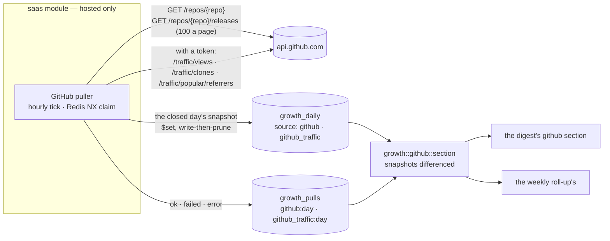

### The public counters — cumulative snapshots

[`crates/modules/saas/src/github_pull.rs`](../crates/modules/saas/src/github_pull.rs), spawned
from the module's `init` ([`lib.rs:122`](../crates/modules/saas/src/lib.rs)). No self-host
profile compiles `saas`; `growth.enabled = false` or an empty `growth.github_repo` starts
nothing and says so once. The counters need **no credential and never carry one**, so a
token that expired, was revoked or was sealed wrong costs the traffic and never a snapshot. A
cycle is one request plus one per hundred releases (8 pages on 2026-10-17), from the 60 an hour
GitHub allows an unauthenticated address — which the releases cache the updater relies on
draws on too.

| Rule | Value | Where |
|---|---|---|
| **A snapshot is the close of a day.** Day D's is the counters as read between 01:00 and 07:00 UTC on D+1, so two consecutive snapshots are 24 h apart give or take six | `SNAPSHOT_GRACE_HOURS` ([`github_pull.rs:102`](../crates/modules/saas/src/github_pull.rs)), `snapshot_due` ([`:676`](../crates/modules/saas/src/github_pull.rs)) |
| **The first good read stands.** A day pulled `ok` is not re-read later in its window, which would move its snapshot's time | `snapshot_due` |
| **A missed window is a missing day.** A cumulative counter cannot be read for the past, so a day not read inside its window has no snapshot, and every delta across it is `null` | the reader, below |
| Releases are paged 100 at a time, at most 30 pages (3,000 releases; 732 existed on 2026-10-17). A longer listing is stored with `truncated` on its pull row, and the reader shows its downloads as a lower bound and refuses every downloads change that needs it. Drafts are left out | `releases` ([`:382`](../crates/modules/saas/src/github_pull.rs)), `counter_rows` ([`:540`](../crates/modules/saas/src/github_pull.rs)) |
| **The updater's rate stays whole.** No page is asked while GitHub's `X-RateLimit-Remaining` is below 10 (`RATE_RESERVE`): the snapshot fails for that tick, nothing partial is stored, and the next tick inside the window retries | `releases` |
| **A sidecar is not a download.** `.asc`, `.sig`, `.sha256`, `.sha512` (and the release key `roomler-release-pubkey.asc`) are left out: the updater fetches a package's `.asc` with the package, so counting it would count every update twice | `is_sidecar` ([`:530`](../crates/modules/saas/src/github_pull.rs)) |
| Every answer is read with a ceiling of 32 MiB (a page of 100 releases measured 4.96 MB) | `capped::read_capped` ([`capped.rs:31`](../crates/modules/saas/src/capped.rs)) |
| A **flavour** is an asset's name without its version, so the same artifact of every release groups together: `roomlerd-0.4.140-x86_64-pc-windows-msvc.msi` → `roomlerd-x86_64-pc-windows-msvc.msi` | `flavour` ([`:483`](../crates/modules/saas/src/github_pull.rs)) |
| Each row is `$set` on its own `_id`; a zero is not stored, so on an `ok` day a missing release or flavour row is a zero | `GrowthDao::replace_daily` |
| A failure is recorded per day with its reason (`github unreachable: unauthorized (401)`), never a 0; the next hourly tick inside the window retries | `run_once` ([`:717`](../crates/modules/saas/src/github_pull.rs)) |
| Once across pods: the DB-scoped Redis claim `roomler:growth-github-pull:<db>` per tick | `pull_schedule::spawn_hourly` ([`pull_schedule.rs:89`](../crates/modules/saas/src/pull_schedule.rs)) |

| `growth_daily` (`source: github`) | dims | metrics |
|---|---|---|
| `by: repo` | `repo` | `stars` · `forks` · `watchers` (GitHub's `subscribers_count`; its `watchers_count` is the stars) · `downloads` (every asset but the sidecars of every published **product** release, ever) · `helper_downloads` (the rest) |
| `by: release` | `repo`, `release` (the tag), `kind` (`product` · `helper`) | `downloads` |
| `by: flavour` | `repo`, `flavour` (product assets only) | `downloads` |

A **helper** release is one our own CI downloads from: vendored builds and caches
(`vendored-ffmpeg-*`, `vendored-libvpx-*`, `seed-cache-*`). The product's are the tags in
`PRODUCT_TAG_PREFIXES` — `agent-v`, `setup-v`, `tunnel-v`, `tunnel-wizard-v`. Read live on
2026-10-17, the helpers held **8,032 of the repository's 16,740 downloads**, so a single total would
have been half CI; they are counted apart, never dropped.

> ⚠️ **GitHub counts every download of a release asset, the fleet's self-updates included.**
> The updater fetches the MSI/.deb/.pkg and its `.asc` from GitHub directly
> (`agents/roomlerd/src/updater.rs`, `download_asset`), hosted and self-hosted devices alike,
> and the installer proxy fetches from GitHub on each request. A download is distribution, not
> an install (the `.asc` itself is not counted). Nothing here tells one deployment from
> another: the number is GitHub's own public aggregate, readable by anyone.

### Traffic — with a read-only token

GitHub keeps 14 days of a repository's traffic, so it is pulled daily, and only with
`growth.github_token`; without one nothing is asked and every reader says "not measured". The
token rides these three requests only.

| `growth_daily` (`source: github_traffic`) | dims | metrics | Pulled |
|---|---|---|---|
| `by: traffic` | `repo` | `views` · `views_uniques` · `clones` · `clones_uniques` — GitHub's per-day buckets (UTC days). Clones are mostly CI's `actions/checkout`, not people | each of the last 13 closed days re-pulled once per cycle (01:00 UTC), frozen after (`TRAFFIC_HORIZON_DAYS`, [`:108`](../crates/modules/saas/src/github_pull.rs)). GitHub's 14 buckets ended at the previous UTC day on a 2026-10-17 read; 13 closed days are inside them whether or not a read also carries today's partial bucket, which is never stored |
| `by: referrer` | `repo`, `referrer` | `referrer_views` · `referrer_uniques` — GitHub's top-10 ranking of the last 14 days, which has no per-day split | stored under the closed day it was read after, and read as such |

A refused token (401, or a 403 for a missing permission) is recorded on every traffic day the run
owed, with the reason. The counters never carry the token, so their snapshot is taken all the
same — a day's snapshot cannot be read later, and a bad token must not leave holes in it.

### In the digest and the weekly roll-up

[`crates/api/src/growth/github.rs`](../crates/api/src/growth/github.rs) reads the stored rows;
`section` ([`:463`](../crates/api/src/growth/github.rs)) is the digest's `github` section and,
for Sunday, the weekly roll-up's.

| Field | What | Rule |
|---|---|---|
| `counters.at` | the snapshot read: the digest's day, else the latest one before it (at most 7 days) | `counters_at` ([`:275`](../crates/api/src/growth/github.rs)) |
| `stars`, `forks`, `watchers`, `downloads`, `helper_downloads` | the cumulative values at that snapshot | — |
| `*_delta {day, d7, d28}` | the snapshot minus the one 1, 7 or 28 days before | **`null` when that snapshot is missing — never 0, never spread across a gap.** A 7-day delta needs only its two ends |
| downloads' deltas | differenced **per release**: a new release counts fully, a deleted one counts nothing, and **one whose total went down counts nothing**. A total goes down when an asset is re-uploaded (CI's `seed-cache`, 28 assets, is clobbered on every seed save; the vendored builds are re-uploaded too), which restarts that asset's count; the total alone cannot tell the other assets' downloads from the restart, so the day is an under-count for that release and never an over-count. The product's releases and the helpers' each on their own (`downloads_delta`, `helper_downloads_delta`); `null` across a snapshot whose listing was truncated | `per_key_downloads` ([`:228`](../crates/api/src/growth/github.rs)) |
| `downloads_truncated` | the snapshot read hit the puller's page bound: `downloads` and `helper_downloads` are lower bounds, and the email says so | `counters_at` |
| `top_releases_7d`, `top_flavours_7d` | downloads in the 7 days ending `at`, top 10; not measured without the snapshot 7 days before, or when either listing was truncated. A flavour's change is clamped at 0 the same way | — |
| `traffic.views`, `clones` (+ `_uniques`) | GitHub's daily buckets summed per window over the days the puller holds an `ok` row for; `measured_days` says how many that is, and the email prints `—` for a window with none. Daily uniques summed are an upper bound on a window's uniques | `traffic_at` ([`:328`](../crates/api/src/growth/github.rs)) |
| `traffic.referrers`, `referrers_as_of` | the newest stored 14-day ranking on or before the day | — |

The email renders a **GitHub** block: each counter with its signed changes (`—` where a
snapshot is missing), the week's downloads by release and by flavour, the traffic with its
measured days (`—` for a window with no day pulled, never a 0 nobody counted; clones labelled as
mostly CI's checkouts) and the referrer ranking, and the note that downloads are not installs.
A digest stored before P7 reads both halves as `arrives_with: P7`.

### Settings and the operator's setup

| Setting | Env | Default | Effect |
|---|---|---|---|
| `growth.github_repo` | `ROOMLER__GROWTH__GITHUB_REPO` | `gjovanov/roomler-ai` | the repository read; anything that is not `owner/name` (GitHub's characters only) switches the puller off ([`settings.rs:799`](../crates/config/src/settings.rs)) |
| `growth.github_api_url` | `ROOMLER__GROWTH__GITHUB_API_URL` | `https://api.github.com` | only a test changes it |
| `growth.github_token` | `ROOMLER__GROWTH__GITHUB_TOKEN` | empty | the traffic's token, sent on the three traffic requests and nothing else; never logged, never in a pull row's error; empty ⇒ traffic "not measured" |

The counters work on the hosted deployment as soon as `saas` runs this build. Traffic needs a
**fine-grained personal access token** created by the repository's owner: resource owner
`gjovanov`, repository access *Only select repositories* → `gjovanov/roomler-ai`, repository
permission **Administration: Read-only** (GitHub adds *Metadata: Read-only* itself), sealed into
`roomler2-secret` as `ROOMLER__GROWTH__GITHUB_TOKEN`. GitHub's traffic endpoints answer only
someone with push access, which is why a read-only token still needs that one permission; a
classic token would need the whole `repo` scope.

## Search: Search Console, Bing and the blog's posts (P7b)

What search does before anyone visits: impressions, clicks and positions per page and query,
whether each post is indexed, and Bing beside Google. Three `saas` pullers on P6's pattern —
hosted-only, each "not measured" without its credential and saying so once at boot, one
`growth_pulls` row per (source, day), a failure recorded with its reason and never a 0. The
Content table and the digest's Search section that read them are P7c.

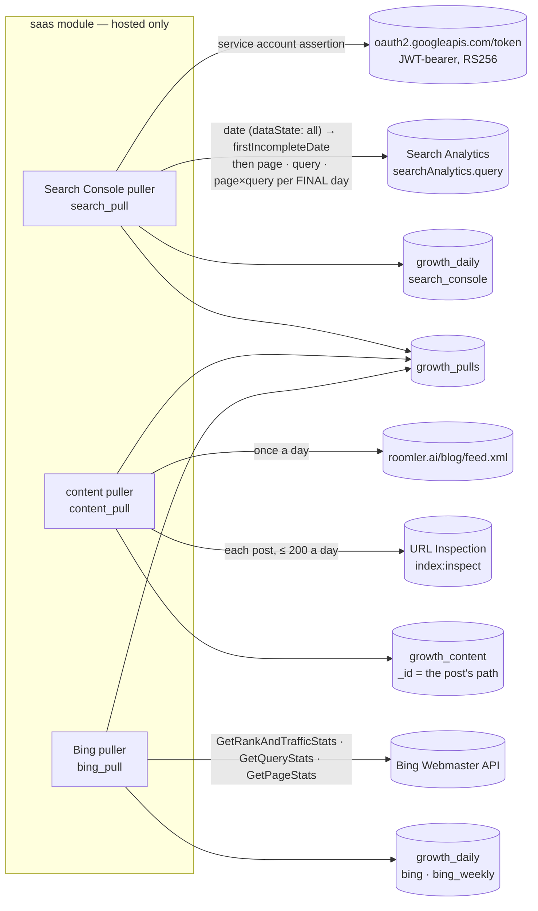

### Google Search Console — only final days

[`search_pull.rs`](../crates/modules/saas/src/search_pull.rs) and its client
[`search_console.rs`](../crates/modules/saas/src/search_console.rs).

| Rule | Value | Where |
|---|---|---|
| **The credential** is a service account's JSON key. The token is the OAuth JWT-bearer grant: an RS256 assertion `{iss: client_email, scope: webmasters.readonly, aud: token_uri, iat, exp = iat + 1 h}`, cached until a minute before it expires. The scope caps the token at **read-only**, whatever role the account holds on the property | `assertion` ([`search_console.rs:334`](../crates/modules/saas/src/search_console.rs)), `access_token` ([`:352`](../crates/modules/saas/src/search_console.rs)) |
| A key that does not parse (not JSON, not `service_account`, not an RSA PEM) is said once, loudly, at boot — without echoing the key — and nothing is pulled | `from_key_json` ([`:273`](../crates/modules/saas/src/search_console.rs)), `spawn_puller` ([`search_pull.rs:320`](../crates/modules/saas/src/search_pull.rs)) |
| **Only final days are stored.** Each cycle first asks the `date` breakdown with `dataState: all`; its `metadata.firstIncompleteDate` says where Google's unsettled days start (usually two or three days back). A day from there on stays **due, with nothing stored** — never a partial day read as whole. When Google omits the date, the Pacific day still running stays due all the same (read as of `now − 8 h`, never later than the true Pacific date). A final day's breakdowns are asked with `dataState: final` | `final_days` ([`search_pull.rs:165`](../crates/modules/saas/src/search_pull.rs)), `pacific_today` ([`:181`](../crates/modules/saas/src/search_pull.rs)), `run_once` ([`:232`](../crates/modules/saas/src/search_pull.rs)) |
| **The horizon** is the last 30 closed days: the first cycle fills them all (the Content table reads 28 days); a day younger than 5 is re-pulled once per cycle to catch a late correction, an older one pulled until it succeeds once; past 30, frozen | `HORIZON_DAYS`, `SETTLE_DAYS` ([`:68`](../crates/modules/saas/src/search_pull.rs)), `pull_schedule::due_days` |
| A day is **Google's**: Search Console dates are Pacific-time days | — |
| Each breakdown pages 25,000 rows at a time, at most four pages (`truncated` on the pull row past that) | `query_all` ([`search_console.rs:440`](../crates/modules/saas/src/search_console.rs)) |
| Google's answer is read leniently: no `rows` key is no rows; a `"NaN"` position is no position; an exponent is a number | `lenient_f64` ([`:155`](../crates/modules/saas/src/search_console.rs)) |
| Every answer is read with a ceiling of 32 MiB (a page of 25,000 rows is a few MB) | `MAX_BODY_BYTES`, `capped::read_capped` |
| A fatal error (the key, the token, a 401 / 403, a quota, a timeout) stops the run and records the reason on every day it owed | `run_once` |

| `growth_daily` (`source: search_console`) | dims | from | note |
|---|---|---|---|
| `by: site` | — | the `date` breakdown | the property's totals — by property, one impression per results page |
| `by: page` | `page` (the URL as Google reports it) | a `page` breakdown | **the per-page totals, anonymised queries included** — what Search Console's UI shows for a page |
| `by: query` | `query` | a `query` breakdown | Google leaves the rare, anonymised queries out of it |
| `by: page_query` | `page`, `query` | a `page` × `query` breakdown | its sum is lower than the page rows by exactly those anonymised queries |

Every row carries `clicks`, `impressions` and **`position_x100`** — the position weighted by
impressions, ×100 and rounded (`Σ position · impressions · 100`), so any set of rows averages as
Google averages: `Σ position_x100 / Σ impressions / 100`. CTR is `clicks / impressions` and is
not stored. A zero is not stored; a value is cut to 300 characters (a page) or 200 (a query) with
control characters dropped, and keys that fold into one are summed
([`rows_of`, `search_pull.rs:125`](../crates/modules/saas/src/search_pull.rs)).

### The blog's posts and URL Inspection

[`content_pull.rs`](../crates/modules/saas/src/content_pull.rs) keeps `growth_content`, a
collection of `saas`'s own (its index set in the module, FR-69 rule 3), read by the host through
`roomler_ai_services::dao::growth_content`
([`sync_feed`, `growth_content.rs:132`](../crates/services/src/dao/growth_content.rs)).

- **The feed is the list.** No server record holds the posts: the blog is built by the docs
  generator and published by the blog lane. Its Atom feed, `{frontend_url}/blog/feed.xml`
  (`ROOMLER__GROWTH__BLOG_FEED_URL` overrides it), carries every post's permanent URL, title and
  `published` time ([`parse_feed`, `content_pull.rs:165`](../crates/modules/saas/src/content_pull.rs)).
  It is read once a day (`growth_pulls content:<day>`) with no credential — it is the site's
  own. `_id` is the post's path, the key every reader joins on; a post that leaves the feed keeps
  its row with `in_feed: false`.
- **Only a feed moves the list.** A 404, a redirect (never followed), a feed URL that is not
  `https` (plain `http` only to a loopback test site), an answer that is not an Atom feed — an
  SPA's index page served for any path, a site mid-deploy — or a feed none of whose entries parse
  is a **failed** read, recorded on `content:<day>` with its reason, and changes nothing: a post
  is marked out of the feed only by a feed that lacks it
  ([`read_feed`, `content_pull.rs:258`](../crates/modules/saas/src/content_pull.rs),
  [`is_atom_feed`, `:131`](../crates/modules/saas/src/content_pull.rs)). Only `https` entry
  links are read, since the Content table renders them as links; the body is capped at 8 MiB.
- **URL Inspection**, with the Search Console key: each post in the feed, at most 200 a day
  (`MAX_INSPECTIONS`, inside Google's 2,000), gets Google's `verdict` (`PASS` · `NEUTRAL` —
  excluded · `FAIL`), `coverage_state` ("Submitted and indexed", "Crawled - currently not
  indexed", …), `indexing_state`, `page_fetch_state`, `robots_txt_state`, `last_crawl_time` and
  `google_canonical`, and `inspected_at` — when that verdict was read. Every attempt sets
  `attempted_at`; a failed one keeps the last good verdict and its `inspected_at`, and records
  the error. A timeout is that post's failure unless three come in a row; a fatal error (the key,
  the token, a 403, a quota, three timeouts) stops the day's inspections, is recorded on **every**
  post the run still owed, and fails `url_inspection:<day>` with its reason. A post inspected
  successfully in the cycle is not asked again when a later tick retries the day
  ([`run_once`, `content_pull.rs:325`](../crates/modules/saas/src/content_pull.rs)).

> ⚠️ **Restricted is enough for the numbers, maybe not for the index column.** Google's own
> permission table gives a *Restricted* user Performance (Search Analytics) but only "fetch only"
> on URL Inspection, and community reports say the API needs *Full*. With a Restricted account
> the clicks and impressions arrive and every post's inspection records `forbidden (403)` —
> never a 0 — until the account is raised to Full. The token stays read-only either way.

### Bing Webmaster — at Bing's own grain

[`bing_pull.rs`](../crates/modules/saas/src/bing_pull.rs). Bing does not answer what Search
Console answers, and nothing here pretends it does:

| Bing method | Bing's grain | Stored as |
|---|---|---|
| `GetRankAndTrafficStats` | one row per **day**: the site's clicks and impressions | `source: bing`, `by: site`, `clicks` · `impressions` |
| `GetQueryStats` | one row per query per **weekly bucket** ("updated every week"; the newest bucket is rewritten until it closes) | `source: bing_weekly`, `by: query`, dims `query`, under the bucket's date |
| `GetPageStats` | one row per page per weekly bucket (the URL comes in Bing's `Query` field) | `source: bing_weekly`, `by: page`, dims `page` |

- Weekly rows carry `clicks`, `impressions` and Bing's `AvgImpressionPosition` /
  `AvgClickPosition` **as Bing returns them, ×10** (`avg_impression_position_x10`,
  `avg_click_position_x10`); Bing's "none" (−1) is not stored. They are a week as Bing cuts it,
  never relabelled as a 7-day window.
- **A rare query's text is not stored**: a query row needs 10 impressions in its weekly bucket
  (`QUERY_MIN_IMPRESSIONS`). Google drops rare queries itself ("anonymised"); Bing documents no
  threshold, and a query seen a handful of times can be one person's words. Its clicks and
  impressions stay in the site's daily totals, which come from `GetRankAndTrafficStats`. Pages
  are our own URLs and are stored whatever their count.
- The key rides the query string, so the client follows **no redirect** (it would carry the key
  to the next hop and into reqwest's debug log of the move), and each answer is capped at 32 MiB.
- A row's day is Bing's: `/Date(1760252400000-0700)/` is epoch milliseconds with a Pacific
  offset, applied before the calendar day is taken
  ([`bing_day`, `bing_pull.rs:270`](../crates/modules/saas/src/bing_pull.rs)).
- Every call returns the whole history, so a cycle (once a day, after 03:00 UTC, marked
  `growth_pulls bing:<yesterday>`) rewrites only the last 30 daily rows and 35 days of weekly
  buckets; older rows stay as first stored.
- Bing exposes **no index status**, and its per-URL crawl method (`GetUrlInfo`) is reported broken
  for verified sites, so the index column is Google's alone.
- A refused key is Bing's `ErrorCode` with its message (`3` InvalidApiKey, `14` NotAuthorized — an
  unverified site), recorded on the cycle's row.

### Settings and the operator's setup

| Setting | Env | Default | Effect |
|---|---|---|---|
| `growth.search_console_site` | `ROOMLER__GROWTH__SEARCH_CONSOLE_SITE` | `sc-domain:roomler.ai` | the property, as Search Console names it |
| `growth.search_console_key` | `ROOMLER__GROWTH__SEARCH_CONSOLE_KEY` | empty | the service account's JSON key; empty ⇒ nothing pulled and nothing inspected, every Google cell "not measured"; never logged |
| `growth.search_console_api_url` | `ROOMLER__GROWTH__SEARCH_CONSOLE_API_URL` | `https://searchconsole.googleapis.com` | only a test changes it |
| `growth.bing_site_url` | `ROOMLER__GROWTH__BING_SITE_URL` | `https://roomler.ai/` | the site exactly as verified in Bing Webmaster Tools |
| `growth.bing_api_key` | `ROOMLER__GROWTH__BING_API_KEY` | empty | Bing's API key; empty ⇒ nothing pulled; never logged |
| `growth.bing_api_url` | `ROOMLER__GROWTH__BING_API_URL` | `https://ssl.bing.com/webmaster/api.svc/json` | only a test changes it |
| `growth.blog_feed_url` | `ROOMLER__GROWTH__BLOG_FEED_URL` | empty ⇒ `{app.frontend_url}/blog/feed.xml` | the list of posts |

**The Search Console credential** is created by the operator, once:

1. In Google Cloud (any project the operator owns), enable the **Google Search Console API**,
   then *IAM & Admin → Service accounts → Create service account* (no project role is needed),
   and on it *Keys → Add key → Create new key → JSON*.
2. Seal the downloaded JSON, whole, into `roomler2-secret` as
   `ROOMLER__GROWTH__SEARCH_CONSOLE_KEY`. Nothing else holds it.
3. In Search Console, property `sc-domain:roomler.ai` → *Settings → Users and permissions → Add
   user* → the key's `client_email` → **Restricted** for the search numbers; **Full** if the index
   column should fill (see the warning above). The token's `webmasters.readonly` scope keeps it
   read-only under either role.

**The Bing key**: Bing Webmaster Tools → *Settings → API access → API key → Generate* (the key is
the user's and covers every site that user verified), sealed into `roomler2-secret` as
`ROOMLER__GROWTH__BING_API_KEY`.

> ⚠️ **Unlike Google's token, Bing's API key has no scope.** It is one key per Bing user, and it
> opens every method of the API on every site that user verified: `AddBlockedUrl` (which hides a
> page from Bing), `RemoveSite` and `AddSiteRoles` as much as the three reads the puller makes
> (`GetRankAndTrafficStats`, `GetQueryStats`, `GetPageStats`). Hold it as a write credential.
> Bing's OAuth has a read-only `webmaster.read` scope, but it needs an interactive consent and a
> stored refresh token; the puller does not implement it.

## The Content table and the Search section (P7c)

The readers of P7b's rows, host-owned like every growth view: one row per blog post, and a Search
section in the daily digest and the weekly roll-up.

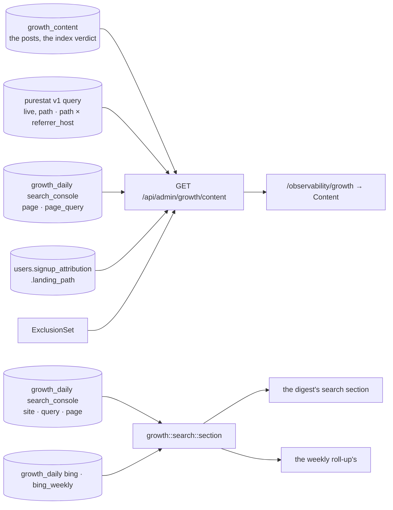

### The Content table — `GET /api/admin/growth/content?since&until&include_internal`

[`content.rs`](../crates/api/src/growth/content.rs) (`compute`,
[`:344`](../crates/api/src/growth/content.rs)) — platform admins and the read key, the empty
404 otherwise and with `growth.enabled = false`, the Campaigns table's range rules (`since` /
`until` inclusive, the 28 closed days ending yesterday by default).

| Column | Source | Window |
|---|---|---|
| post, published | `growth_content` (the blog's own feed); posts in the feed first, newest first, then the ones that left it | — |
| visitors, reads (and the read share from 30 pageviews), median read time, top 3 channels | purestat, **live** for the range — `path` with `visitors pageviews reads median_read_s`, and `path × referrer_host` mapped through the §3b channel table — unique visitors do not add across days, so the frozen daily path rows are not summed ([`fold_web`, `:234`](../crates/api/src/growth/content.rs)) | `[since, until]` |
| Google 7d and 28d: clicks, impressions, CTR, position; top 5 queries over 28 days | `growth_daily {source: search_console}` — the **`page`** breakdown, matched to the post by its path whatever the host, so the anonymised queries are in it; the `page_query` breakdown for the queries ([`per_path`, `search.rs:485`](../crates/api/src/growth/search.rs)) | the 7 and 28 days ending `google_through`, the newest final day pulled on or before `until`; **`google_days`** says how many final days of each window were pulled, and the tab says so when a window is short — an unpulled day is uncounted, not a 0 |
| indexed | `growth_content.inspection`: Google's verdict and coverage state, the last crawl, **when that verdict was read** (`inspected_at`, never a later failed attempt's time), and the newest attempt's time and error if it failed | as of `inspected_at` |
| sign-ups | `users.signup_attribution.landing_path` equal to the post's path (with or without its trailing slash), created in the range, the exclusion set applied ([`signups_by_path`, `:290`](../crates/api/src/growth/content.rs)) | `[since, until]` |

- **A post is its path without the trailing slash.** purestat and Google count `/blog/a` and
  `/blog/a/` apart; their rows add up here — the web counts (visitors too, an upper bound when one
  reader opened both; the median read time is the busier form's), the Google cells, and the
  sign-ups.
- **Small numbers stay honest**: CTR and position appear from 30 impressions, the read share from
  30 pageviews; below that the counts stand alone.
- **Three cells**: no purestat key, a 401 or a timeout makes every web cell `not_measured` with
  the reason (`web_not_measured` at the top); no final Search Console day makes every Google cell
  `not_measured` ("no Search Console key configured", "no final Search Console day pulled yet");
  a post nobody inspected yet says so. A post that had none of it in the window is a measured 0.

> ⚠️ **Sign-ups by landing path are a lower bound.** The site writes `landing_path` only on a
> journey that began on a campaign link (FR-88's carry, `ui/docs/theme/attribution.js`); an
> organic reader of a post who signs up carries none until FR-91 P3 builds the organic carry.
> Every sign-up cell carries that note, and the tab says it in text under the table and in the
> column's own header ("Sign-ups (lower bound)"), not only on hover.

The SPA's `/observability/growth` gains a **Content** tab
([`GrowthContent.vue`](../ui/src/components/growth/GrowthContent.vue)): the range,
include-internal, the reasons a column is not measured, and the table; a `not_measured` cell is a
muted chip with its reason on hover, and every title, path and query is rendered as text, never
`v-html`. AC17 is read here: for one post and one closed week, the clicks and impressions against
Search Console's own Performance report for that page and those days.

### The Search section — the digest and the weekly roll-up

`growth::search::section` ([`search.rs:466`](../crates/api/src/growth/search.rs)) is the digest's
`search` section ([`digest.rs:1113`](../crates/api/src/growth/digest.rs)) and, for Sunday, the
weekly roll-up's:

| Part | What | Rule |
|---|---|---|
| `google.through` | the newest final day pulled on or before the digest's day (Google settles 2–3 days behind, so this lags) | [`through_of`, `:275`](../crates/api/src/growth/search.rs), 14 days back at most |
| `google.clicks`, `impressions` | day / 7d / 28d ending on `through`, from the `site` rows | only days with an `ok` pull; `days` says how many of each window that is |
| `google.d28` | the 28 days' CTR and position | from 30 impressions; position weighted by impressions |
| `google.top_queries_7d`, `top_pages_7d` | top 10 by clicks, then impressions | the `query` breakdown leaves Google's anonymised queries out; the `page` one holds every page |
| `bing.pulled` | the day the newest **successful** `bing` pull covered | read first: with none in the 4 days to the digest's day the part is `not_measured`, naming the newest failed attempt — a failing pull never shows old rows as current ([`bing`, `search.rs:414`](../crates/api/src/growth/search.rs)) |
| `bing.through`, `clicks`, `impressions` | Bing's daily site totals, windows ending on its newest day (with no row stored, on `pulled`: Bing returned its whole history, so the windows are 0) | Bing's own (Pacific) days |
| `bing.week`, `top_queries_week`, `top_pages_week` | Bing's newest weekly bucket and its top rows | a week as Bing cuts it, never a 7-day window; Bing's positions are not averaged |

Each engine is `not_measured` with its reason (no key, nothing pulled yet, a pull failing, `saas`
not mounted), never a 0; a digest stored before P7 reads `{not_measured, arrives_with: P7}` there.
The email renders a **Search** block ([`search_blocks`, `render.rs:1064`](../crates/api/src/growth/render.rs))
with the day Google is final through, the windows (`—` for one with no final day pulled), the
28-day CTR and position, the top queries and pages, Bing's day, its pull and its week, and a note
on both lags.

## The newsletter: delivery, per-issue tags and unsubscribes (P5)

What an issue did — delivered, bounced, complaints, who left through it, the visits and
sign-ups its links brought — counted **per issue, never per reader** (D5, D6). The
footer's promise stays literally true: *the only per-recipient thing in this email is
your unsubscribe link.* The issue's tags are rendered into the issue once, before the
per-recipient substitution, so they are the same bytes for everyone; the server records
what SendGrid says happened to each message, and never whether anyone opened it or
clicked.

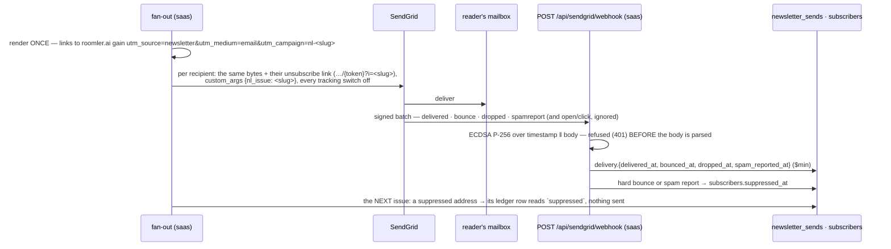

### The Event Webhook — `saas`, hosted-only

[`crates/modules/saas/src/sendgrid.rs`](../crates/modules/saas/src/sendgrid.rs) — mounted
outside the per-IP governor beside the Stripe webhook (signed, and SendGrid posts a batch
every 30 s from a handful of addresses), body bounded at 2 MiB (a batch is at most 768 KB).

| Check, in order | Refusal | Where |
|---|---|---|
| a usable key is configured (`newsletter.event_webhook_public_key`) | the **empty 404** of an absent path, for everything | [`webhook`, sendgrid.rs:275](../crates/modules/saas/src/sendgrid.rs) |
| both headers present (`X-Twilio-Email-Event-Webhook-Signature` / `-Timestamp`) | 401 | same |
| the signed timestamp within 25 h back (SendGrid retries for 24 h) and 5 min ahead | 401 | [`timestamp_fresh`, sendgrid.rs:114](../crates/modules/saas/src/sendgrid.rs) |
| ECDSA P-256 / SHA-256 over `timestamp ‖ raw body` verifies (either `s` of a signature — SendGrid does not normalise it) | 401 — **the body has not been parsed** | [`EventVerifier::verify`, services sendgrid.rs:67](../crates/services/src/sendgrid.rs) |
| the verified body is a JSON array of at most 10,000 events | 400 / 413 | `webhook` |
| a database error while recording | 503 — SendGrid retries; every write is idempotent | [`record_events`, sendgrid.rs:203](../crates/modules/saas/src/sendgrid.rs) |

The key is the one SendGrid shows (base64 DER `SubjectPublicKeyInfo`, starting
`MFkwEwYHKoZIzj0CAQYIKoZIzj0DAQcDQgAE`) or the same key as PEM; anything that is not an
uncompressed P-256 key is refused at boot with a warning, and the route then refuses every
request ([`EventVerifier::from_config`, services sendgrid.rs:39](../crates/services/src/sendgrid.rs)).
The verifier lives in `roomler-ai-services`, beside the Stripe check, so the host's views and
the route agree on whether a configured key is usable
([`webhook_key_usable`, sendgrid.rs:83](../crates/services/src/sendgrid.rs)).

| SendGrid event | Recorded on the ledger row (`newsletter_sends.delivery`) | Effect |
|---|---|---|
| `delivered` | `delivered_at` | — |
| `bounce`, `type: bounce` | `bounced_at`, `bounce_type: bounce`, `reason` (≤ 200 characters) | **suppresses the address** (`subscribers.suppressed_at`, `suppressed_reason: bounce`) |
| `bounce`, any other type (`blocked`, `expired`, none) | `bounced_at`, `bounce_type: blocked`, `reason` | none — the receiving server refusing one message must not cost the address its subscription |
| `dropped` | `dropped_at`, `reason` | none |
| `spamreport` | `spam_reported_at` | **suppresses the address** (`suppressed_reason: spamreport`) |
| `open`, `click`, `processed`, `deferred`, `unsubscribe`, `group_*`, anything else | **nothing** — `DeliveryEvent` has no variant that could say it | — |
| any event without the `nl_issue` custom arg (activation mail, an invite) | nothing — not a newsletter message | — |

- **Matched by the issue, never by a per-recipient token.** Every newsletter message carries
  ONE SendGrid custom arg, `nl_issue = <slug>` — the same for every recipient, and not part of
  the message a reader receives. An event brings it back with the recipient's address: the
  subscriber by its unique address, then the row by the unique `(issue_id, subscriber_id)`.
  A test-send carries no arg (it has no ledger row) so its events can never land on a real
  recipient's row.
- **Idempotent.** Every time is a `$min` — the earliest report wins; a replayed batch, or
  SendGrid's own duplicate, writes nothing new. `status` (our disposition: claimed → sent /
  failed / suppressed) is never touched: `delivery` is the mailbox provider's answer, which
  arrives later, out of order, sometimes twice
  ([`DeliveryEvent`, newsletter_send.rs:31](../crates/services/src/dao/newsletter_send.rs)).
- **Suppression** is the first reason, written once; the fan-out's per-recipient re-check
  reads it ([newsletter_send.rs:175](../crates/modules/saas/src/newsletter_send.rs)) and marks
  the row `suppressed` without sending. Only fresh consent lifts it: subscribing again (the row
  is revived **unconfirmed** — the confirmation click is the proof the mailbox works) or the
  signed-in toggle on a verified account.
- Never an address in a log line: a batch logs `events · recorded · ignored · unmatched ·
  suppressed`.

**SendGrid's own tracking stays off** (D6), twice over: every newsletter message switches
open, click, subscription and Google Analytics tracking off in the request itself
(`SendOptions::no_tracking`, [email.rs:303](../crates/services/src/email.rs) — GA tracking would
rewrite the issue's own UTM tags), and at boot the module reads the ACCOUNT's open and click
settings ([`spawn_tracking_check`, sendgrid.rs:338](../crates/modules/saas/src/sendgrid.rs)) and
logs a **WARN** if either is on — every other mail would be tracked — or if it cannot read them
(the API key needs the `tracking_settings.read` scope). Spawned, bounded at 10 s per request,
never blocking the boot; skipped without a SendGrid key.

### Per-issue tags and unsubscribes (D5)

| What | Rule | Where |
|---|---|---|
| The tags | `utm_source=newsletter&utm_medium=email&utm_campaign=nl-<slug>` on every **http(s) link to this site** — the body's links, the call to action, the footer's `roomler.ai` — rendered once, before the per-recipient substitution | [`LinkTags::tag`, newsletter.rs:100](../crates/services/src/newsletter.rs), [`render_issue_html`, newsletter.rs:260](../crates/services/src/newsletter.rs) |
| This site | `roomler.ai`, `www.roomler.ai` and `app.frontend_url`'s host; anything else — a third party, a `mailto:`, a relative path, a URL with credentials — is left **byte-for-byte as written** (a third party learns nothing; a signed URL is not broken) | [`site_hosts`, newsletter.rs:66](../crates/services/src/newsletter.rs) |
| An operator's own tag | kept; only the missing ones are added, after the query and before the fragment | `LinkTags::tag` |
| The campaign | `nl-<slug>`, cut to the 64 characters a sign-up's attribution keeps — the one spelling both the links and every per-issue lookup use | [`issue_campaign`, newsletter.rs:57](../crates/services/src/newsletter.rs) |
| The unsubscribe link | `…/api/subscribe/unsubscribe/{token}?i=<slug>` — the token is the one per-recipient thing; `i=` is the issue, the same for everyone. The `List-Unsubscribe` header carries the same link | [`unsubscribe_link`, saas newsletter.rs:218](../crates/modules/saas/src/newsletter.rs) |
| The click | stamps `subscribers.unsubscribed_via = <slug>` with `unsubscribed_at` — once, by the click that ends a live subscription; a repeat (a prefetcher, a second issue's link) changes neither the time nor the issue. An `i=` naming no sent issue unsubscribes all the same and records none | [`via_issue`, subscribe.rs:214](../crates/modules/saas/src/subscribe.rs), [`SubscriberDao::unsubscribe`, subscriber.rs:180](../crates/services/src/dao/subscriber.rs) |
| The stamp | when the fan-out starts, the issue records `campaign` (its links' tag; absent with the tags off) and `delivery_events` (this server verified the webhook when it sent) — what tells a later reader "not measured" from a zero | `NewsletterIssueDao::stamp_send_tags` |

**AC15, as a test**: `every_link_but_the_unsubscribe_link_is_byte_identical_for_two_recipients`
([`newsletter_send.rs`](../crates/modules/saas/src/newsletter_send.rs), `tests`) renders an issue
exactly as `run_send` does, composes it for two recipients with the same function the fan-out
calls ([`compose`, newsletter.rs:244](../crates/modules/saas/src/newsletter.rs)), and asserts that
of every `href`/`src` in the two messages exactly one differs — the unsubscribe link — that
with each recipient's unsubscribe link taken out the two bodies are the same bytes, and that
the send options differ only in that link.

### The per-issue table

`GET /api/admin/growth/newsletter?since&until&include_internal`
([`get_newsletter`, newsletter.rs:518](../crates/api/src/growth/newsletter.rs)) — platform admins
only, **404** otherwise and when `growth.enabled = false`. UTC days, both inclusive; the
default is the **90** closed days ending yesterday (an issue is never more than monthly), at
most 366.

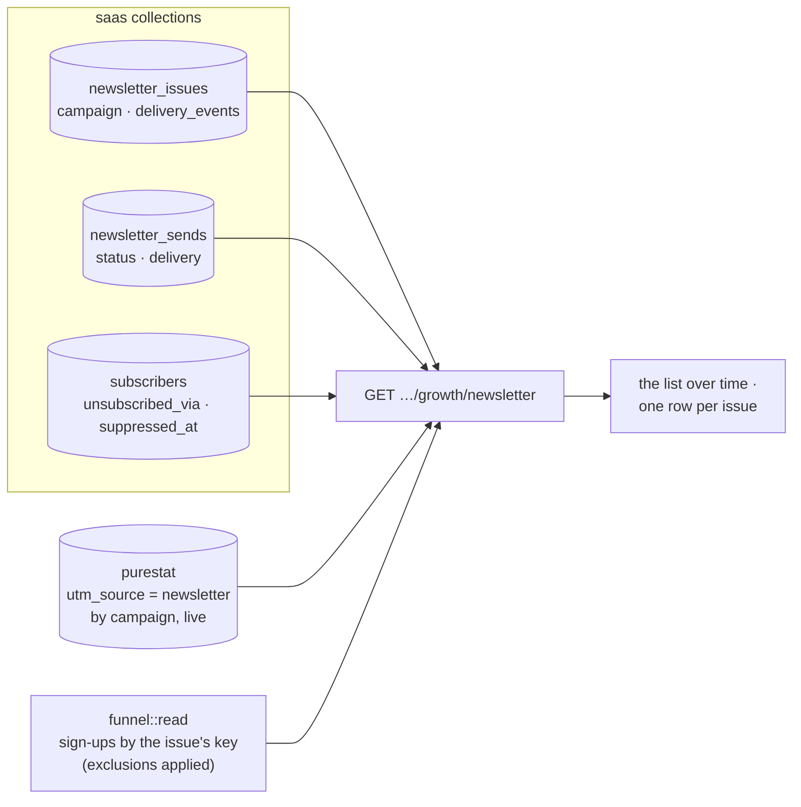

| Cell | What | Not measured when |
|---|---|---|
| `ledger` | `recipients` (rows claimed), `accepted` (a SendGrid 202 — not delivered), `failed`, `suppressed`, `stale`: the stamped counts once completed, live while sending | — |
| `delivery` | `delivered`, `bounced` (`hard_bounced`), `dropped`, `complaints` | this server verifies no webhook (no usable key), or the issue was sent before delivery events were recorded — **never 0** ([`delivery_cell`, newsletter.rs:485](../crates/api/src/growth/newsletter.rs)) |
| `unsubscribed_via` | subscribers whose current unsubscription came through this issue's link | — |
| `web` | purestat's visitors, visits, pageviews, reads and goals for the issue's key `(newsletter, email, nl-<slug>)` over the range — one breakdown filtered on `utm_source = newsletter` | the issue's links carried no tags, or purestat cannot be asked (no key, 401, timeout) |
| `signups` | sign-ups created in the range whose attribution normalises to the issue's key — the funnel's own read, so a link's spelling cased differently still counts, and the exclusion set applies | — |
| `rates` | `delivered` (n = accepted), `hard_bounce` (n = accepted), `complaint` (n = delivered), `unsubscribe` (n = delivered, or accepted while delivery is unmeasured), `signup_per_visitor` (n = visitors); a value only from n = 30 | the side it rests on is not measured |

**The list over time** ([`read_list`, newsletter.rs:255](../crates/api/src/growth/newsletter.rs)):
new, confirmed, unsubscribed and suppressed per UTC day and by `source`, from the timestamps
`subscribers` keeps, and the list's size now — mailable (confirmed, not withdrawn, not
suppressed), awaiting confirmation, unsubscribed, suppressed. A subscriber carries no account
id, so the exclusion set cannot apply to the list; a re-subscription restarts a row's history
(the subscribe path re-stamps `created_at`).

The SPA's `/observability/growth` gains a **Newsletter** tab
([`GrowthNewsletter.vue`](../ui/src/components/growth/GrowthNewsletter.vue)): the list's size,
the daily chart and the sources, then one row per issue — a `not_measured` cell is a muted chip
with its reason on hover, a rate appears only with n ≥ 30, subjects are rendered as text.

**In the digest**, the `newsletter` section gains `delivery` — the day's (and 7/28 days')
delivered, bounced (hard), dropped, spam reports and addresses suppressed, by each event's own
time ([`delivery_figures`, digest.rs:1860](../crates/api/src/growth/digest.rs)), `not_measured`
on a server without the webhook — `unsubscribed_via_issue`, and per issue sent that day its
delivery so far and its unsubscribes, by the same reads and the same three cells as the table.

### Settings and the operator's setup

| Setting | Env | Default | Effect |
|---|---|---|---|
| `newsletter.event_webhook_public_key` | `ROOMLER__NEWSLETTER__EVENT_WEBHOOK_PUBLIC_KEY` | empty | SendGrid's verification key (base64 DER or PEM). Empty or unusable ⇒ `POST /api/sendgrid/webhook` answers 404 to everything and delivery reads "not measured" |
| `newsletter.link_tags` | `ROOMLER__NEWSLETTER__LINK_TAGS` | `true` | the per-issue UTM tags; `false` sends links as written (and the issue's visits read "not measured") |

Turning delivery on is three steps in SendGrid and one secret here:

1. **Settings → Mail Settings → Event Webhook**: HTTP POST URL
   `https://roomler.ai/api/sendgrid/webhook`; select **Delivered, Bounced, Dropped, Spam
   Reports** (Opened and Clicked stay unselected — they would be ignored anyway).
2. Enable **Signature Verification** on that webhook and copy the **public key** it shows into
   the cluster secret as `ROOMLER__NEWSLETTER__EVENT_WEBHOOK_PUBLIC_KEY`; roll.
3. **Settings → Tracking**: Open Tracking and Click Tracking **off** (and Subscription Tracking
   off — FR-58). In Click Tracking, also untick **"Also enable click tracking in plain text
   emails"**. SendGrid keeps it as `enable_text: true` under a disabled toggle, and the boot check
   counts that as on: an answer it cannot read as off never reads as reassurance
   ([`tracking_report`, email.rs:141](../crates/services/src/email.rs)). Give the API key
   `ROOMLER__EMAIL__API_KEY` the `tracking_settings.read` scope so the boot check can confirm it;
   without the scope it logs that it could not.
4. Check: the boot log says `SendGrid Event Webhook on` and `SendGrid open and click tracking
   are off`; SendGrid's "Test Your Integration" button posts a signed sample batch, which
   answers 200 with `{"events": …, "ignored": …}` (its sample events carry no `nl_issue`).

**A test issue** never mails the list: an issue created with `"audience": [1–20 addresses]`
goes only to the confirmed subscribers among them, and the audience is fixed with the draft,
so a resumed send cannot widen it. That is what a field run on production uses — two own
addresses plus one that bounces, sent twice — and the per-issue table marks it `test · N`
(its size, never the addresses).

## Revenue: what Stripe billed (P4)

Billed revenue — paying orgs, billed MRR, its new / expansion / contraction / churned
movements per month, trial → paid, `paid_since`, all of it by the owner's acquisition
channel — read from **what Stripe billed**, never from the price list (§3g). The list-price
figure (`Plan::price_monthly_cents` × seats, [`mrr_estimate_cents`, cost.rs:68](../crates/api/src/routes/cost.rs))
stays beside it, labelled an ESTIMATE: for an org with no invoice yet it is the only figure
there is. Rows carry the org's id and Stripe's ids and amounts — never a card, an address or a
name — and go with the org.

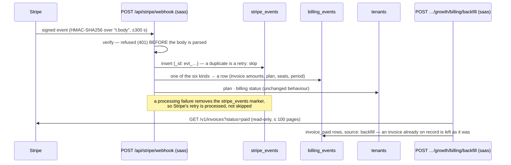

### The six kinds — `billing_events`

[`process`, stripe.rs:761](../crates/services/src/stripe.rs) records every billing kind
before the tenant-state updates it always made; [`parse`, billing.rs:297](../crates/services/src/billing.rs)
reads Stripe's objects for both API versions in the field (the classic shape and the
2025-03-31 "basil" one, which moved `invoice.subscription` under `parent`, a line's
`proration` under `parent.subscription_item_details` and the subscription's period onto its
items).

| Stripe event | `kind` | What the row holds |
|---|---|---|
| `customer.subscription.created` | `subscription_created` | plan (from the price id), seats (items' quantities), period, `status` — **no amount** (`null`, never 0) |
| `customer.subscription.updated` | `subscription_updated` | the same, after the change — a seat change shows here |
| `customer.subscription.deleted` | `subscription_deleted` | `ts` = `ended_at` — MRR is 0 from then |
| `invoice.paid` | `invoice_paid` | `amount_cents` = `amount_paid` (what was billed, after coupons, before tax); `recurring_cents` = the subscription lines that are **not prorations**, after discounts ([`recurring_of`, billing.rs:188](../crates/services/src/billing.rs)); seats, period, interval; `ts` = `paid_at` |
| `invoice.payment_failed` | `invoice_payment_failed` | `amount_cents` = `amount_due` |
| `customer.subscription.trial_will_end` | `trial_will_end` | the trial's end |

- **The org** ([`tenant_for`, stripe.rs:690](../crates/services/src/stripe.rs)): the
  `tenant_id` the checkout stamps on the **subscription's** metadata (from P4,
  `subscription_data[metadata]`, [stripe.rs:210](../crates/services/src/stripe.rs)), else the
  org whose `billing.customer_id` / `billing.subscription_id` the object names. An object that
  names no org here is logged with its ids and not recorded — revenue nobody can be credited
  with is not a row.
- **Recorded once** ([`BillingEventDao::record`, billing_event.rs:173](../crates/services/src/dao/billing_event.rs)):
  a webhook row is unique by `event_id` (sparse — a backfilled row has none), a paid invoice
  by `(kind, stripe_id)` across the webhook and the backfill, on top of `stripe_events`' own
  dedupe of Stripe's retries.

### Billed MRR, and the months

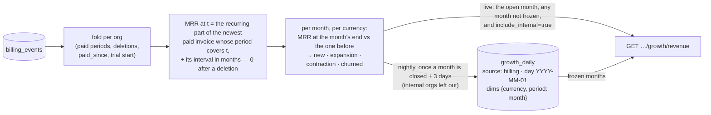

| Figure | Definition | Where |
|---|---|---|
| billed MRR at t | the recurring part of the org's newest paid invoice whose period covers t, normalised by the price's interval (a yearly invoice ÷ 12), 0 once a deletion at or before t came after that period began | [`OrgBilling::mrr_at`, billing.rs:498](../crates/services/src/billing.rs) |
| paying orgs | orgs with billed MRR > 0 | same |
| new / expansion / contraction / churned | per month and currency, each org's MRR at the month's end against the end of the month before: from 0 = new, to 0 = churned, up = expansion, down = contraction | [`movements`, billing.rs:548](../crates/services/src/billing.rs) |
| `paid_since` | the org's first invoice paid with an amount above 0 — also the funnel's **paid** step | [`OrgBilling::of`, billing.rs:446](../crates/services/src/billing.rs) |
| trial → paid | trials started in the range (a `trialing` subscription or `trial_will_end`) and how many paid since | [`trial_to_paid`, billing.rs:948](../crates/services/src/billing.rs) |
| invoices and billed cash | invoices paid in the month and every line they billed, prorations included — cash beside the MRR | `movements` |

- ⚠️ **Billed, so a seat change moves MRR when an invoice bills it.** The proration invoice
  in between is cash (`billed_cents`), not MRR; the renewal that bills the new seat count is
  the expansion. A dunning gap (a renewal not paid yet) reads as 0 until the payment lands,
  and the live view corrects the history once it does.
- **The record** ([`record_start`, billing.rs:758](../crates/services/src/billing.rs)): before
  the first billing row (any org — or the first frozen month, whichever is older) nothing was
  recorded, so a month that ended before it is `on_record: false` — *not measured*, never a
  month of zero revenue — and is never frozen ([`on_record`, billing.rs:750](../crates/services/src/billing.rs)).
  With no row at all, billed revenue is `not_measured` everywhere.
- **Frozen once closed.** The nightly org-daily job ([`freeze_billing_months`, org_daily.rs:510](../crates/api/src/growth/org_daily.rs))
  writes every closed month of the last 13 that ended at least 3 days ago (Stripe retries a
  webhook for three days) and lies on the record into `growth_daily`, internal orgs left out,
  and marks it in `growth_pulls` (`billing:YYYY-MM-01`). A frozen month is never rewritten —
  except by the backfill, for the months it touched — so purging an org later does not
  rewrite last year's MRR ([`freeze_closed_months`, billing.rs:840](../crates/services/src/billing.rs)).

### Upgrade intent: plan-limit collisions

Every plan-limit check now goes through core ([`roomler_core::quota`, quota.rs:33](../crates/core/src/quota.rs))
— thirteen call sites across `chat`, `conference`, `fleet`, `network` and the host. The
decision stays `services::quota`'s, unchanged ([`evaluate`, quota.rs:258](../crates/services/src/quota.rs)),
with the FR-32 warn line written there exactly once. What core adds: a collision — refused in
`enforce`, **or let through in `warn`** — bumps `growth_daily {source: quota, metric: collision,
dims: {tenant, limit}}` for the UTC day ([`record_collision`, quota.rs:72](../crates/core/src/quota.rs)).
The org's id and the limit's wire spelling, never a person; spawned and best-effort (a refused
request is answered at once), and nothing at all with `growth.enabled = false`. The rows carry
the tenant, so they go with the org.

### Margin

The cost to serve is FR-20's ledger priced by [`routes/cost.rs`](../crates/api/src/routes/cost.rs)
— the same prices and the same meters as the Cost & usage tab, through one helper
([`org_costs`, cost.rs:159](../crates/api/src/routes/cost.rs)). Margin per org = billed MRR −
the last 30 days' cost, **only** where both exist in the same currency
([`margin_cents`, revenue.rs:386](../crates/api/src/growth/revenue.rs)); an unpriced meter is
"not priced", never 0.00 (which would read as free to serve).

### The revenue view

`GET /api/admin/growth/revenue?since=YYYY-MM&until=YYYY-MM&include_internal`
([`get_revenue`, revenue.rs:721](../crates/api/src/growth/revenue.rs)) — platform admins only,
**404** otherwise and when `growth.enabled = false`. Months, both inclusive; the default is the
12 months ending with the current one, at most 36, never before 2020-01, never past the
current month.

| Part | What | Not measured when |
|---|---|---|
| `billed.record` | `since` (the record's start), `last_event_at`, `backfilled_at` (absent = the backfill never ran, so figures start at the webhook), `rows`, `truncated` | — |
| `billed.now` | billed MRR and paying orgs, per currency, at the request | `saas` not mounted; nothing on record |
| `billed.months` | one block per month: `frozen`, `partial` (the open month), `on_record`, and per currency the movements, invoices and billed cash ([`month_blocks`, revenue.rs:503](../crates/api/src/growth/revenue.rs)) | a month before the record: `on_record: false` |
| `billed.totals` | the range's invoices paid, billed cash per currency, first payments, failed payments, cancellations | as `billed` |
| `billed.trial_to_paid` | trials started in the range, converted, and the rate from n = 30 | as `billed` |
| `billed.by_channel` | per owner's acquisition channel and currency: paying now, MRR now, first payments, churned, trials → paid ([`channel_rows`, revenue.rs:399](../crates/api/src/growth/revenue.rs)) | as `billed` |
| `estimate` | the list-price MRR over every live org, `estimate: true` | — |
| `cost` | the cost basis: range, currency, whether anything is priced | the usage ledger is off (`stats.enabled = false`) |
| `upgrade_intent` | the range's collisions, orgs, by limit, and the top 50 orgs with their limits and days | — (core's, read on every server) |
| `orgs` | every org with a billing history, a paid plan or a collision (≤ 500): plan, status, seats, channel, `paid_since`, billed MRR (`null` = no invoice), the list-price estimate, 30-day cost, margin, collisions | per cell, as above |

> [!NOTE]
> **"Nothing on record" states what the backfill did, as its ledger row says**
> ([`no_billing_record`, digest.rs:2050](../crates/api/src/growth/digest.rs)). The panel's `billed` and
> the digest's share one reason, and it reads three ways:
>
> - *the backfill has not run*;
> - *the backfill on DAY recorded no paid invoice* (none it read names an org on this server);
> - *the N the backfill on DAY recorded have since been deleted with their org*.
>
> Before this, a fixed "the backfill has not run" outlived a real backfill. Production's first run
> (2026-10-17) read Stripe's one paid invoice, whose customer is no org here, and recorded nothing.

- **The funnel's `paid` step** ([funnel.rs:245](../crates/api/src/growth/funnel.rs)) is the org's
  first invoice paid above 0. It has no window, so it hangs off the org step, not the value
  steps (an org that pays is counted whatever its path to value) and reads "paid so far": its
  `pending` is only the sign-ups still pending at the org step. The Campaigns and Channels
  tables' `paid` cells are the same groups. `null` with `not_measured.paid` without `saas`.
- **The org timeline** gains `plan_history` (the org's billing rows, newest 200) and a
  `first_paid` milestone ([orgs.rs:667](../crates/api/src/growth/orgs.rs)).
- **In the digest**, the revenue section gains `billed` — MRR at the day's end per currency;
  the day's (and 7/28 days') invoices, billed cash, failed payments, first payments,
  cancellations and trials; `record_since` and `backfilled`
  ([`billed_figures`, digest.rs:2051](../crates/api/src/growth/digest.rs)) — and `upgrade_intent`,
  the windows' collisions and the orgs that hit hardest
  ([`upgrade_intent_section`, digest.rs:2143](../crates/api/src/growth/digest.rs)). The
  estimate keeps its line and its label.
- The SPA's `/observability/growth` gains a **Revenue** tab
  ([`GrowthRevenue.vue`](../ui/src/components/growth/GrowthRevenue.vue)); the Overview's funnel
  shows **Paid (so far)**, and the org drawer the plan history.

### The backfill — operator-run, once

`POST /api/admin/growth/billing/backfill?since=YYYY-MM-DD` (`saas`,
[`backfill`, saas stripe.rs:137](../crates/modules/saas/src/stripe.rs)) — platform admins only,
404 otherwise and with growth off. It reads Stripe's **paid** invoices (created since `since`
when given; 100 a page, at most 100 pages) into `invoice_paid` rows with `source: backfill`
([`backfill_paid_invoices`, stripe.rs:396](../crates/services/src/stripe.rs)), then refreezes the
closed months those invoices touch ([`refreeze`, saas stripe.rs:190](../crates/modules/saas/src/stripe.rs))
and leaves a `growth_pulls` marker (`billing_backfill:YYYY-MM-DD`) the views read. It only
reads Stripe. Idempotent: an invoice already on record (the webhook's, or an earlier run's) is
counted under `already` and left as it was; one naming no org here under `no_org`.

```bash
# As a platform admin (a JWT from the SPA), once, after the webhook is wired:
curl -sS -X POST "https://roomler.ai/api/admin/growth/billing/backfill?since=2025-01-01" \
  -H "Authorization: Bearer $ROOMLER_ADMIN_JWT"
# {"pages":1,"invoices":12,"recorded":9,"already":3,"no_org":0,"truncated":false,
#  "months":["2025-11","2025-12",…],"refrozen":["2025-11",…]}
```

### The operator's setup

| Where | What |
|---|---|
| Stripe → Developers → Webhooks → the `https://roomler.ai/api/stripe/webhook` endpoint | add the events `customer.subscription.created`, `customer.subscription.updated`, `customer.subscription.deleted`, `invoice.paid`, `invoice.payment_failed`, `customer.subscription.trial_will_end` (keep `checkout.session.completed`). Its signing secret stays `ROOMLER__STRIPE__WEBHOOK_SECRET` |
| `ROOMLER__STRIPE__PRICE_PRO` / `ROOMLER__STRIPE__PRICE_BUSINESS` | the plan a row names comes from these price ids; a price this server does not sell leaves `plan` empty |
| `ROOMLER__STRIPE__SECRET_KEY` | the backfill's read of the invoice list (a restricted key with *Invoices: read* is enough) |
| — | nothing to switch on: the rows land as the events arrive; `growth.enabled = false` hides the views and stops counting collisions |

A subscription created before P4 carries no `tenant_id` in its metadata; its events are
matched through the org's stored customer and subscription ids instead.

### Field-testing billing in Stripe test mode (AC13)

Production holds live keys, so a test-mode lifecycle runs against a local server. On 2026-10-17
it ran like this (FR-102 §8):

1. **Catalogue.** In test mode, create prices at the list prices (Pro €8 and Business €16 per seat
   a month), plus a coupon for the control. Give the local server their ids as
   `ROOMLER__STRIPE__PRICE_PRO` / `…_BUSINESS`, and the test secret key as
   `ROOMLER__STRIPE__SECRET_KEY`.
2. **Delivery.** `stripe listen --print-secret` gives the signing secret, which goes in as
   `ROOMLER__STRIPE__WEBHOOK_SECRET`. Then run `stripe listen --forward-to
   <local>/api/stripe/webhook --events <the seven kinds above>`. It renders events at the account's
   default API version (2020-03-02 here), the shape production's endpoint receives.
3. **Time.** Put the customer on a **test clock that starts in the past**, then advance it
   through the lifecycle. The Revenue panel never shows a month past the current one, so a clock
   started today would put the renewal and the churn out of view.
4. **Read** `GET /api/admin/growth/revenue` with a range covering the clock's months.

> [!WARNING]
> **A skewed local clock reads a just-paid invoice as future.** `paid_at` is Stripe's time. A server
> whose clock runs behind reads the newest invoice as not yet paid, until its own clock passes it:
> MRR 0 and one invoice short, for as long as the skew. The dev box was 28 s behind on 2026-10-17;
> compare with Stripe's HTTP `Date` header before believing a missing invoice.

## The read key, the weekly roll-up and alerts (P10)

The results feed (spec §3l): the numbers the Growth page shows, readable by a machine; the
week read against the weeks before it, once, in every admin's mailbox on Monday; and a
small set of rules that say so when a source stops measuring or a count leaves its band.

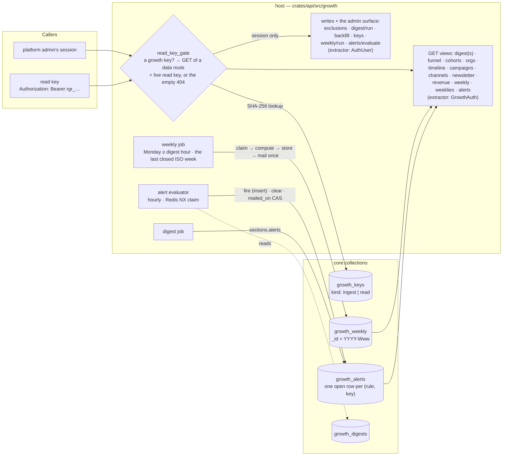

### The read key (D12)

A platform admin mints it where the ingest key is minted — `/observability/growth` →
**Channels** → *Machine keys*, kind `read`, or `POST /api/admin/growth/keys`
`{"kind": "read", "label": "…"}` ([`keys.rs`](../crates/api/src/growth/keys.rs)). It is
`rgr_` and 32 random characters, answered once; only `hex(SHA-256(key))` and a display prefix
are stored in `growth_keys` ([`growth_key.rs`](../crates/services/src/dao/growth_key.rs)).
The promotion pipeline and the sessions that run it read the stored digests, the funnel and
the tables with it instead of querying databases by hand.

**One rule, in two halves** ([`read_key.rs`](../crates/api/src/growth/read_key.rs)):

| Half | What it decides |
|---|---|
| `read_key_gate` — a layer on the whole `/api/admin/growth` router | When the bearer is a growth key of **any** kind, the answer is the key's and never the session's: a **live read key** on a **GET** of a **data route** opens it (the use is recorded as `last_used_at` and logged with the key's prefix and the path — never the key, never a query string). Everything else is the **empty 404** of a path that does not exist: any non-GET, the admin surface (`/keys`, `/exclusions` — session-only even on GET, so a leaked key can neither list its siblings nor read the admin ids), an ingest key, a malformed, unknown or revoked key, and `growth.enabled = false`. Never 401 or 403. A database error is a 503, so a Mongo blip never reads as a revocation. A bearer that is not a growth key (a JWT) passes through untouched. |
| `GrowthAuth` — the extractor every GET view names | The mark the gate left, or else a platform admin's session on a server whose growth surface is on — the same 404s as before. A handler does not know which it serves, which is what makes AC20 a property rather than a promise: the key reads exactly what the admin's session reads at the same route. A write route keeps `AuthUser` + `require_growth_admin`; the gate has already answered a key on it. |

The integration test `crates/tests/src/growth_p10_tests.rs::ac20_…` asserts the same JSON for
the two credentials on every GET view, and the identical empty 404 on every write, on the
admin surface, for an ingest key, a malformed and an unknown key, a revoked key, and the kill
switch.

### The weekly roll-up

Every closed ISO week (Monday–Sunday, UTC) is computed once, stored once in
`growth_weekly` (`_id = "YYYY-Www"`) and mailed once to the digest's recipients
([`weekly.rs`](../crates/api/src/growth/weekly.rs)). Nothing in it is a second definition:
each section is the matching route's own report, computed for exactly that week through the
same function the route calls (`funnel::compute`, `cohorts::compute`, `campaigns::compute`,
`channels::compute`, `newsletter::compute`).

| Section | What |
|---|---|
| `headline` | sign-ups, orgs created, devices enrolled and weekly active orgs as `{week, prev_week, w4_avg}` — the week, the week before, and the mean of the **four before** the week; purestat's visitors, visits, pageviews and reads for the week and the week before (unique per week, never a sum of days; no four-week mean, which would be four more queries for a number that does not add) |
| `funnel` | the week's sign-ups through the account funnel, by source — every step `{count, pending, settled}` |
| `cohorts` | the cohort lines (12 weeks ending with the week) and the WAO series as they stood the morning after |
| `campaigns` | the Campaigns table by source for the week, web cells live from purestat (`not_measured` without a key) |
| `channels` | the Channels table for the posts published in the week |
| `newsletter` | the list over the week and the issues sent in it |
| `alerts` | fired or cleared in the week, and open at the compute |

- **Once, with two pods** — the digest's own claim, in a collection of its own
  (`DigestStore::weekly`, [`growth_digest.rs`](../crates/services/src/dao/growth_digest.rs)):
  the unique `_id` decides which pod computes and mails; a `failed` or stale `computing` week
  is re-claimed; a `sent` week is **never sent again**; a manual `send=false` run ends
  `preview`, which the scheduler still claims. The engine is `digest::finish` behind the
  `Report` seam, so the matrix is one piece of code with the digest's tests behind it, plus
  the weekly's own (`growth_p10_tests.rs`: two concurrent runs → one mail; a re-run after
  `sent` does nothing; a preview never cancels the scheduled mail; a manual send racing the
  scheduler mails once). Its own collection rather than a `week:` id among the days, so the
  daily store's `latest()` and `list()` never meet a week where they expect a day.
- **When** — the scheduler ticks every 10 minutes and owes the **last closed week** once the
  clock passes Monday `00:00 + digest_hour_utc`. A pod that was down on Monday computes it
  at its next tick (one mail, never a backfill); an older week is the run route's business.
- **The mail** — `Roomler weekly roll-up — 2026-W41 (2026-10-05 → 2026-10-11)`: the headline
  against its baselines, the funnel with its n at every step, the WAO table, the campaigns
  by source, the channels, the newsletter, the alerts, the exclusion footer. Every rate
  appears only above n = 30; a not-measured cell is a reason; no address, name or IP.

### Alerts

A small set of rules over this server's own numbers ([`alerts.rs`](../crates/api/src/growth/alerts.rs)),
evaluated hourly by a host job behind `ROOMLER__GROWTH__ALERTS` (default **off**). Each
rule has an n floor (principle 5); a rule that cannot be evaluated — its source not
configured, not mounted or not yet pulled — holds nothing, which clears any open row.

| Rule | Key | Fires when | Clears when |
|---|---|---|---|
| `digest_missing` | `daily` | the digest is on and the latest **due** day (yesterday from `digest_hour_utc` + 2 h; the day before until then) has no row, a `failed` one, or a `computing` one older than the 30-minute stale cutoff | that day is `sent`, `stored` or `preview`, or the digest is off |
| `source_not_measured` | `purestat` | the digest's web plane read "not measured" on the two latest due days while a purestat key is configured | either day measured, or no key |
| `source_not_measured` | `purestat_pull` | the `saas` puller's `growth_pulls` rows for its two latest cycled days (01:00 UTC + 1 h) are both absent or `failed` — once the puller has any row at all (a fresh server's first cycle is still ahead) | either day `ok`, or nothing pulls here |
| `source_not_measured` | `sendgrid` | on each of the two latest closed days ≥ 1 newsletter send was accepted and not one delivery event arrived, with the webhook key configured | either day recorded an event, or no key |
| `source_not_measured` | `search_console_pull` · `url_inspection_pull` · `content_pull` · `github_pull` · `github_traffic_pull` · `bing_pull` | a configured `saas` puller is **failing two days running**, read on the clock ([`pull_failing`, alerts.rs:425](../crates/api/src/growth/alerts.rs)). It still tries (an attempt in the last 26 h), and nothing it pulled has succeeded in 48 h. A puller that never succeeded fires only once its oldest attempt is 48 h old. The detail carries the last success, the newest attempt and its error | a pull succeeds, the puller stops trying (switched off or unmounted), or it is not configured |
| `spike` · `drop` | `signups` | yesterday's sign-ups (exclusions applied) against the 28 days before: baseline n ≥ 30; spike `x > mean + 3√mean` and `x ≥ 2 × mean`; drop `x < mean − 3√mean` | yesterday is within the band |
| `spike` · `drop` | `visitors` | the same, over the puller's daily `visitors` rows (`by = site`); needs yesterday's row and ≥ 21 of the 28 baseline days | the same |

- **One open row per `(rule, key)`** — `growth_alerts` has a partial unique index on
  `{rule, key}` where `cleared_at` is an explicit `null`; a second pod's fire is a duplicate
  key read back as "already open", never a second alert. A recurrence after a clear is a
  new row, so the collection is the history. Rows expire 90 days after `fired_at`.
- **Mailed at most once per rule and key per day** — a row never mailed is mailed to the
  digest's recipients once a compare-and-set on its `mailed_on` succeeds and no row of the
  pair was mailed that day, so neither two pods nor a clear-and-re-fire inside one day send
  twice. A clear mails nothing; the next digest lists it.
- **Where they show** — `GET /api/admin/growth/alerts` (open and recently cleared, with the
  rule table), the Alerts panel at the top of `/observability/growth` → Overview (with
  *Evaluate now* and a *dry run* that decides and writes nothing), the daily digest's
  `alerts` section and the weekly roll-up's. `POST …/alerts/evaluate` runs every rule as
  the hourly job would (409 when the alerts are off, unless `dry_run=true`) — a field
  check that does not wait an hour.

### Settings and routes (P10)

| Setting | Env | Default | Effect |
|---|---|---|---|
| `growth.weekly_enabled` | `ROOMLER__GROWTH__WEEKLY_ENABLED` | **`false`** | the weekly scheduler; the recipients, hour and mail backend are the digest's |
| `growth.alerts` | `ROOMLER__GROWTH__ALERTS` | **`false`** | the hourly evaluator, the stored digest's `alerts` section, and `POST …/alerts/evaluate` without `dry_run` |

| Method | Path | Credential | Purpose |
|---|---|---|---|
| GET | every `/api/admin/growth/*` view above and below | session **or read key** | the numbers |
| GET | `/api/admin/growth/weekly?week=` · `/weeklies?since=&limit=` | session or read key | a stored week (the latest when omitted; dates RFC 3339, the sections as stored) and the list with each week's status and headline |
| POST | `/api/admin/growth/weekly/run?week=&send=false` | session | recompute a closed ISO week through the claim; mail only with `send=true` and never a `sent` week; 409 while a run is in progress; 400 for an open week or a label that is not `YYYY-Www` |
| GET | `/api/admin/growth/alerts?since=` | session or read key | open rows, rows cleared since `since` (default 7 days), the rule table |
| POST | `/api/admin/growth/alerts/evaluate?dry_run=` | session | evaluate every rule now |
| GET/POST/DELETE | `/api/admin/growth/keys` · `/keys/{key_id}` · GET/PUT `/exclusions` | session **only** | the admin surface — a read key meets the empty 404 here, GET included |

## Remote-desktop quality from what is recorded (P9a)

Per UTC day and per agent version: the sessions that reached Active against those that did
not, by `end_reason`; the duration, peak frame rate and RTT distributions; FR-22's time to
first frame as p50/p90; and crashes per 100 device-days (spec §3f). **Server only** — no
remote-control code path changed; every number is read from rows the product already writes
([`crates/api/src/growth/quality.rs`](../crates/api/src/growth/quality.rs),
[`crates/services/src/dao/growth_quality.rs`](../crates/services/src/dao/growth_quality.rs)).

**Why a freeze.** Three of the four sources expire. `agent_logs` — where the browser's
`rc.connect` record carries `ttff_ms` (FR-22 part 4, [remote-control.md §12.1.5](remote-control.md))
and where an agent's own batches say which version it ran — live **7 days**; `agent_crashes` 30
(decision 15, since 2026-10-17; it was 90);
`stats_machine_1d` 730. `remote_sessions` lasts longest: **25 months** (a TTL on `created_at` since
2026-10-17, the retention the privacy policy states). Once the logs are gone the day's time to
first frame is gone with them, so a nightly job writes it down first.

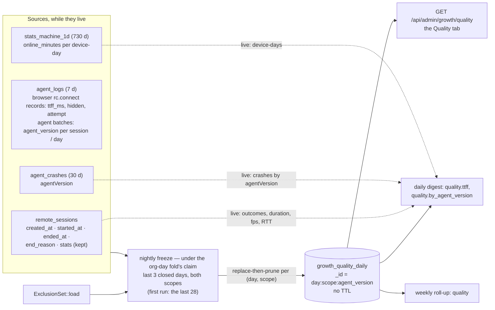

### The rules

| Rule | As built |
|---|---|
| **Which day a session belongs to** | the day it was **requested** (`created_at`). It *reached Active* when `started_at` is set (ended or still running); it *never reached Active* when it ended without one — a refusal (`user_denied`, `consent_timeout`, `no_prompt_surface`), a connect failure (`error`, `agent_disconnect`) or a controller that gave up waiting (`controller_hangup` before Active); it is *pending* when the freeze saw it neither started nor ended. `by_end_reason` keeps the two apart (`reached_active: true/false`); a session not ended reads `open` (`quality::session_quality`) |
| **Duration, frame rate, RTT** | Active sessions that ended: `ended_at − started_at`; `stats.peak_fps` and `stats.avg_rtt_ms` of the Active sessions whose device reported one above 0 (`stats` is `$max`-merged live by the device's samples, so a session that never reached Active has none) |
| **Time to first frame** | the `ttff_ms` of `first_frame` records from a **foreground tab** (`hidden: false`), on a **first attempt** (`attempt: 1`, `after_drop: false`) — FR-22's own mining filter. A hidden tab's paint timing is invalid by the standing rule and a retry measures the retry, so both are counted as *set aside* (`hidden`, `later_attempts`), and every foreground record is counted by `outcome` (`first_frame` · `abandoned` · `closed` · `retried`). A record filed under one org's page for another org's device (FR-52, `agent_org_id`) follows both exclusions (`quality::ttff_quality`) |
| **When TTFF is measured** | only while **every** record of the day still exists: `day_start + 7 d > now` (`quality::logs_complete`). A day whose first rows have started to expire would give a sample biased to its late hours, so it is frozen **without** TTFF — not measured, never 0. At the nightly tick that is yesterday and the two days before; a first fill or a backfill measures the last six closed days and no more |
| **Which version a device ran** | the device's own log batches carrying the session's id, then its batches of that day (the newest when it updated mid-day), then the device row's current `agent_version`, else `unknown` (`VersionIndex::resolve`). A crash names its own version in its payload. A device-day's version is the day's logs, else the row |
| **Scopes** | both are frozen: `external` with the exclusion set applied (every default view), `all` with nothing excluded (`include_internal=true`) — a different row, not a different code path. The set is the one **at the freeze**; the three-day recompute and the backfill route re-freeze with the current set while the sources still hold the day |
| **Percentiles** | nearest-rank, exact per day; a `Dist` also carries a histogram over fixed edges (TTFF 250 ms … 32 s, duration 10 s … 8 h, fps 5 … 120, RTT 10 … 1000 ms), so a window is **pooled** from several days' rows — interpolated inside the bucket the rank falls in, the top bucket answering its lower edge — and says it is an estimate (`exact: false`, rendered `≈`). One day's window is exact |
| **n floor** | a share (reached Active ÷ requested) and a rate (crashes × 100 ÷ device-days) appear only from 30 (spec principle 5) |

⚠️ **The crash payload is camelCase in the row.** `AgentCrashPayload` is
`rename_all = "camelCase"` and flattened into the record, so a production crash carries
`agentVersion`, not `agent_version`. P1d's digest read the latter and reported every crash as
`unknown`; its integration test had seeded the snake-case spelling and passed. P9a reads
`agentVersion` first (`agent_version` second, for a row written by hand) and the test seeds the
shape `AgentCrashDao::record` writes.

### The row — `growth_quality_daily`

`_id = "{day}:{scope}:{agent_version}"`, one per `(day, scope, agent_version)` plus the row
`agent_version: "*"` that sums every version:

| Part | Holds | `None` when |
|---|---|---|
| `sessions` | `requested`, `reached_active`, `not_reached`, `pending`, `by_end_reason [{reached_active, reason, count}]`, `duration_ms` / `peak_fps` / `avg_rtt_ms` as `Dist {n, p50, p90, edges, hist}`, and (P9c) `by_carrier [{carrier, reached_active, duration_ms, peak_fps, avg_rtt_ms}]` — the Active sessions by the carrier they rode | the `remote` module is not mounted |
| `ttff` | `dist` (ms), `hidden`, `later_attempts`, `outcomes {first_frame, abandoned, closed, retried}` | `fleet` not mounted, or the day's logs had started to expire |
| `crashes` | crash reports received that day (`reported_at`) by the version the payload named | `fleet` not mounted |
| `device_days` | devices with `online_minutes > 0` that day | `fleet` not mounted |

Replace-then-prune per `(day, scope)`, so a reader never meets an empty day; a version that no
longer appears on a recompute loses its row. **No TTL** — counts and percentiles about the
product, no org, no device, no person (spec §3p). Index `(scope, day)`. The first scheduled run
on an empty collection fills the last 28 closed days (sessions and crashes exact for all of
them, TTFF and the log-based version for the six the logs still cover), then every run
re-freezes the last three closed days — a session open at midnight, a late crash report, an
exclusion added.

### Where it shows

| Method | Path | Credential | Purpose |
|---|---|---|---|
| GET | `/api/admin/growth/quality?since&until&include_internal` | session or read key | a closed range of frozen days (default the last 28; an open `until` clamped to yesterday; at most 400 days): `totals` (every version pooled), `by_agent_version` (newest release first, `unknown` last), `series` (one compact row per frozen day), `frozen_days` of `days`, `ttff_horizon_days`; `not_measured` with the reason when nothing is frozen |
| POST | `/api/admin/growth/quality/backfill?since=YYYY-MM-DD&until=` | session | re-freeze a closed range, both scopes, with the current exclusion set; clamped to 730 days back and never today; TTFF comes back only for days the logs still cover |

- **The Quality tab** on `/observability/growth`
  ([`GrowthQuality.vue`](../ui/src/components/growth/GrowthQuality.vue)): the range, the
  cards (requested · reached Active · never · TTFF p50 · crashes · per 100 device-days), the
  per-day TTFF p50/p90 chart, the per-version table, a **By carrier** table (P9c: each carrier's
  Active sessions and their duration / frame-rate / RTT), how the sessions ended, the pooled
  distributions and the day-by-day table. A pooled percentile is marked ≈; an absent part is a
  "not measured" chip.

**The carrier (P9c).** Each Active session also records the carrier it rode — `direct` · `turn` ·
`turn_local` · `overlay_direct` · `overlay_turn` · `derp` · `org_relay` · `unknown` — set by the
agent once the session reaches Active ([remote-control.md §11.9](remote-control.md)) and stored on
`remote_sessions.carrier`. The freeze groups the day's Active sessions by it into
`sessions.by_carrier` above, so "does TURN or DERP feel worse than direct" is answered from the
same rows. ⚠️ A session with no carrier recorded — from before P9c, from an agent older than the
field, or ended before the observation landed — is `unknown`, **never read as direct**.
- **When the carrier reaches the server (P9d).** P9c sent it only on the agent's free-running 30 s
  heartbeat tick, and in an end-of-session sample that lands only where the server still holds the
  session live (the device-ended path; a controller-ended session's is dropped once `ended_at` is
  set), so a session with no tick after the observation — which lands ~2.5–6 s after Connected —
  recorded none, and that bias fell on short sessions. Since P9d the observation signals the agent's
  signalling loop the moment it lands and one `rc:session.stats` goes out at once, through the
  peer's own sender (the FR-43 seam: the loop's outbound queue for its own session, the delegation
  channel for a supervised Mac's delegated one, so the sample carries the daemon's identity, the one
  the session row has), so a session that **outlives** the observation records its carrier whatever
  its length. Only a session that **ends before** the observation lands records `unknown`: a pair
  was nominated, but the settle read that names the carrier never ran. It takes effect from agent
  **0.4.142** on; before it, short sessions read `unknown`. On production after 0.4.142's
  publication, every one of the 16 Active sessions shorter than 30 s carried a carrier, sessions of
  4–5 s included (FR-102 §8).
- **The daily digest's `quality` section** adds, live from the kept rows: `requested`,
  `reached_active`, `not_reached` and `reached_share`, `duration_ms` / `peak_fps` /
  `avg_rtt_ms` as `{day, d7, d28}` of `{n, p50, p90}`, `device_days` and
  `per_100_device_days`; and from the frozen rows: `ttff` (`n`, `days_measured`, `p50_ms` /
  `p90_ms` per window, `windows_estimated: true`, `hidden`, `later_attempts`) and
  `by_agent_version` (the day: requested · active · never · failures · TTFF · crashes ·
  device-days). Both read "not frozen yet" until the nightly freeze has run for the day, and
  a digest stored before P9a reads them as "arrives with P9a". The mail renders the same.
- **The weekly roll-up's `quality` section** is the view's own report for Monday–Sunday.

### Field verification (owed after the promote)

For one closed day, by hand from `mongodb-0`, read-only, exclusions as the digest's footer counts
them — the frozen `*` row (`growth_quality_daily`, scope `external`) and the Quality tab must equal:

```js
// Sessions requested that day, by outcome (D = the day's 00:00Z, E = the next):
db.remote_sessions.aggregate([
  { $match: { created_at: { $gte: D, $lt: E }, tenant_id: { $nin: EXCLUDED } } },
  { $group: { _id: { active: { $ne: ['$started_at', null] }, reason: { $ifNull: ['$end_reason', 'open'] } }, n: { $sum: 1 } } } ])
// TTFF the FR-22 way (MongoDB ≥ 7): foreground, first attempt, no drop, that day:
db.agent_logs.aggregate([
  { $match: { source: 'browser', 'lines.target': 'rc.connect', created_at: { $gte: D, $lt: E }, tenant_id: { $nin: EXCLUDED } } },
  { $unwind: '$lines' },
  { $match: { 'lines.fields.outcome': 'first_frame', 'lines.fields.hidden': false, 'lines.fields.attempt': 1, 'lines.fields.after_drop': false } },
  { $group: { _id: null, n: { $sum: 1 }, p: { $percentile: { input: '$lines.fields.ttff_ms', p: [0.5, 0.9], method: 'approximate' } } } } ])
// Crashes by the payload's version, and device-days:
db.agent_crashes.aggregate([{ $match: { reported_at: { $gte: D, $lt: E }, tenant_id: { $nin: EXCLUDED } } }, { $group: { _id: '$agentVersion', n: { $sum: 1 } } }])
db.stats_machine_1d.countDocuments({ ts: { $gte: D, $lt: E }, online_minutes: { $gt: 0 }, tenant_id: { $nin: EXCLUDED } })
// P9c — Active sessions by carrier (needs agent 0.4.140; before it every row is `unknown`):
db.remote_sessions.aggregate([
  { $match: { created_at: { $gte: D, $lt: E }, started_at: { $ne: null }, tenant_id: { $nin: EXCLUDED } } },
  { $group: { _id: { $ifNull: ['$carrier', 'unknown'] }, n: { $sum: 1 } } } ])
```

The carrier split needs an agent carrying P9c (**0.4.140**): on today's fleet every Active session
is `unknown`, which is the P9c fail-first. With it released, prove each carrier from the topology
that produces it — a LAN pair records `direct`, a Check Point / symmetric-NAT host records `turn`
(or `turn_local`), an overlay pair records `overlay_direct` or, when the mesh fell, `derp` /
`org_relay` / `overlay_turn` (cross-checked against `roomler peers --json` `relay_kind`) — and read
the agent's `session carrier recorded (FR-102 P9c)` log line to check the value against the pair's
addresses.

⚠️ **An overlay pair needs the device to allow it.** #1882's `access_policy.rc_overlay` is off unless
the device opts in, and with it off the agent drops every overlay candidate. With it on, an agent
whose overlay interface is named `roomler*` still never gathers on it: the interface-name rule
(`is_overlay_iface`, [`peer.rs:12797`](../agents/roomlerd/src/peer.rs)) applies whatever
`rc_overlay` says. So an overlay carrier comes from `rc_overlay` on AND either a macOS agent, whose
`utunN` the name rule cannot see, or a controller whose route to the agent runs through the mesh.
Measured on 2026-10-19 (FR-102 §8): a controller on the vmtest org's mesh viewing a Linux agent
(0.4.144) paired srflx↔srflx, `direct`, with `rc_overlay` unset and with it on.

`$percentile` is approximate, the freeze's nearest-rank exact: for a day with a few hundred
records the two agree to the sample; for a tiny day read the sorted `ttff_ms` list instead.
Fail-first: on the build before P9a the collection does not exist and the digest's `quality`
has no `ttff`; the digest's `crashes.by_agent_version` reads `unknown` for every crash.

## The post-session rating (P9b)

Asked, not inferred (spec §3f, D10: "a thumbs rating after a session now; NPS later"). After a
remote session of 30 s or more the viewer offers a thumbs up or down with optional reason chips
— *lag*, *picture*, *mouse or keyboard*, *couldn't connect*, *something else* — at most once a
day per person, dismissible, never blocking, never a dialog, no text field. It is **viewer
code** held to the repo's §3 bar, and every rule in it fails toward **not prompting**: the prompt
is a courtesy, the session is not.

```mermaid
sequenceDiagram
    participant P as Person
    participant V as the viewer (RemoteControl.vue)
    participant S as the server (remote module)
    V->>S: GET /api/capabilities (once per page load)
    S-->>V: features.session_feedback = true | false
    P->>V: Connect (phase requesting — the attempt's clock starts)
    Note over V: rc:session.created → the session id is kept
    P->>V: Disconnect, or the session ends (phase closed | error)
    Note over V: ≥ 30 s since the request? feature true? storage can keep the day?<br/>not yet prompted this UTC day? — else nothing
    V->>V: record today as prompted, then show the strip inline in the ended state
    alt dismiss, or Connect again
        V->>V: the strip goes; nothing is posted
    else thumb (+ chips) + Send
        V->>S: POST /api/tenant/{tid}/session/{sid}/feedback {rating, reasons}
        S-->>V: 201 (stored) · 409 already_rated | too_early · 422 code · 403 · 404
        V->>V: "Thanks — noted." either way
    end
```

### The rules

| Rule | As built ([`rcSessionRating.ts`](../ui/src/composables/rcSessionRating.ts), each a pure function with a Vitest) |
|---|---|
| **30 s** | measured from the viewer's **request** (`connect()` set phase `requesting`) to the attempt's terminal transition (`closed` or `error`); a reconnect inside the attempt keeps the original start. A connect that stalled for 35 s and was given up is asked about too — "couldn't connect" is a chip. The server refuses a post sooner than 30 s after the session was requested (`too_early`), so a bypassing client gets the same floor |
| **Once a day** | the UTC day of the **prompt**, recorded in `localStorage` **when it is shown** — a dismissed prompt counts, so nobody is asked twice because they said no. Per browser: the same person on a second browser may be asked there; the server keeps one rating per session regardless |
| **Fail toward not prompting** | no `features.session_feedback: true` read from `/api/capabilities` (the capabilities store's `feature()` fails **closed**: before the answer, after a failed request, on an older server, for a name never sent), no session id (a `requesting` stall), no request time, a storage that throws (a private window) or cannot record the day — each is a silent no |
| **Never blocks, never steals focus** | the strip is inline in the viewer's ended state (`SessionRatingPrompt.vue`), beside the Connect button, which works as before; not a dialog, no `autofocus`, nothing captured; a new Connect withdraws it without posting. The Playwright spec asserts no element of the prompt holds the focus when it appears |
| **No free text** | a thumb and chips from a fixed vocabulary; the request type is `deny_unknown_fields`, so a `comment` key fails the parse on the server; reasons are deduplicated in vocabulary order |
| **Who may rate** | the session's controller or a watcher, within the path's org (a foreign session is a 404 that leaks nothing; a member who was not in the session is a 403); `user_id` comes from the request, `agent_id` from the session row — never from the body |
| **One per session per person** | a rating is one person's experience — the controller and a watcher of the same session may have sat on different networks — so the unique index is `(session_id, user_id)`: two posts by one person (a double click, two tabs) store one and the other answers `already_rated`, while each party rates once. The digest counts **answers**, not sessions: a session with two parties can carry two |
| **One prompt at a time** | the viewer mounts the strip in the closed ending and in the error ending, two branches of one `v-if` chain; `rcRatingMount.spec.ts` parses the template and proves it, and the Playwright spec counts exactly one live |

### The route and the row

| Method | Path | Credential | Answers |
|---|---|---|---|
| POST | `/api/tenant/{tenant_id}/session/{session_id}/feedback` `{rating: up \| down, reasons: [codes]}` (≤ 1 KiB) | session, a party to the session | 201 `{session_id, rating, reasons, ts}` · 403 `not_a_member` / `forbidden` · 404 (not this org's session) · 409 `too_early` / `already_rated` (this person, this session) · 422 `invalid_json` / `unknown_rating` / `unknown_reason` / `too_many_reasons` (a code, never the value, nothing stored) · 413 · the **empty 404** of an absent path while `ROOMLER__GROWTH__FEEDBACK=false` |

`session_feedback` (the `remote` module's; `crates/modules/remote/src/routes.rs`,
`crates/services/src/dao/session_feedback.rs`): `{session_id, tenant_id, user_id, agent_id,
rating, reasons, ts}`, unique `(session_id, user_id)`, `(tenant_id, ts)`, `(user_id)`,
**25-month TTL** on `ts`. `SessionFeedbackDao::purge_user` takes one person's answers and nobody else's — the seam
an account deletion calls; no account hard-delete path exists today, so the TTL is what bounds
the rows for now. A self-hosted server keeps its own rows and sends none anywhere.

**The kill switch** `ROOMLER__GROWTH__FEEDBACK=false` (default on, for `install_counters`'s
reason — no mail, no outside party, a person chooses to answer): the viewer never offers the
prompt (`/api/capabilities` → `features.session_feedback: false`), the route answers the empty
404 of a path that does not exist, and the digest's `quality.ratings` reads "off on this
server" — never a zero, since nobody could answer.

**Where the answers show**: the daily digest's `quality.ratings` — `up`, `down`, `rated` as
`{day, d7, d28}` (answers, not sessions), `up_share_28d` only from 30 answers, `reasons_28d`
most often first — with the exclusion set applied to the org **and** to the person (a platform
admin's own thumbs are not the product's); a digest stored before P9b reads it as "arrives with
P9b". The privacy policy's
§2.15 says what is asked, what is stored and for how long; §7 lists the retention.

### Field verification (AC19)

AC19 is `ui/e2e/remote-session-rating.spec.ts`, with every purestat request aborted. It runs four
checks:

1. A short session shows no prompt.
2. A long session shows it. Dismissing it posts nothing and leaves the URL and the Connect button
   as they were.
3. A second long session the same day shows none.
4. A fresh context shows it again, and thumbs down + a chip + Send posts exactly one `201`.

✅ **2026-10-17, on production.** The spec ran against a kept vmtest guest on agent 0.4.140, from
mars in the pinned Playwright container: one pass, no retries. `E2E_AGENT_NAME` picks the guest by
exact name, because the vmtest org also holds the anchor and other sessions' guests. The server
holds the four sessions and exactly one rating: `down`, `["lag"]`, by the controller.

> ⚠️ Sessions are cookie-only (#680/#690). The spec signs in through each context's own request
> API and sets the `roomler-signed-in` hint. Seeding `localStorage` tokens does nothing. The spec
> as first merged did exactly that and could never have passed. Nobody saw it, because it never ran:
> the pod lane has no agent-e2e harness, so the spec skips there.

Still owed:

- The next digest's `quality.ratings` counting a rating. A rating from the vmtest org, or from a
  platform admin, is excluded by design, so only an `include_internal` preview can show the run's.
- The pod-lane run, once the harness exists.

Fail-first: on the build before P9b, `/api/capabilities` has no `features`, the route is a 404 for
everyone, and the viewer has no strip.

## The `/observability` page as a whole

| Tab / surface | What it shows | Route family |
|---|---|---|
| Relay fleet | coturn + DERP load per region, availability and latency series | `/api/admin/stats/relay/*` |
| Cost & usage | per-org metered cost and the list-price MRR estimate ([relay-cost-metering.md](relay-cost-metering.md)) | `/api/admin/stats/cost` |
| Orgs, machines, calls, users | platform-wide inventories and series | `/api/admin/stats/{orgs,machines,calls,users}` |
| Usage | per-user minutes and bytes across every org | `/api/admin/stats/usage*` |
| Attribution (FR-88) | sign-ups by campaign key and how many activated | `/api/admin/stats/attribution` |
| **Growth** (FR-102) | the daily digest (P1d), the account funnel, cohorts and org views (P2), the Campaigns table (P6), the Channels table with the machine keys (P8, P10), the Newsletter tab (P5), the Revenue tab (P4), the Quality tab (P9a), the Weekly tab and the Alerts panel (P10); the digest's `quality.ratings` from the viewer's post-session prompt (P9b); the digest's and the weekly's `github` section (P7a); the Content tab and the digest's and the weekly's `search` section (P7c) | `/api/admin/growth/*` |

## Field verification

Each production check below is logged, with its numbers and its failing "before" run, in the
FR's field-verification log ([FR-102 §8](fr/FR-102-growth-observability.md#8-field-verification-log)).

| Check | On production | Also covered by |
|---|---|---|
| The digest of a closed day equals a Mongo hand count of sign-ups, orgs, devices, sessions and the newsletter (AC23); without a purestat key the web sections read "not measured" by design | ✅ 2026-10-14 (the 10-13 digest) and 2026-10-15 (the 10-14 digest, the first with campaigns measured and the vmtest orgs excluded) | `crates/tests/src/growth_digest_tests.rs` — two concurrent runs store once and send once |
| The funnel's sign-ups and activated orgs for a closed week equal a hand count (AC7) | ✅ 2026-10-15, the week of 2026-08-31 | `crates/tests/src/growth_funnel_tests.rs` — exact counts per step, `pending` / `settled`, and `null` for an unmounted module (AC6) |
| Each enroll path records its `install` on the agent row (AC9) | ✅ 2026-10-15 on vmtest, agent 0.4.137: `script-sh`, `script-ps1`, `wizard`, `manual`; a 0.4.136 agent records `unknown` | `crates/agent-core/src/enrollment.rs` — flag, then env, then `manual`; an unknown env spelling clamped |
| Unticked, the wizard sends zero diagnostics requests through a full install (a proxy capture); ticked, one per step with exactly the documented fields (AC12) | ✅ 2026-10-16 on the released setup 0.4.139, two vmtest Win11 wizard cells (7/7 each): unticked, no `setup_diagnostics` row and no `install.run`; ticked, 15 rows of one run, one per step boundary, with exactly the seven documented keys | `agents/roomler-setup/src/diagnostics.rs` — a full simulated run unticked makes zero sends; ticked, one per boundary with exactly the seven keys; `crates/tests/src/growth_setup_diagnostics_tests.rs` — the stored row's exact fields with no IP and no UA, every refusal, the kill switch's empty 404, the cap, the freeze, the digest section |
| The Campaigns table's visitors for a closed day equal purestat's own number for the same filter, and read "not measured" with the key revoked (AC16) | ✅ 2026-10-15, 2026-10-13 by `content` | `crates/tests/src/growth_campaigns_tests.rs`, against a fake purestat |
| The ingest stores a snapshot pushed twice once, refuses an unknown platform and a body carrying post text, and answers 404 to a wrong key (AC18) | ✅ 2026-10-15 | `crates/tests/src/growth_channels_tests.rs`, plus the revoked key, the JWT, the kill switch and the unmounted module |
| The read key returns, for one closed range, the same JSON a platform admin's session gets on every GET view, and the empty 404 on every write, on `GET …/keys` and after its revocation (AC20) | ✅ 2026-10-16: eight views gave the key and an admin session the same status, byte length and SHA-256; every non-GET, the admin surface and an unknown growth path got the empty 404 | `crates/tests/src/growth_p10_tests.rs` — every GET view compared body for body, every write, the admin surface, an ingest key, a malformed, an unknown and a revoked key, the kill switch |
| The weekly roll-up is stored and mailed once for the first Monday after `ROOMLER__GROWTH__WEEKLY_ENABLED=true`, with both pods running, and its headline sign-ups equal a hand count for the week | stored and mailed once 2026-10-16 (2026-W41, both pods running, `attempts: 1`); the headline's hand count is owed | `crates/tests/src/growth_p10_tests.rs` — two concurrent runs → one mail; a `sent` week never re-sent; a preview never cancels the scheduled mail; a manual send racing the scheduler mails once; the routes |
| An alert fires once, mails once and clears: `digest_missing` on a day the digest is held back (red), cleared once it runs (green), with `ROOMLER__GROWTH__ALERTS=true` | owed | `crates/tests/src/growth_p10_tests.rs` — each evaluable rule fires once, a second evaluation adds nothing, the clear, a re-fire the same day mails nothing, the digest's `alerts` section |
| For a closed day, the frozen `*` row and the Quality tab equal the hand counts of [remote-desktop quality](#field-verification-owed-after-the-promote): sessions requested by outcome from `remote_sessions`, TTFF p50/p90 from the FR-22 filter over `agent_logs`, crashes by `agentVersion`, device-days from `stats_machine_1d`; the digest's `crashes.by_agent_version` names real versions where it read `unknown` before (P9a) | ✅ 2026-10-16 for 2026-10-15, scope `all`: 144 / 122 / 22 / 0 by outcome and every `end_reason` bucket, TTFF n 58 (p50 523 ms, p90 7,186 ms), 1 crash, each equal to the hand count. The 2026-10-16 digest names `0.4.139` in the per-version table, where the 10-15 one read "arrives with P9a"; neither day had a crash in the digest's scope | `crates/tests/src/growth_quality_tests.rs` — the freeze from the four sources as they are really written (the camelCase crash payload, the browser record, the agents' batches), the version from the logs before the row, both scopes, idempotency, a day past the log horizon frozen without TTFF; the view, the backfill, the digest's and the weekly's sections |
| The rating prompt appears at most once per user per day and never after a session shorter than 30 s, and dismissing it changes nothing else in the viewer (AC19, P9b); a rating posts once and the next digest counts it | ✅ 2026-10-17 on production against a vmtest guest (agent 0.4.140): one pass; four sessions and exactly one stored rating. Owed: the pod-lane run (no agent-e2e harness yet) and a digest counting a rating from an org that is not excluded | `ui/e2e/remote-session-rating.spec.ts` (the four sessions, exactly one prompt element); `ui/src/__tests__/components/rcRatingMount.spec.ts` — the two mounts are branches of one `v-if` chain; `ui/src/__tests__/composables/rcSessionRating.spec.ts` — every gate, the 30 s from the request, the UTC day, a storage that cannot keep it; `crates/tests/src/session_feedback_tests.rs` — a party stores once with codes only, the controller and a watcher each once, everyone else refused with a code, the kill switch's empty 404, `purge_user`, the digest's `quality.ratings` |

The GitHub puller (P7a) is to be shown on production after the promote: for the first closed
day after the roll, `growth_pulls github:<day>` is `ok` and its `by: repo` row's stars and forks
equal `GET https://api.github.com/repos/gjovanov/roomler-ai` read in the same window, its
`downloads` equals the sum of `download_count` over the assets of every published **product**
release (`agent-v`, `setup-v`, `tunnel-v`, `tunnel-wizard-v`) but its `.asc`/`.sha256` sidecars,
and its `helper_downloads` the same sum over every other published release, and the day after,
the digest's `github.counters.stars_delta.day` is the difference of the two snapshots. The
integration suite drives the puller and the readers against a fake GitHub — the window, the
paging, the drafts and sidecars, a helper release counted apart, the token on the traffic requests
only, a refused token recorded per traffic day while the snapshot is still taken, a listing past
the page bound marked, a spent rate limit retried next tick, a gap read as `null`
(`crates/tests/src/growth_github_tests.rs`).

The search pullers (P7b) wait for the operator's two credentials. Then, for one closed day that
Google calls final, `growth_pulls search_console:<day>` is `ok` and its `by: page` rows for a post
equal Search Console's own Performance report filtered to that page and day (AC17 reads it over a
week, in the Content table, P7c); `growth_content` lists every post of the feed, and each carries a
verdict (or, with a Restricted account, `forbidden (403)`); `growth_pulls bing:<day>` is `ok`. The
integration suite drives all three against fakes — the token exchange with its claims checked,
only final days stored, the weighted position, a refused token and a missing permission recorded,
the feed and the inspections, Bing's grain and dates (`crates/tests/src/growth_search_tests.rs`).

The newsletter's webhook is to be shown on production to refuse a bad signature (control),
and to record `delivered` and `bounce` for a test send with one forced bounce, the bounced
address `suppressed` at the next send, with SendGrid's open and click tracking read off at
boot (AC14). The integration suite asserts the refusal before parsing, the four events and
nothing else, the suppression at the next send and the replay that changes nothing
(`crates/tests/src/growth_newsletter_tests.rs`); AC15 is the `saas` unit test above.

Billed revenue is to be shown on production with a Stripe **test-mode** lifecycle — subscribe
with a coupon → invoice paid → a seat change → cancel — writing `billing_events` with the
invoice amounts, and the Revenue tab's MRR equal to the test invoices, not the list price
(AC13; the coupon is the control that makes the two differ). The integration suite drives the
same lifecycle through Stripe's own signature scheme — the rows, MRR month by month, the
frozen months surviving the org's purge, the backfill against a fake Stripe, and the collision
counter (`crates/tests/src/growth_revenue_tests.rs`).
