# Growth observability

How the project learns what a post, an article or an issue produced — visits, sign-ups,
orgs, devices, usage, revenue — **joined by the campaign key and never by a person**. This
page covers what FR-102 has shipped so far: the taxonomy (P1b), the exclusion set (P1c), the
daily digest (P1d), the account funnel, cohorts and org views (P2), the install trace (P3), the
web plane — the purestat puller and the Campaigns table (P6) — social reach: the ingest
routes the promotion pipeline pushes to, and the Channels table (P8) — the newsletter's
delivery side: SendGrid's signed Event Webhook, the per-issue link tags and unsubscribes, and
the per-issue table (P5) — and revenue: what Stripe billed, billed MRR month by month,
upgrade intent from plan-limit collisions, and margin against the cost to serve (P4).
Spec: [`docs/fr/FR-102-growth-observability.md`](fr/FR-102-growth-observability.md) (#2127). It
also places the existing `/observability` page, which no doc described before.

## Two planes, one key

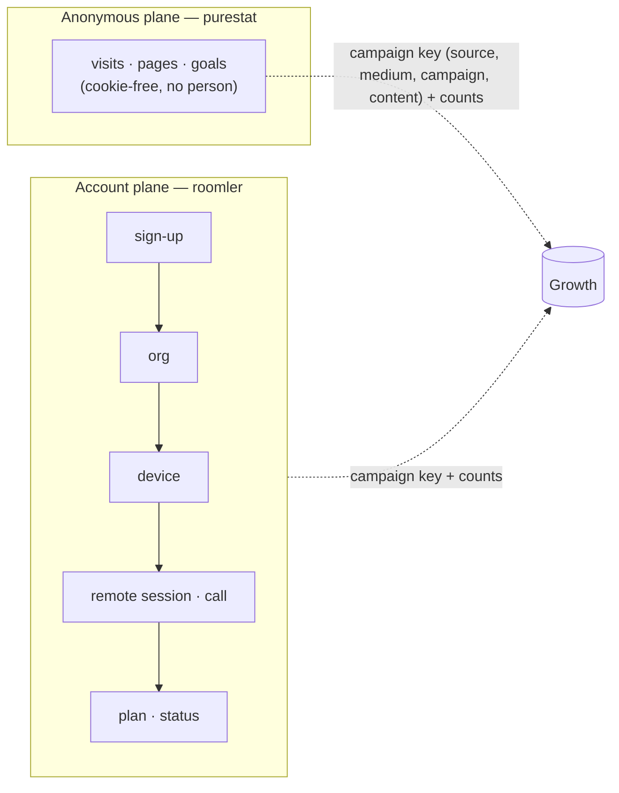

- A purestat visitor is never joined to an account, and an account never gets a visitor id.
  The two planes meet at the key and at counts — one row of a campaigns table is two queries
  keyed alike.
- **Measured, not measured, and zero are three cells.** A source that is down, unset or not
  built yet renders `not_measured` with a reason (and the phase that brings it), never `0`.
- **Every rate carries its n.** Below n = 30 the digest shows counts and hides the percentage.
- **Self-hosted never phones home.** The analytics loader runs only on the hosted hostnames
  (P1a, [public-site.md](public-site.md)); the digest ships **off** and, without a purestat
  key, reads the web sections as "not measured" rather than asking anyone.

## The taxonomy (P1b) — `crates/core/src/campaign.rs`

One table, applied at ingress (`attribution::sanitize`,
[`crates/core/src/attribution.rs`](../crates/core/src/attribution.rs)) to `source` and
`medium` of every sign-up, and used by every report to group:

| Key | Canonical values | Normalisation |
|---|---|---|
| `utm_source` | `youtube` `tiktok` `x` `linkedin` `facebook` `reddit` `hn` `devto` `hashnode` `medium` `github` `newsletter` `blog` · `instagram` (retired, kept for history) | trim → lowercase → aliases `twitter`→`x`, `fb`→`facebook`, `yt` / `youtub`→`youtube`, `li`→`linkedin`, `ig`→`instagram` |
| `utm_medium` | `video` `post` `carousel` `comment` `community` `bio` `article` `email` | trim → lowercase |
| `utm_campaign` / `utm_content` | the operator's slugs | kept as sent |

> ⚠️ **An unknown value is kept verbatim (lowercased) and only *reported* under `other`** —
> never dropped. A new channel must show up in the numbers before it has a name in the table,
> or the table would decide what can be measured. `utm_source=YouTub&utm_medium=Video` stores
> `youtube` / `video` (AC5); `Mastodon` stores `mastodon`.

Organic channels come from the referrer host through `channel_for_referrer_host`: **search**
(`google.*`, `bing.com`, `duckduckgo.com`, `ecosia.org`, `yandex.*`), **ai_assistant**
(`chatgpt.com`, `chat.openai.com`, `perplexity.ai`, `gemini.google.com`,
`copilot.microsoft.com`, `claude.ai`), **social** (`t.co`, `x.com`, `linkedin.com`, `lnkd.in`,
`facebook.com`, `youtube.com`, `tiktok.com`, `reddit.com`, …), **community**
(`news.ycombinator.com`, `lobste.rs`, `dev.to`, `hashnode.com`, `medium.com`), **code**
(`github.com`), **self** (`roomler.ai` — navigation, never a source), **direct** (no
referrer), **other**. Matched by suffix, so `l.facebook.com` and `www.google.co.uk` land where
they should and `googleusercontent.com` does not.

## The exclusion set (P1c) — `roomler_core::growth::ExclusionSet`

Internal orgs and people must not count. `ExclusionSet::load(core)` is the **one** function
every growth number applies; it folds two kinds:

| Kind | Who | Record |
|---|---|---|
| implicit | every platform admin (`ROOMLER__STATS__PLATFORM_ADMINS`), and every org owned by an excluded user — tombstoned orgs included | none: the allowlist and the ownership graph are the record |
| explicit | the rows a platform admin writes: `{kind: tenant\|user, id, reason, by, at}` | `growth_exclusions`, unique `(kind, id)` |

`GET /api/admin/growth/exclusions` answers both, each marked `implicit: true|false`;
`PUT` replaces the explicit list (24-hex ids, a required reason of at most 200 printable
characters, duplicates folded). `include_internal=true` on a growth view is
`ExclusionSet::none()` — the raw totals, with the set empty rather than the filter skipped,
so it is the same code path either way (AC4).

## The daily digest (P1d)

A host job ([`crates/api/src/growth/digest.rs`](../crates/api/src/growth/digest.rs)) reports
every closed UTC day: it computes the day, stores it, and mails it to the platform admins.

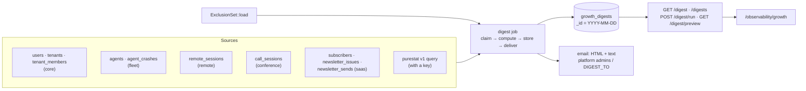

### Sections

Every count is a **figure** `{day, d7, d28}`: the day, and the trailing 7 and 28 days ending
on it, so a quiet day is read against a baseline. A section whose source is not mounted on
this server, not reachable, or not built yet is `{"not_measured": "<reason>",
"arrives_with": "Pn"}` and is never rendered as 0.

| Section | Reports | Source | Available |
|---|---|---|---|
| `headline` | sign-ups, orgs created, devices enrolled, active orgs (a value event: a remote session that reached Active and lasted ≥ 30 s, or a call with ≥ 2 participants), coverage (`{purestat_signup_goals, server_signups}`; a ratio only at n ≥ 30) | all of the below | P1d; coverage with a purestat key |
| `signups` | provider, campaign key, landing path, referrer host, self-reported — **never the address, username or name**; at most 20 rows, else aggregated by source | `users` | P1d |
| `orgs_devices` | orgs created; devices enrolled by OS (tombstones count); orgs that enrolled their **first** device; the day's devices by install method | `tenants`, `agents` | P1d; by install method P3 |
| `usage` | remote-desktop sessions started and session-minutes (each session's overlap with the window — a session spanning midnight counts only its part), calls and participant-minutes, active orgs, the top 10 orgs by remote-desktop minutes | `remote_sessions`, `call_sessions` | P1d |
| `website` | visitors, visits, pageviews; the day's visitors by organic channel; top 10 referrers and paths | purestat | with a key |
| `blog` | per post viewed that day: visitors, pageviews, reads, median read time (top 20); top sources | purestat | with a key |
| `campaigns` | per `(source, medium, campaign)`: visitors, pageviews, the four goals (`signup`, `subscribe`, `install-copy`, `github-outbound`), joined in code with the server's own sign-ups by the same normalised key | purestat + `users` | with a key |
| `newsletter` | new, confirmed and unsubscribed subscribers (and how many left through an issue's link), by source; each issue sent that day with its ledger counts, its delivery so far and its unsubscribes; the window's delivered, bounced, dropped, spam reports and suppressed addresses — [the newsletter](#the-newsletter-delivery-per-issue-tags-and-unsubscribes-p5) | `subscribers`, `newsletter_issues`, `newsletter_sends` | P1d; delivery P5 (`not_measured` without the webhook key) |
| `revenue` | orgs by plan × subscription status; the list-price MRR, **labelled `estimate: true`** (the same formula as the cost view, `routes/cost.rs::mrr_estimate_cents`) | `tenants`, `tenant_members` | P1d; billed P4 |
| `quality` | sessions ended by `end_reason`, classed hang-up · refusal · failure; agent crashes by version | `remote_sessions`, `agent_crashes` | P1d |
| `install` | tokens issued → redeemed; fetches by `(asset, client class, OS)`; enrollments by `(method, OS)`; wizard steps not measured until P3b — [the install trace](#the-install-trace-p3) | `enroll_token_issued`, `growth_daily`, `agents.install` | P3 |
| `social` | posts published per platform `{day, d7, d28}`; the snapshots taken that day (at most 20), each with its post's campaign and the platform's own metric names — `not_measured` when nothing was pushed in 28 days | `growth_posts`, `growth_post_snapshots` | P8 |
| `search` | — | — | P7 |

A module that is not mounted (`[modules] remote = false`, a reduced profile) makes its part
`not_measured: "<module> module not mounted"`; the rest of the digest still completes. The
same holds for purestat: a 401, a timeout or an unreachable host costs the web sections —
with the reason stored — and nothing else. The client
([`purestat.rs`](../crates/services/src/purestat.rs), in `roomler-ai-services` since P6 so
the `saas` puller shares it) has a 15-second timeout, pages `has_more` up to 1,000 rows (and
says when that bound cut an answer), and never logs the key.

### Once, with two pods

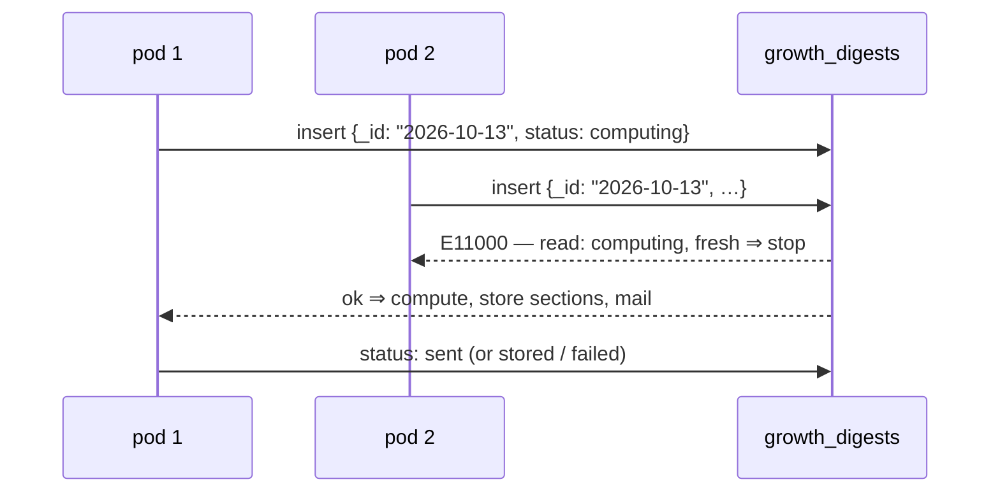

- The **unique `_id`** is the claim. A `failed` day, or a `computing` one whose claim is older
  than 30 minutes (a pod that died mid-run), is re-claimed with a compare-and-set on exactly
  the status and `claimed_at` the reader saw, so two re-claimers cannot both win. A `sent` day
  is **never sent again**.
- The scheduler ticks every 10 minutes; once the clock passes `today 00:00 +
  digest_hour_utc` it ensures **yesterday** exists. It never backfills older days — the run
  route does that on purpose.
- **Every run holds the day through the same claim**, the scheduler's and the admin's manual
  `POST …/digest/run?day=&send=` alike — that is what keeps them from colliding:

| `status` | Meaning | Scheduler | Manual `send=false` | Manual `send=true` |
|---|---|---|---|---|
| `computing` (fresh) | a run is in progress on some pod | leaves it | **409** | **409** |
| `computing` (stale, > 30 min) | a pod died mid-run | re-claims | re-claims | re-claims |
| `failed` | the compute or every send failed (`error`) | re-claims | re-claims | re-claims |
| `preview` | a manual `send=false` result — **not final** | re-claims (so a look at a day never cancels its email) | re-claims | re-claims |
| `stored` | a delivering run found nobody to mail (no recipients, or no mail service) | done | refreshed **in place**, stays `stored` | re-claims (it was never mailed) |
| `sent` | mailed to at least one recipient — **final** | done | refreshed in place, stays `sent` | refreshed in place, **never re-sent** |

  A claimed manual `send=false` run ends `preview`; a claimed `send=true` run delivers and
  ends `sent` / `failed` / `stored` exactly as the scheduler's would. An in-place refresh
  rewrites the sections and never touches the status, so a manual run cannot turn a mailed
  day back into one the scheduler would mail again.
  `GET …/digest/preview?day=&include_internal=` computes live, stores nothing, mails nothing.

### Delivery and what the digest never carries

- Recipients: `ROOMLER__GROWTH__DIGEST_TO` when set, else the platform admins'
  `users.email` — proven addresses only (`.invalid` placeholders skipped). The stored row
  keeps a **count** of recipients, never the addresses. Subject:
  `Roomler daily digest — YYYY-MM-DD`; the HTML and plain-text bodies are rendered from the
  stored sections ([`render.rs`](../crates/api/src/growth/render.rs)), every string escaped,
  with a footer stating how many users and orgs were excluded and that the digest carries no
  personal addresses.
- The digest names **orgs** (as `/observability` does) and never a person's address, name or
  IP; the integration tests assert no seeded address survives into the stored JSON or either
  body. Dates in the JSON are RFC 3339 strings, never a `{"$date": …}` object.

### Settings

| Setting | Env | Default | Effect |
|---|---|---|---|
| `growth.enabled` | `ROOMLER__GROWTH__ENABLED` | `true` | the `/api/admin/growth/*` routes; `false` answers 404 on all of them |
| `growth.digest_enabled` | `ROOMLER__GROWTH__DIGEST_ENABLED` | **`false`** | the scheduler; a self-hosted server never starts mailing its admins a report they did not ask for |
| `growth.digest_hour_utc` | `ROOMLER__GROWTH__DIGEST_HOUR_UTC` | `6` | the UTC hour after which yesterday's digest is due (purestat closes a session 30 min after its last event) |
| `growth.digest_to` | `ROOMLER__GROWTH__DIGEST_TO` | empty | comma-separated recipients; empty ⇒ the platform admins |
| `growth.purestat_url` | `ROOMLER__GROWTH__PURESTAT_URL` | `https://purestat.ai` | the v1 query endpoint's base |
| `growth.purestat_api_key` | `ROOMLER__GROWTH__PURESTAT_API_KEY` | empty | a site-scoped key (`X-API-Key`); empty ⇒ website, blog, campaigns and coverage read "not measured", the Campaigns table's web cells too, and the `saas` puller (P6) pulls nothing and says so once at boot |
| `growth.install_counters` | `ROOMLER__GROWTH__INSTALL_COUNTERS` | `true` | the install trace's fetch counters (P3); `false` writes none. The token ledger and the enroll's `install` have no switch — they are ids on rows that exist anyway |

The hosted deployment turns the digest on with `ROOMLER__GROWTH__DIGEST_ENABLED=true` (and a
key once one is minted for `roomler.ai`); a mail backend must be configured
(`ROOMLER__EMAIL__*`) or every day ends `stored`.

### Routes and the Digest view

| Method | Path | Purpose |
|---|---|---|
| GET/PUT | `/api/admin/growth/exclusions` | the exclusion set (P1c) |
| GET | `/api/admin/growth/digest?day=` | a stored day; the latest when omitted |
| GET | `/api/admin/growth/digests?since=&limit=` | the list: day, status, times, headline |
| POST | `/api/admin/growth/digest/run?day=&send=false` | recompute a closed day through the claim; mail only when asked and not already sent; 409 while a run of that day is in progress |
| GET | `/api/admin/growth/digest/preview?day=&include_internal=` | compute live, store nothing |

All platform-admin only (`ROOMLER__STATS__PLATFORM_ADMINS`), **404** otherwise — the same
gate as `/admin/stats`. The SPA's `/observability/growth` (the Digest view) picks a day,
lists recent digests, recomputes without sending, and shows every section as cards; a
`not_measured` cell is a muted chip, never a 0, and every string is rendered as text.

## The account funnel (P2)

The funnel runs across days, not within a visit (that is purestat's, PS4): sign-up →
org created → activated → first value → paid. **Acquisition belongs to the user**
(the owner's `signup_attribution`, normalised through the taxonomy), **value belongs to
the org**. Each step is a subset of the one before, and every windowed step carries
`pending` and `settled`, FR-88's semantics: a sign-up whose window is still open and has
no event yet is **pending**, not a failure, and `settled = signups − pending` is the only
denominator a rate may use.

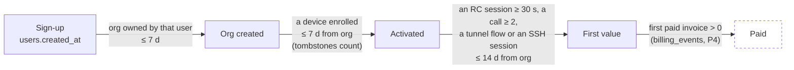

- **First value is one definition, in `crates/api/src/growth/value.rs`** — a remote-desktop
  session that reached Active and lasted ≥ 30 s (`remote`), a call with ≥ 2 participants
  (`conference`), a tunnel flow (`network`), or an SSH session (`network`). The digest's
  "active orgs", the nightly fold, the funnel, the cohorts and the north star all read it,
  so no two can disagree. An `exec` run is recorded on the org-day but is **not** value —
  it is an operator's diagnostic, not the product working for a user.
- **A step whose module is unmounted answers `null`, with the module named** (spec principle
  4). Without `fleet` the server cannot see devices, so `activated` — and, sequentially,
  `first_value` — are `null`; without a value module, `first_value` is. Never `0`.
- **Time to value**: median and p75, each with its `n`, for sign-up → first device and
  sign-up → first value.
- **North star (D2): weekly active orgs (WAO)** — the orgs with a value event in the ISO
  week, internal excluded.

### `growth_org_daily` and its nightly job

One row per org per UTC day with any activity, `_id = "{tenant}:{yyyy-mm-dd}"`, written whole
by a singleton nightly host job (`crates/api/src/growth/org_daily.rs`). It exists because
four of its sources (`tunnel_audit`, `ssh_audit`, `exec_audit`, `ws_sessions`) expire at 90
days while retention needs a year: the row **outlives the audit rows it was folded from**, so
a cohort chart longer than 90 days still sees tunnel and SSH use.

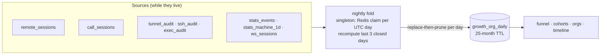

- **Singleton per UTC day** through the DB-name-scoped Redis `NX` claim the stats rollup
  uses; without Redis a pod runs it locally, once a day.
- **The last 3 closed days are recomputed every run** (a session open at midnight, a late
  audit row); **today is never written** — an open day would read as a quiet one. The fold is
  a derivation of durable rows, so recomputing it is idempotent.
- **Replace-then-prune per day**: each row is upserted on its `_id`, then the day's rows of
  orgs that no longer have activity are deleted, so a reader never meets an empty day.
- **The exclusion set is applied at read time, never in the fold** — every org's row is
  written, and every view filters — which is what makes `include_internal=true` the same
  code path as the default.
- **Bounded backfill.** `POST …/org-daily/backfill?since=&until=` fills a closed range in
  31-day chunks, never before `today − 25 months` and never today; the first run on an empty
  collection fills the sources' 730-day horizon once. Nothing here is unbounded.
- Fields: `rc_sessions`, `rc_session_minutes`, `rc_controllers`, `calls`,
  `call_participant_minutes`, `tunnel_flows`, `ssh_sessions`, `exec_runs`, `devices_online`,
  `members_active`, `value` (bool) and `value_kinds`. `roomler_core::growth::purge_tenant` is
  the one call an org deletion must make to take these rows (and the `growth_daily` rows whose
  `dims` carry the tenant) with it — aggregates may outlive rows, rows never outlive their
  owner. ⚠️ There is **no org hard-delete path today** (orgs are only archived, and reversibly),
  so nothing calls it yet and the **25-month TTL** is what bounds the collection for now;
  `purge_tenant` is the seam a deletion path will call when one lands, and it is deliberately
  kept out of the archive cascade (an archived org keeps everything it knows for `unarchive`).

### Cohorts and the org views

- **Cohorts** (`GET …/cohorts?unit=week`): orgs by creation ISO week × weeks since (W0..W12),
  active = ≥ 1 value event in that week, W1/W4/W12 highlighted. A cell past the current week
  is `null`; `closed_through` says how many weeks have fully closed, so the open cells read
  as provisional.
- **Orgs** (`GET …/orgs`): per org — created, the owner's channel and campaign key (never the
  address), devices (live/enrolled, tombstones counted), the last value day, the active weeks
  of the last 12, plan and billing status, and an `at_risk` flag: active in ≥ 3 of the 4 weeks
  before the last 2, and none in those last 2 — an org that had a habit and lost it.
- **Timeline** (`GET …/org/{tenant_id}/timeline`): one org's milestones — the owner's sign-up
  (attribution, never the address), org created, members as they joined, the first device
  (+ OS), the first value event and its kinds, a weekly activity strip, and the plan/invoice
  history as far as data allows (`not_measured` until P4).

### P2 routes

| Method | Path | Purpose |
|---|---|---|
| GET | `/api/admin/growth/funnel?since&until&by&include_internal` | the funnel, time to value, and a per-dimension breakdown (`by` = `source` · `medium` · `campaign` · `content` · `channel` · `self_reported` · `landing_path`) |
| GET | `/api/admin/growth/cohorts?unit=week&since` | weekly cohorts W0..W12, and the WAO series |
| GET | `/api/admin/growth/orgs?limit&include_internal` | the per-org table |
| GET | `/api/admin/growth/org/{tenant_id}/timeline` | one org's milestones |
| POST | `/api/admin/growth/org-daily/backfill?since&until` | recompute a closed range of `growth_org_daily` |

All platform-admin only, **404** otherwise and when `growth.enabled = false` — the same gate
as the digest. The SPA's `/observability/growth` gains **Overview** (WAO trend, the funnel
with counts — a percentage only at n ≥ 30 —, time to value, coverage from the digest's
headline), **Orgs** (the table, with the timeline in a drawer) and **Cohorts** (the heatmap),
beside the existing **Digest** tab. Every attacker-chosen string (UTM values, org names) is
rendered as text, never `v-html`.

## The install trace (P3)

How a device gets from a minted token to a first session — each step recorded where it
already had to happen, joined by ids and counts, never by a person. The fleet module owns
every write (`crates/modules/fleet/src/install_trace.rs`, `agent.rs`); the digest reads.

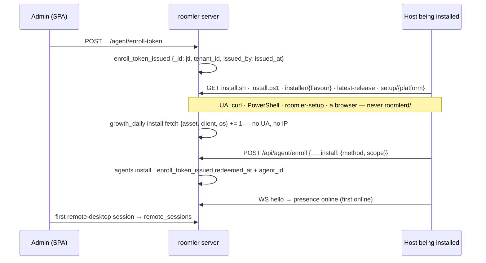

| Step | Record | Written by | Kept |
|---|---|---|---|
| token minted | `enroll_token_issued {_id: jti, tenant_id, issued_by, issued_at, kind: standard, redeemed_at: null, agent_id: null}` — the jti, **never the token** | `POST …/agent/enroll-token` (`agent.rs::issue_enrollment_token`), best-effort | 90 d |
| fetch | `growth_daily {source: install, metric: fetch, dims: {asset, client, os}, day, value}` | the installer proxy, `/api/agent/latest-release`, `/api/setup/latest-release`, `/api/setup/install.sh`, `/api/setup/install.ps1`, `/api/setup/{platform}` (`install_trace::count_fetch`, spawned, best-effort) | indefinitely |
| enroll | `agents.install {method, scope, run?}`; `enroll_token_issued.redeemed_at`, `.agent_id` (an upsert from the token's claims, so a token minted before the ledger is on record too) | `POST /api/agent/enroll` | with the row; 90 d |
| first online · first session | already there: `stats_events` (presence), `remote_sessions` | — | — |

### Fetches by client class

The class comes from the **User-Agent and nothing else about the request**
(`install_trace::classify_user_agent`, a pure function with the real UAs as its tests):

| Class | User-Agent | Who |
|---|---|---|
| `wizard` | `roomler-setup/<ver>` | the wizard resolving and downloading its MSI |
| `script-sh` | `curl/…`, `Wget/…` | `install.sh`, or a person at a terminal |
| `script-ps1` | anything carrying `PowerShell` — Windows PowerShell 5.1 and pwsh 7 both send `Mozilla/5.0 (…) …PowerShell/…`, so this is decided **before** the browser rule | `install.ps1`, `irm … | iex`, or a person at a prompt |
| `browser` | any other `Mozilla/…` | a person on the site (the wizard download button) |
| `other` | everything else, a missing header included | — |

The `os` dimension is what the asset itself implies (an MSI, `install.ps1` and the Windows wizard
archive are `windows`; the macOS and Linux archives name theirs), else the UA's hint; a `curl`
fetch of `install.sh` is honestly `unknown`.

> ⚠️ **The updater is never counted.** `roomlerd/<ver>` is the daemon's own update check, and by
> default it asks `roomler.ai` from self-hosted devices as well
> (`agents/roomlerd/src/updater.rs`, `DEFAULT_PROXY_URL`). Counting it would be exactly the
> self-host telemetry the product promises not to collect (`LICENSING.md`,
> [business-model.md](business-model.md) §6). The rule covers every product token of ours that
> is not the wizard — `roomlerd/`, `roomlerd-*/`, `roomler-cli/`, `roomler-token-renewal/`, the
> updater's pre-rename spelling, whatever a later release adds — decided by the common prefix,
> as `UaClass::Updater`, whose counted value is `None`: a fetch with it writes nothing. Locked
> by a test per known spelling, plus one for an identity that does not exist yet.

- **Never a User-Agent, never an IP.** A row is three enum-like dimensions and a count; the
  integration test scans every row for the UAs it sent and the loopback address.
- The write is **spawned and best-effort**: an install script is served at wire speed whatever
  the database is doing. `ROOMLER__GROWTH__INSTALL_COUNTERS=false` switches the counters off.
- A fetch is a **lower bound on intent, not an install**: a self-hoster who downloads our build
  to enroll elsewhere fetches like anyone else, and only requests that reach this server count.

### The enroll says how

`POST /api/agent/enroll` gained `install: {method, scope, run?}` — additive, `#[serde(default)]`,
clamped server-side (`InstallInfo::clamped`: an unknown `method` is `other`, an unknown `scope`
`unknown`, a `run` that is not a short opaque token dropped) and **never a refusal**. The
vocabulary lives in `crates/remote_control/src/models.rs` (`InstallMethod`, `InstallScope`),
shared by both ends and locked by a test:

| Who enrolls | `method` | `scope` |
|---|---|---|
| the wizard, in-process | `wizard` | its role: `daemon-system` → `system`, `daemon-user` → `per-user`, `daemon-machine` → `attended` (a service without SystemContext, usable only beside a signed-in session) |
| `install.sh` | `script-sh` | `system` with `--system` and for the macOS root half; `per-user` otherwise |
| `install.ps1` | `script-ps1` | as the wizard's roles |
| `roomlerd enroll` by hand | `manual`, or `--install-method` / `ROOMLER_INSTALL_METHOD` | `unknown`, or `--install-scope` / `ROOMLER_INSTALL_SCOPE` |
| the companion's enroll form | `manual` | `unknown` |
| the k8s e2e agent image | `container` (its StatefulSet sets the env) | `system` |
| `roomlerd re-enroll`, a pushed org join, the companion's token refresh | nothing is sent; the row **keeps** what it has | |
| an agent from before P3 | recorded as `unknown` on a new row; a known row keeps its record | `unknown` |

Compatibility, both directions, is what the shape is built around:

- **A new agent against an old server**: the agent omits `install` when it has nothing to say,
  and the server's `EnrollRequest` carries no `deny_unknown_fields` (a comment there says it
  never may), so a pre-P3 server ignores the field. The agent-side test asserts the body without
  `install` is byte-for-byte the pre-P3 five-field shape.
- **An old agent against the new server**: no field ⇒ `install: {method: unknown}` on a new row,
  no change on a re-enrolled one. The device row's `install` is `None` only on rows created
  before P3; the digest reads both as `unknown`.
- ⚠️ **The served scripts set the environment, never the flag.** A script installs whatever
  release is current, and a daemon from before `--install-method` existed refuses an argument it
  does not know — which would have failed every scripted install until the next agent release.
  `ROOMLER_INSTALL_METHOD` / `ROOMLER_INSTALL_SCOPE` are the flag's fallbacks
  (`roomler_node_core::enrollment::resolve_install`: flag, then env, then `manual` / `unknown`);
  an older daemon ignores them. `install.sh` passes them through `env` so they survive `sudo`;
  `install.ps1` removes them after the enroll, since an `irm | iex` run shares the caller's
  process.
- ⚠️ **A spelling the daemon does not know is refused from the FLAG and clamped from the ENV.**
  A flag is the operator's own command line, so a typo is refused before the single-use token
  is spent. The variables come from the scripts, which are compiled into the *server*
  (`include_str!`) and roll with a promote, while the daemon they install comes from the agent
  release channel — a script can know a spelling before the daemon does, and refusing it would
  fail every scripted enrollment until the next agent release. So an unknown env value enrolls
  as `other` / `unknown` with a warning, the same clamp the server applies.

The row is shown on the device (`GET …/agent/{id}` → `install`), which is what a field check
reads (AC9).

### In the digest

`install` is a section of its own: `tokens {issued, redeemed}` (tokens issued in the window,
and how many of those an enroll spent; a redeemed share only at n ≥ 30), `fetches
[{asset, client, os, fetches}]`, `enrollments_by_method [{method, os, enrolled}]`, and
`wizard_steps` not measured until P3b. `orgs_devices.by_install_method` lists the day's devices
by method. Exclusions apply to tokens by the token's tenant and to enrollments by the device's
tenant; the fetch rows carry no tenant and cannot be filtered. All of it is "not mounted"
without the `fleet` module, never 0.

## The web plane: the purestat puller and the Campaigns table (P6)

purestat is the anonymous plane — visits, pages, goals, no person. P6 reads it in two ways,
for two different questions, and never answers one with the other:

| Question | Read | Why that way |
|---|---|---|
| What did campaign X bring between two dates? | **live** — one purestat query for the exact range, by the Campaigns table | unique visitors do not add across days: a sum of daily rows counts a returning visitor once per day |
| What did the web plane hold on day D, long after purestat's 2-year TTL? | **frozen** — the `saas` puller's `growth_daily` rows (`source: purestat`) | a frozen day is what history says; it is never rewritten |

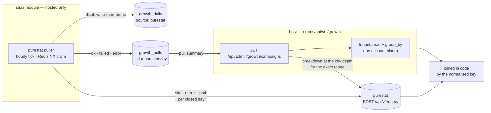

### The key both planes meet on

`roomler_core::campaign::CampaignKey` ([`campaign.rs:228`](../crates/core/src/campaign.rs))
is `(source, medium, campaign, content)`, and `CampaignKey::normalized`
([`campaign.rs:242`](../crates/core/src/campaign.rs)) is the ONE spelling: each value cleaned
exactly as a sign-up's is at ingress (`attribution::clean_value` — trimmed, printable ASCII
only, clamped to 64), then source and medium through the taxonomy and campaign and content
lowercased. A purestat row (`utm_source=YouTub&utm_campaign=20261019-Slug`) and a sign-up
stored by `attribution::sanitize` from the same link meet on one key — a unit test asserts it.
A row with no source is organic traffic, not a key.

`KeyDepth` ([`campaign.rs:164`](../crates/core/src/campaign.rs)) is how deep a breakdown
goes: `source` → `medium` → `campaign` → `content`, each one UTM dimension more.

### The puller — `saas`, hosted-only

[`crates/modules/saas/src/purestat_pull.rs`](../crates/modules/saas/src/purestat_pull.rs),
spawned from the module's `init` ([`lib.rs:96`](../crates/modules/saas/src/lib.rs)). No
self-host profile compiles `saas`, and without `ROOMLER__GROWTH__PURESTAT_API_KEY` (or with
`growth.enabled = false`) it starts nothing and logs that once.

| Rule | Value | Where |
|---|---|---|
| **The horizon** | the last 7 closed UTC days; today is never pulled | `FREEZE_DAYS` ([`purestat_pull.rs:76`](../crates/modules/saas/src/purestat_pull.rs)) |
| **Frozen** | a day older than the horizon is never pulled again and never rewritten — pulled or not | `due_days` ([`purestat_pull.rs:123`](../crates/modules/saas/src/purestat_pull.rs)) |
| **A cycle** | starts at 01:00 UTC (purestat closes a visit 30 min after its last event); every day of the horizon is re-pulled once per cycle, which is what catches a late event | `CYCLE_HOUR_UTC` |
| **A failure** | the day stays due, so the next hourly tick retries; after a fatal error (no key, 401, timeout, unreachable) the run stops asking and records the same reason for every day it owed | `run_once` ([`purestat_pull.rs:309`](../crates/modules/saas/src/purestat_pull.rs)) |
| **Once across pods** | a DB-name-scoped Redis `NX` claim per tick (`roomler:growth-purestat-pull:<db>`), as the stats rollup and the reapers; without Redis the pod runs locally | `spawn_puller` ([`purestat_pull.rs:370`](../crates/modules/saas/src/purestat_pull.rs)) |
| **Idempotent** | each row is `$set` on its own `_id` — a day pulled twice holds one copy; an unchanged row is not written; a row of the pulled metrics the pull no longer carries is deleted (write-then-prune, never an empty day) | `GrowthDao::replace_daily` ([`growth.rs:425`](../crates/services/src/dao/growth.rs)) |

A day is three purestat queries ([`pull_day`](../crates/modules/saas/src/purestat_pull.rs)),
each row's `dims.by` naming its breakdown:

| `dims.by` | other dims | metrics (`growth_daily.metric`) |
|---|---|---|
| `site` | — | `visitors` `visits` `pageviews` `reads` `goal.signup` `goal.subscribe` `goal.install-copy` `goal.github-outbound` |
| `campaign` | the normalised key: `source`, and `medium` / `campaign` / `content` when present | the same |
| `path` | `path` (trimmed, control characters dropped, ≤ 200 characters, must start with `/`) | `visitors` `pageviews` `reads` |

- **Spellings fold.** Raw rows that normalise to one key are **summed** (`YouTub` and
  `youtube`) — an upper bound on unique visitors, since a visitor who arrived by both
  spellings counts twice. purestat's own number for the key is the live table's. Since
  purestat v0.1.9 its v1 query answers `utm_source` / `utm_medium` already normalised (and
  counts their spellings as one, uniquely); our normalisation is a fixed point on its output,
  so both sides stay right against either version, and a fold is now mostly a campaign or
  content written in two cases.
- **A zero is not stored.** On a day whose `growth_pulls` row is `ok`, a missing row IS a
  measured zero; on a day with no pull row, or a `failed` one, it is "not pulled" (principle 4).
- **A goal the site does not define** costs the conversions, not the day: the breakdowns are
  retried without goals, `growth_pulls.missing_goal` names it, and the goal rows an earlier
  pull stored are left as they were.
- `reads` (pageviews visible ≥ 30 s) is the engagement purestat's v1 contract carries; it has
  **no engaged-visitor metric**, so the spec's "engaged visitors" are `reads` here.
- The `_id` is escaped ([`daily_id`, growth.rs:103](../crates/services/src/dao/growth.rs)):
  `%` `,` `=` `:` inside a value are percent-encoded, so a crafted UTM value cannot forge
  another row's id. P3's ids, which contain none of them, are unchanged.

**`growth_pulls`** — one row per `(source, day)` attempted, `_id = "purestat:YYYY-MM-DD"`
([`GrowthPull`, growth.rs:177](../crates/services/src/dao/growth.rs)):

| Field | Meaning |
|---|---|
| `status` | `ok` once a pull of the day succeeded — its rows ARE the day's rows; `failed` while none has. A later failed attempt **never** turns an `ok` day `failed` (one pipeline update decides it from the stored row) |
| `pulled_at` · `attempted_at` · `attempts` | the last success, the newest attempt, how many |
| `rows` | the `growth_daily` rows the last good pull left |
| `error` | what the newest attempt met (`purestat unreachable: unauthorized (401)`), never a credential; `null` when it succeeded |
| `missing_goal` · `truncated` | a goal the site did not define; a breakdown cut at the client's 1,000-row bound |

### The Campaigns table

`GET /api/admin/growth/campaigns?since&until&by&include_internal`
([`campaigns.rs:586`](../crates/api/src/growth/campaigns.rs)) — platform admins only, **404**
otherwise and when `growth.enabled = false`, like every growth route.

| Parameter | Values | Default |
|---|---|---|
| `since`, `until` | UTC days `YYYY-MM-DD`, **both inclusive**; `until` never after today; at most 366 days (purestat's own bound) | the 28 closed days ending yesterday |
| `by` | `source` · `medium` · `campaign` · `content` — the key depth | `campaign` |
| `include_internal` | `true` = the raw totals, exclusion set empty | `false` |

- **The web plane is live.** One purestat breakdown by exactly the depth's UTM dimensions
  over exactly the range, plus one totals query with no dimension — so a row's `visitors` is
  purestat's own number for that key and range (AC16), unless `spellings > 1` says several raw
  spellings were summed into it (from purestat v0.1.9 on, only a campaign or content written
  in two cases can still do that: source and medium arrive normalised).
- **The account plane is P2's** — `funnel::read` and `funnel::group_by`
  ([`funnel.rs:409`](../crates/api/src/growth/funnel.rs)), the same `outcome` the funnel
  tallies with, grouped by `CampaignKey::normalized` of the owner's `signup_attribution`; the
  exclusion set applies. A unit test asserts a grouping agrees with the funnel's own
  breakdown.
- **Joined in code by the key** ([`join`, campaigns.rs:391](../crates/api/src/growth/campaigns.rs)):
  a key on one plane only is still a row — a **measured zero** on the other when that plane
  answered. Sorted by visitors, then sign-ups; at most 500 rows (`rows_truncated` says so).

| Cell | What | Not measured when |
|---|---|---|
| `web.visitors` `visits` `pageviews` `reads` | purestat over the range | no key, 401, timeout, unreachable — **every** web cell then carries the reason, never 0 (`web_not_measured` at the top) |
| `web.goals` | `signup` `subscribe` `install_copy` `github_outbound`, as unique visitors | a goal the site does not define (`conversions` names it) |
| `web.spellings` | raw purestat rows folded into the key; 0 for a key purestat saw no visit of | — |
| `signups` · `org_created` · `activated` · `first_value` | the funnel's steps with `pending` / `settled` | `activated` / `first_value` are `null` without `fleet` (or a value module), and `not_measured` names it |
| `paid` | — | always, until P4 (`arrives_with: "P4"`) |
| `reach` | — | always, until P8 (`arrives_with: "P8"`) |
| `coverage` | purestat `signup` goals ÷ the server's sign-ups for the key; `ratio` only at n ≥ 30 | the web plane or the goal is not measured |
| `rates` | `signup_per_visitor` (n = visitors), `activation`, `first_value` (n = settled), each `{n, value}` with `value` only at n ≥ 30 | the side it rests on is not measured (`null`) |

`totals` carries the range's unique visitors (all traffic, keyed or not), the sign-ups and
those with a key, and the overall coverage. `pulls` summarises `growth_pulls` over the range —
`days`, `pulled`, `failed`, `not_pulled`, the newest error — and says `saas module not
mounted (the puller runs there)` when it is; the live table does not read the frozen rows,
but its reader can see whether they exist.

The SPA's `/observability/growth` gains a **Campaigns** tab
([`GrowthCampaigns.vue`](../ui/src/components/growth/GrowthCampaigns.vue)): the range, the
depth, include-internal, the totals, the pull state, and the table — a `not_measured` cell is
a muted chip with its reason on hover, a rate appears only with its n ≥ 30, and every UTM
value is rendered as text, never `v-html`.

## Social reach: the ingest routes and the Channels table (P8)

What a post on YouTube, X, LinkedIn, Facebook or TikTok produced beyond its own likes. The
private promotion pipeline already records each platform's numbers; it **pushes** them here
(D11 — the collector runs where its credentials live and needs nothing to be reachable), and
the Channels table puts them beside what the post's campaign key brought.

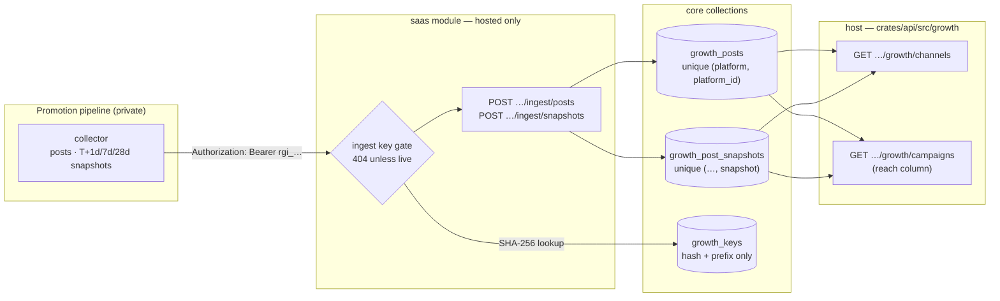

### The ingest key (D12)

A platform admin mints it on `/observability/growth` → **Channels** → *Ingest keys*, or with
`POST /api/admin/growth/keys` `{"kind": "ingest", "label": "…"}`
([`keys.rs:140`](../crates/api/src/growth/keys.rs)). The answer carries the key **once**:
`rgi_` and 32 random characters of nanoid's URL-safe alphabet (192 bits). The server stores
only `hex(SHA-256(key))` and a display prefix (`rgi_AbCd1234`) in `growth_keys`
([`growth_key.rs:97`](../crates/services/src/dao/growth_key.rs)); the list
(`GET /api/admin/growth/keys`) shows the prefix, the label, who minted it, when it was last
used and whether it is revoked — never the key or its hash. `DELETE …/keys/{key_id}` revokes
(a timestamp, so the row stays as the record); at most 10 live keys of a kind.

An ingest key opens the two ingest routes and **nothing else** — not a growth view, not any
other route. ⚠️ Every way of not holding a live one is the same **empty 404** a path that does
not exist answers ([`require_ingest_key`, growth_ingest.rs:467](../crates/modules/saas/src/growth_ingest.rs)),
decided in a gate that runs before the body is read and before the method is matched: no
`Authorization` header, a malformed key, an unknown one, a revoked one, a user's JWT,
`growth.enabled = false`, and a server without the `saas` module. Never 401 or 403 (AC18). A
database error during the lookup is a 503, so a Mongo blip never tells the pipeline its key
was revoked.

### The API, for the pipeline

| Route | Body | Idempotent on | Answers |
|---|---|---|---|
| `POST /api/admin/growth/ingest/posts` | `platform`, `platform_id`, `account`, `format`, `url`, `published_at`, `utm_source`, `utm_medium`?, `utm_campaign`, `utm_content`?, `cost_cents`? | `(platform, platform_id)` — a re-push replaces the mutable fields | `201 {"status": "created"}` · `200 "updated"` · `200 "unchanged"` |
| `POST /api/admin/growth/ingest/snapshots` | `platform`, `platform_id`, `snapshot` (`T+1d` · `T+7d` · `T+28d`), `taken_at`, `metrics` `{raw name: number}` | `(platform, platform_id, snapshot)` — **written once**: the first push's numbers stay | `201 "created"` · `200 "duplicate"` (nothing changed) |

```bash
KEY=rgi_XXXXXXXXXXXXXXXXXXXXXXXXXXXXXXXX   # from the mint answer; obviously fake here

curl -sS -X POST https://roomler.ai/api/admin/growth/ingest/posts \
  -H "Authorization: Bearer $KEY" -H 'Content-Type: application/json' \
  -d '{"platform": "linkedin", "platform_id": "urn:li:share:7123456789",
       "account": "roomler-ai", "format": "post",
       "url": "https://www.linkedin.com/feed/update/urn:li:share:7123456789/",
       "published_at": "2026-10-19T09:00:00Z",
       "utm_source": "linkedin", "utm_medium": "post",
       "utm_campaign": "20261019-ssh-without-port-forwar", "cost_cents": 0}'
# {"status":"created","platform":"linkedin","platform_id":"urn:li:share:7123456789"}

curl -sS -X POST https://roomler.ai/api/admin/growth/ingest/snapshots \
  -H "Authorization: Bearer $KEY" -H 'Content-Type: application/json' \
  -d '{"platform": "linkedin", "platform_id": "urn:li:share:7123456789",
       "snapshot": "T+7d", "taken_at": "2026-10-26T09:05:00Z",
       "metrics": {"impressionCount": 3120, "clickCount": 81, "likeCount": 44}}'
# {"status":"created","platform":"linkedin","platform_id":"urn:li:share:7123456789","snapshot":"T+7d"}
```

**Push the post before its snapshots** — a snapshot for a post never pushed is refused
(`unknown_post`). The routes sit inside the per-IP governor (1 request a second, bursts of
60), which a daily push is far below.

| Field | Rule ([`validate_post` / `validate_snapshot`](../crates/modules/saas/src/growth_ingest.rs)) |
|---|---|
| `platform` | `youtube` · `x` · `linkedin` · `facebook` · `tiktok`, and `instagram` (retired, kept for history) — through the taxonomy's aliases (`Twitter` → `x`, `yt` → `youtube`); anything else is `unknown_platform` |
| `platform_id` | 1–128 of `[A-Za-z0-9:_.-]` (a LinkedIn URN, a video id, a status id) |
| `account` | 1–64 of `[A-Za-z0-9_.@-]` — our own handle, never a person's |
| `format` | 1–32 of `[a-z0-9-]` (lowercased): `video`, `post`, `short`, … |
| `url` | `http(s)://` with a host, at most 512 characters, no whitespace |
| `published_at`, `taken_at` | RFC 3339; not before 2020, not more than a day (`taken_at`: an hour) ahead |
| `utm_*` | the post's link; `utm_source` and `utm_campaign` required; normalised by `CampaignKey::normalized` — the cleaning a sign-up's attribution gets at ingress — so the post meets its visits and sign-ups on one spelling |
| `cost_cents` | optional whole number 0–10,000,000 in the account's currency (an X post with a link is billed per post) |
| `metrics` | 1–50 entries; names 1–64 of `[A-Za-z0-9_.:-]`, **kept verbatim** (a metric is only comparable to itself); values finite numbers, \|v\| ≤ 10¹⁵ |
| anything else | refused — the shape is closed |

Refusals are `422 {"error": "<code>", "message": "…"}` and store nothing:

| `error` | When |
|---|---|
| `post_text_refused` | **any** field whose name looks like copy — `caption`, `text`, `title`, `body`, `description`, `message`, `content`, `postText`, `alt_text`, `hashtags`, … ([`TEXT_WORDS`, growth_ingest.rs:90](../crates/modules/saas/src/growth_ingest.rs)) — whatever its value, even `null`. The ingest stores ids, URLs, numbers and the key, **never content** (AC18) |
| `unknown_platform` | a platform outside the list (AC18) |
| `unknown_field` · `missing_field` · `invalid_field` | the closed shape |
| `invalid_platform_id` · `invalid_account` · `invalid_format` · `invalid_url` · `invalid_published_at` · `invalid_taken_at` · `invalid_key` · `invalid_cost` | a field outside its rule |
| `unknown_snapshot` · `invalid_metrics` · `metric_not_numeric` | a snapshot outside its rule |
| `unknown_post` | a snapshot before its post |

A body that is not JSON is `400 invalid_json`; one over 16 KiB is `413`. Each push is logged at
`info` with the key's display prefix, never the key.

### The Channels table

`GET /api/admin/growth/channels?since&until&include_internal`
([`channels.rs:583`](../crates/api/src/growth/channels.rs)) — platform admins only, 404
otherwise and when `growth.enabled = false`. The range is UTC days, both inclusive (the
Campaigns table's rules); a post is in it when it was **published** in it.

| Level | Cells |
|---|---|
| **platform** (every one of the five; `instagram` only when it has data) | `posts`; **reach per snapshot age** — each age's raw metrics summed over the posts that have that snapshot, with their count, so a three-day-old post is never added to a month-old one ([`reach_at`, channels.rs:257](../crates/api/src/growth/channels.rs)); visitors and sign-ups → activated → first value summed over the posts' **distinct** keys (an upper bound on unique visitors); `paid` (P4); spend |
| **post** | its account, format, URL, publish time, key; every snapshot, and the oldest as `reach`; visitors (purestat, live, at the post's own depth — `content` when its link carried one, else `campaign`), sign-ups → activated → first value by the key; spend |
| **spend** | `cost_cents` summed over the posts that declared one; `per_visitor` and `per_signup` as `{n, cents}` over those posts' visitors and sign-ups, `cents` only from n = 30 ([`cost_rate`, channels.rs:321](../crates/api/src/growth/channels.rs)) |

Three cells, as everywhere: a platform with no post pushed in the range is
`{"not_measured": "no posts pushed for this platform in the range"}` (and says when the ingest
routes are not mounted on the server at all); a post without a snapshot has reach
`not_measured: "no snapshot pushed yet"`; a purestat outage makes the web cells — and the cost
per visitor — `not_measured`, while the reach and the account plane stand.

The **Campaigns table's `reach` column** reads the same posts: per key at its depth, per
platform, the posts with that key and their snapshots summed per age
([`reach_by_key`, channels.rs:286](../crates/api/src/growth/channels.rs)); a key no post was
pushed with is `not_measured`.

| Collection | Shape | Kept |
|---|---|---|
| `growth_keys` | `{kind, label, prefix, hash, created_by, created_at, revoked_at, last_used_at}` — unique `hash` | until deleted by hand; revoked rows stay as the record |
| `growth_posts` | `{platform, platform_id, account, format, url, published_at, key {source, medium, campaign, content}, cost_cents, created_at, updated_at}` — unique `(platform, platform_id)` | indefinitely (our own content, no person) |
| `growth_post_snapshots` | `{platform, platform_id, snapshot, taken_at, metrics {raw: number}, received_at}` — unique `(platform, platform_id, snapshot)` | indefinitely |

All three are core-level, like `growth_daily`: the `saas` module writes them through the core
DAO and the host reads them — so a server that stops mounting `saas` still shows what was
pushed (and says that nothing new arrives). The SPA's `/observability/growth` gains a
**Channels** tab ([`GrowthChannels.vue`](../ui/src/components/growth/GrowthChannels.vue)):
platform cards with their posts, and the ingest-key list with mint (the key shown once) and
revoke. Every pushed string is rendered as text; a URL becomes a link only when it is http(s).

## The newsletter: delivery, per-issue tags and unsubscribes (P5)

What an issue did — delivered, bounced, complaints, who left through it, the visits and
sign-ups its links brought — counted **per issue, never per reader** (D5, D6). The
footer's promise stays literally true: *the only per-recipient thing in this email is
your unsubscribe link.* The issue's tags are rendered into the issue once, before the
per-recipient substitution, so they are the same bytes for everyone; the server records
what SendGrid says happened to each message, and never whether anyone opened it or
clicked.

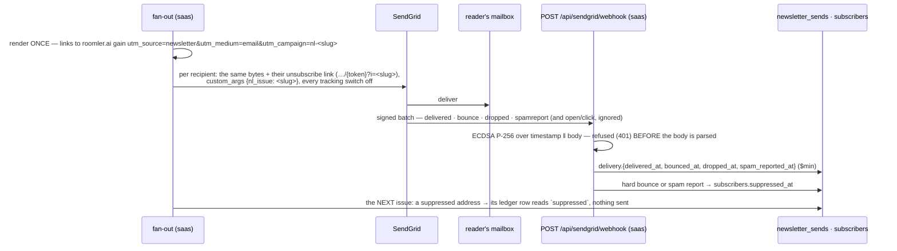

### The Event Webhook — `saas`, hosted-only

[`crates/modules/saas/src/sendgrid.rs`](../crates/modules/saas/src/sendgrid.rs) — mounted
outside the per-IP governor beside the Stripe webhook (signed, and SendGrid posts a batch
every 30 s from a handful of addresses), body bounded at 2 MiB (a batch is at most 768 KB).

| Check, in order | Refusal | Where |
|---|---|---|
| a usable key is configured (`newsletter.event_webhook_public_key`) | the **empty 404** of an absent path, for everything | [`webhook`, sendgrid.rs:275](../crates/modules/saas/src/sendgrid.rs) |
| both headers present (`X-Twilio-Email-Event-Webhook-Signature` / `-Timestamp`) | 401 | same |
| the signed timestamp within 25 h back (SendGrid retries for 24 h) and 5 min ahead | 401 | [`timestamp_fresh`, sendgrid.rs:114](../crates/modules/saas/src/sendgrid.rs) |
| ECDSA P-256 / SHA-256 over `timestamp ‖ raw body` verifies (either `s` of a signature — SendGrid does not normalise it) | 401 — **the body has not been parsed** | [`EventVerifier::verify`, services sendgrid.rs:67](../crates/services/src/sendgrid.rs) |
| the verified body is a JSON array of at most 10,000 events | 400 / 413 | `webhook` |
| a database error while recording | 503 — SendGrid retries; every write is idempotent | [`record_events`, sendgrid.rs:203](../crates/modules/saas/src/sendgrid.rs) |

The key is the one SendGrid shows (base64 DER `SubjectPublicKeyInfo`, starting
`MFkwEwYHKoZIzj0CAQYIKoZIzj0DAQcDQgAE`) or the same key as PEM; anything that is not an
uncompressed P-256 key is refused at boot with a warning, and the route then refuses every
request ([`EventVerifier::from_config`, services sendgrid.rs:39](../crates/services/src/sendgrid.rs)).
The verifier lives in `roomler-ai-services`, beside the Stripe check, so the host's views and
the route agree on whether a configured key is usable
([`webhook_key_usable`, sendgrid.rs:83](../crates/services/src/sendgrid.rs)).

| SendGrid event | Recorded on the ledger row (`newsletter_sends.delivery`) | Effect |
|---|---|---|
| `delivered` | `delivered_at` | — |
| `bounce`, `type: bounce` | `bounced_at`, `bounce_type: bounce`, `reason` (≤ 200 characters) | **suppresses the address** (`subscribers.suppressed_at`, `suppressed_reason: bounce`) |
| `bounce`, any other type (`blocked`, `expired`, none) | `bounced_at`, `bounce_type: blocked`, `reason` | none — the receiving server refusing one message must not cost the address its subscription |
| `dropped` | `dropped_at`, `reason` | none |
| `spamreport` | `spam_reported_at` | **suppresses the address** (`suppressed_reason: spamreport`) |
| `open`, `click`, `processed`, `deferred`, `unsubscribe`, `group_*`, anything else | **nothing** — `DeliveryEvent` has no variant that could say it | — |
| any event without the `nl_issue` custom arg (activation mail, an invite) | nothing — not a newsletter message | — |

- **Matched by the issue, never by a per-recipient token.** Every newsletter message carries
  ONE SendGrid custom arg, `nl_issue = <slug>` — the same for every recipient, and not part of
  the message a reader receives. An event brings it back with the recipient's address: the
  subscriber by its unique address, then the row by the unique `(issue_id, subscriber_id)`.
  A test-send carries no arg (it has no ledger row) so its events can never land on a real
  recipient's row.
- **Idempotent.** Every time is a `$min` — the earliest report wins; a replayed batch, or
  SendGrid's own duplicate, writes nothing new. `status` (our disposition: claimed → sent /
  failed / suppressed) is never touched: `delivery` is the mailbox provider's answer, which
  arrives later, out of order, sometimes twice
  ([`DeliveryEvent`, newsletter_send.rs:31](../crates/services/src/dao/newsletter_send.rs)).
- **Suppression** is the first reason, written once; the fan-out's per-recipient re-check
  reads it ([newsletter_send.rs:175](../crates/modules/saas/src/newsletter_send.rs)) and marks
  the row `suppressed` without sending. Only fresh consent lifts it: subscribing again (the row
  is revived **unconfirmed** — the confirmation click is the proof the mailbox works) or the
  signed-in toggle on a verified account.
- Never an address in a log line: a batch logs `events · recorded · ignored · unmatched ·
  suppressed`.

**SendGrid's own tracking stays off** (D6), twice over: every newsletter message switches
open, click, subscription and Google Analytics tracking off in the request itself
(`SendOptions::no_tracking`, [email.rs:303](../crates/services/src/email.rs) — GA tracking would
rewrite the issue's own UTM tags), and at boot the module reads the ACCOUNT's open and click
settings ([`spawn_tracking_check`, sendgrid.rs:338](../crates/modules/saas/src/sendgrid.rs)) and
logs a **WARN** if either is on — every other mail would be tracked — or if it cannot read them
(the API key needs the `tracking_settings.read` scope). Spawned, bounded at 10 s per request,
never blocking the boot; skipped without a SendGrid key.

### Per-issue tags and unsubscribes (D5)

| What | Rule | Where |
|---|---|---|
| The tags | `utm_source=newsletter&utm_medium=email&utm_campaign=nl-<slug>` on every **http(s) link to this site** — the body's links, the call to action, the footer's `roomler.ai` — rendered once, before the per-recipient substitution | [`LinkTags::tag`, newsletter.rs:100](../crates/services/src/newsletter.rs), [`render_issue_html`, newsletter.rs:260](../crates/services/src/newsletter.rs) |
| This site | `roomler.ai`, `www.roomler.ai` and `app.frontend_url`'s host; anything else — a third party, a `mailto:`, a relative path, a URL with credentials — is left **byte-for-byte as written** (a third party learns nothing; a signed URL is not broken) | [`site_hosts`, newsletter.rs:66](../crates/services/src/newsletter.rs) |
| An operator's own tag | kept; only the missing ones are added, after the query and before the fragment | `LinkTags::tag` |
| The campaign | `nl-<slug>`, cut to the 64 characters a sign-up's attribution keeps — the one spelling both the links and every per-issue lookup use | [`issue_campaign`, newsletter.rs:57](../crates/services/src/newsletter.rs) |
| The unsubscribe link | `…/api/subscribe/unsubscribe/{token}?i=<slug>` — the token is the one per-recipient thing; `i=` is the issue, the same for everyone. The `List-Unsubscribe` header carries the same link | [`unsubscribe_link`, saas newsletter.rs:218](../crates/modules/saas/src/newsletter.rs) |
| The click | stamps `subscribers.unsubscribed_via = <slug>` with `unsubscribed_at` — once, by the click that ends a live subscription; a repeat (a prefetcher, a second issue's link) changes neither the time nor the issue. An `i=` naming no sent issue unsubscribes all the same and records none | [`via_issue`, subscribe.rs:214](../crates/modules/saas/src/subscribe.rs), [`SubscriberDao::unsubscribe`, subscriber.rs:180](../crates/services/src/dao/subscriber.rs) |
| The stamp | when the fan-out starts, the issue records `campaign` (its links' tag; absent with the tags off) and `delivery_events` (this server verified the webhook when it sent) — what tells a later reader "not measured" from a zero | `NewsletterIssueDao::stamp_send_tags` |

**AC15, as a test**: `every_link_but_the_unsubscribe_link_is_byte_identical_for_two_recipients`
([`newsletter_send.rs`](../crates/modules/saas/src/newsletter_send.rs), `tests`) renders an issue
exactly as `run_send` does, composes it for two recipients with the same function the fan-out
calls ([`compose`, newsletter.rs:244](../crates/modules/saas/src/newsletter.rs)), and asserts that
of every `href`/`src` in the two messages exactly one differs — the unsubscribe link — that
with each recipient's unsubscribe link taken out the two bodies are the same bytes, and that
the send options differ only in that link.

### The per-issue table

`GET /api/admin/growth/newsletter?since&until&include_internal`
([`get_newsletter`, newsletter.rs:518](../crates/api/src/growth/newsletter.rs)) — platform admins
only, **404** otherwise and when `growth.enabled = false`. UTC days, both inclusive; the
default is the **90** closed days ending yesterday (an issue is never more than monthly), at
most 366.

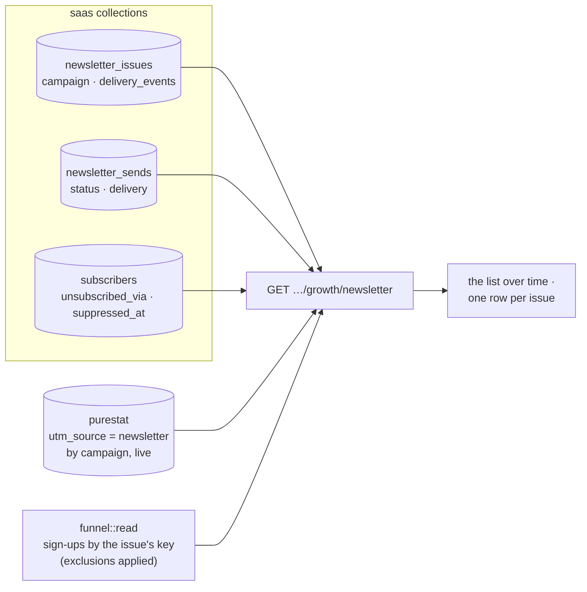

| Cell | What | Not measured when |
|---|---|---|
| `ledger` | `recipients` (rows claimed), `accepted` (a SendGrid 202 — not delivered), `failed`, `suppressed`, `stale`: the stamped counts once completed, live while sending | — |
| `delivery` | `delivered`, `bounced` (`hard_bounced`), `dropped`, `complaints` | this server verifies no webhook (no usable key), or the issue was sent before delivery events were recorded — **never 0** ([`delivery_cell`, newsletter.rs:485](../crates/api/src/growth/newsletter.rs)) |
| `unsubscribed_via` | subscribers whose current unsubscription came through this issue's link | — |
| `web` | purestat's visitors, visits, pageviews, reads and goals for the issue's key `(newsletter, email, nl-<slug>)` over the range — one breakdown filtered on `utm_source = newsletter` | the issue's links carried no tags, or purestat cannot be asked (no key, 401, timeout) |
| `signups` | sign-ups created in the range whose attribution normalises to the issue's key — the funnel's own read, so a link's spelling cased differently still counts, and the exclusion set applies | — |
| `rates` | `delivered` (n = accepted), `hard_bounce` (n = accepted), `complaint` (n = delivered), `unsubscribe` (n = delivered, or accepted while delivery is unmeasured), `signup_per_visitor` (n = visitors); a value only from n = 30 | the side it rests on is not measured |

**The list over time** ([`read_list`, newsletter.rs:255](../crates/api/src/growth/newsletter.rs)):
new, confirmed, unsubscribed and suppressed per UTC day and by `source`, from the timestamps
`subscribers` keeps, and the list's size now — mailable (confirmed, not withdrawn, not
suppressed), awaiting confirmation, unsubscribed, suppressed. A subscriber carries no account
id, so the exclusion set cannot apply to the list; a re-subscription restarts a row's history
(the subscribe path re-stamps `created_at`).

The SPA's `/observability/growth` gains a **Newsletter** tab
([`GrowthNewsletter.vue`](../ui/src/components/growth/GrowthNewsletter.vue)): the list's size,
the daily chart and the sources, then one row per issue — a `not_measured` cell is a muted chip
with its reason on hover, a rate appears only with n ≥ 30, subjects are rendered as text.

**In the digest**, the `newsletter` section gains `delivery` — the day's (and 7/28 days')
delivered, bounced (hard), dropped, spam reports and addresses suppressed, by each event's own
time ([`delivery_figures`, digest.rs:1378](../crates/api/src/growth/digest.rs)), `not_measured`
on a server without the webhook — `unsubscribed_via_issue`, and per issue sent that day its
delivery so far and its unsubscribes, by the same reads and the same three cells as the table.

### Settings and the operator's setup

| Setting | Env | Default | Effect |
|---|---|---|---|
| `newsletter.event_webhook_public_key` | `ROOMLER__NEWSLETTER__EVENT_WEBHOOK_PUBLIC_KEY` | empty | SendGrid's verification key (base64 DER or PEM). Empty or unusable ⇒ `POST /api/sendgrid/webhook` answers 404 to everything and delivery reads "not measured" |
| `newsletter.link_tags` | `ROOMLER__NEWSLETTER__LINK_TAGS` | `true` | the per-issue UTM tags; `false` sends links as written (and the issue's visits read "not measured") |

Turning delivery on is three steps in SendGrid and one secret here:

1. **Settings → Mail Settings → Event Webhook**: HTTP POST URL
   `https://roomler.ai/api/sendgrid/webhook`; select **Delivered, Bounced, Dropped, Spam
   Reports** (Opened and Clicked stay unselected — they would be ignored anyway).
2. Enable **Signature Verification** on that webhook and copy the **public key** it shows into
   the cluster secret as `ROOMLER__NEWSLETTER__EVENT_WEBHOOK_PUBLIC_KEY`; roll.
3. **Settings → Tracking**: Open Tracking and Click Tracking **off** (and Subscription Tracking
   off — FR-58). Give the API key `ROOMLER__EMAIL__API_KEY` the `tracking_settings.read`
   scope so the boot check can confirm it; without the scope it logs that it could not.
4. Check: the boot log says `SendGrid Event Webhook on` and `SendGrid open and click tracking
   are off`; SendGrid's "Test Your Integration" button posts a signed sample batch, which
   answers 200 with `{"events": …, "ignored": …}` (its sample events carry no `nl_issue`).

**A test issue** never mails the list: an issue created with `"audience": [1–20 addresses]`
goes only to the confirmed subscribers among them, and the audience is fixed with the draft,
so a resumed send cannot widen it. That is what a field run on production uses — two own
addresses plus one that bounces, sent twice — and the per-issue table marks it `test · N`
(its size, never the addresses).

## Revenue: what Stripe billed (P4)

Billed revenue — paying orgs, billed MRR, its new / expansion / contraction / churned
movements per month, trial → paid, `paid_since`, all of it by the owner's acquisition
channel — read from **what Stripe billed**, never from the price list (§3g). The list-price
figure (`Plan::price_monthly_cents` × seats, [`mrr_estimate_cents`, cost.rs:68](../crates/api/src/routes/cost.rs))
stays beside it, labelled an ESTIMATE: for an org with no invoice yet it is the only figure
there is. Rows carry the org's id and Stripe's ids and amounts — never a card, an address or a
name — and go with the org.

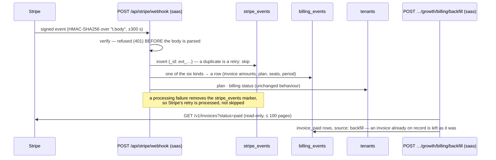

### The six kinds — `billing_events`

[`process`, stripe.rs:761](../crates/services/src/stripe.rs) records every billing kind
before the tenant-state updates it always made; [`parse`, billing.rs:297](../crates/services/src/billing.rs)
reads Stripe's objects for both API versions in the field (the classic shape and the
2025-03-31 "basil" one, which moved `invoice.subscription` under `parent`, a line's
`proration` under `parent.subscription_item_details` and the subscription's period onto its
items).

| Stripe event | `kind` | What the row holds |
|---|---|---|
| `customer.subscription.created` | `subscription_created` | plan (from the price id), seats (items' quantities), period, `status` — **no amount** (`null`, never 0) |
| `customer.subscription.updated` | `subscription_updated` | the same, after the change — a seat change shows here |
| `customer.subscription.deleted` | `subscription_deleted` | `ts` = `ended_at` — MRR is 0 from then |
| `invoice.paid` | `invoice_paid` | `amount_cents` = `amount_paid` (what was billed, after coupons, before tax); `recurring_cents` = the subscription lines that are **not prorations**, after discounts ([`recurring_of`, billing.rs:188](../crates/services/src/billing.rs)); seats, period, interval; `ts` = `paid_at` |
| `invoice.payment_failed` | `invoice_payment_failed` | `amount_cents` = `amount_due` |
| `customer.subscription.trial_will_end` | `trial_will_end` | the trial's end |

- **The org** ([`tenant_for`, stripe.rs:690](../crates/services/src/stripe.rs)): the
  `tenant_id` the checkout stamps on the **subscription's** metadata (from P4,
  `subscription_data[metadata]`, [stripe.rs:210](../crates/services/src/stripe.rs)), else the
  org whose `billing.customer_id` / `billing.subscription_id` the object names. An object that
  names no org here is logged with its ids and not recorded — revenue nobody can be credited
  with is not a row.
- **Recorded once** ([`BillingEventDao::record`, billing_event.rs:173](../crates/services/src/dao/billing_event.rs)):
  a webhook row is unique by `event_id` (sparse — a backfilled row has none), a paid invoice
  by `(kind, stripe_id)` across the webhook and the backfill, on top of `stripe_events`' own
  dedupe of Stripe's retries.

### Billed MRR, and the months

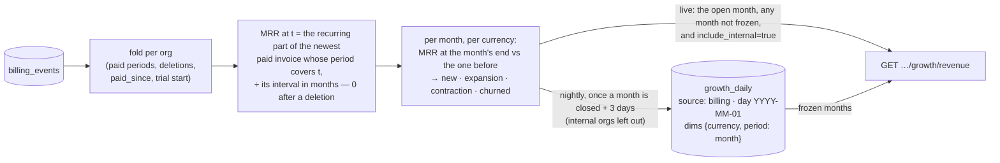

| Figure | Definition | Where |
|---|---|---|
| billed MRR at t | the recurring part of the org's newest paid invoice whose period covers t, normalised by the price's interval (a yearly invoice ÷ 12), 0 once a deletion at or before t came after that period began | [`OrgBilling::mrr_at`, billing.rs:498](../crates/services/src/billing.rs) |
| paying orgs | orgs with billed MRR > 0 | same |
| new / expansion / contraction / churned | per month and currency, each org's MRR at the month's end against the end of the month before: from 0 = new, to 0 = churned, up = expansion, down = contraction | [`movements`, billing.rs:548](../crates/services/src/billing.rs) |
| `paid_since` | the org's first invoice paid with an amount above 0 — also the funnel's **paid** step | [`OrgBilling::of`, billing.rs:446](../crates/services/src/billing.rs) |
| trial → paid | trials started in the range (a `trialing` subscription or `trial_will_end`) and how many paid since | [`trial_to_paid`, billing.rs:948](../crates/services/src/billing.rs) |
| invoices and billed cash | invoices paid in the month and every line they billed, prorations included — cash beside the MRR | `movements` |

- ⚠️ **Billed, so a seat change moves MRR when an invoice bills it.** The proration invoice
  in between is cash (`billed_cents`), not MRR; the renewal that bills the new seat count is
  the expansion. A dunning gap (a renewal not paid yet) reads as 0 until the payment lands,
  and the live view corrects the history once it does.
- **The record** ([`record_start`, billing.rs:758](../crates/services/src/billing.rs)): before
  the first billing row (any org — or the first frozen month, whichever is older) nothing was
  recorded, so a month that ended before it is `on_record: false` — *not measured*, never a
  month of zero revenue — and is never frozen ([`on_record`, billing.rs:750](../crates/services/src/billing.rs)).
  With no row at all, billed revenue is `not_measured` everywhere.
- **Frozen once closed.** The nightly org-daily job ([`freeze_billing_months`, org_daily.rs:510](../crates/api/src/growth/org_daily.rs))
  writes every closed month of the last 13 that ended at least 3 days ago (Stripe retries a
  webhook for three days) and lies on the record into `growth_daily`, internal orgs left out,
  and marks it in `growth_pulls` (`billing:YYYY-MM-01`). A frozen month is never rewritten —
  except by the backfill, for the months it touched — so purging an org later does not
  rewrite last year's MRR ([`freeze_closed_months`, billing.rs:840](../crates/services/src/billing.rs)).

### Upgrade intent: plan-limit collisions

Every plan-limit check now goes through core ([`roomler_core::quota`, quota.rs:33](../crates/core/src/quota.rs))
— thirteen call sites across `chat`, `conference`, `fleet`, `network` and the host. The
decision stays `services::quota`'s, unchanged ([`evaluate`, quota.rs:258](../crates/services/src/quota.rs)),
with the FR-32 warn line written there exactly once. What core adds: a collision — refused in
`enforce`, **or let through in `warn`** — bumps `growth_daily {source: quota, metric: collision,
dims: {tenant, limit}}` for the UTC day ([`record_collision`, quota.rs:72](../crates/core/src/quota.rs)).
The org's id and the limit's wire spelling, never a person; spawned and best-effort (a refused
request is answered at once), and nothing at all with `growth.enabled = false`. The rows carry
the tenant, so they go with the org.

### Margin

The cost to serve is FR-20's ledger priced by [`routes/cost.rs`](../crates/api/src/routes/cost.rs)
— the same prices and the same meters as the Cost & usage tab, through one helper
([`org_costs`, cost.rs:159](../crates/api/src/routes/cost.rs)). Margin per org = billed MRR −
the last 30 days' cost, **only** where both exist in the same currency
([`margin_cents`, revenue.rs:386](../crates/api/src/growth/revenue.rs)); an unpriced meter is
"not priced", never 0.00 (which would read as free to serve).

### The revenue view

`GET /api/admin/growth/revenue?since=YYYY-MM&until=YYYY-MM&include_internal`
([`get_revenue`, revenue.rs:721](../crates/api/src/growth/revenue.rs)) — platform admins only,
**404** otherwise and when `growth.enabled = false`. Months, both inclusive; the default is the
12 months ending with the current one, at most 36, never before 2020-01, never past the
current month.

| Part | What | Not measured when |
|---|---|---|
| `billed.record` | `since` (the record's start), `last_event_at`, `backfilled_at` (absent = the backfill never ran, so figures start at the webhook), `rows`, `truncated` | — |
| `billed.now` | billed MRR and paying orgs, per currency, at the request | `saas` not mounted; nothing on record |
| `billed.months` | one block per month: `frozen`, `partial` (the open month), `on_record`, and per currency the movements, invoices and billed cash ([`month_blocks`, revenue.rs:503](../crates/api/src/growth/revenue.rs)) | a month before the record: `on_record: false` |
| `billed.totals` | the range's invoices paid, billed cash per currency, first payments, failed payments, cancellations | as `billed` |
| `billed.trial_to_paid` | trials started in the range, converted, and the rate from n = 30 | as `billed` |
| `billed.by_channel` | per owner's acquisition channel and currency: paying now, MRR now, first payments, churned, trials → paid ([`channel_rows`, revenue.rs:399](../crates/api/src/growth/revenue.rs)) | as `billed` |
| `estimate` | the list-price MRR over every live org, `estimate: true` | — |
| `cost` | the cost basis: range, currency, whether anything is priced | the usage ledger is off (`stats.enabled = false`) |
| `upgrade_intent` | the range's collisions, orgs, by limit, and the top 50 orgs with their limits and days | — (core's, read on every server) |
| `orgs` | every org with a billing history, a paid plan or a collision (≤ 500): plan, status, seats, channel, `paid_since`, billed MRR (`null` = no invoice), the list-price estimate, 30-day cost, margin, collisions | per cell, as above |

- **The funnel's `paid` step** ([funnel.rs:245](../crates/api/src/growth/funnel.rs)) is the org's
  first invoice paid above 0. It has no window, so it hangs off the org step, not the value
  steps (an org that pays is counted whatever its path to value) and reads "paid so far": its
  `pending` is only the sign-ups still pending at the org step. The Campaigns and Channels
  tables' `paid` cells are the same groups. `null` with `not_measured.paid` without `saas`.
- **The org timeline** gains `plan_history` (the org's billing rows, newest 200) and a
  `first_paid` milestone ([orgs.rs:667](../crates/api/src/growth/orgs.rs)).
- **In the digest**, the revenue section gains `billed` — MRR at the day's end per currency;
  the day's (and 7/28 days') invoices, billed cash, failed payments, first payments,
  cancellations and trials; `record_since` and `backfilled`
  ([`billed_figures`, digest.rs:1638](../crates/api/src/growth/digest.rs)) — and `upgrade_intent`,
  the windows' collisions and the orgs that hit hardest
  ([`upgrade_intent_section`, digest.rs:1730](../crates/api/src/growth/digest.rs)). The
  estimate keeps its line and its label.
- The SPA's `/observability/growth` gains a **Revenue** tab
  ([`GrowthRevenue.vue`](../ui/src/components/growth/GrowthRevenue.vue)); the Overview's funnel
  shows **Paid (so far)**, and the org drawer the plan history.

### The backfill — operator-run, once

`POST /api/admin/growth/billing/backfill?since=YYYY-MM-DD` (`saas`,
[`backfill`, saas stripe.rs:137](../crates/modules/saas/src/stripe.rs)) — platform admins only,
404 otherwise and with growth off. It reads Stripe's **paid** invoices (created since `since`
when given; 100 a page, at most 100 pages) into `invoice_paid` rows with `source: backfill`
([`backfill_paid_invoices`, stripe.rs:396](../crates/services/src/stripe.rs)), then refreezes the
closed months those invoices touch ([`refreeze`, saas stripe.rs:190](../crates/modules/saas/src/stripe.rs))
and leaves a `growth_pulls` marker (`billing_backfill:YYYY-MM-DD`) the views read. It only
reads Stripe. Idempotent: an invoice already on record (the webhook's, or an earlier run's) is
counted under `already` and left as it was; one naming no org here under `no_org`.

```bash
# As a platform admin (a JWT from the SPA), once, after the webhook is wired:
curl -sS -X POST "https://roomler.ai/api/admin/growth/billing/backfill?since=2025-01-01" \
  -H "Authorization: Bearer $ROOMLER_ADMIN_JWT"
# {"pages":1,"invoices":12,"recorded":9,"already":3,"no_org":0,"truncated":false,
#  "months":["2025-11","2025-12",…],"refrozen":["2025-11",…]}
```

### The operator's setup

| Where | What |
|---|---|
| Stripe → Developers → Webhooks → the `https://roomler.ai/api/stripe/webhook` endpoint | add the events `customer.subscription.created`, `customer.subscription.updated`, `customer.subscription.deleted`, `invoice.paid`, `invoice.payment_failed`, `customer.subscription.trial_will_end` (keep `checkout.session.completed`). Its signing secret stays `ROOMLER__STRIPE__WEBHOOK_SECRET` |
| `ROOMLER__STRIPE__PRICE_PRO` / `ROOMLER__STRIPE__PRICE_BUSINESS` | the plan a row names comes from these price ids; a price this server does not sell leaves `plan` empty |
| `ROOMLER__STRIPE__SECRET_KEY` | the backfill's read of the invoice list (a restricted key with *Invoices: read* is enough) |
| — | nothing to switch on: the rows land as the events arrive; `growth.enabled = false` hides the views and stops counting collisions |

A subscription created before P4 carries no `tenant_id` in its metadata; its events are
matched through the org's stored customer and subscription ids instead.

## The `/observability` page as a whole

| Tab / surface | What it shows | Route family |
|---|---|---|
| Relay fleet | coturn + DERP load per region, availability and latency series | `/api/admin/stats/relay/*` |
| Cost & usage | per-org metered cost and the list-price MRR estimate ([relay-cost-metering.md](relay-cost-metering.md)) | `/api/admin/stats/cost` |
| Orgs, machines, calls, users | platform-wide inventories and series | `/api/admin/stats/{orgs,machines,calls,users}` |
| Usage | per-user minutes and bytes across every org | `/api/admin/stats/usage*` |
| Attribution (FR-88) | sign-ups by campaign key and how many activated | `/api/admin/stats/attribution` |
| **Growth** (FR-102) | the daily digest (P1d), the account funnel, cohorts and org views (P2), the Campaigns table (P6), the Channels table with the ingest keys (P8), the Newsletter tab (P5), and the Revenue tab (P4) | `/api/admin/growth/*` |

## Field verification

The digest's counts for a closed day are to be checked against a hand count from Mongo on
production (AC23); the log of that check lives in the FR's spec. Until a purestat key exists
for `roomler.ai`, the web sections read "not measured" by design.

The Campaigns table's visitors for a closed day are to equal purestat's own number for the
same filter, and read "not measured" with the key revoked (AC16 — a production check after the
roll); the integration suite covers the same two halves against a fake purestat
(`crates/tests/src/growth_campaigns_tests.rs`).

The ingest is to be shown on production to store a snapshot pushed twice once, to refuse an
unknown platform and a body carrying post text, and to answer 404 to a wrong key (AC18); the
integration suite asserts each, plus the revoked key, the JWT, the kill switch and the
unmounted module (`crates/tests/src/growth_channels_tests.rs`).

The newsletter's webhook is to be shown on production to refuse a bad signature (control),
and to record `delivered` and `bounce` for a test send with one forced bounce, the bounced
address `suppressed` at the next send, with SendGrid's open and click tracking read off at
boot (AC14). The integration suite asserts the refusal before parsing, the four events and
nothing else, the suppression at the next send and the replay that changes nothing
(`crates/tests/src/growth_newsletter_tests.rs`); AC15 is the `saas` unit test above.

Billed revenue is to be shown on production with a Stripe **test-mode** lifecycle — subscribe
with a coupon → invoice paid → a seat change → cancel — writing `billing_events` with the
invoice amounts, and the Revenue tab's MRR equal to the test invoices, not the list price
(AC13; the coupon is the control that makes the two differ). The integration suite drives the
same lifecycle through Stripe's own signature scheme — the rows, MRR month by month, the
frozen months surviving the org's purge, the backfill against a fake Stripe, and the collision
counter (`crates/tests/src/growth_revenue_tests.rs`).
