# Hive — agent sessions

Hive runs coding agents on an organization's own enrolled machines and makes each
run a record the org can see. A member starts a session on a device, in a folder.
The device runs Claude Code headless as one of its own local accounts. The people
the owner invites watch the session in a chat room, and the ones allowed to drive
it prompt it and answer its approval cards, from a desk or a phone. The server
keeps the record and one stub per turn. What the agent and the people said and did
stays on the device.

> Spec, phases and the full field log: [`fr/FR-90-hive-agent-sessions.md`](fr/FR-90-hive-agent-sessions.md)
> (#1827). The whole design, including the replicaset, the vault, knowhow and the
> learning loop, none of which is built yet: [`roomler-hive-design.md`](roomler-hive-design.md).
> This page describes what is built: agent sessions through P1, and P2a's member
> store. Core memory has its own page, [`brain.md`](brain.md).

Nothing runs until three parties turn it on. The server's switch is `hive.tenants`
(§9). A person needs `HIVE_RUN`. A device runs nothing until its owner sets
`hive_enabled`, maps accounts and names folders. The Linux and macOS release builds
carry the `hive` feature since 0.4.122, and the Windows build from P1i-3 on (#1915),
so from the first Windows release cut after 0.4.123. A device whose owner never
turns sessions on keeps nothing for them: no data directory, no `hive.db`, no store
thread ([`store_wanted`](../agents/roomlerd/src/hive/supervisor.rs#L775)).

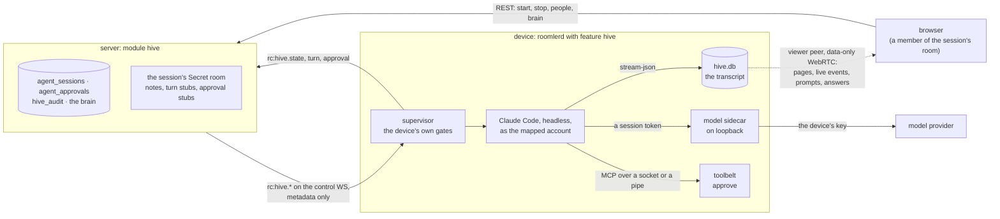

---

## 1. What a session is

A session is four things, and only the first two are on the server.

| Piece | Where | What it holds |
|---|---|---|
| the record | `agent_sessions` ([`model.rs:109`](../crates/modules/hive/src/model.rs#L109)) | who started it (`owner_id`) and who else drives it; the title and the room; the harness and its own session id, a UUID the server mints so every resume continues one conversation; the device, the folder as typed and the account the device says it mapped; the status, the fence, the brain revision, and `origin` (`started` or `adopted`) |
| the room | a `Secret` chat room at the path `hive-<session>`, bound to `{module: "hive", ref: <session>}` ([`room.rs:35`](../crates/modules/hive/src/room.rs#L35)) | notes the session authors when it starts, is refused or ends; one stub per turn; one stub per approval. Never what was asked or answered |
| the transcript | the device's replica store, `hive.db` ([`store.rs`](../crates/hive-node/src/store.rs)) | every event: prompts with their authors, assistant text, tool calls and their results (an output over 64 KiB keeps its head and tail), approvals, each turn's end with its cost, and Hive's own notes |
| the viewer peer | a data-only WebRTC peer from the device to one browser ([`view.rs`](../agents/roomlerd/src/hive/view.rs)) | the transcript's pages and its live tail one way; a driver's prompts and approval answers the other |

⚠️ **The server holds no transcript, and the frames are shaped so it cannot.**
`rc:hive.start`, `rc:hive.state`, `rc:hive.turn`, `rc:hive.approval`,
`rc:hive.manifest` and the replica frames (`rc:hive.replica.*`, P2c-3a) carry ids,
words, numbers, hashes and display names. Tests in
`signaling.rs` lock each field set, so a `prompt`, `tool` or `input` field would be
a deliberate edit there. The one Hive frame with text a model reads is
`rc:hive.memory`, the curated core memory ([`brain.md`](brain.md)). P0f's canary
test ([`hive_canary.rs`](../crates/tests/tests/hive_canary.rs)) sends a canary
through a prompt, a tool's output and a crashing harness's stderr, and finds each
in the device's store and in no Mongo document, object-store file, server log line
or frame the server sent the browser. It found one leak when it was written: the
`ended` detail carried the harness's last 400 bytes of stderr to the server. Those
are a note in the transcript now, and the server hears only how the harness ended
([`describe_end`](../agents/roomlerd/src/hive/supervisor.rs#L3417)).

**Statuses.** The record mirrors what the device reports. Every transition a device
drives is a compare-and-set on the session's device (the authenticated socket's,
never a field of the frame), its fence and the statuses it may leave
([`dao.rs`](../crates/modules/hive/src/dao.rs)), so a stale frame, another device's
frame or one that crossed a stop on the wire changes nothing.

| Status | Means | Set by |
|---|---|---|
| `starting` | the start was sent; `accepted_at` says whether the device answered | the server |
| `idle` · `running` · `awaiting_approval` | the harness waits for a prompt · a turn runs · a tool call waits for a driver | the device's `rc:hive.state` |
| `stopping` | the owner ordered a stop, and the device has not confirmed it | the server |
| `ended` | over; `end_reason` says how: `stopped`, `exited`, `not_on_device`, `member_removed`, `device_removed`, `tenant_archived`, `hive_not_enabled`, `attribution_changed` | the device, or the server for a device it can no longer ask |
| `refused` | the device refused the start, and `refusal` names its gate | the device's `rc:hive.start_ack` |
| `lost` | the start was never answered and will not be sent again (`never_answered`) | the server |

**A turn** is one prompt and the harness's work on it, ended by the stream-json
`result`. The device writes prompts one at a time. One that arrives during a turn
waits, and at most 8 wait before the next caller is refused, because Claude Code
would queue the prompt itself and its `result` would then close the wrong turn's
stub. A turn's stub is posted when the prompt goes in and edited when the turn
ends, and a report for a turn older than the newest stub changes nothing
([`room.rs:172`](../crates/modules/hive/src/room.rs#L172)):

```
✅ Turn 3 — done · 5 steps · 42 s · $0.12 · asked by Alice
```

The cost is what that turn cost. Claude Code's `total_cost_usd` is its process's
running total, so the device subtracts what the process had spent at the previous
turn's end ([`supervisor.rs:3002`](../agents/roomlerd/src/hive/supervisor.rs#L3002)).

**The transcript** is a hash chain ([`chain.rs`](../crates/hive-node/src/chain.rs)).
Each event carries the session's `seq` (gapless from 1), the `fence` of the lease
that wrote it and `prev_hash`, the BLAKE3 hash of the event before it. It is stored
as its exact JSON text, so a member that cannot parse a newer kind still chains and
serves it. One writer thread owns the SQLite file
([`hive/store.rs`](../agents/roomlerd/src/hive/store.rs)), and every append is
checked against the chain's tip inside the transaction that writes its full-text
index row. The file sits in a directory locked to the daemon (`0700`, or SYSTEM and
Administrators on Windows): no local account reads anyone's transcript.

### The viewer peer

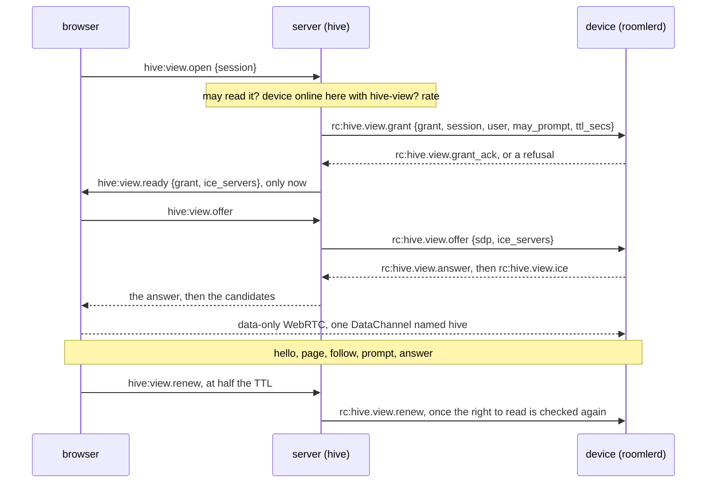

| Rule | Why | Where |
|---|---|---|
| The browser dials only after the device confirmed the grant | a device that would refuse never gets an offer (FR-83's rule) | server [`view.rs:463`](../crates/modules/hive/src/view.rs#L463) `on_device_frame` |
| A grant's TTL is relative (`ttl_secs`, 10 minutes) and renewed at half-life, and each renewal checks again that the viewer may read | a device with a skewed clock cannot expire a fresh grant, and a member taken out of the room loses the view within one TTL | `view_limits`, [`hive.rs:91`](../crates/remote_control/src/hive.rs#L91) |
| Whoever may not read the session, or is in an org the pillar does not serve, is told `not_found` | the answer a bogus id gets | server [`view.rs:181`](../crates/modules/hive/src/view.rs#L181) `open` |
| The server allows 4 grants per browser connection and 20 opens a minute per (user, session); the device serves 8 viewers per session and 32 per device | | server [`view.rs:57`](../crates/modules/hive/src/view.rs#L57), device [`view.rs:259`](../agents/roomlerd/src/hive/view.rs#L259) |
| The device serves a grant on its primary enrollment, with `hive_enabled` on (or `hive_adopt`, for an adopted session), for a session it holds, live or in its store | | device [`view.rs:259`](../agents/roomlerd/src/hive/view.rs#L259) `view_grant` |
| One actor per grant owns the peer, its timers and its channel, and is the one place `close()` runs | ⚠️ a dropped WebRTC peer frees nothing: its ICE sockets belong to tasks the stack spawned, and leaked peers once ate a host's whole ephemeral port range | device [`view.rs:360`](../agents/roomlerd/src/hive/view.rs#L360) |
| Each JSON message travels as binary frames of at most 60,000 bytes: `[v1][id u32][part u16][parts u16][payload]` | one SCTP message over 65,536 bytes is silently lost | [`framing.rs`](../agents/roomlerd/src/hive/framing.rs) |
| `follow` subscribes to the store's live feed first, then catches up from the store | an event that lands in between is in one or the other: never lost, never sent twice | device [`view.rs:774`](../agents/roomlerd/src/hive/view.rs#L774) |
| TURN credentials are minted per grant, with a 12 h TTL | the credential bounds the allocation's whole life, and the configured 600 s would cut a relayed viewer at ten minutes | server [`view.rs:68`](../crates/modules/hive/src/view.rs#L68) |
| ICE is set up as remote control's browser-facing peer: the overlay interface kept out, `.local` candidates resolved by the OS, `ICE_RELAY_TCP` honoured | | device [`view.rs:500`](../agents/roomlerd/src/hive/view.rs#L500) |

The browser half is [`useHiveViewer.ts`](../ui/src/composables/useHiveViewer.ts).
It opens on the last 300 events, keeps at most 1,000 while it follows the newest
(the oldest are a "load earlier" away), and closes its peer on every way out. The
transcript draws each tool call by its tool (a command, an edit as a diff, a file
range, a search) with its result folded under it, and assistant text through
`renderMarkdown`, the one XSS boundary. Everything else is text interpolation
([`HiveTranscript.vue`](../ui/src/components/hive/HiveTranscript.vue)).

---

## 2. Starting one, and who may drive

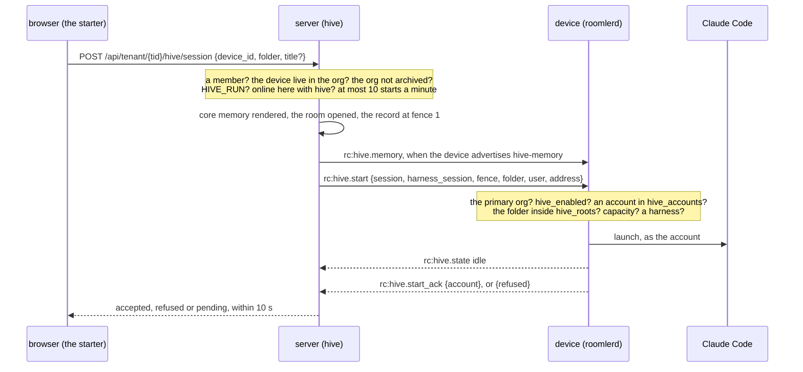

**The server's gates**, in order ([`routes.rs`](../crates/modules/hive/src/routes.rs)):
membership first, so a stranger learns nothing about devices; the device, live in
this org, and a 404 otherwise, as for a bogus id; the org not archived; `HIVE_RUN`;
the device connected here and advertising `hive`; and the per-(user, device)
ceiling of 10 starts a minute, last, so a refusal is attributable to an identity
that passed the others. From the archive check on, a refusal is a `200` that names
the reason, and it is audited in `hive_audit`. That is the exec convention: the row
is what remains when someone probes which devices will run things for them.

`HIVE_RUN` (bit 32) is in no managed role below `ADMINISTRATOR`, pinned by
`no_managed_role_below_administrator_seeds_a_root_shell`
([`role.rs:408`](../crates/db/src/models/role.rs#L408)). Running a session is remote
code execution on a device, gated like exec and SSH.

**The device's gates**, in order ([`decide_and_launch`](../agents/roomlerd/src/hive/supervisor.rs#L1057)).
Each fails closed, and none takes an answer from the server: the start names who is
asking and where, never which account.

| # | Gate | A refusal |
|---|---|---|
| 1 | the frame came on the primary enrollment's connection: a secondary org's admin must not start sessions on a device that org merely borrows | `hive_disabled` |
| 2 | `hive_enabled` | `hive_disabled` |
| 3 | the harness asked for is Claude Code | `other` |
| 4 | a start already running at this fence is answered `accepted` again and launches nothing: reconcile re-sends a start whose answer was lost | — |
| 5 | the daemon is not about to restart for an update, and not stopping | `other`, "start the session again in a minute" |
| 6 | `hive_accounts` maps the starter: by user id first, then by the address the server sent, which is a proven one or the `.invalid` placeholder `users.email` holds otherwise, and that matches nothing ([`gates.rs:106`](../agents/roomlerd/src/hive/gates.rs#L106)) | `no_account` |
| 7 | a session this device hosted resumes as the account it ran as, or not at all: its history is in that account's home | `no_account` |
| 8 | the folder resolves, symlinks and `..` followed, inside a `hive_roots` entry; an empty list means nowhere ([`roots.rs:32`](../crates/hive-node/src/roots.rs#L32)) | `folder_not_allowed` |
| 9 | fewer than `hive_max_sessions` (4) sessions run | `at_capacity` |
| 10 | the store is open, and the sidecar is bound when a key helper is set | `launch_failed` |
| 11 | the launch: the account resolves (uid 0 refused), a harness is found, the account can execute the toolbelt's relay, and the process starts | `no_account` · `harness_missing` · `launch_failed` |

Only a process that started is `accepted`. Each refusal word names a different gate
because each has a different fix, and the words are decoded leniently: an unknown
word from a newer device is still a refusal (`other`), never "accepted"
([`hive.rs:412`](../crates/remote_control/src/hive.rs#L412)). On Windows
`no_console_user` joins them (§3).

**The device's keys** ([`config.rs:384`](../crates/agent-core/src/config.rs#L384)).
Every one is the device owner's, read once when the daemon starts (a change needs a
restart), and none can be pushed:
`the_device_owned_refusals_are_not_pushable`
([`models.rs:5542`](../crates/remote_control/src/models.rs#L5542)) asserts that no
Hive key appears in a serialised `DesiredConfig`. The user-facing reference is
[`configuration.md`](../ui/docs/content/reference/configuration.md).

| Key | Default | Meaning |
|---|---|---|
| `hive_enabled` | off | run agent sessions here |
| `hive_accounts` | empty, so nobody | `{"<user id or proven address>" = "<local account>"}` |
| `hive_roots` | empty, so nowhere | the folders sessions may run in, checked on the resolved path |
| `hive_max_sessions` | 4 | sessions at once |
| `hive_harness` | unset | Claude Code's path; unset, the default locations (§3) |
| `hive_api_key_helper` | unset: no model access | the command the DAEMON runs to print the provider's key (§5) |
| `hive_api_workspace_id` | unset | sent as `anthropic-workspace-id`, for a key that is not scoped to a workspace |
| `hive_update_wait_secs` | 1800 | how long an update waits for running turns; `0` never waits (§7) |
| `hive_core_memory` | off | show the org's core memory to the sessions here ([`brain.md`](brain.md)) |
| `hive_adopt` | off | let this device's people adopt their terminal sessions; off on Windows whatever it says (§8) |
| `hive_allow_passwordless_sudo` | off | macOS: run sessions as an account whose `sudo` needs no password, which gives them root; off, such a start is refused (§3) |
| `hive_replica` | off | hold copies of the sessions this device's owner runs on their other devices (§12, P2c) |
| `hive_archive` | off | offer this device as the org's archive replica; only ever with `hive_replica` |
| `hive_store_quota_mib` | unset: the disk's | the most this device keeps as a replica, in MiB |

### Who may drive

A session's room has members, and a session has drivers
([`access.rs`](../crates/modules/hive/src/access.rs)). The owner names both. What
anyone writes in the room is ordinary chat. Only a driver's "ask the agent" reaches
the harness, over that driver's own viewer peer.

| Who | Reads it | Prompts it, answers its approvals | Stops it, names its drivers |
|---|---|---|---|
| its owner | ✅, even out of its room | ✅ while it is live | ✅ |
| a driver the owner named | ✅ | ✅ while it is live | — |
| another member of its room (a reader) | ✅ | — | — |
| anyone else, in the org or not | — (a 404, as for a bogus id) | — | — |

| Rule | Why | Where |
|---|---|---|
| Naming a driver is the owner's alone, and the person must hold `HIVE_RUN`. At most 16 besides the owner, held by the update's own filter | driving runs code on the device as the session's account, since a driver answers approvals too | [`participants.rs:196`](../crates/modules/hive/src/participants.rs#L196) |
| A change ends the person's open views (`role_changed`), and the view they reopen is minted afresh | a grant carries `may_prompt` as it was minted | server [`view.rs:597`](../crates/modules/hive/src/view.rs#L597) |
| ⚠️ The device decides whom it lets act as its account. A driver other than the starter prompts and answers only when the device's own `hive_accounts` maps them to the account the session runs as; otherwise the view is read only, and `hello` says why (`driving_refused`). The starter is recognised by id, from the start order, never through the map | the gate that survives a wrong server (decision 8). A server before P1c-2 sends no address, and the starter must not be locked out of their own session | [`drives_here`](../agents/roomlerd/src/hive/supervisor.rs#L1177) |
| The model reads who asked, as `[Name] text`. A slash command goes as typed, and the name loses brackets and control characters and is cut to 64 characters | several drivers can share a session, and a display name must not be able to close the label | [`launch.rs:299`](../crates/hive-node/src/launch.rs#L299) `attributed_prompt` |
| A stub's `prompted_by` and an approval's `answered_by` are believed only when they name a driver | both are the device's word | [`room.rs:172`](../crates/modules/hive/src/room.rs#L172), [`room.rs:250`](../crates/modules/hive/src/room.rs#L250) |
| A member removed from the org drives nothing anywhere, and their views end at once | rejoining the org must not hand back a seat nobody offered again | [`hooks.rs:154`](../crates/modules/hive/src/hooks.rs#L154) |
| Every change is a note in the room, and audited (`participant`) | who may prompt the agent is for everyone there to see | |

---

## 3. Who runs it, on each platform

### Linux and macOS

The daemon runs as root, and a session runs as the account `hive_accounts` maps the
starter to, through the one privilege path that exec, SSH and the PTY share, as an agent session
runs it: [`exec::apply_session_run_as`](../agents/roomlerd/src/exec.rs#L847). The
account is resolved in the parent (`getpwnam_r`, `getgrouplist`), uid 0 is refused
([`exec.rs:949`](../agents/roomlerd/src/exec.rs#L949)), and the child only calls
`setgroups`, `setgid` and `setuid`, then checks that they took.

⚠️ **A session holds no administrator group** (decision 13), as Windows denies its
sessions the Administrators group:
- It holds none of the account's administrator groups
  ([`exec.rs:1022`](../agents/roomlerd/src/exec.rs#L1022)): root's own, the sudoers groups
  (`wheel`, `sudo`, macOS's `admin`) and those whose socket or device is root by another
  door (`docker`, `lxd`, `incus`, `libvirt`, `disk`). An account whose primary group is one
  is refused ([`exec.rs:1087`](../agents/roomlerd/src/exec.rs#L1087)). The kernel then
  grants the session nothing by those groups: no docker or libvirt socket, no disk
  device, no write into macOS's `/Applications` (`root:admin 775`).
- On Linux the harness also starts with `no_new_privs`
  ([`exec.rs:1144`](../agents/roomlerd/src/exec.rs#L1144)), so nothing it runs gains a
  privilege by exec: no `sudo`, whatever sudoers says of the account.

| A session, as an account whose `sudo` needs no password | Linux | macOS |
|---|---|---|
| holds `sudo`, `wheel` or `admin` | no | no: a write into `/Applications` is refused |
| `sudo` by a rule that names the account | refused, by `no_new_privs` | **would be allowed**, so the start is refused |
| `sudo` by a rule that names a group (`%admin`, `%sudo`) | refused, the same way | **would be allowed**, so the start is refused |

⚠️ **On macOS the groups cannot stop `sudo`.** macOS has no `no_new_privs`, and its `sudo`
reads the account's groups from the directory, never from the process. Field-measured on
macOS 15.7.7 (sudo 1.9.13p2), with `%admin ALL=(ALL) NOPASSWD: ALL` the only passwordless
rule: a session without the admin group got `sudo-rc=0`, while its write into
`/Applications` was refused. `id` misleads on a Mac too: it reads the directory, so it
lists `admin` in a session that does not hold it.

So a Mac refuses to START a session as an account whose `sudo` needs no password
(decision 15, [`hive/sudo.rs`](../agents/roomlerd/src/hive/sudo.rs)), unless its owner sets
`hive_allow_passwordless_sudo`:

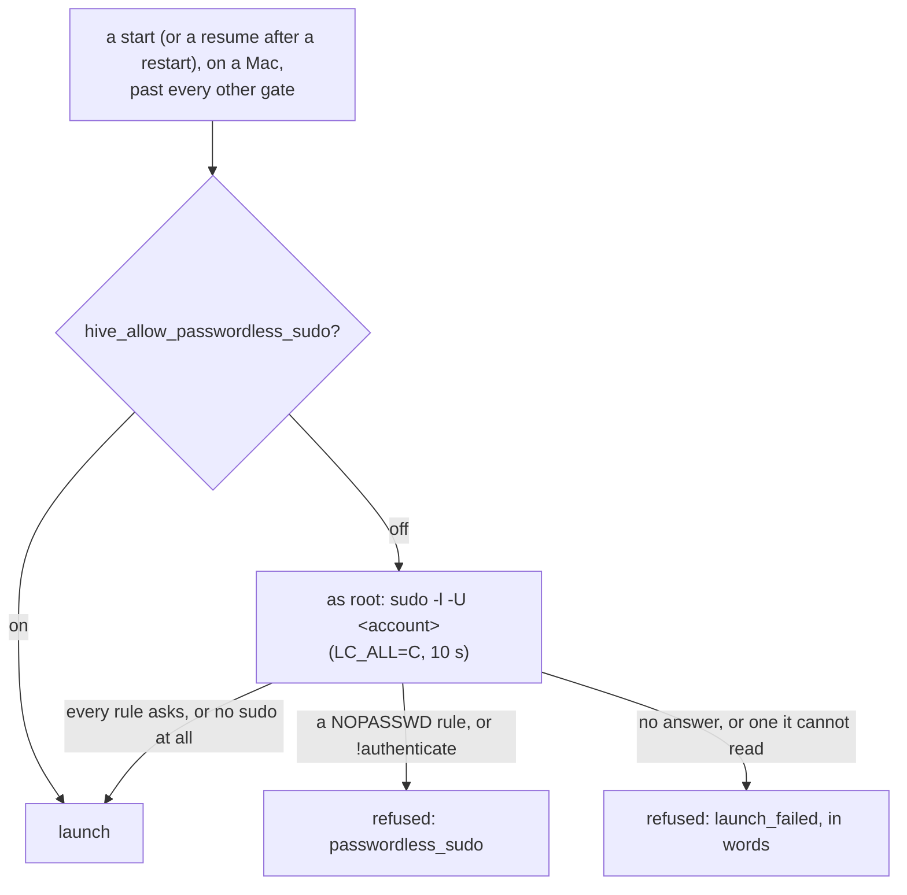

⚠️ The check asks **as root**, never as the account. Listing another account's rules
authenticates nobody: in the field the root listing left only directory lookups in the
unified log. Asked as the account (`sudo -n -l`), it would fail on every Mac whose `sudo`
asks for a password, the default, and have PAM try to authenticate the account at every
start (`pam_sm_authenticate(): … Error obtaining the authtok`). A Mac nobody changed lists
`(ALL) ALL`, which asks, so it starts sessions as before.

The daemon never writes into a tree the account owns. It starts `/bin/sh -c` with a
fixed script ([`WRAPPER`](../agents/roomlerd/src/hive/supervisor.rs#L93)) and
positional arguments, never interpolated, and that script runs as the account:
`umask 077`, make the session's config directory, copy core memory in where nothing
is yet, `cd` into the folder, and `exec` Claude Code. The environment is cleared
first and rebuilt from `HOME`, `USER`, `LOGNAME`, `PATH` (the account's
`~/.local/bin` and `~/.cargo/bin` before the system's) and `LANG`, then Hive's own
variables, so none of the daemon's `ROOMLERD_*` knobs reaches a session. The harness
leads its own process group, so a stop reaches the tools it started.

| What | Where |
|---|---|
| the session's config directory (`CLAUDE_CONFIG_DIR`) | `~<account>/.roomler/hive/<session>/claude`, with the project name pinned to `hive-<harness uuid>` (`CLAUDE_CODE_PROJECT_DIR_NAME`), so the history and the auto-memory live under one `projects/hive-<uuid>/` whatever the folder is ([`launch.rs:109`](../crates/hive-node/src/launch.rs#L109)) |
| the runtime directory, the daemon's | `/run/roomler-hive/<session>` on Linux, `/var/run/roomler-hive/<session>` on macOS, root's and `0755`: `settings.json` and `mcp.json` (root's, `0644`), `toolbelt.sock` (the account's, `0600`), and `memory/` |
| the harness, with `hive_harness` unset | the first executable of `~/.local/bin/claude`, `/usr/local/bin/claude`, `/opt/homebrew/bin/claude` (macOS) and `/usr/bin/claude` ([`supervisor.rs:2542`](../agents/roomlerd/src/hive/supervisor.rs#L2542)) |

**The launch is rebuilt in full every time**, because a resume restores neither
`--settings` nor `--mcp-config` ([`launch.rs:166`](../crates/hive-node/src/launch.rs#L166)):

```
claude -p --input-format stream-json --output-format stream-json --verbose --include-partial-messages
       --session-id <uuid>                      (or --resume <uuid>)
       --settings <runtime>/<session>/settings.json
       --mcp-config <runtime>/<session>/mcp.json --strict-mcp-config
       --permission-prompt-tool mcp__roomler__approve
       --permission-mode default
       --disallowedTools AskUserQuestion
```

| Flag or setting | Why |
|---|---|
| `--permission-mode default` | ⚠️ unset, a `-p` run that fetches no feature flags, which is every run behind the sidecar, starts in `auto`, where a classifier rather than a person decides what runs. P1a's contract probe found it |
| `--strict-mcp-config` | a repository's `.mcp.json` cannot shadow `roomler`, the server that decides what runs |
| `--disallowedTools AskUserQuestion` | it would reach the permission tool as a tool call whose answer must carry the person's choices, which no card asks for; the model asks in its reply instead |
| `settings.json` holds `permissions.deny: ["Read(//proc/**)"]`, `sandbox.autoAllowBashIfSandboxed: false` and no `apiKeyHelper` ([`launch.rs:344`](../crates/hive-node/src/launch.rs#L344)) | the Read tool runs inside the harness, so `/proc/self/environ` would hand the model its environment; a sandbox that comes on, ours or the user's, must not take Bash out of the approvals; nothing in the session can print the provider's key |
| `--resume` exactly when Claude Code's own history exists (`projects/hive-<uuid>/<uuid>.jsonl`), `--session-id` otherwise, for every launch ([`supervisor.rs:2269`](../agents/roomlerd/src/hive/supervisor.rs#L2269)) | Claude Code refuses both other ways round: "Session ID … is already in use", "No conversation found". The daemon only checks that the entry exists, and never reads it |
| ⚠️ no `CLAUDE_CODE_SUBPROCESS_ENV_SCRUB` | on Linux it sandboxes every command, and without bubblewrap and socat Bash then refuses everything. It was the real reason P0's sessions could not run `whoami` (P1a-3) |

### Windows

A Windows device runs a session as the user signed in at the console, at Medium
integrity, and as nobody else (design decision D2). There is no S4U and no
`LogonUser`: the daemon asks for no credential. With nobody signed in a start is
refused `no_console_user`. `hive_accounts` must map the starter to that user, as
`name`, `DOMAIN\name` or `.\name`, compared case-insensitively
([`hive_win.rs:397`](../agents/roomlerd/src/hive_win.rs#L397)); otherwise the start
is refused `no_account`, and the refusal names who is at the console.

The process that hosts sessions is the service's worker. Who the worker is depends
on how the device was installed, never on who connects to it:

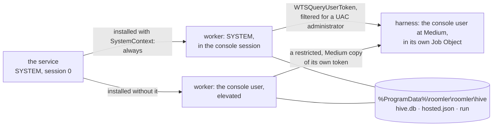

| Rule | Why | Where |
|---|---|---|
| ⚠️ A SystemContext worker is SYSTEM from the start and stays SYSTEM. With `ROOMLERD_ENABLE_SYSTEM_SWAP` on, every cycle of the service reads as if a controller were connected, so the worker is never swapped as one connects or leaves. Without SystemContext the worker is the console user throughout, elevated (`ROOMLERD_ELEVATE_WORKER`, on by default) | P1i-0 expected a remote-desktop connection to swap the worker and cut the running turns, from a gate 0.3.0-rc.7 retired. P1i-4 measured that it does not | [`win_service/supervisor.rs:852`](../agents/roomlerd/src/win_service/supervisor.rs#L852), [`:729`](../agents/roomlerd/src/win_service/supervisor.rs#L729) `decide_spawn` |
| Either way the session is the same person at Medium. A SYSTEM worker takes the console session's token; a worker that is the user takes a restricted, Medium copy of its own token: every administrator group deny-only, no privilege but traverse (FR-85's recorder rule) | a session never holds an administrator's rights on Windows | [`hive_win.rs:135`](../agents/roomlerd/src/hive_win.rs#L135) `console_user`, [`win_token.rs:209`](../agents/roomlerd/src/win_token.rs#L209) |
| `roomlerd hive-prep` does the wrapper's work as the user, in a Job Object of its own with a 30 s deadline: the config directory, core memory copied where nothing is, and the folder opened as the user | the daemon never writes into the user's profile | [`hive_win.rs:677`](../agents/roomlerd/src/hive_win.rs#L677) `prep`, [`:730`](../agents/roomlerd/src/hive_win.rs#L730) `run_prep` |
| The harness is created suspended, assigned to its own Job Object (`KILL_ON_JOB_CLOSE`, no breakaway), and only then resumed. It inherits its three standard handles and nothing else | none of its tools escapes the job, and no other session's pipe leaks into it | [`spawn_into_job`](../agents/roomlerd/src/win_service/supervisor.rs#L2277), [`JobObject`](../agents/roomlerd/src/win_service/supervisor.rs#L2160) |
| The environment is the user's own block with the session's variables laid over it by name, case-insensitively, and a NUL in a name or a value is refused | `Path` and `PATH` are one variable, and a NUL could smuggle in an entry of its own | [`merge_env_block`](../agents/roomlerd/src/win_service/supervisor.rs#L2573) |
| The harness is `hive_harness`, else the native installer's `%USERPROFILE%\.local\bin\claude.exe`, else npm's `%APPDATA%\npm\claude.cmd` run through `cmd.exe /d /v:off /s /c`. An argument holding one of cmd's metacharacters is refused, never escaped | npm's shim passes the line on again with `%*` inside an `IF (…)` block, and no quoting is right for both readers | [`hive_win.rs:523`](../agents/roomlerd/src/hive_win.rs#L523) `harness_command_line` |
| A stop closes the harness's stdin, then ends its job after the grace | no signal reaches a console-less process | [`hive/supervisor.rs:3405`](../agents/roomlerd/src/hive/supervisor.rs#L3405) |

---

## 4. Approvals over the toolbelt

Every tool call that Claude Code's read-only rules do not let through waits for a
driver. Claude Code calls its permission-prompt tool, `mcp__roomler__approve`, on the
session's toolbelt: a `roomler` MCP server, one per session, with one tool
([`toolbelt.rs`](../agents/roomlerd/src/hive/toolbelt.rs)).

Claude Code starts its MCP servers itself, as the session's account, over stdio. So
the server it starts is a relay, `roomlerd hive-mcp <socket>`, which pipes its stdin
and stdout to the session's endpoint. The relay is short-circuited at the top of
`daemon_main`, so it runs none of the daemon's start-up
([`main.rs:1098`](../agents/roomlerd/src/main.rs#L1098)), and the daemon speaks MCP on
the other end.

| | Linux, macOS | Windows |
|---|---|---|
| the endpoint | `<runtime>/<session>/toolbelt.sock`, handed to the session's account, `0600`, in a directory only the daemon writes | `\\.\pipe\roomler-hive-<session>-<nonce>`, made with `FILE_FLAG_FIRST_PIPE_INSTANCE` so a name someone holds is refused, never joined; remote clients rejected |
| who may connect | the kernel admits the account and root, and the daemon checks the peer's uid again on every connection | the DACL grants SYSTEM and Administrators, and the account `0x12008b`: read and write, but not `FILE_CREATE_PIPE_INSTANCE`, which would let it add an instance of its own and take the next connection. Each client's SID is checked again, and the relay opens the pipe with exactly that access, at the identification level ([`hive_win.rs:823`](../agents/roomlerd/src/hive_win.rs#L823), [`:944`](../agents/roomlerd/src/hive_win.rs#L944)) |

⚠️ **It is deliberately not the LocalAPI socket.** On a root daemon that one is
root-only, and most of its verbs trust the socket alone. A process running as the
session's account can reach the toolbelt too, and all it can do there is ask.

⚠️ **What fails, fails closed.** A relay that cannot reach its endpoint leaves Claude
Code without its permission tool. Every call that needs one then errors ("MCP tool
mcp__roomler__approve … not found") and the harness exits 1: nothing runs
unapproved. So a start whose account cannot execute the relay at all is refused
`launch_failed` at once, rather than dying at its first approval
([`executable_by`](../agents/roomlerd/src/hive/supervisor.rs#L2723)).

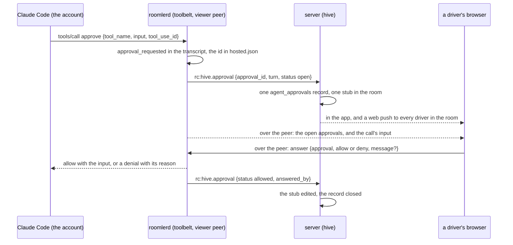

| Rule | Why | Where |
|---|---|---|
| The server hears THAT a session waits, how it ended and who answered. `rc:hive.approval` carries an id, a turn, a word and a user id, and its field set is locked by test. The stub reads "🔐 Approval needed · turn 2 — open the session to answer", then "🔐 Approval · turn 2 — ✅ allowed by Alice" | which tool, and what it would do, travel only over the viewer peer (AC5) | [`room.rs:250`](../crates/modules/hive/src/room.rs#L250) |
| One `agent_approvals` record per (session, approval), held by a unique index, its end a compare-and-set on `open`; kept 90 days | a replayed frame posts no second stub | [`lib.rs:232`](../crates/modules/hive/src/lib.rs#L232) |
| The notification names the session and never the call: `Claude · <device> needs approval`, by web push to every subscription of every driver still in the room | a desk with the app open is not a phone in a pocket | [`room.rs:477`](../crates/modules/hive/src/room.rs#L477) |
| Only a driver's grant answers; a reader's `answer` is refused on the device | | device [`view.rs:821`](../agents/roomlerd/src/hive/view.rs#L821) |
| Unanswered for 25 minutes is a denial that says so. Progress goes to Claude Code every 60 s while a person decides, and the tool-call timeout in the MCP config is 30 minutes | what the model reads is our answer, never a transport error | [`toolbelt.rs:69`](../agents/roomlerd/src/hive/toolbelt.rs#L69) |
| At most 4 approvals are open per session, and a fifth is refused at once | Claude Code asks one at a time (measured), so more is not Claude Code | [`toolbelt.rs:75`](../agents/roomlerd/src/hive/toolbelt.rs#L75) |
| The harness letting go (`notifications/cancelled`, a closed relay), a stop, or the session's end withdraws an open approval | | [`toolbelt.rs:653`](../agents/roomlerd/src/hive/toolbelt.rs#L653) |
| A denial reaches the model as a failed tool result with our words verbatim, for example "Alice denied this: not now" | the model knows who said no, and why | |

---

## 5. The model sidecar

The provider's key never enters a session. The daemon runs the device's
`hive_api_key_helper` itself, as SYSTEM or root, and keeps what it prints. The
harness gets a loopback base URL and a token that only this sidecar honours
([`sidecar.rs`](../agents/roomlerd/src/hive/sidecar.rs)).

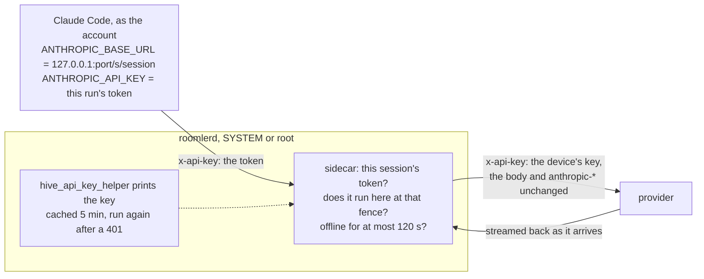

| Piece | Rule | Why | Where |
|---|---|---|---|
| the token | 256 random bits, bound to (session, fence), minted just before the harness starts and taken back if it does not; each run revokes exactly its own token | a run that ends as the same session starts again here cannot take the new run's | [`sidecar.rs:89`](../agents/roomlerd/src/hive/sidecar.rs#L89) |
| the paths | exactly `POST /v1/messages` and `POST /v1/messages/count_tokens`; anything else is `404 not_found_error` | the device's key opens more than inference: the Files API holds every session's uploads under it, and a batch outlives its session and its fence | [`sidecar.rs:282`](../agents/roomlerd/src/hive/sidecar.rs#L282) |
| the fence | a call is forwarded only while the session runs HERE at the token's fence | a stopped session, or a stale primary after a move, spends nothing | [`sidecar.rs:128`](../agents/roomlerd/src/hive/sidecar.rs#L128) `sidecar_admit` |
| `offline_grace` | 120 s after the primary control connection closed, with no newer one in its place, calls are refused `503 overloaded_error`; they flow again on reconnect | a partitioned primary stalls instead of diverging. "Closed" is the agent's own verdict, so a half-open socket counts as up until `WS_RX_DEADLINE` (80 s) ends it, and the worst case is about 200 s | [`sidecar.rs:64`](../agents/roomlerd/src/hive/sidecar.rs#L64), the agent's [`signaling.rs:60`](../agents/roomlerd/src/signaling.rs#L60) |
| the forward | the headers unchanged but for `x-api-key` and `authorization` (the device's key swapped in), the hop-by-hop ones, and `anthropic-workspace-id`, set from `hive_api_workspace_id` when that is configured; a body of at most 32 MiB; the answer streamed as it arrives, `retry-after` and the rate-limit headers intact; TLS through the OS trust store and the proxy environment | an SSE turn is never buffered, and a TLS-inspecting middlebox the machine trusts still works | [`sidecar.rs:334`](../agents/roomlerd/src/hive/sidecar.rs#L334) `handle` |

The helper runs through `/bin/sh -c` on Unix and `cmd.exe /d /s /c "<helper>"`, by
its full path, on Windows, within 10 s. The first line it prints is the key, and
neither its output nor its errors' output is logged
([`sidecar.rs:172`](../agents/roomlerd/src/hive/sidecar.rs#L172)). With no helper a
session has no model access: its own config directory holds no login of its own.

---

## 6. Restart, resume, and what ends a harness

A restart still takes every harness down. Under systemd (`KillMode=control-group`)
a stop reaches the daemon and then every process in its unit. Under launchd, and for
a daemon nothing supervises, the daemon takes them down itself as it leaves
([`wind_down`](../agents/roomlerd/src/hive/supervisor.rs#L1605): SIGTERM to each
harness's process group, SIGKILL after 3 s). On Windows a harness lives in its
worker's Job Object and goes with it. What survives is the session: the next daemon
resumes it with the same Claude Code conversation.

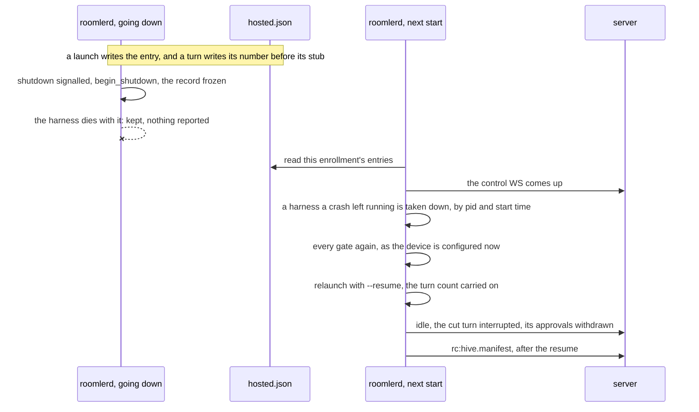

| Rule | Why | Where |
|---|---|---|
| `hosted.json` sits beside the store, root's, `0600`, written whole. Per session it holds the launch's inputs (fence, account, the folder as asked, the starter and their address, Claude Code's session id), the turns begun, the turn in progress and who asked for it, its open approvals, and the harness's pid and start time | after a restart the device holds nothing else: the replay of its last reports lived in memory | [`hosted.rs`](../agents/roomlerd/src/hive/hosted.rs) |
| A new turn's number and a new approval are written before the frame that tells the server, and so is a turn's end; an approval's end is written after its frame | a reused turn number would have every later stub ignored as older than the newest, and a finished turn must never be reported cut. A withdrawal sent twice changes only an approval still open | [`supervisor.rs:2966`](../agents/roomlerd/src/hive/supervisor.rs#L2966) |
| From `begin_shutdown` on, the record is frozen, the toolbelt is ignored, and new prompts and starts are refused ("this device is restarting"). `begin_shutdown` runs the moment any shutdown is signalled: an update, a requested restart, a rollback, an OS stop | the teardown's frames go into closing connections; recorded, they would be lost twice. Field, 2026-10-08: an approval the teardown withdrew stayed "needed" | [`main.rs:3598`](../agents/roomlerd/src/main.rs#L3598), [`supervisor.rs:1569`](../agents/roomlerd/src/hive/supervisor.rs#L1569) |
| A harness that ends without a stop waits 1 s before its end counts, and if the daemon was told to stop by then the session is kept and nothing is reported | under systemd the daemon hears its stop a moment before the harness dies | [`supervisor.rs:1629`](../agents/roomlerd/src/hive/supervisor.rs#L1629) |
| The next daemon resumes at the first connection of its primary enrollment, once, and that connection's manifest waits for it, at most 60 s | a manifest sent first would leave the resuming sessions out, and the server would end every one. A device that never comes back online launches nothing | [`supervisor.rs:1427`](../agents/roomlerd/src/hive/supervisor.rs#L1427) |
| ⚠️ Every gate a start passes is passed again, as the device is configured now: `hive_enabled`, the starter mapped to the SAME account, the folder inside `hive_roots`, capacity, a harness. A refusal ends the session ("not resumed after the device restarted: …") and forgets it | an owner who turns sessions off, or remaps an account, and restarts must not find the session back | [`supervisor.rs:1460`](../agents/roomlerd/src/hive/supervisor.rs#L1460) |
| A recorded pid is signalled only while its start time still matches: the boot id and the `/proc` start time on Linux, `proc_pidinfo` on macOS, `GetProcessTimes` on Windows. Pids 0 and 1 never are | two harnesses on one history would both write it, and whatever holds that pid since must be left alone | [`procs.rs:30`](../agents/roomlerd/src/hive/procs.rs#L30), [`supervisor.rs:3368`](../agents/roomlerd/src/hive/supervisor.rs#L3368) |
| The cut turn is reported `interrupted`, naming who asked; its approvals are reported `withdrawn`; the transcript says the session resumed. The first turn of a resumed process reports no cost | Claude Code restores its running total only from a clean exit's `cost-state`, so where that process starts counting is unknown, and no number is better than a wrong one | [`supervisor.rs:1953`](../agents/roomlerd/src/hive/supervisor.rs#L1953) |
| A session resumed 3 times in a row, each time without outliving the resume by 2 minutes, is ended instead | a resume that takes the daemon down must not become a crash loop | [`supervisor.rs:146`](../agents/roomlerd/src/hive/supervisor.rs#L146) |
| A stop that arrives before the session resumed ends it with no launch | | [`supervisor.rs:1284`](../agents/roomlerd/src/hive/supervisor.rs#L1284) |

⚠️ Prompts waiting behind a turn are lost when a restart cuts it. An update waits the
turn out (§7); a crash does not. ⚠️ `hosted.json` is not synced to disk: a clean
stop, a restart and a crash all keep it, a power cut may lose its last change, and
then the manifest ends what could not be resumed.

### The manifest

On every connection of its primary enrollment the device sends `rc:hive.manifest`:
the sessions it runs NOW, ids and fences only
([`supervisor.rs:1402`](../agents/roomlerd/src/hive/supervisor.rs#L1402)). The server
ends each session it holds as running there that the list leaves out, as
`not_on_device` (or `stopped`, for one being stopped), tells its room and withdraws
its open approvals ([`agent_socket.rs:567`](../crates/modules/hive/src/agent_socket.rs#L567)).

- ⚠️ "Running there" means live and launched on the device's own word: its answer to
  the start (`accepted_at`), or a run state only the device reports (`idle`,
  `running`, `awaiting_approval`). The state usually lands before the answer, so a
  socket that drops between the two leaves `idle` with no `accepted_at`, and with
  `accepted_at` alone that session outlived its harness for ever
  ([`dao.rs:405`](../crates/modules/hive/src/dao.rs#L405)). A start the device has
  said nothing about stays reconcile's, which re-sends an unanswered start for 10
  minutes and an unconfirmed stop on every connection
  ([`agent_socket.rs:670`](../crates/modules/hive/src/agent_socket.rs#L670)).
- ⚠️ A device that comes back with an agent that runs no sessions ends what it ran:
  a connection the hub records without `hive` is given the empty manifest before
  anything pending is read. Field, 2026-10-10: a Windows device updated itself to
  0.4.123, whose build has no `hive`, and its accepted session stayed `idle` for
  ever. Only a definite "no `hive`" counts: a connection a newer one displaced
  decides nothing ([`agent_socket.rs:692`](../crates/modules/hive/src/agent_socket.rs#L692)).
- A list longer than 256 is no device's and changes nothing, and a build that runs
  Hive but predates the manifest sends none, which changes nothing either.
- The other way round: a device that reports it RUNS a session whose record is over,
  because its starter was removed while it was away, is answered with a stop
  ([`agent_socket.rs:613`](../crates/modules/hive/src/agent_socket.rs#L613)).

### What ends a harness

| Event | What happens to the harness | The session |
|---|---|---|
| the owner's Stop | Unix: stdin closed, SIGTERM to its process group, SIGKILL after 5 s. Windows: stdin closed, its job ended after 5 s | ends `stopped` |
| the harness exits or crashes | — | ends `exited`; a crash's last words on stderr stay in the transcript |
| a daemon restart, an update, a crash | it goes with the unit's control group (systemd), by `wind_down` as the daemon leaves, or with its worker's Job Object (Windows). One a crash left running is taken down by the next daemon, before the resume | kept, and resumed by the next daemon |
| Windows: the console session changes (a sign-in, a sign-out, a switch of user) | the service starts a worker in the new session, and the old worker's harnesses go | resumed by the next worker, if its gates still allow it |
| Windows: a remote-desktop connection | nothing: the worker is not swapped (P1i-4, measured) | goes on, a turn waiting at its approval included |
| the gates changed across a restart; three quick resumes | not launched | ends, saying why |
| the starter leaves the org, the device is removed, the org is archived, the org leaves `hive.tenants`, the device comes back without `hive` | stopped, if the device is still connected here | the server ends it: `member_removed` · `device_removed` · `tenant_archived` · `hive_not_enabled` · `not_on_device` |

---

## 7. The update hold

An update restarts the daemon, and every harness with it. So it waits for running
turns first.

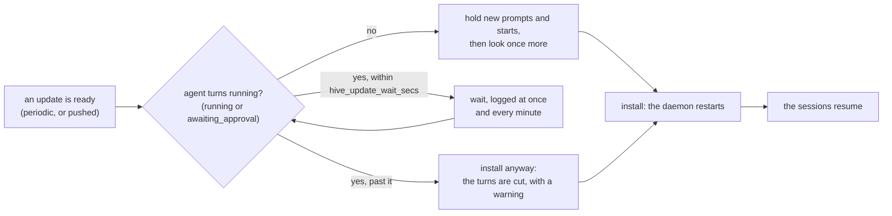

| Platform | Who installs | How the wait runs |
|---|---|---|
| Linux, Windows | the daemon's in-process updater | [`wait_for_agent_turns`](../agents/roomlerd/src/updater.rs#L278) runs before the installer is spawned, for the periodic check and a pushed update alike |
| macOS | the root update helper, `com.roomler.update`, never the daemon | before `installer(8)` the helper asks the root daemon, over its system LocalAPI socket, to hold (`HiveUpdateHold`). The daemon runs the same wait and answers `HiveUpdateHeld {waited_secs, cut}`, then refuses new prompts and starts until that connection closes ([`updater.rs:349`](../agents/roomlerd/src/updater.rs#L349), [`:2805`](../agents/roomlerd/src/updater.rs#L2805)) |

- It waits at most `hive_update_wait_secs` (30 minutes; `0` never waits), looks again
  every 5 s, and logs "update deferred — agent turns running" when it starts and once
  a minute.
- It holds a PUSHED update too: a person asked for the update, not for their agent to
  be cut. It is bounded, so a busy session cannot hold a device's updates back.
- Once no turn runs, new prompts and starts are refused BEFORE a last look, so none
  begins in the gap. One admitted before that still runs, and is waited for. An
  installer that fails to start releases the hold.
- ⚠️ The macOS hold is bound to the helper's connection, not to a timer: a helper
  that dies mid-wait releases it, and so does a failed install. The verb is refused
  to every peer but root, because a hold refuses every new prompt and start on the
  device ([`localapi/src/lib.rs:2503`](../crates/localapi/src/lib.rs#L2503)). A missing, older or
  silent daemon (the helper waits at most 2 h) gets the install it got before: the
  helper fails open.
- ⚠️ `roomlerd self-update`, the CLI, does not wait. It is an operator's explicit
  command, in another process.

---

## 8. Adopting terminal sessions

People already run Claude Code in a terminal. `roomler hive adopt` mirrors those
sessions into the device's store and lists each for its owner alone, read only
(decision 11). A terminal session passed none of Hive's start gates, so adopting has
gates of its own, each default-deny and each owned by a different party. It is Linux
and macOS only: on Windows `hive_adopt` reads off whatever the config says, so the
device never advertises `hive-adopt` ([`gates.rs:73`](../agents/roomlerd/src/hive/gates.rs#L73)),
and the CLI refuses.

| Gate | Owner | Default | A refusal |
|---|---|---|---|
| the hooks are installed (`SessionStart`, `Stop`, `SessionEnd`) | the person, in their own user-level Claude Code settings | not installed | nothing is mirrored |
| `hive_adopt` | the device's owner: a device key, never pushable, advertised as `hive-adopt` | off | nothing reaches the server; an offer from a connection without `hive-adopt` is dropped unanswered |
| the org is served | the server (`hive.tenants`) | — | `hive_not_enabled` |
| the account names ONE person, a member | the device's `hive_accounts`, resolved by the server | — | `no_account` · `ambiguous_account` · `not_a_member` |
| capacity and rate | the server: 16 live adopted sessions a device, 20 offers a minute | — | `at_capacity` · `rate_limited` |

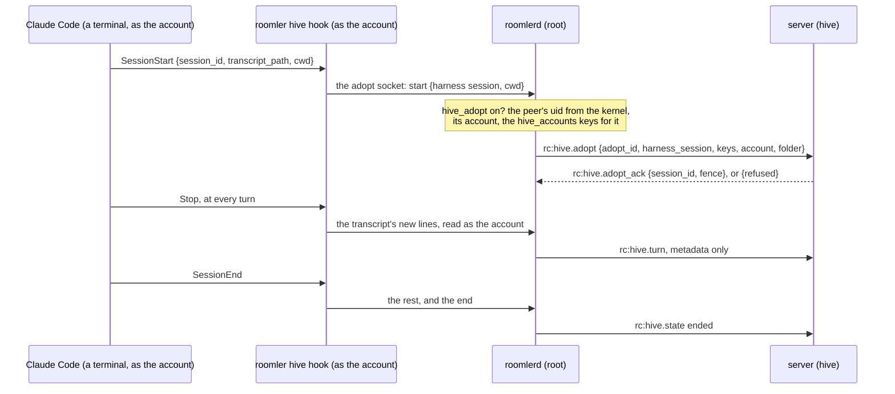

| Rule | Why | Where |
|---|---|---|
| The device sends EVERY `hive_accounts` key that maps to the account, and the server adopts only when they name exactly one person | the attribution is the device owner's statement, never a guess: an account two people share is `ambiguous_account`, never "the one of them who is a member" | [`adopt.rs:285`](../crates/modules/hive/src/adopt.rs#L285) `people` |
| The hook reads the transcript and sends its lines; the daemon never opens a path a hook names | a root daemon that opened a path a hook named would read any file the requester pointed it at | [`supervisor/adopt.rs:651`](../agents/roomlerd/src/hive/supervisor/adopt.rs#L651) |
| Who it is comes from the kernel, the socket's peer credentials, never from the hook; root's own sessions are refused | the hook runs as whoever ran Claude Code, and says nothing that is not checked | [`supervisor/adopt.rs:413`](../agents/roomlerd/src/hive/supervisor/adopt.rs#L413) |
| No drivers, the owner included: naming one is a 409. Readers by name, as for any session. The record has no title, only the folder's name | the terminal holds the harness, and a terminal's first prompt is content | [`access.rs:52`](../crates/modules/hive/src/access.rs#L52) |
| Only the person's conversation is mirrored: `user` and `assistant` lines, never a sub-agent's (`isSidechain`) or Claude Code's bookkeeping | the on-disk transcript is Claude Code's internal format, and a change in it must thin the mirror, never stop it | |
| A terminal killed outright never says `SessionEnd`, so the daemon records Claude Code's process (pid and start time) and ends a session whose process is gone, every minute. That process is the hook's nearest ancestor that is not a shell | Claude Code runs a hook through `/bin/sh -c`, and dash forks it, so the hook's parent is a dying `sh` (P1j-5's field run) | [`procs.rs:44`](../agents/roomlerd/src/hive/procs.rs#L44) `hook_terminal` |
| "Stop mirroring" ends the record and never the terminal; a `claude --resume` later is offered afresh, as a new record | the terminal is the person's: Roomler can only stop watching it | [`supervisor/adopt.rs:818`](../agents/roomlerd/src/hive/supervisor/adopt.rs#L818) |
| `adopted.json`, beside `hosted.json`, keeps what is mirrored and the records of the last 1,000 adopted sessions that ended, which the device still serves to their owner with `hive_enabled` off | a restarted daemon goes on mirroring where it stopped, and an owner can read a session that ended | |
| `hive-adopt` is advertised, and the socket exists, only while `hive_adopt` is on; a daemon started with it off removes a socket its predecessor left | the leftover file read as "this device adopts" (P1j-5) | [`supervisor/adopt.rs:383`](../agents/roomlerd/src/hive/supervisor/adopt.rs#L383) |
| `unadopt` takes out exactly what `adopt` put in, and gives back a file Claude Code wrote byte for byte | the person's settings, and other tools' hooks in them, are theirs | [`hive_hooks.rs`](../agents/roomler-cli/src/hive_hooks.rs) |

---

## 9. The org gate on the server

The module switch (`[modules] hive`) is all or nothing for a server, so it has a
second dial: `hive.tenants` (`ROOMLER__HIVE__TENANTS`), the organizations agent
sessions serve, as comma-separated ids ([`scope.rs`](../crates/modules/hive/src/scope.rs)).
Empty or `*` means every organization, which is what a self-hosted server wants.

⚠️ **The list is the switch.** A non-empty `hive.tenants` mounts the module by itself,
with no `[modules] hive`, and `/api/capabilities` says so
([`settings.rs:858`](../crates/config/src/settings.rs#L858) `Settings::hive_on`). A
hosted server sets only the list, because that form fails safe. An image from before
P1g never reads the list, so with `ROOMLER__MODULES__HIVE=true` beside it, promoting
such an image (a rollback, or another session's older tag) would open the pillar to
every organization on the server. With the list alone, every older image leaves it
off. Clearing the list is the kill switch.

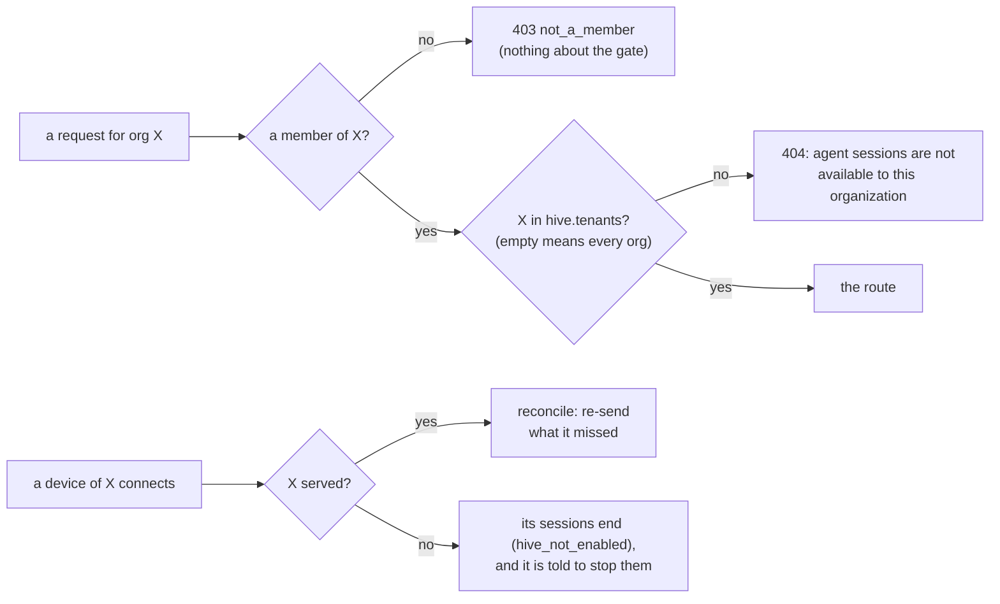

| Where | An organization agent sessions do not serve |
|---|---|
| every route | a `404`, after the membership check, so a non-member still gets `not_a_member` ([`routes.rs:233`](../crates/modules/hive/src/routes.rs#L233) `member_tenant`) |
| `GET /api/tenant/{tid}/hive` | the SPA's question: `{"enabled": true}`, or that 404 |
| the viewer | `hive:view.open` answers `not_found`, as for a session the caller may not read |
| a device connecting | nothing is re-sent; what it still runs for the org ends (`hive_not_enabled`) and it is told to stop ([`agent_socket.rs:647`](../crates/modules/hive/src/agent_socket.rs#L647)) |
| an adopt offer | `hive_not_enabled` |
| a malformed entry | logged, and it matches nothing: a typo shuts the org it meant, and never opens another |

⚠️ **The SPA fails CLOSED for this module alone.** Every other module's capability
gate fails open until `/api/capabilities` answers. `hive` is in `DEFAULT_OFF`
([`registry.ts:39`](../ui/src/modules/registry.ts#L39)), and the router also asks
whether the pillar serves the organization (`checkServed`) before it opens a Hive
page ([`router.ts:394`](../ui/src/plugins/router.ts#L394)).

Prod has served agent sessions to one test organization since 2026-10-09; every
other organization reads the 404.

---

## 10. Platform notes

### Windows: the directories' DACLs

The store, `hosted.json` and each session's runtime files live in the service's
machine-wide directory, `%ProgramData%\roomler\roomler\hive`
([`hive_win.rs:829`](../agents/roomlerd/src/hive_win.rs#L829)), which both kinds of
worker reach. Every directory there is owned by Administrators with a protected DACL,
set by [`dir_with_dacl`](../agents/roomlerd/src/hive_win.rs#L897) as it is made, or
again on one already there.

| Directory | SDDL | Means |
|---|---|---|
| `hive` (the store) and `hive\run` (the runtime root) | `O:BAD:P(A;OICI;FA;;;SY)(A;OICI;FA;;;BA)(A;;0x100080;;;AU)` | SYSTEM and Administrators, in full; Authenticated Users may examine the directory itself, and nothing more ([`hive_win.rs:804`](../agents/roomlerd/src/hive_win.rs#L804)) |
| `hive\run\<session>` | the same owner and first two grants, then `(A;OICI;0x1200a9;;;<account SID>)` | the session's account may also list, traverse and read it, for its settings, its MCP config and its core memory, and writes nothing ([`hive_win.rs:809`](../agents/roomlerd/src/hive_win.rs#L809)) |

- **The owner is set too.** An owner keeps `WRITE_DAC` whatever the DACL says, so a
  folder someone else made there first is taken over, never trusted. A link or a
  junction on the way, or anything but a plain directory in the place, is refused.
- ⚠️ **`FILE_READ_ATTRIBUTES | SYNCHRONIZE` (`0x100080`) for Authenticated Users,
  inherited by nothing.** Both directories lie on the way to every session's
  `…\hive\run\<session>\settings.json`. Claude Code examines each component of a path
  it is handed and refuses the file when one cannot be examined: "Refusing to read a
  file whose path could not be vetted". Field, 2026-10-09 (P1i-4): every session
  ended 1.1 s after its start with exactly that, because the two directories granted
  SYSTEM and Administrators alone, and a session's restricted token has its
  Administrators group deny-only. `SYNCHRONIZE` is needed beside
  `FILE_READ_ATTRIBUTES` because `CreateFileW` asks for it with every synchronous
  open, libuv's `lstat` and Rust's among them: `0x80` alone was still refused. The
  grant is a stat of the directory alone. It lists nothing, so the session ids stay
  unknown, and another session's directory stays closed, its own DACL granting only
  its account. The unit test runs as a restricted Medium copy of its own token, and
  fails on the old DACL
  ([`supervisor.rs:6003`](../agents/roomlerd/src/hive/supervisor.rs#L6003)).

### macOS: the `/var` link

The store's directory is locked to the daemon with no link on its way that someone
other than root could have made
([`untrusted_link`](../agents/roomlerd/src/hive/supervisor.rs#L802)). On a Mac the
root daemon's data directory is under `/var/root`, and `/var` is the system's own
link to `/private/var`. While every link was refused, as FR-85's recording-folder
check refuses them, a Mac opened no store and refused every session "/var is a
symbolic link" (P1h-3, 2026-10-10). So a link is followed when root owns it, in a
directory that root owns and that nobody else may write to, since only root could
have made it. Any other link is refused, as before.

- ⚠️ The published 0.4.122 and 0.4.123 `.pkg`s predate that fix (#1927), so on a Mac
  they refuse every session `launch_failed`. A Mac needs a release that carries it.
- The runtime directory is `/var/run/roomler-hive`, which macOS clears at boot.
- launchd does not kill a harness's process group when the daemon leaves, so
  `wind_down` does it: SIGTERM, then SIGKILL after 3 s.

### Unix: the NGROUPS cap

The privilege path sets the account's supplementary groups from `getgrouplist`, and
`setgroups` refuses the whole list when it is longer than the system's
`NGROUPS_MAX`. That is 16 on macOS, where a test VM's `admin` account was in 17, and
every session on that Mac failed "starting the harness: Invalid argument (os error
22)". The list is now cut to `sysconf(_SC_NGROUPS_MAX)`, in order, the primary group
first, so the child holds fewer groups and never more
([`exec.rs:1004`](../agents/roomlerd/src/exec.rs#L1004) `within_ngroups_max`). Exec, SSH
and the PTY share the fix, since they share the path.

The cap is for `setgroups` alone. `sudo` never reads that list on a Mac, and a Linux
session cannot run `sudo` at all, so nothing is cut below the maximum. What a session
holds of the administrator groups is in §3.

---

## 11. What is field-verified

| Criterion | Linux | macOS | Windows |
|---|---|---|---|
| AC1: a prompt from the session's room comes back as a turn stub, its steps rendered over the viewer peer | ✅ | — | — |
| AC3: `whoami` prints the mapped account (on Windows the console user), never root or SYSTEM; `no_account`; `no_console_user` | ✅ | ✅ | ✅ at Medium integrity |
| AC4, first half: a primary cut off from the server stops calling the model after `offline_grace` | ✅ refused at 125 s, forwarded again after the reconnect | — | — |
| AC5: an approval answered from a phone; the stub holds no tool arguments | ✅ | — | — |
| AC6: a reader's message never reaches the harness | ✅ | — | — |
| AC7: an update waits for a running turn, and logs it | ✅ a real install, 85 s (and a dry run, 80 s) | ✅ a real install by the helper, 135 s | ✅ a real install, 140 s |
| AC8: a fact reaches the next session and not the running one ([`brain.md`](brain.md)) | ✅ | — | — |
| AC20: a session survives a service restart, a restart at an approval and a crash; a changed gate ends it | ✅ | ✅ | ✅ |
| AC20: a session survives an update's restart | ✅ 0.4.123 → 0.4.124, the codeword kept | not yet | not yet |
| AC21: an adopted session is its owner's alone, and read only | ✅ | — | not built |
| Decision 13: a session holds no administrator group and cannot `sudo` | ✅ `27(sudo)` gone, `sudo` refused | ⚠️ the group gone, `sudo` still allowed (§3) | — |
| Decision 15: a Mac refuses a start as an account whose `sudo` needs no password | — | ✅ refused under a rule by user and by group; started with the owner's key, and on a Mac whose `sudo` asks | — |

Linux ran on a throwaway stack (a local server, loopback TURN, a root daemon in WSL),
macOS and Windows on throwaway VMs enrolled in the test organization on prod
(decision 10). Still open: AC2 holds on one device in CI and stays unticked until
replicas exist; AC4's stale-fence half needs P2's promotion; and an update's own
restart is not field-run as a resume on any platform, because the Linux dry run
installs nothing and the only newer release could not resume a session on Windows or
macOS. Every run, its build and what it measured are in the spec's
[§8](fr/FR-90-hive-agent-sessions.md#8-field-verification-log).

In CI, [`hive_canary.rs`](../crates/tests/tests/hive_canary.rs) (AC2, one device),
[`hive_drivers.rs`](../crates/tests/tests/hive_drivers.rs) (AC6),
[`hive_memory.rs`](../crates/tests/tests/hive_memory.rs) and
[`hive_memory_off.rs`](../crates/tests/tests/hive_memory_off.rs) (AC8) drive a real
server and a real in-process device, each in a test binary of its own, because a
process holds one supervisor. The device's own tests run on Linux, macOS and Windows
CI (`hive::`).

---

## 12. P2a: the member's store, and what P2 adds

Until P2 a session lives on the one device that runs it, and it is readable only
while that device is online. P2 gives each session a replicaset: the org's own
devices, each holding a full copy it could resume, with the server learning how fresh
each copy is from sequence numbers and hashes alone (spec §3b). P2a built the store's
half of a member. Nothing sends it anything yet: no frame, no server change, and no
caller outside tests until the join (P2c), the stream (P2d), the purge (P2g) and an
archive replica's search (P2i).

| Piece | What it does | Where |
|---|---|---|
| apply | keeps an envelope another member sent, byte for byte, through the same chain check, so the member ends on the primary's `(seq, hash)` | [`store.rs:338`](../crates/hive-node/src/store.rs#L338) `Store::apply` |
| the fence floor | per session, raised by the server's word before any event of a new fence exists, and only ever raised; an older fence is refused, the device's own appends included | [`store.rs:446`](../crates/hive-node/src/store.rs#L446), [`chain.rs:181`](../crates/hive-node/src/chain.rs#L181) |
| the divergent tail | an older fence's tail, set aside out of `events` and the index; never a tail that holds the floor's fence | [`store.rs:475`](../crates/hive-node/src/store.rs#L475) |
| blobs | content-addressed by BLAKE3, at most 64 MiB each, kept per session; bytes a peer sent under another name are kept under neither | [`store.rs:560`](../crates/hive-node/src/store.rs#L560) |
| purged ids | a purge removes the session's events, floor, tail and the blobs no other session holds, and keeps its id, so nothing takes the session back | [`store.rs:865`](../crates/hive-node/src/store.rs#L865) |
| the writer | each of these on the daemon's one writer thread, answered with the store's own error, so a caller can tell `purged` from a stale fence | [`hive/store.rs:83`](../agents/roomlerd/src/hive/store.rs#L83) `Member` |

⚠️ **The four tables are new, and `user_version` stays 1**
([`store.rs:49`](../crates/hive-node/src/store.rs#L49)). A daemon refuses a store a
newer schema wrote, and the updater's crash-loop rollback can put an older daemon on
a device at any time, so a new column on `events` would cost it every transcript.
`a_daemon_from_before_p2a_reads_what_p2a_wrote` runs P0a's own statements, frozen, on
a store P2a wrote.

⚠️ "Committed" is SQLite's WAL with `synchronous = NORMAL`: an acknowledged event
survives a daemon crash, not a power cut.

### P2b-1: what a checkpoint takes of the config directory

A member can resume a session only with Claude Code's own files: the history that
`--resume` reads byte for byte, the sub-agents' transcripts, the outputs too large
for the context, the auto-memory and `CLAUDE.md`. At each turn's end the primary
will take them as a **checkpoint** (P2b-3 runs it as the session's account), record
it in the chain as a `checkpoint` event, and stream it with the blobs it names. P2b-1
builds what decides what is taken, and how a member puts it back together
([`checkpoint.rs`](../crates/hive-node/src/checkpoint.rs)). Nothing takes one yet.

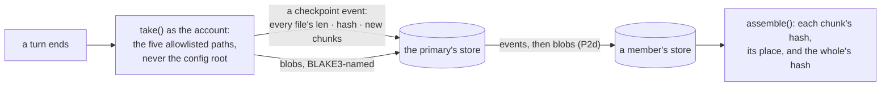

| Path, under the config directory | How Claude Code writes it | How a checkpoint takes it |
|---|---|---|
| `projects/hive-<id>/<id>.jsonl`, the history | appended to only | the bytes past the last checkpoint, up to the last whole line ([`checkpoint.rs:458`](../crates/hive-node/src/checkpoint.rs#L458)) |
| `projects/hive-<id>/<id>/subagents/`: `agent-<id>.jsonl` | appended to only | the same |
| the same directory: `agent-<id>.meta.json` | replaced by a rename | whole, when it changed ([`checkpoint.rs:520`](../crates/hive-node/src/checkpoint.rs#L520)) |
| `projects/hive-<id>/<id>/tool-results/` | each output written once | whole |
| `projects/hive-<id>/memory/` | the auto-memory | whole |
| `CLAUDE.md` | the session's own instructions (P1e) | whole |

The chain is the state. A file's `len` and `hash` in the last checkpoint are where
the next starts ([`checkpoint.rs:335`](../crates/hive-node/src/checkpoint.rs#L335)),
so nothing else is kept between turns. An appended file that shrank, or changed before
its last offset, is taken again from its first byte. A chunk at offset 0 tells a
member to start the file over, and an empty one is sent when no whole line has come
yet, so the old bytes never linger. Chunks are at most 4 MiB, cut at line ends where
one is within reach. One checkpoint lists at most 10,000 files and adds at most
512 MiB.

⚠️ **An allowlist, never the directory** ([`checkpoint.rs:394`](../crates/hive-node/src/checkpoint.rs#L394)).
The config directory's root holds a `peerToken` beside the harness's messaging socket
and a `machineID`, so nothing outside the five paths is opened. The harness id must be
a lowercase, hyphenated UUID, because it is part of every path.

⚠️ **A link is never followed** ([`checkpoint.rs:662`](../crates/hive-node/src/checkpoint.rs#L662)).
A link in the allowlist to the account's `~/.ssh` would copy a key to every member. A
link, or a name that is not UTF-8, is listed as skipped and taken nowhere.

A member's [`assemble`](../crates/hive-node/src/checkpoint.rs#L790) refuses what does
not add up: a missing blob, a blob that does not hash to its name, a chunk out of
place, or a whole that does not hash to the last checkpoint's. The event
([`event.rs:118`](../crates/hive-node/src/event.rs#L118)) is a flat object beside its
`kind`, and nothing in it goes into the full-text index.

### P2b-2: the workspace, through the account's own git

The folder a session works in is checkpointed as a git commit, by the account's own
`git` and never a git built into the daemon (decision 14). It uses plumbing only,
through a temporary index, so the person's index, branches and work tree stay as they
were ([`workspace.rs`](../agents/roomlerd/src/hive/workspace.rs)). P2b-3 will run it
inside `hive-checkpoint`, as the account; for now only its tests do.

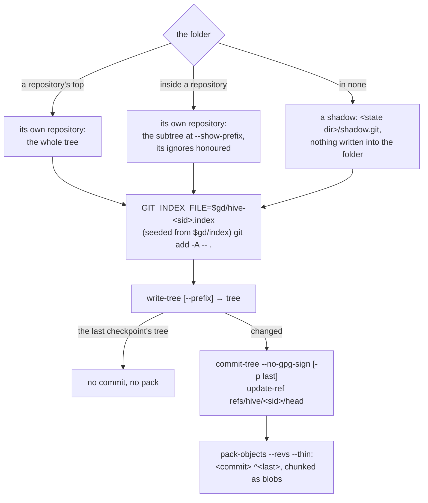

| Step | What it guards | Where |
|---|---|---|
| the repository | its own, or the one the folder is in; a shadow for a folder in none, and a refusal inside a git directory | [`workspace.rs:391`](../agents/roomlerd/src/hive/workspace.rs#L391) |
| the index | `$gd/hive-<sid>.index`, a copy of the person's: theirs is read, never written | [`workspace.rs:297`](../agents/roomlerd/src/hive/workspace.rs#L297) |
| the tree | `write-tree --prefix` for a folder inside a repository, so nothing outside the folder is taken and the repository's `.gitignore` still keeps a `.env` out | [`workspace.rs:444`](../agents/roomlerd/src/hive/workspace.rs#L444) |
| the commit | "Roomler Hive" as author, never the person; `--no-gpg-sign`, so a person's `commit.gpgSign` never waits on their key; the last checkpoint's commit as parent | [`workspace.rs:247`](../agents/roomlerd/src/hive/workspace.rs#L247) |
| the pack | thin against the last checkpoint, whole for the first; at most 512 MiB | [`workspace.rs:468`](../agents/roomlerd/src/hive/workspace.rs#L468) |
| every command | no hook (`core.hooksPath` names nowhere), no fsmonitor, no automatic gc, none of the caller's `GIT_*` environment | [`workspace.rs:872`](../agents/roomlerd/src/hive/workspace.rs#L872) |

⚠️ **The first checkpoint's commit has no parent.** Its pack holds the whole tree and
none of the person's history, because a member has nothing else to resolve a delta
against. Each later commit is the last checkpoint's child, and its pack is thin
against it, so a target applies the packs in order (`git index-pack --fix-thin`). The
person's `HEAD` is recorded beside the commit
([`WorkspaceSnap`](../crates/hive-node/src/checkpoint.rs#L207)), for a teleport into a
clone of the same repository (P2f).

⚠️ A turn that changed no file writes no commit and no pack. A workspace that cannot be
taken (no `git`, a pack over the limit, a folder inside a git directory) never fails the
checkpoint: the config directory is what a resume needs, so the workspace is skipped,
in words. The temporary index and `refs/hive/<sid>/*` stay in the person's repository
until the session ends or is purged (P2g).

### P2b-3a: `hive-checkpoint`, as the account

The daemon never opens a path in the account's tree, so a checkpoint is taken by a
child it starts as the account, `roomlerd hive-checkpoint <request>`, as the Unix
wrapper and Windows' `hive-prep` already run
([`checkpointer.rs`](../agents/roomlerd/src/hive/checkpointer.rs)). P2b-3a builds both
sides. P2b-3b calls it at a turn's end, for a session the server joined as replicated
(P2c).

```mermaid
sequenceDiagram
    participant D as the daemon (root / SYSTEM)
    participant C as hive-checkpoint (as the account)
    participant S as the store
    D->>D: the request into the session's runtime directory:<br/>dirs, n, turn, the last checkpoint
    D->>C: start it as the account (Unix: the session's privilege path;<br/>Windows: the console user, in a job)
    C->>C: take() the allowlist, and the workspace through git
    C-->>D: stdout: magic · header · blobs
    D->>D: read_frames (limits), then check() against the request
    D->>S: P2b-3b: the blobs, then the checkpoint event
```

| On stdout | What the daemon holds it to |
|---|---|
| `HIVECP1\n` | the magic, or nothing is read |
| u32 · JSON `{"checkpoint": …}` | at most 16 MiB; the request's `n` and `turn`; every path inside the allowlist, in order, taken the way the allowlist says, at most mode `0o777` ([`checkpointer.rs:201`](../agents/roomlerd/src/hive/checkpointer.rs#L201)) |
| u32 · then u64 · bytes per blob | each the very blob its chunk names, by length and hash, in order (each file's, then the pack's); not one more or fewer; each at most 4 MiB ([`checkpointer.rs:159`](../agents/roomlerd/src/hive/checkpointer.rs#L159)) |
| the workspace | git's ids only (40 or 64 hex digits), and a prefix that cannot step outside the repository |

⚠️ **What comes back is the account's word, and the agent runs as that account.** The
child is the daemon's own binary, but the account can reach it while it runs. So the
daemon takes nothing on trust. A path like `../.ssh/id_ed25519` or `sessions/1.key`,
a blob swapped for another, an extra or a missing one, or a `../` prefix is refused
before the store sees any of it. A member still checks each whole file again when it
assembles it.

The child gets 120 s ([`checkpointer.rs:304`](../agents/roomlerd/src/hive/checkpointer.rs#L304))
and may write at most the limits' sum. On Unix it is started through the session's
privilege path ([`checkpointer.rs:560`](../agents/roomlerd/src/hive/checkpointer.rs#L560)).
On Windows it runs as the user signed in at the console, whom `hive_accounts` must name
([`hive_win.rs:1056`](../agents/roomlerd/src/hive_win.rs#L1056)), in a job of its own.

⚠️ **An ended checkpoint takes its `git` with it.** On Unix the child leads its own
process group, and a timeout, too much output or an abandoned checkpoint signals the
whole group ([`child.rs:28`](../agents/roomlerd/src/hive/child.rs#L28)
`Group`). Until P2b-3b it signalled the leader alone (`start_kill`, `kill_on_drop`),
which left a `git add` hashing the folder behind it. TERM goes first, then KILL after
2 s, because git removes its lock files on TERM and never on KILL. The group is
signalled only while its leader is unreaped: after that its id may name someone else's
group.

### P2b-3b: a checkpoint at each turn's end

A replicated session checkpoints each turn's end
([`checkpointer.rs:398`](../agents/roomlerd/src/hive/checkpointer.rs#L398)). The checkpoint
comes after the turn's `result` and before the next queued prompt begins, so it holds
the files as the turn left them; nothing writes them while the harness waits for input.
The blobs go into the store first, then the `checkpoint` event, so a member that sees the
event can fetch every blob it names.

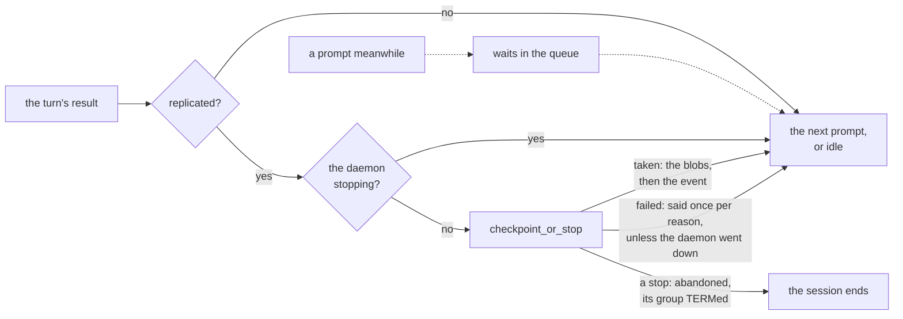

| Piece | What it does |
|---|---|
| the switch | `StartOrder.replicated`: a session the server joined as replicated (P2c, which sets it from the wire). Kept in `hosted.json`, so a resume after a restart goes on checkpointing; absent from an older file, it reads off |
| where it runs | in the session's run loop, not inside the event that ended the turn ([`supervisor.rs:3301`](../agents/roomlerd/src/hive/supervisor.rs#L3301) `checkpoint_or_stop`), so the session still listens: a prompt sent meanwhile waits behind it, and a stop is a stop |
| a stop during one | abandons it: its child's group is TERMed and no checkpoint is recorded. The next one takes everything since the last one kept |
| where the next one starts | the last checkpoint, in memory; after a restart, read back from the store ([`store.rs:666`](../crates/hive-node/src/store.rs#L666) `last_of_kind`). A checkpoint an older daemon stored has no `kind` column, so the next one takes everything again: more bytes, never a wrong checkpoint |
| the request | `checkpoint.json` in the session's runtime directory, the daemon's own: made `0600` and handed to the account through its descriptor, never by a path ([`checkpointer.rs:527`](../agents/roomlerd/src/hive/checkpointer.rs#L527)); on Windows it takes the session directory's DACL |
| a failure | logged with the session and the number, and said once per reason in the transcript ("Checkpoint 3 was not taken: …"); the session goes on |
| the daemon going down | starts none, and says no failure: the child went down with it (systemd signals the whole cgroup at once), and the next daemon's next checkpoint takes what this one would have (P1d-2) |
| a lock left behind | a lock on the checkpoint's own index older than 300 s is cleared ([`workspace.rs:277`](../agents/roomlerd/src/hive/workspace.rs#L277)). A KILL or a power cut leaves one, and it would refuse every checkpoint after it for good; no checkpoint holds one longer than its 120 s |
| the room | a `checkpoint` event is one line: "💾 Checkpoint 2: 1 of 3 of the agent's files changed; the folder committed", or the folder unchanged, or not kept and why |

⚠️ Nothing sets `replicated` before P2c, so no device takes a checkpoint yet. Three
tests turn it on: `a_replicated_session_checkpoints_each_turns_end_and_no_other_does`
(the chain: the history from where the last checkpoint left it, the folder's commit on
the last one's, and the other side), `a_failed_checkpoint_is_said_once_and_the_session_goes_on`,
and `a_stop_is_heard_while_a_checkpoint_runs_and_a_prompt_waits_behind_it`.

⚠️ **Open before P2c turns it on: a folder too big to add.** A folder whose first `git
add` cannot finish within 120 s fails at every turn's end. The add that is ended writes
no index, so the next one starts over, and each such turn waits the full 120 s before
its next prompt. P2c must refuse such a folder up front, or bound the add.

⚠️ **The allowlist is the harness's.** What P2b-1 takes is Claude Code's own layout
(`projects/hive-<id>/…`, `CLAUDE.md`). Codex keeps its rollouts elsewhere
(`~/.codex/sessions`), so the Codex adapter (design §4, P7) brings its own allowlist;
until then only a Claude Code session is replicated.

### P2b-4a: `hive-materialize`, the config directory as the account

The reverse of `hive-checkpoint`. A promotion (P2e) or a teleport (P2f) puts the
session's last checkpoint back on the device that will run it, and the daemon never
writes a path in the account's tree. So it starts `roomlerd hive-materialize` as the
target's account and streams it the files
([`materializer.rs`](../agents/roomlerd/src/hive/materializer.rs)). P2b-4a builds both
sides for the config directory; P2b-4b adds the folder (below). Nothing calls it before P2e.

```mermaid
sequenceDiagram
    participant D as the daemon (root / SYSTEM)
    participant S as the store
    participant M as hive-materialize (as the account)
    D->>D: plan(): the last checkpoint's files, and for each the<br/>chunks since it last started over (chunks_of)
    D->>M: start it as the account (Unix: the session's privilege path;<br/>Windows: the console user, in a job)
    D->>M: stdin: magic · header (every file's path, len, hash)
    M->>M: refusal() and check_places(): every name and every place,<br/>before anything is written
    loop each file, blob by blob
        S-->>D: get_blob, held to its chunk
        D->>M: the bytes
        M->>M: staged beside where it goes, 0600, hashed as it arrives
    end
    M->>M: every file held to its entry, then all renamed into place,<br/>then what the checkpoint no longer lists removed
    M-->>D: stdout: {"files": N, "removed": M}
```

| Step | What it guards | Where |
|---|---|---|
| the plan | every path in the allowlist; each file's chunks from its last start-over, adding up to its entry. A history is streamed, never held whole | [`materializer.rs:190`](../agents/roomlerd/src/hive/materializer.rs#L190) · [`checkpoint.rs:740`](../crates/hive-node/src/checkpoint.rs#L740) `chunks_of` |
| the stream | each blob held to its chunk before it goes; a blob the store lacks ends the stream short, the child writes nothing, and the daemon's own word is the answer | [`materializer.rs:350`](../agents/roomlerd/src/hive/materializer.rs#L350) |
| the names | the allowlist again, in order. On Windows: no device name (`aux.md` is AUX, `COM1.log` is COM1), none of `<>:"\|?*` or a control character, no trailing dot or space, at most 259 characters where it goes. On Windows and macOS: no two names that differ only in case | [`materializer.rs:714`](../agents/roomlerd/src/hive/materializer.rs#L714) |
| the places | every directory on the way is one of its own, never a link to one, and no file goes where a directory is | [`materializer.rs:848`](../agents/roomlerd/src/hive/materializer.rs#L848) |
| the files | staged beside where they go, `0600` whatever mode the checkpoint's OS kept, and each held to its entry's length and hash; only then are they renamed into place | [`materializer.rs:594`](../agents/roomlerd/src/hive/materializer.rs#L594) |
| what goes | inside the allowlist, a file the checkpoint does not list is removed, never through a link and no deeper than a checkpoint looks; nothing outside it is touched (a login, the harness's own state) | [`materializer.rs:984`](../agents/roomlerd/src/hive/materializer.rs#L984) |

⚠️ **What comes in is another device's word.** A checkpoint was taken by whichever
member was primary, and this daemon only relays it. Unchecked, a path that climbs out
with `..` would be written as the target's account wherever it can write, its
`~/.bashrc` included. So the child holds every name to the allowlist again. A refusal at any step writes nothing, and
the files it staged so far are removed.

⚠️ **Windows' names are refused before anything moves.** A Linux session's memory can
hold `aux.md` or `a:b.md`, which Windows cannot. Two names that differ only in case
are one file on Windows and on a default macOS volume. P2f's prepare refuses such a
session up front through the same `refusal`.

⚠️ **A child that refuses is answered in its own words.** It stops reading, and the
feed then meets a closed pipe, which would otherwise be all that is said
([`child.rs:79`](../agents/roomlerd/src/hive/child.rs#L79)). On Unix the runner, its
process group and its time limit are the ones `hive-checkpoint` uses. On Windows a
thread of its own feeds the child's pipe
([`hive_win.rs:1086`](../agents/roomlerd/src/hive_win.rs#L1086)).

The files are written `0600` because a checkpoint taken on Windows records mode 0,
and restoring that on Linux would leave the account unable to read its own history.

### P2b-4b: `hive-materialize`, the folder as the account

The same child takes the session's folder back too, after the config directory's files
are staged ([`workspace.rs`](../agents/roomlerd/src/hive/workspace.rs)). The daemon
sends the packs that bring the last checkpoint's commit
([`materializer.rs:248`](../agents/roomlerd/src/hive/materializer.rs#L248)):
back from it along each `base` to a whole pack, past the turns that changed nothing,
and oldest first, so each thin pack finds its base in the repository already.

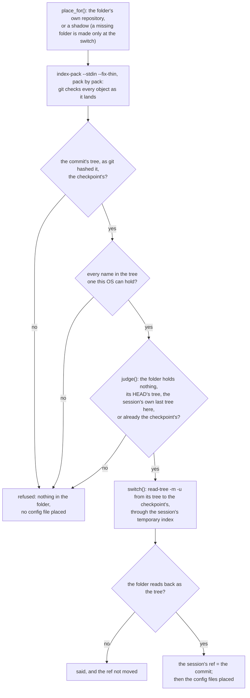

| Step | What it guards | Where |
|---|---|---|
| the place | the folder's own repository, at its prefix, or a shadow in the session's state directory; a link where the folder goes is refused | [`workspace.rs:557`](../agents/roomlerd/src/hive/workspace.rs#L557) |
| the packs | each through `git index-pack --stdin --fix-thin`, which checks every object as it lands. Nothing else of the repository changes; the objects of a materialize refused later are referenced by nothing, and git's own gc takes them | [`workspace.rs:582`](../agents/roomlerd/src/hive/workspace.rs#L582) |
| the tree | the commit's tree, as git hashed it, must be the one the checkpoint names | [`materializer.rs:672`](../agents/roomlerd/src/hive/materializer.rs#L672) |
| the names | every path in the tree held to the same rules as the config directory's: Windows' names and lengths where it goes, and on Windows and macOS two names that are one there, files or the directories on their way (`Dir/a` beside `dir/b`) | [`materializer.rs:765`](../agents/roomlerd/src/hive/materializer.rs#L765) |
| the folder | only one it is safe to replace: holding nothing yet, exactly its own `HEAD`'s tree (a clean clone), exactly what this session last left in it (a former primary: moving back), or already the checkpoint's. Anything else is the person's own work, and is refused | [`workspace.rs:695`](../agents/roomlerd/src/hive/workspace.rs#L695) |
| the switch | git's own two-tree `read-tree -m -u`, through the session's temporary index: what the tree lacks is removed, what it changes is rewritten with the repository's line endings and filters, and an untracked file in the way is refused before anything is written | [`workspace.rs:744`](../agents/roomlerd/src/hive/workspace.rs#L744) |
| a folder inside a repository | the switch is between the whole repository's trees, the index's and the same with the folder's subtree swapped, so nothing outside the folder moves | [`workspace.rs:791`](../agents/roomlerd/src/hive/workspace.rs#L791) |
| the end | the folder read back as a checkpoint reads it must be the tree; only then is `refs/hive/<sid>/head` the commit, where the next checkpoint here starts | [`workspace.rs:744`](../agents/roomlerd/src/hive/workspace.rs#L744) |

⚠️ **The person's `HEAD`, branches and index are never touched**, as the checkpoint
side never touches them. In a clean clone the session's changes land in the work tree
as uncommitted changes, which is what they were where the checkpoint was taken.

⚠️ **A move keeps git's tree, not the bytes** (design §6.3). Line endings follow the
target's git configuration, so a Windows checkout with `core.autocrlf=true` lands with
CRLF. That is why the folder is held to the tree id, never byte for byte. A folder whose
git cannot give the tree back — a CRLF blob into a repository with
`core.autocrlf=input` — is said to, and its ref is not moved.

⚠️ **A switch that fails part way is not undone.** Every check runs before the folder is
touched, and git refuses an untracked file in the way before it writes. But a write that
fails part way (a full disk) leaves the folder between the two trees. The ref is not
moved, the config files are not placed, and the materialize says so.

### P2c-1: the device's gates for holding copies

Before any frame of the replicaset exists, the device's own refusals do (§3g). Three
keys, each the device owner's, default off, never pushable, and in the lock test's list
([`models.rs:5542`](../crates/remote_control/src/models.rs#L5542)):

| Key | What it is | Where |
|---|---|---|
| `hive_replica` | hold copies of the sessions the owner runs on their other devices. While it is on the device keeps a store, as an archive replica's container must although it runs nothing | [`config.rs:471`](../crates/agent-core/src/config.rs#L471) · [`supervisor.rs:775`](../agents/roomlerd/src/hive/supervisor.rs#L775) |
| `hive_archive` | offer the device as the org's archive replica; only ever with `hive_replica`, so alone it reads off | [`gates.rs:79`](../agents/roomlerd/src/hive/gates.rs#L79) |
| `hive_store_quota_mib` | the most the device keeps as a replica, in MiB; unset, the disk's | |

Two verbs join the wire's vocabulary, `hive-replica` and `hive-archive`
([`models.rs:663`](../crates/remote_control/src/models.rs#L663)). `hive` is the prefix of
both, and the three are different promises: running sessions is not holding copies of
other devices', and a replica is no archive. They are matched by equality and locked by
test, like `ssh` and `ssh-consent`.

⚠️ **A verb is advertised only with the frames it promises.** Advertising one says the
device understands its frames, and nothing answered a join before P2c-3b: a server that
saw `hive-replica` then would have waited for a `join_ack` that never came. P2c-3b
advertises both together with the join's handling, only while the keys are on.

⚠️ **A folder too big for one checkpoint is skipped at once**
([`workspace.rs:327`](../agents/roomlerd/src/hive/workspace.rs#L327)). Before `git add`
hashes anything, `git ls-files --others` walks what the index does not have yet,
without hashing and with ignores honoured, and stops at the first limit passed: 20,000
files or 512 MiB. The workspace is then skipped, in words that point at `.gitignore`.
Without it, a folder too big to add within the checkpoint's 120 s failed at every turn's
end, because an add that is ended writes no index and the next one starts over. That was
P2b-3b's open prerequisite for P2c.

### P2c-2a: the org's replica policy

Where an organization's sessions are copied is the organization's call (spec §3b,
"Membership and placement"): one document per organization in `hive_policies`, unique on
`tenant_id` ([`lib.rs:259`](../crates/modules/hive/src/lib.rs#L259)), written by an
`ADMINISTRATOR` and audited. Until one is written, every reader gets decision 2's
defaults ([`policy.rs:91`](../crates/modules/hive/src/policy.rs#L91)). The two routes,
`GET` and `PUT …/hive/policy` ([`lib.rs:194`](../crates/modules/hive/src/lib.rs#L194),
`docs/api.md`), answer **404** while the server's `hive.replicaset` is off
([`settings.rs:83`](../crates/config/src/settings.rs#L83),
[`policy.rs:247`](../crates/modules/hive/src/policy.rs#L247)) or `hive` does not serve the
organization. Placement (P2c-2b) is its reader.

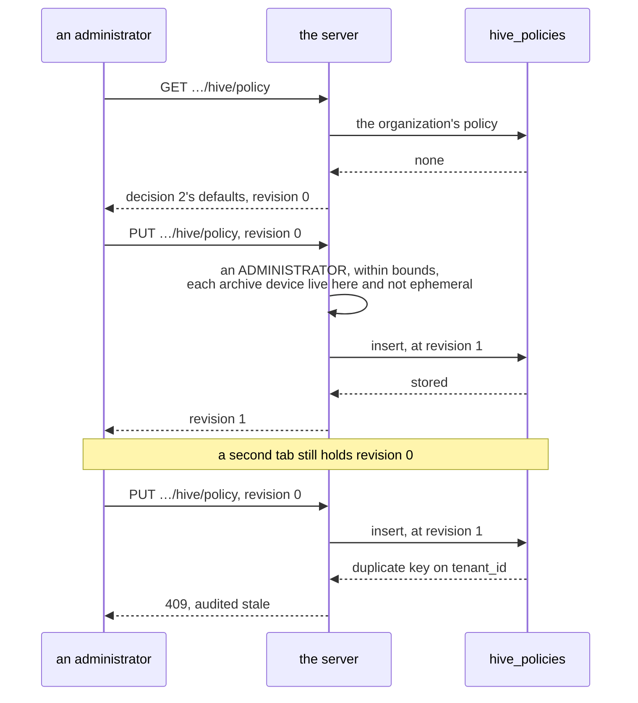

| Field | What a write may set | Why |
|---|---|---|
| `replicaset.min` | 1 to 8; the primary counts | fewer copies than `min` is shown in the session's room, never accepted in silence |
| `replicaset.max` | `min` to 8 | |
| `replicaset.archive` | whether every archive replica the rules allow joins | |
| `replicaset.prefer` | `owner_devices`, once; any other word is refused | the one order decision 2 names. Refused rather than stored, so a word the server cannot place by fails at the write, not silently at every placement |
| `replicaset.restricted_tags` | trimmed, empties dropped, once each, at most 16 of 40 characters ([`agent.rs:931`](../crates/modules/fleet/src/agent.rs#L931)) | normalized as device tags are, so a tag compares equal to the one a device carries |
| `retention_days` | 0 to 3650; 0 keeps sessions for ever | P2g applies it |
| `archive_devices` | at most 16, each a live device of this organization and not ephemeral, each kept once ([`policy.rs:315`](../crates/modules/hive/src/policy.rs#L315)) | the administrator's half of an archive replica. The device's own `hive_archive` is the other half, read where placement runs, so either may come first |

⚠️ **A write names the revision it read** ([`policy.rs:169`](../crates/modules/hive/src/policy.rs#L169)).
A `PUT` replaces the whole policy, so two administrators editing at once would otherwise
each write over the other's change unseen. The first write is an insert, and the unique
index decides between two of them; every later one is an update filtered by
`{tenant_id, revision}` ([`policy.rs:193`](../crates/modules/hive/src/policy.rs#L193)).
Either way the loser gets **409** and reads again.

⚠️ **An ephemeral device is never an archive replica**
([`policy.rs:328`](../crates/modules/hive/src/policy.rs#L328)). FR-51 fixes `ephemeral`
at enrollment, and the reaper hard-deletes such a row once it goes quiet: it could keep
nothing for the retention, and never acknowledge a purge.

⚠️ **Only a device that is not there is a refusal.** A lookup that failed is the
database's answer: a **500**, never a `not_a_device` row in the audit blaming the caller.

Every attempt lands in `hive_audit` as `action: policy`
([`policy.rs:368`](../crates/modules/hive/src/policy.rs#L368)): `set`, or `refused` with
`no_permission`, `invalid`, `not_a_device`, `ephemeral` or `stale`.

A policy only ever says where copies **may** go. Whether a device holds one is still its
owner's `hive_replica` (P2c-1), which no policy and no server can turn on.

### P2c-2b: placement at a start

Placement chooses a session's members from the policy and the devices' stored rows. Its
rules are one pure function, `place`
([`placement.rs:147`](../crates/modules/hive/src/placement.rs#L147)), each rule a unit
test. With `hive.replicaset` on, the start route runs it before the record is written
([`routes.rs:425`](../crates/modules/hive/src/routes.rs#L425)) and keeps the result on the
record as `replicaset` ([`model.rs:178`](../crates/modules/hive/src/model.rs#L178)), which
the session view carries (`docs/api.md`). A placement is a plan: nothing reaches a member
before the join (P2c-3), and the member's own `hive_replica` decides whether it takes the
copy.

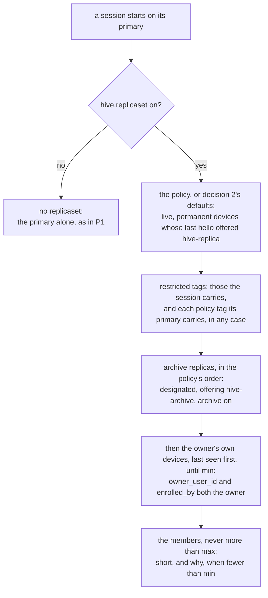

| Rule | Why | Where |
|---|---|---|
| A member offers: its last hello advertised `hive-replica`, and it is live, not ephemeral, and not the primary | the device owner's `hive_replica` is the gate that survives a compromised server; FR-51 hard-deletes an ephemeral row once it goes quiet | [`placement.rs:176`](../crates/modules/hive/src/placement.rs#L176), [`agent.rs:242`](../crates/services/src/dao/agent.rs#L242) |
| The owner's own devices are those whose `owner_user_id` **and** `enrolled_by` both name the session's owner | `owner_user_id` is reassignable with `MANAGE_AGENTS` alone: a device manager who hands someone a device must not receive that person's sessions on it | [`placement.rs:209`](../crates/modules/hive/src/placement.rs#L209) |
| Archive replicas come first, in the policy's order: designated, offering `hive-archive`, and only while `archive` is on | the administrator's half and the device owner's half | [`placement.rs:184`](../crates/modules/hive/src/placement.rs#L184) |
| The owner's devices fill to `min`, last seen first and ties by id; never more than `max` in all | decision 2, and the same answer whenever it is computed | [`placement.rs:222`](../crates/modules/hive/src/placement.rs#L222) |
| A restricted tag only ever takes a device out | a copy is everything the agent saw | [`placement.rs:177`](../crates/modules/hive/src/placement.rs#L177) |
| An adopted session is placed nowhere | decision 11; the adopt path records no replicaset at all | [`placement.rs:167`](../crates/modules/hive/src/placement.rs#L167) |

⚠️ **A tag is compared without case**
([`placement.rs:138`](../crates/modules/hive/src/placement.rs#L138)). A primary tagged
`Prod` is restricted by the policy's `prod`, and a device tagged `PROD` may hold its
copies. A comparison that assumed one casing would leave that session unrestricted: a
guard that assumes a casing is no guard.

⚠️ **Restricted tags stick.** The record keeps the tags the session carries, in the
policy's spelling. A later placement adds to them and never takes one away, so a session
that was restricted stays restricted, whatever its primary is tagged later.

⚠️ **Placement reads each device's stored row, not the pod's live connections.** A device
offline at the start is placed, and joins when it connects (P2c-3). A row can be stale:
it may still offer `hive-replica` after its owner turned the key off. That device refuses
the join itself.

⚠️ **Replication never blocks a start.** A policy or device read that fails is logged,
and the session starts on its primary alone, with no `replicaset`.

A session with fewer members than `min` says why in `short`: `restricted` when a device
that would hold a copy lacks a restricted tag, `no_device` when no other device offers.
The room's header shows it in P2j. Each placement lands in `hive_audit` as
`action: place`, `placed` or `short` with that word
([`routes.rs:480`](../crates/modules/hive/src/routes.rs#L480)).

P2c-2b places only at a start. Placement runs again when the policy or its archive
replicas change, when a member goes and when a device's tags or owner change (P2c-4a,
below), and a session from before P2 is placed when its primary connects (P2c-4b).

### P2c-3a: the join, and what a member says back

A member learns it holds a session from `rc:hive.replica.join`. The server learns what
each member holds from what the member says back: its answer, then the tip of its copy
(spec §3b, "What the server learns"). P2c-3a builds the frames and the server's half
([`replica.rs`](../crates/modules/hive/src/replica.rs)). The device's half is P2c-3b,
below: its gates on a join, the membership its store keeps, and its tips. A server
sends no join to a build that does not advertise `hive-replica`.

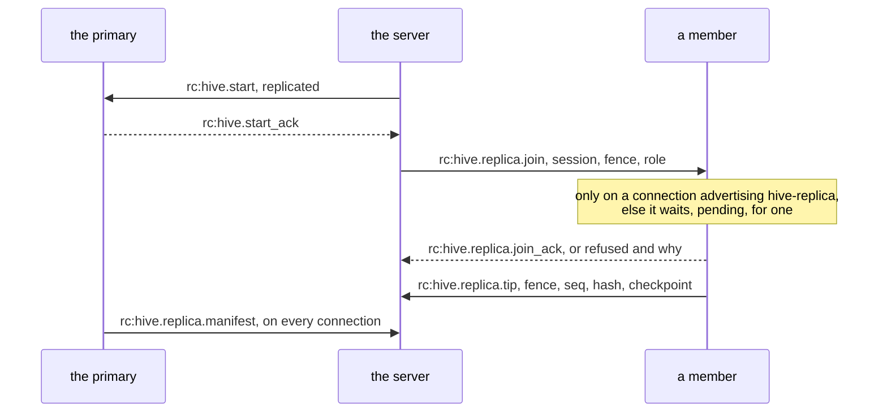

| Frame | From | Says | Where |
|---|---|---|---|
| `rc:hive.start` gains `replicated` | the server | the session has members besides its primary: checkpoint each turn's end (P2b-3b). Absent, as from every earlier server, and a device that predates it ignores it | [`signaling.rs:3033`](../crates/remote_control/src/signaling.rs#L3033); the device takes it into its start order, [`signaling.rs:4252`](../agents/roomlerd/src/signaling.rs#L4252) |
| `rc:hive.replica.join` | the server | `{session_id, fence, role}`: hold a copy, as `archive` or `owner`; or, as `primary` (P2c-4b, below), checkpoint the session you run, which has members now. A role the device cannot name decodes as none, and it refuses | [`signaling.rs:3049`](../crates/remote_control/src/signaling.rs#L3049) |
| `rc:hive.replica.join_ack` | a member | joined, or `refused`: `replica_disabled`, `archive_disabled`, `secondary_org`, `purged`, `stale_fence` or `quota`. An unknown word is still a refusal | [`signaling.rs:831`](../crates/remote_control/src/signaling.rs#L831), [`hive.rs:576`](../crates/remote_control/src/hive.rs#L576) |
| `rc:hive.replica.tip` | a member, or the primary | `{session_id, fence, seq, hash, checkpoint?}`: where its copy ends, at most every 5 s and at each checkpoint | [`signaling.rs:858`](../crates/remote_control/src/signaling.rs#L858) |
| `rc:hive.replica.manifest` | each device, on every connection | every session it holds a copy of, its own included, each with its tip; at most 4,096 | [`signaling.rs:876`](../crates/remote_control/src/signaling.rs#L876), [`hive.rs:491`](../crates/remote_control/src/hive.rs#L491) |

| When | What the server does | Where |
|---|---|---|
| the primary accepts the start | sends each member that has not answered its join, in its role | [`agent_socket.rs:403`](../crates/modules/hive/src/agent_socket.rs#L403), [`replica.rs:121`](../crates/modules/hive/src/replica.rs#L121) |
| a device connects | sends it every join it has still to answer, if THIS connection advertises `hive-replica`. A member placed before P2c-3a has no state, and counts as pending | [`agent_socket.rs:323`](../crates/modules/hive/src/agent_socket.rs#L323), [`replica.rs:141`](../crates/modules/hive/src/replica.rs#L141), [`dao.rs:565`](../crates/modules/hive/src/dao.rs#L565) |
| a join answer arrives | the member is `joined`, or `refused` with the device's word | [`replica.rs:195`](../crates/modules/hive/src/replica.rs#L195), [`dao.rs:484`](../crates/modules/hive/src/dao.rs#L484) |
| a tip arrives, alone or in a manifest | kept on the member's entry: the fence, `seq`, hash and newest checkpoint, and when it was heard | [`replica.rs:233`](../crates/modules/hive/src/replica.rs#L233), [`dao.rs:539`](../crates/modules/hive/src/dao.rs#L539) |

Each member on the record now carries `state` (`pending`, `joined` or `refused`,
[`model.rs:224`](../crates/modules/hive/src/model.rs#L224)), the refusal, when it
answered, and its tip ([`model.rs:255`](../crates/modules/hive/src/model.rs#L255)), all
in the session view (`docs/api.md`). The primary is `joined` from its placement: it holds
the session by running it. It is `pending` only while it is owed its own join (P2c-4b).

⚠️ **A join goes only to a connection that advertises `hive-replica`**
([`hub.rs:1845`](../crates/modules/fleet/src/hub.rs#L1845)). Advertising says two things
at once: the device understands the join, and its owner lets it hold copies. Any other
connection receives nothing, and the join waits, pending, for one that does, as an
offline device's remote configuration waits.

⚠️ **What a member says is a claim, applied only where the record names that device.**
An answer from a device placement did not choose, or to another fence, matches nothing.
A tip from a member that refused is dropped: by its own word it holds nothing.

⚠️ **A hash that is not one is never stored**
([`replica.rs:236`](../crates/modules/hive/src/replica.rs#L236)): exactly 64 lowercase
hex characters ([`hive.rs:507`](../crates/remote_control/src/hive.rs#L507)), or the
report is dropped.

⚠️ **A start says `replicated` only when placement chose another member**
([`replica.rs:56`](../crates/modules/hive/src/replica.rs#L56)). With the switch off there
is no placement, so no start says it and nothing checkpoints; from P2c-4b a start sent
again says it only while the switch is on, too (below). The device keeps the flag
in its start order and its hosted record, so a restarted daemon still checkpoints the
session (P2b-3b).

### P2c-3b: the join, the device's half

A device answers a join through its own gates, keeps what it joined in its store, and
tells the server where each copy ends
([`supervisor/replica.rs`](../agents/roomlerd/src/hive/supervisor/replica.rs)).

```mermaid
flowchart TD
    J["rc:hive.replica.join, session, fence, role"] --> G1{"on the primary<br/>enrollment's connection?"}
    G1 -- no --> R1["secondary_org"]
    G1 -- yes --> G2{"the owner's hive_replica on?"}
    G2 -- no --> R2["replica_disabled"]
    G2 -- yes --> G3{"a role this build can name?<br/>an archive's hive_archive on?"}
    G3 -- no --> R3["other, or archive_disabled"]
    G3 -- yes --> G4{"the store open,<br/>and under hive_store_quota_mib?"}
    G4 -- no --> R4["other, or quota"]
    G4 -- yes --> T["one transaction: not purged, not below the floor,<br/>the floor raised to the fence, the membership kept"]
    T -- refused --> R5["purged, or stale_fence"]
    T -- kept --> A["rc:hive.replica.join_ack, joined"]
```

The gates run in that order ([`replica.rs:43`](../agents/roomlerd/src/hive/supervisor/replica.rs#L43)),
and the answer goes back on the connection the join came on
([`supervisor.rs:554`](../agents/roomlerd/src/hive/supervisor.rs#L554)). A join that
passes is one transaction in the store
([`store.rs:247`](../crates/hive-node/src/store.rs#L247) `Store::join`): the floor rises to
the join's fence, and a row in `memberships` keeps the role and fence
([`store.rs:114`](../crates/hive-node/src/store.rs#L114)). It is a new table, so
`user_version` stays 1 and a daemon the updater rolled back still opens the file. A purge
ends the membership with the rest ([`store.rs:876`](../crates/hive-node/src/store.rs#L876)).

| What the device says | When | Where |
|---|---|---|
| `rc:hive.replica.join_ack` | at once, joined or refused with its word | [`supervisor.rs:554`](../agents/roomlerd/src/hive/supervisor.rs#L554) |
| `rc:hive.replica.tip` | after each checkpoint of a replicated session it runs | [`supervisor.rs:3328`](../agents/roomlerd/src/hive/supervisor.rs#L3328), [`replica.rs:321`](../agents/roomlerd/src/hive/supervisor/replica.rs#L321) |
| `rc:hive.replica.manifest` | on every connection, after the P1b manifest: every membership and every replicated session it runs, newest first | [`supervisor.rs:1388`](../agents/roomlerd/src/hive/supervisor.rs#L1388), [`replica.rs:287`](../agents/roomlerd/src/hive/supervisor/replica.rs#L287) |

A tip is the chain's end, the event's fence, `seq` and hash, and the newest `checkpoint`
event's `seq` and hash. A member that holds nothing yet says `seq` 0 at its floor
([`replica.rs:131`](../agents/roomlerd/src/hive/supervisor/replica.rs#L131)): it joined,
and waits for the carrier.

The device advertises `hive-replica` while its owner's `hive_replica` is on and the store
opened, and `hive-archive` while `hive_archive` is on too
([`caps.rs:1644`](../agents/roomlerd/src/encode/caps.rs#L1644)). A secondary org's
connection strips both words, in its hello and in every heartbeat that re-announces the
caps ([`signaling.rs:5234`](../agents/roomlerd/src/signaling.rs#L5234)), so that org's
placement never picks this device.

⚠️ **Only a device with copies to tell about sends a replica frame**
([`replica.rs:273`](../agents/roomlerd/src/hive/supervisor/replica.rs#L273)). One whose
owner never turned `hive_replica` on, and that runs no replicated session, sends no
`rc:hive.replica.*` at all, so a server from before P2c-3a never receives a word it cannot
read.

⚠️ **The keys are read once, at the daemon's start**, like every `hive_*` key. Turning
`hive_replica` on is advertised, and answered, from the next start.

⚠️ **The quota is the store's own count of its pages**
([`store.rs:296`](../crates/hive-node/src/store.rs#L296)). The write-ahead log is folded
back at each checkpoint, and is not counted.

⚠️ **A joined member holds no copy yet.** The copy comes with the carrier and the stream
(P2d). Until then its tip is `seq` 0, and the server knows it as joined and empty.

### P2c-4a: placement decided again

A placement is not frozen at the start. When something it reads changes, the server
decides again for every live placed session of the organization
([`placement.rs:330`](../crates/modules/hive/src/placement.rs#L330)).

| What changed | Who tells hive | Where |
|---|---|---|
| a device's tags or owner | fleet's update route, once they are stored, through a new core hook, `agent_updated`; a failing holder is the route's 500, and a retry decides again | [`agent.rs:1042`](../crates/modules/fleet/src/agent.rs#L1042), [`hooks.rs:149`](../crates/core/src/hooks.rs#L149), [`hooks.rs:114`](../crates/modules/hive/src/hooks.rs#L114) |
| the policy, or its archive replicas | the policy write, after it is stored | [`policy.rs:354`](../crates/modules/hive/src/policy.rs#L354) |
| a member removed from the fleet | the removal cascade, hive first, while the row is still there: the device is named as gone | [`hooks.rs:103`](../crates/modules/hive/src/hooks.rs#L103) |

```mermaid
flowchart TD
    C["a tag, an owner, the policy, a removal"] --> P["place again, keeping what it holds:<br/>members that still qualify first, in their order"]
    P --> N{"for each device it chooses"}
    N -- "new" --> A["added pending, and joined<br/>once the primary runs the session"]
    N -- "leaving" --> B["pending again, and joined again"]
    N -- "a member already" --> K["kept as it is"]
    P --> L{"for each member it no longer chooses"}
    L --> X["leaving: its copy goes with the purge (P2g)"]
```

⚠️ **Deciding again moves no copy that need not move.** [`place`](../crates/modules/hive/src/placement.rs#L221)
keeps the members a session holds, in their order, before it takes another device,
active ones before leaving ones. Without that, tagging an unrelated device B would evict
member A from a session only because B was seen more recently. A smaller `min` keeps the
first members, and the rest leave.

⚠️ **A leaving member keeps its copy until the purge.** Its state is `leaving`
([`model.rs:237`](../crates/modules/hive/src/model.rs#L237)), and P2g sends it the purge
once `min` holds elsewhere: make-before-break. A join answer in flight when it was let go
does not take it back. If placement chooses it again, it is `pending` and is joined again;
its store already holds the membership.

⚠️ **Restricted tags still only grow.** Placement starts from the tags the session already
carries, so a primary losing `prod` does not release the session to untagged devices.

Each change that moved a member lands in `hive_audit` as `place` with outcome `replaced`.
The row names the session's owner, since the decision was the system's, not a person's.
A member that refused its join stays refused. A primary that started alone is told when
its session gains a member (P2c-4b, below).

⚠️ **Retained sessions are not placed again.** Placement decides again for live
sessions only, so an archive replica designated later receives the live ones it may
hold, never the ended sessions kept for the retention. The back-fill spec §3b asks for
needs a member to stream from, so it waits for the carrier (P2d).

### P2c-4b: the primary told, and sessions from before placement

A session that started alone was started without `replicated`, so its primary takes no
checkpoint. When placement later gives it a member (one of P2c-4a's changes, or its first
placement, below), the primary is told with the frame a member gets, in a third role:
`rc:hive.replica.join {role: primary}`
([`hive.rs:529`](../crates/remote_control/src/hive.rs#L529)). And a session placed
nowhere, from before P2 or started while the switch was off, is placed the first time
its primary connects with the switch on.

```mermaid
sequenceDiagram
    participant P as the primary
    participant S as the server
    participant M as the new member
    Note over P: runs the session alone:<br/>no checkpoint
    Note over S: placement gives it a member:<br/>a policy, a tag, a connection
    S->>S: the primary is owed its join (pending)
    S->>M: rc:hive.replica.join, role owner
    S->>P: rc:hive.replica.join, role primary
    Note over P: replicated from its next turn's end,<br/>and in its hosted record
    P-->>S: rc:hive.replica.join_ack: the primary is joined
    P->>S: rc:hive.replica.tip, after each checkpoint
```

| When | What the server does | Where |
|---|---|---|
| a session that started alone gains its first member | its primary is owed its join (`pending`), sent once the primary runs the session | [`placement.rs:451`](../crates/modules/hive/src/placement.rs#L451), [`dao.rs:632`](../crates/modules/hive/src/dao.rs#L632) |
| the primary connects | sends every primary's join it has not answered `joined`: `pending`, or `refused`, since a build that could not name the role may have learned it since | [`replica.rs:148`](../crates/modules/hive/src/replica.rs#L148), [`dao.rs:595`](../crates/modules/hive/src/dao.rs#L595) |
| the primary answers | `joined`, or `refused` with its word; an answer it was not owed changes nothing | [`dao.rs:484`](../crates/modules/hive/src/dao.rs#L484) |
| a device connects with the switch on | each live session it runs that was never placed is placed as at a start, and its primary is owed its join when placement chose a member besides it | [`agent_socket.rs:325`](../crates/modules/hive/src/agent_socket.rs#L325), [`placement.rs:507`](../crates/modules/hive/src/placement.rs#L507) |

The device answers the primary's join apart from a member's
([`supervisor/replica.rs:205`](../agents/roomlerd/src/hive/supervisor/replica.rs#L205)):

| Gate, in order | Refused with |
|---|---|
| the primary enrollment's connection | `secondary_org` |
| the daemon is not going down: its record would not keep the change, so the next daemon is asked | `other` |
| it runs the session at the join's fence | `stale_fence` when it runs a later one, `other` otherwise |

`hive_replica` is not asked: the primary holds no copy of another device's session, only
its own run.

⚠️ **The join turns a running session replicated, from its next turn's end.** The flag
is shared with the session's task ([`supervisor.rs:245`](../agents/roomlerd/src/hive/supervisor.rs#L245)),
which reads it at each turn's end. So every session now builds its checkpointer at
launch, and takes a checkpoint only while the flag is on.

⚠️ **It holds across a restart.** The hosted record keeps `replicated` (P2b-3b), so the
next daemon resumes the session replicated. The join writes the record, then the live
session, then the record again if it was not there yet. Three writers could lose it, and
none does:

| Writer | How the join's mark survives it | Where |
|---|---|---|
| the resume, which writes back the record as the daemon found it when it began | it keeps a `replicated` the record holds now. The server sends the primary's join at the very connection the resume runs for, so this is the usual order, not a race | [`supervisor.rs:1509`](../agents/roomlerd/src/hive/supervisor.rs#L1509) |
| the launch of a resumed session | it reads the record again once the session is live | [`supervisor.rs:2090`](../agents/roomlerd/src/hive/supervisor.rs#L2090) |
| a new session's first record | written from the live flag, under the record's lock | [`supervisor.rs:2122`](../agents/roomlerd/src/hive/supervisor.rs#L2122) |

⚠️ **A build from before P2c-4b cannot name the role.** P2c-3a and P2c-3b decode it as
none and refuse it: `other`, or `replica_disabled` while their `hive_replica` is off. An
older build drops the frame. The server keeps the refusal, so the room can say why the
session has no checkpoints, and asks again at every connection of that primary; updated,
it answers `joined`.

⚠️ **A primary its start told is owed nothing.** Its start said `replicated`, so it is
`joined` from its placement, and an answer to a join it was never sent changes nothing.

⚠️ **The switch off sends no replica frame, for sessions placed while it was on as
well.** Until P2c-4b only placement was gated: a session placed while `hive.replicaset`
was on, with the switch then turned off, still had its pending joins sent at every
connection and at its acceptance, and a start sent again still said `replicated`. A
primary's join turns checkpoints on, so a switch that let it through would not be a
kill switch. Now no join goes at a connection or an acceptance, and a start sent again
says `replicated` only while the switch is on
([`agent_socket.rs:320`](../crates/modules/hive/src/agent_socket.rs#L320)). Answers and
tips are still kept: they change no device. A device that already checkpoints goes on
until its session ends, since nothing turns checkpointing off.

Placement at a connection follows the rules of a start, and is audited as `place`, with
outcome `placed` or `short`, under the session's owner. A second connection places
nothing more: the record is written only where none is
([`dao.rs:677`](../crates/modules/hive/src/dao.rs#L677)).

In P2e the same frame becomes the server's word that lets a replicated session run after
a start, a restart or a reconnect (spec §3b): P2c-4b sends it when a session first has
members, and P2e at every connection.

### P2d-1: the stream's grants, the server's half

A member holds a copy, and the copy must come from somewhere: P2d carries it from the
source to the member, over QUIC between the two devices. The server never carries a byte
of it. P2d-1 builds the handshake on the server
([`stream.rs`](../crates/modules/hive/src/stream.rs)): a member asks, the server checks and
grants, the source confirms, and only then is the member told where to dial (FR-83). The
devices' half, the QUIC endpoint and the dial, is P2d-2.

```mermaid
sequenceDiagram
    participant M as member (dials)
    participant S as server (hive)
    participant P as source (the primary)
    M->>S: rc:hive.replica.want {session, fence, tip, path}
    Note over S: a joined member? the fence? the rung?<br/>the rate? the source online with hive-stream?
    S->>P: rc:hive.replica.grant {grant, member, path, token, ice_servers, ttl}
    P->>S: rc:hive.replica.ready {grant, cert_fingerprint, addrs} or refused
    S->>M: rc:hive.replica.dial {grant, source, token, cert_fingerprint, addrs}
    M-->>P: QUIC on the rung (P2d-2)
    M->>S: rc:hive.replica.candidate {grant, addr}, on the relay rung
    S->>P: rc:hive.replica.candidate, for the source to permit
```

| Frame | From → to | Says | Where |
|---|---|---|---|
| `rc:hive.replica.want` | member → server | `{session_id, fence, seq, hash, path, derp_pubkey?}`: stream me this session from my tip, on this rung | [`signaling.rs:886`](../crates/remote_control/src/signaling.rs#L886) |
| `rc:hive.replica.grant` | server → source | `{grant_id, session_id, fence, member_id, path, token, ice_servers, ttl_secs, member_derp_pubkey?}`: stand up an endpoint for this member | [`signaling.rs:3070`](../crates/remote_control/src/signaling.rs#L3070) |
| `rc:hive.replica.ready` | source → server | `{grant_id, cert_fingerprint, addrs, derp_pubkey?}`, or `{grant_id, refused, detail}` | [`signaling.rs:907`](../crates/remote_control/src/signaling.rs#L907) |
| `rc:hive.replica.dial` | server → member | `{grant_id, session_id, fence, source_id, path, token, cert_fingerprint, addrs, derp_pubkey?, ice_servers, ttl_secs}` | [`signaling.rs:3100`](../crates/remote_control/src/signaling.rs#L3100) |
| `rc:hive.replica.candidate` | member → server → source | `{grant_id, addr}`: the member's relayed address, for the source's TURN permission | [`signaling.rs:939`](../crates/remote_control/src/signaling.rs#L939), [`:3127`](../crates/remote_control/src/signaling.rs#L3127) |
| `rc:hive.replica.refused` | server → member | `{session_id, fence, path, reason, detail?}`: no stream this time, in the server's word or the source's | [`signaling.rs:3136`](../crates/remote_control/src/signaling.rs#L3136), [`hive.rs:778`](../crates/remote_control/src/hive.rs#L778) |
| `rc:hive.replica.close` | either way | `{grant_id, reason}`: the stream is over | [`signaling.rs:948`](../crates/remote_control/src/signaling.rs#L948), [`:3153`](../crates/remote_control/src/signaling.rs#L3153) |

**The ladder is the member's to climb** ([`hive.rs:724`](../crates/remote_control/src/hive.rs#L724)).
Each want names one rung, `direct`, `relay` or `derp`, and the source stands up one
endpoint for it. A member climbs down a rung when one does not carry, and every renewal
starts from `direct` again: never ratchet.

| Rung | The grant carries | The source answers |
|---|---|---|
| `direct` | STUN only, for a server-reflexive candidate | its host and reflexive addresses |
| `relay` | TURN credentials, minted for both sides with the grant as the session key, so both land on one coturn worker | its relayed address; the member's `candidate` gets it a permission |
| `derp` | the member's WireGuard key, from the want | its own key; no address, since DERP addresses by key |

The server's gates on a want, in order ([`stream.rs:268`](../crates/modules/hive/src/stream.rs#L268)):

| Gate | Refused with |
|---|---|
| the session is in the device's org, and the device a joined member of it, never its primary | `not_a_member`, the answer a session it cannot see gets too |
| the want's fence is the session's | `stale_fence` |
| a rung this build can name; on `derp`, the member's key; on `relay`, a TURN server configured | `path_unavailable` |
| 12 wants a minute per (member, session), counted after the gates above | `rate_limited` |
| the source, the session's primary in P2d, online here | `source_offline` |
| its connection advertises `hive-stream` | `source_unsupported` |
| it serves fewer than 32 streams | `busy` |

The source's own word comes back in its `ready`, and reaches the member as is:
`not_held`, `path_unavailable`, `busy`. A source that does not answer within 30 s is the
member's `no_answer`, and the source is told to drop the grant
([`stream.rs:429`](../crates/modules/hive/src/stream.rs#L429)). The relay's allocation alone
can take ~20 s on a hostile network (#1761), hence 30 s where the viewer waits 10.

⚠️ **The member dials only what the source said, and only once it said it**
([`stream.rs:466`](../crates/modules/hive/src/stream.rs#L466)). A `ready` must carry a
certificate fingerprint as one is written, IP literals and never names, at most 8 of
them, and on `derp` the source's key. Anything else is refused `other` to the member, and
the source told to close the endpoint (`malformed`).

⚠️ **A renewal comes up beside the grant it replaces.** A member holds at most two grants
of one session: the one it follows, and the renewal that carries before the first is let
go (make-before-break). A third want replaces the oldest, and both sides are told
`replaced`.

⚠️ **A member let go stops following at once** ([`placement.rs:469`](../crates/modules/hive/src/placement.rs#L469)).
When placement marks it `leaving`, its streams of that session end there, not at their
grant's end: a tag taken off must stop the copy following, whatever it holds until the
purge. A removed device's streams end too, as member or source
([`hooks.rs:97`](../crates/modules/hive/src/hooks.rs#L97)).

⚠️ **`hive-stream` is a promise of its own** ([`models.rs:683`](../crates/remote_control/src/models.rs#L683)):
a build that carries streams, advertised while its store is open. The spec's diagram had
the server check the source for `hive-replica`. A primary need not hold copies of other
devices' sessions to serve its own, though, and P2c-4b already tells a primary it is
replicated whatever its owner said of others'. Asking for `hive-replica` would silently
stop such a primary replicating. A frame is read only from a connection that advertises
it ([`agent_socket.rs:271`](../crates/modules/hive/src/agent_socket.rs#L271)), and pushed
only to one ([`hub.rs:1906`](../crates/modules/fleet/src/hub.rs#L1906)).

⚠️ **Grants are pod-local**, like view grants, and need both devices' sockets on the pod
that mints them. While a roll moves an org's devices, a want is refused `source_offline`,
and the member asks again. With the replicaset's switch off, no stream frame is answered
or sent ([`stream.rs:212`](../crates/modules/hive/src/stream.rs#L212)).

The source is the session's primary in P2d. A fresher member serving while the primary
is away comes with promotion (P2e). No build advertises `hive-stream` before P2d-2, so
until then no grant is pushed and no want arrives.

### P2d-2a: the direct rung, on the devices

P2d-2a puts the devices' half of the handshake under the server's (P2d-1), on the
`direct` rung ([`supervisor/stream.rs`](../agents/roomlerd/src/hive/supervisor/stream.rs)).
The source stands an endpoint up for each grant, the member dials it, and the two say
where the member's copy stands. That opening exchange has no I/O in it
([`hive-node/src/stream.rs`](../crates/hive-node/src/stream.rs)): the messages, their
framing, and the source's answer, read from its chain.

```mermaid
sequenceDiagram
    participant M as member
    participant S as server
    participant P as source
    S->>P: rc:hive.replica.grant, direct
    Note over P: holds the session? under 32 streams?<br/>one UDP socket: STUN on it, then QUIC on it
    P->>S: rc:hive.replica.ready {fingerprint, host and reflexive addresses}
    S->>M: rc:hive.replica.dial
    Note over M: a member of it, by its own record?<br/>an address a source could hold?
    M-->>P: QUIC to each address in turn, the certificate pinned
    M-->>P: the token, on a stream of its own
    M-->>P: hello {v, session, fence, tip, floor, checkpoints}
    P-->>M: hello {v, tip}, or diverged {at}, or refused {reason}
```

| The source answers | When | Where |
|---|---|---|
| `hello {v, tip, live}` | the member's tip is in the source's chain (genesis, for an empty copy): its copy is a prefix, and the stream goes on from there. `live` and `diverged`'s `tip` came with P2d-3b | [`stream.rs:340`](../crates/hive-node/src/stream.rs#L340) |
| `diverged {at, tip, live}` | the member's tip is not in the chain, or is past its end: `at` is the newest of the member's checkpoints the source holds too, else genesis | the same |
| `refused {reason}` | a version it does not speak (`version`), a session it does not hold (`not_held`), a hello for another session or fence than the grant's (`wrong_session`, `wrong_fence`): the token proves the grant, and the hello must be for it; a first frame that is not a hello (`not_a_hello`) | the same, and [`supervisor/stream.rs:949`](../agents/roomlerd/src/hive/supervisor/stream.rs#L949) |

The devices' own checks, before anything is dialed:

| Side | Answered with | When |
|---|---|---|
| source | `ready` refused `other` | a secondary org's connection: a device serves streams for its primary org only |
| source | `ready` refused `path_unavailable` | a rung this build cannot name |
| source | `ready` refused `not_held` | its store holds nothing of the session, or is closed |
| source | `ready` refused `busy` | it serves 32 streams already |
| member | `close`: `secondary_org`, `path_unavailable`, `not_a_member` | a secondary org's dial, another rung, or a session it never joined, by its own store's record ([`supervisor/stream.rs:1190`](../agents/roomlerd/src/hive/supervisor/stream.rs#L1190)) |
| member | `close` `no_address` | a dial naming no address a source could hold: the unspecified address, port 0, multicast, broadcast ([`remote_control/src/hive.rs:709`](../crates/remote_control/src/hive.rs#L709)) |
| source | `close` `auth_failed` | a connection that presents another token |
| source | `close` `bad_frame` | a frame that announces more than 1 MiB, or is not a message |

⚠️ **STUN is asked on the very socket QUIC then serves on**
([`supervisor/stream.rs:243`](../agents/roomlerd/src/hive/supervisor/stream.rs#L243)),
so the reflexive address the member dials is the NAT mapping QUIC uses; a second
socket would hold a different one. No hole is punched: as on the tunnel's direct path,
the member dials, and a NAT that admits nothing it did not ask for falls to the `relay`
rung.

⚠️ **The member dials only an address a source could hold**
([`remote_control/src/hive.rs:709`](../crates/remote_control/src/hive.rs#L709)).
The addresses reach it through the server, from the source, and it dials as SYSTEM or
root: a multicast address relayed to every member of a tenant would have each of them
spray its own network. The check is the member's own, so it holds against a
compromised server and a compromised source alike.

⚠️ **One connection per grant, and the grant's life is the end of it.** Each endpoint
holds a UDP socket. A connection ends when the other side closes it, when the server's
`close` arrives, or at `ttl_secs`, whichever comes first, and the server is told why. A
refusal is held until the member lets the connection go, 10 s at most: the last to
receive is the one to close (quinn's `Connection::close`). Closed under its data, a
connection loses it, and the member would hear no answer where there is one. An
acknowledgement is not enough: a receiver may drop what it acknowledged but had not
yet read once the close arrives.

⚠️ **A frame says its length first, and one past 1 MiB is refused before it is read**
([`stream.rs:301`](../crates/hive-node/src/stream.rs#L301)): the other side is a
device of the org, not a trusted one.

⚠️ **Not advertised yet.** This build answers grants and dials, but does not advertise
`hive-stream`. A source that answers the hello but streams no event would hold a member
waiting for nothing; events flow from P2d-3a, and the verb is advertised with the member's wants (P2d-3b). Until then no
grant reaches this code outside its tests. It is stripped from a secondary org's
connection already, for when it is advertised.

### P2d-2b: the relay rung, and a grant registered first

P2d-2b serves and follows the `relay` rung
([`supervisor/stream.rs`](../agents/roomlerd/src/hive/supervisor/stream.rs)), for the
networks where no direct path carries: a symmetric NAT, a corporate LAN that drops
unsolicited UDP. Each side allocates on the TURN server the grant names, QUIC runs over
both allocations, and the opening exchange is the direct rung's. The relay sees
ciphertext only.

```mermaid
sequenceDiagram
    participant M as member
    participant S as server
    participant T as TURN
    participant P as source
    S->>P: rc:hive.replica.grant, relay, TURN credentials
    Note over P: registered at once
    P->>T: allocate
    P->>S: rc:hive.replica.ready {fingerprint, relayed address}
    S->>M: rc:hive.replica.dial {relayed address, TURN credentials}
    M->>T: allocate, on the source's worker first
    M->>S: rc:hive.replica.candidate {its relayed address}
    S->>P: rc:hive.replica.candidate
    P->>T: one datagram to it: the permission
    M->>T: one datagram to the source: its own permission
    M-->>P: QUIC through both allocations, then the token and the hello
```

| Step | Side | Why |
|---|---|---|
| the grant registered before its endpoint is built ([`supervisor/stream.rs:678`](../agents/roomlerd/src/hive/supervisor/stream.rs#L678)) | source | the server gives up on a source silent for 30 s and ignores a later `ready`, and an allocation was measured at ~20 s on a UDP-hostile network (#1761). Registered only once built, an endpoint the server had already forgotten waited out its grant. Now a `close` aborts the setup wherever it is, and an allocation dropped mid-flight frees its socket (FR-48) |
| the member's allocation on the source's worker ([`supervisor/stream.rs:1567`](../agents/roomlerd/src/hive/supervisor/stream.rs#L1567)) | member | its first url is `turn:<the source's relayed IP>:<the grant's UDP port>`: two allocations on one coturn worker relay to each other, across workers they may not (the tunnel client's `setup_quic_over_relay`). The granted urls follow, should that one not answer |
| the candidate ([`supervisor/stream.rs:887`](../agents/roomlerd/src/hive/supervisor/stream.rs#L887)) | member, then source | the source is the QUIC server and never sends first, so without a permission for the member's relayed address its TURN server drops the member's opening Initials. A candidate that arrives before the allocation lands is held, 16 at most, and permitted once it does, before the `ready` |
| the member's own permission | member | one datagram to each of the source's addresses before its first Initial, as the tunnel's client sends; the TURN client would install the permission on that first send anyway, so this only spares the first Initial a race. 300 ms to settle, then the dial |

| Answered with | When |
|---|---|
| `ready` refused `path_unavailable` | the grant carries no TURN server, or no allocation could be made: the member climbs down a rung |
| `ready` refused `busy` | the source serves 32 streams already, those still being stood up among them |
| `close` `no_turn` · `allocate_failed` | the member's dial carries no TURN server, or it could not allocate |
| `close` `busy` | the member follows 32 streams already: each holds a socket, and on this rung an allocation |

⚠️ **A TURN permission is an IP's, not an address's** (RFC 8656 §9). The source's one
datagram to the member's relayed address permits that whole IP on its allocation.

⚠️ **The address check is the device's, mirrored on the server.** One rule, in the wire
crate ([`remote_control/src/hive.rs:709`](../crates/remote_control/src/hive.rs#L709)), read
at both ends: the server drops a `ready` or a candidate offering an address no device
could be reached at (the unspecified address, port 0, multicast, broadcast), as a
courtesy ([`modules/hive/src/stream.rs:118`](../crates/modules/hive/src/stream.rs#L118)),
and the device checks again before it dials or permits. The device's check is the one
that holds against a compromised server.

⚠️ **A replayed grant or dial is not taken twice.** A second stream for one grant would
replace the first's entry, and the first, its abort handle lost, would hold its socket
and connection to its grant's end.

### P2d-2c: the derp rung, on a route of its own

P2d-2c serves and follows the `derp` rung
([`supervisor/stream.rs`](../agents/roomlerd/src/hive/supervisor/stream.rs)), the floor
for a pair no UDP path joins. QUIC rides each device's own established `/derp`
connection, the one the overlay already holds to the server, addressed by WireGuard
key, with the MTU clamped under the relay's 2,048-byte frame. The relay sees
ciphertext only.

```mermaid
sequenceDiagram
    participant M as member
    participant S as server (hive, and the /derp relay)
    participant P as source
    S->>P: rc:hive.replica.grant, derp, the member's key
    Note over P: registered at once; a route of the stream's<br/>own toward the member's key, by the grant's id
    P->>S: rc:hive.replica.ready {fingerprint, its own key}
    S->>M: rc:hive.replica.dial {the source's key}
    Note over M: a route of its own toward the source's key
    M-->>P: QUIC through /derp: RMHIVE01 · grant id · packet
```

| Piece | Where | Why |
|---|---|---|
| a route per stream, by the grant's id | `DerpMux::hive_conn_for` ([`derp.rs:521`](../crates/tunnel-core/src/transport/derp.rs#L521)) | the tunnel's route is one per peer and the last caller takes it: on it, a stream would take a `quic-derp-v1` tunnel's route between the same two devices, and a second stream between the pair (another session, a renewal) the first's |
| the framing: `RMHIVE01` (8 bytes), the grant's id (12), the packet | `DerpConn::send_to`; split first in `DerpMux::deliver` ([`derp.rs:596`](../crates/tunnel-core/src/transport/derp.rs#L596)) | WireGuard's header never opens on the magic and disco's is another; a QUIC packet that does is a 2^-64 event. A frame for a tag nobody holds is dropped and counted (`hive_drops`), never reported `Unrouted`, which sends the overlay after a WireGuard peer |
| the source's endpoint | `derp_endpoint` ([`supervisor/stream.rs:273`](../agents/roomlerd/src/hive/supervisor/stream.rs#L273)) | `ready` names its own key and no address |
| the member's client | `member_derp` ([`supervisor/stream.rs:1537`](../agents/roomlerd/src/hive/supervisor/stream.rs#L1537)) | it dials the route's synthetic peer address; the `no_address` check does not apply on this rung |

| Answered with | When |
|---|---|
| `ready` refused `path_unavailable` | the device has no live DERP connection (a build without the overlay, or the overlay down), or the grant names no member key |
| `close` `no_derp` · `no_derp_key` | the member has no live DERP connection, or the dial names no source key |

⚠️ **Under an enforcing overlay ACL, only a pair the netmap shows each other gets
through** (the relay's own check, `crates/modules/network/src/derp_acl.rs`). Two
members of one session that are not overlay peers never connect on this rung, and
stay on `relay`, whose TURNS/443 tier is the TCP floor for them.

⚠️ **Hive frames share the relay's tunnel budget.** They are neither WireGuard nor
disco, so the server's DERP shaper counts them with the device's `quic-derp-v1`
tunnels, about 3 Mbit/s sustained per device.

### P2d-3a: the events, the blobs and the acks

P2d-3a carries the copy itself over the stream P2d-2 stands up
([`supervisor/stream.rs`](../agents/roomlerd/src/hive/supervisor/stream.rs)). After the
opening exchange the source sends the events past where the member's copy ends, from its
store and then as they are appended. The member asks for each blob an event names that it
lacks, keeps them, applies the event through its store's chain check, and acks each frame
once all of it is on disk. The messages have no I/O in them
([`hive-node/src/stream.rs`](../crates/hive-node/src/stream.rs)).

```mermaid
sequenceDiagram
    participant M as member
    participant P as source
    M->>P: hello {tip, floor, checkpoints}
    P->>M: hello {tip}, or diverged {at}
    Note over M: on diverged: the older fence's tail<br/>past at set aside
    P->>M: events [{seq, fence, ts_ms, prev_hash, len}], then each event's JSON
    Note over M: a checkpoint: does the store hold its blobs?
    M->>P: need {the blobs it lacks}
    P-->>M: a QUIC stream per blob: blob {hash, len}, then its bytes
    Note over M: each blob kept, then the event applied
    M->>P: ack {seq, hash}, once the frame is on disk
    Note over P: then the live tail, never more<br/>than 4 MiB past the last ack
```

| Message | From | Says | Where |
|---|---|---|---|
| `events {events: [{seq, fence, ts_ms, prev_hash, len}]}`, then each event's JSON | source | at most 500 events and 1 MiB of JSON a frame, one larger event alone, and at most 32 MiB an event | [`stream.rs:157`](../crates/hive-node/src/stream.rs#L157) |
| `need {blobs}` | member | the blobs the next event names that it lacks, at most 64 | [`stream.rs:120`](../crates/hive-node/src/stream.rs#L120) |
| `blob {hash, len}`, then its bytes | source, on a stream per blob | one blob of the `need`, at most 4 MiB | [`stream.rs:210`](../crates/hive-node/src/stream.rs#L210) |
| `ack {seq, hash}` | member | the frame's last event: applied and on disk, with every blob the frame names | [`stream.rs:123`](../crates/hive-node/src/stream.rs#L123) |

| Rule | Why | Where |
|---|---|---|
| The source subscribes to its store's feed first, then reads the store from the member's tip | an event appended in between is in one or the other, and the cursor drops what is in both, as the viewer's `follow` does | [`supervisor/stream.rs:1025`](../agents/roomlerd/src/hive/supervisor/stream.rs#L1025) |
| A member asks for blobs; a source never pushes one | a blob pushed ahead of its event reaches the member before it can know the name, so it could hold the blob to none, and a source could fill its disk; a blob it could not read at once would fill the connection's flow-control window under the data that frees it | [`stream.rs:27`](../crates/hive-node/src/stream.rs#L27) |
| The blobs an event names are kept before the event is applied | a copy never holds a checkpoint without its files: an ack, a tip report and a hello all speak for the blobs too | [`supervisor/stream.rs:1374`](../agents/roomlerd/src/hive/supervisor/stream.rs#L1374) |
| A wave of blobs is asked for only once this device's blob budget holds it, and all of its streams are read at once | a stream left waiting for another fills the connection's flow-control window under it, and the one waited for can then never arrive | [`supervisor/stream.rs:1413`](../agents/roomlerd/src/hive/supervisor/stream.rs#L1413), [`supervisor/stream.rs:561`](../agents/roomlerd/src/hive/supervisor/stream.rs#L561) |
| An event held already, the same `seq` hashed the same, is taken as held | a renewal comes up beside the stream it replaces, and both carry the same events | [`store.rs:352`](../crates/hive-node/src/store.rs#L352) |
| On `diverged`, only an older fence's tail is set aside, and only past a point the member named | the one rewrite the store allows; a source's word alone never moves a copy back | [`supervisor/stream.rs:617`](../agents/roomlerd/src/hive/supervisor/stream.rs#L617) |
| A source sends no more than 4 MiB of events past the last ack, and checks each ack against what it sent | what a member that stopped reading leaves unread stays well under the window its blobs need beside it | [`supervisor/stream.rs:429`](../agents/roomlerd/src/hive/supervisor/stream.rs#L429), [`supervisor/stream.rs:513`](../agents/roomlerd/src/hive/supervisor/stream.rs#L513) |
| The member reports its tip at most every 5 s while its copy moves, and when the stream ends | the server learns each member's freshness from the member itself (spec §3b), without a write per event | [`supervisor/stream.rs:1482`](../agents/roomlerd/src/hive/supervisor/stream.rs#L1482) |
| What a member holds in memory is bounded across every stream it follows: 64 MiB of events and 16 MiB of blobs, each taken before it is read | 32 sources must not each make it hold their largest at once | [`supervisor/stream.rs:112`](../agents/roomlerd/src/hive/supervisor/stream.rs#L112) |

The words a stream ends in, as the server hears them in `rc:hive.replica.close`:

| Close | Side | When |
|---|---|---|
| `blob_missing` | source | a blob the member asked for is not in its store |
| `event_too_large` | source | an event past 32 MiB: no copy follows past it |
| `bad_ack` | source | an ack for a frame it did not send, or by another hash |
| `bad_frame` | either | a frame that is not one, out of turn, or announcing past a limit |
| `bad_blob` | member | a blob it did not ask for, at another length, or whose bytes do not hash to its name |
| `bad_answer` | member | `diverged` at a point it did not name |
| `diverged_at_floor` | member | its tail is of the current fence, and is never set aside |
| `stale_fence` · `gap` · `broken_chain` · `purged` | member | its store refused an event |
| `stalled` | member | 60 s without a byte, in the middle of an event or a blob |
| `source:<word>` · `member:<word>` | either | the other side ended the stream on its word: `source:blob_missing`, `member:diverged_at_floor` |

⚠️ **A copy at the current fence is never set aside, whatever the source says.** One way
to get there: a primary loses its last events in a power cut (the store is `synchronous =
NORMAL`, durable across a daemon crash, not a power cut) after a member applied them. The
two then disagree at the current fence. The member keeps its copy and ends the stream
`diverged_at_floor` until promotion (P2e) can decide which copy is the session's.

⚠️ **The build holds the limits.** The largest event a device records, a checkpoint's
manifest (16 MiB), a stream-json line (8 MiB) and an adopted session's line (4 MiB), must
stay under the stream's 32 MiB, and each memory budget must hold the largest thing it
counts. Both are compile-time assertions
([`supervisor/stream.rs:121`](../agents/roomlerd/src/hive/supervisor/stream.rs#L121)): a producer raised
past the limit fails the build, not a copy in the field.

⚠️ **Not advertised in P2d-3a.** That build did not advertise `hive-stream`, so no grant
reached this code outside its tests. The member's wants, which ask the server for a grant
for each session it holds, came with the advertisement (P2d-3b).

### P2d-3b: the member's wants, and what it follows

P2d-3b gives each copy a follow ([`supervisor/follow.rs`](../agents/roomlerd/src/hive/supervisor/follow.rs)).
For every session the device holds as a member, it asks the server for a stream
(`rc:hive.replica.want`) on one rung of the ladder at a time, follows the dial it gets,
and acts on every other answer. The build advertises `hive-stream` from here, so devices
serve and follow streams wherever the server's `hive.replicaset` switch is on (off by
default).

```mermaid
stateDiagram-v2
    [*] --> Wanting: a join, or the primary connection
    Wanting --> Following: dial
    Wanting --> Wanting: a rung down
    Wanting --> Waiting: later
    Waiting --> Wanting: the wait is over
    Wanting --> Queued: every slot taken
    Queued --> Wanting: a slot frees
    Following --> Wanting: the stream ended
    Following --> Parked: caught up, the session over
    Wanting --> Stopped: no member of it
    Following --> Stopped: let go
    Stopped --> Wanting: the next join
```

| Answer | Next | Where |
|---|---|---|
| refused `path_unavailable` or `no_answer`; a stream that never got past its opening exchange (`unreachable`, `no_turn`, `allocate_failed`, `no_derp`, `auth_failed`, …) | the next rung down, at once; past the bottom, a wait, then the top | [`supervisor/follow.rs:147`](../agents/roomlerd/src/hive/supervisor/follow.rs#L147), [`supervisor/follow.rs:160`](../agents/roomlerd/src/hive/supervisor/follow.rs#L160) |
| refused `source_offline`, `busy`, `rate_limited`, or a word this build cannot read; a stream that ended for its data | a wait, then the same rung | the same |
| refused `source_unsupported` or `not_held`; a stream ended `diverged_at_floor` | a long wait (30 min) | the same |
| a stream that carried and ended (`expired`, the source let go) | at once, from the top | the same |
| a stream ended `caught_up` | parked: asked for no more | the same |
| refused `not_a_member` or `stale_fence`; the server's close `member_left` or `device_removed` | stopped, until the next join | the same |

Waits start at 5 s and double to 5 min, a fifth either way so devices that lost the same
source do not all ask again at once; a stream that carried starts them over.

| Rule | Why | Where |
|---|---|---|
| Every new ask starts from `direct`; only a rung that did not carry is climbed down | never ratchet: a member that fell to `derp` is back on a direct path at the first ask that finds one | [`supervisor/follow.rs:449`](../agents/roomlerd/src/hive/supervisor/follow.rs#L449) |
| A source says whether the session is live there, as it runs there or its hosted record will resume it; a member caught up with one that is over lets the stream go (`caught_up`), and the session is parked | a device holds copies of every session its owner ran, most of them over; the slots go to the sessions that move | [`supervisor/stream.rs:1511`](../agents/roomlerd/src/hive/supervisor/stream.rs#L1511), [`supervisor/stream.rs:1273`](../agents/roomlerd/src/hive/supervisor/stream.rs#L1273) |
| At most 32 asked for or followed at once, the rest queued in order and given the first slot freed | as many as the stream lets a member follow | [`supervisor/follow.rs:512`](../agents/roomlerd/src/hive/supervisor/follow.rs#L512) |
| A dial is followed only while the owner lets the device hold copies (`hive_replica`) | the gate that survives a compromised server: without it, a server could have a device go on taking a session its owner said it should no longer hold | [`supervisor/stream.rs:1138`](../agents/roomlerd/src/hive/supervisor/stream.rs#L1138) |
| Only the primary organization's connection asks | a device holds copies for its primary organization alone (P2c-3) | [`supervisor.rs:1395`](../agents/roomlerd/src/hive/supervisor.rs#L1395) |
| `hive-stream` is advertised while the store is open, whatever the owner says of holding copies | a primary serves its own sessions' members (P2c-4) | [`agents/roomlerd/src/encode/caps.rs:1657`](../agents/roomlerd/src/encode/caps.rs#L1657) |

⚠️ **Parked lives in memory.** After a restart the device asks for every copy once more.
A copy whose session is over and that it holds whole lets its stream go at the opening
exchange, since the source's tip is the copy's own.

⚠️ **No renewal yet.** A stream ends with its grant (10 min), and is asked for again from
the top: a few seconds without one. P2d-4 renews at half-life and keeps the old
connection until the new one carries.

The rest of P2 is next (spec §3b and §4): the rest of the carrier and the stream (P2d-4
to P2d-6), promotion and fencing (P2e), teleport and fork (P2f), purges and retention
(P2g), the archive replica image (P2h), full-text search on archive replicas (P2i), the
UI (P2j) and the field run (P2k). Its server switch is `hive.replicaset` and its device
switch `hive_replica`, both off by default.

---

## Code map

| Piece | Where |
|---|---|
| the wire: frames, refusal words, limits | [`crates/remote_control/src/hive.rs`](../crates/remote_control/src/hive.rs); the `rc:hive.*` variants in [`signaling.rs`](../crates/remote_control/src/signaling.rs) (`ClientMsg` `:655`–`:865`, `ServerMsg` `:2821`–`:3000`); `RpcCap::Hive`, `HiveView`, `HiveMemory` and `HiveAdopt` in [`models.rs`](../crates/remote_control/src/models.rs) `:626`–`:655`, matched by equality, since `hive` is a prefix of the other three |
| the server module | [`crates/modules/hive/src/`](../crates/modules/hive/src/): `lib.rs` (the module, routes, indexes), `routes.rs` (start, list, get, stop), `agent_socket.rs` (reports, reconcile, the manifest), `view.rs` (grants and their signalling), `participants.rs`, `access.rs`, `room.rs`, `dao.rs`, `hooks.rs` (removals), `scope.rs` (`hive.tenants`), `adopt.rs`, `brain.rs`, `policy.rs` (the replica policy), `placement.rs` (who holds a session's copies), `replica.rs` (joins, answers and tips), `stream.rs` (the replica stream's grants) |
| the device core, with no daemon in it | [`crates/hive-node/src/`](../crates/hive-node/src/): `event.rs`, `chain.rs`, `stream_json.rs`, `store.rs`, `launch.rs`, `roots.rs`, `checkpoint.rs`, `stream.rs` (the replica stream's messages, their framing and limits, and its opening exchange) |
| the device | [`agents/roomlerd/src/hive/`](../agents/roomlerd/src/hive/): `gates.rs`, `supervisor.rs` (starts, the session task, the resume), `supervisor/adopt.rs`, `supervisor/replica.rs` (the join's gates, the primary's join, tips), `supervisor/stream.rs` (the replica stream: its endpoints and dials on the direct, relay and derp rungs, then its events, blobs and acks), `supervisor/follow.rs` (the member's wants: the ladder, the waits, the sessions parked), `toolbelt.rs`, `sidecar.rs`, `view.rs`, `framing.rs`, `store.rs` (the writer), `hosted.rs`, `procs.rs`; Windows in [`hive_win.rs`](../agents/roomlerd/src/hive_win.rs) |
| what builds it | the `hive` feature, and `cfg(hive_host)` on Linux, macOS and Windows ([`build.rs:52`](../agents/roomlerd/build.rs#L52)); the capabilities in [`caps.rs:1619`](../agents/roomlerd/src/encode/caps.rs#L1619) |
| the update wait | [`updater.rs:278`](../agents/roomlerd/src/updater.rs#L278); the macOS hold, `HiveUpdateHold`, in [`crates/localapi/src/lib.rs`](../crates/localapi/src/lib.rs) |
| `adopt` | the CLI in [`hive_hooks.rs`](../agents/roomler-cli/src/hive_hooks.rs); its protocol in [`crates/localapi/src/hive_adopt.rs`](../crates/localapi/src/hive_adopt.rs) |
| the SPA | [`stores/hive.ts`](../ui/src/stores/hive.ts), [`useHiveViewer.ts`](../ui/src/composables/useHiveViewer.ts), [`components/hive/`](../ui/src/components/hive/), [`views/hive/`](../ui/src/views/hive/) |
| the integration tests | `crates/tests/src/hive_tests.rs`, and the canary, drivers and memory in `crates/tests/tests/hive_*.rs` |

## Not built

- The replicaset beyond P2a's store (P2). Until then a session is readable only while
  its device is online.
- The vault and the rest of the toolbelt (P3), knowhow (P4) and the learning loop
  (P5). `docs/vault.md` and `docs/knowhow.md` come with them.
- `adopt` on Windows, and a Windows session for anyone but the console user.
- A device-owned permission mode (decision 7). A session runs in `default`, where a
  person decides everything but reads.
- WSL (decision 4): a daemon inside the distro, or a launcher from the Windows daemon.
