# Hive — agent sessions

Hive runs coding agents on an organization's own enrolled machines and makes each
run a record the org can see. A member starts a session on a device, in a folder.
The device runs Claude Code headless as one of its own local accounts. The people
the owner invites watch the session in a chat room, and the ones allowed to drive
it prompt it and answer its approval cards, from a desk or a phone. The server
keeps the record and one stub per turn. What the agent and the people said and did
stays on the device.

> Spec, phases and the full field log: [`fr/FR-90-hive-agent-sessions.md`](fr/FR-90-hive-agent-sessions.md)
> (#1827). The whole design, including the replicaset, the vault, knowhow and the
> learning loop, none of which is built yet: [`roomler-hive-design.md`](roomler-hive-design.md).
> This page describes what is built: agent sessions through P1, and P2a's member
> store. Core memory has its own page, [`brain.md`](brain.md).

Nothing runs until three parties turn it on. The server's switch is `hive.tenants`
(§9). A person needs `HIVE_RUN`. A device runs nothing until its owner sets
`hive_enabled`, maps accounts and names folders. The Linux and macOS release builds
carry the `hive` feature since 0.4.122, and the Windows build from P1i-3 on (#1915),
so from the first Windows release cut after 0.4.123. A device whose owner never
turns sessions on keeps nothing for them: no data directory, no `hive.db`, no store
thread ([`store_wanted`](../agents/roomlerd/src/hive/supervisor.rs#L1068)).

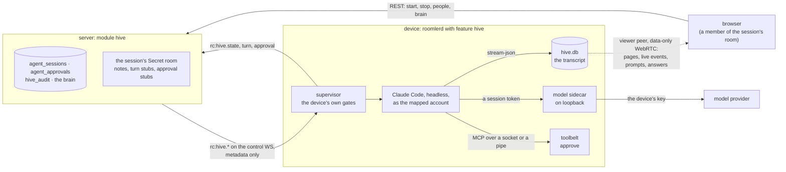

---

## 1. What a session is

A session is four things, and only the first two are on the server.

| Piece | Where | What it holds |
|---|---|---|
| the record | `agent_sessions` ([`model.rs:109`](../crates/modules/hive/src/model.rs#L109)) | who started it (`owner_id`) and who else drives it; the title and the room; the harness and its own session id, a UUID the server mints so every resume continues one conversation; the device, the folder as typed and the account the device says it mapped; the status, the fence, the brain revision, and `origin` (`started` or `adopted`) |
| the room | a `Secret` chat room at the path `hive-<session>`, bound to `{module: "hive", ref: <session>}` ([`room.rs:35`](../crates/modules/hive/src/room.rs#L35)) | notes the session authors when it starts, is refused or ends; one stub per turn; one stub per approval. Never what was asked or answered |
| the transcript | the device's replica store, `hive.db` ([`store.rs`](../crates/hive-node/src/store.rs)) | every event: prompts with their authors, assistant text, tool calls and their results (an output over 64 KiB keeps its head and tail), approvals, each turn's end with its cost, and Hive's own notes |
| the viewer peer | a data-only WebRTC peer from the device to one browser ([`view.rs`](../agents/roomlerd/src/hive/view.rs)) | the transcript's pages and its live tail one way; a driver's prompts and approval answers the other |

⚠️ **The server holds no transcript, and the frames are shaped so it cannot.**
`rc:hive.start`, `rc:hive.state`, `rc:hive.turn`, `rc:hive.approval`,
`rc:hive.manifest` and the replica frames (`rc:hive.replica.*`, P2c-3a) carry ids,
words, numbers, hashes and display names. Tests in
`signaling.rs` lock each field set, so a `prompt`, `tool` or `input` field would be
a deliberate edit there. The one Hive frame with text a model reads is
`rc:hive.memory`, the curated core memory ([`brain.md`](brain.md)). P0f's canary
test ([`hive_canary.rs`](../crates/tests/tests/hive_canary.rs)) sends a canary
through a prompt, a tool's output and a crashing harness's stderr, and finds each
in the device's store and in no Mongo document, object-store file, server log line
or frame the server sent the browser. It found one leak when it was written: the
`ended` detail carried the harness's last 400 bytes of stderr to the server. Those
are a note in the transcript now, and the server hears only how the harness ended
([`describe_end`](../agents/roomlerd/src/hive/supervisor.rs#L5803)). Since P2d-6 it
runs with the replicaset on and a second device, a member, which must hold every
canary too, carried to it over the replica stream (§12, P2d-6).

**Statuses.** The record mirrors what the device reports. Every transition a device
drives is a compare-and-set on the session's device (the authenticated socket's,
never a field of the frame), its fence and the statuses it may leave
([`dao.rs`](../crates/modules/hive/src/dao.rs)), so a stale frame, another device's
frame or one that crossed a stop on the wire changes nothing.

| Status | Means | Set by |
|---|---|---|
| `starting` | the start was sent; `accepted_at` says whether the device answered | the server |
| `idle` · `running` · `awaiting_approval` | the harness waits for a prompt · a turn runs · a tool call waits for a driver | the device's `rc:hive.state` |
| `stopping` | the owner ordered a stop, and the device has not confirmed it | the server |
| `ended` | over; `end_reason` says how: `stopped`, `exited`, `not_on_device`, `member_removed`, `device_removed`, `tenant_archived`, `hive_not_enabled`, `attribution_changed` | the device, or the server for a device it can no longer ask |
| `refused` | the device refused the start, and `refusal` names its gate | the device's `rc:hive.start_ack` |
| `lost` | the start was never answered and will not be sent again (`never_answered`) | the server |

**A turn** is one prompt and the harness's work on it, ended by the stream-json
`result`. The device writes prompts one at a time. One that arrives during a turn
waits, and at most 8 wait before the next caller is refused, because Claude Code
would queue the prompt itself and its `result` would then close the wrong turn's
stub. A turn's stub is posted when the prompt goes in and edited when the turn
ends, and a report for a turn older than the newest stub changes nothing
([`room.rs:329`](../crates/modules/hive/src/room.rs#L329)):

```
✅ Turn 3 — done · 5 steps · 42 s · $0.12 · asked by Alice
```

The cost is what that turn cost. Claude Code's `total_cost_usd` is its process's
running total, so the device subtracts what the process had spent at the previous
turn's end ([`supervisor.rs:5156`](../agents/roomlerd/src/hive/supervisor.rs#L5156)).

**The transcript** is a hash chain ([`chain.rs`](../crates/hive-node/src/chain.rs)).
Each event carries the session's `seq` (gapless from 1), the `fence` of the lease
that wrote it and `prev_hash`, the BLAKE3 hash of the event before it. It is stored
as its exact JSON text, so a member that cannot parse a newer kind still chains and
serves it. One writer thread owns the SQLite file
([`hive/store.rs`](../agents/roomlerd/src/hive/store.rs)), and every append is
checked against the chain's tip inside the transaction that writes its full-text
index row. The file sits in a directory locked to the daemon (`0700`, or SYSTEM and
Administrators on Windows): no local account reads anyone's transcript.

### The viewer peer

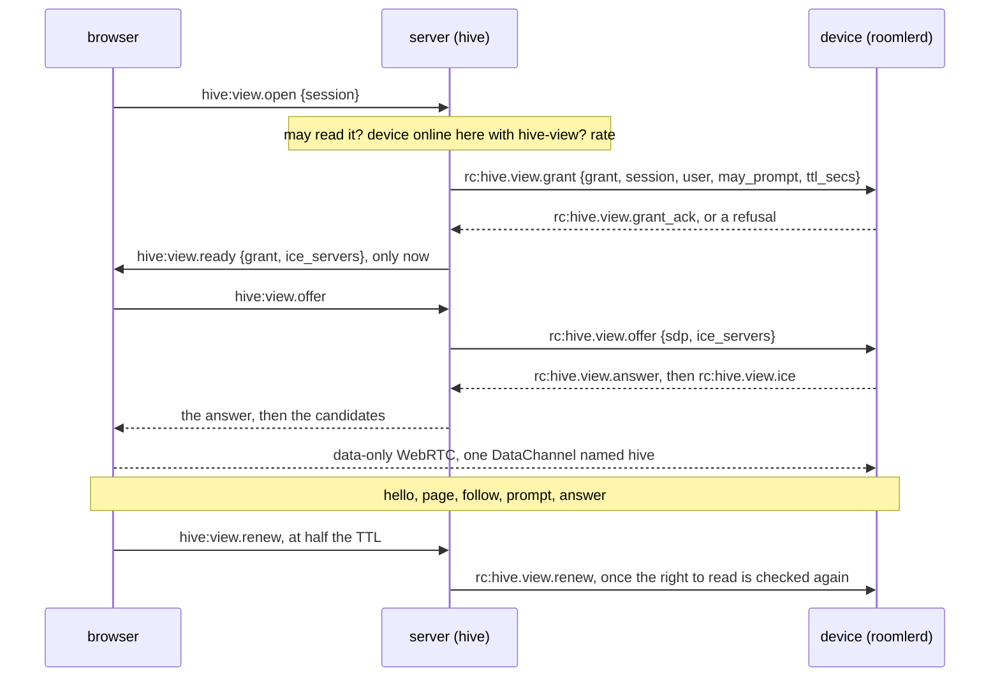

| Rule | Why | Where |
|---|---|---|
| The browser dials only after the device confirmed the grant | a device that would refuse never gets an offer (FR-83's rule) | server [`view.rs:490`](../crates/modules/hive/src/view.rs#L490) `on_device_frame` |
| A grant's TTL is relative (`ttl_secs`, 10 minutes) and renewed at half-life, and each renewal checks again that the viewer may read | a device with a skewed clock cannot expire a fresh grant, and a member taken out of the room loses the view within one TTL | `view_limits`, [`hive.rs:91`](../crates/remote_control/src/hive.rs#L91) |
| Whoever may not read the session, or is in an org the pillar does not serve, is told `not_found` | the answer a bogus id gets | server [`view.rs:191`](../crates/modules/hive/src/view.rs#L191) `open` |
| The server allows 4 grants per browser connection and 20 opens a minute per (user, session); the device serves 8 viewers per session and 32 per device | | server [`view.rs:67`](../crates/modules/hive/src/view.rs#L67), device [`view.rs:263`](../agents/roomlerd/src/hive/view.rs#L263) |
| The device serves a grant on its primary enrollment, with `hive_enabled` on (or `hive_adopt`, for an adopted session), for a session it holds, live or in its store | | device [`view.rs:263`](../agents/roomlerd/src/hive/view.rs#L263) `view_grant` |
| One actor per grant owns the peer, its timers and its channel, and is the one place `close()` runs | ⚠️ a dropped WebRTC peer frees nothing: its ICE sockets belong to tasks the stack spawned, and leaked peers once ate a host's whole ephemeral port range | device [`view.rs:400`](../agents/roomlerd/src/hive/view.rs#L400) |
| Each JSON message travels as binary frames of at most 60,000 bytes: `[v1][id u32][part u16][parts u16][payload]` | one SCTP message over 65,536 bytes is silently lost | [`framing.rs`](../agents/roomlerd/src/hive/framing.rs) |
| `follow` subscribes to the store's live feed first, then catches up from the store | an event that lands in between is in one or the other: never lost, never sent twice | device [`view.rs:817`](../agents/roomlerd/src/hive/view.rs#L817) |
| TURN credentials are minted per grant, with a 12 h TTL | the credential bounds the allocation's whole life, and the configured 600 s would cut a relayed viewer at ten minutes | server [`view.rs:78`](../crates/modules/hive/src/view.rs#L78) |
| ICE is set up as remote control's browser-facing peer: the overlay interface kept out, `.local` candidates resolved by the OS, `ICE_RELAY_TCP` honoured | | device [`view.rs:540`](../agents/roomlerd/src/hive/view.rs#L540) |

The browser half is [`useHiveViewer.ts`](../ui/src/composables/useHiveViewer.ts).
It opens on the last 300 events, keeps at most 1,000 while it follows the newest
(the oldest are a "load earlier" away), and closes its peer on every way out. The
transcript draws each tool call by its tool (a command, an edit as a diff, a file
range, a search) with its result folded under it, and assistant text through
`renderMarkdown`, the one XSS boundary. Everything else is text interpolation
([`HiveTranscript.vue`](../ui/src/components/hive/HiveTranscript.vue)).

---

## 2. Starting one, and who may drive

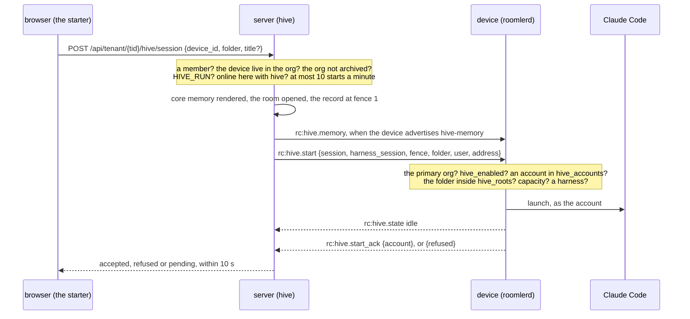

**The server's gates**, in order ([`routes.rs`](../crates/modules/hive/src/routes.rs)):
membership first, so a stranger learns nothing about devices; the device, live in
this org, and a 404 otherwise, as for a bogus id; the org not archived; `HIVE_RUN`;
the device connected here and advertising `hive`; and the per-(user, device)
ceiling of 10 starts a minute, last, so a refusal is attributable to an identity
that passed the others. From the archive check on, a refusal is a `200` that names
the reason, and it is audited in `hive_audit`. That is the exec convention: the row
is what remains when someone probes which devices will run things for them.

`HIVE_RUN` (bit 32) is in no managed role below `ADMINISTRATOR`, pinned by
`no_managed_role_below_administrator_seeds_a_root_shell`
([`role.rs:408`](../crates/db/src/models/role.rs#L408)). Running a session is remote
code execution on a device, gated like exec and SSH.

**The device's gates**, in order ([`decide_and_launch`](../agents/roomlerd/src/hive/supervisor.rs#L1666)).
Each fails closed, and none takes an answer from the server: the start names who is
asking and where, never which account.

| # | Gate | A refusal |
|---|---|---|
| 1 | the frame came on the primary enrollment's connection: a secondary org's admin must not start sessions on a device that org merely borrows | `hive_disabled` |
| 2 | `hive_enabled` | `hive_disabled` |
| 3 | the harness asked for is Claude Code | `other` |
| 4 | a start already running at this fence is answered `accepted` again and launches nothing: reconcile re-sends a start whose answer was lost | — |
| 5 | the daemon is not about to restart for an update, and not stopping | `other`, "start the session again in a minute" |
| 6 | `hive_accounts` maps the starter: by user id first, then by the address the server sent, which is a proven one or the `.invalid` placeholder `users.email` holds otherwise, and that matches nothing ([`gates.rs:106`](../agents/roomlerd/src/hive/gates.rs#L106)) | `no_account` |
| 7 | a session this device hosted resumes as the account it ran as, or not at all: its history is in that account's home | `no_account` |
| 8 | the folder resolves, symlinks and `..` followed, inside a `hive_roots` entry; an empty list means nowhere ([`roots.rs:32`](../crates/hive-node/src/roots.rs#L32)) | `folder_not_allowed` |
| 9 | fewer than `hive_max_sessions` (4) sessions run | `at_capacity` |
| 10 | the store is open, and the sidecar is bound when a key helper is set | `launch_failed` |
| 11 | the launch: the account resolves (uid 0 refused), a harness is found, the account can execute the toolbelt's relay, and the process starts | `no_account` · `harness_missing` · `launch_failed` |

Only a process that started is `accepted`. Each refusal word names a different gate
because each has a different fix, and the words are decoded leniently: an unknown
word from a newer device is still a refusal (`other`), never "accepted"
([`hive.rs:420`](../crates/remote_control/src/hive.rs#L420)). On Windows
`no_console_user` joins them (§3).

**The device's keys** ([`config.rs:384`](../crates/agent-core/src/config.rs#L384)).
Every one is the device owner's, read once when the daemon starts (a change needs a
restart), and none can be pushed:
`the_device_owned_refusals_are_not_pushable`
([`models.rs:6024`](../crates/remote_control/src/models.rs#L6024)) asserts that no
Hive key appears in a serialised `DesiredConfig`. The user-facing reference is
[`configuration.md`](../ui/docs/content/reference/configuration.md).

| Key | Default | Meaning |
|---|---|---|
| `hive_enabled` | off | run agent sessions here |
| `hive_accounts` | empty, so nobody | `{"<user id or proven address>" = "<local account>"}` |
| `hive_roots` | empty, so nowhere | the folders sessions may run in, checked on the resolved path |
| `hive_max_sessions` | 4 | sessions at once |
| `hive_harness` | unset | Claude Code's path; unset, the default locations (§3) |
| `hive_api_key_helper` | unset: no model access | the command the DAEMON runs to print the provider's key (§5) |
| `hive_api_workspace_id` | unset | sent as `anthropic-workspace-id`, for a key that is not scoped to a workspace |
| `hive_update_wait_secs` | 1800 | how long an update waits for running turns; `0` never waits (§7) |
| `hive_core_memory` | off | show the org's core memory to the sessions here ([`brain.md`](brain.md)) |
| `hive_adopt` | off | let this device's people adopt their terminal sessions; off on Windows whatever it says (§8) |
| `hive_allow_passwordless_sudo` | off | macOS: run sessions as an account whose `sudo` needs no password, which gives them root; off, such a start is refused (§3) |
| `hive_replica` | off | hold copies of the sessions this device's owner runs on their other devices (§12, P2c) |
| `hive_archive` | off | offer this device as the org's archive replica; only ever with `hive_replica` |
| `hive_store_quota_mib` | unset: the disk's | the most this device keeps as a replica, in MiB |

### Who may drive

A session's room has members, and a session has drivers
([`access.rs`](../crates/modules/hive/src/access.rs)). The owner names both. What
anyone writes in the room is ordinary chat. Only a driver's "ask the agent" reaches
the harness, over that driver's own viewer peer.

| Who | Reads it | Prompts it, answers its approvals | Stops it, names its drivers |
|---|---|---|---|
| its owner | ✅, even out of its room | ✅ while it is live | ✅ |
| a driver the owner named | ✅ | ✅ while it is live | — |
| another member of its room (a reader) | ✅ | — | — |
| anyone else, in the org or not | — (a 404, as for a bogus id) | — | — |

| Rule | Why | Where |
|---|---|---|
| Naming a driver is the owner's alone, and the person must hold `HIVE_RUN`. At most 16 besides the owner, held by the update's own filter | driving runs code on the device as the session's account, since a driver answers approvals too | [`participants.rs:196`](../crates/modules/hive/src/participants.rs#L196) |
| A change ends the person's open views (`role_changed`), and the view they reopen is minted afresh | a grant carries `may_prompt` as it was minted | server [`view.rs:624`](../crates/modules/hive/src/view.rs#L624) |
| ⚠️ The device decides whom it lets act as its account. A driver other than the starter prompts and answers only when the device's own `hive_accounts` maps them to the account the session runs as; otherwise the view is read only, and `hello` says why (`driving_refused`). The starter is recognised by id, from the start order, never through the map | the gate that survives a wrong server (decision 8). A server before P1c-2 sends no address, and the starter must not be locked out of their own session | [`drives_here`](../agents/roomlerd/src/hive/supervisor.rs#L2491) |
| The model reads who asked, as `[Name] text`. A slash command goes as typed, and the name loses brackets and control characters and is cut to 64 characters | several drivers can share a session, and a display name must not be able to close the label | [`launch.rs:372`](../crates/hive-node/src/launch.rs#L372) `attributed_prompt` |
| A stub's `prompted_by` and an approval's `answered_by` are believed only when they name a driver | both are the device's word | [`room.rs:329`](../crates/modules/hive/src/room.rs#L329), [`room.rs:407`](../crates/modules/hive/src/room.rs#L407) |
| A member removed from the org drives nothing anywhere, and their views end at once | rejoining the org must not hand back a seat nobody offered again | [`hooks.rs:154`](../crates/modules/hive/src/hooks.rs#L154) |
| Every change is a note in the room, and audited (`participant`) | who may prompt the agent is for everyone there to see | |

---

## 3. Who runs it, on each platform

### Linux and macOS

The daemon runs as root, and a session runs as the account `hive_accounts` maps the
starter to, through the one privilege path that exec, SSH and the PTY share, as an agent session
runs it: [`exec::apply_session_run_as`](../agents/roomlerd/src/exec.rs#L853). The
account is resolved in the parent (`getpwnam_r`, `getgrouplist`), uid 0 is refused
([`exec.rs:955`](../agents/roomlerd/src/exec.rs#L955)), and the child only calls
`setgroups`, `setgid` and `setuid`, then checks that they took.

⚠️ **A session holds no administrator group** (decision 13), as Windows denies its
sessions the Administrators group:
- It holds none of the account's administrator groups
  ([`exec.rs:1028`](../agents/roomlerd/src/exec.rs#L1028)): root's own, the sudoers groups
  (`wheel`, `sudo`, macOS's `admin`) and those whose socket or device is root by another
  door (`docker`, `lxd`, `incus`, `libvirt`, `disk`). An account whose primary group is one
  is refused ([`exec.rs:1093`](../agents/roomlerd/src/exec.rs#L1093)). The kernel then
  grants the session nothing by those groups: no docker or libvirt socket, no disk
  device, no write into macOS's `/Applications` (`root:admin 775`).
- On Linux the harness also starts with `no_new_privs`
  ([`exec.rs:1150`](../agents/roomlerd/src/exec.rs#L1150)), so nothing it runs gains a
  privilege by exec: no `sudo`, whatever sudoers says of the account.

| A session, as an account whose `sudo` needs no password | Linux | macOS |
|---|---|---|
| holds `sudo`, `wheel` or `admin` | no | no: a write into `/Applications` is refused |
| `sudo` by a rule that names the account | refused, by `no_new_privs` | **would be allowed**, so the start is refused |
| `sudo` by a rule that names a group (`%admin`, `%sudo`) | refused, the same way | **would be allowed**, so the start is refused |

⚠️ **On macOS the groups cannot stop `sudo`.** macOS has no `no_new_privs`, and its `sudo`
reads the account's groups from the directory, never from the process. Field-measured on
macOS 15.7.7 (sudo 1.9.13p2), with `%admin ALL=(ALL) NOPASSWD: ALL` the only passwordless
rule: a session without the admin group got `sudo-rc=0`, while its write into
`/Applications` was refused. `id` misleads on a Mac too: it reads the directory, so it
lists `admin` in a session that does not hold it.

So a Mac refuses to START a session as an account whose `sudo` needs no password
(decision 15, [`hive/sudo.rs`](../agents/roomlerd/src/hive/sudo.rs)), unless its owner sets
`hive_allow_passwordless_sudo`:

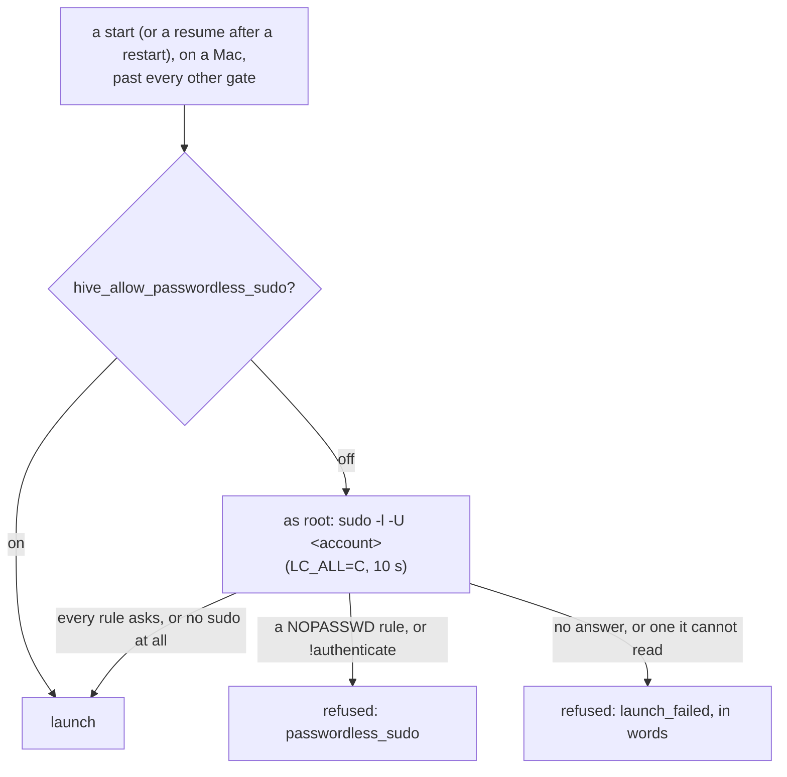

⚠️ The check asks **as root**, never as the account. Listing another account's rules
authenticates nobody: in the field the root listing left only directory lookups in the
unified log. Asked as the account (`sudo -n -l`), it would fail on every Mac whose `sudo`
asks for a password, the default, and have PAM try to authenticate the account at every
start (`pam_sm_authenticate(): … Error obtaining the authtok`). A Mac nobody changed lists
`(ALL) ALL`, which asks, so it starts sessions as before.

The daemon never writes into a tree the account owns. It starts `/bin/sh -c` with a
fixed script ([`WRAPPER`](../agents/roomlerd/src/hive/supervisor.rs#L108)) and
positional arguments, never interpolated, and that script runs as the account:
`umask 077`, make the session's config directory, copy core memory in where nothing
is yet, `cd` into the folder, and `exec` Claude Code. The environment is cleared
first and rebuilt from `HOME`, `USER`, `LOGNAME`, `PATH` (the account's
`~/.local/bin` and `~/.cargo/bin` before the system's) and `LANG`, then Hive's own
variables, so none of the daemon's `ROOMLERD_*` knobs reaches a session. The harness
leads its own process group, so a stop reaches the tools it started.

| What | Where |
|---|---|
| the session's config directory (`CLAUDE_CONFIG_DIR`) | `~<account>/.roomler/hive/<session>/claude`, with the project name pinned to `hive-<harness uuid>` (`CLAUDE_CODE_PROJECT_DIR_NAME`), so the history and the auto-memory live under one `projects/hive-<uuid>/` whatever the folder is ([`launch.rs:151`](../crates/hive-node/src/launch.rs#L151)) |
| the runtime directory, the daemon's | `/run/roomler-hive/<session>` on Linux, `/var/run/roomler-hive/<session>` on macOS, root's and `0755`: `settings.json` and `mcp.json` (root's, `0644`), `toolbelt.sock` (the account's, `0600`), and `memory/` |
| the harness, with `hive_harness` unset | the first executable of `~/.local/bin/claude`, `/usr/local/bin/claude`, `/opt/homebrew/bin/claude` (macOS) and `/usr/bin/claude` ([`supervisor.rs:4403`](../agents/roomlerd/src/hive/supervisor.rs#L4403)) |

**The launch is rebuilt in full every time**, because a resume restores neither
`--settings` nor `--mcp-config` ([`launch.rs:221`](../crates/hive-node/src/launch.rs#L221)):

```
claude -p --input-format stream-json --output-format stream-json --verbose --include-partial-messages
       --session-id <uuid>                      (or --resume <uuid>)
       --settings <runtime>/<session>/settings.json
       --mcp-config <runtime>/<session>/mcp.json --strict-mcp-config
       --permission-prompt-tool mcp__roomler__approve
       --permission-mode default
       --disallowedTools AskUserQuestion
```

| Flag or setting | Why |
|---|---|
| `--permission-mode default` | ⚠️ unset, a `-p` run that fetches no feature flags, which is every run behind the sidecar, starts in `auto`, where a classifier rather than a person decides what runs. P1a's contract probe found it |
| `--strict-mcp-config` | a repository's `.mcp.json` cannot shadow `roomler`, the server that decides what runs |
| `--disallowedTools AskUserQuestion` | it would reach the permission tool as a tool call whose answer must carry the person's choices, which no card asks for; the model asks in its reply instead |
| `settings.json` holds `permissions.deny: ["Read(//proc/**)"]`, `sandbox.autoAllowBashIfSandboxed: false` and no `apiKeyHelper` ([`launch.rs:421`](../crates/hive-node/src/launch.rs#L421)) | the Read tool runs inside the harness, so `/proc/self/environ` would hand the model its environment; a sandbox that comes on, ours or the user's, must not take Bash out of the approvals; nothing in the session can print the provider's key |
| `--resume` exactly when Claude Code's own history exists (`projects/hive-<uuid>/<uuid>.jsonl`), `--session-id` otherwise, for every launch ([`supervisor.rs:4767`](../agents/roomlerd/src/hive/supervisor.rs#L4767) `decide_history`) | Claude Code refuses both other ways round: "Session ID … is already in use", "No conversation found". The daemon only checks that the entry exists, and never reads it |
| ⚠️ no `CLAUDE_CODE_SUBPROCESS_ENV_SCRUB` | on Linux it sandboxes every command, and without bubblewrap and socat Bash then refuses everything. It was the real reason P0's sessions could not run `whoami` (P1a-3) |

### Windows

A Windows device runs a session as the user signed in at the console, at Medium
integrity, and as nobody else (design decision D2). There is no S4U and no
`LogonUser`: the daemon asks for no credential. With nobody signed in a start is
refused `no_console_user`. `hive_accounts` must map the starter to that user, as
`name`, `DOMAIN\name` or `.\name`, compared case-insensitively
([`hive_win.rs:397`](../agents/roomlerd/src/hive_win.rs#L397)); otherwise the start
is refused `no_account`, and the refusal names who is at the console.

The process that hosts sessions is the service's worker. Who the worker is depends
on how the device was installed, never on who connects to it:

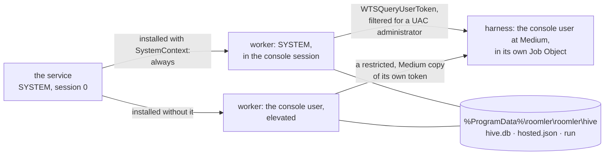

| Rule | Why | Where |
|---|---|---|
| ⚠️ A SystemContext worker is SYSTEM from the start and stays SYSTEM. With `ROOMLERD_ENABLE_SYSTEM_SWAP` on, every cycle of the service reads as if a controller were connected, so the worker is never swapped as one connects or leaves. Without SystemContext the worker is the console user throughout, elevated (`ROOMLERD_ELEVATE_WORKER`, on by default) | P1i-0 expected a remote-desktop connection to swap the worker and cut the running turns, from a gate 0.3.0-rc.7 retired. P1i-4 measured that it does not | [`win_service/supervisor.rs:875`](../agents/roomlerd/src/win_service/supervisor.rs#L875), [`:752`](../agents/roomlerd/src/win_service/supervisor.rs#L752) `decide_spawn` |
| Either way the session is the same person at Medium. A SYSTEM worker takes the console session's token; a worker that is the user takes a restricted, Medium copy of its own token: every administrator group deny-only, no privilege but traverse (FR-85's recorder rule) | a session never holds an administrator's rights on Windows | [`hive_win.rs:135`](../agents/roomlerd/src/hive_win.rs#L135) `console_user`, [`win_token.rs:209`](../agents/roomlerd/src/win_token.rs#L209) |
| `roomlerd hive-prep` does the wrapper's work as the user, in a Job Object of its own with a 30 s deadline: the config directory, core memory copied where nothing is, and the folder opened as the user | the daemon never writes into the user's profile | [`hive_win.rs:677`](../agents/roomlerd/src/hive_win.rs#L677) `prep`, [`:730`](../agents/roomlerd/src/hive_win.rs#L730) `run_prep` |
| The harness is created suspended, assigned to its own Job Object (`KILL_ON_JOB_CLOSE`, no breakaway), and only then resumed. It inherits its three standard handles and nothing else | none of its tools escapes the job, and no other session's pipe leaks into it | [`spawn_into_job`](../agents/roomlerd/src/win_service/supervisor.rs#L2320), [`JobObject`](../agents/roomlerd/src/win_service/supervisor.rs#L2203) |
| The environment is the user's own block with the session's variables laid over it by name, case-insensitively, and a NUL in a name or a value is refused | `Path` and `PATH` are one variable, and a NUL could smuggle in an entry of its own | [`merge_env_block`](../agents/roomlerd/src/win_service/supervisor.rs#L2616) |
| The harness is `hive_harness`, else the native installer's `%USERPROFILE%\.local\bin\claude.exe`, else npm's `%APPDATA%\npm\claude.cmd` run through `cmd.exe /d /v:off /s /c`. An argument holding one of cmd's metacharacters is refused, never escaped | npm's shim passes the line on again with `%*` inside an `IF (…)` block, and no quoting is right for both readers | [`hive_win.rs:523`](../agents/roomlerd/src/hive_win.rs#L523) `harness_command_line` |
| A stop closes the harness's stdin, then ends its job after the grace | no signal reaches a console-less process | [`hive/supervisor.rs:5791`](../agents/roomlerd/src/hive/supervisor.rs#L5791) |

---

## 4. Approvals over the toolbelt

Every tool call that Claude Code's read-only rules do not let through waits for a
driver. Claude Code calls its permission-prompt tool, `mcp__roomler__approve`, on the
session's toolbelt: a `roomler` MCP server, one per session, with one tool
([`toolbelt.rs`](../agents/roomlerd/src/hive/toolbelt.rs)).

Claude Code starts its MCP servers itself, as the session's account, over stdio. So
the server it starts is a relay, `roomlerd hive-mcp <socket>`, which pipes its stdin
and stdout to the session's endpoint. The relay is short-circuited at the top of
`daemon_main`, so it runs none of the daemon's start-up
([`main.rs:1110`](../agents/roomlerd/src/main.rs#L1110)), and the daemon speaks MCP on
the other end.

| | Linux, macOS | Windows |
|---|---|---|
| the endpoint | `<runtime>/<session>/toolbelt.sock`, handed to the session's account, `0600`, in a directory only the daemon writes | `\\.\pipe\roomler-hive-<session>-<nonce>`, made with `FILE_FLAG_FIRST_PIPE_INSTANCE` so a name someone holds is refused, never joined; remote clients rejected |
| who may connect | the kernel admits the account and root, and the daemon checks the peer's uid again on every connection | the DACL grants SYSTEM and Administrators, and the account `0x12008b`: read and write, but not `FILE_CREATE_PIPE_INSTANCE`, which would let it add an instance of its own and take the next connection. Each client's SID is checked again, and the relay opens the pipe with exactly that access, at the identification level ([`hive_win.rs:823`](../agents/roomlerd/src/hive_win.rs#L823), [`:944`](../agents/roomlerd/src/hive_win.rs#L944)) |

⚠️ **It is deliberately not the LocalAPI socket.** On a root daemon that one is
root-only, and most of its verbs trust the socket alone. A process running as the
session's account can reach the toolbelt too, and all it can do there is ask.

⚠️ **What fails, fails closed.** A relay that cannot reach its endpoint leaves Claude
Code without its permission tool. Every call that needs one then errors ("MCP tool
mcp__roomler__approve … not found") and the harness exits 1: nothing runs
unapproved. So a start whose account cannot execute the relay at all is refused
`launch_failed` at once, rather than dying at its first approval
([`executable_by`](../agents/roomlerd/src/hive/supervisor.rs#L4677)).

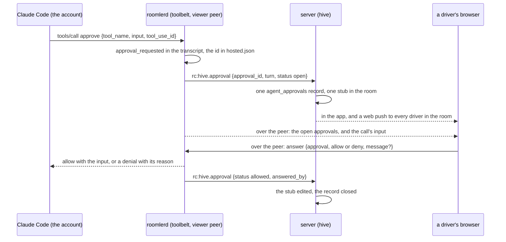

| Rule | Why | Where |
|---|---|---|
| The server hears THAT a session waits, how it ended and who answered. `rc:hive.approval` carries an id, a turn, a word and a user id, and its field set is locked by test. The stub reads "🔐 Approval needed · turn 2 — open the session to answer", then "🔐 Approval · turn 2 — ✅ allowed by Alice" | which tool, and what it would do, travel only over the viewer peer (AC5) | [`room.rs:407`](../crates/modules/hive/src/room.rs#L407) |
| One `agent_approvals` record per (session, approval), held by a unique index, its end a compare-and-set on `open`; kept 90 days | a replayed frame posts no second stub | [`lib.rs:267`](../crates/modules/hive/src/lib.rs#L267) |
| The notification names the session and never the call: `Claude · <device> needs approval`, by web push to every subscription of every driver still in the room | a desk with the app open is not a phone in a pocket | [`room.rs:634`](../crates/modules/hive/src/room.rs#L634) |
| Only a driver's grant answers; a reader's `answer` is refused on the device | | device [`view.rs:864`](../agents/roomlerd/src/hive/view.rs#L864) |
| Unanswered for 25 minutes is a denial that says so. Progress goes to Claude Code every 60 s while a person decides, and the tool-call timeout in the MCP config is 30 minutes | what the model reads is our answer, never a transport error | [`toolbelt.rs:69`](../agents/roomlerd/src/hive/toolbelt.rs#L69) |
| At most 4 approvals are open per session, and a fifth is refused at once | Claude Code asks one at a time (measured), so more is not Claude Code | [`toolbelt.rs:75`](../agents/roomlerd/src/hive/toolbelt.rs#L75) |
| The harness letting go (`notifications/cancelled`, a closed relay), a stop, or the session's end withdraws an open approval | | [`toolbelt.rs:660`](../agents/roomlerd/src/hive/toolbelt.rs#L660) |
| A denial reaches the model as a failed tool result with our words verbatim, for example "Alice denied this: not now" | the model knows who said no, and why | |

---

## 5. The model sidecar

The provider's key never enters a session. The daemon runs the device's
`hive_api_key_helper` itself, as SYSTEM or root, and keeps what it prints. The
harness gets a loopback base URL and a token that only this sidecar honours
([`sidecar.rs`](../agents/roomlerd/src/hive/sidecar.rs)).

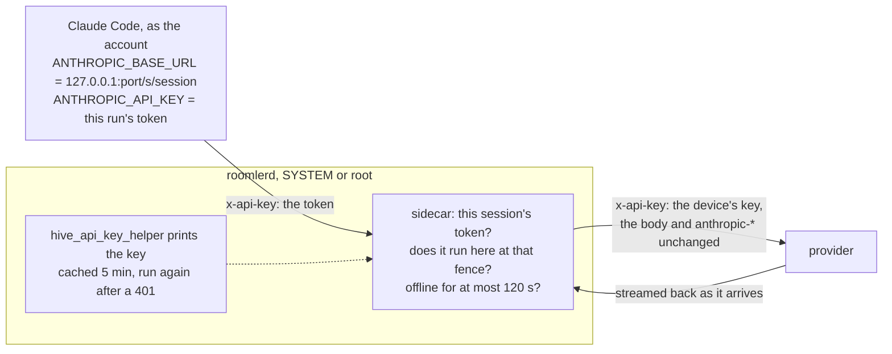

| Piece | Rule | Why | Where |
|---|---|---|---|
| the token | 256 random bits, bound to (session, fence), minted just before the harness starts and taken back if it does not; each run revokes exactly its own token | a run that ends as the same session starts again here cannot take the new run's | [`sidecar.rs:89`](../agents/roomlerd/src/hive/sidecar.rs#L89) |
| the paths | exactly `POST /v1/messages` and `POST /v1/messages/count_tokens`; anything else is `404 not_found_error` | the device's key opens more than inference: the Files API holds every session's uploads under it, and a batch outlives its session and its fence | [`sidecar.rs:328`](../agents/roomlerd/src/hive/sidecar.rs#L328) |
| the fence | a call is forwarded only while the session runs HERE at the token's fence | a stopped session, or a stale primary after a move, spends nothing | [`sidecar.rs:128`](../agents/roomlerd/src/hive/sidecar.rs#L128) `sidecar_admit` |
| `offline_grace` | 120 s after the primary control connection closed, with no newer one in its place, calls are refused `503 overloaded_error`; they flow again on reconnect | a partitioned primary stalls instead of diverging. "Closed" is the agent's own verdict, so a half-open socket counts as up until `WS_RX_DEADLINE` (80 s) ends it, and the worst case is about 200 s | [`sidecar.rs:64`](../agents/roomlerd/src/hive/sidecar.rs#L64), the agent's [`signaling.rs:60`](../agents/roomlerd/src/signaling.rs#L60) |
| the forward | the headers unchanged but for `x-api-key` and `authorization` (the device's key swapped in), the hop-by-hop ones, and `anthropic-workspace-id`, set from `hive_api_workspace_id` when that is configured; a body of at most 32 MiB; the answer streamed as it arrives, `retry-after` and the rate-limit headers intact; TLS through the OS trust store and the proxy environment | an SSE turn is never buffered, and a TLS-inspecting middlebox the machine trusts still works | [`sidecar.rs:380`](../agents/roomlerd/src/hive/sidecar.rs#L380) `handle` |

The helper runs through `/bin/sh -c` on Unix and `cmd.exe /d /s /c "<helper>"`, by
its full path, on Windows, within 10 s. The first line it prints is the key, and
neither its output nor its errors' output is logged
([`sidecar.rs:218`](../agents/roomlerd/src/hive/sidecar.rs#L218)). With no helper a
session has no model access: its own config directory holds no login of its own.

---

## 6. Restart, resume, and what ends a harness

A restart still takes every harness down. Under systemd (`KillMode=control-group`)
a stop reaches the daemon and then every process in its unit. Under launchd, and for
a daemon nothing supervises, the daemon takes them down itself as it leaves
([`wind_down`](../agents/roomlerd/src/hive/supervisor.rs#L3358): SIGTERM to each
harness's process group, SIGKILL after 3 s). On Windows a harness lives in its
worker's Job Object and goes with it. What survives is the session: the next daemon
resumes it with the same Claude Code conversation.

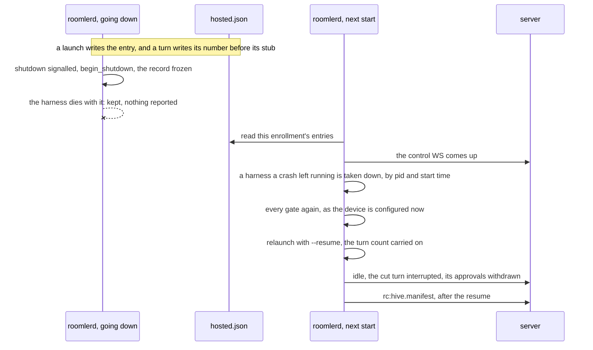

| Rule | Why | Where |
|---|---|---|
| `hosted.json` sits beside the store, root's, `0600`, written whole. Per session it holds the launch's inputs (fence, account, the folder as asked, the starter and their address, Claude Code's session id), the turns begun, the turn in progress and who asked for it, its open approvals, and the harness's pid and start time | after a restart the device holds nothing else: the replay of its last reports lived in memory | [`hosted.rs`](../agents/roomlerd/src/hive/hosted.rs) |
| A new turn's number and a new approval are written before the frame that tells the server, and so is a turn's end; an approval's end is written after its frame | a reused turn number would have every later stub ignored as older than the newest, and a finished turn must never be reported cut. A withdrawal sent twice changes only an approval still open | [`supervisor.rs:5111`](../agents/roomlerd/src/hive/supervisor.rs#L5111) |
| From `begin_shutdown` on, the record is frozen, the toolbelt is ignored, and new prompts and starts are refused ("this device is restarting"). `begin_shutdown` runs the moment any shutdown is signalled: an update, a requested restart, a rollback, an OS stop | the teardown's frames go into closing connections; recorded, they would be lost twice. Field, 2026-10-08: an approval the teardown withdrew stayed "needed" | [`main.rs:3715`](../agents/roomlerd/src/main.rs#L3715), [`supervisor.rs:3320`](../agents/roomlerd/src/hive/supervisor.rs#L3320) |
| A harness that ends without a stop waits 1 s before its end counts, and if the daemon was told to stop by then the session is kept and nothing is reported | under systemd the daemon hears its stop a moment before the harness dies | [`supervisor.rs:3382`](../agents/roomlerd/src/hive/supervisor.rs#L3382) |
| The next daemon resumes at the first connection of its primary enrollment, once, and that connection's manifest waits for it, at most 60 s | a manifest sent first would leave the resuming sessions out, and the server would end every one. A device that never comes back online launches nothing | [`supervisor.rs:3145`](../agents/roomlerd/src/hive/supervisor.rs#L3145) |
| ⚠️ Every gate a start passes is passed again, as the device is configured now: `hive_enabled`, the starter mapped to the SAME account, the folder inside `hive_roots`, capacity, a harness. A refusal ends the session ("not resumed after the device restarted: …") and forgets it | an owner who turns sessions off, or remaps an account, and restarts must not find the session back | [`supervisor.rs:3178`](../agents/roomlerd/src/hive/supervisor.rs#L3178) |
| A recorded pid is signalled only while its start time still matches: the boot id and the `/proc` start time on Linux, `proc_pidinfo` on macOS, `GetProcessTimes` on Windows. Pids 0 and 1 never are | two harnesses on one history would both write it, and whatever holds that pid since must be left alone | [`procs.rs:30`](../agents/roomlerd/src/hive/procs.rs#L30), [`supervisor.rs:5754`](../agents/roomlerd/src/hive/supervisor.rs#L5754) |
| The cut turn is reported `interrupted`, naming who asked; its approvals are reported `withdrawn`; the transcript says the session resumed. The first turn of a resumed process reports no cost | Claude Code restores its running total only from a clean exit's `cost-state`, so where that process starts counting is unknown, and no number is better than a wrong one | [`supervisor.rs:3744`](../agents/roomlerd/src/hive/supervisor.rs#L3744) |
| A session resumed 3 times in a row, each time without outliving the resume by 2 minutes, is ended instead | a resume that takes the daemon down must not become a crash loop | [`supervisor.rs:219`](../agents/roomlerd/src/hive/supervisor.rs#L219) |
| A stop that arrives before the session resumed ends it with no launch | | [`supervisor.rs:2634`](../agents/roomlerd/src/hive/supervisor.rs#L2634) |

⚠️ Prompts waiting behind a turn are lost when a restart cuts it. An update waits the
turn out (§7); a crash does not. ⚠️ `hosted.json` is not synced to disk: a clean
stop, a restart and a crash all keep it, a power cut may lose its last change, and
then the manifest ends what could not be resumed.

### The manifest

On every connection of its primary enrollment the device sends `rc:hive.manifest`:
the sessions it runs NOW, ids and fences only
([`supervisor.rs:3107`](../agents/roomlerd/src/hive/supervisor.rs#L3107)). The server
ends each session it holds as running there that the list leaves out, as
`not_on_device` (or `stopped`, for one being stopped), tells its room and withdraws
its open approvals ([`agent_socket.rs:756`](../crates/modules/hive/src/agent_socket.rs#L756)).

- ⚠️ "Running there" means live and launched on the device's own word: its answer to
  the start (`accepted_at`), or a run state only the device reports (`idle`,
  `running`, `awaiting_approval`). The state usually lands before the answer, so a
  socket that drops between the two leaves `idle` with no `accepted_at`, and with
  `accepted_at` alone that session outlived its harness for ever
  ([`dao.rs:956`](../crates/modules/hive/src/dao.rs#L956)). A start the device has
  said nothing about stays reconcile's, which re-sends an unanswered start for 10
  minutes and an unconfirmed stop on every connection
  ([`agent_socket.rs:978`](../crates/modules/hive/src/agent_socket.rs#L978)).
- ⚠️ A device that comes back with an agent that runs no sessions ends what it ran:
  a connection the hub records without `hive` is given the empty manifest before
  anything pending is read. Field, 2026-10-10: a Windows device updated itself to
  0.4.123, whose build has no `hive`, and its accepted session stayed `idle` for
  ever. Only a definite "no `hive`" counts: a connection a newer one displaced
  decides nothing ([`agent_socket.rs:1000`](../crates/modules/hive/src/agent_socket.rs#L1000)).
- A list longer than 256 is no device's and changes nothing, and a build that runs
  Hive but predates the manifest sends none, which changes nothing either.
- The other way round: a device that reports it RUNS a session whose record is over,
  because its starter was removed while it was away, is answered with a stop
  ([`agent_socket.rs:805`](../crates/modules/hive/src/agent_socket.rs#L805)).

### What ends a harness

| Event | What happens to the harness | The session |
|---|---|---|
| the owner's Stop | Unix: stdin closed, SIGTERM to its process group, SIGKILL after 5 s. Windows: stdin closed, its job ended after 5 s | ends `stopped` |
| the harness exits or crashes | — | ends `exited`; a crash's last words on stderr stay in the transcript |
| a daemon restart, an update, a crash | it goes with the unit's control group (systemd), by `wind_down` as the daemon leaves, or with its worker's Job Object (Windows). One a crash left running is taken down by the next daemon, before the resume | kept, and resumed by the next daemon |
| Windows: the console session changes (a sign-in, a sign-out, a switch of user) | the service starts a worker in the new session, and the old worker's harnesses go | resumed by the next worker, if its gates still allow it |
| Windows: a remote-desktop connection | nothing: the worker is not swapped (P1i-4, measured) | goes on, a turn waiting at its approval included |
| the gates changed across a restart; three quick resumes | not launched | ends, saying why |
| the starter leaves the org, the device is removed, the org is archived, the org leaves `hive.tenants`, the device comes back without `hive` | stopped, if the device is still connected here | the server ends it: `member_removed` · `device_removed` · `tenant_archived` · `hive_not_enabled` · `not_on_device` |

---

## 7. The update hold

An update restarts the daemon, and every harness with it. So it waits for running
turns first.

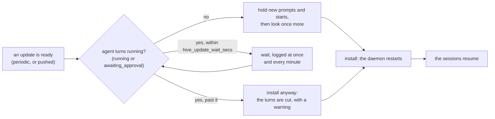

| Platform | Who installs | How the wait runs |
|---|---|---|
| Linux, Windows | the daemon's in-process updater | [`wait_for_agent_turns`](../agents/roomlerd/src/updater.rs#L278) runs before the installer is spawned, for the periodic check and a pushed update alike |
| macOS | the root update helper, `com.roomler.update`, never the daemon | before `installer(8)` the helper asks the root daemon, over its system LocalAPI socket, to hold (`HiveUpdateHold`). The daemon runs the same wait and answers `HiveUpdateHeld {waited_secs, cut}`, then refuses new prompts and starts until that connection closes ([`updater.rs:349`](../agents/roomlerd/src/updater.rs#L349), [`:2805`](../agents/roomlerd/src/updater.rs#L2805)) |

- It waits at most `hive_update_wait_secs` (30 minutes; `0` never waits), looks again
  every 5 s, and logs "update deferred — agent turns running" when it starts and once
  a minute.
- It holds a PUSHED update too: a person asked for the update, not for their agent to
  be cut. It is bounded, so a busy session cannot hold a device's updates back.
- Once no turn runs, new prompts and starts are refused BEFORE a last look, so none
  begins in the gap. One admitted before that still runs, and is waited for. An
  installer that fails to start releases the hold.
- ⚠️ The macOS hold is bound to the helper's connection, not to a timer: a helper
  that dies mid-wait releases it, and so does a failed install. The verb is refused
  to every peer but root, because a hold refuses every new prompt and start on the
  device ([`localapi/src/lib.rs:2509`](../crates/localapi/src/lib.rs#L2509)). A missing, older or
  silent daemon (the helper waits at most 2 h) gets the install it got before: the
  helper fails open.
- ⚠️ `roomlerd self-update`, the CLI, does not wait. It is an operator's explicit
  command, in another process.

---

## 8. Adopting terminal sessions

People already run Claude Code in a terminal. `roomler hive adopt` mirrors those
sessions into the device's store and lists each for its owner alone, read only
(decision 11). A terminal session passed none of Hive's start gates, so adopting has
gates of its own, each default-deny and each owned by a different party. It is Linux
and macOS only: on Windows `hive_adopt` reads off whatever the config says, so the
device never advertises `hive-adopt` ([`gates.rs:73`](../agents/roomlerd/src/hive/gates.rs#L73)),
and the CLI refuses.

| Gate | Owner | Default | A refusal |
|---|---|---|---|
| the hooks are installed (`SessionStart`, `Stop`, `SessionEnd`) | the person, in their own user-level Claude Code settings | not installed | nothing is mirrored |
| `hive_adopt` | the device's owner: a device key, never pushable, advertised as `hive-adopt` | off | nothing reaches the server; an offer from a connection without `hive-adopt` is dropped unanswered |
| the org is served | the server (`hive.tenants`) | — | `hive_not_enabled` |
| the account names ONE person, a member | the device's `hive_accounts`, resolved by the server | — | `no_account` · `ambiguous_account` · `not_a_member` |
| capacity and rate | the server: 16 live adopted sessions a device, 20 offers a minute | — | `at_capacity` · `rate_limited` |

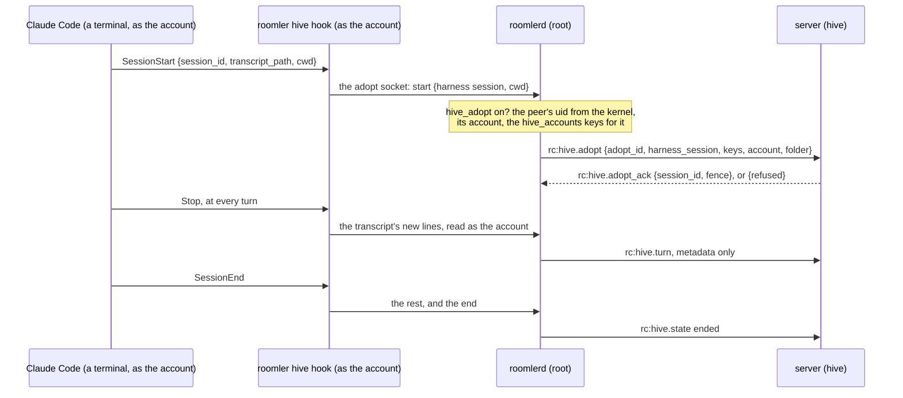

| Rule | Why | Where |
|---|---|---|
| The device sends EVERY `hive_accounts` key that maps to the account, and the server adopts only when they name exactly one person | the attribution is the device owner's statement, never a guess: an account two people share is `ambiguous_account`, never "the one of them who is a member" | [`adopt.rs:292`](../crates/modules/hive/src/adopt.rs#L292) `people` |
| The hook reads the transcript and sends its lines; the daemon never opens a path a hook names | a root daemon that opened a path a hook named would read any file the requester pointed it at | [`supervisor/adopt.rs:756`](../agents/roomlerd/src/hive/supervisor/adopt.rs#L756) |
| Who it is comes from the kernel, the socket's peer credentials, never from the hook; root's own sessions are refused | the hook runs as whoever ran Claude Code, and says nothing that is not checked | [`supervisor/adopt.rs:517`](../agents/roomlerd/src/hive/supervisor/adopt.rs#L517) |
| No drivers, the owner included: naming one is a 409. Readers by name, as for any session. The record has no title, only the folder's name | the terminal holds the harness, and a terminal's first prompt is content | [`access.rs:60`](../crates/modules/hive/src/access.rs#L60) |
| Only the person's conversation is mirrored: `user` and `assistant` lines, never a sub-agent's (`isSidechain`) or Claude Code's bookkeeping | the on-disk transcript is Claude Code's internal format, and a change in it must thin the mirror, never stop it | |
| A terminal killed outright never says `SessionEnd`, so the daemon records Claude Code's process (pid and start time) and ends a session whose process is gone, every minute. That process is the hook's nearest ancestor that is not a shell | Claude Code runs a hook through `/bin/sh -c`, and dash forks it, so the hook's parent is a dying `sh` (P1j-5's field run) | [`procs.rs:44`](../agents/roomlerd/src/hive/procs.rs#L44) `hook_terminal` |
| "Stop mirroring" ends the record and never the terminal; a `claude --resume` later is offered afresh, as a new record | the terminal is the person's: Roomler can only stop watching it | [`supervisor/adopt.rs:923`](../agents/roomlerd/src/hive/supervisor/adopt.rs#L923) |
| `adopted.json`, beside `hosted.json`, keeps what is mirrored and the records of the last 1,000 adopted sessions that ended, which the device still serves to their owner with `hive_enabled` off | a restarted daemon goes on mirroring where it stopped, and an owner can read a session that ended | |
| `hive-adopt` is advertised, and the socket exists, only while `hive_adopt` is on; a daemon started with it off removes a socket its predecessor left | the leftover file read as "this device adopts" (P1j-5) | [`supervisor/adopt.rs:487`](../agents/roomlerd/src/hive/supervisor/adopt.rs#L487) |
| `unadopt` takes out exactly what `adopt` put in, and gives back a file Claude Code wrote byte for byte | the person's settings, and other tools' hooks in them, are theirs | [`hive_hooks.rs`](../agents/roomler-cli/src/hive_hooks.rs) |

⚠️ Once its terminal has ended, its owner may make an adopted session a managed one, on the
device that adopted it, from the terminal's own history (decision 11's other half: §12,
"P2f-4a"). A session whose mirroring was stopped from Roomler never is.

---

## 9. The org gate on the server

The module switch (`[modules] hive`) is all or nothing for a server, so it has a
second dial: `hive.tenants` (`ROOMLER__HIVE__TENANTS`), the organizations agent
sessions serve, as comma-separated ids ([`scope.rs`](../crates/modules/hive/src/scope.rs)).
Empty or `*` means every organization, which is what a self-hosted server wants.

⚠️ **The list is the switch.** A non-empty `hive.tenants` mounts the module by itself,
with no `[modules] hive`, and `/api/capabilities` says so
([`settings.rs:1078`](../crates/config/src/settings.rs#L1078) `Settings::hive_on`). A
hosted server sets only the list, because that form fails safe. An image from before
P1g never reads the list, so with `ROOMLER__MODULES__HIVE=true` beside it, promoting
such an image (a rollback, or another session's older tag) would open the pillar to
every organization on the server. With the list alone, every older image leaves it
off. Clearing the list is the kill switch.

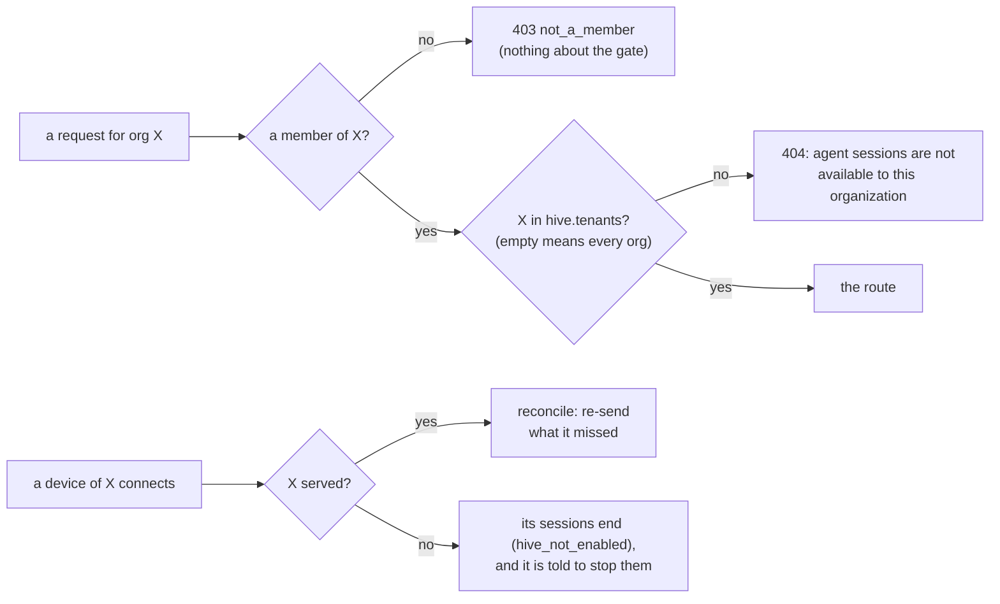

| Where | An organization agent sessions do not serve |
|---|---|
| every route | a `404`, after the membership check, so a non-member still gets `not_a_member` ([`routes.rs:258`](../crates/modules/hive/src/routes.rs#L258) `member_tenant`) |
| `GET /api/tenant/{tid}/hive` | the SPA's question: `{"enabled": true}`, or that 404 |
| the viewer | `hive:view.open` answers `not_found`, as for a session the caller may not read |
| a device connecting | nothing is re-sent; what it still runs for the org ends (`hive_not_enabled`) and it is told to stop ([`agent_socket.rs:955`](../crates/modules/hive/src/agent_socket.rs#L955)) |
| an adopt offer | `hive_not_enabled` |
| a malformed entry | logged, and it matches nothing: a typo shuts the org it meant, and never opens another |

⚠️ **The SPA fails CLOSED for this module alone.** Every other module's capability
gate fails open until `/api/capabilities` answers. `hive` is in `DEFAULT_OFF`
([`registry.ts:39`](../ui/src/modules/registry.ts#L39)), and the router also asks
whether the pillar serves the organization (`checkServed`) before it opens a Hive
page ([`router.ts:394`](../ui/src/plugins/router.ts#L394)).

Prod has served agent sessions to one test organization since 2026-10-09; every
other organization reads the 404.

---

## 10. Platform notes

### Windows: the directories' DACLs

The store, `hosted.json` and each session's runtime files live in the service's
machine-wide directory, `%ProgramData%\roomler\roomler\hive`
([`hive_win.rs:829`](../agents/roomlerd/src/hive_win.rs#L829)), which both kinds of
worker reach. Every directory there is owned by Administrators with a protected DACL,
set by [`dir_with_dacl`](../agents/roomlerd/src/hive_win.rs#L897) as it is made, or
again on one already there.

| Directory | SDDL | Means |
|---|---|---|
| `hive` (the store) and `hive\run` (the runtime root) | `O:BAD:P(A;OICI;FA;;;SY)(A;OICI;FA;;;BA)(A;;0x100080;;;AU)` | SYSTEM and Administrators, in full; Authenticated Users may examine the directory itself, and nothing more ([`hive_win.rs:804`](../agents/roomlerd/src/hive_win.rs#L804)) |
| `hive\run\<session>` | the same owner and first two grants, then `(A;OICI;0x1200a9;;;<account SID>)` | the session's account may also list, traverse and read it, for its settings, its MCP config and its core memory, and writes nothing ([`hive_win.rs:809`](../agents/roomlerd/src/hive_win.rs#L809)) |

- **The owner is set too.** An owner keeps `WRITE_DAC` whatever the DACL says, so a
  folder someone else made there first is taken over, never trusted. A link or a
  junction on the way, or anything but a plain directory in the place, is refused.
- ⚠️ **`FILE_READ_ATTRIBUTES | SYNCHRONIZE` (`0x100080`) for Authenticated Users,
  inherited by nothing.** Both directories lie on the way to every session's
  `…\hive\run\<session>\settings.json`. Claude Code examines each component of a path
  it is handed and refuses the file when one cannot be examined: "Refusing to read a
  file whose path could not be vetted". Field, 2026-10-09 (P1i-4): every session
  ended 1.1 s after its start with exactly that, because the two directories granted
  SYSTEM and Administrators alone, and a session's restricted token has its
  Administrators group deny-only. `SYNCHRONIZE` is needed beside
  `FILE_READ_ATTRIBUTES` because `CreateFileW` asks for it with every synchronous
  open, libuv's `lstat` and Rust's among them: `0x80` alone was still refused. The
  grant is a stat of the directory alone. It lists nothing, so the session ids stay
  unknown, and another session's directory stays closed, its own DACL granting only
  its account. The unit test runs as a restricted Medium copy of its own token, and
  fails on the old DACL
  ([`supervisor.rs:11191`](../agents/roomlerd/src/hive/supervisor.rs#L11191)).

### macOS: the `/var` link

The store's directory is locked to the daemon with no link on its way that someone
other than root could have made
([`untrusted_link`](../agents/roomlerd/src/hive/supervisor.rs#L1095)). On a Mac the
root daemon's data directory is under `/var/root`, and `/var` is the system's own
link to `/private/var`. While every link was refused, as FR-85's recording-folder
check refuses them, a Mac opened no store and refused every session "/var is a
symbolic link" (P1h-3, 2026-10-10). So a link is followed when root owns it, in a
directory that root owns and that nobody else may write to, since only root could
have made it. Any other link is refused, as before.

- ⚠️ The published 0.4.122 and 0.4.123 `.pkg`s predate that fix (#1927), so on a Mac
  they refuse every session `launch_failed`. A Mac needs a release that carries it.
- The runtime directory is `/var/run/roomler-hive`, which macOS clears at boot.
- launchd does not kill a harness's process group when the daemon leaves, so
  `wind_down` does it: SIGTERM, then SIGKILL after 3 s.

### Unix: the NGROUPS cap

The privilege path sets the account's supplementary groups from `getgrouplist`, and
`setgroups` refuses the whole list when it is longer than the system's
`NGROUPS_MAX`. That is 16 on macOS, where a test VM's `admin` account was in 17, and
every session on that Mac failed "starting the harness: Invalid argument (os error
22)". The list is now cut to `sysconf(_SC_NGROUPS_MAX)`, in order, the primary group
first, so the child holds fewer groups and never more
([`exec.rs:1010`](../agents/roomlerd/src/exec.rs#L1010) `within_ngroups_max`). Exec, SSH
and the PTY share the fix, since they share the path.

The cap is for `setgroups` alone. `sudo` never reads that list on a Mac, and a Linux
session cannot run `sudo` at all, so nothing is cut below the maximum. What a session
holds of the administrator groups is in §3.

---

## 11. What is field-verified

| Criterion | Linux | macOS | Windows |
|---|---|---|---|
| AC1: a prompt from the session's room comes back as a turn stub, its steps rendered over the viewer peer | ✅ | — | — |
| AC3: `whoami` prints the mapped account (on Windows the console user), never root or SYSTEM; `no_account`; `no_console_user` | ✅ | ✅ | ✅ at Medium integrity |
| AC4, first half: a primary cut off from the server stops calling the model after `offline_grace` | ✅ refused at 125 s, forwarded again after the reconnect | — | — |
| AC5: an approval answered from a phone; the stub holds no tool arguments | ✅ | — | — |
| AC6: a reader's message never reaches the harness | ✅ | — | — |
| AC7: an update waits for a running turn, and logs it | ✅ a real install, 85 s (and a dry run, 80 s) | ✅ a real install by the helper, 135 s | ✅ a real install, 140 s |
| AC8: a fact reaches the next session and not the running one ([`brain.md`](brain.md)) | ✅ | — | — |
| AC20: a session survives a service restart, a restart at an approval and a crash; a changed gate ends it | ✅ | ✅ | ✅ |
| AC20: a session survives an update's restart | ✅ 0.4.123 → 0.4.124, the codeword kept | not yet | not yet |
| AC21: an adopted session is its owner's alone, and read only | ✅ | — | not built |
| Decision 13: a session holds no administrator group and cannot `sudo` | ✅ `27(sudo)` gone, `sudo` refused | ⚠️ the group gone, `sudo` still allowed (§3) | — |
| Decision 15: a Mac refuses a start as an account whose `sudo` needs no password | — | ✅ refused under a rule by user and by group; started with the owner's key, and on a Mac whose `sudo` asks | — |

Linux ran on a throwaway stack (a local server, loopback TURN, a root daemon in WSL),
macOS and Windows on throwaway VMs enrolled in the test organization on prod
(decision 10). Still open: AC2 holds on one device in CI and stays unticked until
replicas exist; AC4's stale-fence half needs P2's promotion; and an update's own
restart is not field-run as a resume on any platform, because the Linux dry run
installs nothing and the only newer release could not resume a session on Windows or
macOS. Every run, its build and what it measured are in the spec's
[§8](fr/FR-90-hive-agent-sessions.md#8-field-verification-log).

In CI, [`hive_canary.rs`](../crates/tests/tests/hive_canary.rs) (AC2, on two devices
since P2d-6), [`hive_drivers.rs`](../crates/tests/tests/hive_drivers.rs) (AC6),
[`hive_memory.rs`](../crates/tests/tests/hive_memory.rs) and
[`hive_memory_off.rs`](../crates/tests/tests/hive_memory_off.rs) (AC8) drive a real
server and a real in-process device, each in a test binary of its own, because a
process holds one supervisor. The canary's second device, a member, is a process of
its own for the same reason. The device's own tests run on Linux, macOS and Windows
CI (`hive::`).

---

## 12. P2a: the member's store, and what P2 adds

Until P2 a session lives on the one device that runs it, and it is readable only
while that device is online. P2 gives each session a replicaset: the org's own
devices, each holding a full copy it could resume, with the server learning how fresh
each copy is from sequence numbers and hashes alone (spec §3b). P2a built the store's
half of a member. Nothing sends it anything yet: no frame, no server change, and no
caller outside tests until the join (P2c), the stream (P2d), the purge (P2g) and an
archive replica's search (P2i).

| Piece | What it does | Where |
|---|---|---|
| apply | keeps an envelope another member sent, byte for byte, through the same chain check, so the member ends on the primary's `(seq, hash)` | [`store.rs:504`](../crates/hive-node/src/store.rs#L504) `Store::apply` |
| the fence floor | per session, raised by the server's word before any event of a new fence exists, and only ever raised; an older fence is refused, the device's own appends included | [`store.rs:613`](../crates/hive-node/src/store.rs#L613), [`chain.rs:195`](../crates/hive-node/src/chain.rs#L195) |
| the divergent tail | an older fence's tail, set aside out of `events` and the index; never a tail that holds the floor's fence | [`store.rs:642`](../crates/hive-node/src/store.rs#L642) |
| blobs | content-addressed by BLAKE3, at most 64 MiB each, kept per session; bytes a peer sent under another name are kept under neither | [`store.rs:727`](../crates/hive-node/src/store.rs#L727) |
| purged ids | a purge removes the session's events, floor, tail and the blobs no other session holds, and keeps its id, so nothing takes the session back | [`store.rs:1247`](../crates/hive-node/src/store.rs#L1247) |
| the writer | each of these on the daemon's one writer thread, answered with the store's own error, so a caller can tell `purged` from a stale fence | [`hive/store.rs:92`](../agents/roomlerd/src/hive/store.rs#L92) `Member` |

⚠️ **The four tables are new, and `user_version` stays 1**
([`store.rs:50`](../crates/hive-node/src/store.rs#L50)). A daemon refuses a store a
newer schema wrote, and the updater's crash-loop rollback can put an older daemon on
a device at any time, so a new column on `events` would cost it every transcript.
`a_daemon_from_before_p2a_reads_what_p2a_wrote` runs P0a's own statements, frozen, on
a store P2a wrote.

⚠️ "Committed" is SQLite's WAL with `synchronous = NORMAL`: an acknowledged event
survives a daemon crash, not a power cut.

### P2b-1: what a checkpoint takes of the config directory

A member can resume a session only with Claude Code's own files: the history that
`--resume` reads byte for byte, the sub-agents' transcripts, the outputs too large
for the context, the auto-memory and `CLAUDE.md`. At each turn's end the primary
will take them as a **checkpoint** (P2b-3 runs it as the session's account), record
it in the chain as a `checkpoint` event, and stream it with the blobs it names. P2b-1
builds what decides what is taken, and how a member puts it back together
([`checkpoint.rs`](../crates/hive-node/src/checkpoint.rs)). Nothing takes one yet.

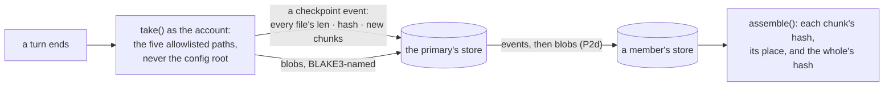

| Path, under the config directory | How Claude Code writes it | How a checkpoint takes it |
|---|---|---|
| `projects/hive-<id>/<id>.jsonl`, the history | appended to only | the bytes past the last checkpoint, up to the last whole line ([`checkpoint.rs:505`](../crates/hive-node/src/checkpoint.rs#L505)) |
| `projects/hive-<id>/<id>/subagents/`: `agent-<id>.jsonl` | appended to only | the same |
| the same directory: `agent-<id>.meta.json` | replaced by a rename | whole, when it changed ([`checkpoint.rs:567`](../crates/hive-node/src/checkpoint.rs#L567)) |
| `projects/hive-<id>/<id>/tool-results/` | each output written once | whole |
| `projects/hive-<id>/memory/` | the auto-memory | whole |
| `CLAUDE.md` | the session's own instructions (P1e) | whole |

The chain is the state. A file's `len` and `hash` in the last checkpoint are where
the next starts ([`checkpoint.rs:336`](../crates/hive-node/src/checkpoint.rs#L336)),
so nothing else is kept between turns. An appended file that shrank, or changed before
its last offset, is taken again from its first byte. A chunk at offset 0 tells a
member to start the file over, and an empty one is sent when no whole line has come
yet, so the old bytes never linger. Chunks are at most 4 MiB, cut at line ends where
one is within reach. One checkpoint lists at most 10,000 files and adds at most
512 MiB.

⚠️ **An allowlist, never the directory** ([`checkpoint.rs:395`](../crates/hive-node/src/checkpoint.rs#L395)).
The config directory's root holds a `peerToken` beside the harness's messaging socket
and a `machineID`, so nothing outside the five paths is opened. The harness id must be
a lowercase, hyphenated UUID, because it is part of every path.

⚠️ **A link is never followed** ([`checkpoint.rs:711`](../crates/hive-node/src/checkpoint.rs#L711)).
A link in the allowlist to the account's `~/.ssh` would copy a key to every member. A
link, or a name that is not UTF-8, is listed as skipped and taken nowhere.

A member's [`assemble`](../crates/hive-node/src/checkpoint.rs#L839) refuses what does
not add up: a missing blob, a blob that does not hash to its name, a chunk out of
place, or a whole that does not hash to the last checkpoint's. The event
([`event.rs:118`](../crates/hive-node/src/event.rs#L118)) is a flat object beside its
`kind`, and nothing in it goes into the full-text index.

### P2b-2: the workspace, through the account's own git

The folder a session works in is checkpointed as a git commit, by the account's own
`git` and never a git built into the daemon (decision 14). It uses plumbing only,
through a temporary index, so the person's index, branches and work tree stay as they
were ([`workspace.rs`](../agents/roomlerd/src/hive/workspace.rs)). P2b-3 will run it
inside `hive-checkpoint`, as the account; for now only its tests do.

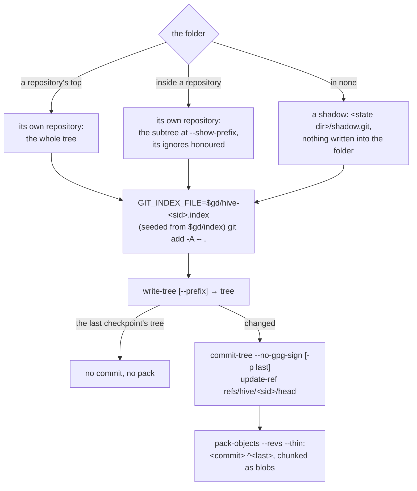

| Step | What it guards | Where |
|---|---|---|
| the repository | its own, or the one the folder is in; a shadow for a folder in none, and a refusal inside a git directory | [`workspace.rs:399`](../agents/roomlerd/src/hive/workspace.rs#L399) |
| the index | `$gd/hive-<sid>.index`, a copy of the person's: theirs is read, never written | [`workspace.rs:297`](../agents/roomlerd/src/hive/workspace.rs#L297) |
| the tree | `write-tree --prefix` for a folder inside a repository, so nothing outside the folder is taken and the repository's `.gitignore` still keeps a `.env` out | [`workspace.rs:452`](../agents/roomlerd/src/hive/workspace.rs#L452) |
| the commit | "Roomler Hive" as author, never the person; `--no-gpg-sign`, so a person's `commit.gpgSign` never waits on their key; the last checkpoint's commit as parent | [`workspace.rs:247`](../agents/roomlerd/src/hive/workspace.rs#L247) |
| the pack | thin against the last checkpoint, whole for the first; at most 512 MiB | [`workspace.rs:478`](../agents/roomlerd/src/hive/workspace.rs#L478) |
| every command | no hook (`core.hooksPath` names nowhere), no fsmonitor, no automatic gc, none of the caller's `GIT_*` environment | [`workspace.rs:1170`](../agents/roomlerd/src/hive/workspace.rs#L1170) |

⚠️ **The first checkpoint's commit has no parent.** Its pack holds the whole tree and
none of the person's history, because a member has nothing else to resolve a delta
against. Each later commit is the last checkpoint's child, and its pack is thin
against it, so a target applies the packs in order (`git index-pack --fix-thin`). The
person's `HEAD` is recorded beside the commit
([`WorkspaceSnap`](../crates/hive-node/src/checkpoint.rs#L208)), for a teleport into a
clone of the same repository (P2f).

⚠️ A turn that changed no file writes no commit and no pack. A workspace that cannot be
taken (no `git`, a pack over the limit, a folder inside a git directory) never fails the
checkpoint: the config directory is what a resume needs, so the workspace is skipped,
in words. The temporary index and `refs/hive/<sid>/*` stay in the person's repository
until the session ends or is purged (P2g).

### P2b-3a: `hive-checkpoint`, as the account

The daemon never opens a path in the account's tree, so a checkpoint is taken by a
child it starts as the account, `roomlerd hive-checkpoint <request>`, as the Unix
wrapper and Windows' `hive-prep` already run
([`checkpointer.rs`](../agents/roomlerd/src/hive/checkpointer.rs)). P2b-3a builds both
sides. P2b-3b calls it at a turn's end, for a session the server joined as replicated
(P2c).

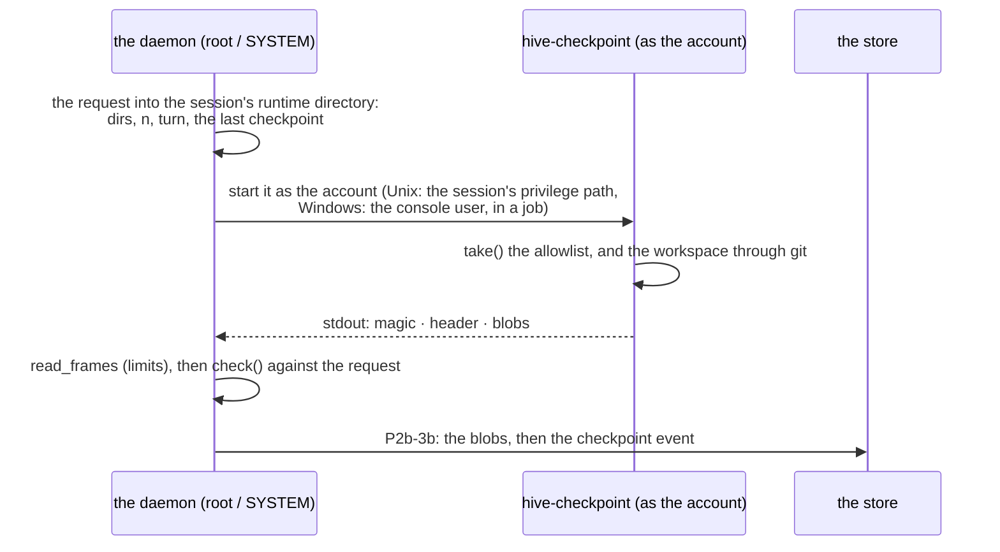

| On stdout | What the daemon holds it to |
|---|---|
| `HIVECP1\n` | the magic, or nothing is read |
| u32 · JSON `{"checkpoint": …}` | at most 16 MiB; the request's `n` and `turn`; every path inside the allowlist, in order, taken the way the allowlist says, at most mode `0o777` ([`checkpointer.rs:209`](../agents/roomlerd/src/hive/checkpointer.rs#L209)) |
| u32 · then u64 · bytes per blob | each the very blob its chunk names, by length and hash, in order (each file's, then the pack's); not one more or fewer; each at most 4 MiB ([`checkpointer.rs:167`](../agents/roomlerd/src/hive/checkpointer.rs#L167)) |
| the workspace | git's ids only (40 or 64 hex digits), and a prefix that cannot step outside the repository |

⚠️ **What comes back is the account's word, and the agent runs as that account.** The
child is the daemon's own binary, but the account can reach it while it runs. So the
daemon takes nothing on trust. A path like `../.ssh/id_ed25519` or `sessions/1.key`,
a blob swapped for another, an extra or a missing one, or a `../` prefix is refused
before the store sees any of it. A member still checks each whole file again when it
assembles it.

The child gets 120 s ([`checkpointer.rs:313`](../agents/roomlerd/src/hive/checkpointer.rs#L313))
and may write at most the limits' sum. On Unix it is started through the session's
privilege path ([`checkpointer.rs:603`](../agents/roomlerd/src/hive/checkpointer.rs#L603)).
On Windows it runs as the user signed in at the console, whom `hive_accounts` must name
([`hive_win.rs:1056`](../agents/roomlerd/src/hive_win.rs#L1056)), in a job of its own.

⚠️ **An ended checkpoint takes its `git` with it.** On Unix the child leads its own
process group, and a timeout, too much output or an abandoned checkpoint signals the
whole group ([`child.rs:28`](../agents/roomlerd/src/hive/child.rs#L28)
`Group`). Until P2b-3b it signalled the leader alone (`start_kill`, `kill_on_drop`),
which left a `git add` hashing the folder behind it. TERM goes first, then KILL after
2 s, because git removes its lock files on TERM and never on KILL. The group is
signalled only while its leader is unreaped: after that its id may name someone else's
group.

### P2b-3b: a checkpoint at each turn's end

A replicated session checkpoints each turn's end
([`checkpointer.rs:428`](../agents/roomlerd/src/hive/checkpointer.rs#L428)). The checkpoint
comes after the turn's `result` and before the next queued prompt begins, so it holds
the files as the turn left them; nothing writes them while the harness waits for input.
The blobs go into the store first, then the `checkpoint` event, so a member that sees the
event can fetch every blob it names.

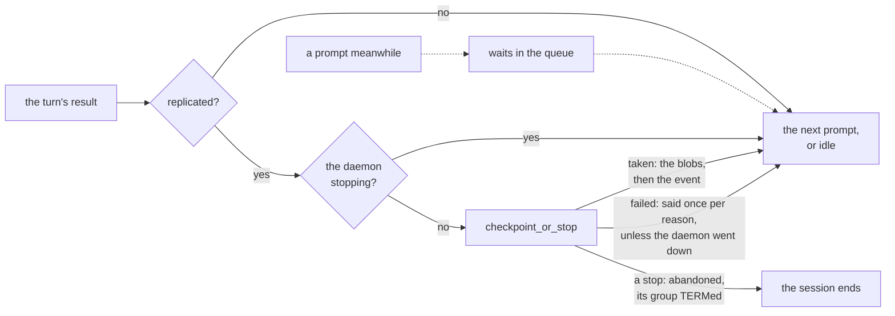

| Piece | What it does |
|---|---|
| the switch | `StartOrder.replicated`: a session the server joined as replicated (P2c, which sets it from the wire). Kept in `hosted.json`, so a resume after a restart goes on checkpointing; absent from an older file, it reads off |
| where it runs | in the session's run loop, not inside the event that ended the turn ([`supervisor.rs:5594`](../agents/roomlerd/src/hive/supervisor.rs#L5594) `checkpoint_or_stop`), so the session still listens: a prompt sent meanwhile waits behind it, and a stop is a stop |
| a stop during one | abandons it: its child's group is TERMed and no checkpoint is recorded. The next one takes everything since the last one kept |
| where the next one starts | the last checkpoint, in memory; after a restart, read back from the store ([`store.rs:1002`](../crates/hive-node/src/store.rs#L1002) `last_of_kind`). A checkpoint an older daemon stored has no `kind` column, so the next one takes everything again: more bytes, never a wrong checkpoint |
| the request | `checkpoint.json` in the session's runtime directory, the daemon's own: made `0600` and handed to the account through its descriptor, never by a path ([`checkpointer.rs:555`](../agents/roomlerd/src/hive/checkpointer.rs#L555)); on Windows it takes the session directory's DACL |
| a failure | logged with the session and the number, and said once per reason in the transcript ("Checkpoint 3 was not taken: …"); the session goes on |
| the daemon going down | starts none, and says no failure: the child went down with it (systemd signals the whole cgroup at once), and the next daemon's next checkpoint takes what this one would have (P1d-2) |
| a lock left behind | a lock on the checkpoint's own index older than 300 s is cleared ([`workspace.rs:277`](../agents/roomlerd/src/hive/workspace.rs#L277)). A KILL or a power cut leaves one, and it would refuse every checkpoint after it for good; no checkpoint holds one longer than its 120 s |
| the room | a `checkpoint` event is one line: "💾 Checkpoint 2: 1 of 3 of the agent's files changed; the folder committed", or the folder unchanged, or not kept and why |

⚠️ Nothing sets `replicated` before P2c, so no device takes a checkpoint yet. Three
tests turn it on: `a_replicated_session_checkpoints_each_turns_end_and_no_other_does`
(the chain: the history from where the last checkpoint left it, the folder's commit on
the last one's, and the other side), `a_failed_checkpoint_is_said_once_and_the_session_goes_on`,
and `a_stop_is_heard_while_a_checkpoint_runs_and_a_prompt_waits_behind_it`.

⚠️ **Open before P2c turns it on: a folder too big to add.** A folder whose first `git
add` cannot finish within 120 s fails at every turn's end. The add that is ended writes
no index, so the next one starts over, and each such turn waits the full 120 s before
its next prompt. P2c must refuse such a folder up front, or bound the add.

⚠️ **The allowlist is the harness's.** What P2b-1 takes is Claude Code's own layout
(`projects/hive-<id>/…`, `CLAUDE.md`). Codex keeps its rollouts elsewhere
(`~/.codex/sessions`), so the Codex adapter (design §4, P7) brings its own allowlist;
until then only a Claude Code session is replicated.

### P2b-4a: `hive-materialize`, the config directory as the account

The reverse of `hive-checkpoint`. A promotion (P2e) or a teleport (P2f) puts the
session's last checkpoint back on the device that will run it, and the daemon never
writes a path in the account's tree. So it starts `roomlerd hive-materialize` as the
target's account and streams it the files
([`materializer.rs`](../agents/roomlerd/src/hive/materializer.rs)). P2b-4a builds both
sides for the config directory; P2b-4b adds the folder (below). Nothing calls it before P2e.

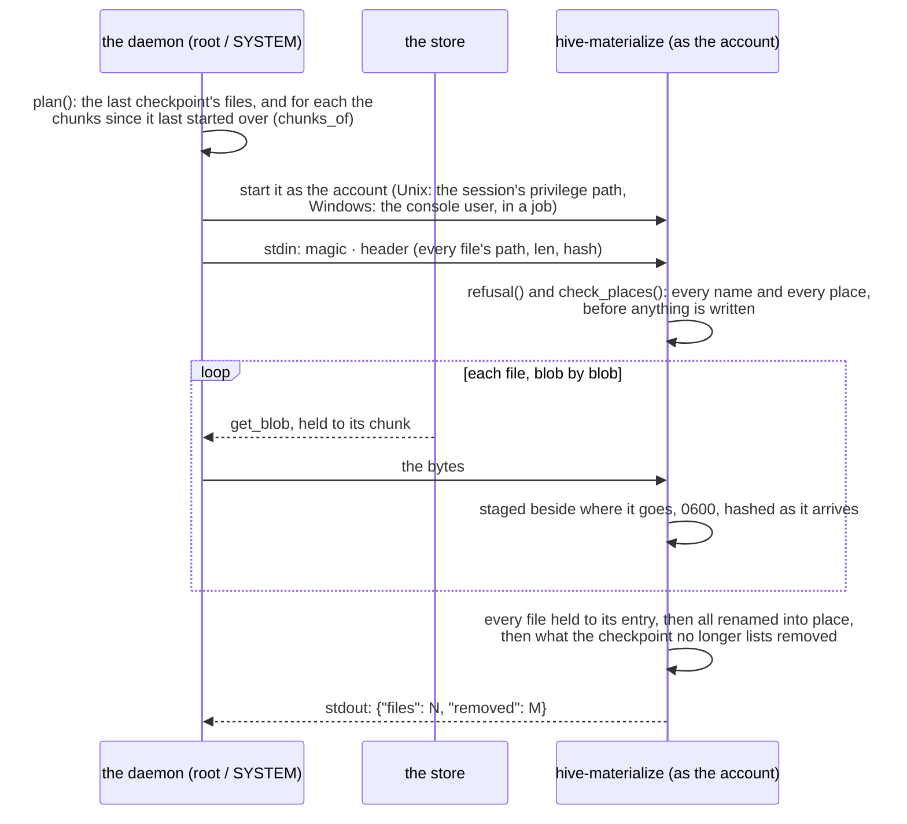

| Step | What it guards | Where |
|---|---|---|
| the plan | every path in the allowlist; each file's chunks from its last start-over, adding up to its entry. A history is streamed, never held whole | [`materializer.rs:202`](../agents/roomlerd/src/hive/materializer.rs#L202) · [`checkpoint.rs:789`](../crates/hive-node/src/checkpoint.rs#L789) `chunks_of` |
| the stream | each blob held to its chunk before it goes; a blob the store lacks ends the stream short, the child writes nothing, and the daemon's own word is the answer | [`materializer.rs:484`](../agents/roomlerd/src/hive/materializer.rs#L484) |
| the names | the allowlist again, in order. On Windows: no device name (`aux.md` is AUX, `COM1.log` is COM1), none of `<>:"\|?*` or a control character, no trailing dot or space, at most 259 characters where it goes. On Windows and macOS: no two names that differ only in case | [`materializer.rs:860`](../agents/roomlerd/src/hive/materializer.rs#L860) |
| the places | every directory on the way is one of its own, never a link to one, and no file goes where a directory is | [`materializer.rs:1001`](../agents/roomlerd/src/hive/materializer.rs#L1001) |
| the files | staged beside where they go, `0600` whatever mode the checkpoint's OS kept, and each held to its entry's length and hash; only then are they renamed into place | [`materializer.rs:729`](../agents/roomlerd/src/hive/materializer.rs#L729) |
| what goes | inside the allowlist, a file the checkpoint does not list is removed, never through a link and no deeper than a checkpoint looks; nothing outside it is touched (a login, the harness's own state) | [`materializer.rs:1137`](../agents/roomlerd/src/hive/materializer.rs#L1137) |

⚠️ **What comes in is another device's word.** A checkpoint was taken by whichever
member was primary, and this daemon only relays it. Unchecked, a path that climbs out
with `..` would be written as the target's account wherever it can write, its
`~/.bashrc` included. So the child holds every name to the allowlist again. A refusal at any step writes nothing, and
the files it staged so far are removed.

⚠️ **Windows' names are refused before anything moves.** A Linux session's memory can
hold `aux.md` or `a:b.md`, which Windows cannot. Two names that differ only in case
are one file on Windows and on a default macOS volume. P2f's prepare refuses such a
session up front through the same `refusal`.

⚠️ **A child that refuses is answered in its own words.** It stops reading, and the
feed then meets a closed pipe, which would otherwise be all that is said
([`child.rs:79`](../agents/roomlerd/src/hive/child.rs#L79)). On Unix the runner, its
process group and its time limit are the ones `hive-checkpoint` uses. On Windows a
thread of its own feeds the child's pipe
([`hive_win.rs:1106`](../agents/roomlerd/src/hive_win.rs#L1106)).

The files are written `0600` because a checkpoint taken on Windows records mode 0,
and restoring that on Linux would leave the account unable to read its own history.

### P2b-4b: `hive-materialize`, the folder as the account

The same child takes the session's folder back too, after the config directory's files
are staged ([`workspace.rs`](../agents/roomlerd/src/hive/workspace.rs)). The daemon
sends the packs that bring the last checkpoint's commit
([`materializer.rs:272`](../agents/roomlerd/src/hive/materializer.rs#L272)):
back from it along each `base` to a whole pack, past the turns that changed nothing,
and oldest first, so each thin pack finds its base in the repository already.

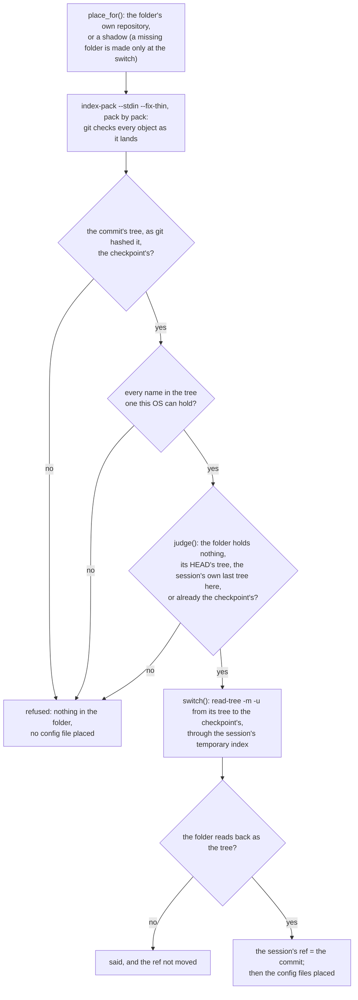

| Step | What it guards | Where |
|---|---|---|
| the place | the folder's own repository, at its prefix, or a shadow in the session's state directory; a link where the folder goes is refused | [`workspace.rs:745`](../agents/roomlerd/src/hive/workspace.rs#L745) |
| the packs | each through `git index-pack --stdin --fix-thin`, which checks every object as it lands. Nothing else of the repository changes; the objects of a materialize refused later are referenced by nothing, and git's own gc takes them | [`workspace.rs:770`](../agents/roomlerd/src/hive/workspace.rs#L770) |
| the tree | the commit's tree, as git hashed it, must be the one the checkpoint names | [`materializer.rs:807`](../agents/roomlerd/src/hive/materializer.rs#L807) |
| the names | every path in the tree held to the same rules as the config directory's: Windows' names and lengths where it goes, and on Windows and macOS two names that are one there, files or the directories on their way (`Dir/a` beside `dir/b`) | [`materializer.rs:918`](../agents/roomlerd/src/hive/materializer.rs#L918) |
| the folder | only one it is safe to replace: holding nothing yet, exactly its own `HEAD`'s tree (a clean clone), exactly what this session last left in it (a former primary: moving back), or already the checkpoint's. Anything else is the person's own work, and is refused | [`workspace.rs:890`](../agents/roomlerd/src/hive/workspace.rs#L890) |
| the switch | git's own two-tree `read-tree -m -u`, through the session's temporary index: what the tree lacks is removed, what it changes is rewritten with the repository's line endings and filters, and an untracked file in the way is refused before anything is written | [`workspace.rs:983`](../agents/roomlerd/src/hive/workspace.rs#L983) |
| a folder inside a repository | the switch is between the whole repository's trees, the index's and the same with the folder's subtree swapped, so nothing outside the folder moves | [`workspace.rs:1030`](../agents/roomlerd/src/hive/workspace.rs#L1030) |
| the end | the folder read back as a checkpoint reads it must be the tree; only then is `refs/hive/<sid>/head` the commit, where the next checkpoint here starts | [`workspace.rs:983`](../agents/roomlerd/src/hive/workspace.rs#L983) |

⚠️ **The person's `HEAD`, branches and index are never touched**, as the checkpoint
side never touches them. In a clean clone the session's changes land in the work tree
as uncommitted changes, which is what they were where the checkpoint was taken.

⚠️ **A move keeps git's tree, not the bytes** (design §6.3). Line endings follow the
target's git configuration, so a Windows checkout with `core.autocrlf=true` lands with
CRLF. That is why the folder is held to the tree id, never byte for byte. A folder whose
git cannot give the tree back — a CRLF blob into a repository with
`core.autocrlf=input` — is said to, and its ref is not moved.

⚠️ **A switch that fails part way is not undone.** Every check runs before the folder is
touched, and git refuses an untracked file in the way before it writes. But a write that
fails part way (a full disk) leaves the folder between the two trees. The ref is not
moved, the config files are not placed, and the materialize says so.

### P2c-1: the device's gates for holding copies

Before any frame of the replicaset exists, the device's own refusals do (§3g). Three
keys, each the device owner's, default off, never pushable, and in the lock test's list
([`models.rs:6024`](../crates/remote_control/src/models.rs#L6024)):

| Key | What it is | Where |
|---|---|---|
| `hive_replica` | hold copies of the sessions the owner runs on their other devices. While it is on the device keeps a store, as an archive replica's container must although it runs nothing | [`config.rs:471`](../crates/agent-core/src/config.rs#L471) · [`supervisor.rs:1068`](../agents/roomlerd/src/hive/supervisor.rs#L1068) |
| `hive_archive` | offer the device as the org's archive replica; only ever with `hive_replica`, so alone it reads off | [`gates.rs:79`](../agents/roomlerd/src/hive/gates.rs#L79) |
| `hive_store_quota_mib` | the most the device keeps as a replica, in MiB; unset, the disk's | |

Two verbs join the wire's vocabulary, `hive-replica` and `hive-archive`
([`models.rs:663`](../crates/remote_control/src/models.rs#L663)). `hive` is the prefix of
both, and the three are different promises: running sessions is not holding copies of
other devices', and a replica is no archive. They are matched by equality and locked by
test, like `ssh` and `ssh-consent`.

⚠️ **A verb is advertised only with the frames it promises.** Advertising one says the
device understands its frames, and nothing answered a join before P2c-3b: a server that
saw `hive-replica` then would have waited for a `join_ack` that never came. P2c-3b
advertises both together with the join's handling, only while the keys are on.

⚠️ **A folder too big for one checkpoint is skipped at once**
([`workspace.rs:327`](../agents/roomlerd/src/hive/workspace.rs#L327)). Before `git add`
hashes anything, `git ls-files --others` walks what the index does not have yet,
without hashing and with ignores honoured, and stops at the first limit passed: 20,000
files or 512 MiB. The workspace is then skipped, in words that point at `.gitignore`.
Without it, a folder too big to add within the checkpoint's 120 s failed at every turn's
end, because an add that is ended writes no index and the next one starts over. That was
P2b-3b's open prerequisite for P2c.

### P2c-2a: the org's replica policy

Where an organization's sessions are copied is the organization's call (spec §3b,
"Membership and placement"): one document per organization in `hive_policies`, unique on
`tenant_id` ([`lib.rs:294`](../crates/modules/hive/src/lib.rs#L294)), written by an
`ADMINISTRATOR` and audited. Until one is written, every reader gets decision 2's
defaults ([`policy.rs:91`](../crates/modules/hive/src/policy.rs#L91)). The two routes,
`GET` and `PUT …/hive/policy` ([`lib.rs:229`](../crates/modules/hive/src/lib.rs#L229),
`docs/api.md`), answer **404** while the server's `hive.replicaset` is off
([`settings.rs:88`](../crates/config/src/settings.rs#L88),
[`policy.rs:247`](../crates/modules/hive/src/policy.rs#L247)) or `hive` does not serve the
organization. Placement (P2c-2b) is its reader.

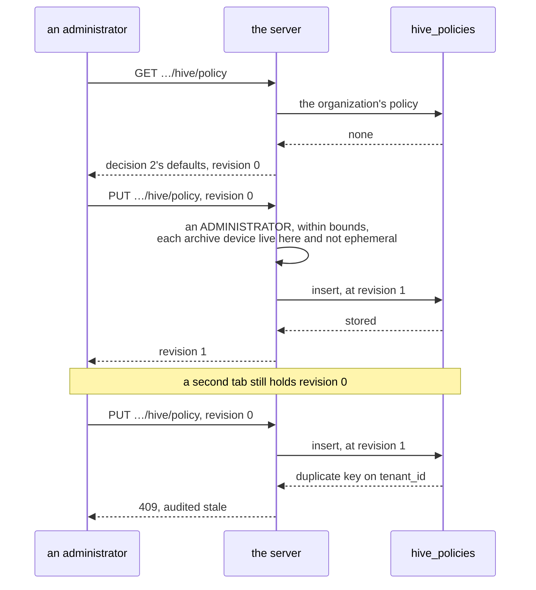

| Field | What a write may set | Why |
|---|---|---|
| `replicaset.min` | 1 to 8; the primary counts | fewer copies than `min` is shown in the session's room, never accepted in silence |
| `replicaset.max` | `min` to 8 | |
| `replicaset.archive` | whether every archive replica the rules allow joins | |
| `replicaset.prefer` | `owner_devices`, once; any other word is refused | the one order decision 2 names. Refused rather than stored, so a word the server cannot place by fails at the write, not silently at every placement |
| `replicaset.restricted_tags` | trimmed, empties dropped, once each, at most 16 of 40 characters ([`agent.rs:1000`](../crates/modules/fleet/src/agent.rs#L1000)) | normalized as device tags are, so a tag compares equal to the one a device carries |
| `retention_days` | 0 to 3650; 0 keeps sessions for ever | P2g applies it |
| `archive_devices` | at most 16, each a live device of this organization and not ephemeral, each kept once ([`policy.rs:315`](../crates/modules/hive/src/policy.rs#L315)) | the administrator's half of an archive replica. The device's own `hive_archive` is the other half, read where placement runs, so either may come first |

⚠️ **A write names the revision it read** ([`policy.rs:169`](../crates/modules/hive/src/policy.rs#L169)).
A `PUT` replaces the whole policy, so two administrators editing at once would otherwise
each write over the other's change unseen. The first write is an insert, and the unique
index decides between two of them; every later one is an update filtered by
`{tenant_id, revision}` ([`policy.rs:193`](../crates/modules/hive/src/policy.rs#L193)).
Either way the loser gets **409** and reads again.

⚠️ **An ephemeral device is never an archive replica**
([`policy.rs:328`](../crates/modules/hive/src/policy.rs#L328)). FR-51 fixes `ephemeral`
at enrollment, and the reaper hard-deletes such a row once it goes quiet: it could keep
nothing for the retention, and never acknowledge a purge.

⚠️ **Only a device that is not there is a refusal.** A lookup that failed is the
database's answer: a **500**, never a `not_a_device` row in the audit blaming the caller.

Every attempt lands in `hive_audit` as `action: policy`
([`policy.rs:368`](../crates/modules/hive/src/policy.rs#L368)): `set`, or `refused` with
`no_permission`, `invalid`, `not_a_device`, `ephemeral` or `stale`.

A policy only ever says where copies **may** go. Whether a device holds one is still its
owner's `hive_replica` (P2c-1), which no policy and no server can turn on.

### P2c-2b: placement at a start

Placement chooses a session's members from the policy and the devices' stored rows. Its
rules are one pure function, `place`
([`placement.rs:255`](../crates/modules/hive/src/placement.rs#L255)), each rule a unit
test. With `hive.replicaset` on, the start route runs it before the record is written
([`routes.rs:515`](../crates/modules/hive/src/routes.rs#L515)) and keeps the result on the
record as `replicaset` ([`model.rs:427`](../crates/modules/hive/src/model.rs#L427)), which
the session view carries (`docs/api.md`). A placement is a plan: nothing reaches a member
before the join (P2c-3), and the member's own `hive_replica` decides whether it takes the
copy.

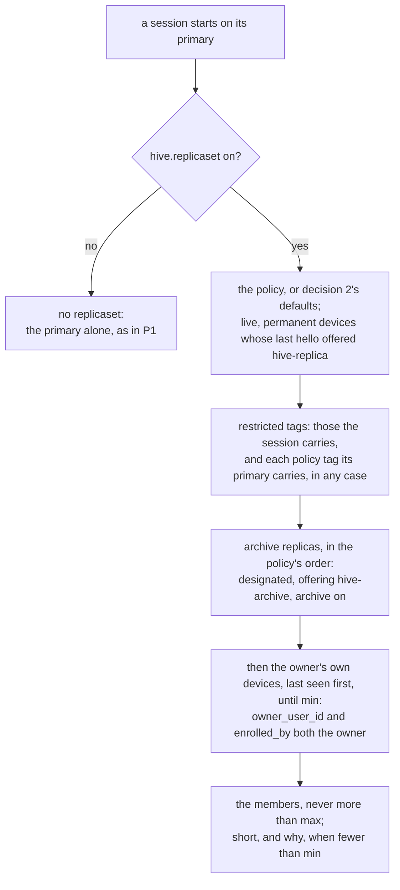

| Rule | Why | Where |
|---|---|---|
| A member offers: its last hello advertised `hive-replica`, and it is live, not ephemeral, and not the primary | the device owner's `hive_replica` is the gate that survives a compromised server; FR-51 hard-deletes an ephemeral row once it goes quiet | [`placement.rs:275`](../crates/modules/hive/src/placement.rs#L275), [`agent.rs:256`](../crates/services/src/dao/agent.rs#L256) |
| The owner's own devices are those whose `owner_user_id` **and** `enrolled_by` both name the session's owner | `owner_user_id` is reassignable with `MANAGE_AGENTS` alone: a device manager who hands someone a device must not receive that person's sessions on it | [`placement.rs:308`](../crates/modules/hive/src/placement.rs#L308) |
| Archive replicas come first, in the policy's order: designated, offering `hive-archive`, and only while `archive` is on | the administrator's half and the device owner's half | [`placement.rs:283`](../crates/modules/hive/src/placement.rs#L283) |
| The owner's devices fill to `min`, last seen first and ties by id; never more than `max` in all | decision 2, and the same answer whenever it is computed | [`placement.rs:321`](../crates/modules/hive/src/placement.rs#L321) |
| A restricted tag only ever takes a device out | a copy is everything the agent saw | [`placement.rs:276`](../crates/modules/hive/src/placement.rs#L276) |
| An adopted session is placed nowhere | decision 11; the adopt path records no replicaset at all | [`placement.rs:266`](../crates/modules/hive/src/placement.rs#L266) |

⚠️ **A tag is compared without case**
([`placement.rs:143`](../crates/modules/hive/src/placement.rs#L143)). A primary tagged
`Prod` is restricted by the policy's `prod`, and a device tagged `PROD` may hold its
copies. A comparison that assumed one casing would leave that session unrestricted: a
guard that assumes a casing is no guard.

⚠️ **Restricted tags stick.** The record keeps the tags the session carries, in the
policy's spelling. A later placement adds to them and never takes one away, so a session
that was restricted stays restricted, whatever its primary is tagged later.

⚠️ **Placement reads each device's stored row, not the pod's live connections.** A device
offline at the start is placed, and joins when it connects (P2c-3). A row can be stale:
it may still offer `hive-replica` after its owner turned the key off. That device refuses
the join itself.

⚠️ **Replication never blocks a start.** A policy or device read that fails is logged,
and the session starts on its primary alone, with no `replicaset`.

A session with fewer members than `min` says why in `short`: `restricted` when a device
that would hold a copy lacks a restricted tag, `no_device` when no other device offers.
The room's header shows it in P2j. Each placement lands in `hive_audit` as
`action: place`, `placed` or `short` with that word
([`routes.rs:582`](../crates/modules/hive/src/routes.rs#L582)).

P2c-2b places only at a start. Placement runs again when the policy or its archive
replicas change, when a member goes and when a device's tags or owner change (P2c-4a,
below), and a session from before P2 is placed when its primary connects (P2c-4b).

### P2c-3a: the join, and what a member says back

A member learns it holds a session from `rc:hive.replica.join`. The server learns what
each member holds from what the member says back: its answer, then the tip of its copy
(spec §3b, "What the server learns"). P2c-3a builds the frames and the server's half
([`replica.rs`](../crates/modules/hive/src/replica.rs)). The device's half is P2c-3b,
below: its gates on a join, the membership its store keeps, and its tips. A server
sends no join to a build that does not advertise `hive-replica`.

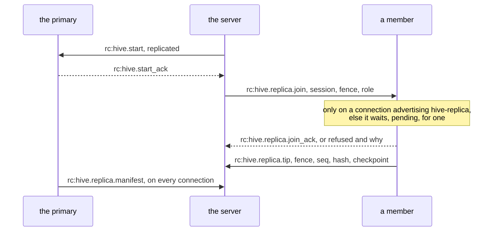

| Frame | From | Says | Where |
|---|---|---|---|
| `rc:hive.start` gains `replicated` | the server | the session has members besides its primary: checkpoint each turn's end (P2b-3b). Absent, as from every earlier server, and a device that predates it ignores it | [`signaling.rs:3157`](../crates/remote_control/src/signaling.rs#L3157); the device takes it into its start order, [`signaling.rs:4375`](../agents/roomlerd/src/signaling.rs#L4375) |
| `rc:hive.replica.join` | the server | `{session_id, fence, role}`: hold a copy, as `archive` or `owner`; or, as `primary` (P2c-4b, below), checkpoint the session you run, which has members now. A role the device cannot name decodes as none, and it refuses | [`signaling.rs:3191`](../crates/remote_control/src/signaling.rs#L3191) |
| `rc:hive.replica.join_ack` | a member | joined, or `refused`: `replica_disabled`, `archive_disabled`, `secondary_org`, `purged`, `stale_fence` or `quota`. An unknown word is still a refusal | [`signaling.rs:831`](../crates/remote_control/src/signaling.rs#L831), [`hive.rs:600`](../crates/remote_control/src/hive.rs#L600) |
| `rc:hive.replica.tip` | a member, or the primary | `{session_id, fence, seq, hash, checkpoint?}`: where its copy ends, at most every 5 s and at each checkpoint | [`signaling.rs:858`](../crates/remote_control/src/signaling.rs#L858) |
| `rc:hive.replica.manifest` | each device, on every connection | every session it holds a copy of, its own included, each with its tip; at most 4,096 | [`signaling.rs:876`](../crates/remote_control/src/signaling.rs#L876), [`hive.rs:499`](../crates/remote_control/src/hive.rs#L499) |

| When | What the server does | Where |
|---|---|---|
| the primary accepts the start | sends each member that has not answered its join, in its role | [`agent_socket.rs:537`](../crates/modules/hive/src/agent_socket.rs#L537), [`replica.rs:189`](../crates/modules/hive/src/replica.rs#L189) |
| a device connects | sends it every join it has still to answer, if THIS connection advertises `hive-replica`. A member placed before P2c-3a has no state, and counts as pending | [`agent_socket.rs:403`](../crates/modules/hive/src/agent_socket.rs#L403), [`replica.rs:208`](../crates/modules/hive/src/replica.rs#L208), [`dao.rs:1116`](../crates/modules/hive/src/dao.rs#L1116) |
| a join answer arrives | the member is `joined`, or `refused` with the device's word | [`replica.rs:261`](../crates/modules/hive/src/replica.rs#L261), [`dao.rs:1035`](../crates/modules/hive/src/dao.rs#L1035) |
| a tip arrives, alone or in a manifest | kept on the member's entry: the fence, `seq`, hash and newest checkpoint, and when it was heard | [`replica.rs:303`](../crates/modules/hive/src/replica.rs#L303), [`dao.rs:1090`](../crates/modules/hive/src/dao.rs#L1090) |

Each member on the record now carries `state` (`pending`, `joined` or `refused`,
[`model.rs:474`](../crates/modules/hive/src/model.rs#L474)), the refusal, when it
answered, and its tip ([`model.rs:505`](../crates/modules/hive/src/model.rs#L505)), all
in the session view (`docs/api.md`). The primary is `joined` from its placement: it holds
the session by running it. It is `pending` only while it is owed its own join (P2c-4b).

⚠️ **A join goes only to a connection that advertises `hive-replica`**
([`hub.rs:2090`](../crates/modules/fleet/src/hub.rs#L2090)). Advertising says two things
at once: the device understands the join, and its owner lets it hold copies. Any other
connection receives nothing, and the join waits, pending, for one that does, as an
offline device's remote configuration waits.

⚠️ **What a member says is a claim, applied only where the record names that device.**
An answer from a device placement did not choose, or to another fence, matches nothing.
A tip from a member that refused is dropped: by its own word it holds nothing.

⚠️ **A hash that is not one is never stored**
([`replica.rs:306`](../crates/modules/hive/src/replica.rs#L306)): exactly 64 lowercase
hex characters ([`hive.rs:519`](../crates/remote_control/src/hive.rs#L519)), or the
report is dropped.

⚠️ **A start says `replicated` only when placement chose another member**
([`replica.rs:62`](../crates/modules/hive/src/replica.rs#L62)). With the switch off there
is no placement, so no start says it and nothing checkpoints; from P2c-4b a start sent
again says it only while the switch is on, too (below). The device keeps the flag
in its start order and its hosted record, so a restarted daemon still checkpoints the
session (P2b-3b).

### P2c-3b: the join, the device's half

A device answers a join through its own gates, keeps what it joined in its store, and
tells the server where each copy ends
([`supervisor/replica.rs`](../agents/roomlerd/src/hive/supervisor/replica.rs)).

```mermaid
flowchart TD
    J["rc:hive.replica.join, session, fence, role"] --> G1{"on the primary<br/>enrollment's connection?"}
    G1 -- no --> R1["secondary_org"]
    G1 -- yes --> G2{"the owner's hive_replica on?"}
    G2 -- no --> R2["replica_disabled"]
    G2 -- yes --> G3{"a role this build can name?<br/>an archive's hive_archive on?"}
    G3 -- no --> R3["other, or archive_disabled"]
    G3 -- yes --> G4{"the store open,<br/>and under hive_store_quota_mib?"}
    G4 -- no --> R4["other, or quota"]
    G4 -- yes --> T["one transaction: not purged, not below the floor,<br/>the floor raised to the fence, the membership kept"]
    T -- refused --> R5["purged, or stale_fence"]
    T -- kept --> A["rc:hive.replica.join_ack, joined"]
```

The gates run in that order ([`replica.rs:60`](../agents/roomlerd/src/hive/supervisor/replica.rs#L60)),
and the answer goes back on the connection the join came on
([`supervisor.rs:823`](../agents/roomlerd/src/hive/supervisor.rs#L823)). A join that
passes is one transaction in the store
([`store.rs:343`](../crates/hive-node/src/store.rs#L343) `Store::join`): the floor rises to
the join's fence, and a row in `memberships` keeps the role and fence
([`store.rs:115`](../crates/hive-node/src/store.rs#L115)). It is a new table, so
`user_version` stays 1 and a daemon the updater rolled back still opens the file. A purge
ends the membership with the rest ([`store.rs:1262`](../crates/hive-node/src/store.rs#L1262)).

| What the device says | When | Where |
|---|---|---|
| `rc:hive.replica.join_ack` | at once, joined or refused with its word | [`supervisor.rs:823`](../agents/roomlerd/src/hive/supervisor.rs#L823) |
| `rc:hive.replica.tip` | after each checkpoint of a replicated session it runs | [`supervisor.rs:5636`](../agents/roomlerd/src/hive/supervisor.rs#L5636), [`replica.rs:496`](../agents/roomlerd/src/hive/supervisor/replica.rs#L496) |
| `rc:hive.replica.manifest` | on every connection, after the P1b manifest: every membership and every replicated session it runs, newest first | [`supervisor.rs:3088`](../agents/roomlerd/src/hive/supervisor.rs#L3088), [`replica.rs:448`](../agents/roomlerd/src/hive/supervisor/replica.rs#L448) |

A tip is the chain's end, the event's fence, `seq` and hash, and the newest `checkpoint`
event's `seq` and hash. A member that holds nothing yet says `seq` 0 at its floor
([`replica.rs:201`](../agents/roomlerd/src/hive/supervisor/replica.rs#L201)): it joined,
and waits for the carrier.

The device advertises `hive-replica` while its owner's `hive_replica` is on and the store
opened, and `hive-archive` while `hive_archive` is on too
([`caps.rs:1644`](../agents/roomlerd/src/encode/caps.rs#L1644)). A secondary org's
connection strips both words, in its hello and in every heartbeat that re-announces the
caps ([`signaling.rs:5545`](../agents/roomlerd/src/signaling.rs#L5545)), so that org's
placement never picks this device.

⚠️ **Only a device with copies to tell about sends a replica frame**
([`replica.rs:433`](../agents/roomlerd/src/hive/supervisor/replica.rs#L433)). One whose
owner never turned `hive_replica` on, and that runs no replicated session, sends no
`rc:hive.replica.*` at all, so a server from before P2c-3a never receives a word it cannot
read.

⚠️ **The keys are read once, at the daemon's start**, like every `hive_*` key. Turning
`hive_replica` on is advertised, and answered, from the next start.

⚠️ **The quota is the store's own count of its pages**
([`store.rs:462`](../crates/hive-node/src/store.rs#L462)). The write-ahead log is folded
back at each checkpoint, and is not counted.

⚠️ **A joined member holds no copy yet.** The copy comes with the carrier and the stream
(P2d). Until then its tip is `seq` 0, and the server knows it as joined and empty.

### P2c-4a: placement decided again

A placement is not frozen at the start. When something it reads changes, the server
decides again for every live placed session of the organization
([`placement.rs:433`](../crates/modules/hive/src/placement.rs#L433)).

| What changed | Who tells hive | Where |
|---|---|---|
| a device's tags or owner | fleet's update route, once they are stored, through a new core hook, `agent_updated`; a failing holder is the route's 500, and a retry decides again | [`agent.rs:1111`](../crates/modules/fleet/src/agent.rs#L1111), [`hooks.rs:149`](../crates/core/src/hooks.rs#L149), [`hooks.rs:114`](../crates/modules/hive/src/hooks.rs#L114) |
| the policy, or its archive replicas | the policy write, after it is stored | [`policy.rs:354`](../crates/modules/hive/src/policy.rs#L354) |
| a member removed from the fleet | the removal cascade, hive first, while the row is still there: the device is named as gone | [`hooks.rs:103`](../crates/modules/hive/src/hooks.rs#L103) |

```mermaid
flowchart TD
    C["a tag, an owner, the policy, a removal"] --> P["place again, keeping what it holds:<br/>members that still qualify first, in their order"]
    P --> N{"for each device it chooses"}
    N -- "new" --> A["added pending, and joined<br/>once the primary runs the session"]
    N -- "leaving" --> B["pending again, and joined again"]
    N -- "a member already" --> K["kept as it is"]
    P --> L{"for each member it no longer chooses"}
    L --> X["leaving: its copy goes with the purge (P2g)"]
```

⚠️ **Deciding again moves no copy that need not move.** [`place`](../crates/modules/hive/src/placement.rs#L320)
keeps the members a session holds, in their order, before it takes another device,
active ones before leaving ones. Without that, tagging an unrelated device B would evict
member A from a session only because B was seen more recently. A smaller `min` keeps the
first members, and the rest leave.

⚠️ **A leaving member keeps its copy until the purge.** Its state is `leaving`
([`model.rs:487`](../crates/modules/hive/src/model.rs#L487)), and P2g sends it the purge
once `min` holds elsewhere: make-before-break. A join answer in flight when it was let go
does not take it back. If placement chooses it again, it is `pending` and is joined again;
its store already holds the membership.

⚠️ **Restricted tags still only grow.** Placement starts from the tags the session already
carries, so a primary losing `prod` does not release the session to untagged devices.

Each change that moved a member lands in `hive_audit` as `place` with outcome `replaced`.
The row names the session's owner, since the decision was the system's, not a person's.
A member that refused its join stays refused. A primary that started alone is told when
its session gains a member (P2c-4b, below).

⚠️ **Retained sessions are not placed again.** Placement decides again for live
sessions only, so an archive replica designated later receives the live ones it may
hold, never the ended sessions kept for the retention. The back-fill spec §3b asks for
needs a member to stream from, so it waits for the carrier (P2d).

### P2c-4b: the primary told, and sessions from before placement

A session that started alone was started without `replicated`, so its primary takes no
checkpoint. When placement later gives it a member (one of P2c-4a's changes, or its first
placement, below), the primary is told with the frame a member gets, in a third role:
`rc:hive.replica.join {role: primary}`
([`hive.rs:544`](../crates/remote_control/src/hive.rs#L544)). And a session placed
nowhere, from before P2 or started while the switch was off, is placed the first time
its primary connects with the switch on.

```mermaid
sequenceDiagram
    participant P as the primary
    participant S as the server
    participant M as the new member
    Note over P: runs the session alone:<br/>no checkpoint
    Note over S: placement gives it a member:<br/>a policy, a tag, a connection
    S->>S: the primary is owed its join (pending)
    S->>M: rc:hive.replica.join, role owner
    S->>P: rc:hive.replica.join, role primary
    Note over P: replicated from its next turn's end,<br/>and in its hosted record
    P-->>S: rc:hive.replica.join_ack: the primary is joined
    P->>S: rc:hive.replica.tip, after each checkpoint
```

| When | What the server does | Where |
|---|---|---|
| a session that started alone gains its first member | its primary is owed its join (`pending`), sent once the primary runs the session | [`placement.rs:561`](../crates/modules/hive/src/placement.rs#L561), [`dao.rs:1183`](../crates/modules/hive/src/dao.rs#L1183) |
| the primary connects | sends every primary's join it has not answered `joined`: `pending`, or `refused`, since a build that could not name the role may have learned it since | [`replica.rs:215`](../crates/modules/hive/src/replica.rs#L215), [`dao.rs:1146`](../crates/modules/hive/src/dao.rs#L1146) |
| the primary answers | `joined`, or `refused` with its word; an answer it was not owed changes nothing | [`dao.rs:1035`](../crates/modules/hive/src/dao.rs#L1035) |
| a device connects with the switch on | each live session it runs that was never placed is placed as at a start, and its primary is owed its join when placement chose a member besides it | [`agent_socket.rs:405`](../crates/modules/hive/src/agent_socket.rs#L405), [`placement.rs:615`](../crates/modules/hive/src/placement.rs#L615) |

The device answers the primary's join apart from a member's
([`supervisor/replica.rs:286`](../agents/roomlerd/src/hive/supervisor/replica.rs#L286)):

| Gate, in order | Refused with |
|---|---|
| the primary enrollment's connection | `secondary_org` |
| the daemon is not going down: its record would not keep the change, so the next daemon is asked | `other` |
| it runs the session at the join's fence | `stale_fence` when it runs a later one, `other` otherwise |

`hive_replica` is not asked: the primary holds no copy of another device's session, only
its own run.

⚠️ **The join turns a running session replicated, from its next turn's end.** The flag
is shared with the session's task ([`supervisor.rs:387`](../agents/roomlerd/src/hive/supervisor.rs#L387)),
which reads it at each turn's end. So every session now builds its checkpointer at
launch, and takes a checkpoint only while the flag is on.

⚠️ **It holds across a restart.** The hosted record keeps `replicated` (P2b-3b), so the
next daemon resumes the session replicated. The join writes the record, then the live
session, then the record again if it was not there yet. Three writers could lose it, and
none does:

| Writer | How the join's mark survives it | Where |
|---|---|---|
| the resume, which writes back the record as the daemon found it when it began | it keeps a `replicated` the record holds now. The server sends the primary's join at the very connection the resume runs for, so this is the usual order, not a race | [`supervisor.rs:3250`](../agents/roomlerd/src/hive/supervisor.rs#L3250) |
| the launch of a resumed session | it reads the record again once the session is live | [`supervisor.rs:3922`](../agents/roomlerd/src/hive/supervisor.rs#L3922) |
| a new session's first record | written from the live flag, under the record's lock | [`supervisor.rs:3956`](../agents/roomlerd/src/hive/supervisor.rs#L3956) |

⚠️ **A build from before P2c-4b cannot name the role.** P2c-3a and P2c-3b decode it as
none and refuse it: `other`, or `replica_disabled` while their `hive_replica` is off. An
older build drops the frame. The server keeps the refusal, so the room can say why the
session has no checkpoints, and asks again at every connection of that primary; updated,
it answers `joined`.

⚠️ **A primary its start told is owed nothing.** Its start said `replicated`, so it is
`joined` from its placement, and an answer to a join it was never sent changes nothing.

⚠️ **The switch off sends no replica frame, for sessions placed while it was on as
well.** Until P2c-4b only placement was gated: a session placed while `hive.replicaset`
was on, with the switch then turned off, still had its pending joins sent at every
connection and at its acceptance, and a start sent again still said `replicated`. A
primary's join turns checkpoints on, so a switch that let it through would not be a
kill switch. Now no join goes at a connection or an acceptance, and a start sent again
says `replicated` only while the switch is on
([`agent_socket.rs:400`](../crates/modules/hive/src/agent_socket.rs#L400)). Answers and
tips are still kept: they change no device. A device that already checkpoints goes on
until its session ends, since nothing turns checkpointing off.

Placement at a connection follows the rules of a start, and is audited as `place`, with
outcome `placed` or `short`, under the session's owner. A second connection places
nothing more: the record is written only where none is
([`dao.rs:1228`](../crates/modules/hive/src/dao.rs#L1228)).

In P2e the same frame becomes the server's word that lets a replicated session run after
a start, a restart or a reconnect (spec §3b): P2c-4b sends it when a session first has
members, and P2e at every connection.

### P2d-1: the stream's grants, the server's half

A member holds a copy, and the copy must come from somewhere: P2d carries it from the
source to the member, over QUIC between the two devices. The server never carries a byte
of it. P2d-1 builds the handshake on the server
([`stream.rs`](../crates/modules/hive/src/stream.rs)): a member asks, the server checks and
grants, the source confirms, and only then is the member told where to dial (FR-83). The
devices' half, the QUIC endpoint and the dial, is P2d-2.

```mermaid
sequenceDiagram
    participant M as member (dials)
    participant S as server (hive)
    participant P as source (the primary)
    M->>S: rc:hive.replica.want {session, fence, tip, path}
    Note over S: a joined member? the fence? the rung?<br/>the rate? the source online with hive-stream?
    S->>P: rc:hive.replica.grant {grant, member, path, token, ice_servers, ttl}
    P->>S: rc:hive.replica.ready {grant, cert_fingerprint, addrs} or refused
    S->>M: rc:hive.replica.dial {grant, source, token, cert_fingerprint, addrs}
    M-->>P: QUIC on the rung (P2d-2)
    M->>S: rc:hive.replica.candidate {grant, addr}, on the relay rung
    S->>P: rc:hive.replica.candidate, for the source to permit
```

| Frame | From → to | Says | Where |
|---|---|---|---|
| `rc:hive.replica.want` | member → server | `{session_id, fence, seq, hash, path, derp_pubkey?}`: stream me this session from my tip, on this rung | [`signaling.rs:886`](../crates/remote_control/src/signaling.rs#L886) |
| `rc:hive.replica.grant` | server → source | `{grant_id, session_id, fence, member_id, path, token, ice_servers, ttl_secs, member_derp_pubkey?}`: stand up an endpoint for this member | [`signaling.rs:3244`](../crates/remote_control/src/signaling.rs#L3244) |
| `rc:hive.replica.ready` | source → server | `{grant_id, cert_fingerprint, addrs, derp_pubkey?}`, or `{grant_id, refused, detail}` | [`signaling.rs:908`](../crates/remote_control/src/signaling.rs#L908) |
| `rc:hive.replica.dial` | server → member | `{grant_id, session_id, fence, source_id, path, token, cert_fingerprint, addrs, derp_pubkey?, ice_servers, ttl_secs}` | [`signaling.rs:3279`](../crates/remote_control/src/signaling.rs#L3279) |
| `rc:hive.replica.candidate` | member → server → source | `{grant_id, addr}`: the member's relayed address, for the source's TURN permission | [`signaling.rs:940`](../crates/remote_control/src/signaling.rs#L940), [`:3307`](../crates/remote_control/src/signaling.rs#L3307) |
| `rc:hive.replica.refused` | server → member | `{session_id, fence, path, reason, detail?}`: no stream this time, in the server's word or the source's | [`signaling.rs:3316`](../crates/remote_control/src/signaling.rs#L3316), [`hive.rs:851`](../crates/remote_control/src/hive.rs#L851) |
| `rc:hive.replica.close` | either way | `{grant_id, reason}`: the stream is over | [`signaling.rs:950`](../crates/remote_control/src/signaling.rs#L950), [`:3333`](../crates/remote_control/src/signaling.rs#L3333) |

**The ladder is the member's to climb** ([`hive.rs:797`](../crates/remote_control/src/hive.rs#L797)).
Each want names one rung, `direct`, `relay` or `derp`, and the source stands up one
endpoint for it. A member climbs down a rung when one does not carry, and every renewal
starts from `direct` again: never ratchet.

| Rung | The grant carries | The source answers |
|---|---|---|
| `direct` | STUN only, for a server-reflexive candidate | its host and reflexive addresses |
| `relay` | TURN credentials, minted for both sides with the grant as the session key, so both land on one coturn worker | its relayed address; the member's `candidate` gets it a permission |
| `derp` | the member's WireGuard key, from the want | its own key; no address, since DERP addresses by key |

The server's gates on a want, in order ([`stream.rs:268`](../crates/modules/hive/src/stream.rs#L268)):

| Gate | Refused with |
|---|---|
| the session is in the device's org, and the device a joined member of it, never its primary | `not_a_member`, the answer a session it cannot see gets too |
| the want's fence is the session's | `stale_fence` |
| a rung this build can name; on `derp`, the member's key; on `relay`, a TURN server configured | `path_unavailable` |
| 12 wants a minute per (member, session), counted after the gates above | `rate_limited` |
| the source, the session's primary in P2d, online here | `source_offline` |
| its connection advertises `hive-stream` | `source_unsupported` |
| it serves fewer than 32 streams | `busy` |

The source's own word comes back in its `ready`, and reaches the member as is:
`not_held`, `path_unavailable`, `busy`. A source that does not answer within 30 s is the
member's `no_answer`, and the source is told to drop the grant
([`stream.rs:433`](../crates/modules/hive/src/stream.rs#L433)). The relay's allocation alone
can take ~20 s on a hostile network (#1761), hence 30 s where the viewer waits 10.

⚠️ **The member dials only what the source said, and only once it said it**
([`stream.rs:470`](../crates/modules/hive/src/stream.rs#L470)). A `ready` must carry a
certificate fingerprint as one is written, IP literals and never names, at most 8 of
them, and on `derp` the source's key. Anything else is refused `other` to the member, and
the source told to close the endpoint (`malformed`).

⚠️ **A renewal comes up beside the grant it replaces.** A member holds at most two grants
of one session: the one it follows, and the renewal that carries before the first is let
go (make-before-break). A third want replaces the oldest, and both sides are told
`replaced`.

⚠️ **A member let go stops following at once** ([`placement.rs:577`](../crates/modules/hive/src/placement.rs#L577)).
When placement marks it `leaving`, its streams of that session end there, not at their
grant's end: a tag taken off must stop the copy following, whatever it holds until the
purge. A removed device's streams end too, as member or source
([`hooks.rs:97`](../crates/modules/hive/src/hooks.rs#L97)).

⚠️ **`hive-stream` is a promise of its own** ([`models.rs:683`](../crates/remote_control/src/models.rs#L683)):
a build that carries streams, advertised while its store is open. The spec's diagram had
the server check the source for `hive-replica`. A primary need not hold copies of other
devices' sessions to serve its own, though, and P2c-4b already tells a primary it is
replicated whatever its owner said of others'. Asking for `hive-replica` would silently
stop such a primary replicating. A frame is read only from a connection that advertises
it ([`agent_socket.rs:330`](../crates/modules/hive/src/agent_socket.rs#L330)), and pushed
only to one ([`hub.rs:2534`](../crates/modules/fleet/src/hub.rs#L2534)).

⚠️ **Grants are pod-local**, like view grants, and need both devices' sockets on the pod
that mints them. While a roll moves an org's devices, a want is refused `source_offline`,
and the member asks again. With the replicaset's switch off, no stream frame is answered
or sent ([`stream.rs:212`](../crates/modules/hive/src/stream.rs#L212)).

The source is the session's primary in P2d. A fresher member serving while the primary
is away comes with promotion (P2e). No build advertises `hive-stream` before P2d-2, so
until then no grant is pushed and no want arrives.

### P2d-2a: the direct rung, on the devices

P2d-2a puts the devices' half of the handshake under the server's (P2d-1), on the
`direct` rung ([`supervisor/stream.rs`](../agents/roomlerd/src/hive/supervisor/stream.rs)).
The source stands an endpoint up for each grant, the member dials it, and the two say
where the member's copy stands. That opening exchange has no I/O in it
([`hive-node/src/stream.rs`](../crates/hive-node/src/stream.rs)): the messages, their
framing, and the source's answer, read from its chain.

```mermaid
sequenceDiagram
    participant M as member
    participant S as server
    participant P as source
    S->>P: rc:hive.replica.grant, direct
    Note over P: holds the session? under 32 streams?<br/>one UDP socket: STUN on it, then QUIC on it
    P->>S: rc:hive.replica.ready {fingerprint, host and reflexive addresses}
    S->>M: rc:hive.replica.dial
    Note over M: a member of it, by its own record?<br/>an address a source could hold?
    M-->>P: QUIC to each address in turn, the certificate pinned
    M-->>P: the token, on a stream of its own
    M-->>P: hello {v, session, fence, tip, floor, checkpoints}
    P-->>M: hello {v, tip}, or diverged {at}, or refused {reason}
```

| The source answers | When | Where |
|---|---|---|
| `hello {v, tip, live}` | the member's tip is in the source's chain (genesis, for an empty copy): its copy is a prefix, and the stream goes on from there. `live` and `diverged`'s `tip` came with P2d-3b | [`stream.rs:478`](../crates/hive-node/src/stream.rs#L478) |
| `diverged {at, tip, live}` | the member's tip is not in the chain, or is past its end: `at` is the newest of the member's checkpoints the source holds too, else genesis | the same |
| `refused {reason}` | a version it does not speak (`version`), a session it does not hold (`not_held`), a hello for another session or fence than the grant's (`wrong_session`, `wrong_fence`): the token proves the grant, and the hello must be for it; a first frame that is not a hello (`not_a_hello`) | the same, and [`supervisor/stream.rs:1014`](../agents/roomlerd/src/hive/supervisor/stream.rs#L1014) |

The devices' own checks, before anything is dialed:

| Side | Answered with | When |
|---|---|---|
| source | `ready` refused `other` | a secondary org's connection: a device serves streams for its primary org only |
| source | `ready` refused `path_unavailable` | a rung this build cannot name |
| source | `ready` refused `not_held` | its store holds nothing of the session, or is closed |
| source | `ready` refused `busy` | it serves 32 streams already |
| member | `close`: `secondary_org`, `path_unavailable`, `not_a_member` | a secondary org's dial, another rung, or a session it never joined, by its own store's record ([`supervisor/stream.rs:1287`](../agents/roomlerd/src/hive/supervisor/stream.rs#L1287)) |
| member | `close` `no_address` | a dial naming no address a source could hold: the unspecified address, port 0, multicast, broadcast ([`remote_control/src/hive.rs:782`](../crates/remote_control/src/hive.rs#L782)) |
| source | `close` `auth_failed` | a connection that presents another token |
| source | `close` `bad_frame` | a frame that announces more than 1 MiB, or is not a message |

⚠️ **STUN is asked on the very socket QUIC then serves on**
([`supervisor/stream.rs:255`](../agents/roomlerd/src/hive/supervisor/stream.rs#L255)),
so the reflexive address the member dials is the NAT mapping QUIC uses; a second
socket would hold a different one. No hole is punched: as on the tunnel's direct path,
the member dials, and a NAT that admits nothing it did not ask for falls to the `relay`
rung.

⚠️ **The member dials only an address a source could hold**
([`remote_control/src/hive.rs:782`](../crates/remote_control/src/hive.rs#L782)).
The addresses reach it through the server, from the source, and it dials as SYSTEM or
root: a multicast address relayed to every member of a tenant would have each of them
spray its own network. The check is the member's own, so it holds against a
compromised server and a compromised source alike.

⚠️ **One connection per grant, and the grant's life is the end of it.** Each endpoint
holds a UDP socket. A connection ends when the other side closes it, when the server's
`close` arrives, or at `ttl_secs`, whichever comes first, and the server is told why. A
refusal is held until the member lets the connection go, 10 s at most: the last to
receive is the one to close (quinn's `Connection::close`). Closed under its data, a
connection loses it, and the member would hear no answer where there is one. An
acknowledgement is not enough: a receiver may drop what it acknowledged but had not
yet read once the close arrives.

⚠️ **A frame says its length first, and one past 1 MiB is refused before it is read**
([`stream.rs:439`](../crates/hive-node/src/stream.rs#L439)): the other side is a
device of the org, not a trusted one.

⚠️ **Not advertised yet.** This build answers grants and dials, but does not advertise
`hive-stream`. A source that answers the hello but streams no event would hold a member
waiting for nothing; events flow from P2d-3a, and the verb is advertised with the member's wants (P2d-3b). Until then no
grant reaches this code outside its tests. It is stripped from a secondary org's
connection already, for when it is advertised.

### P2d-2b: the relay rung, and a grant registered first

P2d-2b serves and follows the `relay` rung
([`supervisor/stream.rs`](../agents/roomlerd/src/hive/supervisor/stream.rs)), for the
networks where no direct path carries: a symmetric NAT, a corporate LAN that drops
unsolicited UDP. Each side allocates on the TURN server the grant names, QUIC runs over
both allocations, and the opening exchange is the direct rung's. The relay sees
ciphertext only.

```mermaid
sequenceDiagram
    participant M as member
    participant S as server
    participant T as TURN
    participant P as source
    S->>P: rc:hive.replica.grant, relay, TURN credentials
    Note over P: registered at once
    P->>T: allocate
    P->>S: rc:hive.replica.ready {fingerprint, relayed address}
    S->>M: rc:hive.replica.dial {relayed address, TURN credentials}
    M->>T: allocate, on the source's worker first
    M->>S: rc:hive.replica.candidate {its relayed address}
    S->>P: rc:hive.replica.candidate
    P->>T: one datagram to it: the permission
    M->>T: one datagram to the source: its own permission
    M-->>P: QUIC through both allocations, then the token and the hello
```

| Step | Side | Why |
|---|---|---|
| the grant registered before its endpoint is built ([`supervisor/stream.rs:743`](../agents/roomlerd/src/hive/supervisor/stream.rs#L743)) | source | the server gives up on a source silent for 30 s and ignores a later `ready`, and an allocation was measured at ~20 s on a UDP-hostile network (#1761). Registered only once built, an endpoint the server had already forgotten waited out its grant. Now a `close` aborts the setup wherever it is, and an allocation dropped mid-flight frees its socket (FR-48) |
| the member's allocation on the source's worker ([`supervisor/stream.rs:2050`](../agents/roomlerd/src/hive/supervisor/stream.rs#L2050)) | member | its first url is `turn:<the source's relayed IP>:<the grant's UDP port>`: two allocations on one coturn worker relay to each other, across workers they may not (the tunnel client's `setup_quic_over_relay`). The granted urls follow, should that one not answer |
| the candidate ([`supervisor/stream.rs:952`](../agents/roomlerd/src/hive/supervisor/stream.rs#L952)) | member, then source | the source is the QUIC server and never sends first, so without a permission for the member's relayed address its TURN server drops the member's opening Initials. A candidate that arrives before the allocation lands is held, 16 at most, and permitted once it does, before the `ready` |
| the member's own permission | member | one datagram to each of the source's addresses before its first Initial, as the tunnel's client sends; the TURN client would install the permission on that first send anyway, so this only spares the first Initial a race. 300 ms to settle, then the dial |

| Answered with | When |
|---|---|
| `ready` refused `path_unavailable` | the grant carries no TURN server, or no allocation could be made: the member climbs down a rung |
| `ready` refused `busy` | the source serves 32 streams already, those still being stood up among them |
| `close` `no_turn` · `allocate_failed` | the member's dial carries no TURN server, or it could not allocate |
| `close` `busy` | the member follows 32 streams already: each holds a socket, and on this rung an allocation |

⚠️ **A TURN permission is an IP's, not an address's** (RFC 8656 §9). The source's one
datagram to the member's relayed address permits that whole IP on its allocation.

⚠️ **The address check is the device's, mirrored on the server.** One rule, in the wire
crate ([`remote_control/src/hive.rs:782`](../crates/remote_control/src/hive.rs#L782)), read
at both ends: the server drops a `ready` or a candidate offering an address no device
could be reached at (the unspecified address, port 0, multicast, broadcast), as a
courtesy ([`modules/hive/src/stream.rs:118`](../crates/modules/hive/src/stream.rs#L118)),
and the device checks again before it dials or permits. The device's check is the one
that holds against a compromised server.

⚠️ **A replayed grant or dial is not taken twice.** A second stream for one grant would
replace the first's entry, and the first, its abort handle lost, would hold its socket
and connection to its grant's end.

### P2d-2c: the derp rung, on a route of its own

P2d-2c serves and follows the `derp` rung
([`supervisor/stream.rs`](../agents/roomlerd/src/hive/supervisor/stream.rs)), the floor
for a pair no UDP path joins. QUIC rides each device's own established `/derp`
connection, the one the overlay already holds to the server, addressed by WireGuard
key, with the MTU clamped under the relay's 2,048-byte frame. The relay sees
ciphertext only.

```mermaid
sequenceDiagram
    participant M as member
    participant S as server (hive, and the /derp relay)
    participant P as source
    S->>P: rc:hive.replica.grant, derp, the member's key
    Note over P: registered at once, a route of the stream's<br/>own toward the member's key, by the grant's id
    P->>S: rc:hive.replica.ready {fingerprint, its own key}
    S->>M: rc:hive.replica.dial {the source's key}
    Note over M: a route of its own toward the source's key
    M-->>P: QUIC through /derp: RMHIVE01 · grant id · packet
```

| Piece | Where | Why |
|---|---|---|
| a route per stream, by the grant's id | `DerpMux::hive_conn_for` ([`derp.rs:521`](../crates/tunnel-core/src/transport/derp.rs#L521)) | the tunnel's route is one per peer and the last caller takes it: on it, a stream would take a `quic-derp-v1` tunnel's route between the same two devices, and a second stream between the pair (another session, a renewal) the first's |
| the framing: `RMHIVE01` (8 bytes), the grant's id (12), the packet | `DerpConn::send_to`; split first in `DerpMux::deliver` ([`derp.rs:596`](../crates/tunnel-core/src/transport/derp.rs#L596)) | WireGuard's header never opens on the magic and disco's is another; a QUIC packet that does is a 2^-64 event. A frame for a tag nobody holds is dropped and counted (`hive_drops`), never reported `Unrouted`, which sends the overlay after a WireGuard peer |
| the source's endpoint | `derp_endpoint` ([`supervisor/stream.rs:285`](../agents/roomlerd/src/hive/supervisor/stream.rs#L285)) | `ready` names its own key and no address |
| the member's client | `member_derp` ([`supervisor/stream.rs:2020`](../agents/roomlerd/src/hive/supervisor/stream.rs#L2020)) | it dials the route's synthetic peer address; the `no_address` check does not apply on this rung |

| Answered with | When |
|---|---|
| `ready` refused `path_unavailable` | the device has no live DERP connection (a build without the overlay, or the overlay down), or the grant names no member key |
| `close` `no_derp` · `no_derp_key` | the member has no live DERP connection, or the dial names no source key |

⚠️ **Under an enforcing overlay ACL, only a pair the netmap shows each other gets
through** (the relay's own check, `crates/modules/network/src/derp_acl.rs`). Two
members of one session that are not overlay peers never connect on this rung, and
stay on `relay`, whose TURNS/443 tier is the TCP floor for them.

⚠️ **Hive frames share the relay's tunnel budget.** They are neither WireGuard nor
disco, so the server's DERP shaper counts them with the device's `quic-derp-v1`
tunnels, about 3 Mbit/s sustained per device.

### P2d-3a: the events, the blobs and the acks

P2d-3a carries the copy itself over the stream P2d-2 stands up
([`supervisor/stream.rs`](../agents/roomlerd/src/hive/supervisor/stream.rs)). After the
opening exchange the source sends the events past where the member's copy ends, from its
store and then as they are appended. The member asks for each blob an event names that it
lacks, keeps them, applies the event through its store's chain check, and acks each frame
once all of it is on disk. The messages have no I/O in them
([`hive-node/src/stream.rs`](../crates/hive-node/src/stream.rs)).

```mermaid
sequenceDiagram
    participant M as member
    participant P as source
    M->>P: hello {tip, floor, checkpoints}
    P->>M: hello {tip}, or diverged {at}
    Note over M: on diverged: the older fence's tail<br/>past at set aside
    P->>M: events [{seq, fence, ts_ms, prev_hash, len}], then each event's JSON
    Note over M: a checkpoint: does the store hold its blobs?
    M->>P: need {the blobs it lacks}
    P-->>M: a QUIC stream per blob: blob {hash, len}, then its bytes
    Note over M: each blob kept, then the event applied
    M->>P: ack {seq, hash}, once the frame is on disk
    Note over P: then the live tail, never more<br/>than 4 MiB past the last ack
```

| Message | From | Says | Where |
|---|---|---|---|
| `events {events: [{seq, fence, ts_ms, prev_hash, len}]}`, then each event's JSON | source | at most 500 events and 1 MiB of JSON a frame, one larger event alone, and at most 32 MiB an event | [`stream.rs:194`](../crates/hive-node/src/stream.rs#L194) |
| `need {blobs}` | member | the blobs the next event names that it lacks, at most 64 | [`stream.rs:135`](../crates/hive-node/src/stream.rs#L135) |
| `blob {hash, len}`, then its bytes | source, on a stream per blob | one blob of the `need`, at most 4 MiB | [`stream.rs:247`](../crates/hive-node/src/stream.rs#L247) |
| `ack {seq, hash}` | member | the frame's last event: applied and on disk, with every blob the frame names | [`stream.rs:138`](../crates/hive-node/src/stream.rs#L138) |

| Rule | Why | Where |
|---|---|---|
| The source subscribes to its store's feed first, then reads the store from the member's tip | an event appended in between is in one or the other, and the cursor drops what is in both, as the viewer's `follow` does | [`supervisor/stream.rs:1100`](../agents/roomlerd/src/hive/supervisor/stream.rs#L1100) |
| A member asks for blobs; a source never pushes one | a blob pushed ahead of its event reaches the member before it can know the name, so it could hold the blob to none, and a source could fill its disk; a blob it could not read at once would fill the connection's flow-control window under the data that frees it | [`stream.rs:30`](../crates/hive-node/src/stream.rs#L30) |
| The blobs an event names are kept before the event is applied | a copy never holds a checkpoint without its files: an ack, a tip report and a hello all speak for the blobs too | [`supervisor/stream.rs:1507`](../agents/roomlerd/src/hive/supervisor/stream.rs#L1507) |
| A wave of blobs is asked for only once this device's blob budget holds it, and all of its streams are read at once | a stream left waiting for another fills the connection's flow-control window under it, and the one waited for can then never arrive | [`supervisor/stream.rs:1562`](../agents/roomlerd/src/hive/supervisor/stream.rs#L1562), [`supervisor/stream.rs:604`](../agents/roomlerd/src/hive/supervisor/stream.rs#L604) |
| An event held already, the same `seq` hashed the same, is taken as held | a renewal comes up beside the stream it replaces, and both carry the same events | [`store.rs:518`](../crates/hive-node/src/store.rs#L518) |
| On `diverged`, only an older fence's tail is set aside, and only past a point the member named | the one rewrite the store allows; a source's word alone never moves a copy back | [`supervisor/stream.rs:678`](../agents/roomlerd/src/hive/supervisor/stream.rs#L678) |
| A source sends no more than 4 MiB of events past the last ack, and checks each ack against what it sent | what a member that stopped reading leaves unread stays well under the window its blobs need beside it | [`supervisor/stream.rs:441`](../agents/roomlerd/src/hive/supervisor/stream.rs#L441), [`supervisor/stream.rs:542`](../agents/roomlerd/src/hive/supervisor/stream.rs#L542) |
| The member reports its tip at most every 5 s while its copy moves, and when the stream ends | the server learns each member's freshness from the member itself (spec §3b), without a write per event | [`supervisor/stream.rs:1957`](../agents/roomlerd/src/hive/supervisor/stream.rs#L1957) |
| What a member holds in memory is bounded across every stream it follows: 64 MiB of events and 16 MiB of blobs, each taken before it is read | 32 sources must not each make it hold their largest at once | [`supervisor/stream.rs:124`](../agents/roomlerd/src/hive/supervisor/stream.rs#L124) |

The words a stream ends in, as the server hears them in `rc:hive.replica.close`:

| Close | Side | When |
|---|---|---|
| `blob_missing` | source | a blob the member asked for is not in its store |
| `event_too_large` | source | an event past 32 MiB: no copy follows past it |
| `bad_ack` | source | an ack for a frame it did not send, or by another hash |
| `bad_frame` | either | a frame that is not one, out of turn, or announcing past a limit |
| `bad_blob` | member | a blob it did not ask for, at another length, or whose bytes do not hash to its name |
| `bad_answer` | member | `diverged` at a point it did not name |
| `diverged_at_floor` | member | its tail is of the current fence, and is never set aside |
| `stale_fence` · `gap` · `broken_chain` · `purged` | member | its store refused an event |
| `stalled` | member | 60 s without a byte, in the middle of an event or a blob |
| `source:<word>` · `member:<word>` | either | the other side ended the stream on its word: `source:blob_missing`, `member:diverged_at_floor` |

⚠️ **A copy at the current fence is never set aside, whatever the source says.** One way
to get there: a primary loses its last events in a power cut (the store is `synchronous =
NORMAL`, durable across a daemon crash, not a power cut) after a member applied them. The
two then disagree at the current fence. The member keeps its copy and ends the stream
`diverged_at_floor` until promotion (P2e) can decide which copy is the session's.

⚠️ **The build holds the limits.** The largest event a device records, a checkpoint's
manifest (16 MiB), a stream-json line (8 MiB) and an adopted session's line (4 MiB), must
stay under the stream's 32 MiB, and each memory budget must hold the largest thing it
counts. Both are compile-time assertions
([`supervisor/stream.rs:133`](../agents/roomlerd/src/hive/supervisor/stream.rs#L133)): a producer raised
past the limit fails the build, not a copy in the field.

⚠️ **Not advertised in P2d-3a.** That build did not advertise `hive-stream`, so no grant
reached this code outside its tests. The member's wants, which ask the server for a grant
for each session it holds, came with the advertisement (P2d-3b).

### P2d-3b: the member's wants, and what it follows

P2d-3b gives each copy a follow ([`supervisor/follow.rs`](../agents/roomlerd/src/hive/supervisor/follow.rs)).
For every session the device holds as a member, it asks the server for a stream
(`rc:hive.replica.want`) on one rung of the ladder at a time, follows the dial it gets,
and acts on every other answer. The build advertises `hive-stream` from here, so devices
serve and follow streams wherever the server's `hive.replicaset` switch is on (off by
default).

```mermaid
stateDiagram-v2
    [*] --> Wanting: a join, or the primary connection
    Wanting --> Following: dial
    Wanting --> Wanting: a rung down
    Wanting --> Waiting: later
    Waiting --> Wanting: the wait is over
    Wanting --> Queued: every slot taken
    Queued --> Wanting: a slot frees
    Following --> Wanting: the stream ended
    Following --> Parked: caught up, the session over
    Wanting --> Stopped: no member of it
    Following --> Stopped: let go
    Stopped --> Wanting: the next join
```

| Answer | Next | Where |
|---|---|---|
| refused `path_unavailable` or `no_answer`; a stream that never got past its opening exchange (`unreachable`, `no_turn`, `allocate_failed`, `no_derp`, `auth_failed`, …) | the next rung down, at once; past the bottom, a wait, then the top | [`supervisor/follow.rs:216`](../agents/roomlerd/src/hive/supervisor/follow.rs#L216), [`supervisor/follow.rs:229`](../agents/roomlerd/src/hive/supervisor/follow.rs#L229) |
| refused `source_offline`, `busy`, `rate_limited`, or a word this build cannot read; a stream that ended for its data | a wait, then the same rung | the same |
| refused `source_unsupported` or `not_held`; a stream ended `diverged_at_floor` | a long wait (30 min) | the same |
| a stream that carried and ended (`expired`, the source let go) | at once, from the top | the same |
| a stream ended `caught_up` | parked: asked for no more | the same |
| refused `not_a_member` or `stale_fence`; the server's close `member_left` or `device_removed` | stopped, until the next join | the same |

Waits start at 5 s and double to 5 min, a fifth either way so devices that lost the same
source do not all ask again at once; a stream that carried starts them over.

| Rule | Why | Where |
|---|---|---|
| Every new ask starts from `direct`; only a rung that did not carry is climbed down | never ratchet: a member that fell to `derp` is back on a direct path at the first ask that finds one | [`supervisor/follow.rs:824`](../agents/roomlerd/src/hive/supervisor/follow.rs#L824) |
| A source says whether the session is live there, as it runs there or its hosted record will resume it; a member caught up with one that is over lets the stream go (`caught_up`), and the session is parked | a device holds copies of every session its owner ran, most of them over; the slots go to the sessions that move | [`supervisor/stream.rs:1993`](../agents/roomlerd/src/hive/supervisor/stream.rs#L1993), [`supervisor/stream.rs:1396`](../agents/roomlerd/src/hive/supervisor/stream.rs#L1396) |
| At most 32 asked for or followed at once, the rest queued in order and given the first slot freed | as many as the stream lets a member follow | [`supervisor/follow.rs:900`](../agents/roomlerd/src/hive/supervisor/follow.rs#L900) |
| A dial is followed only while the owner lets the device hold copies (`hive_replica`), or for the copy of a teleport the device was prepared for (P2f-1b, below) | the gate that survives a compromised server: without it, a server could have a device go on taking a session its owner said it should no longer hold. A teleport's copy is the one the device will run, admitted by its own prepare's gates | [`supervisor/stream.rs:1233`](../agents/roomlerd/src/hive/supervisor/stream.rs#L1233) |
| Only the primary organization's connection asks | a device holds copies for its primary organization alone (P2c-3) | [`supervisor.rs:3096`](../agents/roomlerd/src/hive/supervisor.rs#L3096) |
| `hive-stream` is advertised while the store is open, whatever the owner says of holding copies | a primary serves its own sessions' members (P2c-4) | [`agents/roomlerd/src/encode/caps.rs:1657`](../agents/roomlerd/src/encode/caps.rs#L1657) |

⚠️ **Parked lives in memory.** After a restart the device asks for every copy once more.
A copy whose session is over and that it holds whole lets its stream go at the opening
exchange, since the source's tip is the copy's own.

⚠️ **No renewal in P2d-3b.** A stream ended with its grant (10 min) and was asked for
again from the top: a few seconds without one. P2d-4 renews at half-life and keeps the
old connection until the new one carries (below).

### P2d-4: renewals

A grant lives 10 minutes. P2d-4 keeps a copy's stream going past that. At half a
grant's life the member asks for the session again, from the top of the ladder, and
follows the renewal's stream beside the old one. Once the new stream gets past its
opening exchange, it is the one followed and the old one is let go (`renewed`). A
copy is never without a stream at its grant's end (make-before-break).

```mermaid
sequenceDiagram
    participant M as member
    participant S as server
    participant P as source
    Note over M,P: M follows grant g1 (10 min)
    M->>S: rc:hive.replica.want, at 5 min, from direct
    S->>P: rc:hive.replica.grant g2
    P->>S: rc:hive.replica.ready
    S->>M: rc:hive.replica.dial g2
    M->>P: g2: token, hello, beside g1
    P->>M: g2: hello or diverged
    Note over M: g2 answered: followed from here
    M->>S: rc:hive.replica.close g1, renewed
    S->>P: rc:hive.replica.close g1, renewed
```

| Rule | Why | Where |
|---|---|---|
| The renewal is asked for at half the grant's life, on `direct` whatever rung the stream it renews is on, and climbs down a rung on its own answers | never ratchet: a member that fell to `derp` is back on a direct path at the first renewal that finds one | [`supervisor/follow.rs:623`](../agents/roomlerd/src/hive/supervisor/follow.rs#L623), [`supervisor/follow.rs:642`](../agents/roomlerd/src/hive/supervisor/follow.rs#L642) |
| The old stream is let go once the new one answers its opening exchange, before the new one sets anything aside | a rung that answered carries, the ladder's own test (P2d-3b); the old stream stops applying events before a `diverged` answer moves the copy's tail | [`supervisor/follow.rs:590`](../agents/roomlerd/src/hive/supervisor/follow.rs#L590), [`supervisor/stream.rs:1372`](../agents/roomlerd/src/hive/supervisor/stream.rs#L1372) |
| A renewal that finds no rung, or hears "not now", is dropped. The stream followed carries on to its end, and the follow asks again from the top then | the old stream still carries, and the next ask is at most minutes away | [`supervisor/follow.rs:703`](../agents/roomlerd/src/hive/supervisor/follow.rs#L703) |
| The stream followed that ends with its renewal dialed hands over to it, and a rung down from there is a rung down from the renewal's. An end that lets the session be (`caught_up`, `member_left`) lets the renewal's stream go too | no gap when the old stream ends before the new one answered; a session parked or stopped holds no stream | [`supervisor/follow.rs:764`](../agents/roomlerd/src/hive/supervisor/follow.rs#L764) |
| A dial while a stream is followed is that stream's renewal, a late one included. A newer one replaces a renewal dialed already (`replaced`) | a member holds at most two streams of a session, as the server holds at most two grants of it, a third replacing the oldest | [`supervisor/follow.rs:529`](../agents/roomlerd/src/hive/supervisor/follow.rs#L529) |
| A renewal asked for when the connection went is asked for again on the next one, on its rung. Each of its asks times out on its own clock | its answer would have come on the connection that went; a timeout must not move an ask the renewal moved on from | [`supervisor/follow.rs:284`](../agents/roomlerd/src/hive/supervisor/follow.rs#L284), [`supervisor/follow.rs:671`](../agents/roomlerd/src/hive/supervisor/follow.rs#L671) |
| A member follows at most 64 streams: 32 sessions, each with its renewal beside it | the follow's slots are 32; a renewal must not be turned away `busy` by the stream it renews | [`supervisor/stream.rs:103`](../agents/roomlerd/src/hive/supervisor/stream.rs#L103) |

⚠️ **The old stream is let go from outside its task.** The task is aborted, which
drops its QUIC connection, its socket and, on `relay`, its allocation
([`supervisor/stream.rs:2145`](../agents/roomlerd/src/hive/supervisor/stream.rs#L2145)). The server
is told `renewed`, and tells the source. A test holds the source's side of the old
stream to end with the member's word rather than its own clock.

⚠️ **A refusal names no ask.** `rc:hive.replica.refused` carries the session, the fence
and the rung. A renewal's refusal that arrives after the stream followed has ended is
taken for the follow's next ask on that rung. That costs one rung climbed down for
nothing, never a stream, as does an answer that arrives after its ask timed out
(P2d-3b).

⚠️ **In the field** once a release carries it, where the server's `hive.replicaset` is
on (off by default).

### P2d-5: a replica's read-only view

A session's transcript sits on its members as well as on its primary. P2d-5 lets a
viewer read a member's copy while the primary cannot serve, offline above all. Before
it, the server always asked the primary, and with the primary offline the room showed
its stubs and nothing more.

```mermaid
flowchart TD
    O[hive:view.open] --> P{can the primary serve?}
    P -- yes --> G1[a grant to the primary: a driver drives]
    P -- no --> S{hive.replicaset on?}
    S -- no --> R[refused in the primary's word]
    S -- yes --> M{a joined member that serves copies?}
    M -- no --> R
    M -- yes --> G2[a grant to the freshest copy: read only]
```

| Rule | Why | Where |
|---|---|---|
| The primary while it can serve (online here, advertising `hive-view`); else the freshest member's copy; with neither, the primary's own word refuses (`device_offline`, `device_unsupported`) | a session readable only while its device is online was the gap the replicaset closes for reading | [`view.rs:229`](../crates/modules/hive/src/view.rs#L229) |
| The freshest by the tip each member last reported, the fence first and then the seq; an archive replica on a tie, then the lowest device id. A member that reported no tip ranks below any that did | the reader sees as much as the copies hold, and an archive replica is the one kept for reading (design §5.2) | [`replica.rs:94`](../crates/modules/hive/src/replica.rs#L94) |
| Only a member that took its copy (`joined`), on a connection advertising both `hive-view` and `hive-replica` | a pending or leaving member holds no copy to read, and a device whose owner turned `hive_replica` off serves none | [`hub.rs:2056`](../crates/modules/fleet/src/hub.rs#L2056) |
| A grant toward a copy never carries `may_prompt`, nor the driver's address | the harness runs on the primary, the one device a prompt can reach; a reader's address never leaves the server | [`view.rs:279`](../crates/modules/hive/src/view.rs#L279) |
| The device serves a copy on `hive_replica` alone, with agent sessions themselves off, and serves none once its owner has turned `hive_replica` off, `hive_enabled` or not | an archive replica runs no sessions; and this gate survives a compromised server: an owner who no longer holds copies serves none of those still on disk until the purge | [`view.rs:283`](../agents/roomlerd/src/hive/view.rs#L283) |
| A copy is read only whoever the server named, and its hello says `copy` | the viewer is told why it cannot prompt, instead of a refusal worded for a driver | [`view.rs:352`](../agents/roomlerd/src/hive/view.rs#L352), [`view.rs:793`](../agents/roomlerd/src/hive/view.rs#L793) |
| The audit row of a view served from a copy says `copy`, and names the member | every decision is audited, and which device served the reader | [`view.rs:333`](../crates/modules/hive/src/view.rs#L333) |

⚠️ **A member's tip is its own claim.** It only orders the members. The device serves
what it holds, so a member that claims more than it has shows less than it claimed.

⚠️ **One switch.** With `hive.replicaset` off no copy serves a view, whatever its
members hold: the replicaset's switch stops all of it.

⚠️ **The SPA says so.** A view from a copy reads "You are reading a copy another device
holds", with no composer, for a driver too
([`HiveTranscript.vue:189`](../ui/src/components/hive/HiveTranscript.vue#L189)).

### P2d-6: AC2 on two devices in CI

P0f's canary test ([`hive_canary.rs`](../crates/tests/tests/hive_canary.rs)) found every
canary in its one device's store and in none of the places the server keeps. P2d-6 runs
it with the replicaset on and a second device: each session is placed on a member too,
and every canary must reach the member's store as well, carried over the replica stream,
while the server carries the stream's signalling and the member's tips.

```mermaid
sequenceDiagram
    participant T as the test (server + primary)
    participant M as the member (a child process)
    T->>M: the same binary, member_device_process, a config that holds copies
    M->>T: online, advertising hive-replica
    T->>T: sessions start, placed on the member too
    M->>T: the join, the wants
    T-->>M: the stream (direct, on loopback): events, checkpoints, their blobs
    M->>T: tips, until each copy ends where the primary does
    T->>M: stdin closed: the member stops
    T->>T: the member's store read, the server's places searched
```

| What | Why | Where |
|---|---|---|
| The member is this test binary again, its one member test asked to be a device by an environment variable; an ordinary run passes that test at once | a process holds one supervisor; and a `[[bin]]` cannot carry the test launcher, which reaches `roomlerd` only as a Linux dev-dependency, so that no build but a test's ever compiles it | [`hive_canary.rs:260`](../crates/tests/tests/hive_canary.rs#L260) |
| Each copy is waited for until the member's tip, as the server heard it, is the primary's, which the test reads as a viewer does | the test never opens a store a running device writes | [`hive_canary.rs:314`](../crates/tests/tests/hive_canary.rs#L314), [`hive_canary.rs:304`](../crates/tests/tests/hive_canary.rs#L304) |
| Every canary is in the member's copy, and so is a checkpoint, none of them failed | a member applies a checkpoint only once it holds every blob it names, so its checkpoint is the blobs' crossing too | [`hive_canary.rs:337`](../crates/tests/tests/hive_canary.rs#L337) |
| An integration test's device takes its checkpoints in process (`hive-test-launcher`) | its binary is a test's, which knows no `hive-checkpoint`: every checkpoint of a replicated session failed before | [`supervisor.rs:1015`](../agents/roomlerd/src/hive/supervisor.rs#L1015) |

⚠️ **Not the server's `/derp`.** The stream rides `direct` here, on loopback. The tests
build carries no overlay, so neither device has a DERP connection, and no stream frame
crosses the server's `/derp`: an absence checked there could not fail. That the `derp`
rung carries ciphertext only is held by the device's own tests (P2d-2c); the server's
relay, in the field run (P2k).

⚠️ **AC2 stays open.** The test passes in CI; the criterion is ticked on the field run's
evidence (P2k), like every other.

### P2e-1: the fence on the device

A session's lease is a fence: the server's word on where the session runs, which only
grows. P2e-1 makes the device hold to it before anything moves a session (the promotion,
P2e-2 onward). A start at a newer fence ends the run here first. `rc:hive.demote` tells
an old primary that it no longer holds the session. A run that ends removes only what is
its own. On the server, a device that reports a session held elsewhere is answered with
the demote.

```mermaid
sequenceDiagram
    participant S as server
    participant D as device
    participant R1 as run, fence n
    participant R2 as run, fence n+2
    S->>D: rc:hive.start {fence n+2}
    D->>R1: fenced: its model calls, prompts and approval answers refused
    D->>R1: stop (superseded)
    R1-->>D: let go: its live entry and hosted record, at fence n only
    D->>S: rc:hive.state ended at fence n (not the record's fence: ignored)
    D->>R2: launched, --resume on the history R1 left
    D->>S: rc:hive.state idle at fence n+2, then rc:hive.start_ack
```

```mermaid
sequenceDiagram
    participant A as old primary, fence n
    participant S as server
    Note over S: the record: device B, fence n+1
    A->>S: a report about the session: a state, a turn, an approval, its manifest, a late start answer
    S->>A: rc:hive.demote {session, fence n+1, not_location}
    Note over A: the floor rises to n+1 · the run is fenced and stopped · hosted.json forgets it
    A->>S: rc:hive.state ended at fence n (ignored)
```

| Rule | Why | Where |
|---|---|---|
| A start at an older fence than the run here is refused, and so is one at the fence of a run a newer fence took | a stale frame: the server's word only grows | [`supervisor.rs:1751`](../agents/roomlerd/src/hive/supervisor.rs#L1751) |
| A start at a newer fence fences the run here out and stops it before any other gate, and launches only once that run's task has let go: at most 15 s, then it is refused | two harnesses never run on one history (§3d); whatever the gates say, the server has moved past that run | [`supervisor.rs:2854`](../agents/roomlerd/src/hive/supervisor.rs#L2854), [`supervisor.rs:159`](../agents/roomlerd/src/hive/supervisor.rs#L159), [`supervisor.rs:4003`](../agents/roomlerd/src/hive/supervisor.rs#L4003) |
| A fenced run's model calls, prompts and approval answers are refused from that moment, before its harness has gone | the sidecar's gate is the run's fence ([`sidecar.rs:143`](../agents/roomlerd/src/hive/sidecar.rs#L143)): a run being stopped must not spend | [`supervisor.rs:2828`](../agents/roomlerd/src/hive/supervisor.rs#L2828), [`supervisor.rs:2521`](../agents/roomlerd/src/hive/supervisor.rs#L2521), [`supervisor.rs:2564`](../agents/roomlerd/src/hive/supervisor.rs#L2564), [`supervisor.rs:3537`](../agents/roomlerd/src/hive/supervisor.rs#L3537) |
| A run's end removes its live entry and its hosted record only at its own fence, and a run writes its hosted record only at its own fence | an old run's end would take the new run's entry, and with it its model access (§3d ⚠️) | [`supervisor.rs:3733`](../agents/roomlerd/src/hive/supervisor.rs#L3733), [`supervisor.rs:3320`](../agents/roomlerd/src/hive/supervisor.rs#L3320), [`supervisor.rs:3332`](../agents/roomlerd/src/hive/supervisor.rs#L3332), [`hosted.rs:215`](../agents/roomlerd/src/hive/hosted.rs#L215), [`hosted.rs:243`](../agents/roomlerd/src/hive/hosted.rs#L243) |
| `rc:hive.demote {session, fence}` raises the store's floor to that fence first, then fences out and stops a run at an older fence and forgets its hosted record. A run at that fence or a newer one is left alone | the run's late writes are refused on this device as on every member; no restart resumes it; a session that came back is not the demote's | [`supervisor.rs:2791`](../agents/roomlerd/src/hive/supervisor.rs#L2791), [`supervisor.rs:1293`](../agents/roomlerd/src/hive/supervisor.rs#L1293) |
| A resume reads the hosted record again under the start lock | a demote or a stop that came while it waited for the lock wins | [`supervisor.rs:3197`](../agents/roomlerd/src/hive/supervisor.rs#L3197) |
| A stop for a newer fence than the run here ends that run, and reports the newer fence `ended` | a start at that fence may be waiting for this very run to let go; its launch is answered with a stop when it reports in | [`supervisor.rs:2623`](../agents/roomlerd/src/hive/supervisor.rs#L2623) |
| The server answers a report from a device that is not the session's location with `rc:hive.demote` at the record's fence: a state, a turn, an approval, a manifest, a late answer to its start. Another organization's device that names the session is told nothing | an old primary hears that it no longer holds the session from whichever report it sends first, a reconnect's replay and manifest included | [`agent_socket.rs:919`](../crates/modules/hive/src/agent_socket.rs#L919), [`agent_socket.rs:820`](../crates/modules/hive/src/agent_socket.rs#L820), [`agent_socket.rs:645`](../crates/modules/hive/src/agent_socket.rs#L645), [`agent_socket.rs:672`](../crates/modules/hive/src/agent_socket.rs#L672), [`agent_socket.rs:894`](../crates/modules/hive/src/agent_socket.rs#L894) |

⚠️ **The demote carries the record's fence, not the run's.** The device ends what it
runs below that fence. A run at it or above is the session come back to this device.

⚠️ **Only a promotion moves a session.** A record's location changes only with the
promotion (P2e-3), which needs both ends to advertise `hive-promote`, as every build does
from P2e-5c. A start at a newer fence reaches a device from a promotion, or from a lease
moved back.

⚠️ **The turn count across a fence is P2e-5's.** `rc:hive.move` carries the record's
last turn. Until then a run that superseded another counts its turns from 0, and the
server ignores a stub older than its newest.

⚠️ **A member that follows an old primary** hears that the session is over once the
primary is demoted, since its source then runs nothing. The member joins at the new
fence (P2e-3) take it to the new primary.

⚠️ **An older daemon drops the frame** as an `rc:` frame it cannot read, at warn. A
server sends it only after a move, which needs a device that promotes (P2e-3).

### P2e-2: the lease word

A primary that was demoted while it could not hear would run the session again on its own
word: its resume launches what it hosted before the server has said anything, and a
reconnect clears its offline clock at once, so its model calls go again. P2e-2 holds a
leased session to the server's word on each connection. The device runs it, and lets it
call the model, only once the server has said on that connection that the device still
holds it.

```mermaid
sequenceDiagram
    participant D as device
    participant S as server
    Note over D: a leased session, running, or hosted before a restart
    D->>S: a new connection, then rc:hive.manifest {session, fence}
    Note over D: its model calls wait · a hosted one is held back
    alt the record holds it here at that fence
        S->>D: rc:hive.lease {session, fence}, on this connection
        Note over D: the calls go · the held-back session launches
    else the record holds it elsewhere
        S->>D: rc:hive.demote (P2e-1)
    else the record says it is over
        S->>D: rc:hive.stop
    end
```

| Rule | Why | Where |
|---|---|---|
| A session is leased when its record names a member besides its primary, on a device that advertises `hive-lease`. Its start says `lease`, and the start is the word on its own connection | a member is what a promotion moves a session to: a session alone keeps P1's behaviour, and so does a build before P2e-2 | [`routes.rs:618`](../crates/modules/hive/src/routes.rs#L618), [`agent_socket.rs:1153`](../crates/modules/hive/src/agent_socket.rs#L1153), [`supervisor.rs:1144`](../agents/roomlerd/src/hive/supervisor.rs#L1144) |
| Every manifest is answered from the record, session by session, in one read: the word for one held here at that fence and leased, a demote for one held elsewhere, a stop for one that is over | the device hears the word on every connection; a held-back session would otherwise wait for a word that never comes | [`agent_socket.rs:870`](../crates/modules/hive/src/agent_socket.rs#L870) |
| The word goes on the connection whose manifest it answers and on no other. The report loop holds that connection weakly, and the word is sent on its own sender | a word counts only on its own connection: should a newer connection take the slot meanwhile, the word does not move to it | [`hub.rs:2180`](../crates/modules/fleet/src/hub.rs#L2180), [`agent_socket.rs:424`](../crates/modules/hive/src/agent_socket.rs#L424), [`lease.rs:30`](../crates/modules/hive/src/lease.rs#L30) |
| A session that gains its first member while it runs is leased from then on: the word goes at once, beside its join | its device then holds it to the word from its next connection, not from the one after | [`placement.rs:567`](../crates/modules/hive/src/placement.rs#L567) |
| The device keeps a word only when it came on the latest connection, and only for a session it runs or hosts. A newer fence's word voids an older one's, and the first word for a running session leases it, in `hosted.json` too | a word that comes late on an older connection must never take the latest one's place, and a server cannot fill the device with words | [`supervisor.rs:2946`](../agents/roomlerd/src/hive/supervisor.rs#L2946), [`supervisor.rs:2877`](../agents/roomlerd/src/hive/supervisor.rs#L2877) |
| A leased run's model call waits for the word on the latest connection, at most 30 s, then is refused in the provider's "overloaded" shape, which Claude Code retries | after a reconnect, the server may have moved the session while the device could not hear | [`sidecar.rs:175`](../agents/roomlerd/src/hive/sidecar.rs#L175), [`supervisor.rs:164`](../agents/roomlerd/src/hive/supervisor.rs#L164) |
| After a restart, a leased hosted session is held back until the word, and listed in the manifest meanwhile. The word or a start at its fence launches it; a stop or a demote ends it | the resume launched before the server had said anything | [`supervisor.rs:3212`](../agents/roomlerd/src/hive/supervisor.rs#L3212), [`supervisor.rs:3125`](../agents/roomlerd/src/hive/supervisor.rs#L3125), [`supervisor.rs:2661`](../agents/roomlerd/src/hive/supervisor.rs#L2661) |

⚠️ **Offline, the word still counts.** While the device is offline, the latest connection is
the one that closed, so its word stands and `offline_grace` decides, as for every session
(P0e). Only a new connection voids the word.

⚠️ **Not the replicaset's switch.** The word is sent for a session whose record names a
member, with `hive.replicaset` on or off, so a session placed while the switch was on is not
stranded once it is off. A new start asks for the lease only with the switch on, as it says
`replicated`.

⚠️ **A server rolled back below P2e-2 sends no word.** A leased session then waits on its
device; the owner's stop still ends it.

⚠️ **A build before P2e-2 runs what it hosts on its own word.** The promotion (P2e-3) moves
a session only between two connections that advertise `hive-lease`, and `hive-promote`.

### P2e-3: the server's promotion

The owner moves a session to one of its members. P2e-3 builds the server's half: the route,
its gates, every step of the move and its failures, and the lease CAS. The devices' halves
follow: the drain is P2e-4 (below), and the prepare and the move are P2e-5. Until a build advertises
`hive-promote` the route refuses every promotion (`device_unsupported`), so the server half
ships inert. The replicaset's switch, `hive.replicaset`, takes the route away altogether.

```mermaid
sequenceDiagram
    participant O as owner (browser)
    participant S as server
    participant A as primary, fence n
    participant B as member
    participant M as every other member
    O->>S: POST …/session/{sid}/promote {device_id, folder?}
    Note over S: the gates, then the promotion begins on the record (CAS)
    S->>B: rc:hive.prepare {fence n+1, folder, the owner}
    B-->>S: rc:hive.prepare_ack (ready, or a start's refusal word)
    S-->>O: promoting · refused · pending (no answer in 10 s)
    S->>A: rc:hive.drain {fence n}
    Note over A: no word answers its manifest meanwhile
    A-->>S: rc:hive.drained {seq, hash}
    B->>S: rc:hive.replica.tip, until it is {seq, hash}
    Note over S: the lease CAS: fence n+1, location B, roles, where fence n ended
    S->>A: rc:hive.demote {fence n+1, promoted} · its join as a member
    S->>M: rc:hive.replica.join {fence n+1}
    S->>B: rc:hive.replica.join {primary} · rc:hive.move · rc:hive.start {resume, lease}
    B-->>S: rc:hive.start_ack
    Note over S: done: the room says who moved it where
```

```mermaid
stateDiagram-v2
    [*] --> preparing: the owner promotes
    preparing --> draining: the member is ready
    draining --> syncing: the primary drained, at its tip
    syncing --> moving: the member's own tip is the drained one (the lease CAS)
    moving --> [*]: the member runs it
    moving --> [*]: the member refused the start, so the lease moves back to fence n+2
    preparing --> [*]: refused, or no answer in time
    draining --> [*]: not drained, or not in time, so the primary gets its word back
    syncing --> [*]: diverged, or not in time, so the primary gets its word back
```

| Rule | Why | Where |
|---|---|---|
| The promotion lives on the record (`agent_sessions.promotion`), and every step is a compare-and-set on the state it leaves. A device's frame takes each step, on whichever pod reads it | a frame that arrives twice, late, or after the promotion ended matches nothing | [`dao.rs:568`](../crates/modules/hive/src/dao.rs#L568), [`dao.rs:628`](../crates/modules/hive/src/dao.rs#L628), [`dao.rs:720`](../crates/modules/hive/src/dao.rs#L720) |
| The owner promotes, holding `HIVE_RUN`, a session that is running (launched, not being stopped, not adopted), to a member that took its copy (`joined`). Both ends must be online and advertise `hive`, `hive-lease` and `hive-promote`. The start's per-(user, device) ceiling is spent last | a promotion starts the session on a device as one of its accounts; a build before P2e-2 runs what it hosts on its own word | [`promote.rs:421`](../crates/modules/hive/src/promote.rs#L421), [`hub.rs:2180`](../crates/modules/fleet/src/hub.rs#L2180) |
| The member is asked first, with the start's own fields, and the caller hears its answer, in the start's words, within the start's bound | a refusal leaves the session where it was, and the person hears why (FR-83) | [`promote.rs:639`](../crates/modules/hive/src/promote.rs#L639), [`promote.rs:1235`](../crates/modules/hive/src/promote.rs#L1235) |
| While the primary is drained for the move, its manifest gets no lease word | the word lifts the drain: the lease is in motion | [`promote.rs:2109`](../crates/modules/hive/src/promote.rs#L2109), [`agent_socket.rs:905`](../crates/modules/hive/src/agent_socket.rs#L905) |
| The lease moves only once the member's OWN tip is the drained one: behind it is waited for, past it or another event at its `seq` fails the move | the primary's tip says nothing of the member's copy; a copy that is not the primary's is never promoted | [`promote.rs:1750`](../crates/modules/hive/src/promote.rs#L1750), [`promote.rs:1707`](../crates/modules/hive/src/promote.rs#L1707) |
| The lease CAS moves the fence to n+1 and the location to the member, and sets the roles in the same write: the member is the primary, owed its join; the old primary is a member if placement's rules let it hold a copy, else `leaving`; every other member is owed its join at the new fence. Array filters, never a rewritten member list | members report tips every few seconds, and a list read before the CAS would undo them | [`dao.rs:753`](../crates/modules/hive/src/dao.rs#L753), [`placement.rs:177`](../crates/modules/hive/src/placement.rs#L177) |
| At the move, in this order: the old run's open approvals withdrawn, every view and stream of the session ended, the old primary demoted, every member joined at the new fence, then the member's own join, the record's `rc:hive.move` and the start, as a resume | nothing the old primary does counts from the move on; its harness stops before the next one starts | [`promote.rs:1784`](../crates/modules/hive/src/promote.rs#L1784), [`promote.rs:1945`](../crates/modules/hive/src/promote.rs#L1945) |
| The member's acceptance, or a run state it reports at the new fence, ends the promotion, and the room says who moved it where. A moved start posts no "Started" note | the member's own word that it runs it; one note per move | [`promote.rs:2000`](../crates/modules/hive/src/promote.rs#L2000), [`agent_socket.rs:517`](../crates/modules/hive/src/agent_socket.rs#L517) |
| A moved start the member refuses moves the lease back, to fence n+2, and the session starts again where it ran; it is not refused | a fence handed out once is never handed out again | [`promote.rs:2043`](../crates/modules/hive/src/promote.rs#L2043), [`dao.rs:866`](../crates/modules/hive/src/dao.rs#L866), [`agent_socket.rs:461`](../crates/modules/hive/src/agent_socket.rs#L461) |
| A failure before the move ends the promotion in the state its caller read, gives the primary its lease word back once it was asked to drain, writes the audit and tells the room why. A session stopped meanwhile gets neither the word nor a note | the word lifts the drain; a stopped session's end has its own note | [`promote.rs:1097`](../crates/modules/hive/src/promote.rs#L1097) |
| One timer per promotion fails a step that runs past its bound, and a promotion past its deadline counts as failed anywhere | a promotion whose pod died strands nothing: the next promotion replaces it, and the primary's next manifest ends it and gets the word | [`promote.rs:1197`](../crates/modules/hive/src/promote.rs#L1197), [`settings.rs:92`](../crates/config/src/settings.rs#L92) |
| A start past the first fence that is re-sent on connect, however late (P2e-6b), is a resume, preceded by the member's join as the primary and the record's move | a member that was away at the move hears what it would have heard | [`agent_socket.rs:1128`](../crates/modules/hive/src/agent_socket.rs#L1128), [`promote.rs:1894`](../crates/modules/hive/src/promote.rs#L1894) |
| The record keeps where each fence a promotion superseded ended (`fences`, the drained tip) | a member behind the drained tip at the move, or one that joins later, still needs that fence's events below a floor that rose past it (spec §3b, "Open for P2e"); the move is the one moment the server holds it | [`model.rs:186`](../crates/modules/hive/src/model.rs#L186) |

| The route's gates, in order | Answer |
|---|---|
| the caller is a member of the org, the org is served | 403 `not_a_member` · 404 |
| `hive.replicaset` is on | 404 |
| the session is the caller's own | 404, the answer a bogus id gets |
| the device is live in the org | 404 |
| the org is not archived · `HIVE_RUN` | `org_archived` · `no_permission` |
| the session is running (launched, not stopping, not adopted) · no promotion in flight | `session_not_running` · `promotion_in_progress` |
| the device is not where it runs · it is a joined member | `already_primary` · `not_a_member` |
| the device, then the primary, online here and advertising `hive`, `hive-lease`, `hive-promote` | `device_offline` · `device_unsupported` · `primary_offline` · `primary_unsupported` |
| a primary not online here: not heard from for 230 s, its last hello advertising `hive-lease`, and the device the member that holds the most (P2e-6a, below) | `primary_offline` · `primary_unsupported` · `not_freshest` |
| a teleport's (P2f-1b, below): the device is no joined member, both ends advertise `hive-teleport`, and the primary is online here | `already_a_member` · `device_unsupported` · `primary_unsupported` · `primary_offline` |
| the start's per-(user, device) ceiling | `rate_limited` |

| Bound | Default | Past it |
|---|---|---|
| `hive.promote_prepare_secs` | 30 s | failed `prepare_timeout`, nothing moved |
| `hive.promote_drain_secs` | 75 s: the device's turn cut, 60 s ([`hive.rs:929`](../crates/remote_control/src/hive.rs#L929)), and a margin | failed `drain_timeout`, the word given back |
| `hive.promote_sync_secs` | 120 s | failed `sync_timeout`, the word given back |
| `hive.promote_join_secs` | 600 s, a teleport's only (P2f-1b, below): under the target's 30 min admission of its join | failed `join_timeout`, nothing moved, the target let go |
| a moved start unanswered | none: re-sent on the member's every connection, however late (P2e-6b) | nothing moves back on its own; once the member is unreachable for 230 s, its owner may move the session on |

⚠️ **The old primary is demoted at the move, not after the member's answer.** §3b's
diagram demotes it once the member accepts. Demoted at the CAS, its harness stops before
the member's starts, and nothing it does at the old fence counts from that moment on (AC4).
A move back starts it again at fence n+2.

⚠️ **A member silent after the move holds the session until it answers.** Nothing moves the
lease back on its own: the member may have launched it, and a second executor is what AC4
forbids. The start is re-sent on its every connection, however late. Once the member has
been unreachable for 230 s, its owner can move the session on (P2e-6b, below).

⚠️ **A member behind the drained tip at the move needs P2e-5.** Its join at the new fence
raises its floor, and today's store then refuses the rest of the old fence's events. The
record keeps where that fence ended (`fences`). P2e-5's joins carry it, and its store
accepts an older fence's events up to there. No promotion happens before then: nothing
advertises `hive-promote`.

⚠️ **Pod-local, like a start.** Both devices' sockets must be on the pod that serves the
route (tenant affinity puts them there), and the timer is that pod's. The steps are not
pod-local: a frame read on any pod takes its step.

⚠️ **Not under test:** a timer firing at the very moment a step is taken (`fail` ends the
promotion only in the state its caller read, so the step wins), and the `rate_limited`,
`org_archived`, `no_permission` and `primary_unsupported` gates.

### P2e-4: the primary's drain

Before the lease moves, the session must go quiet on its primary, at a tip the member's
copy can match. P2e-4 builds the device's half of `rc:hive.drain`. The run takes no new
prompt, its running turn ends or is cut, its open approvals are withdrawn and a last
checkpoint is taken. Then `rc:hive.drained {seq, hash}` says where the store's copy ends.
The run stays up, idle, until the server's word at its fence lifts the drain (the lease
stayed) or a demote ends the run (it moved). The server sends a drain only to a connection
that advertises `hive-promote`, as every build does from P2e-5c.

```mermaid
sequenceDiagram
    participant S as server
    participant D as primary, its dispatch
    participant T as the session's task
    participant H as Claude Code
    S->>D: rc:hive.drain {session, fence n}
    Note over D: taken up before the next frame is read · prompts refused from now on
    D->>T: the drain
    Note over T: the open approvals withdrawn · queued prompts held
    opt a turn runs
        Note over T: its result waited for, at most 60 s
        T->>H: the interrupt, a control_request on stdin
        H-->>T: control_response · the interrupted marker · result
        Note over T: the turn reported interrupted · no result 10 s later: not drained
    end
    Note over T: a replicated session's last checkpoint, then the store's tip
    T-->>D: drained at seq, hash
    D->>S: rc:hive.drained {seq, hash}, on the connection the drain came on
    alt the promotion failed before the move
        S->>D: rc:hive.lease {fence n}
        Note over T: the drain lifted · the held prompts begin
    else the lease moved
        S->>D: rc:hive.demote {fence n+1}
        Note over T: the run ends (P2e-1)
    end
```

```mermaid
stateDiagram-v2
    [*] --> waiting: rc:hive.drain, a turn running
    [*] --> checkpoint: rc:hive.drain, idle
    waiting --> cut: 60 s and the turn still runs
    waiting --> checkpoint: the turn ended
    cut --> checkpoint: the cut turn ended
    cut --> [*]: no result 10 s later, so refused and lifted
    checkpoint --> drained: kept, or not replicated
    checkpoint --> [*]: not taken, so refused and lifted
    drained --> [*]: the word lifts it, or the demote ends the run
    waiting --> [*]: the word, right behind the drain
```

| Rule | Why | Where |
|---|---|---|
| The drain is taken up as its frame is read, before the next one: from that moment the run refuses prompts, and the session's task reads the drain before anything sent after it | a lease word right behind the drain must reach the session after it, or it would lift nothing and the drain would hold the session for ever | [`signaling.rs:4482`](../agents/roomlerd/src/signaling.rs#L4482), [`supervisor.rs:1239`](../agents/roomlerd/src/hive/supervisor.rs#L1239), [`supervisor.rs:2689`](../agents/roomlerd/src/hive/supervisor.rs#L2689) |
| Only the primary enrollment's drain counts. One for a run this device does not have at that fence, or for one a newer fence took, is refused `not_running` and moves nothing | like every Hive frame: a secondary org's admin has no say over the owner's sessions, and a stale frame moves nothing | [`supervisor.rs:1239`](../agents/roomlerd/src/hive/supervisor.rs#L1239), [`supervisor.rs:2689`](../agents/roomlerd/src/hive/supervisor.rs#L2689) |
| No prompt begins while the session drains: a new one is refused in words, and one admitted before the drain waits in the queue | the session must go quiet at a tip | [`supervisor.rs:2569`](../agents/roomlerd/src/hive/supervisor.rs#L2569), [`supervisor.rs:5068`](../agents/roomlerd/src/hive/supervisor.rs#L5068), [`supervisor.rs:5077`](../agents/roomlerd/src/hive/supervisor.rs#L5077) |
| The open approvals are withdrawn at once, and one that opens while the session drains is withdrawn as it opens | a turn waiting on a person could not end; the harness hears the approval withdrawn, and goes on | [`supervisor.rs:4872`](../agents/roomlerd/src/hive/supervisor.rs#L4872), [`supervisor.rs:5008`](../agents/roomlerd/src/hive/supervisor.rs#L5008), [`toolbelt.rs:182`](../agents/roomlerd/src/hive/toolbelt.rs#L182) |
| A running turn is waited for, at most 60 s ([`hive.rs:933`](../crates/remote_control/src/hive.rs#L933)), then cut with Claude Code's own interrupt on its stream-json input, the transcript saying why first | the server waits 75 s for the answer; the interrupt ends the turn as the SDK's own does, and the process takes the next prompt | [`supervisor.rs:5266`](../agents/roomlerd/src/hive/supervisor.rs#L5266), [`supervisor.rs:4919`](../agents/roomlerd/src/hive/supervisor.rs#L4919), [`supervisor.rs:5522`](../agents/roomlerd/src/hive/supervisor.rs#L5522) |
| A cut turn is reported `interrupted`, and Claude Code's `[Request interrupted by user]` that follows the cut is not recorded | no person interrupted it, and the note before it says what did. An adopted session's marker is a person's, and is kept | [`supervisor.rs:5181`](../agents/roomlerd/src/hive/supervisor.rs#L5181), [`supervisor.rs:5141`](../agents/roomlerd/src/hive/supervisor.rs#L5141) |
| A cut turn that has not ended 10 s later is not drained: the drain is refused and lifted, and the turn runs on | the lease must not move while the old primary may still be calling the model | [`supervisor.rs:5266`](../agents/roomlerd/src/hive/supervisor.rs#L5266) |
| A replicated session's drain ends at a checkpoint: one of its own when it found the session idle, the last turn's when it waited for that turn, never one more. A checkpoint not taken is not drained | the member's copy must hold the files as the session left them; why it was not taken stays in the transcript, on the device | [`supervisor.rs:5689`](../agents/roomlerd/src/hive/supervisor.rs#L5689), [`supervisor.rs:5465`](../agents/roomlerd/src/hive/supervisor.rs#L5465), [`supervisor.rs:5594`](../agents/roomlerd/src/hive/supervisor.rs#L5594) |
| The answer is the store's tip, read as a member reports its own, and nothing is written to the session's events after it | the lease moves only once the member's own tip is that one (P2e-3), and one more event would fail the move as diverged | [`supervisor.rs:5689`](../agents/roomlerd/src/hive/supervisor.rs#L5689), [`replica.rs:201`](../agents/roomlerd/src/hive/supervisor/replica.rs#L201) |
| A drain asked again waits for the one under way, or is answered with the tip it gave | a frame that arrives twice drains once | [`supervisor.rs:4872`](../agents/roomlerd/src/hive/supervisor.rs#L4872) |
| The server's word at the run's fence lifts the drain: one still under way is refused (`the lease stayed on this device`), and the held prompts begin | the server gives the word back when a promotion fails before the move | [`supervisor.rs:2910`](../agents/roomlerd/src/hive/supervisor.rs#L2910), [`supervisor.rs:5220`](../agents/roomlerd/src/hive/supervisor.rs#L5220), [`supervisor.rs:4899`](../agents/roomlerd/src/hive/supervisor.rs#L4899) |
| A drain not answered within its bound (120 s: the cut, its grace and 50 s for the checkpoint) is refused and lifted | the device never stays drained on a drain it could not finish | [`supervisor.rs:2723`](../agents/roomlerd/src/hive/supervisor.rs#L2723), [`supervisor.rs:171`](../agents/roomlerd/src/hive/supervisor.rs#L171) |

| Bound | Default | Past it |
|---|---|---|
| the running turn | 60 s, `promote_limits::DRAIN_TURN_CUT_SECS` | the turn is interrupted |
| the cut turn's grace | 10 s | not drained; the turn runs on |
| the last checkpoint | 50 s more: 120 s in all | not drained, "the drain did not finish in time" |
| the server's own | 75 s, `hive.promote_drain_secs` ([`settings.rs:98`](../crates/config/src/settings.rs#L98)) | the promotion fails `drain_timeout`, and the primary gets its word back |

⚠️ **A drain that answered is lifted only by the word and ended only by a demote.** No
timer on the device lifts it. Once the device has said where its copy ends, the lease may
move at any moment, and a run that took prompts again would write past the tip the member
was held to. If the connection drops, the run stays drained until the next connection's
manifest is answered. By then the promotion has either moved the lease or failed, at
75 s at the latest.

⚠️ **The interrupt was measured, not assumed.** Measured on Claude Code 2.1.280, headless
with the hive's own flags, against a mock Messages API on loopback that held the turn's model
call:
- The interrupt aborted the call at once.
- It was answered with `control_response {subtype: success}`, then
  `[Request interrupted by user]` and a `result` (`error_during_execution`,
  `terminal_reason: aborted_streaming`).
- The same process answered the next prompt.

Not yet on a fleet device: the field run comes with the move, P2e-5.

⚠️ **Not measured: a turn cut during a tool's run.** The experiment held a model call.
Claude Code marks a turn cut during a tool with `[Request interrupted by user for tool use]`,
which the marker the drain drops covers. Whatever the tool left half done is in the
checkpoint as the files are.

⚠️ **A drained session shows `idle`.** There is no run state for "drained". The server knows
the promotion's state, and a prompt refused meanwhile says why.

### P2e-5a: the member's prepare and the moved start

The member's half of a promotion, built ahead of anything that would ask for it. P2e-5a
answers `rc:hive.prepare` with a start's gates, and keeps `rc:hive.move` for the start right
behind it. A moved session is then taken over from the copy in the device's own store: the
conversation's history and the folder are put in place as the account, the folder is held
to the copy's tree, and Claude Code resumes. P2e-5b, below, carries where the old fence
ended on the joins, and P2e-5c turns promotion on.

```mermaid
sequenceDiagram
    participant S as server
    participant B as the member it moves to
    participant St as B's store
    participant M as hive-materialize, as the account
    participant H as Claude Code
    S->>B: rc:hive.prepare {session, fence n+1, folder, the owner}
    Note over B: a start's gates, as configured now · a checkpoint in the store · nothing stopped or launched
    B-->>S: rc:hive.prepare_ack, ready as an account, or a start's refusal word
    Note over S: the drain, the sync, the lease CAS (P2e-3, P2e-4)
    S->>B: rc:hive.replica.join {primary, n+1} · rc:hive.move {turns, from} · rc:hive.start {n+1}
    Note over B: the move kept for that fence
    alt it ran on another device
        B->>St: the session's checkpoints, oldest first
        B->>M: the last checkpoint's files and packs, from the store's blobs
        M-->>B: what it put in place, the folder at its tree
        Note over B: the tree is the copy's · a session with turns has its history
    else a move back: it ran here
        Note over B: its state is here, so nothing is put in place
    end
    B->>H: --resume with a history, --session-id without one
    B-->>S: rc:hive.start_ack, then idle, counting on from the turns
```

| Rule | Why | Where |
|---|---|---|
| `rc:hive.prepare` runs every gate a start passes, as the device is configured now, and none of a start's side effects: nothing is stopped, nothing launched, no word kept. It answers in the start's own refusal words, on the connection it came on | a member that would refuse the start refuses before anything moves (spec §3b) | [`supervisor.rs:2265`](../agents/roomlerd/src/hive/supervisor.rs#L2265), [`supervisor.rs:619`](../agents/roomlerd/src/hive/supervisor.rs#L619), [`signaling.rs:4497`](../agents/roomlerd/src/signaling.rs#L4497) |
| The prepare also asks for the copy: the session's checkpoints in this device's store. A teleport's prepare does not (P2f-1a): its copy comes after it | a moved start is put in place from them | [`supervisor.rs:2453`](../agents/roomlerd/src/hive/supervisor.rs#L2453) |
| A run of the session here at an older fence does not count against `hive_max_sessions`, and a run at the fence asked, or a newer one, is refused unless it is that very run | the start supersedes the older run (P2e-1); a newer one is the session come back | [`supervisor.rs:2436`](../agents/roomlerd/src/hive/supervisor.rs#L2436), [`supervisor.rs:2404`](../agents/roomlerd/src/hive/supervisor.rs#L2404) |
| `rc:hive.move` is kept by (session, fence) for the start right behind it, 10 min and 64 at once, and dropped only once that start has launched | a start refused before its launch finds it again when re-sent | [`supervisor.rs:1413`](../agents/roomlerd/src/hive/supervisor.rs#L1413), [`supervisor.rs:1433`](../agents/roomlerd/src/hive/supervisor.rs#L1433), [`supervisor.rs:1454`](../agents/roomlerd/src/hive/supervisor.rs#L1454) |
| A moved start counts on from the move's `turns`, in what the device hosts too, and says nothing of a restart | the server ignores a stub older than its newest, and a move is no restart | [`supervisor.rs:3947`](../agents/roomlerd/src/hive/supervisor.rs#L3947), [`supervisor.rs:3983`](../agents/roomlerd/src/hive/supervisor.rs#L3983) |
| From another device, the session's copy is put in place before the harness is launched: every checkpoint in the store, oldest first, `hive-materialize` as the account, and the folder held to the last checkpoint's tree | the daemon never writes a path in the account's tree; a history only grows, so its chunks span every checkpoint since it began | [`supervisor.rs:1989`](../agents/roomlerd/src/hive/supervisor.rs#L1989), [`supervisor.rs:2018`](../agents/roomlerd/src/hive/supervisor.rs#L2018), [`store.rs:1041`](../crates/hive-node/src/store.rs#L1041) |
| A move back, whose `from` is this device, puts nothing in place | the session comes back where its state is: the drain checkpointed it there, and nothing ran after | [`supervisor.rs:1465`](../agents/roomlerd/src/hive/supervisor.rs#L1465) |
| A session that has had turns must find its history, and the history decides between `--resume` and `--session-id` | without it Claude Code would start the conversation afresh, silently; a session moved before its first prompt has none | [`supervisor.rs:2003`](../agents/roomlerd/src/hive/supervisor.rs#L2003), [`supervisor.rs:1891`](../agents/roomlerd/src/hive/supervisor.rs#L1891) |
| A moved start that cannot take the session over is refused `launch_failed`, in fixed words; why goes to the device's log | what the materializer names can be the account's own files, which never reach the server | [`supervisor.rs:1884`](../agents/roomlerd/src/hive/supervisor.rs#L1884) |
| A folder that holds work of its own is refused: one that is not empty, not at its own `HEAD`, and not what this session last left there | a person's work is never overwritten (P2b-4b) | [`workspace.rs:890`](../agents/roomlerd/src/hive/workspace.rs#L890) |

| Bound | Value | Past it |
|---|---|---|
| the copy's chain | 20 000 checkpoints | the start is refused whole, never put in place cut short |
| the materialize | 300 s (`MATERIALIZE_TIMEOUT`) | the start is refused |
| a kept move | 10 min, 64 at once | the oldest goes; a start without its move runs as any start does |

⚠️ **The materialize runs under the start lock.** A device's other starts wait for it, for up
to its 300 s. That keeps it simple, and the moved session cannot be started twice meanwhile.

⚠️ **A refused moved start moves the lease back** (P2e-3): the session starts again on the
device it came from, at the fence after. A promotion never leaves a session on a device that
could not take it over.

⚠️ **Not under test:** a child that reports a tree other than the copy's. P2b-4b's `switch`
holds the folder to the tree itself, and the daemon checks it again. The move's dispatch over
a real connection is P2e-5c's test.

### P2e-5b: the old fence's end, on every join

A join raises a member's floor to its fence (P2c-3), and below the floor an event is
refused (P2a). That refuses the old primary's late writes, as it should. It also refused
the history itself: after a move, every event the session had is of a fence older than the
floor a join raises. A member behind the drained tip at the move, or one that joined later,
could never take that history, so after one promotion no new copy could be made.

P2e-5b closes it. The record keeps where each superseded fence ended (P2e-3's `fences`), and
every join carries them. The member's store takes such a fence's events up to its end. At
the end it takes only the event that fence ended with, and nothing after it.

```mermaid
sequenceDiagram
    participant S as server
    participant C as a member joined after the move
    participant St as C's store
    participant B as the new primary
    Note over S: the move kept where fence 1 ended, the drained tip {seq 5, hash}
    S->>C: rc:hive.replica.join {fence 2, fences [{fence 1, seq 5, hash}]}
    C->>St: the floor to 2, and fence 1's end, in one transaction
    C-->>S: rc:hive.replica.join_ack
    C->>B: the stream (P2d)
    B-->>C: fence 1's events, seq 1 to 5, then fence 2's
    Note over St: fence 1 is below the floor: taken up to seq 5, and at 5 only its end
    Note over St: a fence 1 event at seq 6 is the old primary's late write: stale_fence
```

| Rule | Why | Where |
|---|---|---|
| Every join carries the record's `fences`, oldest first, whoever it goes to: at a start, at placement, at a move and at its move back, and on every connection owed one. `push_join` takes the record, never its fields | no caller can send a join without them | [`replica.rs:128`](../crates/modules/hive/src/replica.rs#L128), [`:173`](../crates/modules/hive/src/replica.rs#L173) `fence_marks` |
| A mark no promotion could have written, a negative number, is left out, never sent wrapped | that fence's events are then refused below the floor, as every one was before P2e-5b | [`replica.rs:173`](../crates/modules/hive/src/replica.rs#L173) |
| The device reads the ends whole before its store is asked: at most 256, each older than the join's fence, in order, and each hash a hash. One it cannot read refuses the join `other`, and nothing of it is kept | an end is the one way an older fence's events get past the floor; ends taken in part would let some of them through | [`supervisor/replica.rs:165`](../agents/roomlerd/src/hive/supervisor/replica.rs#L165), [`:110`](../agents/roomlerd/src/hive/supervisor/replica.rs#L110); [`hive.rs:513`](../crates/remote_control/src/hive.rs#L513) |
| The ends are kept with the floor, in the join's own transaction. A later join that names none takes none away, and a purge drops them | no event finds the floor raised without its ends. A fence's end never changes once it is superseded, and a server from before P2e-5b names none | [`store.rs:343`](../crates/hive-node/src/store.rs#L343), [`:375`](../crates/hive-node/src/store.rs#L375), [`:1258`](../crates/hive-node/src/store.rs#L1258) |
| Below the floor, an event of a fence that has an end is taken while its `seq` is at most the end's, chained as any event is. At the end's `seq` it must be the event whose hash the end is (`not_fence_end`). Past the end, or of a fence with no end, it is refused `stale_fence` | the history up to the drained tip is the session's; an event after it at that fence is the old primary's late write | [`chain.rs:210`](../crates/hive-node/src/chain.rs#L210), [`store.rs:544`](../crates/hive-node/src/store.rs#L544) |
| An apply reads only the end of its own event's fence, by its key | an apply never reads them all | [`store.rs:421`](../crates/hive-node/src/store.rs#L421) |
| A member ends the stream `not_fence_end` for an event at an end that is not that end | the source holds a chain the record does not: the member waits, then asks again | [`supervisor/stream.rs:729`](../agents/roomlerd/src/hive/supervisor/stream.rs#L729) |
| A primary's join does not read them | it runs the session, and held all of its history before the move | [`supervisor/replica.rs:236`](../agents/roomlerd/src/hive/supervisor/replica.rs#L236) |
| The server refuses a promotion that could leave the session with more ends than a device takes in one join: `moved_too_often`. A move keeps one end, and the move back of a refused start keeps a second | past that, no member could ever join the session again | [`promote.rs:593`](../crates/modules/hive/src/promote.rs#L593), [`:467`](../crates/modules/hive/src/promote.rs#L467) |

| Bound | Value | Past it |
|---|---|---|
| the ends one join names | 256 (`MAX_FENCE_MARKS`) | the device refuses the join whole |
| the ends a session holds when a promotion begins | 254 | the promotion is refused `moved_too_often` |

The ends live in a new table, `fence_ends`, made only when missing, like P2a's
([`store.rs:126`](../crates/hive-node/src/store.rs#L126)). The schema version stays 1, so a
daemon from before P2e-5b still opens the store.

⚠️ **An end pins its fence's events only at its own `seq`.** Before that, an older fence's
event is taken on its chain link alone, as any event is. A copy that took a chain the record
does not hold stops at the end, `not_fence_end`. Every event of that tail is below the
floor, so the next stream's hello sets it aside, as it sets aside a tail a promotion cut
off (P2d-3).

⚠️ **A member from before P2e-5b reads no `fences`.** After a move its copy stands still
below its floor, and its streams end `stale_fence`. A later join that reaches it on a build
that reads them, the next move's, lets it catch up. P2e-5c's promotion asks `hive-promote`
only of the two devices it moves between, not of the session's other members.

A real member joining after a real move, and following one move back, is P2e-5c's test.

### P2e-5c: promotion, on

Every build that runs agent sessions advertises `hive-promote` from here on
([`caps.rs:1680`](../agents/roomlerd/src/encode/caps.rs#L1680)). It is a property of the
build, like `hive-lease`: a device still refuses a drain or a prepare its own gates do not
pass, in its own words, and a secondary organization's connection refuses both. A session's
owner can now move it to a member (P2e-3), and the route's gates are all that stand in the
way.

P2e-5c's test is the first promotion between real devices
([`hive_promote.rs`](../crates/tests/tests/hive_promote.rs)). The route starts it, and every
step after that is a device's own frame. A and B run sessions and hold copies, C only holds
copies, and each one is a process of its own, because a process holds one Hive supervisor.

```mermaid
sequenceDiagram
    participant O as the owner
    participant S as server
    participant A as A, the primary
    participant B as B, its member
    participant C as C, joined later
    O->>S: POST …/promote {device B, a folder}
    S->>B: rc:hive.prepare
    B-->>S: ready
    S->>A: rc:hive.drain
    A-->>S: rc:hive.drained {seq, hash}
    Note over B: its copy reaches the drained tip
    S->>A: rc:hive.demote, then its member join at fence 2
    S->>B: its join as the primary, the floor to 2 · rc:hive.move · rc:hive.start
    Note over B: the copy put in place as the account, then --resume
    B-->>S: accepted: the session runs on B, its conversation whole
    O->>S: PUT …/policy {min 3}
    S->>C: its join at fence 2, naming where fence 1 ended
    Note over C: the history below its floor, then fence 2's
    O->>S: POST …/promote {device A, a folder holding someone's work}
    S->>A: prepare, B drained, the lease to fence 3
    A-->>S: refused, launch_failed: the folder holds work that is not the session's
    S->>B: the lease back at fence 4: its join as the primary · move · start
    Note over B: a move back puts nothing in place
    Note over C: it followed every move: at B's tip, three fences' ends held
```

| What the first real promotion found | Now | Where |
|---|---|---|
| The target heard its join as the primary before its start, for a session it did not run yet, and refused it (`other`, "this device does not run the session"). After every real move its own row read refused until it next connected, and its floor never rose before it wrote | a primary's join for a session the device holds a copy of, ahead of its start, raises the copy's floor to the join's fence and is taken up; one for a session it holds nothing of is refused, as before | [`supervisor/replica.rs:389`](../agents/roomlerd/src/hive/supervisor/replica.rs#L389) |
| From the lease's move until its start launched, the target told every member it streamed to that the session was over (`live: false`), since it neither ran nor hosted it yet. A member that held its copy whole parked it while the session went on there | a device keeping a move for the session says the session is live | [`supervisor/stream.rs:1993`](../agents/roomlerd/src/hive/supervisor/stream.rs#L1993), [`supervisor.rs:1445`](../agents/roomlerd/src/hive/supervisor.rs#L1445) |
| A member that asked for a stream as the session moved was granted one toward the old location. The server ends such a grant at the move, before its dial, and a member never hears of a grant it was not dialed for. Its newer join found it still asking, and only raised the fence, so it waited out the ask's whole timeout, 45 s | a newer join that overtakes an ask out asks again at once. The old ask's refusal names its fence and its timer its generation, so neither moves anything | [`supervisor/follow.rs:378`](../agents/roomlerd/src/hive/supervisor/follow.rs#L378) |
| A stop or a park was taken at its word even when a newer join had overtaken the ask or stream it answered | the session is asked for again from the top, at the new fence: that answer was about the fence the session left | [`supervisor/follow.rs:837`](../agents/roomlerd/src/hive/supervisor/follow.rs#L837) |
| The move ended every stream of the session, and the move back none. A stream the refusing member had been asked to serve told its member that the session ran nowhere | the move back ends every view and stream of the session, as the move does | [`promote.rs:2090`](../crates/modules/hive/src/promote.rs#L2090) |

⚠️ **CI green proved none of these.** P2e-3's integration tests drive fake devices that
answer whatever they are sent, and each device test answers one step on its own. Only two
real devices in one promotion put a device's real answers against the server's real order
of frames. The real test first failed on the target's own row, then on a member's parked
copy. Then it passed in 71 s with a 45 s wait in it; with every fix it passes in 26 s.

⚠️ **Not under test:**
- the real Claude Code. That is the field run (AC9).
- devices on separate machines: the test's streams ride `direct` on loopback.
- the `derp` rung under a promotion.

### P2e-6a: away from an unreachable primary

A primary can go dark in the middle of a session: a laptop closed, a network gone, a crash.
Until P2e-6a its session stayed there, because a promotion needs the primary's drain. Now
the owner can move it away once the primary is unreachable, with nothing asked of it.

The risk is two executors: the old primary still calling the model while the new one runs
the session. The server cannot ask the device, so it waits until the device's own clocks
have stopped its model calls:

| Clock | Where | Time |
|---|---|---|
| the device notices its connection is gone: no frame received, and it closes it | `WS_RX_DEADLINE` ([`signaling.rs:60`](../agents/roomlerd/src/signaling.rs#L60)) | 80 s |
| from that close, its sidecar keeps serving model calls ([`supervisor.rs:3617`](../agents/roomlerd/src/hive/supervisor.rs#L3617), `lost_connection`) | `OFFLINE_GRACE` ([`sidecar.rs:64`](../agents/roomlerd/src/hive/sidecar.rs#L64)) | 120 s |
| the server may have sent to it after it last recorded hearing from it: a heartbeat comes every 30 s, and a pod can die with no teardown | a margin | 30 s |
| all of it: `promote_limits::UNREACHABLE_SECS` ([`hive.rs:943`](../crates/remote_control/src/hive.rs#L943)) | | **230 s** |

"Unreachable" means two things at once: the device has no connection on this pod, and its
row's `last_seen_at` is 230 s old. Every hello stamps that field before the connection is
registered ([`socket.rs:99`](../crates/modules/fleet/src/socket.rs#L99)), every
heartbeat on any pod refreshes it ([`agent.rs:482`](../crates/services/src/dao/agent.rs#L482)),
and every teardown stamps it as it marks the device offline
([`agent.rs:451`](../crates/services/src/dao/agent.rs#L451)). A device with a live
connection anywhere is never unreachable.

```mermaid
sequenceDiagram
    participant O as the owner
    participant S as server
    participant A as A, the primary, dark
    participant B as B, the member that holds the most
    participant C as C, another member
    Note over A: no hello, no heartbeat · last_seen_at stamped at its teardown
    O->>S: POST …/promote {B}, under 230 s later
    S-->>O: refused primary_offline, the wait named
    O->>S: POST …/promote {C}, 230 s later
    S-->>O: refused not_freshest: B holds more
    O->>S: POST …/promote {B}
    S->>B: rc:hive.prepare {fence n+1}
    B-->>S: ready, tip {fence, seq, hash}: where its copy ends, read at the answer
    Note over S: the tip within the ends · the freshest still · syncing, drained = that tip · A asked about once more · the lease CAS
    S->>C: rc:hive.replica.join {n+1, fences: fence n ends at B's tip}
    S->>B: its join as the primary · rc:hive.move · rc:hive.start
    S-->>O: promoting, the session already moving
    Note over S: the room: A cannot be reached, so the session goes on from B's copy
    A->>S: back: hello, rc:hive.manifest {fence n}
    S->>A: rc:hive.demote {n+1}, never the word · its join as a member
    Note over A: what it wrote past B's tip is set aside when it follows B (P2d-3)
```

```mermaid
stateDiagram-v2
    [*] --> preparing: the owner promotes, the primary unreachable
    preparing --> syncing: the member is ready, its own tip named
    syncing --> moving: the primary still unreachable (the lease CAS)
    preparing --> draining: the primary heard from again first
    preparing --> [*]: no tip, or one past an end, or a member holds more
    syncing --> [*]: the primary came back meanwhile, so it gets its word back
    moving --> [*]: the member runs it
```

| Rule | Why | Where |
|---|---|---|
| A primary that is not online here may be moved away from only once its row's `last_seen_at` is `UNREACHABLE_SECS` old, and only if its last hello advertised `hive-lease`. Sooner it is `primary_offline`, the message naming the wait; without `hive-lease` it is `primary_unsupported` | by then it calls the model no more, by its own clocks. A build before P2e-2 would run the session again the moment it reconnects, before its demote lands | [`promote.rs:324`](../crates/modules/hive/src/promote.rs#L324) `unreachable_reach`, [`:521`](../crates/modules/hive/src/promote.rs#L521) |
| The member promoted to must hold at least as much of the session as every other joined member, as the server last heard. Else `not_freshest` | what only the dead primary held is lost anyway; a move to any other member loses more | [`promote.rs:338`](../crates/modules/hive/src/promote.rs#L338) `fresher_than` |
| How much a copy holds is a `seq` on the session's chain: a fence that ended counts up to its end and no further, and an empty copy, `seq` 0 at the fence it joined at, counts least | past an end is a tail a no-drain move cut off. `(fence, seq)` compared whole would rank an empty copy at a newer fence above a full one | [`promote.rs:358`](../crates/modules/hive/src/promote.rs#L358) `on_chain` |
| The member's ready names where its copy ends, `tip {fence, seq, hash}`, read from its store as it answers. A ready without one, from a build before P2e-6a, fails the move `no_copy_tip` | the lease moves to the copy the member holds, never to a report seconds old | [`supervisor.rs:2246`](../agents/roomlerd/src/hive/supervisor.rs#L2246), [`supervisor/replica.rs:483`](../agents/roomlerd/src/hive/supervisor/replica.rs#L483), [`signaling.rs:989`](../crates/remote_control/src/signaling.rs#L989) |
| That tip must lie on the record's chain: at or before where its fence ended, and at the end, the same event. Else `cut_off` | the next fence would begin on a tail the record cut off, and no member could follow it | [`promote.rs:369`](../crates/modules/hive/src/promote.rs#L369) `within_ends` |
| The promotion goes to `syncing` first, with `drained` set to the member's tip, and only then is the primary asked about again. Heard from meanwhile, the move fails `primary_back` and the primary gets its word back. Else the lease CAS moves the lease to that tip, and every join at the new fence says the old one ended there | a primary that reconnects after `syncing` gets no word on its manifest, and one that reconnected before it is seen by the second look. One of the two always catches it | [`promote.rs:1567`](../crates/modules/hive/src/promote.rs#L1567), [`:1535`](../crates/modules/hive/src/promote.rs#L1535), [`:2109`](../crates/modules/hive/src/promote.rs#L2109) |
| A primary heard from again before the member answers is drained, as any online primary is | it can answer now, and its drain loses nothing | [`promote.rs:1276`](../crates/modules/hive/src/promote.rs#L1276) |
| The caller hears `promoting` once the lease has moved, and the room says the session goes on from the member's copy, and that what the primary did after it is not in it | the owner learns what the move cost (design §12: the unconfirmed call is flagged) | [`room.rs:130`](../crates/modules/hive/src/room.rs#L130) |

| Bound | Value | Past it |
|---|---|---|
| a primary not heard from | 230 s, `UNREACHABLE_SECS` | it may be moved away from with no drain |

⚠️ **The 230 s is the device's own budget, held by a test.** A roomlerd test asserts
`UNREACHABLE_SECS == WS_RX_DEADLINE + OFFLINE_GRACE + 30 s`
([`sidecar/tests.rs:746`](../agents/roomlerd/src/hive/sidecar/tests.rs#L746)).
Lengthen either clock on the device and the test fails before the server moves a session
too soon.

⚠️ **No socket is closed to start a device's clock.** The design (spec §3b) closes the socket
of a primary that ignores a drain, to start that clock. As built, nothing is closed, because
it would buy nothing and cost a healthy device:
- a link that carries one way only is closed already. The device closes it when it hears no
  pong for 80 s (its receive deadline), and the server tears it down when it hears no frame
  for 90 s (its reaper). Either close starts the device's clock. While frames flow both
  ways, the device is reachable, and a promotion drains it;
- a drain may legitimately take the device 120 s while the server waits 75 s. Closing a
  slow, healthy primary's socket would tear its rc, tunnel and overlay planes for seconds,
  and could leave it relay-locked behind a strict corporate VPN, for nothing.

⚠️ **What only the dead primary held is lost.** That can be the turn it was in, and its last
checkpoint if no member had it yet. The member that holds the most is chosen so the loss is
smallest, and the room says so. When the old primary comes back it is demoted, joined as a
member, and its first stream sets aside what it wrote past the new fence's start (P2d-3).

⚠️ **A copy that holds a cut-off tail is never moved to, and it can hold the session up.** If
the new primary goes dark too, before the old one has followed it, the old one cannot be
moved to (`cut_off`), and a member behind the end yields to it (`not_freshest`). The session
then waits for a primary to come back rather than lose history. A target that set its own
tail aside at its moved start would lift this. Not built.

⚠️ **"Online here" is this pod's.** A device whose connection a pod roll moved to another pod
is not unreachable: its heartbeats there keep `last_seen_at` fresh, so the route refuses
`primary_offline`.

The real-device test ([`hive_promote.rs`](../crates/tests/tests/hive_promote.rs)) ends on this
move. B, the primary at fence 4, is stopped and waited out. A's own ready names where its copy
ends, the lease moves there with no drain, and A resumes the conversation with all four
prompts. C follows A, event for event.

⚠️ **Not under test:**
- the `primary_back` window itself, a reconnect between `syncing` and the second look: it is
  milliseconds wide, and the order is the guard. The second look's refusal did run, under a
  negative control that broke the first look: the move failed `primary_back`;
- a pod that died with no teardown: the margin covers it.

### P2e-6b: a target that never answered

A move hands the session to its member with a start (P2e-3). The member can go dark before
it answers: a network gone in the middle of the take-over, a crash. Until P2e-6b such a
session went wrong one of two ways:
- **Back late, the session was lost.** On a reconnect, a start older than 10 minutes was
  not sent again: the session was marked `lost`. That window is for a session's first
  start, whose caller has gone. It counted from the record's creation, and a moved
  session's record was made long before its move, so a member back from a short drop lost a
  session that had run for hours.
- **Gone, it held the session for good.** The route moves only a running session, and one
  waiting on its start is not running. Nothing could move it on.

Now a moved start is sent again however late its member comes back. And once that member
has been unreachable for 230 s, the owner can move the session on, as from any unreachable
primary (P2e-6a): the move that sent the start is replaced.

```mermaid
sequenceDiagram
    participant O as the owner
    participant S as server
    participant A as A, the old primary
    participant B as B, the member it moved to
    S->>B: its join as the primary · rc:hive.move {from A} · rc:hive.start {fence 2}
    Note over B: dark before it answers
    B->>S: back, however late
    S->>B: the same three again, from A
    Note over B: dark again
    O->>S: POST …/promote {A}, under 230 s later
    S-->>O: refused primary_offline
    O->>S: POST …/promote {A}, 230 s later
    S->>A: rc:hive.prepare {fence 3}
    A-->>S: ready, tip: where its copy ends
    Note over S: P2e-6a's move, the move to B replaced: no drain, fence 2 ends where it began
    S->>A: its join as the primary · rc:hive.move {from B} · rc:hive.start {fence 3}
    B->>S: back again
    S->>B: rc:hive.demote {fence 3}, and nothing to run
```

| Rule | Why | Where |
|---|---|---|
| A start past the first fence is sent again on its device's every connection, however late. The redelivery window, after which a start is `lost`, bounds a session's first start only | that start's caller has gone. A moved session's conversation lives on, and its record was made long before the move | [`agent_socket.rs:1093`](../crates/modules/hive/src/agent_socket.rs#L1093) |
| A session waiting on a moved start its device never answered counts as running for a promotion: past the first fence, starting, never accepted, and no run state reported. It is moved on only once that device is unreachable for 230 s; sooner, `primary_offline`. With the device online, it is `promotion_in_progress` while the move is under way, and `session_not_running` after | it runs nowhere yet. By 230 s that device makes no model call, and back, it is demoted before it runs anything | [`promote.rs:571`](../crates/modules/hive/src/promote.rs#L571) `unanswered_move`, [`:524`](../crates/modules/hive/src/promote.rs#L524) |
| That promotion replaces the move that sent the start, in flight or not, by a compare-and-set on the session still waiting on it | that move is over: its member never answered | [`dao.rs:568`](../crates/modules/hive/src/dao.rs#L568) `begin_promotion` |
| The record keeps where the start its device holds came from (`moved`), set at every move of the lease, and every start sent again says so | a device takes a session that comes from elsewhere over from its own copy, and one from itself back as it left it. The move that sent a start can be gone before the start is answered | [`model.rs:195`](../crates/modules/hive/src/model.rs#L195), [`dao.rs:768`](../crates/modules/hive/src/dao.rs#L768), [`agent_socket.rs:1123`](../crates/modules/hive/src/agent_socket.rs#L1123) |
| A move on from a device that never answered keeps where that device's start came from (`prior`), and a move back to it, should the new member refuse the start, restores it | a move back to a device that never ran the session must not tell it the session is its own: it has none of it in place, and it takes it over from its copy | [`model.rs:392`](../crates/modules/hive/src/model.rs#L392), [`dao.rs:874`](../crates/modules/hive/src/dao.rs#L874), [`promote.rs:2100`](../crates/modules/hive/src/promote.rs#L2100) |

⚠️ **Found while building it: the lost session.** P2e-3's reconnect counted the window from
the record's creation. It never showed: the tests made each session seconds before its
move. It is not live either, since no released agent advertises `hive-promote` yet.

⚠️ **A move back to the silent device is still a move back.** If the member the session
moved on to refuses its start, the lease returns to the device that never answered, which
may still be dark. The owner can move it on again, as before.

⚠️ **Nothing moves a session off a member that is online and silent.** It holds its
connection, so its clocks never stop it; the route waits for it.

⚠️ **Not under test:** real devices. The move itself is P2e-6a's, which the real-device test
covers.

### P2e-7: the resume note

A session moved to another device resumes there with Claude Code's own `--resume`. The model
gets every earlier turn, and Claude Code adds the new platform and folder (spec §3b's
probe). What the model did not know is that the session moved: who moved it and when, that
paths in its earlier turns now live elsewhere, and that its last tool call may never have
finished. P2e-7 tells it, once, as it resumes (design §6.6).

```mermaid
sequenceDiagram
    participant S as server
    participant D as the member's daemon
    participant St as its store
    participant H as Claude Code, as the account
    S->>D: rc:hive.move {by, at, from device, from folder} · rc:hive.start {fence n+1}
    D->>St: the last tool call, and whether a result follows it
    Note over D: the note composed · left in the runtime directory, the account's, 0600 · recorded as a note event
    D->>H: --resume, with --settings holding a SessionStart hook (matcher resume)
    H->>H: the hook, as the account: roomlerd hive-resume-note <file>
    Note over H: the note reaches the model as context · the history keeps it
```

A note, as a session moved from one machine to another receives it:

```text
This session was moved to this device by Alice at 2026-10-12 14:02 UTC.
It ran on mars, in /srv/work. It runs here now, in /home/alice/work.
Paths in earlier turns under /srv/work now live under /home/alice/work.
The last tool call before the move, `cargo test -p roomlerd --lib`, has no result: it may not have run, or not to its end.
```

| Rule | Why | Where |
|---|---|---|
| The note is left only for a start that brings the session from another device. Every other launch removes one an earlier launch left: a first start, a restart, a move back | the history keeps each note once, so a restart's resume adds nothing. A move back comes back to its own state and conversation | [`supervisor.rs:1933`](../agents/roomlerd/src/hive/supervisor.rs#L1933), [`:4515`](../agents/roomlerd/src/hive/supervisor.rs#L4515) `leave_note` |
| The note is the account's, `0600`, in the daemon-owned runtime directory, written as core memory is; on Windows the directory's DACL hands it to the user | it names folders and a command, and no other local account reads it | [`supervisor.rs:4515`](../agents/roomlerd/src/hive/supervisor.rs#L4515) |
| Every session's settings carry a `SessionStart` hook with the matcher `resume` (and, since P2f-3a, the same hook with `fork`, for a fork's first launch). It runs this binary as the session's account (`roomlerd hive-resume-note <file>`), which prints the note when there is one and nothing otherwise | a hook that prints nothing adds nothing (the probe), so one hook serves every launch. The account runs it, as it runs the toolbelt's relay | [`launch.rs:438`](../crates/hive-node/src/launch.rs#L438), [`resume_note.rs:235`](../agents/roomlerd/src/hive/resume_note.rs#L235), [`:271`](../agents/roomlerd/src/hive/resume_note.rs#L271), [`main.rs:1131`](../agents/roomlerd/src/main.rs#L1131) |
| The note's facts come from the move (who moved the session, when, and from which device and folder) and from the device's own store: the last tool call that no result follows | the server holds the first and never the second; the store holds the transcript | [`resume_note.rs:74`](../agents/roomlerd/src/hive/resume_note.rs#L74), [`supervisor.rs:4532`](../agents/roomlerd/src/hive/supervisor.rs#L4532) `last_open_call` |
| Every quoted name, folder and command is one line, with no control character and no backtick, at most 200 characters | names and folders come from the server and a command from the model; none may break the note's lines or its quoting | [`resume_note.rs:211`](../agents/roomlerd/src/hive/resume_note.rs#L211) |
| The note goes into the session's transcript as a `note` event, on the device | a viewer sees what the harness was told; like every transcript event, it never reaches the server | [`supervisor.rs:3862`](../agents/roomlerd/src/hive/supervisor.rs#L3862) |
| The kept move keeps where the session came from and who moved it | the device used to drop them | [`supervisor.rs:285`](../agents/roomlerd/src/hive/supervisor.rs#L285) |

⚠️ **The hook is a command line, and the shell that reads it differs by platform.** Both
paths are quoted: single quotes on Linux and macOS, and double quotes on Windows, where the
shell Claude Code runs hooks with is not verified yet. A path the quoting cannot carry
leaves no hook, and the session resumes without its note.

⚠️ **Not built:**
- the path map across several moves (P2f, with teleport): the note names the last move's
  folder only;
- toolchain drift, and what the move did not carry (background processes, caches);
- the credentials re-evaluated on the new device (P3).

⚠️ **Not under test:** the real Claude Code reading the note; that is the field run (AC9).
The real-device test checks the note, the hook and the transcript on each device. Its devices
are the test binary, which does not dispatch `hive-resume-note`, so the printer itself runs in
unit tests only.

### P2f-1a: a teleport, the devices' half

A teleport moves a session to a device that holds no copy of it (spec §3b, "Teleport, the
path map and fork"; design §6.1, §6.2). The target joins the session's replicaset for this
one session and takes a full copy over the stream while the session still runs; then the
promotion runs as it does to any member: the drain, the sync of what the drain added, the
move. P2f-1a is the devices' half. The route and its joining step are the server's half,
P2f-1b, below.

```mermaid
sequenceDiagram
    participant S as server (P2f-1b)
    participant T as the target's daemon
    participant P as the primary's daemon
    S->>T: rc:hive.prepare {fence n+1, teleport}
    Note over T: every start gate but the copy: hive_enabled, the account, the folder, capacity, sudo, the sidecar
    T-->>S: rc:hive.prepare_ack · the session's join admitted for 30 min
    S->>T: rc:hive.replica.join {fence n, role teleport}
    Note over T: admitted whatever hive_replica says · the membership kept · the stream followed
    S->>P: rc:hive.replica.join {fence n, role primary}
    Note over P: no turn running: its first checkpoint now · a turn running: that turn's end takes it
    P-->>S: rc:hive.replica.tip, where its copy ends
    Note over S,P: the target's copy follows the stream to that tip, then the drain, the sync and the move, as for a member
```

| Rule | Why | Where |
|---|---|---|
| A teleport's prepare (`rc:hive.prepare` with `teleport`) asks every gate a promotion's prepare asks but the copy: the primary enrollment's connection, `hive_enabled`, the harness, the account, the folder, capacity, the store, `sudo` on a Mac, the sidecar | the copy comes after the prepare; whether the device may RUN the session is the same question either way. A prepare that does not say `teleport` is a promotion's, and still needs the copy | [`supervisor.rs:2278`](../agents/roomlerd/src/hive/supervisor.rs#L2278) `prepare_teleport`, [`:2376`](../agents/roomlerd/src/hive/supervisor.rs#L2376) `prepare_as`, [`:2450`](../agents/roomlerd/src/hive/supervisor.rs#L2450) |
| One that passes admits that session's join in a new role, `teleport`, at the record's fence (one before the start's the prepare named), for 30 minutes, whatever the owner's `hive_replica` | a device that will run a session needs `hive_enabled`, not `hive_replica` (spec §3b): the copy it takes is the one it will run. `hive_replica` is its owner's offer to hold copies of sessions run elsewhere, which a teleport is not | [`supervisor.rs:1473`](../agents/roomlerd/src/hive/supervisor.rs#L1473) `admit_teleport`, [`:1552`](../agents/roomlerd/src/hive/supervisor.rs#L1552) `teleport_admitted`, [`hive.rs:950`](../crates/remote_control/src/hive.rs#L950) |
| A join in the `teleport` role that no prepare admitted is refused `not_prepared`, `hive_replica` on or off; a prepare admits no other role; a secondary org's connection takes none. The store's own gates still hold: the quota, a purge, the floor | the prepare's gates are what make this copy safe to hold, and a server could otherwise put any session on any device with `hive_replica` off | [`replica.rs:77`](../agents/roomlerd/src/hive/supervisor/replica.rs#L77), [`hive.rs:618`](../crates/remote_control/src/hive.rs#L618) |
| The admission ends when the session launches here at the prepare's fence, or when it runs out; a later prepare of the same session replaces it | a join re-sent at a connection is admitted until then | [`supervisor.rs:1575`](../agents/roomlerd/src/hive/supervisor.rs#L1575) `forget_teleport` |
| A device prepared for a teleport sends the manifest of the copies it holds at each connection | the server learns where the target's copy ends after a reconnect, as it does for a member | [`replica.rs:433`](../agents/roomlerd/src/hive/supervisor/replica.rs#L433) `reports_copies` |
| A primary's join takes the session's first checkpoint at once when no turn runs, no checkpoint is due and no drain is under way; with a turn running, that turn's end takes it. Where the copy ends is told either way, and a join again says so too | before, a member that joined a session that ran alone held none of its files until its next turn ended. A teleport waits for its target's copy to reach the primary's tip before it drains, so the full copy moves while the session still runs, and the drain moves only what it added | [`replica.rs:286`](../agents/roomlerd/src/hive/supervisor/replica.rs#L286) `take_up_replication`, [`:363`](../agents/roomlerd/src/hive/supervisor/replica.rs#L363) `tell_replicated`, [`supervisor.rs:5656`](../agents/roomlerd/src/hive/supervisor.rs#L5656) `checkpoint_now` |
| `hive-teleport` (`RpcCap::HiveTeleport`), a property of the build like `hive-promote`, and kept on a secondary org's connection like it | a build before it refuses a teleport's prepare for want of a copy, and its primary says nothing at a join: the server must teleport only between two devices that advertise it. No placement chooses a teleport's target, and a secondary org's prepare and join are refused there either way | [`caps.rs:1690`](../agents/roomlerd/src/encode/caps.rs#L1690), [`models.rs:726`](../crates/remote_control/src/models.rs#L726) |

⚠️ **The admission lives in the daemon's memory.** A daemon that restarts between a
teleport's prepare and its join refuses the join `not_prepared`, and the teleport fails in
that word. Asked again, it prepares again.

⚠️ **A teleport that fails before its move leaves the target holding the copy it took**,
listed `leaving` by the server's half (P2f-1b), until the purge (P2g). Its owner did
not offer to hold copies; the session's owner moved the session there.

### P2f-1b: a teleport, the server's half

`POST /api/tenant/{tid}/hive/session/{sid}/teleport {device_id, folder?}` moves a session to
a device that holds no copy of it: the session's owner, holding `HIVE_RUN`, the same gates
as a promotion except the target's membership. The promotion record carries it
(`teleport: true`) and gains one step, `joining`, between the target's ready and the drain:
the target takes a full copy while the session still runs, so the drain, the sync and the
move are a promotion's, and the drain moves only what it added
([`lib.rs:210`](../crates/modules/hive/src/lib.rs#L210),
[`promote.rs:654`](../crates/modules/hive/src/promote.rs#L654) `teleport`).

```mermaid
stateDiagram-v2
    [*] --> preparing: POST …/teleport
    preparing --> joining: the target is ready (rc:hive.prepare_ack)
    joining --> draining: the target joined, the primary joined and said where its copy ends, the target's copy holds as much
    draining --> syncing: rc:hive.drained
    syncing --> moving: the target's tip is the drained one (the lease CAS, fence n+1)
    moving --> [*]: the target's start accepted
    preparing --> [*]: refused or past its bound, nothing moved
    joining --> [*]: a join refused or past its bound: the target is let go
    draining --> [*]: as a promotion's, and the target is let go
    syncing --> [*]: as a promotion's, and the target is let go
```

| Rule | Why | Where |
|---|---|---|
| A teleport is refused to a device that holds a copy already (`already_a_member`: promote the session to it), and between two connections that do not both advertise `hive-teleport` (`device_unsupported`, `primary_unsupported`) | a device with a copy is promoted to; a build before P2f-1a refuses a teleport's prepare for want of a copy, and its primary says nothing at a join | [`promote.rs:474`](../crates/modules/hive/src/promote.rs#L474) |
| The primary must be online here (`primary_offline`); there is no move away from an unreachable primary for a teleport, nor one that replaces a move whose start was never answered | the stream's only source is the primary (P2d): an unreachable one leaves nothing to copy from | [`promote.rs:500`](../crates/modules/hive/src/promote.rs#L500) |
| The prepare says `teleport` and goes to a connection advertising `hive-teleport`; a session with no replicaset yet is placed first | the target's own gates decide whether it may run the session (P2f-1a); a teleport adds a member, so the record needs a replicaset | [`promote.rs:665`](../crates/modules/hive/src/promote.rs#L665) `begin`, [`hub.rs:2312`](../crates/modules/fleet/src/hub.rs#L2312) `push_hive_teleport` |
| At the target's ready, one compare-and-set on the promotion still `preparing` adds the target in the role `teleport`, `pending` (a row it had that held no copy is taken over), and enters `joining` with `hive.promote_join_secs` (default 600) | a ready that came twice, or after the promotion moved on, adds nothing | [`dao.rs:654`](../crates/modules/hive/src/dao.rs#L654) `begin_joining`, [`promote.rs:1348`](../crates/modules/hive/src/promote.rs#L1348), [`settings.rs:112`](../crates/config/src/settings.rs#L112) |
| The target is sent its join in the `teleport` role, through `hive-teleport`, never `hive-replica`; the primary its join as the primary, every time. A session that ran alone is owed that join and leased from then on, as when placement gives it a first member | the target's owner need not let it hold copies; the primary answers its join by saying where its copy ends (P2f-1a), which is what the joining step waits for | [`replica.rs:128`](../crates/modules/hive/src/replica.rs#L128) `push_join` |
| `joining` goes on to the drain once the target answered `joined`, the primary answered `joined` and reported a tip heard since the teleport began, and the target's copy holds at least that tip, counted as `on_chain` counts | an older tip of the primary's may predate what the session did since; a tail past an ended fence counts for nothing | [`promote.rs:1415`](../crates/modules/hive/src/promote.rs#L1415) `joined_of`, [`:1461`](../crates/modules/hive/src/promote.rs#L1461) `check_joined` |
| Each join's answer and each tip, the target's or the primary's, asks whether the step can go on | a frame drives every step, on whichever pod reads it, as every promotion step | [`promote.rs:1510`](../crates/modules/hive/src/promote.rs#L1510) `on_join_answer`, [`:1707`](../crates/modules/hive/src/promote.rs#L1707) `on_tip` |
| A refused join fails the teleport in the device's word (`join_refused`, `primary_join_refused`), and the step past its bound in `join_timeout`; a teleport that fails before the move, or whose moved start is refused after it, lets its target go (`leaving`) and ends its streams | its owner never offered to hold copies: it took one only to run the session; what it holds goes with the purge (P2g) | [`promote.rs:1186`](../crates/modules/hive/src/promote.rs#L1186) `let_go`, [`dao.rs:866`](../crates/modules/hive/src/dao.rs#L866) `move_lease_back` |
| A target back before it answered its join is sent it again on a connection advertising `hive-teleport`, whatever it says of holding copies | the join is re-sent at every connection until it is answered, as a member's is | [`replica.rs:208`](../crates/modules/hive/src/replica.rs#L208) `reconcile_joins` |
| Placement decided again leaves the target of a teleport in flight alone | no placement chose it, and it must not be let go for that | [`placement.rs:484`](../crates/modules/hive/src/placement.rs#L484) |
| Every audit row of a teleport says `teleport`; the room says the target takes a copy first, then the drain's and the move's notes | a teleport reads as one in the audit and in the room | [`room.rs:117`](../crates/modules/hive/src/room.rs#L117) |
| On the target, a device whose owner holds no copies follows the stream of a teleport it was prepared for, and at a connection follows those copies only | the member's dial kept `hive_replica`'s gate, so a target with it off refused its own copy; a leftover of a teleport that is over waits for the purge | [`stream.rs:1233`](../agents/roomlerd/src/hive/supervisor/stream.rs#L1233), [`follow.rs:341`](../agents/roomlerd/src/hive/supervisor/follow.rs#L341) `follow_teleports` |

⚠️ **Found by the real-device test, the first time a teleport ran end to end:** P2f-1a's
target admitted its join and then refused its own stream. The member's dial kept the
`hive_replica` gate (P2d-3b), and a target with `hive_replica` off closed every dial
`replica_disabled`, so its copy never moved and the teleport waited out its joining step.
The fake-device tests could not see it: their devices answer frames, and follow nothing.

⚠️ **`hive.promote_join_secs` must stay under the target's admission of its join (30 min,
`promote_limits::TELEPORT_ADMISSION_SECS`).** A join re-sent after that is refused
`not_prepared`. A unit test holds the default to it.

⚠️ **Measured here only on loopback.** The real-device test teleports between two
processes on one host. AC10 (under 30 s on a LAN pair, under 120 s with the source on the
DERP floor) is the field run's (P2k).

Next, P2f-2: the workspace's have and want. The target's `hive-materialize` names the commits
its folder's repository already holds, and the source packs against them, so a target with a
clone of the same repository receives only the session's own changes (spec §3b). Then fork
(P2f-3), an ended adopted session made managed (P2f-4), and the path map across several
moves (P2f-5).

### P2f-2a: a pack against what a repository holds

A session's first checkpoint packs the whole tree of its folder (P2b-2): its commit has no
parent, so nothing else is there for a member to resolve a delta against. A teleport's
target with a clone of the same repository holds nearly all of it already. P2f-2 has the
target name the commits its repository holds, and the source pack against them, git's
have and want (spec §3b, "the workspace"). P2f-2a is the devices' building blocks, with no
frame yet. The stream's half is P2f-2b.

```mermaid
flowchart LR
    T["target: hive-pack holds<br/>{the person's HEAD, its own}"] -->|"the ones its clone holds"| S["source: hive-pack pack<br/>{commit, haves}"]
    S --> P["git pack-objects --revs --thin<br/>commit ^h ^h^{tree} … for each h it holds too"]
    P --> K["the target keeps it as a substitute<br/>for the checkpoint's whole pack"]
    K --> M["materialize: the walk ends at the substitute;<br/>the folder's repository must hold every h"]
```

| Rule | Why | Where |
|---|---|---|
| Two questions, each asked of the account's own `git` in a child of its own, `roomlerd hive-pack <request>`, as `hive-checkpoint` runs: which of some commits the folder's repository holds, and the pack that brings a commit into a repository holding some others | the daemon never opens a path in the account's tree (spec §3b) | [`packer.rs:124`](../agents/roomlerd/src/hive/packer.rs#L124) `produce`, [`:280`](../agents/roomlerd/src/hive/packer.rs#L280) `ask` |
| A commit another device names is 40 or 64 lowercase hex digits, at most 16 of them in a request, held to that before any git sees it | no revision syntax (`HEAD~1`, `--all`, `^x`) reaches a git that runs as the account | [`workspace.rs:549`](../agents/roomlerd/src/hive/workspace.rs#L549) `is_object_id` |
| Which candidates a folder's repository holds is one `git cat-file --batch-check`: a commit, each once, in the order asked. A folder that is missing, or in no repository with no shadow yet, holds none, and the question makes nothing | it is asked before the copy is taken, so it must leave the target as it was | [`workspace.rs:569`](../agents/roomlerd/src/hive/workspace.rs#L569), [`:677`](../agents/roomlerd/src/hive/workspace.rs#L677) `holds` |
| The pack is thin against the haves the session's own repository holds too, and whole against none; those come back with it | a pack is of use only where every commit it is thin against is held | [`workspace.rs:643`](../agents/roomlerd/src/hive/workspace.rs#L643) `pack_against` |
| Each have's tree is named as well as the commit (`^h ^h^{tree}`) | `--revs` leaves out what a negative commit reaches only on the edge, a parent of what is packed. A first checkpoint has no parent, so a pack against the person's `HEAD` alone still held the whole tree | [`workspace.rs:660`](../agents/roomlerd/src/hive/workspace.rs#L660) |
| The child's answer is held to the request: every commit it names is one the request named, once; the pack within 512 MiB, and a pack | the answer is the account's word, and git checks every object of the pack again where it is used | [`packer.rs:226`](../agents/roomlerd/src/hive/packer.rs#L226) `check` |
| A substitute is kept per session and commit, only once every blob it names is, and goes with the purge | a substitute here always has its bytes, as a checkpoint does | [`store.rs:832`](../crates/hive-node/src/store.rs#L832) `put_substitute` |
| The materializer reads a checkpoint's own whole pack whenever its blobs are here; only where they are not does a substitute for it stand in, and the walk back from the last checkpoint ends there. A thin pack is never stood in for | the substitute is one way to the same commit, never a second answer to which commit | [`materializer.rs:403`](../agents/roomlerd/src/hive/materializer.rs#L403), [`:272`](../agents/roomlerd/src/hive/materializer.rs#L272) `packs_of` |
| The materialize holds the folder's repository to every commit the substitute is thin against before a pack goes in, and refuses in words if one is missing | git could resolve none of its deltas there, and the folder would be left between two trees | [`materializer.rs:815`](../agents/roomlerd/src/hive/materializer.rs#L815) |

⚠️ **Nothing sends a substitute yet.** No frame carries a pack against haves in P2f-2a, so
no device keeps one outside the tests. P2f-2b is the stream's half: the target asks
`want_pack` instead of the whole pack's blobs, and the source answers through `hive-pack`.

⚠️ **A copy that holds a substitute instead of its whole pack cannot serve that pack.** Its
blobs are named by their hashes in the checkpoint, and a pack made again need not hash the
same. A device that became the primary through a teleport answers a member that asks for
them with a whole pack made from its own repository (P2f-2c).

Next, P2f-2b: the stream's have and want. The target probes its clone for the person's
`HEAD` and its own, and asks for a pack against them in place of the whole pack's blobs.

### P2f-2b: the stream's have and want

A teleport's target whose folder is a clone of the session's repository takes the
workspace's first pack as one against what the clone holds. It names the commits its clone
holds; the source packs against them as the session's account; the target keeps what comes
as a substitute for the checkpoint's whole pack (P2f-2a), and never asks for that pack's own
blobs. The server lets a target do this only with `hive.teleport_have_want` on, default off,
until the operator confirms decision 16 (spec §6).

```mermaid
sequenceDiagram
    participant S as server
    participant T as the target (a teleport's)
    participant P as the primary, the stream's source
    S->>T: rc:hive.prepare {teleport, have_want}
    Note over T: the admission keeps the account and folder the prepare's gates passed
    P-->>T: hello {packs: true}, then the events: a checkpoint whose pack is whole
    Note over T: hive-pack holds {the checkpoint's head}, as the account, in its folder: what its clone holds, and its own HEAD
    T->>P: want_pack {commit, haves}
    Note over P: a whole pack's commit in the chain, the session running here: hive-pack pack, as its account
    P-->>T: pack {commit, against, chunks}, on a stream of its own
    T->>P: need {the chunks}
    P-->>T: blob, blob, …
    Note over T: the substitute kept, then the checkpoint applied without the whole pack's blobs
    Note over T,P: no_pack {why}, or a source that said no packs: the whole pack's blobs, as before
```

| Rule | Why | Where |
|---|---|---|
| The server's prepare of a teleport says `have_want` only with `hive.teleport_have_want` on (default off), and so (P2f-3c) does the prepare of a fork onto a device with no copy. A promotion's never says it, and with the setting off the prepare has no `have_want` key at all, as before | a target that takes a substitute holds the checkpoint without its whole pack's blobs (decision 16). Whether to allow that is the operator's call, and it needs no release | [`promote.rs:874`](../crates/modules/hive/src/promote.rs#L874), [`settings.rs:119`](../crates/config/src/settings.rs#L119), [`signaling.rs:3466`](../crates/remote_control/src/signaling.rs#L3466) |
| The target's admission keeps the account and folder the prepare's gates passed, and only with `have_want`, for that session until the admission runs out | the holds question runs as that account, in the folder the session will run in | [`supervisor.rs:2278`](../agents/roomlerd/src/hive/supervisor.rs#L2278) `prepare_teleport`, [`:1534`](../agents/roomlerd/src/hive/supervisor.rs#L1534) `have_want_place` |
| A source says in its hello whether it answers `want_pack` (`packs`). A hello without `packs` comes from a build before P2f-2b, and that source is asked for blobs only | an older source would take `want_pack` for a frame it cannot read, and end the stream | [`stream.rs:160`](../crates/hive-node/src/stream.rs#L160) |
| For a checkpoint whose workspace pack is whole and not held here, the target asks `hive-pack holds` in its folder for the checkpoint's `head` (the person's `HEAD` where the checkpoint was taken), adds the folder's own `HEAD`, and sends `want_pack {commit, haves}` with what is held, at most 16. If the clone holds none of them, or every blob of the pack is here already, the target takes the whole pack as before | a clone helps only where it holds a commit the session's repository holds too | [`supervisor/stream.rs:1660`](../agents/roomlerd/src/hive/supervisor/stream.rs#L1660) `stand_in`, [`:1794`](../agents/roomlerd/src/hive/supervisor/stream.rs#L1794) `haves_for`, [`workspace.rs:695`](../agents/roomlerd/src/hive/workspace.rs#L695) `head_of` |
| A `want_pack` is checked before any pack is made: a commit id, 1 to 16 haves, the commit not among them. A stream carries one want per commit and at most 16 in all. Anything else ends the stream `bad_frame` | a member cannot make the source run git for anything but a pack of the session's own. Each want costs a read of the chain's checkpoints | [`stream.rs:348`](../crates/hive-node/src/stream.rs#L348) `check_want_pack`, [`:92`](../crates/hive-node/src/stream.rs#L92) `MAX_WANTS`, [`supervisor/stream.rs:583`](../agents/roomlerd/src/hive/supervisor/stream.rs#L583) |
| The source answers only for the commit of a whole pack in the session's chain, and only while the session runs there. It makes the pack from its own repository as the session's account (`hive-pack pack`), keeps the pack's chunks as blobs of the session, and answers `pack {commit, against, chunks}`. Anything else gets `no_pack` with a reason: `not_a_whole_pack`, `not_live`, `pack_failed`, `store_error` | the session's objects are in the account's repository. The member then takes the chunks as it takes any blob, through `need` | [`supervisor/stream.rs:1844`](../agents/roomlerd/src/hive/supervisor/stream.rs#L1844) `answer_want_pack`, [`:665`](../agents/roomlerd/src/hive/supervisor/stream.rs#L665) `whole_pack_commit`, [`supervisor.rs:1499`](../agents/roomlerd/src/hive/supervisor.rs#L1499) `workplace` |
| The answer comes on a stream of its own (`BlobMsg::Pack`, `BlobMsg::NoPack`), never on the stream the events ride. The member waits for it at most `hive-pack`'s bound plus 30 s | the source may already have sent events ahead on the events stream, up to the stream's window past the last ack, and an answer there would wait behind them | [`stream.rs:247`](../crates/hive-node/src/stream.rs#L247), [`supervisor/stream.rs:1173`](../agents/roomlerd/src/hive/supervisor/stream.rs#L1173), [`:117`](../agents/roomlerd/src/hive/supervisor/stream.rs#L117) |
| A `pack` is held to the want it answers: the same commit, thin only against commits the want named, and chunks that follow one another from offset 0, each a blob the stream carries. Otherwise the stream ends `bad_pack`, or `bad_blob` for a blob in the pack's place, and nothing is applied or kept | a source cannot make a target keep a substitute for a commit it did not ask about, or one its clone cannot resolve | [`stream.rs:385`](../crates/hive-node/src/stream.rs#L385) `check_pack` |
| The target asks for the chunks with `need` and keeps them as blobs. Once every chunk is here it keeps the substitute, fetches the checkpoint's other blobs and applies the event. It never asks for the whole pack's own blobs | the store applies a checkpoint only with its blobs or a substitute for its pack (P2f-2a), and the materialize then reads the substitute | [`supervisor/stream.rs:1507`](../agents/roomlerd/src/hive/supervisor/stream.rs#L1507) `take_event`, [`:1562`](../agents/roomlerd/src/hive/supervisor/stream.rs#L1562) `fetch_blobs` |
| On `no_pack`, or from a source whose hello did not say `packs`, the target takes the whole pack's blobs, as before | have and want only saves bytes. It never decides whether the copy moves | [`supervisor/stream.rs:1777`](../agents/roomlerd/src/hive/supervisor/stream.rs#L1777) |
| `hive-pack` runs as the account wherever a session runs: a child fed its request on stdin, and on Windows a child in the console user's session, as `hive-checkpoint` runs | the daemon never opens a path in the account's tree | [`packer.rs:280`](../agents/roomlerd/src/hive/packer.rs#L280) `ask`, [`:417`](../agents/roomlerd/src/hive/packer.rs#L417) `pack_main`, [`hive_win.rs:1068`](../agents/roomlerd/src/hive_win.rs#L1068) `pack_command_line` |

⚠️ **Off by default.** `hive.teleport_have_want` stays off until the operator confirms
decision 16. Until then a teleport's target takes the whole pack, as before. Turning it on
needs a server restart, and no device release: every target of this build answers the word.

⚠️ **Measured on loopback only.** In the real-device test (`hive_teleport.rs`, into a
clone), the target took 306 bytes in place of a 27,549-byte whole pack. AC10's half with the
source on the DERP floor is the field run's (P2k).

⚠️ **A dirty clone is refused only at the moved start**, by the materialize, after the copy
moved. The teleport then fails and the session stays where it ran. P2f-2d moves that
refusal to the prepare.

⚠️ **The source keeps each pack it makes as blobs of the session** until the session's purge
(P2g), because the member asks for them after the answer, as for any blob. A pack made again
need not hash the same, which is one more reason a stream carries one want per commit.

⚠️ **A target that took a substitute still cannot serve that whole pack** to a member that
asks for it later (P2f-2a). P2f-2c is next: a primary serves such a member a whole pack made
from its own repository.

### P2f-2c: a whole pack its source holds only a substitute for

A teleport's target that took a substitute (P2f-2b) holds the workspace's first pack only
as a pack made against its clone. Once it is the primary, it is the stream's source, and a
member that joins later asks it for that whole pack's blobs, which it does not hold. Before
P2f-2c, every such stream ended `blob_missing`, and the member's copy could never pass its
first checkpoint. Now the source says which whole packs it holds only as substitutes, and
makes each one again from its own repository when a member asks.

```mermaid
sequenceDiagram
    participant C as a member that joins later
    participant B as the primary, which took a substitute
    C->>B: hello
    B-->>C: hello {packs, stand_ins: [commit]}
    Note over B: substitutes whose whole pack has a blob not held here
    B-->>C: the events: the checkpoint whose pack is whole
    C->>B: want_pack {commit, haves: []}
    Note over B: a stand-in here: hive-pack pack as the session's account, from where it runs, or where its last launch here kept it
    B-->>C: pack {commit, against: [], chunks}, on a stream of its own
    C->>B: need {the chunks}
    B-->>C: blob, blob, …
    Note over C: kept as a substitute against nothing, the checkpoint applied
```

| Rule | Why | Where |
|---|---|---|
| A source's hello lists its stand-ins: each substitute it keeps for a whole pack of the chain with a blob not held here, the oldest first, at most 16. A substitute no whole pack names, or one whose pack is held whole, is no stand-in | those are the blobs it cannot serve. A member must learn that before it asks for them, or the stream ends `blob_missing` | [`store.rs:908`](../crates/hive-node/src/store.rs#L908) `stand_ins`, [`stream.rs:478`](../crates/hive-node/src/stream.rs#L478) `answer_hello` |
| The member holds the list to the wire's rules: commit ids, each once, at most 16. A source that lists anything else is let go `bad_frame`, before anything is taken from it | the list decides what the member asks of the source | [`stream.rs:366`](../crates/hive-node/src/stream.rs#L366) `check_stand_ins`, [`supervisor/stream.rs:1349`](../agents/roomlerd/src/hive/supervisor/stream.rs#L1349) |
| For a whole pack the source lists, the member asks by `want_pack`, whatever the server said of `have_want`: with what its folder holds where it was given a place to ask (a teleport's target), and with no haves otherwise. It keeps the answer as a substitute (against nothing, for a whole one) | a member of a replicaset has no folder of the session's to offer: it asks for the pack whole | [`supervisor/stream.rs:1660`](../agents/roomlerd/src/hive/supervisor/stream.rs#L1660) `stand_in` |
| A want with no haves is a want for a whole pack. The wire allows it now. The source answers it only for its own stand-ins; for a whole pack held by its blobs, it answers `held_whole`, with no git run | those blobs are there to ask for, and making a pack again costs the source a run of the account's git | [`stream.rs:348`](../crates/hive-node/src/stream.rs#L348) `check_want_pack`, [`supervisor/stream.rs:1864`](../agents/roomlerd/src/hive/supervisor/stream.rs#L1864) |
| Each launch keeps where the session is worked on in the store: the account, the folder, the state directory. A source whose session does not run here now packs from there, the account resolved as a start resolves it. Nothing kept: `not_live`. The purge takes it | a finished session leaves `hosted.json`, while its copy still serves members. A member that joins once the session ended, an archive replica among them (P2h), is still packed for | [`supervisor.rs:3880`](../agents/roomlerd/src/hive/supervisor.rs#L3880), [`supervisor/stream.rs:1932`](../agents/roomlerd/src/hive/supervisor/stream.rs#L1932) `kept_workplace`, [`supervisor.rs:2186`](../agents/roomlerd/src/hive/supervisor.rs#L2186) `who_for`, [`store.rs:960`](../crates/hive-node/src/store.rs#L960) `put_workplace` |

⚠️ **A pack made again need not hash the same, but it can.**
In the real-device test, the whole pack B made again for C was byte for byte A's original
(27,551 bytes, its one chunk hashing as the original's): git made the same pack of the same
objects. B then holds the whole pack's own blobs too, stops listing it, and the next member
takes it by its blobs. The design counts on neither outcome.

⚠️ **On Windows, a pack is made as the console user.** With nobody signed in, a source whose
session does not run there answers `not_live`: there is nobody to make the pack as.

⚠️ **Measured on loopback only.** In `hive_teleport.rs`, B is stopped after the teleport, then
started again; it resumes the session on the server's word, and C, joined by a policy of three,
takes its copy from B. C's copy reached B's tip, keeping B's whole pack made again (27,551
bytes) as a substitute against nothing.

Next, P2f-2d: a dirty clone refused at a teleport's prepare, with a sibling worktree named,
instead of at the moved start.

### P2f-2d: a dirty clone refused at the prepare

A teleport into a folder that holds the person's own work used to fail only at the moved
start. The materialize refused to write over that work after the lease had moved, and the
session moved back (P2e-3). Now the target asks its folder at the prepare, as the account,
what the moved start will hold it to. A folder holding work of its own is refused
`folder_dirty` before anything moves, and the refusal names a sibling folder for the person
to make (design §6.3).

```mermaid
flowchart LR
    P["rc:hive.prepare {teleport}"] --> G["every start gate but the copy"]
    G --> C["hive-pack clean {sid}, as the account"]
    C -->|"missing, empty, its HEAD's, this session's"| A["admitted: the join, then the copy"]
    C -->|"work of its own"| D["folder_dirty: make a sibling, e.g. git worktree add &lt;folder&gt;-hive-&lt;8&gt;"]
    C -->|"cannot be asked"| O["other, in words"]
```

| Rule | Why | Where |
|---|---|---|
| A teleport's prepare asks `hive-pack clean {sid}` of the folder, as the account, once every start gate has passed. The folder may take the copy when it is missing or empty, when it is exactly what its repository's `HEAD` holds (ignored files aside), or when it is what this session last left there. This is the moved start's own verdict, given with no checkpoint in hand | the moved start refused such a folder only after the lease moved, and moving back cost a promotion | [`supervisor.rs:2286`](../agents/roomlerd/src/hive/supervisor.rs#L2286), [`workspace.rs:908`](../agents/roomlerd/src/hive/workspace.rs#L908) `takes_a_copy`, [`:935`](../agents/roomlerd/src/hive/workspace.rs#L935) `judged` |
| A folder in no repository is read as a directory: empty, it may take the copy; holding files, it may not. Asking makes nothing for it | a shadow is the session's own, made only when a copy is put there | [`workspace.rs:908`](../agents/roomlerd/src/hive/workspace.rs#L908) |
| The child holds the session id to 24 lowercase hex before any git sees it | the id names a ref and an index file | [`packer.rs:142`](../agents/roomlerd/src/hive/packer.rs#L142) |
| Refused `folder_dirty`, the detail saying why and naming `git worktree add <folder>-hive-<the id's last 8 digits>` when that sibling's parent is under `hive_roots`. Nothing is made for the person | a folder must exist to pass the gates (`roots::confine` resolves it), so the person makes it. A worktree of the clone keeps its objects at hand, so the copy still comes against it. The id's first digits are its timestamp, shared by sessions made in the same second | [`supervisor.rs:2313`](../agents/roomlerd/src/hive/supervisor.rs#L2313) `folder_refusal`, [`:4736`](../agents/roomlerd/src/hive/supervisor.rs#L4736) `sibling_for` |
| A folder that cannot be asked about is refused `other`, in words | the moved start would ask the same git, as the same account | [`supervisor.rs:2345`](../agents/roomlerd/src/hive/supervisor.rs#L2345) |
| `folder_dirty` is a new refusal word: the server says it as "the folder on the device holds work of its own", the device's detail with it. An older server reads it as `other`, still a refusal | refusal words are decoded leniently | [`hive.rs:191`](../crates/remote_control/src/hive.rs#L191), [`routes.rs:122`](../crates/modules/hive/src/routes.rs#L122), in `device_refusal_message` |

⚠️ **The prepare and the move are two looks.** A folder the person changes between them is
still refused at the move by the materialize, and the session moves back, as before.

⚠️ **Measured on loopback only.** In `hive_teleport.rs`, a file of the person's in B's clone
has the teleport refused `folder_dirty` with the sibling named, and nothing moves. With the
file gone, the same teleport goes ahead.

Next, P2f-3a: a fork, the devices' half.

### P2f-3a: a fork, the devices' half

A fork is a new session made from another one's conversation: the same turns up to the fork,
then its own, in a folder of its own, while the session it came from goes on (design §6.5,
spec §3b "Fork"). Claude Code makes one with `--resume <parent> --fork-session`, and takes the
fork's id from `--session-id` beside them (spec §8, probe 5). P2f-3a is the device's half: a
start that names the session it forks, put in place from the device's copy of that session and
launched under the fork's own ids. The server's half, the route and the record, is P2f-3b.

```mermaid
sequenceDiagram
    participant S as server
    participant D as the device's daemon
    participant St as its store
    participant A as git and the files, as the account
    participant H as Claude Code, as the account
    S->>D: rc:hive.start {fork_of: {session_id, harness_session}}
    Note over D: every start gate · nothing of the fork on the device yet
    D->>A: hive-pack clean {the fork's id}: may its folder take a copy?
    D->>St: the parent's checkpoints
    Note over D: the parent's files moved under the fork's project name
    D->>A: hive-materialize: the parent's last checkpoint, under the fork's ids
    Note over D: the fork's note left for the hook · recorded as a note event
    D->>H: --resume <parent> --fork-session --session-id <fork>
    H->>H: the hook (source fork): roomlerd hive-resume-note <file>
    Note over H: at its first prompt, <fork>.jsonl: the parent's conversation, then its own
```

| Rule | Why | Where |
|---|---|---|
| A start may name the session it forks: `fork_of {session_id, harness_session}`, absent from every other start's frame. The device refuses a fork of itself, by either id, and an id its names cannot hold. A server sends one only to a device that advertises `hive-fork` | `hive` is its prefix and not the same promise: a build before it would start the fork empty, a new conversation in the folder as it is | [`hive.rs:707`](../crates/remote_control/src/hive.rs#L707), [`signaling.rs:3175`](../crates/remote_control/src/signaling.rs#L3175), [`models.rs:736`](../crates/remote_control/src/models.rs#L736), [`caps.rs:1697`](../agents/roomlerd/src/encode/caps.rs#L1697), [`supervisor.rs:1735`](../agents/roomlerd/src/hive/supervisor.rs#L1735) |
| At a fork's first start here (not moved here, not hosted here at its fence, and nothing of it on the device), its folder is asked first, as a teleport's is: work of its own is refused `folder_dirty`, the sibling named, "and fork there". Then the parent's last checkpoint, as this device's copy holds it, is put in place AS THE ACCOUNT under the fork's ids | a fork into a folder holding the person's own work, or the parent's work since its last turn, would have the copy write over it | [`supervisor.rs:2052`](../agents/roomlerd/src/hive/supervisor.rs#L2052) `fork_in_place`, [`:2121`](../agents/roomlerd/src/hive/supervisor.rs#L2121) `put_fork_in_place` |
| The parent's own files move from its project directory to the fork's, their names kept: `projects/hive-<fork>/<parent>.jsonl`, `…/<parent>/subagents/`, `…/<parent>/tool-results/`, the memory, `CLAUDE.md`. Every checkpoint moves alike. What the parent keeps of a session further back is left out. The folder takes the parent's tree under the fork's refs | `--resume <parent>` reads the parent's history under the fork's pinned project name (probe 5). The parent's history holds the turns further back already | [`materializer.rs:346`](../agents/roomlerd/src/hive/materializer.rs#L346) `forked` |
| No copy of the parent here is refused `other`: "this device holds no copy of the session the fork is made from"; a copy whose last checkpoint holds no conversation yet, "…no conversation to fork yet". Nothing is launched | the server's half sees to the copy (P2f-3b); a fork of nothing is no fork | [`supervisor.rs:2141`](../agents/roomlerd/src/hive/supervisor.rs#L2141) |
| A launch resumes the fork's own history once it has one (`--resume <fork>`, as any session). Until then, it starts from the parent's: `--resume <parent> --fork-session --session-id <fork>`. With neither here, the launch is refused, never started empty | Claude Code writes the fork's history at its first prompt. A restart before then must start from the same place, and a fork that started empty would be a different conversation under the person's fork | [`supervisor.rs:4767`](../agents/roomlerd/src/hive/supervisor.rs#L4767) `decide_history`, [`launch.rs:237`](../crates/hive-node/src/launch.rs#L237), [`:138`](../crates/hive-node/src/launch.rs#L138) `parent_history_in` |
| A fork's allowlist is its own five and three of its parent's under its own project name, for its life. Every checkpoint of it takes them, and a target of a fork's copy holds the copy to them. The parent's files are written once, so each is taken whole | a copy of the fork then starts anywhere from its own chain, before its first prompt as after. The fork's history names the parent's saved outputs: Claude Code copies none of them | [`checkpoint.rs:439`](../crates/hive-node/src/checkpoint.rs#L439) `allowlist_of`, [`checkpointer.rs:71`](../agents/roomlerd/src/hive/checkpointer.rs#L71) |
| The hosted record keeps `fork_of`, and a start that does not say it takes it from there at the same fence | a restart is a fork's restart, and its checkpoints never drop the parent's history | [`hosted.rs:107`](../agents/roomlerd/src/hive/hosted.rs#L107), [`supervisor.rs:1706`](../agents/roomlerd/src/hive/supervisor.rs#L1706) |
| A fork is told it is one at each launch that starts it from the parent's history: that its earlier turns are another session's, which goes on; where they worked, from the parent's last `system/init` in the copy, when that was another folder; where the outputs they saved are now. The hook carries the matcher `fork` beside `resume` | Claude Code starts that launch as `source: "fork"`, and a `resume` hook never fired there (2.1.280, probed 2026-10-13). The parent's folder stays the parent's: its paths in the fork's history are not the fork's to edit | [`supervisor.rs:1901`](../agents/roomlerd/src/hive/supervisor.rs#L1901), [`:4589`](../agents/roomlerd/src/hive/supervisor.rs#L4589) `parent_folder`, [`resume_note.rs:131`](../agents/roomlerd/src/hive/resume_note.rs#L131), [`launch.rs:445`](../crates/hive-node/src/launch.rs#L445) |
| A fork's first turn claims no cost, as a resumed process's does | Claude Code's running total may begin at the parent's | [`supervisor.rs:3969`](../agents/roomlerd/src/hive/supervisor.rs#L3969) |

A note, as a fork receives it at its first launch:

```text
This session is a fork: its earlier turns are another session's, which goes on without it. It runs here, in /home/alice/work-try.
Those turns worked in /home/alice/work, which stays that session's: paths under /home/alice/work in them live under /home/alice/work-try for this one.
Outputs those turns saved to files under a folder named hive-<parent> are under /home/alice/.roomler/hive/<fork's sid>/claude/projects/hive-<fork> now.
```

The probe behind the hook ran Claude Code 2.1.280 on Windows 11 against a fake Messages API on
loopback, at no model spend. With one entry per source, the request of the fork's first launch
held only the `fork` hook's output, and the fork's next launch, `--resume <fork>`, held both:
the earlier note stays in its history. A single `resume|fork` matcher matched the fork too.

⚠️ **The fork is made at the last checkpoint the device's copy holds.** A copy behind its
primary forks from an earlier turn. The server's half makes the copy current first (P2f-3b).

⚠️ **A copy that took a substitute for its first pack (P2f-2b) forks only into a folder that
holds what that pack is thin against.** A worktree of the clone the copy came into holds it;
another folder is refused at the materialize, and the device's log says which commit it lacks.

⚠️ **A fork of a fork keeps its parent's history, not what the parent kept of its own
parent.** The parent's history holds those turns, so the conversation is whole; the
sub-agent transcripts and saved outputs of the session two back stay with it.

⚠️ **A daemon before P2f-3a resumes a fork as a plain session.** A fork it hosts that was
never prompted starts empty there. No server sends `fork_of` until P2f-3b, and then only to a
device that advertises `hive-fork`.

⚠️ **Measured in the supervisor's tests only**, with a fake harness that forks as Claude Code
was probed to: a fork's first start and its restart, its refusals, and the real materialize of
the parent's copy under the fork's names. The real harness's fork is the field run's (P2k).

### P2f-3b: a fork, the server's half

`POST /api/tenant/{tid}/hive/session/{sid}/fork {device_id, folder, title?}` makes a new
session from this one's conversation, on a device that holds a copy of it: the session's
primary, in a folder of its own, or a member that took its copy. The session's owner alone
may fork it, holding `HIVE_RUN`, and the session goes on as it was. The fork is a session like
any other, started through the start route's own path
([`routes.rs:451`](../crates/modules/hive/src/routes.rs#L451) `begin`): its own record,
harness id, room and replicaset. Its record names the session it was made from, and every
start of it names that session to the device (P2f-3a)
([`fork.rs:362`](../crates/modules/hive/src/fork.rs#L362), [`lib.rs:212`](../crates/modules/hive/src/lib.rs#L212)).

```mermaid
sequenceDiagram
    participant P as the person
    participant S as server
    participant A as the session's primary
    participant B as a member, the fork's device
    A-->>S: rc:hive.replica.tip {checkpoint}: after each checkpoint
    B-->>S: rc:hive.replica.tip {checkpoint}: at once, then at most every 5 s
    P->>S: POST …/session/{sid}/fork {device_id: B, folder}
    Note over S: the gates, in order · refused: a 200 with the reason, audited
    Note over S: B's copy waited for, within hive.fork_copy_secs, to hold the primary's last checkpoint
    Note over S: the fork's record: parent {session_id, harness_session}, its room, its replicaset under the parent's restricted tags
    S->>B: rc:hive.start {fork_of}: only to a connection that starts forks
    Note over B: P2f-3a: the parent's last checkpoint put in place under the fork's ids
    B-->>S: rc:hive.start_ack
    S-->>P: 200 {outcome: accepted, session: {parent_session_id, …}}
    Note over S: 🌿 the parent's room: forked into · the fork's room: a fork of
```

| Rule | Why | Where |
|---|---|---|
| The route is there only with `hive.replicaset` on, and answers 404 for a session that is not the caller's, as a promotion's does. The title defaults to "Fork of <the session's title>" | only a replicated session keeps the checkpoints a fork is made from; a fork is its owner's own copy of their conversation | [`fork.rs:362`](../crates/modules/hive/src/fork.rs#L362) `fork` |
| The gates, in order: the org not archived (`org_archived`) and `HIVE_RUN` (`no_permission`); not an adopted session (`not_forkable`); one with copies (`not_replicated`); a turn kept and a checkpoint its primary reported (`no_conversation`); no move in flight (`in_progress`); a device that holds a copy (`no_copy`); not the session's own folder on its own device (`same_folder`); the session's restricted tags on the device (`restricted`); connected here and starting forks (`device_offline`, `device_unsupported`); the per-(user, device) ceiling LAST (`rate_limited`). Each refusal is a 200 carrying its word, and an audit row `fork` naming the session forked | a fork of an adopted session has no copy to start from: its terminal holds the harness and took no checkpoints. Only a fork that would reach the device spends a token | [`fork.rs:252`](../crates/modules/hive/src/fork.rs#L252) `authorize` |
| A device holds a copy when it is the session's primary, or a member that answered `joined` | a member still `pending` or `leaving` holds nothing the server can name. A device with no copy is P2f-3c's: it joins first, as a teleport's target does | [`fork.rs:192`](../crates/modules/hive/src/fork.rs#L192) `holds_copy` |
| On a member, the fork waits until the member's copy holds the last checkpoint the primary reported when the fork was asked, within `hive.fork_copy_secs` (default 30), polling the record every 250 ms; then it is refused `copy_behind`. On the primary it does not wait | the device makes the fork at the last checkpoint its copy holds (P2f-3a). A copy one turn behind would fork from an earlier turn than the person saw | [`fork.rs:337`](../crates/modules/hive/src/fork.rs#L337) `copy_current`, [`settings.rs:130`](../crates/config/src/settings.rs#L130) |
| The record keeps `parent {session_id, harness_session}`, and its view `parent_session_id`. The fork's harness id is its own, minted with the record, as every session's is | the device's `fork_of` comes from the record, at every start, whoever sends it | [`model.rs:286`](../crates/modules/hive/src/model.rs#L286) `ParentLink`, [`:558`](../crates/modules/hive/src/model.rs#L558) `fork_of`, [`:660`](../crates/modules/hive/src/model.rs#L660) |
| The fork is placed as its record is made, carrying the parent's restricted tags. A placement that cannot be read refuses the fork (500), where a start runs on its primary alone | a fork of a restricted session is restricted (spec §3b). A session placed later (one started while `hive.replicaset` was off, placed at its device's next connection or at a teleport) is placed as a new one, with no tags carried; a fork is made only with the switch on, so it is never one of those | [`placement.rs:361`](../crates/modules/hive/src/placement.rs#L361) `place_new`, [`routes.rs:451`](../crates/modules/hive/src/routes.rs#L451) `begin` |
| Every start of a fork goes through one path: the route's, a promotion's moved start, a reconnect's re-send. That path sends it only to a connection whose hello advertised `hive-fork`; to any other connection it is not sent and is logged, and the fork stays `starting` | a build before P2f-3a would start the fork empty, a new conversation under the person's fork | [`routes.rs:666`](../crates/modules/hive/src/routes.rs#L666) `push_start`, [`hub.rs:2375`](../crates/modules/fleet/src/hub.rs#L2375) `push_hive_fork`, [`agent_socket.rs:1177`](../crates/modules/hive/src/agent_socket.rs#L1177), [`promote.rs:1989`](../crates/modules/hive/src/promote.rs#L1989) |
| A promotion or a teleport of a fork is refused `device_unsupported` to a target that does not start forks | its moved start would not be sent, and the lease would have moved to a device that never runs the fork | [`promote.rs:497`](../crates/modules/hive/src/promote.rs#L497) |
| The fleet's hub keeps, per connection, whether its hello advertised `hive-fork` | the same promise kept per connection as `hive-teleport`: a device that reconnects on an older build loses it | [`socket.rs:171`](../crates/modules/fleet/src/socket.rs#L171), [`hub.rs:2336`](../crates/modules/fleet/src/hub.rs#L2336) |
| The parent's room says who forked it, into what, on which device and folder, and that it goes on as it was; the fork's room opens with what it was forked from. A fork its device refused is told in its own room only | the person reading either room knows there are two conversations now, and only when there are | [`room.rs:237`](../crates/modules/hive/src/room.rs#L237) `forked_note`, [`:250`](../crates/modules/hive/src/room.rs#L250) `forked_from_note` |

⚠️ **The wait is the member's tip cadence, not the copy's.** A member reports where its copy
ends at once, then at most every `replica_limits::TIP_INTERVAL_SECS` (5 s). In the
real-device test the fork took 5.2 s, about 5.1 s of it this wait: two checkpoints landed
13 ms apart, and B's second report waited out the cadence. B then put the fork in place and
launched it in 42 ms. A `hive.fork_copy_secs` below 5 can refuse a copy that is current but
has not said so yet.

⚠️ **`same_folder` compares the folder as typed.** The server cannot resolve a path, so
another spelling of the session's folder passes it. The device's folder question (P2f-3a)
still refuses that folder while it holds anything but its repository's `HEAD`. A clean
repository passes, and the fork would share the parent's folder: the device refuses that
since P2f-3d.

⚠️ **No released agent advertises `hive-fork`**, so on today's fleet every fork is refused
`device_unsupported` until a release carries P2f-3a. An older server ignores the word.

⚠️ **Measured here only on loopback.** The real-device test
(`crates/tests/tests/hive_fork.rs`) forks onto a member and onto the session's own primary,
two processes on one host, with a fake harness that forks as Claude Code was probed to. Each
fork answers a prompt from the parent's two turns (`history: 3`), and the parent's harness
reads nothing of it. The real harness's fork is the field run's (P2k).

### P2f-3c: a fork onto a device that holds no copy

A fork onto a device that holds no copy of the session (neither its primary nor a member that
took its copy) no longer answers `no_copy`. The device takes a copy first, by a teleport's steps
up to the copy: the prepare, the join in the `teleport` role, the catching up. The fork is then
made there, as P2f-3b makes one on a device that held a copy already. The session never moves:
the move ends where a teleport's would drain
([`promote.rs:931`](../crates/modules/hive/src/promote.rs#L931) `begin_fork_join`,
[`:1490`](../crates/modules/hive/src/promote.rs#L1490) `make_fork`,
[`fork.rs:519`](../crates/modules/hive/src/fork.rs#L519) `make_joined`).

```mermaid
sequenceDiagram
    participant P as the person
    participant S as server
    participant A as the session's primary
    participant C as the fork's device, with no copy
    P->>S: POST …/session/{sid}/fork {device_id: C, folder}
    Note over S: the fork's gates · for no copy: the session runs, C takes a teleport's copy, A hands copies over
    S->>C: rc:hive.prepare {teleport: true}: the session, in the fork's folder
    C-->>S: rc:hive.prepare_ack, ready
    S-->>P: 200 {outcome: joining}
    S->>C: rc:hive.replica.join {role: teleport}
    S->>A: rc:hive.replica.join {role: primary}
    A-->>S: joined · where its copy ends
    C-->>S: joined · its copy, caught up
    Note over S: the move ends, with no drain · C let go from the session's replicaset
    S->>C: rc:hive.start {fork_of}: the fork, made through the start's own path
    C-->>S: rc:hive.start_ack
    Note over S: 🌿 the session's room: forked into · the fork's room: a fork of
```

| Rule | Why | Where |
|---|---|---|
| A fork onto a device with no copy is a promotion record with `teleport` and `fork {title}` on it. The device is sent a teleport's prepare for the session, in the fork's folder, then its join in the `teleport` role | the device needs nothing new: a teleport's target admits that join whatever its `hive_replica` (P2f-1a), and the fork's start finds the session's chain in its store (P2f-3a) | [`model.rs:404`](../crates/modules/hive/src/model.rs#L404), [`promote.rs:780`](../crates/modules/hive/src/promote.rs#L780) `start_move` |
| Its gates are the fork's (P2f-3b), and for a device with no copy three more: the session runs on its primary (`no_copy` otherwise; a member's copy still forks a session that ended); the device takes a teleport's copy (`hive-teleport`, else `device_unsupported`); the primary is here and hands copies over (`primary_offline`, `primary_unsupported`) | a copy comes only from the primary's stream, and only while the session runs there | [`fork.rs:252`](../crates/modules/hive/src/fork.rs#L252) `authorize`, [`:213`](../crates/modules/hive/src/fork.rs#L213) `runs_on_its_primary` |
| The answer is `joining`, with no session: the fork's record is made once the copy caught up. A prepare the device refuses is answered in its words (`folder_dirty`, `hive_disabled`, …), and a record or push that fails in the fork's (`in_progress`, `device_offline`, …) | the fork is made from what the device holds when it is made, never from a copy still on its way | [`fork.rs:362`](../crates/modules/hive/src/fork.rs#L362) `fork`, [`:229`](../crates/modules/hive/src/fork.rs#L229) `refusal_of` |
| Once the device's copy holds what the primary said it holds (the joining step's own check), the move ends with no drain, the device is let go (`leaving`), and the fork is made through the start's own path, off the frame's task | the device took its copy only to fork. Its copy stays until the purge (P2g), as the copy of a teleport that did not happen. Making the fork waits on the device's answer to its start, which no frame handler may | [`promote.rs:1461`](../crates/modules/hive/src/promote.rs#L1461) `check_joined`, [`:1490`](../crates/modules/hive/src/promote.rs#L1490) `make_fork`, [`fork.rs:519`](../crates/modules/hive/src/fork.rs#L519) `make_joined` |
| A failure before the fork is a teleport's (the prepare refused, the join refused, a step past its bound), told as the fork's: "The fork onto … did not happen". No fork is made | the session never moved, so a move's "the session continues on …" would mislead | [`promote.rs:1097`](../crates/modules/hive/src/promote.rs#L1097) `fail`, [`room.rs:275`](../crates/modules/hive/src/room.rs#L275) `fork_failed_note` |
| A fork taking a copy is no move: a fork onto a member goes ahead meanwhile. A promotion, a teleport, or a second fork taking a copy waits for it (`promotion_in_progress`, `in_progress`) | it holds the session's one promotion record | [`fork.rs:284`](../crates/modules/hive/src/fork.rs#L284), [`dao.rs:568`](../crates/modules/hive/src/dao.rs#L568) `begin_promotion` |
| Its audit rows say `fork`, name the session forked as their target and no session of their own: `joining` at the prepare, `failed` with its reason, then the fork's start `sent`, naming the fork | as the route's rows, so one query finds everything done to fork a session | [`promote.rs:611`](../crates/modules/hive/src/promote.rs#L611) `audit` |
| The session's room says the device takes a copy first; the session's view says `promotion.fork` meanwhile | the person, and a client, tell a fork's taking of a copy from a move | [`room.rs:261`](../crates/modules/hive/src/room.rs#L261) `fork_joining_note`, [`model.rs:696`](../crates/modules/hive/src/model.rs#L696) |

⚠️ **The session's promotion record is busy while the copy is taken**, for up to
`hive.promote_join_secs` (default 600 s): the session can be neither promoted nor
teleported meanwhile.

⚠️ **The device's admission of its join is never consumed.** It came with a teleport's
prepare, which no moved start follows, so it lapses after 30 min
(`promote_limits::TELEPORT_ADMISSION_SECS`). Meanwhile the device reports its copy, as a
teleport's target does; the copy itself waits for the purge (P2g).

⚠️ **The first agent build to advertise `hive-teleport` and `hive-fork` is `agent-v0.4.132`**
(tagged 2026-10-13). The fork's device needs both and its primary `hive-teleport`, and a server
does none of this without `hive.replicaset`, which prod has off.

⚠️ **Measured here only on loopback.** In the real-device test (`crates/tests/tests/hive_fork.rs`),
device C, which holds no copies at all (`hive_replica` off), was prepared, joined, streamed the
session from A and had the fork running 558 ms after the route was asked; the fork answered
`history: 3`, and C was let go from the session's replicaset. Its stream is ended
`teleport_ended`; it asks once more, about 5 s later, and is told it is no member.

### P2f-3d: a fork into its parent's live folder, refused by the device

The server compares a fork's folder with the session's only as typed (`same_folder`, P2f-3b),
and the device's folder question (P2f-3a) lets a clean repository at its `HEAD` take the copy.
So a fork typed `…/app/.` onto the device its parent runs on, in `…/app`, passed both, and two
harnesses would have worked one folder. At a fork's first start the device now compares the
fork's resolved folder with the folder its parent runs in here, if it runs here, and refuses
`folder_dirty` when they are one, a sibling named as for any folder that holds work of its
own ([`supervisor.rs:2079`](../agents/roomlerd/src/hive/supervisor.rs#L2079) in
`fork_in_place`, [`:2358`](../agents/roomlerd/src/hive/supervisor.rs#L2358) `folder_taken`).

| Rule | Why | Where |
|---|---|---|
| A fork whose resolved folder is the one its parent runs in on this device is refused `folder_dirty`: "the session it forks runs in this folder", a sibling named for the person to make and fork into | the resolved paths are the device's to compare: the server sees only what was typed, and a repository at its `HEAD` is clean to the folder's own question | [`supervisor.rs:2079`](../agents/roomlerd/src/hive/supervisor.rs#L2079) |
| Only a parent running HERE counts. The same path on another device, or the parent's folder once the parent no longer runs here, is the folder's own question again | a member's `/home/alice/work` is another machine's folder; an ended parent leaves its folder to whoever is next | [`supervisor.rs:1499`](../agents/roomlerd/src/hive/supervisor.rs#L1499) `workplace` |
| The refusal's words and its sibling come from the one helper P2f-2d's folder question uses | a person reads one shape of "make a sibling, e.g. `git worktree add …`, and fork there" | [`supervisor.rs:2358`](../agents/roomlerd/src/hive/supervisor.rs#L2358) `folder_taken` |

⚠️ **A daemon change**: it rides the next agent release. An older device still lets such a fork
share its parent's folder, when the folder is a clean repository.

⚠️ **Measured in the supervisor's tests only**: a fork typed `…/app/.` into its live parent's
clean repository `…/app` is refused, and launches nothing; with the check removed, the same
fork was accepted (the negative control's catch).

### P2f-4a: an ended terminal session made a managed one, the devices' half

An adopted session (§8, P1j) is its terminal's. Its store holds a
mirror of the person's conversation: events, which Claude Code cannot resume. No checkpoint was
ever taken of it (spec §3b). Decision 11's other half makes it a managed session once its
terminal has ended. This is the device's half. A start carrying `from_terminal`
([`signaling.rs:3208`](../crates/remote_control/src/signaling.rs#L3208)) makes the record's own
session a managed one, at its fence, on the device that adopted it, from the terminal's own
history. The route that sends that start is the server's half, P2f-4b.

```mermaid
sequenceDiagram
    participant S as server (hive)
    participant D as roomlerd<br/>(root / SYSTEM)
    participant I as roomlerd hive-import<br/>(as the terminal's account)
    participant H as Claude Code<br/>(the managed harness)
    S->>D: rc:hive.start {from_terminal, its fence}
    Note over D: every start gate, then its own:<br/>the terminal ended HERE, never stopped,<br/>its account by this device's record, its uid
    D->>I: the request, on stdin
    Note over I: ~/.claude/projects/*/{id}.jsonl,<br/>{id}/subagents, {id}/tool-results<br/>→ projects/hive-{id}/
    I-->>D: {"files":N,"bytes":B,"skipped":S}
    D->>H: --resume {id} --permission-mode default
    D-->>S: rc:hive.start_ack accepted
    Note over D: no longer one of the terminal<br/>sessions that ended here
```

| Rule | Why | Where |
|---|---|---|
| Only on the device that adopted it, and only once its terminal ended there. No terminal may be running it: mirrored, stopped from Roomler, or resumed afresh as a new record (`claude --resume`) | two harnesses on one history would both write it (spec §3d), and a history being written is copied cut short | [`adopt.rs:1065`](../agents/roomlerd/src/hive/supervisor/adopt.rs#L1065) |
| Whose terminal it was is this device's record: the account the kernel named at the hello, and its uid, kept when the session ended (`ended_terminals` in `adopted.json`). A session that ended before P2f-4a has no such record, and is refused | a server that named another account would pour that person's terminal into this owner's session | [`adopt.rs:122`](../agents/roomlerd/src/hive/supervisor/adopt.rs#L122) `EndedTerminal`, [`:247`](../agents/roomlerd/src/hive/supervisor/adopt.rs#L247) `retire` |
| A session whose mirroring was stopped from Roomler is never made managed | its terminal went on after the stop, and what it did then is not Roomler's to take | [`adopt.rs:1082`](../agents/roomlerd/src/hive/supervisor/adopt.rs#L1082) |
| The starter maps to the account it ran as, and that account still has the uid it had | the history is in that account's home: a remapped starter must not carry it into another's | [`adopt.rs:1095`](../agents/roomlerd/src/hive/supervisor/adopt.rs#L1095), [`:1104`](../agents/roomlerd/src/hive/supervisor/adopt.rs#L1104) |
| A child AS THE ACCOUNT copies the history (`roomlerd hive-import`); the daemon never reads it. It takes the one regular file `{id}.jsonl` under `~/.claude/projects/*/` (the folder's own project directory first), and the sub-agent transcripts and saved outputs it names. They land under the managed session's names, byte for byte, the history cut at its last newline | the daemon never opens a path in an account's tree (spec §3b); a link could name anything the account reads, so none is followed; a terminal killed mid-write leaves a line cut short | [`importer.rs:109`](../agents/roomlerd/src/hive/importer.rs#L109) `produce`, [`:141`](../agents/roomlerd/src/hive/importer.rs#L141) `find_project`, [`:284`](../agents/roomlerd/src/hive/importer.rs#L284) `copy_in` |
| At most 10,000 files and 512 MiB, nested at most 8 deep; never over a history already there, and the history written last | the session's first checkpoint takes all of it; the history is what makes the launch resume, so a copy cut short must not read as one | [`importer.rs:109`](../agents/roomlerd/src/hive/importer.rs#L109) |
| The folder's auto-memory, and the person's own settings and `CLAUDE.md`, stay where they are | that memory is every terminal session's of the folder, not this one's; the settings are the person's | [`importer.rs:109`](../agents/roomlerd/src/hive/importer.rs#L109) |
| It counts on from the turns its terminal began. It is told once, as it resumes, that it ran in a terminal, where its turns worked, what stayed behind, and the tool call the terminal left open | the room's turn stubs go on in order, and the model learns why its tools now wait for a person | [`supervisor.rs:3830`](../agents/roomlerd/src/hive/supervisor.rs#L3830), [`resume_note.rs:169`](../agents/roomlerd/src/hive/resume_note.rs#L169) `compose_terminal` |
| Once its history is in place, a re-sent start launches it as any session's does; a start that forks a session and takes a terminal's history at once is refused | idempotent on session and fence: the history is its own | [`adopt.rs:1024`](../agents/roomlerd/src/hive/supervisor/adopt.rs#L1024) `terminal_in_place`, [`supervisor.rs:1740`](../agents/roomlerd/src/hive/supervisor.rs#L1740) |
| `hive-manage`, a property of the build where terminals are adopted (Unix), matched by equality | a build before it would start the conversation afresh, under the terminal's id | [`caps.rs:1720`](../agents/roomlerd/src/encode/caps.rs#L1720), [`models.rs:752`](../crates/remote_control/src/models.rs#L752) |

⚠️ **The permission mode the terminal ran in comes with the history, and is not restored.** An
interactive terminal records it there (`{"type":"permission-mode","permissionMode":
"bypassPermissions",…}`), and the copy is byte for byte. Probed with Claude Code 2.1.280 (zero
spend: an isolated `CLAUDE_CONFIG_DIR`, a dummy key, a fake Messages API on loopback; spec §8):
`-p --resume` restores no mode a history recorded, `bypassPermissions` and `acceptEdits`
included, with `--permission-mode default` or with no flag at all. The launch pins `default`
anyway.

⚠️ **A terminal that set `CLAUDE_CONFIG_DIR`** keeps its history where the device is not told.
That start is refused in words, and nothing launches.

⚠️ **Unix only**: nothing is adopted on Windows, and a Windows build neither advertises
`hive-manage` nor takes such a start.

⚠️ **Measured in the device's tests only**, with a fake harness. An ended terminal session made
managed resumed the terminal's three lines ("history: 4" after its first prompt), counted on
from its terminal's turn, was told where it ran, and was served as a managed session from then
on. A live terminal, a stopped one, another account's, and a history not found were each
refused, and nothing launched. 17 negative controls were each caught at their own
assertion.

### P2f-4b: an ended terminal session made a managed one, the server's half

`POST …/hive/session/{sid}/manage {folder?}` asks it, for the session's owner only
([`manage.rs:208`](../crates/modules/hive/src/manage.rs#L208)). The SAME record becomes a managed
session, at its fence, on the device that adopted it, in one compare-and-set
([`dao.rs:368`](../crates/modules/hive/src/dao.rs#L368) `make_managed`). Its start carries
`from_terminal`, and goes only to a connection that makes one, `hive-manage`
([`routes.rs:675`](../crates/modules/hive/src/routes.rs#L675),
[`hub.rs:2427`](../crates/modules/fleet/src/hub.rs#L2427) `push_hive_manage`). What the device
does with it is P2f-4a's, above.

```mermaid
stateDiagram-v2
    adopted_ended: adopted · ended (exited)
    starting: started · starting · from_terminal
    running: started · idle / running
    adopted_ended --> starting: POST …/manage (the CAS)
    starting --> running: the device accepts
    starting --> adopted_ended: the device refuses · never answers in the window · comes back unable
```

| Gate, in order | Refused with | Why |
|---|---|---|
| membership, and `hive.replicaset` | **404** | P2's switch, as for a fork and a teleport |
| the session, the caller's own | **404** | decision 11: nobody else learns that an adopted session exists |
| the org, and `HIVE_RUN` | `org_archived` · `no_permission` | it runs on the device as any session does |
| no asking of it in flight | `in_progress` | read before the origin: an asking in flight has made the record a started one |
| an adopted session; ended; by its terminal's own end (`exited`) | `not_adopted` · `not_ended` · `stopped` · `ended_otherwise` | a stop from Roomler records `stopped`, and its terminal went on after it; any other end (its device, its person, its org) is not the terminal's |
| the device that adopted it: live in the org, connected here, making one | `device_offline` · `device_unsupported` | a removed device answers `device_offline`, never a 404 for the session |
| the per-(user, device) ceiling | `rate_limited` | LAST: only an asking that would reach the device spends a token |

| Rule | Why | Where |
|---|---|---|
| The record keeps `from_terminal`: who asked, when, and the adopted record's own end and folder. A started session stores no origin; its `accepted_at`, end and refusal are cleared, and it is placed by the policy now | the asking's time is what its start and its restore key on; the end and the folder are what a refusal puts back, since the asking may name another folder; decision 11's half: once it is managed, it follows the policy | [`model.rs:237`](../crates/modules/hive/src/model.rs#L237) `FromTerminal`, [`dao.rs:368`](../crates/modules/hive/src/dao.rs#L368) |
| A start the device refuses leaves the adopted session it was: origin, status, end and folder back, `replicaset` unset, the word kept as `from_terminal.refused`, the room told, the audit written, and whoever asked woken at once | never a refused managed session that nothing could start again | [`agent_socket.rs:477`](../crates/modules/hive/src/agent_socket.rs#L477), [`manage.rs:431`](../crates/modules/hive/src/manage.rs#L431) `restore`, [`dao.rs:426`](../crates/modules/hive/src/dao.rs#L426) `restore_adopted` |
| The route answers from the asking's own word, never from the record's status | a restored record is `ended`, which any start's answer reads as answered | [`manage.rs:416`](../crates/modules/hive/src/manage.rs#L416) `answer_of` |
| An unanswered start is sent again on the device's next connection, still saying `from_terminal`; its window counts from the asking. Past it, or when the device comes back as a build without Hive or without `hive-manage`, the adopted session it was, never `lost` | the record's `created_at` is the adoption, made long before; a session `lost` would strand the conversation | [`agent_socket.rs:1091`](../crates/modules/hive/src/agent_socket.rs#L1091), [`:1056`](../crates/modules/hive/src/agent_socket.rs#L1056), [`:1189`](../crates/modules/hive/src/agent_socket.rs#L1189) |
| Accepted, the room says it was made managed, not "started" | the record's room has held the terminal's turns since its adoption | [`agent_socket.rs:528`](../crates/modules/hive/src/agent_socket.rs#L528) |
| The hello records `hive-manage` per connection | `hive` is its prefix; a build before it would start the conversation afresh | [`socket.rs:175`](../crates/modules/fleet/src/socket.rs#L175) |

⚠️ **Measured between real processes** (`crates/tests/tests/hive_manage.rs`). The real hook client
adopted a terminal session on the device, reading its transcript where Claude Code keeps it, and
ended it there. `POST …/manage` was answered `accepted` 93–151 ms later over three runs: the device put the terminal's
history in place (one file, 431 bytes, its one turn) and resumed it. A prompt over a viewer was
answered from the terminal's three lines (`history: 4`), and the terminal's own file stayed as it
left it. The test launcher opens the adopt socket now, as the daemon's own init does
([`supervisor.rs:1026`](../agents/roomlerd/src/hive/supervisor.rs#L1026)).

⚠️ **Not built: the UI** (P2j): the SPA shows no "make it managed" button yet, and reads `origin`
as it did.

### P2f-5: the path map across several moves

A session moved more than once has old turns whose paths name more than one folder. Each moved
start's note used to name only the last device's folder (P2e-7), and that device's own note, still
in the history, said the older paths lived where it ran, which is wrong by the next move. Now
every lease move goes into the record's path map, and each `rc:hive.move` names every place the
session ran before.

```mermaid
flowchart LR
    A["A · /srv/app<br/>fence 1"] -->|"move: path_map + {2, A, B}"| B["B · /home/a/app<br/>fence 2"]
    B -->|"move: path_map + {3, B, C}"| C["C · /opt/app<br/>fence 3"]
    C -.->|"C refuses its start: the move back<br/>takes out the entry for fence 3"| B
```

At C the note says: "Paths in earlier turns under /srv/app and /home/a/app now live under
/opt/app."

| Rule | Why | Where |
|---|---|---|
| The lease move pushes `{fence, from, to, at}` onto `path_map` in the same compare-and-set that moves the lease. No account is kept: a device names one only in its answer | one write: a map that missed a move would name a folder wrongly | [`dao.rs:753`](../crates/modules/hive/src/dao.rs#L753) `move_lease` |
| A move back pulls its move's entry, by fence | the target refused the start, so no run began there and no turn used its folder | [`dao.rs:929`](../crates/modules/hive/src/dao.rs#L929) |
| `rc:hive.move` carries `earlier`: the map's `from` places, oldest first, one per folder (where the session last ran in each), the newest 16 | the device names them in its note; the record's map is bounded by the fence marks' bound, the frame by this | [`promote.rs:1877`](../crates/modules/hive/src/promote.rs#L1877) `earlier_places`, [`hive.rs:717`](../crates/remote_control/src/hive.rs#L717) `HivePlace` |
| The frame's `moved_at_ms` is the lease move's own time when the record keeps it | a start re-sent at a later connection used to name its re-send | [`promote.rs:1913`](../crates/modules/hive/src/promote.rs#L1913) |
| The note lists every earlier folder except this one. A list of one reads byte for byte as before | the history keeps each earlier note, which named only its own move's folder | [`resume_note.rs:96`](../agents/roomlerd/src/hive/resume_note.rs#L96) |
| An older server sends no `earlier`, and an older device ignores it | serde's defaults, and `ServerMsg` has no `deny_unknown_fields` | [`signaling.rs:3519`](../crates/remote_control/src/signaling.rs#L3519) |

⚠️ **A session moved before P2f-5 has no map entries for those moves.** Its note names only the
places the record has kept since, plus the move's own `from`.

⚠️ **Not built: a fork's note with its parent's map.** A fork's first start carries no move, and
`fork_of` names the parent's harness session, not its places. A fork is told the one folder its
parent's copy names (P2f-3a), not every folder its parent's turns worked in.

Proven with fake devices: two moves into three folders, then a third refused and moved back
(`hive_tests::each_moved_start_names_every_folder_the_session_ran_in_before`), and a re-sent move
an hour late. On the device, the note's own tests and a moved start that names two earlier
folders. Between real devices (`hive_promote.rs`) the moves carry `earlier` over the real wire,
but there they name one earlier folder only: its moves go A to B and back.

### P2g-1: a purge, the devices' half

A purge deletes a session from a device: the daemon's copy, and what the session's account holds
of it. The server's half, the route, the tombstone and its delivery until every device answered,
is P2g-2. Here a device answers `rc:hive.purge {purge_id, session_id}` with `rc:hive.purge_ack`,
per part: `store` for the daemon's own copy, `account` for what the account holds.

```mermaid
sequenceDiagram
    participant S as server
    participant D as daemon (root)
    participant C as hive-purge (the account)
    S->>D: rc:hive.purge {purge_id, session_id}
    Note over D: under the start lock: no start of it races the purge
    D->>D: a run of it here fenced out and stopped, waited for until it lets go
    D->>D: a terminal mirroring it stops; what was kept of its ended terminal goes
    D->>D: Store::purge (its id kept) — the workplace moves into purge_debts, in the same transaction
    D->>D: its runtime directory, hosted entry, in-memory moves, streams and follow
    D->>C: the debt's {session, state_dir, folder}, on stdin
    C->>C: refs/hive/<sid>/* and hive-<sid>.index in the folder's repository; then ~/.roomler/hive/<sid>
    C-->>D: {state_dir, refs, index}
    D-->>S: rc:hive.purge_ack {store, account, detail}
```

| Rule | Why | Where |
|---|---|---|
| Each part answers `done`, `not_there` or `failed`, with `detail` for a failure, and is decoded leniently: an unknown word, or none, is `failed` | a purge must never read as complete on a word the server does not know | [`hive.rs:1020`](../crates/remote_control/src/hive.rs#L1020) `HivePurgePart` |
| What is deleted is the device's own record of the session: the frame names a session id and nothing else | a compromised server must not be able to point a root daemon at a path | [`purge.rs:52`](../agents/roomlerd/src/hive/supervisor/purge.rs#L52) |
| Nothing is deleted while a run of it here goes on: it is fenced out at once (no model call, prompt or approval answer is taken), stopped, and waited for until its task lets go, or the purge fails whole and comes again | a harness writing into a state directory being deleted would leave half of it | [`purge.rs:114`](../agents/roomlerd/src/hive/supervisor/purge.rs#L114) |
| The purge holds the start lock for all its steps, and a start of a purged session is refused | a start racing the purge would launch what is being deleted; removal is final | [`supervisor.rs:1182`](../agents/roomlerd/src/hive/supervisor.rs#L1182), [`supervisor.rs:1685`](../agents/roomlerd/src/hive/supervisor.rs#L1685) |
| `Store::purge` moves the session's workplace into `purge_debts` in its own transaction, and the debt is cleared only once the account's part is done | the account's part may fail (a Windows console user signed out), and its retry needs the record the store purge deletes | [`store.rs:1269`](../crates/hive-node/src/store.rs#L1269) |
| The account's part runs as the account (`roomlerd hive-purge`, its request on stdin), and holds the request to that account's own home: a state directory that is not `$HOME/.roomler/hive/<sid>` exactly is refused | a record gone wrong must not make it delete anything else of the account's | [`purger.rs:81`](../agents/roomlerd/src/hive/purger.rs#L81) |
| In the folder's repository only `refs/hive/<sid>/*` and the checkpoints' own index go; never the person's branches, index or work tree; the objects stay, unreachable, for the person's own gc | Hive deletes what Hive keeps | [`workspace.rs:1116`](../agents/roomlerd/src/hive/workspace.rs#L1116) `forget` |
| Nothing is deleted through a link: a state directory that is one is left, and a link inside goes as a link | `remove_dir_all` neither follows links nor races a swapped directory | [`purger.rs:81`](../agents/roomlerd/src/hive/purger.rs#L81) |
| An adopted terminal session's mirror goes, and so does what was kept of its ended terminal, so it is never made managed; the terminal's own history is the person's and stays | Claude Code's own files are not Hive's | [`adopt.rs:958`](../agents/roomlerd/src/hive/supervisor/adopt.rs#L958) `adopt_purge` |
| `hive-purge` is advertised by every build that runs sessions, equality-matched | `hive` is its prefix; a build before it drops the frame, and a purge pushed to it would wait for ever | [`models.rs:761`](../crates/remote_control/src/models.rs#L761) |

### P2g-2: a purge, the server's half

Deleting a session is its owner's, with `HIVE_RUN` (decision 12):
`DELETE /api/tenant/{tenant_id}/hive/session/{session_id}`. The server writes a purge naming every
device that held the session, makes the record that purge's tombstone, and sends each device
`rc:hive.purge` until it has answered (the device's half is P2g-1). The purge is complete once no
device's part is pending; its tombstone then goes. With `hive.replicaset` off the route answers
404, and a purge already issued waits.

```mermaid
sequenceDiagram
    participant O as owner
    participant S as server (hive)
    participant A as primary, online
    participant C as member, offline
    O->>S: DELETE …/session/{sid}
    S->>S: hive_purges {A pending, C pending}, written first
    S->>S: the record made its tombstone, in one compare-and-set naming that purge
    S->>S: its room, core memory snapshot and approvals deleted
    S->>A: rc:hive.purge {purge_id, session_id}
    S-->>O: {outcome: purging, purge}
    A-->>S: rc:hive.purge_ack {store: done, account: done}
    Note over C: nothing reaches it
    C->>S: it connects
    S->>C: rc:hive.purge, before anything else it is sent
    C-->>S: rc:hive.purge_ack {store: done, account: not_there}
    S->>S: nothing pending: done_at, and the tombstone deleted
```

| Rule | Why | Where |
|---|---|---|
| The owner's alone, holding `HIVE_RUN`; anyone else's id is a 404. Refused `no_permission`, or `in_progress` while a promotion is in flight, as a 200 and audited. A purge of it already issued answers the asking again | decision 12; a session's existence does not leak to other members; a move would leave a copy on a device the purge could not name | [`purge.rs:585`](../crates/modules/hive/src/purge.rs#L585) |
| The purge reaches every device the record names: where it runs, every member of its replicaset whatever its state, where it ran before, and a promotion's two ends | a member that refused a later join may hold an earlier copy, and an earlier host keeps the account's state directory and refs | [`purge.rs:342`](../crates/modules/hive/src/purge.rs#L342) |
| A removed device's part is closed `device_removed`. A member that refused its join as a secondary organization's enrollment, or because it had purged the session already, is closed `holds_nothing`, when the record names it in no other role | the first can never be asked; the second ignores every Hive frame, a purge included, so a purge would wait on it for ever | [`purge.rs:378`](../crates/modules/hive/src/purge.rs#L378), [`purge.rs:413`](../crates/modules/hive/src/purge.rs#L413) |
| The purge is written first, then the record is made its tombstone in one compare-and-set that also asserts the record names no device the purge does not. Should it fail, that purge goes and one is made again from the record as it is now | no write spans two collections at once; a placement that added a member after the read must not leave a copy no purge names | [`purge.rs:439`](../crates/modules/hive/src/purge.rs#L439), [`dao.rs:1362`](../crates/modules/hive/src/dao.rs#L1362) |
| A purge is sent only while its session's tombstone names it, or once the record is gone | a purge whose tombstone never landed (a lost race, a crash between the two writes) must reach no device: the session is still there, its owner's to purge again | [`purge.rs:731`](../crates/modules/hive/src/purge.rs#L731) |
| The tombstone is read by nobody, its owner included: the session's view and list, its participants, a fork of it, a viewer's grant, a member's stream | a viewer's grant would stream the transcript from a device the purge has not reached yet | [`access.rs:38`](../crates/modules/hive/src/access.rs#L38), [`dao.rs:68`](../crates/modules/hive/src/dao.rs#L68) |
| The tombstone drops the names it held of the work at once (its title, its folders, where it ran before, its room), and the session's room, core memory snapshot and approvals are deleted with the purge | they are the server's, and no device needs them | [`purge.rs:684`](../crates/modules/hive/src/purge.rs#L684), [`bound.rs:103`](../crates/modules/chat/src/bound.rs#L103) |
| `rc:hive.purge` goes only to a connection that advertises `hive-purge`. A build before it waits, its part saying `device_unsupported` | a build before it does not know the frame | [`hub.rs:2473`](../crates/modules/fleet/src/hub.rs#L2473) |
| A device's purges go first at each of its connections, before anything else it is sent | an offline device converges through the same code as an online one, the remote-config rule | [`agent_socket.rs:394`](../crates/modules/hive/src/agent_socket.rs#L394), [`purge.rs:757`](../crates/modules/hive/src/purge.rs#L757) |
| An answer lands only on the answering socket's own entry. A failed part keeps the entry pending, in the device's words, and the purge is sent again at the device's next connection | the frame names a purge, never which device answered; "could not" has its own fix | [`purge.rs:798`](../crates/modules/hive/src/purge.rs#L798) |
| The purge completes once no device's part is pending, and once only: its tombstone goes, the room is deleted again should its first delete have failed, and the audit says so. A completed purge is kept 90 days; a pending one, which has no `done_at`, never expires | the tombstone stays until every member has answered (design §4.4) | [`purge.rs:837`](../crates/modules/hive/src/purge.rs#L837), [`lib.rs:327`](../crates/modules/hive/src/lib.rs#L327) |

The answer, to the `DELETE` and to `GET …/session/{sid}/purge` (the owner's read of how it stands):

| Field | What |
|---|---|
| `outcome` | `purging` (its devices are being told), `purged` (each answered, or none could be asked), `refused` |
| `reason`, `message` | for `refused`: `no_permission`, `in_progress` |
| `purge` | `{id, session_id, reason, at, done_at?, devices: [{device_id, state, store?, account?, detail?, answered_at?, closed?}]}`; `state` is `pending`, `done` or `closed` |
| `forks` | how many sessions were forked from it: each keeps its conversation up to its fork, and this purge leaves them |

⚠️ **A device's answer is its claim**, as `ssh_activity` is: a compromised device can say `done`
and keep the copy. The purge records what each device said; the audit, what the server decided
(`purge`: `issued`, `refused`, `complete`).

⚠️ **An adopted session's owner may not hold `HIVE_RUN`.** Adopting needs none, but decision 12
gives the purge to owners holding it: such an owner is refused `no_permission` until an owner of
the organization grants it.

The rest of P2 is next (spec §3b and §4): the rest of purges and retention (P2g-3 and P2g-4), the
archive replica image (P2h), full-text search on archive replicas (P2i), the UI (P2j) and the
field run (P2k). Its server switch is `hive.replicaset` and its device switch `hive_replica`,
both off by default.

---

## Code map

| Piece | Where |
|---|---|
| the wire: frames, refusal words, limits | [`crates/remote_control/src/hive.rs`](../crates/remote_control/src/hive.rs); the `rc:hive.*` variants in [`signaling.rs`](../crates/remote_control/src/signaling.rs) (`ClientMsg` `:666`–`:1099`, `ServerMsg` `:3110`–`:3616`); `RpcCap::Hive`, `HiveView`, `HiveMemory`, `HiveAdopt`, `HiveReplica`, `HiveArchive`, `HiveStream`, `HiveLease`, `HivePromote`, `HiveTeleport`, `HiveFork`, `HiveManage` and `HivePurge` in [`models.rs`](../crates/remote_control/src/models.rs) `:618`–`:761`, matched by equality, since `hive` is a prefix of the other twelve |
| the server module | [`crates/modules/hive/src/`](../crates/modules/hive/src/): `lib.rs` (the module, routes, indexes), `routes.rs` (start, list, get, stop, and the one path that makes and starts a session, a fork's too), `fork.rs` (a fork: its route, its gates, the wait for the device's copy, and a fork onto a device that takes a copy first), `manage.rs` (an ended terminal session made a managed one: its route, its gates, and the adopted session it was again on a refusal), `purge.rs` (a purge: its route and its read, the devices it reaches, the tombstone it is written ahead of, its delivery, the answers and its completion), `agent_socket.rs` (reports, reconcile, the manifest, the demote), `view.rs` (grants and their signalling, and who serves them: the primary, or a member's copy), `participants.rs`, `access.rs`, `room.rs`, `dao.rs`, `hooks.rs` (removals), `scope.rs` (`hive.tenants`), `adopt.rs`, `brain.rs`, `policy.rs` (the replica policy), `placement.rs` (who holds a session's copies), `replica.rs` (joins, answers and tips), `stream.rs` (the replica stream's grants), `lease.rs` (the lease word), `promote.rs` (the promotion: the route and its gates, its steps, the lease move and the move back, the move away from an unreachable primary or from a target that never answered, and its timer; a teleport's route and its joining step, and its prepare's `have_want`; a fork onto a device with no copy, ended where a teleport's would drain; and the places a moved start names, from the path map) |
| the device core, with no daemon in it | [`crates/hive-node/src/`](../crates/hive-node/src/): `event.rs`, `chain.rs`, `stream_json.rs`, `store.rs` (the substitutes, and where each session was worked on), `launch.rs` (a fork's first launch), `roots.rs`, `checkpoint.rs` (a fork's allowlist), `stream.rs` (the replica stream's messages, their framing and limits, its opening exchange, and the have and want's frames, `want_pack` and `pack`, and the stand-ins a source's hello lists) |
| the device | [`agents/roomlerd/src/hive/`](../agents/roomlerd/src/hive/): `gates.rs`, `supervisor.rs` (starts, the fence, the lease word, the drain, the prepare and the moved start, a teleport's prepare, the folder it asks, and the join it admits, a fork's first start from its parent's copy, the session task and its first checkpoint at a primary's join, the resume), `supervisor/adopt.rs` (and a terminal session that ended here made a managed one: its gates, and this device's record of whose terminal it was), `supervisor/purge.rs` (a purge: the run stopped first, the daemon's copy, then the account's part from the debt the store kept), `supervisor/replica.rs` (the join's gates, the teleport's among them, and the fences' ends it keeps, the primary's join, tips), `supervisor/stream.rs` (the replica stream: its endpoints and dials on the direct, relay and derp rungs, a teleport's dial on a device that holds no copies, then its events, blobs and acks, and a teleport's have and want: the target's `want_pack`, the source's pack, made again from where the session was worked on for a whole pack it holds only a substitute for), `supervisor/follow.rs` (the member's wants: the ladder, the waits, the sessions parked, the renewals, a join that overtakes them, a teleport's copy followed at a connection), `toolbelt.rs`, `resume_note.rs` (the resume note, every earlier folder a move names, a fork's, a terminal session's made managed, and the hook's printer), `sidecar.rs`, `view.rs`, `framing.rs`, `store.rs` (the writer, and the substitutes and workplaces it keeps), `workspace.rs` (a folder checkpointed and materialized through the account's own git, and a pack against what another repository holds, and whether a folder may take a teleport's copy), `checkpointer.rs` (`hive-checkpoint`), `materializer.rs` (`hive-materialize`, the substitute it reads in place of a whole pack, and a parent's chain moved under a fork's names), `packer.rs` (`hive-pack`: which commits a folder's repository holds, the pack against them, and whether the folder may take a teleport's copy, as the account), `importer.rs` (`hive-import`: an ended terminal session's own history, put in place as the managed session's, as the account), `purger.rs` (`hive-purge`: a purged session's state directory, and its checkpoints' refs and index, deleted as the account), `hosted.rs`, `procs.rs`; Windows in [`hive_win.rs`](../agents/roomlerd/src/hive_win.rs) |
| what builds it | the `hive` feature, and `cfg(hive_host)` on Linux, macOS and Windows ([`build.rs:52`](../agents/roomlerd/build.rs#L52)); the capabilities in [`caps.rs:1619`](../agents/roomlerd/src/encode/caps.rs#L1619) |
| the update wait | [`updater.rs:278`](../agents/roomlerd/src/updater.rs#L278); the macOS hold, `HiveUpdateHold`, in [`crates/localapi/src/lib.rs`](../crates/localapi/src/lib.rs) |
| `adopt` | the CLI in [`hive_hooks.rs`](../agents/roomler-cli/src/hive_hooks.rs); its protocol in [`crates/localapi/src/hive_adopt.rs`](../crates/localapi/src/hive_adopt.rs) |
| the SPA | [`stores/hive.ts`](../ui/src/stores/hive.ts), [`useHiveViewer.ts`](../ui/src/composables/useHiveViewer.ts), [`components/hive/`](../ui/src/components/hive/), [`views/hive/`](../ui/src/views/hive/) |
| the integration tests | `crates/tests/src/hive_tests.rs`, and in `crates/tests/tests/hive_*.rs` the canary, drivers and memory, a device's frames of a promotion (`hive_drain.rs`), a promotion between real devices (`hive_promote.rs`), a teleport between real devices, into a folder and into a clone (`hive_teleport.rs`), forks (`hive_fork.rs`), a terminal session the real hook client adopted, made a managed one (`hive_manage.rs`), and a session purged with a member offline, each device's store keeping only its id (`hive_purge.rs`) |

## Not built

- The rest of the replicaset (P2f onward). A session is readable from a member's copy
  while its device is offline (P2d-5), a device holds to the session's fence (P2e-1) and
  to the server's word on each connection (P2e-2), the server moves a session to a member
  (P2e-3), a primary drains for the move (P2e-4), and a member answers the prepare and
  takes a moved session over from its copy (P2e-5a). The joins carry the old fence's end
  (P2e-5b), and promotion is on, proven between real devices (P2e-5c). An unreachable
  primary is waited out and moved away from (P2e-6a), and so is a target that never answered
  its moved start, whose start is re-sent however late it comes back (P2e-6b). A session
  moved to a device is told, once, that it moved (P2e-7). A device prepares for a teleport
  and takes the copy it will run, and a primary's join checkpoints at once (P2f-1a); the
  server moves a session to a device that held no copy of it (P2f-1b). The devices answer the
  workspace's have and want, and keep a pack against it in place of a whole one (P2f-2a);
  the stream carries it, so a teleport's target with a clone takes only what the clone lacks
  (P2f-2b, off until `hive.teleport_have_want`), and a primary that took a substitute makes that
  whole pack again for a member that joins later, even once the session ended there (P2f-2c). A
  dirty clone is refused at the prepare, before anything moves, a sibling named for the
  person to make (P2f-2d). A device starts a fork from its copy of the session it is made
  from, under the fork's own ids (P2f-3a), and the server makes one on a device that holds
  a copy, as a session of its own linked to its parent (P2f-3b), or on a device that holds
  none, which takes one first by a teleport's steps (P2f-3c); a device refuses a fork into
  the folder its parent runs in there (P2f-3d). A device makes a terminal session it adopted
  a managed one once that terminal has ended, from the terminal's own history (P2f-4a), and
  the server makes the same record a managed session there, the adopted session it was again
  should the device refuse (P2f-4b). A moved session is told every folder its earlier turns
  worked in, across several moves (P2f-5); P2f is done in code. A device purges a session
  on the server's word, its own copy and, as the account, what the account holds of it,
  answering per part (P2g-1), and the server purges a deleted session from every device that
  held it, until each has answered (P2g-2); retention, and removal and leaving, are next
  (P2g-3, P2g-4).
- The vault and the rest of the toolbelt (P3), knowhow (P4) and the learning loop
  (P5). `docs/vault.md` and `docs/knowhow.md` come with them.
- `adopt` on Windows, and a Windows session for anyone but the console user.
- A device-owned permission mode (decision 7). A session runs in `default`, where a
  person decides everything but reads.
- WSL (decision 4): a daemon inside the distro, or a launcher from the Windows daemon.
