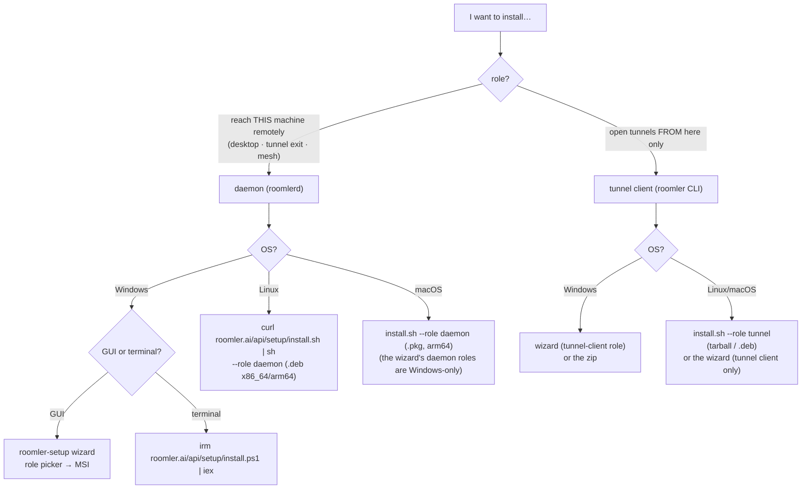
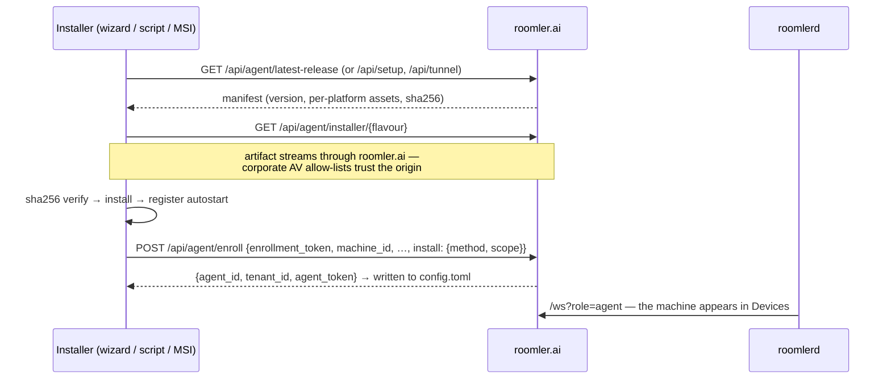
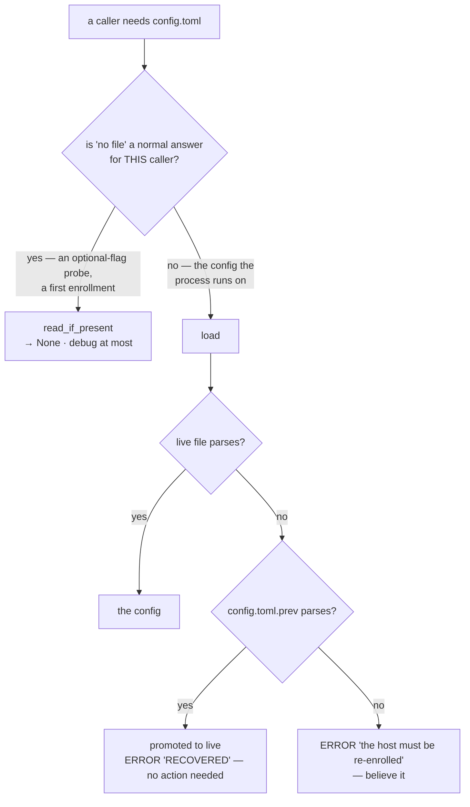
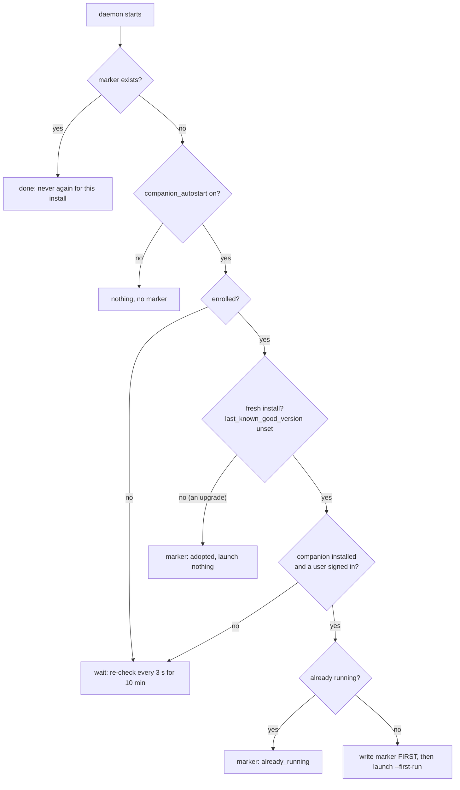
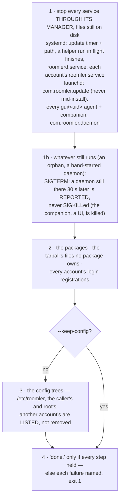

# Installation

Every way to put the Roomler node stack on a machine, on every supported platform.
"Daemon" means `roomlerd` — the full node: remote-desktop target, tunnel exit, and
overlay-mesh member. "Tunnel client" means just the `roomler` CLI for opening
forwards/SOCKS5 from the machine you sit at. *Re-checked against master on
2026-09-02 (0.4.47).*

## Which installer do I want?



Everything needs an **enrollment token** — minted in the admin UI
(**Admin → Agents → Enroll** for daemons, **Tunnel clients → Enroll** for CLIs),
valid 10 minutes, single-use.

## Enrollment — what every path does



⚠️ **Not every download streams through roomler.ai.** The MSI downloads (the
wizard's and `install.ps1`'s) and the tunnel CLI's installers do
(`/api/agent/installer/{flavour}`, `/api/tunnel/installer/…`). These fetch the asset's own URL from the manifest,
which is GitHub's (`github.com/…/releases/download/…`, redirected to
`release-assets.githubusercontent.com`, measured 2026-10-18):
- `install.sh`'s daemon and companion packages (`.deb`, `.rpm`, tarball, `.pkg`);
- `install.ps1`'s companion, `roomler-desktop.exe` (`scripts/install.ps1:325`);
- every self-update (`download_asset`, `agents/roomlerd/src/updater.rs:1555`).

A host behind an allow-list needs both GitHub hosts for those. `install.ps1`
also fetches the Visual C++ runtime from `aka.ms` when it is missing
(`scripts/install.ps1:147`).

`machine_id` is a stable hardware hash and `(tenant_id, machine_id)` is unique —
re-running an installer on a known machine reuses its identity instead of
duplicating it.

**The enroll says how it was installed** (FR-102 P3, the install trace in
[growth-observability.md](growth-observability.md)): the device row records
`install {method, scope}`, shown on the device (`GET …/agent/{id}`) and counted
in the daily digest. The wizard says `wizard`; the served scripts say
`script-sh` / `script-ps1`; a hand-typed `roomlerd enroll` says `manual`. If you
script installs yourself, say what you are:

```bash
roomlerd enroll --server … --token … --name … --install-method deb --install-scope system
# or, equivalently, for a daemon of any version (an older one ignores the variables):
ROOMLER_INSTALL_METHOD=container ROOMLER_INSTALL_SCOPE=system roomlerd enroll …
```

`--install-method` ∈ `wizard` `script-sh` `script-ps1` `msi` `deb` `pkg` `manual`
`container` `other`; `--install-scope` ∈ `system` `per-user` `attended` `unknown`.
The flag beats the env var. A misspelled **flag** is refused at the prompt,
before the single-use token is spent; an unknown **env** value enrolls as
`other` / `unknown` with a warning, because the variables usually come from a
script that can be newer than the daemon it installs. ⚠️ The served scripts set
the **environment**, never the flag: a script installs whatever release is
current, and a daemon from before the flag existed would refuse an argument it
does not know. A `re-enroll` sends nothing and leaves the row's recorded install
alone.

### "The host must be re-enrolled" — when to believe it

Re-enrolling is **destructive**: removal is final, and a re-enrolled device
never gets its old overlay address back. So the one log line that prescribes it
has to be true whenever it appears. Since FR-66 it is: `roomlerd` reads its
`config.toml` two ways, and which one a caller uses states whether a missing
file is a *normal* answer for that caller.

| Reader | For | When the file is absent or unreadable |
|---|---|---|
| `config::load` (`crates/agent-core/src/config.rs:2788`) | the config the process **runs on** | promotes `config.toml.prev` if it parses — ERROR *"…RECOVERED from the previous good copy"*, and the host carries on; with no usable previous copy, ERROR *"…the host must be re-enrolled"* (`:2826`) |
| `config::read_if_present` (`:2553`) | a **probe** for a file that may legitimately not exist | `None`, and at most a `debug!` |



Before FR-66, two callers that expect to find nothing went through `load` and
printed the destructive remedy about perfectly healthy hosts: the Windows
supervisor's `netd_enabled()` flag probe
(`agents/roomlerd/src/win_service/supervisor.rs:977`), on **every service
start** of every user-context install; and enrollment itself, reusing an
existing `machine_id` — during the very operation that enrolls the machine.
The noise also buried the genuine case, which prints the identical line.

⚠️ **Pick the reader by the question, not by the mechanism.** A shared helper
that logs at the severity of its worst caller makes every caller inherit that
reading. Do not fix a false alarm by softening `load`'s ERROR: for the config a
process runs on, it is exactly as serious as it was. And never use
`read_if_present` for *that* config — silently getting `None` there is the
"running on an older config must never look like a normal boot" failure the
ERROR exists to prevent. FR-66's P2 audited all 37 `load` call sites on this
question; two moved to `read_if_present`.

## Windows

**Recommended: the `roomler-setup` wizard** (signed EXE, downloadable from the
admin UI or `https://roomler.ai/api/setup/windows-x86_64`). One wizard, four
roles:

| Wizard role | What it installs | Runs as |
|---|---|---|
| **Daemon — system** | perMachine MSI + SystemContext enabled | SCM service `Roomler` (LocalSystem) — controls lock screen, UAC, pre-logon |
| **Daemon — per user** | perUser MSI | Scheduled Task `Roomler` at logon (limited) |
| **Daemon — machine (attended)** | perMachine MSI | SCM service, no SystemContext |
| **Tunnel client** | CLI archive + PATH entry | on demand |

Details worth knowing:

- **Two MSI flavours** exist (`peruser`, `permachine`) — the wizard maps roles
  onto them and flips SystemContext separately (`roomlerd enable-system-context`).
- **Running the perMachine MSI by hand** (`msiexec /i roomlerd-<v>-perMachine-….msi /qn`):
  `ENABLE_SYSTEM_CONTEXT=1` turns SystemContext on, `=0` turns it off, and
  **leaving it out keeps the mode the machine was last switched to** (#1727).
  The installer runs `roomlerd keep-system-context`, which follows the product's
  own record of the last `enable-system-context` / `disable-system-context`
  (`%PROGRAMDATA%\roomler\last-system-context-attempt.json`). Every install
  recreates the service, so the switch itself never survives one.
  ⚠️ Before #1727, leaving it out switched SystemContext **off**: the service
  kept running, the worker could no longer find its enrollment and exited in a
  loop, and the device went offline. To rescue a host in that state, run
  `roomlerd enable-system-context` from an elevated shell. Start `msiexec` with
  `Start-Process -Wait -PassThru` so the exit code you read is the installer's.
- **The private network is on by default for the two machine roles** (FR-84 S2):
  the Advanced **overlay** box follows the role — checked for *Daemon — system* and
  *Daemon — machine*, unchecked for *Daemon — per user* (the WireGuard adapter
  needs a service install; a per-user host can still join through the userspace
  netstack) — until you touch it, after which your choice sticks across role
  changes. The served `install.ps1` / `install.sh` keep their own defaults.
- **The wizard ships with every agent release** (FR-84 S1): `agent-v<V>` also
  publishes `setup-v<V>` at the same commit, so `/api/setup/*` serves a wizard as
  new as the daemon it installs.
- **The wizard can anchor the device for SYSTEM exec** (FR-104, from 0.4.135) when
  its token was minted with *Also let administrators run commands as SYSTEM on this
  device* (the admin UI's enrollment dialog, Windows, a machine-wide scope). The
  Token step says it will; after enrolling, the wizard asks for a **second
  administrator prompt** and runs `roomlerd anchor create` with the same token. A
  declined prompt leaves the install complete and unanchored, and the Done page
  carries the command to anchor later. Details: [`fleet-rpc.md`](./fleet-rpc.md)
  § Anchoring a device.
- Daemon installs also place **`roomler-desktop`** (tray companion: status,
  tunnels pane, consent prompts) and **`roomler.exe`** — a small shim that
  re-execs `roomlerd cli`, so CLI and daemon can never version-skew.
- Terminal alternative: `irm https://roomler.ai/api/setup/install.ps1 | iex`
  (prompts for role/token; flags mirror the sh script).
- Binaries are Authenticode-signed; the MSI's payload EXEs are signed before
  packaging.
- On a perMachine install the SCM host writes the Defender rule
  `Roomler UDP-In (roomlerd)` **before** it spawns the worker, so an attended
  install never sees the "Allow access?" prompt — and removes, once, the
  `Roomler Daemon` Block rules an earlier install's prompt left behind (only
  rules whose id carries the prompt's own signature; a Block an administrator
  placed deliberately is left alone — #1698,
  [`overlay-wfp.md`](./overlay-wfp.md)). The perUser flavour cannot elevate
  and is unchanged.

## Linux

```bash
curl -fsSL https://roomler.ai/api/setup/install.sh | sh -s -- \
  --role daemon --token <enrollment-jwt> [--server https://roomler.ai] [--name lab-1]
```

- Installs the `.deb` (x86_64 **and** arm64) or tarball, verifies SHA-256,
  enrolls, and enables a **systemd user unit** (`roomler.service` →
  `systemctl --user enable --now`).
- **It updates itself unattended, per-user or `--system`.** A per-user daemon
  runs as you and cannot write `/usr`, so for a per-user install `install.sh`
  also enables a **root update helper**, and so does the `.deb` itself however
  it is installed (apt, the Software app, `dpkg -i`). `roomler-update.service`
  is woken by `roomler-update.timer` (5 min after boot, or at once when the
  install turns it on, then every 6 h) and by `roomler-update.path` (the file
  a pushed update touches). It checks, verifies and installs as root, and the
  daemon then restarts onto the new binary once nothing it serves would be cut
  (FR-96). On a system install the helper steps aside: that root daemon
  installs its own updates.
  - The helper is enabled only when the installed release's daemon steps aside
    for it (`roomlerd update-helper --capabilities` lists `step-aside`).
  - `--system` turns it off: that root daemon installs its own updates, and two
    updaters must never race.
  - Opt out with `/etc/roomler/disable-auto-update`.
  - A re-run of `install.sh` restarts the running daemon only when nothing
    else will: when it is too old to restart itself onto a new version, or
    when the re-run just turned the helper on, since the daemon decides at its
    start who installs its updates.
  - Details: [linux-self-update.md](linux-self-update.md#the-update-half-of-a-per-user-install-fr-96).
- ⚠️ The user unit is **sandboxed** (`ProtectSystem=strict`,
  `ProtectHome=read-only`). The daemon can write only these:
  - its own config and data folders;
  - the runtime dir (`%t`), which holds the single-instance lock and the
    LocalAPI socket;
  - `~/.local/state/roomler`, the portal's restore token, created 0700 by an
    unsandboxed `ExecStartPre=-+` (a failure costs one prompt per session, never the start);
  - `~/Downloads` (incoming files) and `~/Videos` (screen recordings, FR-85 P2c).

  Every `ReadWritePaths=` entry that may be missing carries systemd's `-`
  prefix. Without it a missing path fails the whole unit with `226/NAMESPACE`,
  and until P2c the pre-rename folders listed there without it kept the unit
  from starting on any host that never ran the pre-rename agent, wherever the
  sandbox applies. CI starts a unit with these sandbox lines on a fresh runner
  (`ci.yml`, "The Linux user unit's sandbox").
- ⚠️ **The unit stops with the graphical session, and the session starts it
  again** (`PartOf=` plus `WantedBy=graphical-session.target`, FR-93 P5,
  #2144). Until then only `default.target` wanted it, so wherever the user's
  systemd manager outlived a logout — a lingering user (the headless recipe in
  `README.Debian`), an SSH login still open — the daemon stopped at the logout
  and the next login never started it: the device stayed offline until a reboot
  (measured on the FR-93 lab's GNOME 50 per-user guest, 0.4.132). A daemon
  enabled before the fix enables itself again once at start
  (`service.rs`, `repair_session_wants_at_start`; kill switch
  `ROOMLERD_UNIT_REPAIR=0`), through `systemctl --user enable`: the sandbox
  leaves `~/.config/systemd/user` read-only to the daemon itself.
- ⚠️ **Until #1997 the per-user daemon could not start wherever the sandbox
  applies**, Fedora among them: it restarted every 5 s with `acquiring
  single-instance lock` … `Read-only file system`, because `%t` was not
  writable. The P2c cell could not see it: a system unit's `%t` is
  `/run`, and its oneshot never takes the lock. A second cell ("…where its
  user manager sandboxes it") starts the shipped unit under the runner's own
  user manager, with AppArmor's user-namespace restriction lifted (Fedora's
  configuration). It fails unless the daemon ran in its own mount namespace,
  then waits for the LocalAPI socket. ⚠️ Not `StateDirectory=`: on systemd 255
  it took the existing `~/.config/roomler` for its own pre-XDG-state location
  and symlinked `~/.local/state/roomler` to it.
- ⚠️ **The sandbox is best-effort for a user unit.** A user manager applies
  it only inside an unprivileged user namespace in which it may mount, and
  otherwise runs the unit with **no sandbox at all** (home fully writable,
  `ProtectSystem` off), in one of two ways:
  - it cannot create the namespace: systemd logs `Failed to set up user
    namespacing for unprivileged user, ignoring` (measured on systemd 255
    with `user.max_user_namespaces=0`: the unit that fails `226/NAMESPACE`
    with namespaces allowed starts, and writes `~/Videos`);
  - it creates one but may not mount in it: **default Ubuntu 24.04**, whose
    AppArmor restricts unprivileged user namespaces
    (`kernel.apparmor_restrict_unprivileged_userns=1`). systemd skips the
    mounts at debug level, so no journal line shows it. Field-verified on a
    fresh 24.04 vmtest guest (kernel 6.8, systemd 255): the running daemon's
    user namespace differs from the session's but its **mount** namespace is
    the same, `/home` has no read-only remount, and the unit started without
    the pre-rename folders.

  🔑 To tell which a host got, compare `readlink /proc/self/ns/mnt` with the
  daemon's `/proc/<pid>/ns/mnt` (the same means unsandboxed); the journal
  cannot say. The root system unit (`roomlerd.service`) has no sandbox
  either way.
- `--role tunnel` installs just the CLI (tarball or `.deb`).
- **The system service from the CLI** (FR-97 P6c): `sudo roomlerd service install --as-service` (alias
  `--system`) enables `roomlerd.service`, the root unit `install.sh --system` uses, after the fact. It refuses
  until `/etc/roomler/config.toml` exists (`sudo roomlerd --config /etc/roomler/config.toml enroll …`): without
  a config the unit would restart every 5 s. It warns when a per-user daemon also runs (one daemon per machine),
  and it leaves the update helper alone, because the helper steps aside by itself while the system unit is
  enabled. `service uninstall|status|start|stop --as-service` complete it; uninstall keeps the config
  (`agents/roomlerd/src/service.rs`, `pub mod system`).
- Useful flags: `--download-only`, `--no-enroll`; and `--uninstall
  [--keep-config]` removes it all again ([below](#uninstall-every-platform)).
- Headless servers: the daemon's virtual-desktop mode gives the machine a
  display, so "Connect" drops you into a live console.
- Design notes for the tarball/self-update path: [linux-self-update.md](linux-self-update.md).

### Where a root daemon's config lives (rc.435)

A **root** daemon on Linux resolves `/etc/roomler/config.toml` — the path the
packaged `roomlerd.service` has always passed as `--config`. Non-root Linux
installs are untouched.

`appdirs::migrate_system_config()` moves a legacy
`/root/.config/roomler/config.toml` there once at startup, under the same rules
as the tree migration: **dest-absent only**, `rename`, **never deletes**, notes
logged at WARN after `logging::init`. The `.prev` sibling travels with it so no
credential-bearing copy is stranded.

`default_config_path()` resolves **`/etc` → profile → `/etc`**, so a host whose
migration has not run (or could not) keeps its identity instead of losing it.

⚠️ **This closes a real crash-loop class.** Hosts enrolled before the convention
ran on an orphan `roomlerd run` using the profile path, and died `no config
found` the first time systemd started them — `Restart=always` then looped. Hit on
buildhost, fleet-host-2 and the WSL sibling, the last from nothing but a
`dpkg -i`.

⚠️ **`systemctl is-active` reads `inactive` while such a host is perfectly
healthy** — the live daemon is an unmanaged orphan. Check `pgrep -x roomlerd` and
`roomler peers`, and never "restart to fix" on that basis.

⚠️ The per-host `roomlerd.service.d/config-path.conf` drop-ins used as the stopgap
are unnecessary from rc.435 and should be removed.

### The desktop user and a root daemon (FR-27 P11)

A root daemon's own socket, `/var/run/roomler/roomler.sock`, is root-only. So
`sudo roomler …` is how you administer it, and before P11 a plain `roomler …` as the
desktop user failed with `Permission denied (os error 13)`.

From P11 the daemon also gives the person at the seat a **person socket** in their
runtime dir: `/run/user/<uid>/roomler.sock`, 0600 and theirs. Their companion uses
it, which is how a system install gets its "Being viewed by …" banner, its
Disconnect and its consent prompt. As that user:
- `roomler status` answers. Its `mode` line names the account the daemon runs as:
  `service (root)` here, `service (per-user)` for a per-user install
  (`service (SYSTEM)` on Windows). `status --json` carries the same fact as
  `"privileged"`. An older daemon reports no account: a new CLI then prints a
  bare `service`, an older one `service (SYSTEM)` for every install;
- `roomler devices` answers too (FR-97 P2g): the devices this machine's private
  network reaches, as the companion's Devices page shows them. So does `roomler
  peers` (P2h), the links to them, without any endpoint (`sudo roomler peers` has those);
- anything administrative (`flows`, routes, `config`, …) is refused with a pointer
  to `sudo roomler …`.

The socket follows the active graphical session, so there is none over SSH or at the
login screen. Turn it off with `ROOMLERD_PERSON_SOCKET=0` in a `roomlerd.service`
drop-in. Details: [`desktop-companion.md`](desktop-companion.md) §12 and the
[security baseline](security-baseline.md) §4.

## macOS

> **Requires macOS 15 (Sequoia) or later, on Apple silicon (arm64).** The
> `.pkg` enforces this itself. Below the floor, the installer refuses the
> package rather than install a daemon that cannot start. On a Mac that already
> runs Roomler, the root update helper's install fails, the Mac stays on the
> version it has, and the helper raises its usual notice ("Self-update to … failed
> … this Mac is still on …", with `/var/log/install.log` naming the OS
> requirement). The last release that installs on macOS 14 is **0.4.115**.
>
> Why 15: the `.pkg` bundles dylibs (Homebrew's libvpx and the vendored FFmpeg),
> and each carries its own minimum macOS. Homebrew no longer publishes a macOS 14
> build of libvpx, and GitHub retires its macOS 14 build runners in November
> 2026. The release job derives the installer gate, both bundles'
> `LSMinimumSystemVersion` and a build-time check of every shipped binary from
> one value, `MACOS_FLOOR` in `release-agent.yml`. A future runner move that
> raises a dylib's minimum fails the release instead of shipping a daemon that
> cannot start.

Same `install.sh` one-liner, but macOS is the one platform that needs **two
processes**, and it is worth knowing why before you install:

<!-- RETIRED-NAME-ANCHOR(1): /etc/roomler-agent is now the LEGACY macOS daemon
     config dir, named only because the .pkg postinstall still reads it to
     MIGRATE off it (`migrate_legacy_dir /etc/roomler-agent /etc/roomler`,
     and it still honours a legacy `enable-daemon` marker there), so the
     path remains an input to code on user machines. FR-21 D5.
     ⚠️ This anchor's previous reason was FALSE and had been for some time:
     it claimed com.roomler.daemon.plist passes /etc/roomler-agent as its
     config. It does not — it passes /etc/roomler/config.toml. An anchor's
     stated reason is a CLAIM and ages like any other; re-read the code it
     names before trusting it (FR-46). -->
| Half | Runs as | Does | Why it cannot do the other's job |
|------|---------|------|----------------------------------|
| LaunchAgent `com.roomler.agent` | you, inside your GUI login session | screen capture, input, clipboard | a root LaunchDaemon in session 0 has no WindowServer — capture and `CGEvent` injection do not work there |
| LaunchDaemon `com.roomler.daemon` | root, from boot | overlay mesh, tunnels | creating a `utun` and installing routes require root |
| LaunchDaemon `com.roomler.update` | root, on a 6 h timer + on demand | self-update: check, verify, `installer -pkg … -target /` | `installer -target /` needs root, and neither agent half should ever exec its own replacement (the exit-to-update dance is what used to knock Macs offline). Installed by DEFAULT; opt out with `sudo touch /etc/roomler/disable-auto-update` + re-run the installer |

They cannot share one enrollment: the hub keys sessions on `agent_id`, so a
second control-WS connection displaces the first. **Each half is its own
enrollment, so a Mac appears as two devices** — the second named
`<name>-daemon`.

```bash
# Screen sharing only (one token, one device row):
curl -fsSL https://roomler.ai/api/setup/install.sh | sh -s -- \
  --role daemon --token <token> --server https://roomler.ai --name "$(hostname)"

# Screen sharing AND the overlay mesh — mint a SECOND enrollment token:
curl -fsSL https://roomler.ai/api/setup/install.sh | sh -s -- \
  --role daemon --token <token> --daemon-token <second-token> \
  --server https://roomler.ai --name "$(hostname)"
```

`--daemon-token` also turns the overlay on (`enroll --overlay`) — installing a
root daemon is itself the opt-in, and the overlay is the only reason that half
exists. Without it the Mac never sends `rc:overlay.join`, so it is **absent
from `roomler peers` entirely** rather than showing as offline.

Running the one-liner under `sudo` is fine: the script resolves the console
user itself and enrolls the per-user half as them.

The root half can also be added after the fact (FR-97 P6c). Enroll it with
`sudo /Library/Roomler/roomlerd.app/Contents/MacOS/roomlerd --config /etc/roomler/config.toml enroll … --overlay`,
then `sudo roomlerd service install --as-service` writes the enable marker and
the LaunchDaemon and bootstraps it. `service stop --as-service` is a SIGTERM
that stays down until the next boot or `service start --as-service`: the plist
restarts only a failed exit, and the clean stop exits 0 (measured). The
per-user `roomlerd service stop` works the same way.

### Grant the two permissions — nothing works until you do

macOS gates capture and input, and **it never reports an error when a grant is
missing**: the screen streams as wallpaper only, and injected keys and clicks
are silently dropped.

<!-- RETIRED-NAME-ANCHOR-BEGIN
     The whole macOS layout is FROZEN by FR-21 D5. The .app bundle name and
     path key the Screen Recording and Accessibility TCC grants; renaming
     either silently voids them, and the failure is a black screen with no
     error. The published .deb asset name is matched by the updater.
     Everything below names something a user can see today.
     ⚠️ This preamble also used to claim /etc/roomler-agent is what the
     LaunchDaemon plist passes as its config. It is not — the plist passes
     /etc/roomler/config.toml, and the old dir survives only as a migration
     source in the .pkg postinstall. Corrected 2026-09-02. -->
- System Settings → Privacy & Security → **Screen & System Audio Recording** → enable **Roomler Daemon**
- System Settings → Privacy & Security → **Accessibility** → enable **Roomler Daemon**

If a stale **Roomler Agent** entry is still listed from a pre-rename install,
remove it — macOS does not carry a grant across a bundle rename, and the `.pkg`
postinstall prints the same instruction when it detects one.

You do not have to hunt for this: the **Roomler menu-bar app** names whichever
grant is missing and gives you a button per permission that opens the right
pane. The agent also probes both at startup, says what is missing in its log,
and reports the state to the server — so the device list shows "No screen
access" / "No input access" instead of letting you discover it by connecting to
a black screen.

Then restart it: `launchctl kickstart -k gui/$(id -u)/com.roomler.agent`

⚠️ Grants are keyed to the binary's code signature. Until Apple notarisation is
finished the `.pkg` is unsigned, so **an agent update invalidates them** and
both toggles need re-enabling.

### What the package installs

| | |
|---|---|
| `/Applications/Roomler.app` | the **menu-bar companion** — status, routes, and the permissions panel. `LSUIElement`, so no Dock tile. The only Roomler icon you should see |
| `/Library/Roomler/roomlerd.app` | the daemon. A background service with nothing to launch, so it is deliberately NOT in `/Applications`; still a bundle, because TCC attributes the two permissions to a bundle identity |
| `/usr/local/bin/roomler` | the CLI (a small shim onto the daemon's own command surface) |
| `/usr/local/bin/roomlerd` | the daemon on PATH, for `roomlerd enroll` / `--version` — a symlink into the bundle, not a second copy |

Same three commands as Windows and Linux.

`roomler peers` / `status` reach the **per-user** half; `sudo roomler …` reaches
the **root** half, because the two listen on different LocalAPI sockets
(`$TMPDIR/roomler/roomler.sock` vs `/var/run/roomler/roomler.sock`). If a
command reports "daemon not running", you are probably asking the wrong half.

### Paths, logs, limits

| | Path |
|---|---|
| App bundle | `/Library/Roomler/roomlerd.app` (executable `roomlerd`). ⚠️ Renaming the bundle voids the TCC grants — FR-46 P5b did rename it, which is why the `.pkg` postinstall tells you to re-approve **Roomler Daemon** and delete a stale **Roomler Agent** entry |
| Per-user config | `~/Library/Application Support/live.roomler.roomler/config.toml` |
| Root config | `/etc/roomler/config.toml` |
| Per-user log | `/tmp/roomlerd.err.log` |
| Root log | `/var/log/roomler/daemon.log` |

Video encodes in hardware through VideoToolbox, H.264 and HEVC: the FFmpeg
cascades carry `h264_videotoolbox` and `hevc_videotoolbox`
(`agents/roomlerd/src/encode/ffmpeg/encoder.rs:115`, `:179`), and the macOS
release builds `ffmpeg-encoder`; a MacBook's probe advertises both cells
([encoders.md](encoders.md)). Software H.264 (openh264) and VP9-4:4:4 (libvpx)
are offered too. There is no AV1 encode: Apple ships AV1 decode only. Remote
audio capture is unavailable on macOS today (FR-97 P2a). A second organization
gets a utun of its own, as on the other two platforms (run on macOS 15, FR-97
P1d).

### Uninstall

```bash
curl -fsSL https://roomler.ai/api/setup/install.sh | sh -s -- --uninstall
```

The same command as on Linux — [Uninstall: every platform](#uninstall-every-platform)
has what it removes and in which order. On a Mac it boots both halves out
through launchd before a single file goes, for every account that has the
per-user half, and it resets the two privacy grants while the bundle that names
them still exists, so a fresh install asks again instead of showing a toggle
that is ON for a binary that is gone.

Remove the device row(s) in the admin UI too: a Mac that ran the root half is
two rows, and deleting them releases the overlay lease.

## After install: the companion opens, and starts at login (FR-84 D6)

Every install path ends with the daemon starting, so the **daemon** opens the
companion — once — with the **Welcome tour**: this device, the private network
(what it is, what it changes, an **Enable** button), who may view this screen,
where received files land, start at login. The tour shows at every start until
the person finishes or skips it (per-user state), and is reachable again from
the tray (**Welcome tour…**) and Settings.

| Install path | Who opens it after install | Login start |
|---|---|---|
| Windows perMachine — wizard, `install.ps1`, MSI | the **SCM service host** (LocalSystem), into the console session with the console user's own **non-elevated** token (`WTSQueryUserToken` + `CreateProcessAsUserW`, no inherited handles) | `HKLM\Software\Microsoft\Windows\CurrentVersion\Run\Roomler Desktop` = `"<install dir>\roomler-desktop.exe" --autostart` — written by the elevated `service install --as-service` (MSI custom action), self-healed at every service start, removed by `service uninstall --as-service` |
| Windows perUser — wizard, `install.ps1 -Role daemon-user` | the **worker** (the Scheduled Task, as the user) — `CreateProcessW` with `bInheritHandles = FALSE` | `HKCU\…\Run\Roomler Desktop` — written by the per-user `service install`, the worker at each start and the companion's first run; removed by `service uninstall` |
| Ubuntu / Debian — `install.sh` (user or `--system`) | the **daemon**, via `systemd-run` as its own transient unit (never in the daemon's cgroup) into the active `Class=user` graphical session — it waits for the companion `.deb`, which `install.sh` installs after the daemon's | the package's `/etc/xdg/autostart/roomler-desktop.desktop` (`--autostart`) |
| Fedora / RHEL family / openSUSE — `install.sh` (FR-93 P6d) | the same: the daemon from the tarball, then the companion **`.rpm`**, which `install.sh` installs with `dnf` (`zypper`, `yum`) so its libraries come from the distro's own repositories | the same autostart file, from the `.rpm` |
| macOS — `.pkg` | the package's postinstall (the `com.roomler.desktop` LaunchAgent) — unchanged | the same LaunchAgent (`RunAtLoad`) |



The rules that matter (`agents/roomlerd/src/companion/launch_once.rs`, `decide`):

- ⚠️ **One launch per install, never a resurrection.** The marker
  (`companion-first-launch.json`: `%PROGRAMDATA%\roomler\roomler\` for the SCM
  host, else next to the daemon's `config.toml`) is written with `create_new`
  BEFORE the spawn; a failed write launches nothing. A companion the person quit
  stays quit across daemon restarts.
- ⚠️ **An upgrade is not an install.** `last_known_good_version` is unset until a
  daemon has run healthily for five minutes, so a host upgrading into D6 is
  *adopted* (marker written, nothing opened by the launcher). Its people meet the
  tour the next time their companion starts — at login, or straight after the
  update where the service's version refresh restarts a running companion.
- **Nobody signed in** (an RMM install, a headless box): no marker; the login start
  covers the first person to sign in.
- **Pre-enrollment starts wait**: the wizard's MSI starts the service before it
  enrolls and places the companion, so the launcher re-checks for ten minutes.
  The wizard also starts a **per-user** daemon right away now (its Scheduled
  Task used to wait for the next logon), as `install.ps1` always has.
- The marker records what happened (`launched`, `adopted`, `already_running`),
  and the daemon log says it: `companion launch-once …`. The companion logs its
  own `startup … action=Show("welcome")` in its `desktop.log`.

**Opting out.** A person: the companion's **Start at login** toggle (Settings, or
the tour) — per-user Windows deletes the `HKCU` value; per-machine Windows records
the choice and an `--autostart` launch exits at once; Linux writes
`~/.config/autostart/roomler-desktop.desktop` with `Hidden=true`; macOS points at
**System Settings → General → Login Items**. The whole device:
**`companion_autostart = false`** (Settings → Device configuration, or `roomler
config set companion_autostart false`) — no post-install launch, the Windows Run
value removed at the next service start, and any `--autostart` launch leaves.
⚠️ The machine-wide Run value starts a companion in **every** interactive session,
RDP ones included: on a multi-user server, this switch is the one to turn off.
The consent prompt does not depend on it — a prompt still starts the companion
when one is needed (FR-27).

## Keeping it updated

| Component | Mechanism |
|---|---|
| `roomlerd` (daemon hosts) | Self-updater polls `/api/agent/latest-release` (4 h timer + startup cooldown; a check that fails on the NETWORK — DNS, connect, timeout — rechecks after 5, 15, then 60 min instead of the full interval, #1755, while a verdict such as a 403 rate limit keeps the interval), verifies SHA-256, hands off to MSI / `dpkg` / `installer` and restarts. A per-user Linux daemon cannot write `/usr`: there a root update helper (`roomler-update.service`) installs, and the daemon restarts onto the new binary once nothing it serves would be cut (FR-96). Admins can force it fleet-wide or per device (`POST …/agent/update`); ⚠️ `delivered: true` means only that the push reached the device's live socket — a device with `auto_update = false` ignores it and logs `update trigger dropped — auto-update is off on this device` (#1689). Crash-looping updates roll back to the last known-good version |
| `roomler` CLI (tunnel-only hosts) | `roomler self-update` (same proxy origin): since FR-97 P6b the release's `.asc` is checked against the pinned key on every OS, and Linux and macOS install too, the tarball or (where dpkg owns the binary) the `.deb` ([`tunnel-install.md` §10](tunnel-install.md)). On daemon hosts the MSI/.deb owns the binaries — the shim's `self-update` refuses by design |
| `roomler-desktop` | Not in either MSI: the daemon refreshes it itself at start when the companion's recorded version differs from its own — downloads the signed asset, stages it beside the old EXE, stops the running companion **by PID** (found by the path it was started from, never by image name), promotes the new file and starts it again in the same session (`agents/roomlerd/src/companion.rs`, `swap`). ⚠️ **One refresher per install**: on a Windows service install that is the service host — the worker it spawns skips, because two refreshers raced and left the old companion running, holding the single-instance lock (#1686) |
| wizard | Fetch-latest by nature; `setup-v<V>` is cut with every `agent-v<V>` (the lockstep job in `release-agent.yml`) |

## Verifying what you install

Every release asset ships with a `.sha256` sidecar, a detached **GPG signature**
(`.asc`, key published as `roomler-release-pubkey.asc`), and **SLSA build
provenance**:

```bash
gh attestation verify roomlerd-<v>-x86_64-unknown-linux-gnu.deb --repo gjovanov/roomler-ai
```
<!-- RETIRED-NAME-ANCHOR-END -->

Windows binaries are Authenticode-signed; macOS artifacts are Developer-ID signed
and notarized where the format allows. [code-signing.md](code-signing.md) covers
the whole chain — who the publisher is, how CI signs without holding any key
material, and how to verify an artifact by hand. The installer proxies exist
precisely so corporate networks can allow-list `roomler.ai` instead of
`github.com`.

## Uninstall: every platform

- **Windows**: uninstall the MSI (per-user or per-machine) from Apps, or run
  `install.ps1 -Uninstall`; the agent's version sweep also removes older
  same-flavour MSIs after upgrades. `roomlerd service uninstall` removes a
  manually-installed service/task.
- **Linux and macOS** (FR-97 P6d): one command, whatever put Roomler there —
  this script, the `.deb`, the companion's `.rpm`, the tarball, the `.pkg`, the
  tunnel CLI. Every step acts only on what is present, so it also works on a
  partial install and when run twice.

  ```bash
  curl -fsSL https://roomler.ai/api/setup/install.sh | sh -s -- --uninstall [--keep-config]
  ```

  It takes no `--role` and refuses one: it removes every Roomler part on the
  machine, and a role would read as "only this part".
- Server side, delete the device (**Devices → remove**): this revokes its
  credential and releases its overlay address back to the pool.

### The order is the design

`scripts/install.sh:902` (the section) — `uninstall_linux` at `:1328`,
`uninstall_macos` at `:1377`.



| Step | Linux | macOS |
|---|---|---|
| 1 · stop | `roomler-update.timer` + `.path`, a `roomler-update.service` run still in `SubState=start` waited out, then `roomlerd.service`, then each account's `roomler.service` on its user bus (`stop_unit`, `:1149`) | `com.roomler.update` once it is no longer `state = running`, every account's `gui/<uid>/com.roomler.{desktop,agent}`, then `com.roomler.daemon` (`:1340`) |
| 1b · sweep | `roomlerd` and `roomler-desktop` by exact name — `pgrep -x`, or `/proc/*/comm` where procps is absent (`stop_leftovers`, `:1078`) | the same; it also reaches a companion opened from Finder, which runs under LaunchServices, out of any bootout's reach |
| 2 · programs | `dpkg --purge` of the companion, the daemon, the tunnel CLI and the two names the daemon's `.deb` replaced (dependent first, one call); `rpm -e roomler-desktop`; the tarball payload of `scripts/stage-linux-tarball.sh` and the tunnel CLI's `/usr/local/bin` (`:1248`); every account's `roomler.service` enable links and the companion's own autostart entry (`X-Roomler-Managed`) | the two privacy grants, the two LaunchDaemons, every account's LaunchAgents, `/Library/Roomler`, `/Applications/Roomler.app`, `/usr/local/bin/roomler{,d}`, the `com.roomler.*` package receipts |
| 3 · config | `/etc/roomler`, `/etc/default/roomlerd`, `roomlerd.service.d/`; for the caller (the account behind `sudo`) and root: `~/.config/roomler`, `~/.local/share/roomler`, `~/.local/state/roomler`, the tunnel CLI's tree, the pre-rename trees | `/etc/roomler`, `/var/log/roomler`, the `/tmp` logs; for the caller, the console user and root: `~/Library/Application Support/live.roomler.roomler`, the tunnel CLI's tree, the pre-rename trees |

⚠️ **Stop through the manager before any file goes.** The stop is a SIGTERM,
the daemon's clean stop: it takes back the exit routes and the DNS steer it put
in the host (FR-97 P0e's `purge_after_daemon`, `agents/roomlerd/src/main.rs:1961`),
and an ephemeral device unenrolls itself. Delete the files first and the host
keeps pins and a steer that nothing installed will ever heal.

⚠️ **Never SIGKILL the daemon.** A daemon that ignores the SIGTERM for 30 s is
reported, and the exit is 1: a SIGKILL would skip exactly the cleanup this
order is for. The companion is a UI with nothing to clean up, so one that
outlives its SIGTERM is killed, as the `.pkg` postinstall does.

⚠️ **The sweep's grace differs by manager.** systemd's stop has already waited
for its unit, so on Linux the sweep signals at once. `launchctl bootout`
returns while the job is still draining, so on a Mac it first waits up to
20 s.

⚠️ **An update in flight finishes first.** Stopping `roomler-update.service`
mid-install would hand step 2 a half-installed package; on a Mac, booting
`com.roomler.update` out mid-install kills its whole process group,
`installer` included (the `.pkg` postinstall's own warning).

⚠️ **The config is the credential.** `config.toml` holds the agent token (and
the SSH host key). Removing the program and leaving the token on disk is not an
uninstall; `--keep-config` is the explicit exception, for a reinstall that
should come back as the same device. Every removal runs as root, in one
privileged call per list: an install done under `sudo` before rc.454 left the
per-user config owned by root, which a plain `rm` cannot remove.

⚠️ **Registrations go for every account; config only for the caller's and
root's.** A LaunchAgent left in another account's `~/Library/LaunchAgents` is
respawned against a missing binary at each of that account's logins, so those
go. Another account's config is that account's own device credential: it is
listed, never removed.

⚠️ **A path a package owns is that package's.** The tarball sweep removes a
file only when neither `dpkg -S` nor `rpm -qf` names an owner.

⚠️ **It cannot revoke the device.** A permanent device may not remove itself
from the server — `self_unenroll` answers 403, so a compromised host cannot
erase its own fleet record — and the last line it prints points at
**Devices → remove**.

The agent's `config.toml` (server URL, tokens, per-node settings like
`encoder_preference`, `overlay_*`, `tunnel_routes`) lives under
`%APPDATA%\roomler\roomler\` / `%PROGRAMDATA%\roomler\roomler\`
(machine-global) / `/etc/roomler/` (root) or `~/.config/roomler/` — remove it to fully forget an
enrollment.
