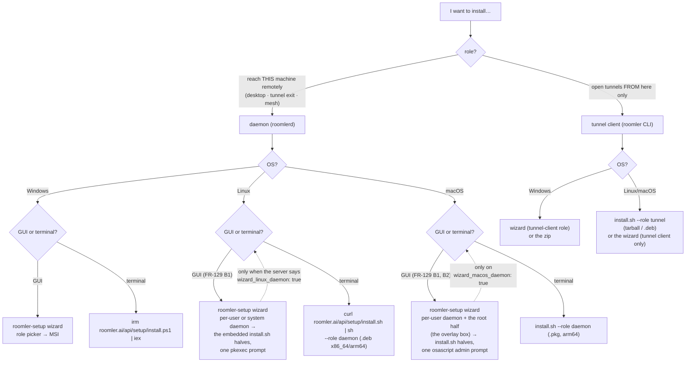
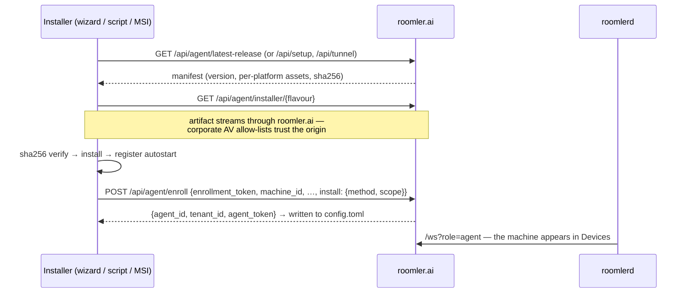
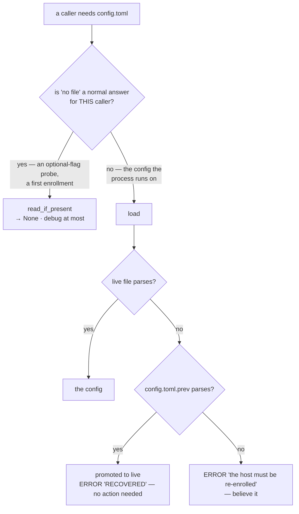
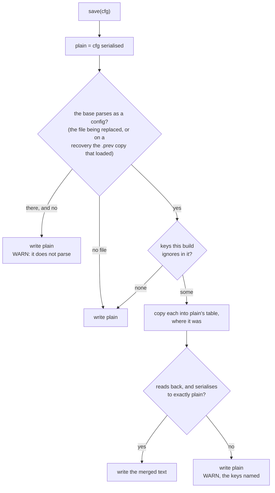
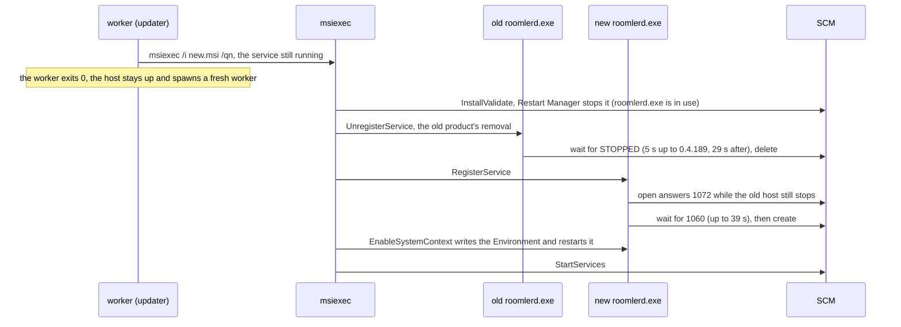
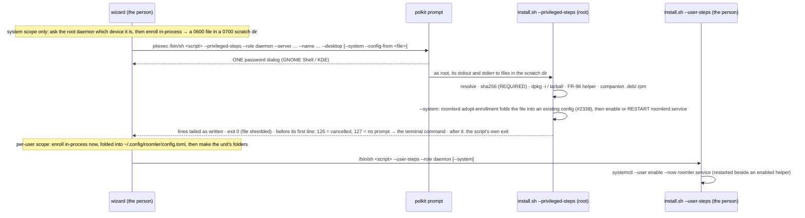
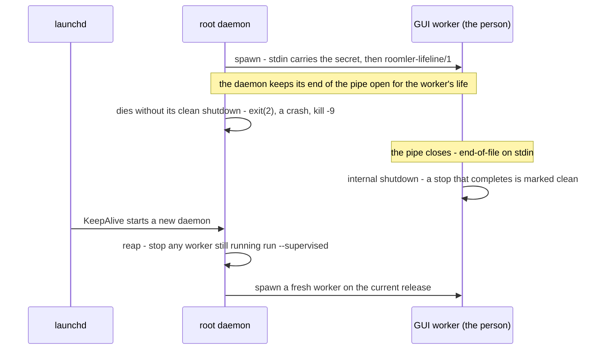
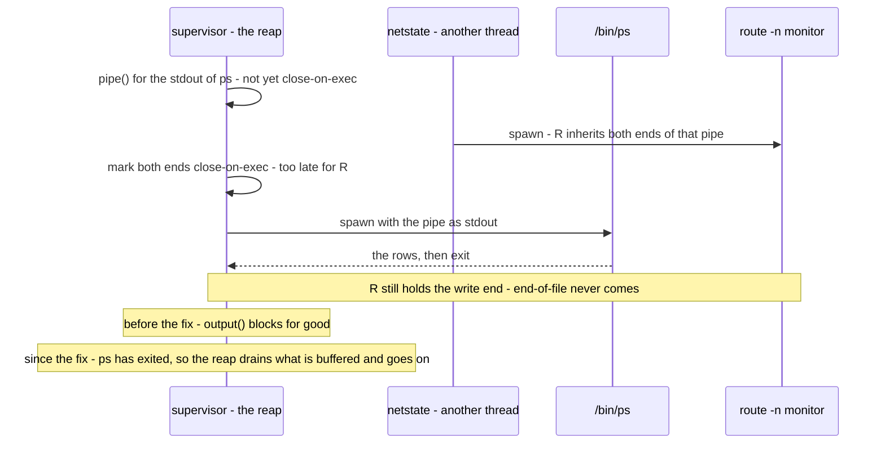
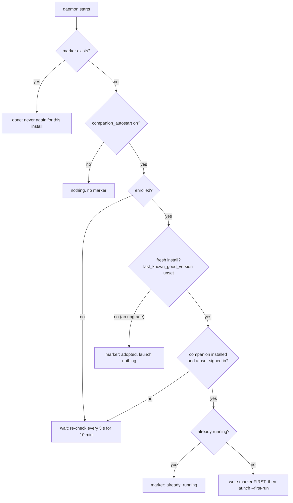
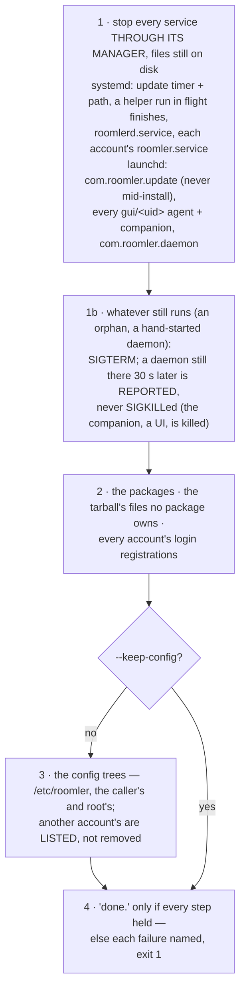

# Installation

Every way to put the Roomler node stack on a machine, on every supported platform.
"Daemon" means `roomlerd` — the full node: remote-desktop target, tunnel exit, and
overlay-mesh member. "Tunnel client" means just the `roomler` CLI for opening
forwards/SOCKS5 from the machine you sit at. *Re-checked against master on
2026-09-02 (0.4.47).*

## Which installer do I want?



Everything needs an **enrollment token** — minted in the admin UI
(**Devices → Enroll → Device** for daemons, **Devices → Enroll → Tunnel client**
for CLIs), valid 10 minutes, single-use — or, for a daemon, a **pairing**
(FR-129): the wizard's "Set up in the browser", and `--pair` on the terminal
installers ([below](#pairing-from-a-terminal)), mint that same token into the
installing process after you approve a code at `/pair`, so nothing is copied or
pasted.

### The wizard's first page: the background service by default (FR-129 C1)

The Welcome page opens with a role already picked, which the person can change
before anything happens: the background service on a machine with nothing
installed, and an existing install's own flavour otherwise, so a default never
switches a flavour or changes a device's security posture. Rust decides
(`agents/roomler-setup/src/role.rs:211`, `default_role`, carried as
`defaultRole` on the detection); the SPA only applies it, when nothing is picked
yet, and never saves it (a click does). The "Join the overlay network" box keeps
its per-OS default, ticked for every preselected daemon role.

| OS | nothing installed | a per-user install | a machine-wide install (or both) |
|---|---|---|---|
| Windows | **background service** (perMachine + SystemContext: the lock screen, UAC dialogs, admin apps) | this user only | the service's SystemContext switch (`ROOMLERD_ENABLE_SYSTEM_SWAP` in the `Roomler` service's SCM Environment, read as the daemon reads it): on → background service; off or absent → attended service (SystemContext would make the lock screen remotely controllable, a choice left to the person); unreadable → nothing preselected |
| Linux | **system service** (root), once the server offers the Linux daemon cards; the tunnel client while it does not | this user only | system service |
| macOS | **this Mac** (with the root half, the overlay box being ticked), once the server offers the macOS cards; the tunnel client while it does not | this Mac | this Mac |

Where an installed flavour is not offered (a Linux or macOS server with the
switch off), nothing is preselected: the tunnel client would be another product
than the one the device has. An installed tunnel client does not change the
default; the daemon roles carry the `roomler` CLI too.

**A new launch resumes a run only from the Server or the Token page.** The
wizard's saved state (`%LOCALAPPDATA%\roomler\roomler-setup\data\wizard-state.json`
on Windows) restores its role and device name only when the run was killed on
one of those two pages; a run that finished, stopped on Welcome, or was cut off
during the install starts a new run at Welcome, with the default device name.
The server URL is kept either way. Before FR-129 C1 a finished run's role and
name came back: a test run's tunnel-client role preselected the tunnel card on
the operator's own machine, and its device name was offered again.

## Enrollment — what every path does



⚠️ **Not every download streams through roomler.ai.** The MSI downloads (the
wizard's and `install.ps1`'s) and the tunnel CLI's installers do
(`/api/agent/installer/{flavour}`, `/api/tunnel/installer/…`). These fetch the asset's own URL from the manifest,
which is GitHub's (`github.com/…/releases/download/…`, redirected to
`release-assets.githubusercontent.com`, measured 2026-10-18):
- `install.sh`'s daemon and companion packages (`.deb`, `.rpm`, tarball, `.pkg`);
- `install.ps1`'s companion, `roomler-desktop.exe` (`scripts/install.ps1:396`);
- every self-update (`download_asset`, `agents/roomlerd/src/updater.rs:1555`).

A host behind an allow-list needs both GitHub hosts for those. `install.ps1`
also fetches the Visual C++ runtime from `aka.ms` when it is missing
(`scripts/install.ps1:173`).

`machine_id` is a stable hardware hash and `(tenant_id, machine_id)` is unique —
re-running an installer on a known machine reuses its identity instead of
duplicating it.

**A reinstall keeps the device's settings** (#2338, FR-129 B1). `roomlerd
enroll` and the setup wizard, on every OS, fold the new enrollment into the
config already at its path instead of replacing it
(`agents/roomler-setup/src/enroll_step.rs`). A refresh of the same organization
keeps the mesh and its key, the routes, the lock and consent policy and every
other operator-owned key; of the wizard's Advanced boxes, only the ones the
person *touched* are written over them. An enrollment into **another
organization** is added beside the primary one (`roomlerd org ls`):

- none of the Advanced boxes is written then, touched or not, because they are
  the primary enrollment's settings (`auto_grant_session` is the device's
  consent policy for every organization);
- the added organization's private network starts off (`roomlerd org overlay
  <label> netstack` joins it), and the daemon mints that organization's own
  key at its first start on the mesh (`org_join::heal_org_keys`);
- the Done page names the added organization's device, not the primary's;
- on Windows, a token minted to anchor the device does not anchor it: the
  machine's one SYSTEM anchor stays with the primary organization.

**On Windows the reinstalled daemon runs the new enrollment at once** (#3116).
The perMachine MSI restarts the service *before* the wizard enrolls, so the
daemon then running loaded the config from before the reinstall. Up to 0.4.187
its first startup save wrote that copy back over the wizard's a second later,
so a reinstall's new enrollment never took, and neither did a touched box or a
new name. Two changes close it:

| Where | What it does |
|---|---|
| the daemon's start (`agents/roomlerd/src/app.rs:3776`, `crates/agent-core/src/config.rs:4155`) | The saves a daemon makes while it starts (a migration, a minted key, the crash bookkeeping) write the copy it loaded. Each one now checks first that the file is still the one it loaded or last wrote itself. A config another process wrote in the meantime is not written over; the daemon runs it from its next start. Every later writer already reloads under the daemon's write lock. |
| the wizard (`agents/roomler-setup/src/orchestrator_agent.rs:633`, `:965`) | On a perMachine reinstall it reads the config to fold into only once the daemon the MSI restarted answers on its LocalAPI (up to 90 s), which a daemon serves only after its startup saves, so an older daemon's save cannot land after the wizard's write either. After the write it asks that daemon to restart through its own LocalAPI (`RestartDaemon`, the companion's Apply now), as `install.sh` restarts the Linux unit. That is the internal arm: the restart is not counted as a crash, and an ephemeral device does not take it for the OS stop that unenrolls it. When the daemon declines or does not answer, the Done page says why: the enrollment is written and takes effect at its next start. |

**A reinstall of the pre-logon service needs Roomler Setup run as
administrator.** After its first healthy run the daemon hardens that config's
folder to SYSTEM and Administrators (#3073), and a wizard that is not elevated
cannot open it. The wizard says so on its first page, before a token is pasted
or paired (`agents/roomler-setup/src/orchestrator_agent.rs:1156`), and the
install refuses it before anything is downloaded (`:290`). Before the enroll it
also stops on a config it may not read (`:634`, never reported as a damaged
config) or a folder it may not write (`:640`). The token is never spent on a
config that cannot be written. A **fresh** install of that role still works
from a double-click: the folder is not hardened yet.

**The wizard asks for those rights itself** (FR-129 C3). The note on its first
page carries a **Restart as administrator** button: the wizard starts its own
image again through the shell's `runas` verb (one UAC prompt,
`crates/roomler-setup-core/src/elevation.rs`) with
`--role <role> [--server <url>] [--session-data <folder>] --after-elevation <its pid>`
(the folder is its own `%LOCALAPPDATA%`), and exits once the elevated copy has started,
handing it the right to take the foreground. Nothing secret is on that command line:
it happens on Welcome, before a token exists. The elevated copy
(`agents/roomler-setup/src/launch.rs`):

1. waits, at most 30 s, for the limited copy to exit, **before** Tauri's
   single-instance plugin looks for a running copy — otherwise it would find
   the dying copy's lock, hand it its arguments and quit. With over-the-shoulder
   credentials (a standard user typing an administrator's password) the copy is
   another account, may be refused a handle on the limited one, and polls the
   process list instead; it also runs in that account's profile, which is why
   the role travels on the command line rather than in the saved state;
2. keeps its WebView2 data in its own folder, under the LIMITED copy's
   `%LOCALAPPDATA%` (`...\ai.roomler.setup\elevated`): WebView2 shares one browser
   process among every host naming the same folder, the limited copy's can
   outlive it by a moment, and an elevated host must not join a limited browser
   process. The folder goes through the API (Tauri's `data_directory`, so the
   main window is created by the wizard's setup hook and `tauri.conf.json` says
   `"create": false`), never through `WEBVIEW2_USER_DATA_FOLDER`: an elevated
   WebView2 host ignores every `WEBVIEW2_*` environment variable — for the same
   reason an elevated wizard's debugging port comes only from the HKLM policy.
   It sits in the limited copy's profile because WebView2's browser process
   de-elevates to the session's user, who cannot open an administrator's
   profile: with the folder there, over-the-shoulder credentials give a white
   window that goes away after about a minute. A limited run keeps Tauri's folder
   unchanged;
3. comes to the front, or it would open behind the browser the wizard was
   started from;
4. opens on Welcome with the handed role preselected, over the detected
   default, and the Continue gate as usual.

A right-click **Run as administrator** by a person who is an administrator works
as it always has, in that account's own folder. **With another account's password
it does not** (the white window above, or Edge's "We couldn't create the data
directory"): that start has no limited copy to name the session's folder. Start the
wizard normally and use the button.

The wizard EXE loads DLLs from System32 alone, never from the folder it sits in
(the linker's `/DEPENDENTLOADFLAG:0x800` and `SetDefaultDllDirectories`): that
folder is usually Downloads, and the same image goes on to run elevated.

A declined prompt leaves the limited wizard as it was, with one line saying so;
any other failure shows its reason and the right-click way. Nothing else in the
wizard elevates itself: a fresh install still gets the MSI's own UAC prompt.

**The enroll says how it was installed** (FR-102 P3, the install trace in
[growth-observability.md](growth-observability.md)): the device row records
`install {method, scope}`, shown on the device (`GET …/agent/{id}`) and counted
in the daily digest. The wizard says `wizard`; the served scripts say
`script-sh` / `script-ps1`; a hand-typed `roomlerd enroll` says `manual`. If you
script installs yourself, say what you are:

```bash
roomlerd enroll --server … --token … --name … --install-method deb --install-scope system
# or, equivalently, for a daemon of any version (an older one ignores the variables):
ROOMLER_INSTALL_METHOD=container ROOMLER_INSTALL_SCOPE=system roomlerd enroll …
```

`--install-method` ∈ `wizard` `script-sh` `script-ps1` `msi` `deb` `pkg` `manual`
`container` `other`; `--install-scope` ∈ `system` `per-user` `attended` `unknown`.
The flag beats the env var. A misspelled **flag** is refused at the prompt,
before the single-use token is spent; an unknown **env** value enrolls as
`other` / `unknown` with a warning, because the variables usually come from a
script that can be newer than the daemon it installs. ⚠️ The served scripts set
the **environment**, never the flag: a script installs whatever release is
current, and a daemon from before the flag existed would refuse an argument it
does not know. A `re-enroll` sends nothing and leaves the row's recorded install
alone.

### Pairing from a terminal

`roomlerd enroll --pair` (FR-129 A4; `install.sh --pair` and `install.ps1 -Pair`
run it for you once the package is placed) is the token step without the token:

```text
To pair this device, open   https://roomler.ai/pair
and type the code           BCDF-GHJK

(The code expires in 15 minutes. Waiting for the approval…)

Approved in the browser.
  Organization: Acme Corp  (slug: acme)
  Approved by:  Dana Smith  (username: dana)
Join «Acme Corp» (acme) as approved by «Dana Smith» (@dana)? [y/N] y
Enrollment successful. Agent id: …
```

- The page's address never carries the code: you type it there, signed in (or
  after creating an account and an org on that page). The daemon polls, and on
  the approval enrolls **in the same process** through exactly the `--token`
  path — the delivered token never touches a command line, a log line, or any
  file but the enrolled config.
- **Check the two unique handles before you answer.** Anybody can give an org or
  an account any display name; the org's slug and the approver's username are
  unique — but only byte for byte. An approval into an org you don't recognise
  ends at this question: `n` (or nothing)
  enrolls nothing, the pairing stays delivered on the server, and its token
  expires unused in 10 minutes. Everything the server sent is shown with its
  control and invisible characters escaped (`\u{1b}`), and a slug the admin UI
  could not have made (`ACME`, `acme `, a Cyrillic `а`) or a username with
  spaces or non-ASCII letters carries a `WARNING:` line — that is what an
  org dressed up as yours looks like.
- The question is asked on the **terminal** (`/dev/tty`; the console on
  Windows), never on stdin — under `curl … | sh` stdin is the script itself.
  With no terminal at all (a scheduler, `ssh host 'curl … | sh -s -- --pair'`
  without `-t`) the only way to enroll is **`--pair-org <slug>`**: the device
  enrolls only if the approval names exactly that org — **byte for byte**, so
  `ACME` is not `acme`. On a terminal the flag replaces the question; a
  mismatch refuses either way. On Windows the question goes to the console
  `roomlerd.exe` is attached to, so where nobody can see that console (a
  scheduled task, a tool that hosts programs on a hidden console) pass
  `--pair-org` too.
- A poll that fails (a network blip, a server restarting) is retried at a
  longer interval until the code expires; nothing needs restarting.
- `--pair` and `--token` refuse each other; `--pair` refuses `--ephemeral` (a
  pairing mints a standard token, never an ephemeral key). An older server, or
  one with `[pairing] enabled = false`, answers "this server does not support
  pairing; use --token", and the command exits 1.
- The served scripts: `install.sh --role daemon --pair [--pair-org SLUG]`
  (per-user, `--system`, and on macOS the per-user half) and
  `install.ps1 -Role … -Pair [-PairOrg SLUG]`. The tunnel role still takes
  `--token` (the `roomler` CLI has no `--pair` yet). The macOS root half is a
  second enrollment, paired afterwards as root — the install prints the two
  commands (the macOS section below). One approval for both halves is the
  wizard's (FR-129 B2); the terminal keeps two runs, because one would hand a
  credential across the `sudo` boundary with no Retry.

### "The host must be re-enrolled" — when to believe it

Re-enrolling is **destructive**: removal is final, and a re-enrolled device
never gets its old overlay address back. So the one log line that prescribes it
has to be true whenever it appears. Since FR-66 it is: `roomlerd` reads its
`config.toml` two ways, and which one a caller uses states whether a missing
file is a *normal* answer for that caller.

| Reader | For | When the file is absent or unreadable |
|---|---|---|
| `config::load` (`crates/agent-core/src/config.rs:3556`) | the config the process **runs on** | promotes `config.toml.prev` if it parses — ERROR *"…RECOVERED from the previous good copy"*, and the host carries on; with no usable previous copy, ERROR *"…the host must be re-enrolled"* (`:3600`) |
| `config::read_if_present` (`:3617`) | a **probe** for a file that may legitimately not exist | `None`, and at most a `debug!` |



Before FR-66, two callers that expect to find nothing went through `load` and
printed the destructive remedy about perfectly healthy hosts: the Windows
supervisor's `netd_enabled()` flag probe
(`agents/roomlerd/src/win_service/supervisor.rs:977`), on **every service
start** of every user-context install; and enrollment itself, reusing an
existing `machine_id` — during the very operation that enrolls the machine.
The noise also buried the genuine case, which prints the identical line.

⚠️ **Pick the reader by the question, not by the mechanism.** A shared helper
that logs at the severity of its worst caller makes every caller inherit that
reading. Do not fix a false alarm by softening `load`'s ERROR: for the config a
process runs on, it is exactly as serious as it was. And never use
`read_if_present` for *that* config — silently getting `None` there is the
"running on an older config must never look like a normal boot" failure the
ERROR exists to prevent. FR-66's P2 audited all 37 `load` call sites on this
question; two moved to `read_if_present`.

### What a save keeps: the keys this build does not know (#2078)

`roomlerd` rewrites `config.toml` far more often than anyone edits it. It saves at every
start and clean stop (`mark_run_starting`, `mark_clean_shutdown`,
`crates/agent-core/src/config.rs:2622`, `:2644`), at the clean-run promotion
(`record_clean_run_at`, `:2620`), at every `ConfigSet`, and at enrollment. The daemon, the
desktop app and the setup wizard all write it through `config::save` (`:4062`). Each save
serialises the `AgentConfig` struct, and before #2078 that erased every key the running build
does not model:

- **A key set ahead of the update that knows it** was gone by the old daemon's stop, so the
  new daemon started on the default and nothing said so. Measured twice: `mutter_input`,
  written while 0.4.131 ran on the FR-93 lab, and `hive_worker` under 0.4.177 on a vmtest
  cell (#2972).
- **A rollback** erased every key newer than the version it rolled back to, and the next
  upgrade did not bring them back.

Now `save` writes the struct **plus** every key of the file it replaces that this build
ignores (`serialise_for`, `:3962`):

| In the file being replaced | After the save |
|---|---|
| a key this build does not know, top level or a whole table | kept where it was |
| a key it does not know inside a table it knows (`[forward_acl]`) | kept inside that table |
| a key it does not know inside an `[[orgs]]` or `[[tunnel_routes]]` entry | kept on that entry wherever the save moved it, found by the org's `tenant_id` or the route's `id` — this build's own key for that array, never one read off the entry; **dropped, with a WARN naming it,** once that entry is gone, or when it has no identity (a route with an empty `id`) |
| a key this build knows and the save cleared | stays cleared: only ignored keys are copied |
| nothing it does not know | written exactly as before, byte for byte |
| comments | lost, as before; keeping them needs an in-place editor |



"Unknown" means exactly what this build's deserializer skipped: `serde_ignored` names the
keys (`unknown_keys`, `:3799`). A key this build knows is written as this build read it: a
value a newer build wrote that this one cannot represent — `peer_auth = "enforce"`, read as
`audit` (`:2780`) — is rewritten to that reading, for instance after a rollback. Only the keys
the deserializer skipped are kept as written.

⚠️ **An array entry is found by its identity, never by its position** (`same_entry`,
`:3866`): an org by its `tenant_id`, a route by its `id` — this build's own key for that
array (`entry_identity`, `:3850`), never one read off the entry on disk. A newer build's
entry can carry a key that looks like an identity (an `id` on an org) which no entry this
build writes has: keyed on it, the entry is found nowhere, and every key on it is lost, in
exactly the array the merge exists for. Positions move: removing an org shifts the ones
after it, and promoting an org puts the demoted primary at the promoted org's index, under
the promoted org's label, with the array's length unchanged (`promote_org_to_primary`).
Matched by position, or by label, a key would land on another org, which is worse than
losing it. A route's `id` may be empty, and an empty id is no identity: a key on such a
route is dropped, never copied onto another, even with one such route. An array with no identity
(`[[forward_acl.allowlist]]`) drops the keys inside its entries at every save, with the
WARN; a test holds every array of tables this build writes to naming its identity, or its
lack of one.

⚠️ **A key at the top level stays at the top level when the primary identity changes.**
`promote_org_to_primary` and `enroll --replace` swap the identity the file's scalar keys
describe, and a key this build does not know beside them stays beside them. A newer build
may scope such a key to the org and would have moved it with the demoted one; this build
keeps it with the new primary, as `preserve_operator_config` keeps every operator setting
with the file.

Two guards keep the worst case at the old behaviour. The merged text must read back and
serialise to exactly what the struct alone would have written (`:3946`), so the merge can only
add what this build ignores and never change a key it knows. And any failure writes the struct
alone, with a WARN that names the keys it could not keep.

`load` names them once per process and file (`note_unknown_keys`, `:4030`), with WARN *"config
keys this build does not know: ignored here, and kept in the file through every save"* and the
key paths. After a rollback, "my setting did nothing" has its answer in the log.

`load`'s recovery keeps them too. It reinstates the `config.toml.prev` copy it loaded over a
live file that does not parse, and names the copy as the base (`save_with_base`, `:4068`):
the keys to keep are the copy's, and the live file holds nothing a merge can read. Every
other save reads the file it replaces, and one over a file that does not parse says so —
WARN *"the config being replaced does not parse: keys this build does not know in it, if
any, are NOT kept through this save"*, a fixed string, never the parser's.

⚠️ **Key paths only, never values.** The file holds the agent token and the overlay keys. A
TOML parse error quotes the line it stopped at, so the merge reports fixed strings and never
passes a parser message on.

⚠️ **A key a build retires now stays in the file** and is logged as unknown at every start,
where the next save used to scrub it. Every key retired so far was a knob or a kill switch. A
retired key that held a secret would need an explicit scrub; no code relies on a save to
remove one today.

## Windows

**Recommended: the `roomler-setup` wizard**, downloadable from the admin UI or
`https://roomler.ai/api/setup/windows`. From the first `setup-v*` release that
publishes it (FR-129 C2), that link serves the **signed EXE itself**,
`roomler-setup-<v>-x86_64-pc-windows-msvc.exe`, whose bytes equal the release's
`.exe.sha256` and carry a GPG `.asc` like every other asset;
`https://roomler.ai/api/setup/windows?format=zip` serves the same EXE in a zip,
for a proxy that refuses an EXE download. A release without the EXE asset keeps
serving its zip. One wizard, four roles:

| Wizard role | What it installs | Runs as |
|---|---|---|
| **Daemon — system** | perMachine MSI + SystemContext enabled | SCM service `Roomler` (LocalSystem) — controls lock screen, UAC, pre-logon |
| **Daemon — per user** | perUser MSI | Scheduled Task `Roomler` at logon (limited) |
| **Daemon — machine (attended)** | perMachine MSI | SCM service, no SystemContext |
| **Tunnel client** | CLI archive + PATH entry | on demand |

Details worth knowing:

- **Two MSI flavours** exist (`peruser`, `permachine`) — the wizard maps roles
  onto them and flips SystemContext separately (`roomlerd enable-system-context`).
- **What Apps & Features lists** (FR-133 P1): the per-user MSI as **Roomler**
  and the per-machine one as **Roomler (per-Machine)**; the Start-menu entry of
  the per-user MSI is **Roomler** too, and a signed MSI's UAC prompt reads
  *Roomler installer*.
  <!-- RETIRED-NAME-ANCHOR: the names a machine installed before FR-133 P1 still
       lists until its next update replaces the entry; they go once no machine
       can still carry one. -->
  A machine installed before P1 lists **Roomler Agent** / **Roomler Agent (per-Machine)**
  until its next update. The name is display only: Windows Installer matches an
  upgrade by the MSI's UpgradeCode, and so does `roomlerd`'s `install_detect`
  (`agents/roomlerd/src/install_detect/mod.rs:324`), so an update leaves one
  entry, under the new name. `install.ps1 -Uninstall` matches both names,
  exactly (`scripts/install.ps1:109`). An IT detection rule (Intune, Configuration
  Manager) written against a name has to follow it; one written against the
  UpgradeCode never moves (`agents/roomlerd/src/install_detect/upgrade_codes.rs:14`,
  `:17`).
- **Running the perMachine MSI by hand** (`msiexec /i roomlerd-<v>-perMachine-….msi /qn`):
  `ENABLE_SYSTEM_CONTEXT=1` turns SystemContext on, `=0` turns it off, and
  **leaving it out keeps the mode the machine was last switched to** (#1727).
  The installer runs `roomlerd keep-system-context`, which follows the product's
  own record of the last `enable-system-context` / `disable-system-context`
  (`%PROGRAMDATA%\roomler\last-system-context-attempt.json`). A major upgrade
  re-creates the service, so the switch itself does not survive one; since
  #3115 a reinstall of the same version keeps the service, switch included
  ([below](#what-an-msi-run-does-to-the-roomler-service)).
  ⚠️ Before #1727, leaving it out switched SystemContext **off**: the service
  kept running, the worker could no longer find its enrollment and exited in a
  loop, and the device went offline. To rescue a host in that state, run
  `roomlerd enable-system-context` from an elevated shell. Start `msiexec` with
  `Start-Process -Wait -PassThru` so the exit code you read is the installer's.
- **The private network is on by default for the two machine roles** (FR-84 S2):
  the Advanced **overlay** box follows the role — checked for *Daemon — system* and
  *Daemon — machine*, unchecked for *Daemon — per user* (the WireGuard adapter
  needs a service install; a per-user host can still join through the userspace
  netstack) — until you touch it, after which your choice sticks across role
  changes. The served `install.ps1` / `install.sh` keep their own defaults.
- **The wizard ships with every agent release** (FR-84 S1): `agent-v<V>` also
  publishes `setup-v<V>` at the same commit, so `/api/setup/*` serves a wizard as
  new as the daemon it installs.
- **The wizard can anchor the device for SYSTEM exec** (FR-104, from 0.4.135) when
  its token was minted with *Also let administrators run commands as SYSTEM on this
  device* (the admin UI's enrollment dialog, Windows, a machine-wide scope). The
  Token step says it will; after enrolling, the wizard asks for a **second
  administrator prompt** and runs `roomlerd anchor create` with the same token. A
  declined prompt leaves the install complete and unanchored, and the Done page
  carries the command to anchor later. Details: [`fleet-rpc.md`](./fleet-rpc.md)
  § Anchoring a device.
- Daemon installs also place **`roomler-desktop`** (tray companion: status,
  tunnels pane, consent prompts) and **`roomler.exe`** — a small shim that
  re-execs `roomlerd cli`, so CLI and daemon can never version-skew.
- Terminal alternative: `irm https://roomler.ai/api/setup/install.ps1 | iex`
  runs the script with its defaults (`-Role daemon-system` from an elevated
  shell, nothing enrolled — it asks for nothing). To pass parameters, which
  mirror the sh script's, download it first or use
  `& ([scriptblock]::Create((irm https://roomler.ai/api/setup/install.ps1))) -Role daemon-system -Pair`:
  `-Pair [-PairOrg <slug>]` pairs in the browser instead of taking `-Token`
  ([above](#pairing-from-a-terminal)).
- Binaries are Authenticode-signed; the MSI's payload EXEs are signed before
  packaging.
- On a perMachine install the SCM host writes the Defender rule
  `Roomler UDP-In (roomlerd)` **before** it spawns the worker, so an attended
  install never sees the "Allow access?" prompt — and removes, once, the
  `Roomler Daemon` Block rules an earlier install's prompt left behind (only
  rules whose id carries the prompt's own signature; a Block an administrator
  placed deliberately is left alone — #1698,
  [`overlay-wfp.md`](./overlay-wfp.md)). The perUser flavour cannot elevate
  and is unchanged.

### What an MSI run does to the `Roomler` service

Every perMachine MSI run that is not an uninstall runs **RegisterService**
(`roomlerd service install --as-service`, deferred, as LocalSystem,
`agents/roomlerd/wix-perMachine/main.wxs:361`). One of the SystemContext actions
follows it (Enable, Disable or Keep), which restarts the service, and then the
MSI's own StartServices. What happens to the service depends on the run (#3115):

| The run | What stops the service first | What happens to the `Roomler` entry |
|---|---|---|
| A fresh install | nothing is running | created (`agents/roomlerd/src/win_service/lifecycle.rs:436`, `register`) |
| A **reinstall** of the installed version: a maintenance run, such as the wizard over the same release or a hand-run `msiexec /i` of the same MSI | the SystemContext action's restart | **reconfigured in place**: `ChangeServiceConfigW`, the description and the recovery actions. It keeps running until that restart, and its `Environment` (the SystemContext switch) survives |
| A **major upgrade** to a newer release: the auto-updater, the wizard, a hand-run install | Windows Installer's Restart Manager, at InstallValidate: `roomlerd.exe` is in use and the run has no UI, so it shuts down what holds it. Where Restart Manager is off (the "Prohibit use of Restart Manager" policy), the OLD product's `UnregisterService` does, because `MajorUpgrade` is `afterInstallInitialize` (`main.wxs:90`) and the old product is removed before the new files land | retired by the old binary, then created by the new one. If the old binary deleted it while it was still stopping (1072), the new one waits for the entry to go first |
| An uninstall | `UnregisterService` (`main.wxs:553`) | retired (`lifecycle.rs:384`, `retire`) |

**The waits are derived from the host's own shutdown**, so the two cannot drift
apart (`lifecycle.rs:81`, pinned by the test
`the_stop_wait_covers_the_hosts_whole_shutdown`):

| Bound | Value | What it covers |
|---|---|---|
| `HOST_STOP_BOUND` | 14.5 s | the supervisor's whole shutdown (`agents/roomlerd/src/win_service/supervisor.rs:671`: a 0.5 s poll tick, the worker's 8 s graceful budget at `:659`, the terminate and netd's reap at 1.5 s each), then the 3 s the host process gives its runtime after it reports STOPPED (`agents/roomlerd/src/runtime_exit.rs:30`) |
| `STOP_WAIT_BOUND` | 29 s | twice that, for a loaded box. A retire waits this long for STOPPED **and** for the host process to exit (`lifecycle.rs:275`), and only then deletes |
| `GONE_WAIT_BOUND` | 10 s | after the delete, for the SCM to answer 1060. A handle held elsewhere (services.msc on the service's properties) outlasts it, and the retire says so |
| `MARKED_WAIT_BOUND` | 39 s | how long an install waits for an entry that an earlier delete marked (1072) before it creates the service |

⚠️ Up to 0.4.189, every run but an uninstall deleted the service and created it
again, after waiting at most **5 s** for its stop. That is less than the
worker's own 8 s graceful budget. A healthy stop that took longer (7.8 s on a
Win11 laptop in the field, 3.4–6.2 s on a vmtest cell) went like this:

1. `DeleteService` only *marked* the service, which was still stopping;
2. `CreateService` answered 1072 (`ERROR_SERVICE_MARKED_FOR_DELETE`);
3. EnableSystemContext failed on the missing service, and the MSI rolled back
   (1603);
4. when the host finally exited, the SCM removed the marked entry. The machine
   had **no service and no daemon** until someone installed again.

An MSI rollback never re-creates the service. No action has a rollback partner
that would, and the service is not in the MSI's `ServiceInstall` table. So
`RegisterService` stays `Return="ignore"` on purpose (`main.wxs:346`): under
`"check"`, a failure there would roll a major upgrade back to the old files
with no service at all.

The env-block paths now name the service that is actually missing (`the Roomler
service is not registered`, or `… is marked for deletion (1072)`). They used to
fall back to the service's pre-rename name whenever `Roomler` was missing, and
failed on the registry key of a service retired months before
(`agents/roomlerd/src/win_service/environment.rs:179`,
`agents/roomlerd/src/win_service/mod.rs:116`).



**Auto-updates and upgrades** (the open question in #3115). The updater does
not stop the service before it runs msiexec. `spawn_installer_with_watch`
(`agents/roomlerd/src/updater.rs:1891`) launches `msiexec /i … /qn` elevated
(`:2236`, `:2636`) while the service runs; the worker that launched it exits 0,
and its host stays up (`:593`). Measured on a vmtest Win11 cell, released code,
with each stop held to the field's 7.8 s:

| Run | The first Stop came from | Released code |
|---|---|---|
| a major upgrade, Restart Manager on | Restart Manager at InstallValidate, 10.3 s before the old product's `UnregisterService` | completed |
| a major upgrade, Restart Manager off by policy | the old `UnregisterService`, which deleted the service 6.5 s before its host stopped | completed by about 40 ms: the new RegisterService's own 5 s wait covered the rest |
| a reinstall of the same version | `RegisterService`, after its 5 s | **1603, and no service**: the field case |

So an upgrade had a head start that a reinstall lacked: it survived stops of
about 11 s (Restart Manager off) to 15 s (on), where a reinstall survived 5 s.
Since #3115 no run deletes a service before it has stopped and its host has
exited, and an install waits out an entry that an older binary deleted early.
⚠️ `OpenService` can succeed on such a marked entry (the upgrade above opened
one); only a change is refused with 1072. So the install asks with a change that
changes nothing (`lifecycle.rs:242`, `is_marked`), never by the open alone.

## Linux

```bash
curl -fsSL https://roomler.ai/api/setup/install.sh | sh -s -- \
  --role daemon --token <enrollment-jwt> [--server https://roomler.ai] [--name lab-1]

# or pair in the browser instead of pasting a token (FR-129 A4):
curl -fsSL https://roomler.ai/api/setup/install.sh | sh -s -- \
  --role daemon --pair [--pair-org <org-slug>] [--server https://roomler.ai] [--name lab-1]
```

- Installs the `.deb` (x86_64 **and** arm64) or tarball, verifies SHA-256,
  enrolls, and enables a **systemd user unit** (`roomler.service` →
  `systemctl --user enable --now`).
- **It updates itself unattended, per-user or `--system`.** A per-user daemon
  runs as you and cannot write `/usr`, so for a per-user install `install.sh`
  also enables a **root update helper**, and so does the `.deb` itself however
  it is installed (apt, the Software app, `dpkg -i`). `roomler-update.service`
  is woken by `roomler-update.timer` (5 min after boot, or at once when the
  install turns it on, then every 6 h) and by `roomler-update.path` (the file
  a pushed update touches). It checks, verifies and installs as root, and the
  daemon then restarts onto the new binary once nothing it serves would be cut
  (FR-96). On a system install the helper steps aside: that root daemon
  installs its own updates.
  - The helper is enabled only when the installed release's daemon steps aside
    for it (`roomlerd update-helper --capabilities` lists `step-aside`).
  - `--system` turns it off: that root daemon installs its own updates, and two
    updaters must never race.
  - Opt out with `/etc/roomler/disable-auto-update`, on a per-user and a
    system install alike. The update helper reads it on every run, and a
    system install's root daemon reads it at its start (#2901: before that
    it read only `auto_update`, so a system install frozen this way kept
    updating itself). `auto_update = false` also turns one daemon's own
    updater off.
  - A re-run of `install.sh` restarts the running daemon only when nothing
    else will: when it is too old to restart itself onto a new version, or
    when the re-run just turned the helper on, since the daemon decides at its
    start who installs its updates.
  - Details: [linux-self-update.md](linux-self-update.md#the-update-half-of-a-per-user-install-fr-96).
- ⚠️ The user unit is **sandboxed** (`ProtectSystem=strict`,
  `ProtectHome=read-only`). The daemon can write only these:
  - its own config and data folders;
  - the runtime dir (`%t`), which holds the single-instance lock and the
    LocalAPI socket;
  - `~/.local/state/roomler`, the portal's restore token, created 0700 by an
    unsandboxed `ExecStartPre=-+` (a failure costs one prompt per session, never the start);
  - `~/Downloads` (incoming files) and `~/Videos` (screen recordings, FR-85 P2c).

  Every `ReadWritePaths=` entry that may be missing carries systemd's `-`
  prefix. Without it a missing path fails the whole unit with `226/NAMESPACE`,
  and until P2c the pre-rename folders listed there without it kept the unit
  from starting on any host that never ran the pre-rename agent, wherever the
  sandbox applies. CI starts a unit with these sandbox lines on a fresh runner
  (`ci.yml`, "The Linux user unit's sandbox").
- ⚠️ **The unit stops with the graphical session, and the session starts it
  again** (`PartOf=` plus `WantedBy=graphical-session.target`, FR-93 P5,
  #2144). Until then only `default.target` wanted it, so wherever the user's
  systemd manager outlived a logout — a lingering user (the headless recipe in
  `README.Debian`), an SSH login still open — the daemon stopped at the logout
  and the next login never started it: the device stayed offline until a reboot
  (measured on the FR-93 lab's GNOME 50 per-user guest, 0.4.132). A daemon
  enabled before the fix enables itself again once at start
  (`service.rs`, `repair_session_wants_at_start`; kill switch
  `ROOMLERD_UNIT_REPAIR=0`), through `systemctl --user enable`: the sandbox
  leaves `~/.config/systemd/user` read-only to the daemon itself.
- ⚠️ **Until #1997 the per-user daemon could not start wherever the sandbox
  applies**, Fedora among them: it restarted every 5 s with `acquiring
  single-instance lock` … `Read-only file system`, because `%t` was not
  writable. The P2c cell could not see it: a system unit's `%t` is
  `/run`, and its oneshot never takes the lock. A second cell ("…where its
  user manager sandboxes it") starts the shipped unit under the runner's own
  user manager, with AppArmor's user-namespace restriction lifted (Fedora's
  configuration). It fails unless the daemon ran in its own mount namespace,
  then waits for the LocalAPI socket. ⚠️ Not `StateDirectory=`: on systemd 255
  it took the existing `~/.config/roomler` for its own pre-XDG-state location
  and symlinked `~/.local/state/roomler` to it.
- ⚠️ **The sandbox is best-effort for a user unit.** A user manager applies
  it only inside an unprivileged user namespace in which it may mount, and
  otherwise runs the unit with **no sandbox at all** (home fully writable,
  `ProtectSystem` off), in one of two ways:
  - it cannot create the namespace: systemd logs `Failed to set up user
    namespacing for unprivileged user, ignoring` (measured on systemd 255
    with `user.max_user_namespaces=0`: the unit that fails `226/NAMESPACE`
    with namespaces allowed starts, and writes `~/Videos`);
  - it creates one but may not mount in it: **default Ubuntu 24.04**, whose
    AppArmor restricts unprivileged user namespaces
    (`kernel.apparmor_restrict_unprivileged_userns=1`). systemd skips the
    mounts at debug level, so no journal line shows it. Field-verified on a
    fresh 24.04 vmtest guest (kernel 6.8, systemd 255): the running daemon's
    user namespace differs from the session's but its **mount** namespace is
    the same, `/home` has no read-only remount, and the unit started without
    the pre-rename folders.

  🔑 To tell which a host got, compare `readlink /proc/self/ns/mnt` with the
  daemon's `/proc/<pid>/ns/mnt` (the same means unsandboxed); the journal
  cannot say. The root system unit (`roomlerd.service`) has no sandbox
  either way.
- `--role tunnel` installs just the CLI (tarball or `.deb`).
- **The system service from the CLI** (FR-97 P6c): `sudo roomlerd service install --as-service` (alias
  `--system`) enables `roomlerd.service`, the root unit `install.sh --system` uses, after the fact. It refuses
  until `/etc/roomler/config.toml` exists (`sudo roomlerd --config /etc/roomler/config.toml enroll …`): without
  a config the unit would restart every 5 s. It warns when a per-user daemon also runs (one daemon per machine),
  and it leaves the update helper alone, because the helper steps aside by itself while the system unit is
  enabled. `service uninstall|status|start|stop --as-service` complete it; uninstall keeps the config
  (`agents/roomlerd/src/service.rs`, `pub mod system`).
- Useful flags: `--download-only`, `--no-enroll`; and `--uninstall
  [--keep-config]` removes it all again ([below](#uninstall-every-platform)).
- Headless servers: the daemon's virtual-desktop mode gives the machine a
  display, so "Connect" drops you into a live console.
- Design notes for the tarball/self-update path: [linux-self-update.md](linux-self-update.md).

### The wizard on Linux (FR-129 B1)

The same `roomler-setup` wizard that installs the daemon on Windows installs it
on a Linux desktop, with two daemon cards — **this user only** (the systemd user
unit, the overlay through the userspace netstack) and **system service** (the
root `roomlerd.service`, the TUN overlay, config at `/etc/roomler/config.toml` —
the terminal path's `--system`; the card preselected on a machine with nothing
installed, [FR-129 C1](#the-wizards-first-page-the-background-service-by-default-fr-129-c1)).
It is a GUI front
end to the **embedded `install.sh`**, never a second implementation of its steps
(`agents/roomler-setup/src/unix_daemon.rs`, `orchestrator_unix.rs`):



- **The wizard needs WebKitGTK 4.1.** The Fedora KDE lab image lacked it
  (`sudo dnf install webkit2gtk4.1`). On Debian and Ubuntu the package is
  `libwebkit2gtk-4.1-0`.
- **The cards appear only when the chosen server says so**: the wizard reads
  `GET /api/setup/features` and shows the Linux cards on a JSON
  `wizard_linux_daemon: true`, or on `wizard_unix_daemon: true`, which a server
  from before the per-OS split (B1-s2) sends for both OSes, and on nothing
  else — a 404 (an older server), a 503, a timeout, a string `"true"` all mean
  the tunnel-client card alone (`ROOMLER__SETUP__WIZARD_LINUX_DAEMON`, default
  off; the legacy `ROOMLER__SETUP__WIZARD_UNIX_DAEMON` turns Linux and macOS
  on together). One helper decides it for the Welcome cards, the Server page
  and the pipeline (`SetupFeatures::daemon_offered`,
  `agents/roomler-setup/src/features.rs:73-79`). The server is picked after the role, so the
  Server page asks again when the URL changes and the pipeline once more before
  it installs.
- **On production, both OSes since 2026-10-30 (22:33Z).** The deploy repo's
  `roomler2-config` ConfigMap sets the legacy
  `ROOMLER__SETUP__WIZARD_UNIX_DAEMON: "true"`, with a bump of the deployment's
  `roomler.ai/config-rev` annotation in the same change: the pods read the
  ConfigMap through `envFrom`, which does not roll them, and the annotation
  does. `GET /api/setup/features` answers every key `true`.
- **Taking one OS off** (the operator). Delete the legacy key and set the other
  OS's, `ROOMLER__SETUP__WIZARD_LINUX_DAEMON: "true"` to leave Linux on, with
  the same annotation bump. A wizard from `setup-v0.4.190` on reads its own OS's
  key and keeps its cards (field-measured 2026-10-31). A wizard released before
  the split reads only `wizard_unix_daemon`, which the server answers as Linux
  AND macOS, so it then shows no daemon card until it is downloaded again.
- **One prompt, through the desktop's own agent.** `pkexec` is launched from
  the wizard's process, which GNOME and Plasma put in the user manager; polkit
  resolves it to the seat session and GNOME Shell or `polkit-kde-agent` shows
  the dialog. `pkexec` strips `DISPLAY`, so the half cannot see a desktop:
  the wizard passes `--desktop`, because the companion is the device's consent
  prompt surface. Until the half prints its first line, exit **126** is the
  person's No ("cancelled", nothing installed) and **127** is "no prompt
  possible" (no agent in this session, `pkexec` absent, the password refused):
  the wizard then shows the identical half as `sudo /bin/sh …` for a terminal
  — no secret on it — waits for the person to say it ran, and checks the daemon
  is there. After that line every exit is the script's own: a step whose
  command is missing exits 127 too, and that is a failed step, never a reason
  to show the terminal command.
- **Cancel** while the dialog is up closes it, and nothing was installed. Once
  the password is accepted the half runs as root, and nothing the wizard does
  can stop it: a cancel then is reported, the half runs to its end, and the
  install stops there and says what the half left. The window does not close
  while the half runs, since the wizard's exit would remove the files the half
  is still using. **Retry** picks up where it stopped: a half that ran to its
  end is not run again (no second password), and a system scope is not enrolled
  twice with a token already spent.
- **A missing digest is an error here**, where the terminal path only warns:
  a GUI that elevated to root places nothing it cannot verify (AC12).
- **The token never leaves the wizard's process** — not in argv, a URL or a
  line. A system scope enrolls *before* the prompt into a private file the half
  places root-owned 0600; the file is shredded once placed, kept for a Retry
  when the half failed (the single-use token is already spent, so the Retry
  reuses the enrollment), and shredded at the wizard's exit at the latest.
- **A reinstall keeps the device's settings (#2338).** The wizard folds the new
  enrollment into the config already at its path, as `roomlerd enroll` does;
  for the root config, which the person cannot read, the privileged half runs
  `roomlerd adopt-enrollment` as root. Only the Advanced boxes the person
  *touched* are written over an existing config. And because `systemctl enable
  --now` leaves an active unit as it is, the half **restarts** a running
  `roomlerd.service` onto the placed config.
  - An enrollment into **another organization** is added beside the primary
    one, and none of the Advanced boxes is written then
    ([every path's rule](#enrollment--what-every-path-does)); for the root
    config, `adopt-enrollment` applies that rule as root and says so.
  - A config there that **does not load** is not treated as absent: the wizard
    (or, for the root config, `adopt-enrollment`) says so, folds the enrollment
    into its last good copy (`config.toml.prev`) when that one loads, and keeps
    the damaged file as `config.toml.unreadable`.
  - A system scope's machine id is **derived from the host name** (the person
    cannot read the one in root's config). On a renamed host, or a VM cloned
    together with its config, the server therefore enrolls a **new device**: the
    old private-network key, which the old row still claims, is dropped so the
    mesh comes up on a fresh one, and the old device is named — remove it if it
    was this machine, keep it if it is the machine this one was cloned from.
- **The overlay on a per-user install** goes through the userspace netstack:
  the wizard writes `netstack_socks_port` (the first free port in 10800–10899)
  with `overlay_enabled`, since a per-user unit has no `CAP_NET_ADMIN` and
  joins nothing without it.
- **The per-user unit's folders exist before it starts.** The packaged unit
  lists `~/.config/roomler` and `~/.local/share/roomler` in `ReadWritePaths=`
  without `-`, and wherever the user manager applies that sandbox (Fedora's
  does; Ubuntu 24.04's skips its mounts) a missing one stops the unit with
  226/NAMESPACE, every 5 s. On the terminal path `roomlerd enroll` makes both;
  the wizard enrolls in its own process, so it makes them itself, from the same
  resolution as the config path (a pre-rename host keeps its legacy tree).
- Install trace: `install.method = wizard`, `scope = per-user` or `system`.

### Where a root daemon's config lives (rc.435)

A **root** daemon on Linux resolves `/etc/roomler/config.toml` — the path the
packaged `roomlerd.service` has always passed as `--config`. Non-root Linux
installs are untouched.

`appdirs::migrate_system_config()` moves a legacy
`/root/.config/roomler/config.toml` there once at startup, under the same rules
as the tree migration: **dest-absent only**, `rename`, **never deletes**, notes
logged at WARN after `logging::init`. The `.prev` sibling travels with it so no
credential-bearing copy is stranded.

`default_config_path()` resolves **`/etc` → profile → `/etc`**, so a host whose
migration has not run (or could not) keeps its identity instead of losing it.

⚠️ **This closes a real crash-loop class.** Hosts enrolled before the convention
ran on an orphan `roomlerd run` using the profile path, and died `no config
found` the first time systemd started them — `Restart=always` then looped. Hit on
buildhost, fleet-host-2 and the WSL sibling, the last from nothing but a
`dpkg -i`.

⚠️ **`systemctl is-active` reads `inactive` while such a host is perfectly
healthy** — the live daemon is an unmanaged orphan. Check `pgrep -x roomlerd` and
`roomler peers`, and never "restart to fix" on that basis.

⚠️ The per-host `roomlerd.service.d/config-path.conf` drop-ins used as the stopgap
are unnecessary from rc.435 and should be removed.

### The desktop user and a root daemon (FR-27 P11)

A root daemon's own socket, `/var/run/roomler/roomler.sock`, is root-only. So
`sudo roomler …` is how you administer it, and before P11 a plain `roomler …` as the
desktop user failed with `Permission denied (os error 13)`.

From P11 the daemon also gives the person at the seat a **person socket** in their
runtime dir: `/run/user/<uid>/roomler.sock`, 0600 and theirs. Their companion uses
it, which is how a system install gets its "Being viewed by …" banner, its
Disconnect and its consent prompt. As that user:
- `roomler status` answers. Its `mode` line names the account the daemon runs as:
  `service (root)` here, `service (per-user)` for a per-user install
  (`service (SYSTEM)` on Windows). `status --json` carries the same fact as
  `"privileged"`. An older daemon reports no account: a new CLI then prints a
  bare `service`, an older one `service (SYSTEM)` for every install;
- `roomler devices` answers too (FR-97 P2g): the devices this machine's private
  network reaches, as the companion's Devices page shows them. So does `roomler
  peers` (P2h), the links to them, without any endpoint (`sudo roomler peers` has those);
- anything administrative (`flows`, routes, `config`, …) is refused with a pointer
  to `sudo roomler …`.

The socket follows the active graphical session, so there is none over SSH or at the
login screen. Turn it off with `ROOMLERD_PERSON_SOCKET=0` in a `roomlerd.service`
drop-in. Details: [`desktop-companion.md`](desktop-companion.md) §12 and the
[security baseline](security-baseline.md) §4.

### The companion's Device configuration on a system install (#2891)

The companion reaches the root daemon over that same person socket, which serves
no configuration, so its Settings → Device configuration card cannot list or
change the daemon's settings — they are root's: `/etc/roomler/config.toml`, read
by `sudo roomler config ls` and changed by `sudo roomler config set <key>
<value>`. Since #2891 the card **says so**, naming the daemon, its file and
both commands. Before it, the card took the refusal for a daemon that was down,
fell back to the per-user config path a system install does not have, and showed
"Could not load the configuration" with a Retry that never helped; had a stale
per-user file been left behind by an earlier per-user install, it would have read
— and written — a file no daemon reads. Nothing was admitted on the person socket
for this: the device-owned gates (`exec_enabled`, `ssh_enabled`,
`remote_config_enabled`) stay an administrator's on a system install, as on a
root-mode Mac ("Two configurations", below). A Linux **per-user** install and a
Windows machine-wide install are unaffected: there the daemon's socket admits the
signed-in user to those verbs, and the card edits as before.

### A Hive session's worker and its memory (FR-90 P8-2a-7)

Where the device's owner turned workers on (`hive_worker`, `docs/hive.md`), each
Hive session's worker runs in a cgroup of its own, its memory bounded at 512 MiB
and kept off swap, **only where systemd delegates a cgroup with the memory
controller to the daemon's unit**. The packaged units do not. To give a system
install the bound:

```bash
sudo systemctl edit roomlerd      # a drop-in, with these two lines:
#   [Service]
#   Delegate=memory
sudo systemctl restart roomlerd
```

As the first worker starts, the daemon moves its own processes into a leaf of the
unit's cgroup (`roomlerd.service/roomlerd`), since cgroup v2 hands a controller
down only from a cgroup with no processes of its own, and logs `hive: a session's
worker runs in a cgroup of its own, its memory bounded`. Without the drop-in it
logs that the worker runs without one. A per-user install takes the same two
lines through `systemctl --user edit roomler`.

⚠️ Delegated, and the cgroups cannot be made: no worker runs. A worker that
cannot have its limits never runs (FR-90 P8-2a-3), and the daemon's log says why.

## macOS

> **Requires macOS 15 (Sequoia) or later, on Apple silicon (arm64).** The
> `.pkg` enforces this itself. Below the floor, the installer refuses the
> package rather than install a daemon that cannot start. On a Mac that already
> runs Roomler, the root update helper's install fails, the Mac stays on the
> version it has, and the helper raises its usual notice ("Self-update to … failed
> … this Mac is still on …", with `/var/log/install.log` naming the OS
> requirement). The last release that installs on macOS 14 is **0.4.115**.
>
> Why 15: the `.pkg` bundles dylibs (Homebrew's libvpx and the vendored FFmpeg),
> and each carries its own minimum macOS. Homebrew no longer publishes a macOS 14
> build of libvpx, and GitHub retires its macOS 14 build runners in November
> 2026. The release job derives the installer gate, both bundles'
> `LSMinimumSystemVersion` and a build-time check of every shipped binary from
> one value, `MACOS_FLOOR` in `release-agent.yml`. A future runner move that
> raises a dylib's minimum fails the release instead of shipping a daemon that
> cannot start.

**The wizard on macOS (FR-129 B1)** installs the per-user half — the
LaunchAgent, screen sharing — through the same embedded `install.sh` halves as
on Linux, under one `osascript … with administrator privileges` dialog. The
AppleScript is a constant that takes the half's argv as *its* arguments and
quotes each with `quoted form of`, so nothing from the device name or the
server URL is ever interpolated into script source; a dismissed dialog
(`User canceled. (-128)`) reads as "cancelled", a failed shell command as its
own exit code. `do shell script` hands back nothing until the command has
finished, so the root shell writes its output to files the wizard tails as
they grow, and its exit status to a third. A cancel closes the dialog while it
is up; once the password is accepted, killing `osascript` would no longer stop
the root shell — `installer -pkg` would run on — so the wizard waits it out
and says so instead. The card appears only when the server's `wizard_macos_daemon`
switch is on (`ROOMLER__SETUP__WIZARD_MACOS_DAEMON`, or the legacy
`wizard_unix_daemon` for both OSes), independently of the Linux cards' switch.

**The root half from the wizard (FR-129 B2).** With "Join the overlay network"
ticked, which is the macOS default, the wizard adds the root half beside the
person's: the root LaunchDaemon that owns the overlay's utun, enrolled as a
device of its own named `<name>-daemon`. One approval delivers both tokens (the
pairing's `halves: 2`). On the paste path the box asks for a second token, and
each half counts as a device on the plan. The root half enrolls in the wizard's
process, before the one administrator dialog, into a 0600 file. `--config-from`
hands that file to the privileged half, which places it at
`/etc/roomler/config.toml`, or folds it into the config already there through
`roomlerd adopt-enrollment`. Its machine id comes from the hardware: the
platform UUID, and on a virtual Mac its `en0` address too, since a cloned VM
keeps the original's UUID. So a reinstall finds its row however the network has
renamed the Mac. Unticked, the wizard installs the per-user half alone. The
two privacy grants below remain the person's; the Done page says so.

Same `install.sh` one-liner, but macOS is the one platform that needs **two
processes**, and it is worth knowing why before you install:

<!-- RETIRED-NAME-ANCHOR(1): /etc/roomler-agent is now the LEGACY macOS daemon
     config dir, named only because the .pkg postinstall still reads it to
     MIGRATE off it (`migrate_legacy_dir /etc/roomler-agent /etc/roomler`,
     and it still honours a legacy `enable-daemon` marker there), so the
     path remains an input to code on user machines. FR-21 D5.
     ⚠️ This anchor's previous reason was FALSE and had been for some time:
     it claimed com.roomler.daemon.plist passes /etc/roomler-agent as its
     config. It does not — it passes /etc/roomler/config.toml. An anchor's
     stated reason is a CLAIM and ages like any other; re-read the code it
     names before trusting it (FR-46). -->
| Half | Runs as | Does | Why it cannot do the other's job |
|------|---------|------|----------------------------------|
| LaunchAgent `com.roomler.agent` | you, inside your GUI login session | screen capture, input, clipboard | a root LaunchDaemon in session 0 has no WindowServer — capture and `CGEvent` injection do not work there |
| LaunchDaemon `com.roomler.daemon` | root, from boot | overlay mesh, tunnels | creating a `utun` and installing routes require root |
| LaunchDaemon `com.roomler.update` | root, on a 6 h timer + on demand | self-update: check, verify, `installer -pkg … -target /` | `installer -target /` needs root, and neither agent half should ever exec its own replacement (the exit-to-update dance is what used to knock Macs offline). Installed by DEFAULT; opt out with `sudo touch /etc/roomler/disable-auto-update` + re-run the installer |

⚠️ The jobs a person waits on run as `ProcessType = Interactive`: the agent, the desktop companion
and, since FR-119 P2b-9, the daemon. Without the key, launchd throttles a job's CPU and I/O. Since
FR-43, the worker that runs every session is spawned inside the daemon's job. So on a MacBook every
thread of both halves scheduled in the utility band, under WindowServer and the apps, and a 120 fps
stream bunched ([FR-119 §4.11](fr/FR-119-high-refresh-streaming.md)).
`sudo launchctl print system/com.roomler.daemon` reads `spawn type = interactive (4)` on a fixed
install, and `daemon (3)` on an older one. The update helper keeps the default: it is background work.

They cannot share one enrollment: the hub keys sessions on `agent_id`, so a
second control-WS connection displaces the first. **Each half is its own
enrollment, so a Mac appears as two devices** — the second named
`<name>-daemon`.

```bash
# Screen sharing only (one token, one device row):
curl -fsSL https://roomler.ai/api/setup/install.sh | sh -s -- \
  --role daemon --token <token> --server https://roomler.ai --name "$(hostname)"

# Screen sharing AND the overlay mesh — mint a SECOND enrollment token:
curl -fsSL https://roomler.ai/api/setup/install.sh | sh -s -- \
  --role daemon --token <token> --daemon-token <second-token> \
  --server https://roomler.ai --name "$(hostname)"

# Or pair in the browser instead of pasting a token (FR-129 A4): the per-user half …
curl -fsSL https://roomler.ai/api/setup/install.sh | sh -s -- \
  --role daemon --pair --server https://roomler.ai --name "$(hostname)"
# … then, for the overlay, pair the root half as root (its own approval):
sudo /Library/Roomler/roomlerd.app/Contents/MacOS/roomlerd --config /etc/roomler/config.toml \
  enroll --pair --server https://roomler.ai --name "$(hostname)-daemon" --overlay
sudo roomlerd service install --as-service
```

`--daemon-token` also turns the overlay on (`enroll --overlay`) — installing a
root daemon is itself the opt-in, and the overlay is the only reason that half
exists. Without it the Mac never sends `rc:overlay.join`, so it is **absent
from `roomler peers` entirely** rather than showing as offline.

Running the one-liner under `sudo` is fine: the script resolves the console
user itself and enrolls the per-user half as them.

The root half can also be added after the fact (FR-97 P6c). Enroll it with
`sudo /Library/Roomler/roomlerd.app/Contents/MacOS/roomlerd --config /etc/roomler/config.toml enroll … --overlay`,
then `sudo roomlerd service install --as-service` writes the enable marker and
the LaunchDaemon and bootstraps it. `service stop --as-service` is a SIGTERM
that stays down until the next boot or `service start --as-service`: the plist
restarts only a failed exit, and the clean stop exits 0 (measured). The
per-user `roomlerd service stop` works the same way.

### Grant the two permissions — nothing works until you do

macOS gates capture and input, and **it never reports an error when a grant is
missing**: the screen streams as wallpaper only, and injected keys and clicks
are silently dropped.

<!-- RETIRED-NAME-ANCHOR-BEGIN
     The whole macOS layout is FROZEN by FR-21 D5. The .app bundle name and
     path key the Screen Recording and Accessibility TCC grants; renaming
     either silently voids them, and the failure is a black screen with no
     error. The published .deb asset name is matched by the updater.
     Everything below names something a user can see today.
     ⚠️ This preamble also used to claim /etc/roomler-agent is what the
     LaunchDaemon plist passes as its config. It is not — the plist passes
     /etc/roomler/config.toml, and the old dir survives only as a migration
     source in the .pkg postinstall. Corrected 2026-09-02. -->
- System Settings → Privacy & Security → **Screen & System Audio Recording** → turn on **roomlerd**
- System Settings → Privacy & Security → **Accessibility** → turn on **roomlerd**

The panes list the agent by its bundle's file name, **`roomlerd`** (with a
generic icon), and its prompts say "“roomlerd” would like to…" — not its
`CFBundleName`, "Roomler Daemon", which this page named until #3164. An entry
called **Roomler** (the brand icon) is the menu-bar app; turning it on changes
nothing.

If a stale **Roomler Agent** entry is still listed from a pre-rename install,
remove it — macOS does not carry a grant across a bundle rename, and the `.pkg`
postinstall prints the same instruction when it detects one.
<!-- RETIRED-NAME-ANCHOR-END -->

You do not have to hunt for this: the **Roomler menu-bar app** names whichever
grant the agent is missing, as the agent itself reports it, and gives you a
button per permission that opens the right pane. The agent also probes both at
startup, says what is missing in its log, and reports the state to the server —
so the device list shows "No screen access" / "No input access" instead of
letting you discover it by connecting to a black screen.

**Screen Recording needs a restart; Accessibility does not.** macOS applies a
Screen Recording grant only to a freshly started process, so a session after the
grant still reports `permission` until the agent restarts (#3164, field-measured
on macOS 15.7). Restart it in any of three ways:

| how | what happens |
|---|---|
| **Quit & Reopen** — the button macOS offers when you turn the toggle on | System Settings sends the agent a Quit AppleEvent (with a log-out's reason, `'rlgo'`); the agent tells it from a real log-out by its sender (only `loginwindow` quits a session that is ending), leaves with its restart code, and launchd relaunches it within milliseconds. Finder may still say "The application “roomlerd” is not open anymore": its *Reopen* looks for the process that quit, while launchd has already brought the agent back. ⚠️ Agents up to 0.4.189 exited 0 instead, which launchd does not relaunch: the device stayed **offline** until a `kickstart`. Fixed in 0.4.190 (2026-10-31), field-verified on that release |
| **Restart roomlerd** in the menu-bar app's permission card | the LocalAPI `RestartDaemon` verb (the same as Settings' *Apply now*) |
| `launchctl kickstart -k gui/$(id -u)/com.roomler.agent` in Terminal | the restart that works on every version |

Accessibility is read live: input works from the next remote event, with no
restart (up to 0.4.189 the first session's failed input backend was kept until
the agent restarted, so typed input was dropped while the viewer no longer
warned).

A log-out, restart or shut-down still ends the agent with exit 0 (those quits
come from `loginwindow`), so nothing relaunches it into a session that is going
away; `RunAtLoad` starts it again at the next login.

**Two more prompts, and what to answer:**

- **"Allow “roomlerd” to find devices on local networks?"** — at the first
  remote-control session (macOS 15's Local Network privacy, raised as the
  session gathers its network paths). Allow it: it is the agent's own request,
  and macOS limits what the agent may reach on the local network until it is
  answered.
- **"“roomlerd” is requesting to bypass the system private window picker and
  directly access your screen and audio"** — macOS 15 asks this again every 30
  days (`kScreenCapturePrivacyHintPolicy`). Capture keeps flowing while it waits,
  so a session is not interrupted; answer **Allow** when you are at the Mac.

<!-- RETIRED-NAME-ANCHOR-BEGIN — the layout below is still FR-21 D5's frozen one. -->

⚠️ Grants are keyed to the bundle's code signature. A release's Developer ID
signature keeps them across updates; a re-signed or locally built agent gets
entries of its own, to grant again.

### What the package installs

| | |
|---|---|
| `/Applications/Roomler.app` | the **menu-bar companion** — status, routes, and the permissions panel. `LSUIElement`, so no Dock tile. The only Roomler icon you should see |
| `/Library/Roomler/roomlerd.app` | the daemon. A background service with nothing to launch, so it is deliberately NOT in `/Applications`; still a bundle, because TCC attributes the two permissions to a bundle identity |
| `/usr/local/bin/roomler` | the CLI (a small shim onto the daemon's own command surface) |
| `/usr/local/bin/roomlerd` | the daemon on PATH, for `roomlerd enroll` / `--version` — a symlink into the bundle, not a second copy |

Same three commands as Windows and Linux.

`roomler peers` / `status` reach the **per-user** half; `sudo roomler …` reaches
the **root** half, because the two listen on different LocalAPI sockets
(`$TMPDIR/roomler/roomler.sock` vs `/var/run/roomler/roomler.sock`). If a
command reports "daemon not running", you are probably asking the wrong half.

`roomler status` as the signed-in user carries the **root** half's overlay
address, exit node and MagicDNS (FR-97 P2h lends them to the per-user half, which
runs no overlay of its own) and, since #2892, says so: the address lines read
`(the root daemon's)` and a `network` line names that daemon. The per-user
half's own enrollments stay "overlay OFF" — they are off the mesh by design, and
the line under them says that instead of prescribing netstack.

### Two configurations — which one the app and the CLI edit (#2871)

The two halves are **two enrollments with two configuration files**, and that
stays true with the FR-43 supervisor on (`macos_supervise_gui_worker = true`):
the root daemon spawns the GUI worker as the console user, but the worker still
runs on *that person's* enrollment and file (FR-43 keeps it through P2 as the
fallback; P3, one enrollment, has not shipped). So a supervised Mac has:

| Half | Config file | Edited by | Owns |
|---|---|---|---|
| per-user — the GUI worker, `roomlerd run --supervised` | `~/Library/Application Support/live.roomler.roomler/config.toml` | the companion's Settings → Device configuration; `roomler config …` as the signed-in user | screen capture, input, clipboard: the session knobs |
| root — `com.roomler.daemon` | `/etc/roomler/config.toml` | an administrator: `sudo roomler config ls` · `sudo roomler config set <key> <value>` | the overlay, Roomler SSH, remote commands, the updater: `overlay_enabled`, `ssh_enabled`, `exec_enabled`, `remote_config_enabled`, … |

⚠️ **The root half is the device `roomler ssh` and `roomler exec` reach**, and
its switches are read from *its* file. A switch flipped in the app, or with an
unprivileged `roomler config set`, changes the per-user half's file and nothing
the mesh node reads — measured on 0.4.169: the app showed `ssh_enabled = off`
while the root half served SSH. Since #2871 both surfaces say so. The app's
Device configuration card carries a banner naming both files
(`agents/roomler-desktop/src/commands.rs:828`), and `roomler config ls` /
`config set` print the "a second roomler daemon is running" note that `status`
and `peers` already printed — a note that had gone silent for the console user,
because the root socket's `0700` directory refuses their `stat`; the root half's
person socket is the evidence now (`crates/localapi/src/lib.rs:4592`).

The root half's switches are **root's to set by design**, not by omission: its
LocalAPI is `/var/run/roomler` (`0700` / `0600`), and the person socket it
serves the console user admits the safety surface only — status, sessions,
consent, the Devices view — never a config verb (`localapi::person_may`,
`crates/localapi/src/lib.rs:3101`). Whether the console user should flip the
root half's gates from the app is the decision left open on #2871; until it is
taken, the gate stays with `sudo`.

The Overview's **Service** line reads the root daemon too (`System daemon
(root) · running`). Before #2871 the companion understood only Windows' answers,
and a supervised Mac — whose LaunchAgent FR-43 P2d boots out by design — read
"not installed".

### The GUI worker never outlives its daemon (#2987)

The supervisor starts the GUI worker as `launchctl asuser <uid> sudo -u '#<uid>'
… roomlerd run --supervised`, in a process group of its own, so that it can stop
the whole chain at once (`agents/roomlerd/src/macos_supervisor.rs:595`). The same
group is why launchd's teardown of the daemon never reaches the worker. Before
#2987, a daemon that ended any way other than its clean shutdown (the watchdog's
`exit(2)` after a stall, a crash, a `kill -9`) left its worker running. That
worker stayed on the old release, its delegation was refused (`secret
mismatch`), and it held the person's single-instance lock. Each worker the next
daemon spawned then exited 0 within seconds, and after five the supervisor gave
up. Measured on the operator's MacBook on 2026-10-26: a 0.4.174 worker outlived
the 0.4.175 and 0.4.177 updates.



| Mechanism | How | Catches |
|---|---|---|
| **Lifeline** | After the secret, the daemon writes `roomler-lifeline/1` and keeps its end of the worker's stdin open, holding it for the daemon process's whole life (`macos_supervisor.rs:659`, `:538`). The worker reads stdin on a thread of its own. At end-of-file it leaves through the internal shutdown an update uses, with a 15 s backstop (`agents/roomlerd/src/delegate_worker.rs:454`, `:502`). | A worker of this release, however its daemon ended |
| **Reap** | A daemon that holds no worker of its own stops every process running exactly `<exe> run --supervised` as a person (`macos_supervisor.rs:828`, `:465`). It sends SIGTERM, waits up to 20 s, then sends SIGKILL. 20 s is longer than the worker's own 15 s backstop, so a worker still in its clean stop is never cut short. The reap runs at start, and again after a worker exits 0 within 30 s. That exit still counts towards giving up. If the LaunchAgent is loaded, a reap that stopped anything also kickstarts launchd's worker. | Workers that older releases left behind, including the ones already stranded in the field, and a lifeline a concurrent spawn leaked |
| **Diagnosis** | The give-up names its cause from how the last worker ended: 0 means another roomlerd holds the lock, anything else means no per-user enrollment (`macos_supervisor.rs:483`) | A lock holder neither mechanism can identify, such as a hand-run `roomlerd run` |

⚠️ **Mixed versions are safe in both directions.** The offer is a line of its
own after the secret. A worker from before #2987 reads one line, as it always
did, and never sees the offer. A new worker under an older daemon reads
end-of-file where the offer would be, arms nothing and behaves as before. Which
release is on disk is never known at spawn time, because an update replaces the
binary under a running daemon.

⚠️ **The worker leaves as an update would, not as an OS stop.** A stop that
completes marks the run clean, so the crash-and-rollback counter never counts
it. An ephemeral device does not unenroll, and the next daemon's worker comes
up on the same enrollment. The 15 s backstop's exit is unclean on purpose: it
fires only when that stop wedged.

⚠️ The reap matches the whole command line, and nothing else: `--supervised` is
on no command line but the one `spawn_worker` builds. A hand-run `roomlerd run`,
launchd's own worker (`… run`) and the daemon (`… --config … run`) never match,
and neither does a root process.

**If a Mac is stuck anyway**, the daemon's log ends with `the GUI worker died
on arrival too many times — NOT retrying: each worker exited 0 at once: another
roomlerd holds this person's single-instance lock`. The holder is then not a
supervised worker: `pgrep -lU <uid> roomlerd` names it. Stop it, then run
`sudo launchctl kickstart -k system/com.roomler.daemon`.

**Field-verified on 0.4.181** (the operator's MacBook, 2026-10-28, both halves on
0.4.181). Before the fix, the same Mac lost its worker on 2026-10-26, as
described above.

| Test | Result |
|---|---|
| `kill -9` of the root daemon | The worker logged `delegation: our daemon is gone` 5.7 ms after the kill and recorded a clean stop 9 ms later. launchd started a new daemon at once, and its worker attached **472 ms** after the kill. Nothing was left with ppid 1, and the reap found nothing to stop |
| A worker the lifeline cannot reach. The stand-in was a process run as the person, with its argv set to exactly `<exe> run --supervised`, followed by `launchctl kickstart -k system/com.roomler.daemon` | The new daemon logged `stopping a GUI worker a previous daemon left behind … pid=<stand-in>`, and spawned its own worker 107 ms later |

⚠️ **A stopped (`SIGSTOP`) worker cannot stand in for an old one.** When its
daemon dies, the worker's process group becomes orphaned with a stopped member,
so the kernel sends the whole group SIGHUP and then SIGCONT (POSIX). roomlerd
handles SIGTERM and SIGINT, not SIGHUP (`agents/roomlerd/src/app.rs:3388`), so
the worker is gone before the next daemon's reap looks. That exit is abrupt, and
the next worker counts it as a crash (`crash_count=1`). This is harmless while
`last_known_good_version` is the running release: `should_rollback` never rolls
back to the version that is running (`crates/agent-core/src/config.rs:2672`).

### No pipe can stall the supervisor (#3080)

macOS has no `pipe2`, so Rust's std makes a pipe there with `pipe()` and marks
each end close-on-exec in two later calls. A child that another thread spawns
inside that window inherits both ends without the flag. A short-lived child
closes them when it exits. A long-lived one holds the write end for as long as
it lives, and the pipe's reader waits for an end-of-file that does not come.
Linux is not exposed: its `pipe2(O_CLOEXEC)` is atomic.

On 2026-10-29, at the 0.4.184 install on the operator's MacBook, netstate's
`route -n monitor` was spawned inside the window of the reap's `/bin/ps`: their
pids are consecutive. `ps` exited and `route` kept the pipe's write end. The
reap's `Command::output()` waited on a runtime worker, before the supervisor's
first poll, so the Mac got no GUI worker: no capture and no input until a
restart. The reap has run at every start since 0.4.181 (#3014). The hang
showed once in two starts.



| Side of the race | Since #3080 | Where |
|---|---|---|
| **The reader** | The reap reads `ps` until `ps` **exits**, never until end-of-file, within 10 s, on the blocking pool. The child is reaped either way. A `ps` that fails or runs out of time only skips the reap, which leaves things as they were before #2987 | `agents/roomlerd/src/macos_supervisor.rs:886`, `:835`; `crates/tunnel-core/src/child.rs:75` |
| **The holders** | The two long-lived children spawned at start, `route -n monitor` and the worker chain, mark every descriptor above stderr close-on-exec between `fork` and `exec`. Neither keeps a pipe but its own stdio | `crates/tunnel-core/src/child.rs:216`, `crates/tunnel-core/src/overlay/netstate.rs:1217`, `macos_supervisor.rs:625` |
| **A second reader** | netstate's `route -n get` is read the same bounded way, within 5 s | `crates/tunnel-core/src/overlay/netstate.rs:927` |

⚠️ **Restoring a Mac on a release without the fix.** Kill the daemon's own
`route -n monitor` child by its PID, after checking that its parent PID is the
daemon's, never by pattern. The supervisor carries on within milliseconds, and
netstate respawns its monitor by itself (#1867). Restarting the daemon
(`sudo launchctl kickstart -k system/com.roomler.daemon`) works too, but it
rolls the race again: check that `state action=` follows `supervisor ON` in the
log.

⚠️ **The sweep is for long-lived children only.** It costs a `fork` where std
would use `posix_spawn`, and up to 65,536 `fcntl` calls in the child. The other
long-lived macOS children, such as the recorder's own `posix_spawn`, SSH shells
and long `exec` sessions, are not swept yet (#3082). Until they are, one narrow
window stays open: the `fork` path waits on an exec-error pipe of its own, made
the same non-atomic way, so an unswept long-lived child spawned inside that
window would hold the swept spawn until it exits.

### Paths, logs, limits

| | Path |
|---|---|
| App bundle | `/Library/Roomler/roomlerd.app` (executable `roomlerd`). ⚠️ Renaming the bundle voids the TCC grants — FR-46 P5b did rename it, which is why the `.pkg` postinstall tells you to re-approve **Roomler Daemon** and delete a stale **Roomler Agent** entry |
| Per-user config | `~/Library/Application Support/live.roomler.roomler/config.toml` |
| Root config | `/etc/roomler/config.toml` |
| Per-user log | `/tmp/roomlerd.err.log` |
| Root log | `/var/log/roomler/daemon.log` |

Video encodes in hardware through VideoToolbox, H.264 and HEVC: the FFmpeg
cascades carry `h264_videotoolbox` and `hevc_videotoolbox`
(`agents/roomlerd/src/encode/ffmpeg/encoder.rs:115`, `:179`), and the macOS
release builds `ffmpeg-encoder`; a MacBook's probe advertises both cells
([encoders.md](encoders.md)). Software H.264 (openh264) and VP9-4:4:4 (libvpx)
are offered too. There is no AV1 encode: Apple ships AV1 decode only. Remote
audio capture is unavailable on macOS today (FR-97 P2a). A second organization
gets a utun of its own, as on the other two platforms (run on macOS 15, FR-97
P1d).

### Uninstall

```bash
curl -fsSL https://roomler.ai/api/setup/install.sh | sh -s -- --uninstall
```

The same command as on Linux — [Uninstall: every platform](#uninstall-every-platform)
has what it removes and in which order. On a Mac it boots both halves out
through launchd before a single file goes, for every account that has the
per-user half, and it resets the two privacy grants while the bundle that names
them still exists, so a fresh install asks again instead of showing a toggle
that is ON for a binary that is gone.

Remove the device row(s) in the admin UI too: a Mac that ran the root half is
two rows, and deleting them releases the overlay lease.

## After install: the companion opens, and starts at login (FR-84 D6)

Every install path ends with the daemon starting, so the **daemon** opens the
companion — once — with the **Welcome tour**: this device, the private network
(what it is, what it changes, an **Enable** button), who may view this screen,
where received files land, start at login. The tour shows at every start until
the person finishes or skips it (per-user state), and is reachable again from
the tray (**Welcome tour…**) and Settings.

| Install path | Who opens it after install | Login start |
|---|---|---|
| Windows perMachine — wizard, `install.ps1`, MSI | the **SCM service host** (LocalSystem), into the console session with the console user's own **non-elevated** token (`WTSQueryUserToken` + `CreateProcessAsUserW`, no inherited handles) | `HKLM\Software\Microsoft\Windows\CurrentVersion\Run\Roomler Desktop` = `"<install dir>\roomler-desktop.exe" --autostart` — written by the elevated `service install --as-service` (MSI custom action), self-healed at every service start, removed by `service uninstall --as-service` |
| Windows perUser — wizard, `install.ps1 -Role daemon-user` | the **worker** (the Scheduled Task, as the user) — `CreateProcessW` with `bInheritHandles = FALSE` | `HKCU\…\Run\Roomler Desktop` — written by the per-user `service install`, the worker at each start and the companion's first run; removed by `service uninstall` |
| Ubuntu / Debian — `install.sh` (user or `--system`) | the **daemon**, via `systemd-run` as its own transient unit (never in the daemon's cgroup) into the active `Class=user` graphical session — it waits for the companion `.deb`, which `install.sh` installs after the daemon's | the package's `/etc/xdg/autostart/roomler-desktop.desktop` (`--autostart`) |
| Fedora / RHEL family / openSUSE — `install.sh` (FR-93 P6d) | the same: the daemon from the tarball, then the companion **`.rpm`**, which `install.sh` installs with `dnf` (`zypper`, `yum`) so its libraries come from the distro's own repositories | the same autostart file, from the `.rpm` |
| macOS — `.pkg` | the package's postinstall (the `com.roomler.desktop` LaunchAgent) — unchanged | the same LaunchAgent (`RunAtLoad`) |



The rules that matter (`agents/roomlerd/src/companion/launch_once.rs`, `decide`):

- ⚠️ **One launch per install, never a resurrection.** The marker
  (`companion-first-launch.json`: `%PROGRAMDATA%\roomler\roomler\` for the SCM
  host, else next to the daemon's `config.toml`) is written with `create_new`
  BEFORE the spawn; a failed write launches nothing. A companion the person quit
  stays quit across daemon restarts.
- ⚠️ **An upgrade is not an install.** `last_known_good_version` is unset until a
  daemon has run healthily for five minutes, so a host upgrading into D6 is
  *adopted* (marker written, nothing opened by the launcher). Its people meet the
  tour the next time their companion starts — at login, or straight after the
  update where the service's version refresh restarts a running companion.
- **Nobody signed in** (an RMM install, a headless box): no marker; the login start
  covers the first person to sign in.
- **Pre-enrollment starts wait**: the wizard's MSI starts the service before it
  enrolls and places the companion, so the launcher re-checks for ten minutes.
  The wizard also starts a **per-user** daemon right away now (its Scheduled
  Task used to wait for the next logon), as `install.ps1` always has.
- The marker records what happened (`launched`, `adopted`, `already_running`),
  and the daemon log says it: `companion launch-once …`. The companion logs its
  own `startup … action=Show("welcome")` in its `desktop.log`.

**Opting out.** A person: the companion's **Start at login** toggle (Settings, or
the tour) — per-user Windows deletes the `HKCU` value; per-machine Windows records
the choice and an `--autostart` launch exits at once; Linux writes
`~/.config/autostart/roomler-desktop.desktop` with `Hidden=true`; macOS points at
**System Settings → General → Login Items**. The whole device:
**`companion_autostart = false`** (Settings → Device configuration, or `roomler
config set companion_autostart false`) — no post-install launch, the Windows Run
value removed at the next service start, and any `--autostart` launch leaves.
⚠️ The machine-wide Run value starts a companion in **every** interactive session,
RDP ones included: on a multi-user server, this switch is the one to turn off.
The consent prompt does not depend on it — a prompt still starts the companion
when one is needed (FR-27).

## Keeping it updated

| Component | Mechanism |
|---|---|
| `roomlerd` (daemon hosts) | Self-updater polls `/api/agent/latest-release` (4 h timer + startup cooldown; a check that fails on the NETWORK — DNS, connect, timeout — rechecks after 5, 15, then 60 min instead of the full interval, #1755, while a verdict such as a 403 rate limit keeps the interval), verifies SHA-256, hands off to MSI / `dpkg` / `installer` and restarts. A per-user Linux daemon cannot write `/usr`: there a root update helper (`roomler-update.service`) installs, and the daemon restarts onto the new binary once nothing it serves would be cut (FR-96). Admins can force it fleet-wide or per device (`POST …/agent/update`); ⚠️ `delivered: true` means only that the push reached the device's live socket — a device with `auto_update = false` ignores it and logs `update trigger dropped — auto-update is off on this device` (#1689). Crash-looping updates roll back to the last known-good version. On a Windows service install the post-install watcher's last act is to **settle** the `Roomler` service: it waits out a stop still in flight, starts the service when it reads STOPPED, and trusts RUNNING only after 15 s unbroken. Windows Installer's Restart Manager can stop the freshly installed service *after* the install has finished, and a single `sc start` answers 1056 ("already running") for a service that is still stopping (#2711). `last-install.json` records what it saw (`service Roomler: running (1 start; seen StopPending→Stopped→Running)`). The watcher writes its verdict without `println!` (#2934, #2935): an update driven by `roomler exec … self-update` leaves it the exec's stdout, whose reader is gone by then, and the panic that followed was filed as an agent crash |
| `roomler` CLI (tunnel-only hosts) | `roomler self-update` (same proxy origin): since FR-97 P6b the release's `.asc` is checked against the pinned key on every OS, and Linux and macOS install too, the tarball or (where dpkg owns the binary) the `.deb` ([`tunnel-install.md` §10](tunnel-install.md)). On daemon hosts the MSI/.deb owns the binaries — the shim's `self-update` refuses by design |
| `roomler-desktop` | Not in either MSI: the daemon refreshes it itself at start when the companion's recorded version differs from its own — downloads the signed asset, stages it beside the old EXE, stops the running companion **by PID** (found by the path it was started from, never by image name), promotes the new file and starts it again in the same session (`agents/roomlerd/src/companion.rs`, `swap`). ⚠️ **One refresher per install**: on a Windows service install that is the service host — the worker it spawns skips, because two refreshers raced and left the old companion running, holding the single-instance lock (#1686) |
| wizard | Fetch-latest by nature; `setup-v<V>` is cut with every `agent-v<V>` (the lockstep job in `release-agent.yml`) |

## Verifying what you install

Every release asset ships with a `.sha256` sidecar, a detached **GPG signature**
(`.asc`, key published as `roomler-release-pubkey.asc`), and **SLSA build
provenance**:

```bash
gh attestation verify roomlerd-<v>-x86_64-unknown-linux-gnu.deb --repo gjovanov/roomler-ai
```
<!-- RETIRED-NAME-ANCHOR-END -->

Windows binaries are Authenticode-signed; macOS artifacts are Developer-ID signed
and notarized where the format allows. [code-signing.md](code-signing.md) covers
the whole chain — who the publisher is, how CI signs without holding any key
material, and how to verify an artifact by hand. The installer proxies exist
precisely so corporate networks can allow-list `roomler.ai` instead of
`github.com`.

## Uninstall: every platform

- **Windows**: uninstall **Roomler** (per-user) or **Roomler (per-Machine)** from
  Apps (the names [above](#windows)), or run
  `install.ps1 -Uninstall`; the daemon's version sweep also removes older
  same-flavour MSIs after upgrades. `roomlerd service uninstall` removes a
  manually-installed service/task.
- **Linux and macOS** (FR-97 P6d): one command, whatever put Roomler there —
  this script, the `.deb`, the companion's `.rpm`, the tarball, the `.pkg`, the
  tunnel CLI. Every step acts only on what is present, so it also works on a
  partial install and when run twice.

  ```bash
  curl -fsSL https://roomler.ai/api/setup/install.sh | sh -s -- --uninstall [--keep-config]
  ```

  It takes no `--role` and refuses one: it removes every Roomler part on the
  machine, and a role would read as "only this part".
- Server side, delete the device (**Devices → remove**): this revokes its
  credential and releases its overlay address back to the pool.

### The order is the design

`scripts/install.sh:1261` (the section) — `uninstall_linux` at `:1687`,
`uninstall_macos` at `:1494`.



| Step | Linux | macOS |
|---|---|---|
| 1 · stop | `roomler-update.timer` + `.path`, a `roomler-update.service` run still in `SubState=start` waited out, then `roomlerd.service`, then each account's `roomler.service` on its user bus (`stop_unit`, `:1149`) | `com.roomler.update` once it is no longer `state = running`, every account's `gui/<uid>/com.roomler.{desktop,agent}`, then `com.roomler.daemon` (`:1340`) |
| 1b · sweep | `roomlerd` and `roomler-desktop` by exact name — `pgrep -x`, or `/proc/*/comm` where procps is absent (`stop_leftovers`, `:1078`) | the same; it also reaches a companion opened from Finder, which runs under LaunchServices, out of any bootout's reach |
| 2 · programs | `dpkg --purge` of the companion, the daemon, the tunnel CLI and the two names the daemon's `.deb` replaced (dependent first, one call); `rpm -e roomler-desktop`; the tarball payload of `scripts/stage-linux-tarball.sh` and the tunnel CLI's `/usr/local/bin` (`:1248`); every account's `roomler.service` enable links and the companion's own autostart entry (`X-Roomler-Managed`) | the two privacy grants, the two LaunchDaemons, every account's LaunchAgents, `/Library/Roomler`, `/Applications/Roomler.app`, `/usr/local/bin/roomler{,d}`, the `com.roomler.*` package receipts |
| 3 · config | `/etc/roomler`, `/etc/default/roomlerd`, `roomlerd.service.d/`; for the caller (the account behind `sudo`) and root: `~/.config/roomler`, `~/.local/share/roomler`, `~/.local/state/roomler`, the tunnel CLI's tree, the pre-rename trees | `/etc/roomler`, `/var/log/roomler`, the `/tmp` logs; for the caller, the console user and root: `~/Library/Application Support/live.roomler.roomler`, the tunnel CLI's tree, the pre-rename trees |

⚠️ **Stop through the manager before any file goes.** The stop is a SIGTERM,
the daemon's clean stop: it takes back the exit routes and the DNS steer it put
in the host (FR-97 P0e's `purge_after_daemon`, `agents/roomlerd/src/app.rs:2151`),
and an ephemeral device unenrolls itself. Delete the files first and the host
keeps pins and a steer that nothing installed will ever heal.

⚠️ **Never SIGKILL the daemon.** A daemon that ignores the SIGTERM for 30 s is
reported, and the exit is 1: a SIGKILL would skip exactly the cleanup this
order is for. The companion is a UI with nothing to clean up, so one that
outlives its SIGTERM is killed, as the `.pkg` postinstall does.

⚠️ **The sweep's grace differs by manager.** systemd's stop has already waited
for its unit, so on Linux the sweep signals at once. `launchctl bootout`
returns while the job is still draining, so on a Mac it first waits up to
20 s.

⚠️ **An update in flight finishes first.** Stopping `roomler-update.service`
mid-install would hand step 2 a half-installed package; on a Mac, booting
`com.roomler.update` out mid-install kills its whole process group,
`installer` included (the `.pkg` postinstall's own warning).

⚠️ **The config is the credential.** `config.toml` holds the agent token (and
the SSH host key). Removing the program and leaving the token on disk is not an
uninstall; `--keep-config` is the explicit exception, for a reinstall that
should come back as the same device. Every removal runs as root, in one
privileged call per list: an install done under `sudo` before rc.454 left the
per-user config owned by root, which a plain `rm` cannot remove.

⚠️ **Registrations go for every account; config only for the caller's and
root's.** A LaunchAgent left in another account's `~/Library/LaunchAgents` is
respawned against a missing binary at each of that account's logins, so those
go. Another account's config is that account's own device credential: it is
listed, never removed.

⚠️ **A path a package owns is that package's.** The tarball sweep removes a
file only when neither `dpkg -S` nor `rpm -qf` names an owner.

⚠️ **It cannot revoke the device.** A permanent device may not remove itself
from the server — `self_unenroll` answers 403, so a compromised host cannot
erase its own fleet record — and the last line it prints points at
**Devices → remove**.

The agent's `config.toml` (server URL, tokens, per-node settings like
`encoder_preference`, `overlay_*`, `tunnel_routes`) lives under
`%APPDATA%\roomler\roomler\` / `%PROGRAMDATA%\roomler\roomler\`
(machine-global) / `/etc/roomler/` (root) or `~/.config/roomler/` — remove it to fully forget an
enrollment.
