# Knowhow: the organization's map

Knowhow is the organization's map. It records what exists (machines,
repositories and their checkouts, databases, clusters, services), where each
lives, and how a session reaches each. Its facts are meant to be verified by
probes rather than remembered, and every fact says where it came from. People
read it to find their way around their own infrastructure. From P4-4 agent
sessions read it too, through their toolbelt.

> Spec, steps and the field log: [`fr/FR-90-hive-agent-sessions.md`](fr/FR-90-hive-agent-sessions.md)
> §3e "P4, knowhow, as designed" (#1827). The design is
> [`roomler-hive-design.md`](roomler-hive-design.md) §9. **This page describes
> what is built: P4-1, the module, its store and the people's routes; P4-2,
> the fleet's devices mirrored as machines, with what the fleet and the
> network say of each (§10); P4-3a, a scan asked of a device, delivered,
> answered and written as the device's own part of the map (§11); and
> P4-3b-1 to P4-3b-3, the device's own half on Linux and macOS: its
> checkouts with the services their manifests name, a listed kubeconfig's
> contexts, each root read as the account that owns it, and, when its owner
> says so, the ports it listens on (§11.2); and P4-4-1, a session's
> questions: the word that the map is there, a session's search and card,
> believed from its record and held to its starter's `KNOWHOW_VIEW` (§12),
> asked through the toolbelt's `knowhow_search` and `knowhow_get` (§12.1); and
> P4-4-2, a session's proposals, made through the toolbelt's
> `knowhow_propose`, written `proposed` and naming the session (§12.2); and
> P4-4-3, a person's word on a proposal (§12.3); and P4-5-1a, a probe's
> server half: a person asks a device to probe an entity, the target read from
> the entity's own facts, and what it measured recorded on them (§13); and
> P4-5-1b, the device's half: only within what its owner lists in
> `knowhow_probe_reach`, a connect and a close, and for TLS the certificate it
> is shown (§13.2); and P4-5-2a, a session's verify, the server's half: a
> session asks its own device to probe an entity, while its starter holds
> `KNOWHOW_EDIT`, and is sent what it measured (§13.3); and P4-5-2b, the
> toolbelt's `knowhow_verify`, which asks a person at each call (§12.1); and
> P4-5-3-1, staleness: a person's fact, or a confirmed proposal, that nothing
> confirmed for `knowhow.stale_days` turns `stale`, and a probe's or a
> person's word revives it (§13.4); and P4-5-4, what each device last found
> of an entity, a row of each probe kind (P4-5-4b), on its card beside each
> fact's last word (§13.5); and P4-6-1a, a session's connect, the server's
> half of `roomler_connect`: the engine, upstream and credential an entity's
> confirmed facts say, and the paths its devices measured (§13.6); and
> P4-6-1b, the toolbelt's `roomler_connect`: from the session's own device
> when a probe from here found it (P4-6-1b-1), or through another device that
> reached it, its upstream connection riding a flow only this daemon may use
> (P4-6-1b-2) (§13.7).** People, the sync, scans and sessions' proposals fill
> the map, probes verify it, and what nobody confirms ages.
> Windows (P4-3b-4) comes with the step that builds it (§14).

## 1. A map, not a gate

Knowhow grants nothing, and nothing that decides consults it. The vault
decides every credential and every egress, the network every route, and the
device its own gates, as they do without knowhow. A wrong fact misleads a
session toward a host. It never opens anything.

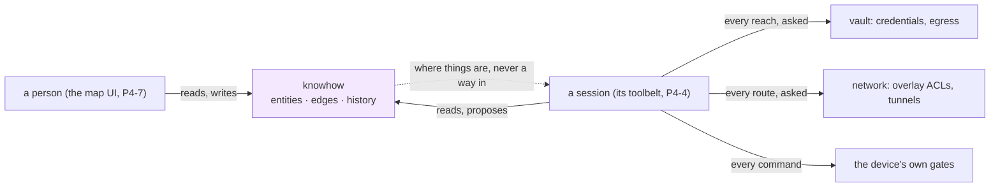

> [!WARNING]
> **What the map holds is information, so it is read with a permission of its
> own** (`KNOWHOW_VIEW`, §5): where the production database lives is worth
> keeping from a guest. But no answer of the vault, the network or a device
> ever depends on it. A planted fact can send a session toward a host; the
> reach is still decided as any other is, and P4-6's `roomler_connect` asks a
> person first.

## 2. The model

An **entity** is one thing the organization has
([`model.rs:119`](../crates/modules/knowhow/src/model.rs#L119)):

| Field | Meaning |
|---|---|
| `kind` | what it is: one of `KINDS` (below). Never changes |
| `key` | its name among the live of its kind in the organization: lowercase segments of `a-z 0-9 . _ : @ -` joined by `/` (`github.com/acme/api`, `prod/payments`, `db-1:5432`). Never changes: a chip and a session name an entity by its kind and key, so another name is another entity |
| `name` | what a person reads, up to 200 characters |
| `env` | an environment, one lowercase word (`prod`, `staging`), or none |
| `owner_id` | the member who answers for it, or none. A member of the organization, checked on every write |
| `attrs` | a JSON object, up to 16 KiB stored: what describes it |
| `facts` | what is known of it, each with its provenance (below), up to 64. A machine keeps 15 of them for the sync and its scans, a scan's own entity 9 for its scans (§10, §11.1) |
| `status` | `active`; `proposed` for a session's (§12.2); `archived` once tombstoned. A fact also turns `stale` when nothing confirmed it for `knowhow.stale_days` (§13.4) |
| `source` | where it came from: `person`, `sync` (§10), `scan` (§11.1) or `session` (§12.2) |
| `device` | for a scan's own entity, the device whose scans made it, keep it and retire it (§11.1); absent otherwise |
| `session` | for a session's proposal, the session that made it (§12.2); absent otherwise |
| `confirmed` | P4-4-3, for a confirmed proposal: `{by, at}`, the person who confirmed it and when (§12.3), shown as `confirmed_by` and `confirmed_at` |
| `rev` | bumped by every write. A write names the rev it read (§3) |

Kinds: `machine`, `repo`, `checkout`, `database`, `cluster`, `namespace`,
`service`, `endpoint`, `bucket`, `cloud_account`, `domain`, `environment`,
`team`, `doc`. An **edge** relates two entities, `from` `kind` `to`
([`model.rs:230`](../crates/modules/knowhow/src/model.rs#L230)), its
kind one of `runs_on`, `checked_out_at`, `deployed_to`, `depends_on`, `reads`,
`writes`, `part_of`, `owned_by`, `documented_in`, `authenticates_with`,
`reachable_via`, with attributes of its own (up to 4 KiB). No rule pairs an
edge kind with the kinds at its ends yet.

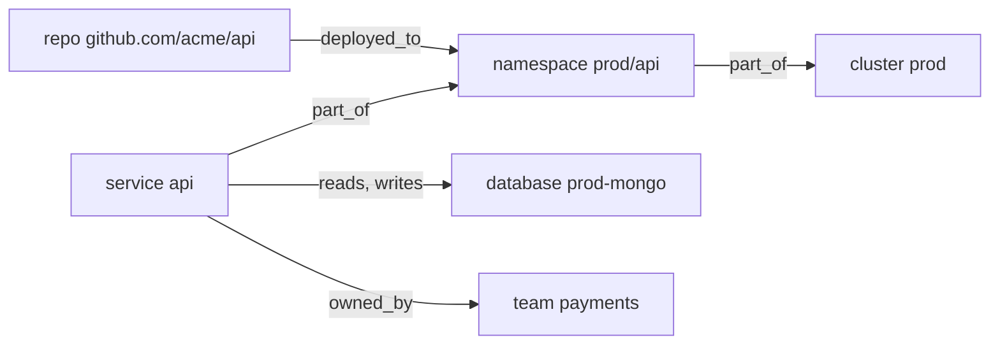

A **fact** is a path, a value and where the value came from
([`model.rs:174`](../crates/modules/knowhow/src/model.rs#L174)):

| Field | Meaning |
|---|---|
| `path` | `[a-z0-9]` then `[a-z0-9._-]`: `port`, `tls.fingerprint`. Stored beside the value, never as a key in the document, so a `.` is safe |
| `value` | any JSON but null, up to 2 KiB |
| `source`, `by`, `device`, `session` | `person` and who; `sync`, with nobody; `scan` and its device (§11.1); or `session` and the session that proposed it (§12.2) |
| `confirmed` | for a proposed fact a person confirmed: who, and when (§12.3) |
| `observed_at`, `verified_at` | when it was said; when a probe last found it as it says (§13.1) |
| `verified` | P4-5: what the last probe that measured it found, `{at, probe, from_device, rtt_ms, carrier, ok}`, as it says or not (§13.1) |
| `status` | `active` for a person's, the sync's and a scan's. A session's is `proposed` until a probe or a person confirms it (decision 39, §12.2) |

> [!IMPORTANT]
> **A person's change to one fact never restamps another**
> ([`merge_facts`](../crates/modules/knowhow/src/model.rs#L704)). An
> update names facts by path: a value sets that fact, as the caller's; null
> removes it; a fact it does not name keeps who said it, from where and when,
> and so does one set to the value it already holds while active. Restamping
> every fact on every edit would make a person the source of what a device or
> a probe said.

> [!NOTE]
> **One spelling per name, and nothing a document reads as a path.** A key is
> lowercase by rule, not folded, as the vault's paths are: two keys differing
> only in case would be one thing to a person and two to the unique index. An
> attribute's name is a key in the stored document, so it is a word of
> `A-Z a-z 0-9 _ -`, never a `.` path or a `$` operator, at every depth.
> A kind, an edge kind, a status and a source are strings in the row, never
> enums: a newer server writes values this build has never heard of, and a
> reader shows an unknown one. Only a write is held to the lists.

⚠️ **A `machine` is never a person's.** A machine mirrors a device, and the sync
records it (§10), keyed by its node id with its overlay address beside its name
(§10.2): labels move and are reused, and MagicDNS can be dead on a GPO-locked
desktop and is absent on macOS. A create naming `machine` is refused **400**
([`SYNCED_KINDS`](../crates/modules/knowhow/src/model.rs#L46)). A host
that is no device is an `endpoint`.

## 3. The store

Five collections, per organization
([`lib.rs:272`](../crates/modules/knowhow/src/lib.rs#L272)):

- **`knowhow_entities`**, unique on `(tenant_id, kind, key)` among the live (a
  partial index on `deleted_at: {$type: "null"}`, so a live row stores an
  explicit null).
- **`knowhow_edges`**, unique on `(tenant_id, from, kind, to)` among the live,
  so a kind of link between two entities exists once.
- **`knowhow_history`**, every write appended.
- **`knowhow_scans`**, the scans asked of devices (§11).
- **`knowhow_probes`**, the probes asked of devices (§13).

An organization's map holds at most 10,000 live entities and 50,000 live links
([`dao.rs:30`](../crates/modules/knowhow/src/dao.rs#L30)); a write past
either is **409**.

**A write is a compare-and-set on `rev`**
([`dao.rs:246`](../crates/modules/knowhow/src/dao.rs#L246)): its filter
names the rev the writer read, its update `$inc`s it, and the row after is
returned. A writer that lost the race matches nothing and is told so, rather
than overwriting what it never saw.

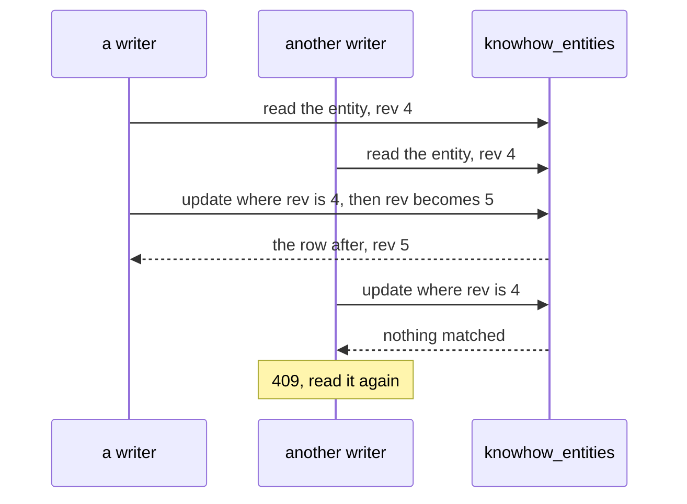

⚠️ **The history is appended after the write it records, never before**
([`write.rs:168`](../crates/modules/knowhow/src/write.rs#L168)).
Without a transaction, a row written first could name a write that then lost
its compare-and-set. A row appended after can only go missing: the write
stands, the failure is logged, and the entity still names who changed it last
(`updated_by`, `updated_at`).

**Archiving an entity** tombstones it at the rev it was read, which frees its
key, and archives every live link to it, each in the history with the cause
`entity_archived`
([`archive_links`](../crates/modules/knowhow/src/write.rs#L204)).
Nothing links to an archived entity: a link's ends are resolved live, within
the organization, before it is made. A link the archive raced is invisible,
because a card and a neighbourhood show only the links whose other end is live.

## 4. The switch and the org gate

| Switch | Effect |
|---|---|
| `[modules] knowhow` (`ROOMLER__MODULES__KNOWHOW`) | **default OFF**, like `hive` and `vault`: no route is mounted |
| `knowhow.tenants` (`ROOMLER__KNOWHOW__TENANTS=<id>,<id>`) | the organizations whose map it keeps ([`KnowhowSettings`](../crates/config/src/settings.rs#L163)). A list alone mounts the module ([`knowhow_on`](../crates/config/src/settings.rs#L1641)), the form a hosted server uses, because no older image reads it. Clearing it is the kill switch |

`knowhow.tenants` reads like `vault.tenants`: empty or `*` is every
organization, and an entry that is not an organization id matches nothing
([`scope.rs`](../crates/modules/knowhow/src/scope.rs)). Every route checks, in
this order ([`routes.rs:83`](../crates/modules/knowhow/src/routes.rs#L83)):

1. **membership**: someone outside the organization is told `403 not_a_member`,
   and so learns nothing about whether its map is kept;
2. **the scope**: a member of an organization knowhow does not serve is told
   `404 knowhow is not available to this organization`;
3. **the permission** (§5);
4. **the id**, resolved within the organization: another organization's
   entity answers **404**, as a bogus id does, on every route that names one.

## 5. Who reads and who changes it

| Bit | Grants | In the managed roles |
|---|---|---|
| `KNOWHOW_VIEW` (bit 33, [`role.rs:121`](../crates/db/src/models/role.rs#L121)) | every read: the status, a search, a card, a neighbourhood, the history | in `DEFAULT_MEMBER`, so `member`, `moderator` and `admin` hold it, and `owner` by `ALL`. Never `guest` |
| `KNOWHOW_EDIT` (bit 34, [`role.rs:125`](../crates/db/src/models/role.rs#L125)) | every write, and every read | in `DEFAULT_ADMIN` |

These are decisions 37 and 36 as recommended, built pending the operator's word
(the FR-90 spec, §6). Every alternative stays open: a bit no route reads grants
nothing, so "every member, as a wiki" or `MANAGE_AGENTS` would move the gate
without taking a grant back.

> [!NOTE]
> **The startup reconcile hands both bits to every existing organization.**
> The managed roles are reconciled additively at boot
> ([permissions.md](permissions.md) §3), so the first boot of a build with
> P4-1 grants `KNOWHOW_VIEW` to each org's `member`, `moderator` and `admin`
> rows and `KNOWHOW_EDIT` to its `admin` row, and records each stratum in
> `role_reconcile_audit`. With the module switched off the bits open nothing.

The UI mirror lists both under *Knowhow* (`ui/src/utils/permissions.ts`), as
`2 ** 33` and `2 ** 34`: a shift cannot express either in JS.

## 6. Routes

All under `/api/tenant/{tenant_id}/knowhow`
([`routes.rs`](../crates/modules/knowhow/src/routes.rs)):

| Method | Path | Does | Needs |
|---|---|---|---|
| GET | `` | `{entities, edges}`: how much the map holds, live | `KNOWHOW_VIEW` |
| GET | `/search` | the live entities whose key or name holds `q` (as written, case aside, never a pattern), of a `kind`, in an `env`, by kind and key; `?limit=` 1–200 (default 50) and `truncated`. Each as a node: no attributes, no facts. A kind this build does not know is searched for, not refused | `KNOWHOW_VIEW` |
| GET | `/entity?kind=…&key=…` | one live entity's card, by the name a chip and a session use | `KNOWHOW_VIEW` |
| GET | `/entity/{id}` | its card: `{entity, links[{direction: out · in, edge, other}], truncated, probes, probes_truncated}`, up to 200 links to live entities, and (P4-5-4) each device's last probe that found something, a row of each probe kind (P4-5-4b), up to 16 devices, each as the probes listing shows one (§13.5) | `KNOWHOW_VIEW` |
| GET | `/map/{id}` | its neighbourhood (§7): `?depth=` 1 (default) or 2, `?kind=`, `?env=` → `{center, entities, edges, truncated}` | `KNOWHOW_VIEW` |
| GET | `/history` | the writes, newest first; `?entity=` one entity's, its links' included, archived or not; `?limit=` 1–200 | `KNOWHOW_VIEW` |
| POST | `/entity` | `{kind, key, name, env?, owner_id?, attrs?, facts?: {path: value}}` → **201**. **409** when a live entity holds the kind and key; **400** for `machine`, a kind or a spelling outside the rules, a null fact, an owner who is no member; **422** for an unknown field | `KNOWHOW_EDIT` |
| PATCH | `/entity/{id}` | `{rev, name?, env?, owner_id?, attrs?, facts?: {path: value or null}}`: `""` clears `env` and `owner_id`; `attrs` is replaced whole; `facts` is merged by path (§2). **409** at a rev already gone; a change that changes nothing writes nothing and answers the entity as it is. `kind` and `key` are unknown fields (**422**). A machine's name, owner and synced facts are the fleet's (**400**, §10), a scan entity's name, owner and scanned facts and any fact a scan said are its device's (**400**, §11.1), and a person's own facts stop at 49 on a machine and 55 on a scan entity (**400**) | `KNOWHOW_EDIT` |
| DELETE | `/entity/{id}?rev=…` | archive it and its links: `{archived, links_archived}`. **409** at a rev already gone, **404** once archived; **400** for a machine, which leaves when its device does (§10), and for a scan entity, which leaves when its device's scans no longer report it (§11.1) | `KNOWHOW_EDIT` |
| POST | `/edge` | `{from, to, kind, attrs?}`: two live entities of the organization → **201**. **409** when they are already linked by that kind; **400** for a link to itself | `KNOWHOW_EDIT` |
| PATCH | `/edge/{id}` | `{rev, attrs}`: its attributes, replaced. Its ends and kind never change: a different link is archived and made again | `KNOWHOW_EDIT` |
| DELETE | `/edge/{id}?rev=…` | archive the link | `KNOWHOW_EDIT` |
| POST | `/entity/{id}/confirm` | P4-4-3, a person's word on a session's proposed entity (§12.3): `{rev}` → **200**, `active`, with `confirmed_by` and `confirmed_at`. **409** for one that is no proposal or at a rev already gone. Its facts are each confirmed on their own | `KNOWHOW_EDIT` |
| POST | `/entity/{id}/fact/confirm` | `{rev, path}`: one proposed fact, or (P4-5-3) one turned stale, at its entity's rev → **200**. **404** for a path no fact holds, **409** for a fact that is neither, or a rev already gone | `KNOWHOW_EDIT` |
| POST | `/edge/{id}/confirm` | `{rev}`: a proposed link → **200**, as an entity's | `KNOWHOW_EDIT` |
| POST | `/scan` | `{device}`: ask a device to scan (§11) → **202** with the scan, or the device's pending one. **409** for a device that cannot scan or is a secondary enrollment; **404** for one that is not the organization's | `KNOWHOW_EDIT` |
| GET | `/scan?device=…` | a device's scans, newest first: `{scans[{id, device_id, requested_by, requested_at, state, delivered_at?, answered_at?, counts, truncated?, detail?}]}`; `?limit=` 1–200 | `KNOWHOW_VIEW` |
| POST | `/probe` | P4-5-1a, `{entity, device, kind}`: ask a device to probe an entity, `tcp` or `tls` (§13) → **202** with the probe, or the device's pending one when it is this same probe. **400** for an entity whose facts say nowhere a probe reaches, or a kind not known; **409** for a device that cannot probe, is a secondary enrollment, or is running another probe; **429** past 30 a minute for the device; **404** for an entity or a device that is not the organization's | `KNOWHOW_EDIT` |
| GET | `/probe?entity=…` or `?device=…` | an entity's probes or a device's, newest first: `{probes[{id, entity_id, device_id, requested_by, requested_at, kind, target{host, from, port, sni?}, state, delivered_at?, answered_at?, rtt_ms?, address?, carrier?, tls?, detail?, measured?}]}`; `?limit=` 1–200. One of the two, never both | `KNOWHOW_VIEW` |

## 7. A neighbourhood

The map route walks the links both ways, one step at a time
([`routes.rs:479`](../crates/modules/knowhow/src/routes.rs#L479)). Each step
is one indexed read of the live links from or to the step's entities, at most
500 ([`touching`](../crates/modules/knowhow/src/dao.rs#L304)), each way on
its own index (`(tenant_id, from, deleted_at)`, `(tenant_id, to, deleted_at)`).
The entities they lead to are read live, and filtered by `kind` and `env`; the
centre is always shown. A filtered entity is not walked through. A link is
shown only when both its ends are.

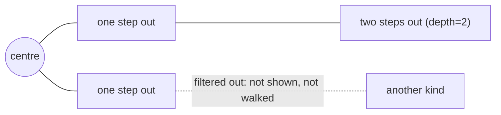

⚠️ **Bounded at the source.** The design named `$graphLookup`, whose traversal
has no limit of its own: a hub two steps out would load most of the map before
any cap applied. A step that reaches the bound sets `truncated`, and the walk
stops there.

## 8. History

One row per write ([`model.rs:277`](../crates/modules/knowhow/src/model.rs#L277)):

| Field | Meaning |
|---|---|
| `target`, `target_id` | `entity` or `edge`, and which |
| `entity_ids` | the entity, or the link's two ends: an entity's history is read by it, so a link made or archived shows in the history of both its ends |
| `rev`, `op` | the rev the write made; `create`, `update`, `archive`, (P4-4-3) `confirm`, a person's word on a proposal, or (P4-5) `verify`, what a probe measured (§13.1) |
| `source`, `by`, `at` | `person` and who, in P4-1; `probe` and the probing `device` for a `verify`; when |
| `session`, `why` | P4-4-2: the session whose proposal wrote, and why it proposed (§12.2); absent otherwise |
| `set` | what the write set: a create's whole body, an update's changed fields (facts as `{path, value}` rows, a null value for one removed), an archive's status and, for a link an entity's archive took, `cause: entity_archived` |

The history is kept as long as the map: a fact's provenance may be asked for
years after it was written, so it has no TTL.

## 9. Collections

| Collection | One row per | Indexes | Retention |
|---|---|---|---|
| `knowhow_entities` | entity: kind, key, name, env, owner, attributes, facts, status, source, device, session, rev | unique `(tenant_id, kind, key)` over live rows (partial on `deleted_at: {$type: "null"}`); `(tenant_id, deleted_at, kind, key)`; `(tenant_id, device, deleted_at)`, a device's scan part | tombstoned, kept |
| `knowhow_edges` | link: from, to, kind, attributes, status, source, device, session, rev | unique `(tenant_id, from, kind, to)` over live rows; `(tenant_id, from, deleted_at)`, `(tenant_id, to, deleted_at)`; `(tenant_id, device, deleted_at)` | tombstoned, kept |
| `knowhow_history` | write (P4-4-2: a session's names it, with its why) | `(tenant_id, at desc, _id desc)`, `(tenant_id, entity_ids, at desc, _id desc)`; `(tenant_id, session)` over a session's rows (partial on `session: {$type: "objectId"}`), its ceiling's count | kept, no TTL |
| `knowhow_scans` | scan asked of a device: who asked and when, its state, when delivered and answered, its counts and detail (§11) | unique `(tenant_id, device_id)` over pending rows (partial on `pending: true`); `(tenant_id, device_id, requested_at desc)`; `(device_id, state)` | 90 days (TTL on `requested_at`) |
| `knowhow_probes` | probe asked of a device: the entity, who asked, the kind and the target as read, its state, what the device said, what it measured (§13) | unique `(tenant_id, device_id)` over pending rows (partial on `pending: true`): one at a time; `(tenant_id, entity_id, requested_at desc)`, `(tenant_id, device_id, requested_at desc)`; `(device_id, state)` | 90 days (TTL on `requested_at`) |

## 10. Machines, from the fleet and the network (P4-2)

Every live device of an organization knowhow serves is a **machine** on the map
([`sync.rs`](../crates/modules/knowhow/src/sync.rs)). The sync is the first of the
design's sources and the most trusted: what the fleet and the network say of a device is
the server's own record, not anybody's claim.

| A machine's | Is |
|---|---|
| `key` | the device's id: the node id, which a re-enrolment of a live machine keeps and a removal retires. It never moves when a label does |
| `name` | the label the device list shows: its display name, else its own name. A label the map cannot keep falls back to the machine's name, then to its id, never to nothing |
| `owner_id` | the device's owner |
| `source` | `sync`; its history rows too, with no person behind them |
| facts, the sync's | what the fleet says (§10.1) and what the network says (§10.2), fourteen paths in all ([`SYNCED_FACTS`](../crates/modules/knowhow/src/sync.rs#L65)), each sourced `sync`, with no `by` |

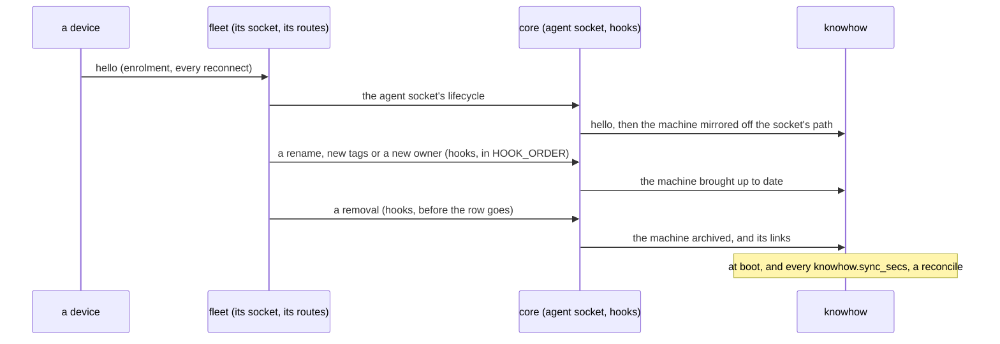

It hears of a device from core, never from a call by fleet or the network, so the module
still has no edge in the graph. It reads devices through the shared `AgentDao`, as the
vault does, and the overlay through the shared overlay DAOs: a stateless dependency is no
edge (FR-69's rule 5).

- **A hello** mirrors its device: an enrolment's first, and every reconnect. It runs off the
  socket's path, so a slow database never delays a device's session.
- **A rename, new tags, a new owner** reach the machine through fleet's hooks
  (`agent_renamed`, `agent_updated`). The rename hook answers `NoLiveNode`, which never
  displaces the overlay's answer.
- **A removal** archives the machine and every link to it, each in the history.
- **The reconcile** brings every served organization into line. It runs at boot, on the pod
  that holds the startup lease, and every `knowhow.sync_secs` (default 600) on every pod. It
  catches what no hook carries, such as a display name and everything the network says
  (§10.2). It also retires a machine whose device went while knowhow was not looking:
  switched off, or a removal whose hook failed. A second run changes nothing.

> [!WARNING]
> **A sync that fails is logged, never the caller's failure.** No rename, no update and above
> all no removal fails because the map could not be written. The next reconcile tries again.

> [!IMPORTANT]
> **What the fleet says of a machine is the fleet's.** A person's change to a machine's name,
> its owner or a synced fact is refused **400**, because the next sync would undo it. So is
> archiving a machine, which leaves the map when its device is removed. A person may give a
> machine an environment, attributes and facts of their own, and every sync leaves those as
> they are ([`the_fleets`](../crates/modules/knowhow/src/routes.rs#L192)).

> [!NOTE]
> **A machine keeps room for the sync's facts.** An entity holds at most 64 facts, and the
> sync owns 14 of a machine's paths and its scans one more (§11.1), so a person's own facts on
> a machine stop at 49
> ([`persons_room`](../crates/modules/knowhow/src/routes.rs#L255)), and no sync
> takes a machine past 64. An edit that adds none of a person's still passes, so a machine
> that a newly synced path left past its room can still be tidied.

| Setting | Effect |
|---|---|
| `knowhow.sync_secs` (`ROOMLER__KNOWHOW__SYNC_SECS`) | how often each pod reconciles, in seconds; 0 or absent: 600 |

### 10.1 What the fleet says (P4-2a)

`machine_name`, `os`, `arch` (where the device said it), `version`, `ephemeral` and `tags`:
the device row as the fleet keeps it.

### 10.2 What the network says (P4-2b)

| Fact | Is | Present |
|---|---|---|
| `overlay.ipv4` | the address the device leases on the organization's overlay | while it holds a live overlay node |
| `overlay.name` | its name there, the MagicDNS label, as the device list shows it | while the node has a label (every node since names) |
| `overlay.magicdns` | `<label>.<domain>`, the name the device list shows ([`mirror`](../crates/modules/knowhow/src/sync.rs#L222)) | while the organization has a MagicDNS domain |
| `overlay.routes` | the subnets it carries for its peers: approved by an admin **and** still offered by the device ([`effective_routes`](../crates/remote_control/src/models.rs#L6711)), the default route apart; at most 64 | while it holds a node (`[]` for none) |
| `overlay.exit` | whether it carries the default route `0.0.0.0/0` for the peers that choose it, approved and still offered | while it holds a node |
| `tunnel.routes` | the subnets it is a gateway for in the tunnel mesh, as an admin set them | always (`[]` for none); at most 64 |
| `ssh.server` | whether its build serves roomler SSH: the `ssh` verb it advertises, matched whole | always |
| `ssh.policy` | gate 3: `on` while the organization lets it accept sessions, else `off` | always |

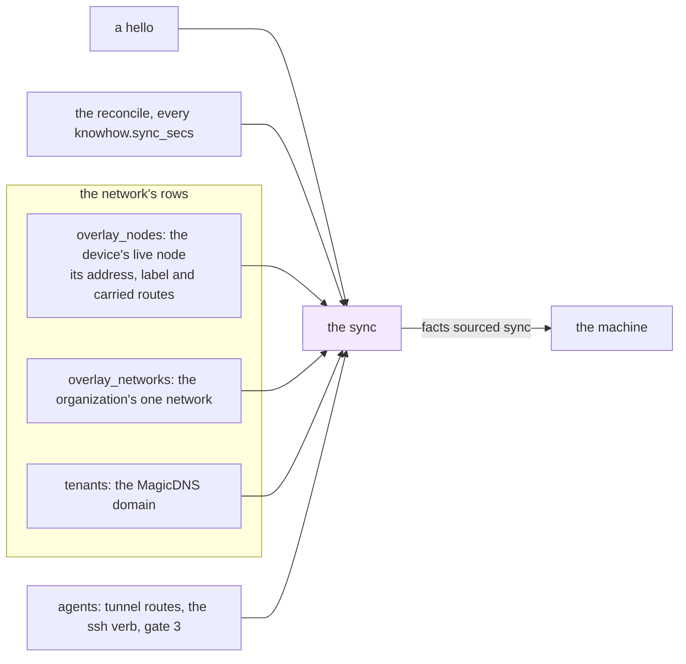

A hello reads the device's own node ([`device`](../crates/modules/knowhow/src/sync.rs#L353));
the reconcile reads the organization's live nodes once, by device
([`device_nodes`](../crates/modules/knowhow/src/sync.rs#L315)). An overlay fact
exists while the device holds a live node and leaves the machine with it: an evicted node's
facts go at the next sync, and the rest of the machine stays, because an eviction forces a new
lease and is no removal.

> [!WARNING]
> **The network tells nobody when it changes, so its word reaches the map late.** A first
> join (which follows the hello), an admin's approval of a route or an exit, gate 3, the
> organization's MagicDNS domain and a device's tunnel routes (fleet's `agent_updated` fires
> for tags and an owner only) reach the machine at the device's next hello or the next
> reconcile, within `knowhow.sync_secs`. Nothing calls knowhow, and a hook on the overlay's
> join path would buy a fresher map with the mesh's own latency, the wrong way round for a
> map.

> [!IMPORTANT]
> **What the network says is no promise of reach.** `ssh.server` says the device's build
> carries roomler SSH's server, not that the device switched it on (its own gate 4, which the
> server cannot see), nor that anyone may open a session: gates 1 and 2 still decide, and
> `ssh.policy` is gate 3 alone ([roomler-ssh.md](roomler-ssh.md)). `overlay.routes` and
> `overlay.exit` are the data plane's (an approval the device no longer offers is no route),
> and the overlay ACL still decides what passes. `tunnel.routes` are still gated by the
> organization's tunnel policies.

⚠️ **A MagicDNS read that fails fails the sync.** Read as "no domain", it would take every
machine's MagicDNS name off the map until a later sync put it back
([`magic_domain`](../crates/modules/knowhow/src/sync.rs#L305)).

**Declared tunnel routes** (`[[tunnel_routes]]`) are not among the facts: the server never
holds them. They live in the device's own config, outside its remote configuration surface,
and the tunnel hub knows only the flows live on its pod. They come with the device's own scan
(§11.1), which sends them from P4-3b-1.

## 11. Scans (P4-3a)

A scan is the server's request and the device's answer (decision 38): a person asks a device
to scan, and the device reads only the roots its owner lists, each as the account that owns it
([`scan.rs`](../crates/modules/knowhow/src/scan.rs)). P4-3a-1 builds the request, its
delivery and the answer's record; P4-3a-2 writes what a scan found onto the map (§11.1,
decision 42). The device's half (the roots, the scanners) is P4-3b's, designed with
decisions 45–47 in the FR-90 spec's §3e "P4-3b, a device's scan, as designed", and built on
Linux and macOS by P4-3b-1 and P4-3b-2 (§11.2). The server's half, with decisions 41–44, is its §3e
"P4-3, scans, as designed".

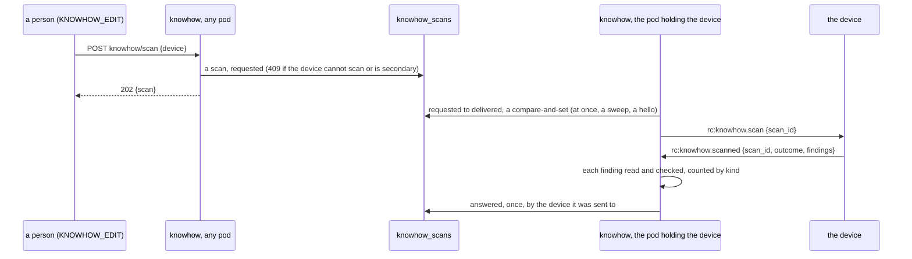

**Who asks, and which devices** ([`request`](../crates/modules/knowhow/src/scan.rs#L494)).
A person with `KNOWHOW_EDIT` (decision 41) asks for a live device of the organization: **202**
with the scan, or with the device's pending scan when it has one, since a scan is never doubled
(a partial unique index on `pending`). A device is refused **409** up front
([`refusal`](../crates/modules/knowhow/src/scan.rs#L146)) when its last hello did not
advertise `knowhow-scan`, since an agent that cannot scan would never answer, and when it is a
secondary enrollment (its caps' `update_mode` is `primary_org`), since its roots are one
device-owned list, scanned for its primary organization alone (decision 43). That is how fleet
refuses an update push a device would ignore (FR-67).

**The delivery: the row is the bus** ([`deliver`](../crates/modules/knowhow/src/scan.rs#L164)).
The pod holding the device's connection tells it, the vault's way, so knowhow needs no edge to
fleet's Hub, which is pod-local:

| When | Who sends |
|---|---|
| the request lands on the pod holding the device | that pod, at once |
| it landed on another pod | the holding pod's next sweep, every `knowhow.scan_sweep_secs` (5 s) |
| the device was offline | the pod its next hello reaches ([`hello`](../crates/modules/knowhow/src/scan.rs#L206)) |
| it was sent to a connection that died unanswered | the next hello's pod, again |

Each first send is a compare-and-set from `requested` to `delivered`, so one connection is told
once; a send that cannot go out within 2 s is put back to `requested` for the next sweep. A
connection is linked at its hello when the device can scan, and unlinked when it closes.

> [!NOTE]
> **Sent again, run once.** A scan delivered to a connection that dies before its answer is sent
> again at the device's next hello. The device runs a scan id once, and the server keeps the
> first answer, so a repeat costs a frame, never a second scan.

**The record.** `knowhow_scans`, one row per request, kept 90 days:

| State | Means | Its fix |
|---|---|---|
| `requested` | asked, not yet sent | the device comes online, or this pod's sweep runs |
| `delivered` | sent, not yet answered | the device answers, or is sent it again at its next hello |
| `done` | answered with what it found, counted by kind | — |
| `no_roots` | its owner lists no root (decision 38) | the owner lists roots on the device |
| `failed` | the device could not scan; why is `detail` | the detail's |
| `expired` | 24 h without an answer | ask again |

**The answer** ([`read_answer`](../crates/modules/knowhow/src/scan.rs#L291)).
Recorded once, and only from the device the scan was sent to: an answer for another device's scan,
one already answered, or a made-up id is dropped and logged. Only a `done` answer's findings are
read, each on its own by the wire's rules
([`Finding::read`](../crates/remote_control/src/knowhow.rs#L227)), and counted:
`checkouts`, `contexts`, `listeners`, `tunnel_routes`, `unknown` (a kind this build does not
know: skipped, so a newer device's answer is never lost whole) and `refused`. An answer past
2,000 findings or 1 MiB is recorded `failed`. A `detail` is clamped to 200 characters.

> [!WARNING]
> **A finding is closed, and never holds a credential.** A known kind with a field this build
> does not know is refused, since an open shape is where a token would ride along unseen. Every
> string is checked for a credential's shape
> ([`holds_credential`](../crates/remote_control/src/knowhow.rs#L337)): a URL's
> password, a token by a prefix it knows, an AWS access key, a PEM block, a JWT. A finding that
> holds one is refused whole, and a `detail` that holds one is withheld. Only the findings
> read are written (§11.1); what was refused is counted, never stored.

| Setting | Effect |
|---|---|
| `knowhow.scan_sweep_secs` (`ROOMLER__KNOWHOW__SCAN_SWEEP_SECS`) | how often each pod looks for scans asked of the devices connected to it, in seconds; 0 or absent: 5 |

### 11.1 What a scan writes (P4-3a-2)

Decision 42: what lives on its device, and nothing else
([`intake.rs`](../crates/modules/knowhow/src/intake.rs)). Its findings are written once its
answer has taken, so a scan is written once, and what it wrote is stamped on its record
(`written`: checkouts, endpoints, repos and clusters made, links made, what it retired, and
whether the map was full).

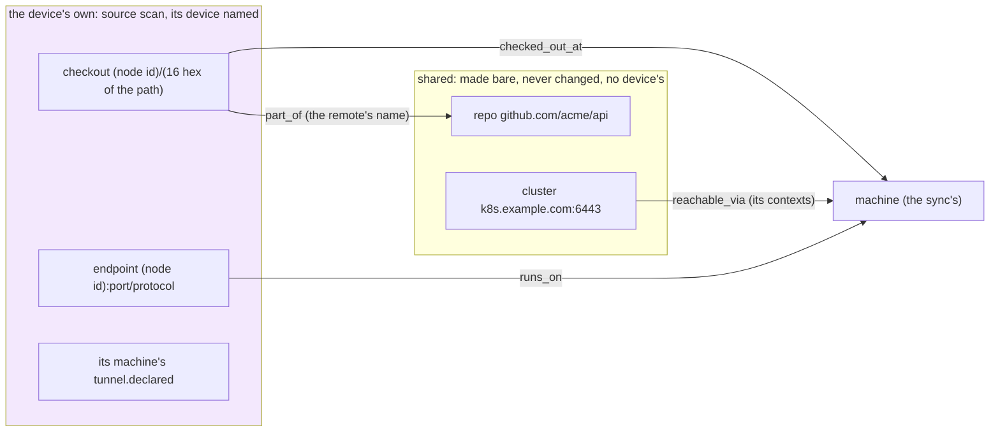

| A finding | Writes | Keyed |
|---|---|---|
| a checkout | a `checkout` named `<last segment> on <machine>`, owned by the device's owner: `path`, `remotes`, `root_commit`, `branch`, `services`; `checked_out_at` its machine; `part_of` the repository of each remote, the remote's name as the link's attribute | `<node id>/<16 hex of the path's SHA-256>` ([`checkout_key`](../crates/modules/knowhow/src/intake.rs#L81)), since a path is not a key (case, spaces, separators) |
| a listener | an `endpoint`: `port`, `protocol`, `address`, `process`; `runs_on` its machine | `<node id>:<port>/<protocol>` |
| a kube context | the `cluster` its server names, made bare; `reachable_via` its machine, the device's contexts for it (name, namespace, CA) as the link's attributes | its server's `host:port` ([`cluster_key`](../crates/modules/knowhow/src/intake.rs#L150)), the scheme's port when it names none |
| a declared tunnel route | its machine's `tunnel.declared`, a list | — |
| a remote | the `repo` it names, made bare | its host and path, lowercase, with no scheme, user, port or `.git` ([`repo_key`](../crates/modules/knowhow/src/intake.rs#L120)). A local path names none |

Every fact and link a scan writes says so: source `scan`, and the device (`device`), with no
person (`by`), as do its history rows. A shared repository or cluster is a scan's (source
`scan`, its history naming the device that made it), but no device's: `device` is empty.

> [!IMPORTANT]
> **A scan is its device's claim about itself.** It writes only entities keyed by its own node
> id and its own machine's scan fact. It makes a repository or a cluster only bare and never
> changes one another source made, including another device's scan. A key a person already
> holds is left as it is. So the worst a lying device does is describe itself falsely, and name
> a repository or a cluster that does not exist.

**A later scan replaces its device's part**
([`retire`](../crates/modules/knowhow/src/intake.rs#L681)):

| The answer | Archives |
|---|---|
| `done`, complete | what the device's earlier scans wrote and this one no longer reports: its own entities with their links, then its own links. No routes declared clears `tunnel.declared` |
| `done`, truncated | nothing: what it left out is unknown, not gone |
| `no_roots` | all of the device's part |
| `failed` | nothing |

Never a shared entity: no device owns one. A device removed from the fleet takes its own
entities with its machine.

> [!NOTE]
> **What a scan says is the device's.** A person's change to a scan entity's name, owner or one
> of its scan's facts, to a machine's `tunnel.declared`, or to any fact a scan said, is refused
> **400** (`its device's scan says this of a checkout: path — change the device instead`), and
> so is archiving a scan entity: it leaves when its device's scans no longer report it. A person
> may give it an environment, attributes and facts of their own, and every scan leaves those as
> they are. A shared repository or cluster is a person's to describe; no scan changes it again.
> A machine now keeps room for 15 facts (the sync's 14 and its scans' `tunnel.declared`), so a
> person's own stop at 49; a scan entity keeps room for its scans' 9, so a person's own stop at
> 55.

### 11.2 A device's scan (P4-3b-1 to P4-3b-3)

The device's half of decision 38: the daemon reads the roots its owner lists, each through a
child running as the account that owns it, and answers with what it found, checked as the
server will check it ([`hive/knowhow`](../agents/roomlerd/src/hive/knowhow/mod.rs)). Linux and
macOS, on every build carrying `hive`. Since P4-3b-2 a checkout's manifests are read, and a file
listed as a root is read as a kubeconfig (decision 46). Since P4-3b-3 the TCP ports the machine
listens on are reported too, when its owner turns that on (decision 47). Windows is P4-3b-4's.

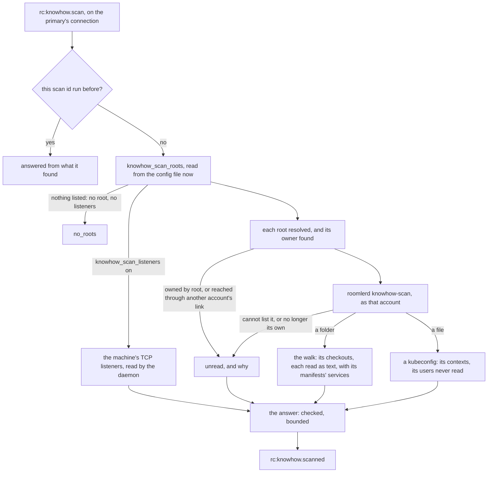

**The roots.**

| | |
|---|---|
| the key | `knowhow_scan_roots`: comma-separated absolute paths, set in the device's config or over the LocalAPI, `roomler config set knowhow_scan_roots …` ([`config_surface`](../crates/agent-core/src/config_surface.rs#L552)). A folder is walked for its checkouts; a file is read as a kubeconfig (decision 46) |
| empty | nothing is read: the answer is `no_roots` |
| live | read from the config file again at each scan, under the LocalAPI's write lock ([`read_config`](../agents/roomlerd/src/hive/knowhow/mod.rs#L523)): an edit takes the next scan, with no restart |
| whose | the device's: absent from `DesiredConfig`, and named in the test that keeps every device-owned key out of it ([`the_device_owned_refusals_are_not_pushable`](../crates/remote_control/src/models.rs#L9437)) |
| the listeners | P4-3b-3: `knowhow_scan_listeners`, off by default, live and the device's like the roots ([`config_surface`](../crates/agent-core/src/config_surface.rs#L562)). Nothing listed at all, neither a root nor the listeners, is `no_roots` |

**Whose eyes** ([`whose`](../agents/roomlerd/src/hive/knowhow/owner.rs#L78)).

| The root | Read as |
|---|---|
| owned by an account, the daemon root | that account: `roomlerd knowhow-scan` started as it, through the drop an agent session takes ([`run_child`](../agents/roomlerd/src/hive/knowhow/mod.rs#L560)) |
| owned by the account the daemon runs as (a per-user install) | the daemon itself |
| owned by another account, the daemon not root | unread: it reads only its own |
| owned by root | unread: the owner lists the folders below it. A file root owns, a cluster's `admin.conf` among them, is never read |
| reached through a symbolic link that belongs to neither root nor the root's owner | unread ([`resolve`](../agents/roomlerd/src/hive/knowhow/owner.rs#L132)) |
| a file | read as a kubeconfig, by the account that owns it, as a folder would be |
| neither a folder nor a file | unread |

The child is started as hive's own children are: fed its request on stdin, its environment
emptied but for its account's, in a process group of its own, at low priority. It refuses to run
as root at all, and resolves its root again: a root it cannot list, or one no longer its
account's, is refused ([`produce`](../agents/roomlerd/src/hive/knowhow/mod.rs#L195)).

**The walk** ([`walk`](../agents/roomlerd/src/hive/knowhow/walk.rs#L71)).

| Bound | Value | When it is reached |
|---|---|---|
| depth below the root | 8 levels | deeper is never seen, the same at every scan: not a cut |
| entries read | 100,000 | cut |
| time | 60 s a root, which the child keeps; a child 15 s past it is ended whole; 5 min a scan | cut, or the root unread |
| roots | the first 32 | the rest unread |
| filesystem | the root's own | a mount under it is passed by |
| links | never followed | — |
| dot-folders, `node_modules`, `target`, `vendor`, `venv`, `__pycache__`, `bower_components`, `dist`, `build` | skipped | — |

A folder holding `.git` (a folder, or a file naming one: a worktree) is a checkout, and the walk
goes no deeper into it. A folder under the root the account cannot list is passed by: the same at
every scan, so not a cut.

**A checkout** ([`read`](../agents/roomlerd/src/hive/knowhow/checkout.rs#L48)).

| Fact | Read from |
|---|---|
| `path` | where it is, resolved |
| `remotes` | each remote's first `url` in its config (the shared one, for a worktree), its user and password, query and fragment taken out ([`clean_url`](../agents/roomlerd/src/hive/knowhow/checkout.rs#L189)), and one still holding a credential's shape dropped |
| `branch` | `HEAD`; none when it is detached |
| `root_commit` | `git rev-list --max-parents=0 HEAD`, as the account: hooks and fsmonitor off, no prompt, no fetch, neither the system's git config nor the account's, 5 s; only a real git ([`find_git`](../agents/roomlerd/src/hive/knowhow/checkout.rs#L33)), and never in a shallow clone, whose oldest commit is where it was cut |
| `services` | P4-3b-2: its manifests' services ([`services`](../agents/roomlerd/src/hive/knowhow/manifests.rs#L91)). A compose file's services, and a Kubernetes workload's containers (a Deployment, StatefulSet, DaemonSet, ReplicaSet, Job, CronJob or Pod), each a name and an image: the workload's name for one container, `<workload>/<container>` for several. From YAML files three levels down at most: 200 a checkout, 256 KiB each, 64 services. A Helm template is not YAML until it is rendered, and is skipped |

**A kubeconfig** ([`contexts`](../agents/roomlerd/src/hive/knowhow/kubeconfig.rs#L28)), P4-3b-2,
decision 46: a file listed as a root, read by the account that owns it.

| Fact | Read from |
|---|---|
| `name` | the context's |
| `server` | its cluster's `server`, its user and password taken out; a context naming no cluster is passed by |
| `namespace` | the context's, when it names one |
| `ca_sha256` | the SHA-256 of its cluster's CA certificate (the DER of the first one), from `certificate-authority-data` or from the file `certificate-authority` names: the fingerprint `openssl x509 -noout -fingerprint -sha256` prints, so a person can check it by hand. None when the cluster skips verification |

> [!WARNING]
> **A kubeconfig's `users` is never read.** The reader passes the key by at the top of the file
> without keeping a byte of its value
> ([`documents`](../agents/roomlerd/src/hive/knowhow/yaml.rs#L64)'s `skip`): the credentials a
> context uses stay where they are, and nothing a scan sends could carry one. A file that holds
> no `contexts` or no `clusters` is refused as no kubeconfig, never read as an empty one.

> [!NOTE]
> **One YAML reader, bounded.** Manifests and kubeconfigs are read through `yaml-rust2`'s event
> parser, never its loader, which copies an anchor's whole subtree at every alias, so a file of a
> few lines can grow without bound. Here an alias counts as its anchor's size against
> 100,000 nodes a document ([`MAX_NODES`](../agents/roomlerd/src/hive/knowhow/yaml.rs#L18)):
> a document past it is refused, and its file passed by.

**The listeners** ([`listeners`](../agents/roomlerd/src/hive/knowhow/listeners.rs#L32)), P4-3b-3,
decision 47: the machine's TCP listeners, read by the daemon from the system's own table when
`knowhow_scan_listeners` is on. No account's file is opened, so no account's eyes are needed.

| OS | Table | Its process |
|---|---|---|
| Linux | `/proc/net/tcp` and `tcp6`, the rows in state `0A` | the socket's inode found under `/proc/<pid>/fd`, then `/proc/<pid>/comm` |
| macOS | `lsof -nP -iTCP -sTCP:LISTEN -F pctn`, within 10 s | its own lines; `*` is the family's any-address |

Each is a `listener` finding: its port, `tcp`, the address it is bound to, and its process when
the table can say. Each bound address and port is reported once.

> [!NOTE]
> **The daemon's own ports are left out**: its loopback forwards are its declared routes, which
> the scan reports as such. A daemon that is not root sees only its own account's processes, so
> another account's listener comes without its process. A table that cannot be read is one more
> source unread: the answer is `truncated`, and nothing is retired.

> [!WARNING]
> **macOS's `/usr/bin/git` is never run.** Without the developer tools it is a stub that offers
> the person at the console an install dialog. The scanner runs Homebrew's git or the tools' own,
> and names no first commit without one.

**The answer** ([`assemble`](../agents/roomlerd/src/hive/knowhow/mod.rs#L695)).

| Outcome | When | The server then (§11.1) |
|---|---|---|
| `no_roots` | nothing listed: no root, and the listeners off | archives the device's whole scan part |
| `done` | every root, and the listener table when on, read whole | writes what it found, archives what it no longer reports |
| `done`, `truncated` | a root or the listener table unread, a root cut or ended, or the answer past 2,000 findings or 1 MiB | writes what it found, archives nothing |
| `failed` | nothing it lists read | writes nothing, archives nothing |

The primary's declared tunnel routes go first
([`declared_routes`](../agents/roomlerd/src/hive/knowhow/mod.rs#L670)): a secondary's names
another organization's node. Then each root's checkouts, each checked as the server will check it
and dropped when it would be refused, and a checkout two roots share sent once. `detail` names
each root not read and why, and counts what was dropped.

> [!WARNING]
> **Only a scan that read everything it lists retires anything.** A root that is missing,
> refused, unlistable or cut makes the answer `truncated`, so a folder on an unplugged disk, a
> typo, or a folder macOS's privacy protections hide (`~/Desktop`, `~/Documents`, `~/Downloads`
> without Full Disk Access for `roomlerd`) never archives what earlier scans found. Its `detail`
> names the root and why, until the owner fixes the list.

> [!NOTE]
> **Once per scan id, on the primary's connection, off the loop**
> ([`handle_scan`](../agents/roomlerd/src/hive/knowhow/mod.rs#L617)). A frame on a secondary
> enrollment's connection is answered `failed` (decision 43), though the server never sends one.
> A scan runs off the signaling loop, one at a time, and the last 16 answers are kept, so a scan
> delivered again after a lost connection is answered from what it found, never run twice. The
> verb is advertised by every Linux and macOS build carrying `hive`
> ([`rpc_caps`](../agents/roomlerd/src/encode/caps.rs#L2563)), whatever its roots say: an empty
> list is an answer.

## 12. A session's questions (P4-4-1)

A session asks the map through its toolbelt, and its device carries each
question on its primary connection, as it carries a session's lease requests
([`session.rs`](../crates/modules/knowhow/src/session.rs)). P4-4-1a builds the
server's half: the word that the map is there, the two reads, and who is
believed. The device's half (its client, the toolbelt's tools, the session's
settings) is P4-4-1b's. The design, with decisions 48–52, is the FR-90 spec's
§3e "P4-4, a session's reads and proposals, as designed".

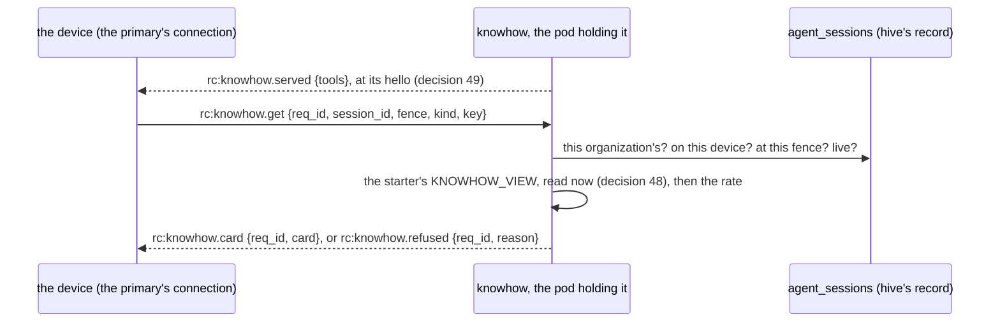

**The word that the map is there** ([`served`](../crates/modules/knowhow/src/session.rs#L258)). At each hello the
pod's knowhow sends `rc:knowhow.served {tools}` to a device whose hello
advertised `knowhow-tools`, on its primary enrollment's connection, when
knowhow serves its organization. `tools` names what this server answers
(`knowhow_search`, `knowhow_get`, since P4-4-2a `knowhow_propose`, since
P4-5-2a `knowhow_verify` for a device that probes, §13.3, and since P4-6-1a
`roomler_connect` for a device with a vault client, §13.6), so a newer agent
offers a session no tool an older server would leave unanswered. No other device is sent it: an older
agent would log a frame it cannot read. A device offers its sessions the
tools only on this word, so where knowhow is switched off no session is shown
a tool that no module would answer.

**Who is asking** ([`identify`](../crates/modules/knowhow/src/session.rs#L500)). A question names a session and
its fence; the organization and the device come from the socket. Every
question is checked, in this order:

| Check | Refused |
|---|---|
| knowhow serves the organization (`knowhow.tenants`) | `not_served` |
| the session's record, read through hive's own DAO, is this organization's and runs on this device | `not_located` |
| at the frame's fence | `stale_fence` |
| live: starting, idle, running or awaiting approval | `ended` |
| its starter holds `KNOWHOW_VIEW` or `KNOWHOW_EDIT` in the organization, read now ([`may_read`](../crates/modules/knowhow/src/session.rs#L547), decision 48) | `denied` |
| 120 questions a minute for the session on its device | `busy` |

Then the question itself: `bad_request` for one past its bounds, `not_found`
for a name no live entity holds, `unavailable` when a read failed. Each
connection's questions wait in one queue of 16, answered in order by one task,
so a slow read never holds the socket and a flood is answered `busy` instead
of queued ([`Questions`](../crates/modules/knowhow/src/session.rs#L124)).

> [!IMPORTANT]
> **A session reads what its starter may, now.** The vault holds a session's
> requests to its role, chosen at its start; knowhow reads the starter's roles
> again at every question, as a person's route reads them. A starter whose
> role loses `KNOWHOW_VIEW` stops their sessions' reads at the next question,
> and one who leaves the organization ends their sessions.

**The reads.** What a person's routes answer, bounded for a model:

| Question | Answer | Bounds |
|---|---|---|
| `rc:knowhow.search {q?, kind?, env?, limit?}` | `rc:knowhow.found {entities, truncated}`: the people's search (§6), each entity as a listing shows one, no attributes and no facts | at most 50, 20 by default; `q` at most 200 characters |
| `rc:knowhow.get {kind, key}` | `rc:knowhow.card {card}`: the people's card (§6), by the name a chip and a session use, with each device's last finding (§13.5) | at most 50 links. Past 64 KiB the devices' findings go first, the oldest first, then links from the end, until the card fits ([`bounded`](../crates/modules/knowhow/src/session.rs#L680)); the entity itself is never cut, its own bounds hold it |

Every entity, fact and link comes with its status and source, so a session
sees what a person said, what the sync and scans said, and (with P4-4-2) what
a session proposed, each for what it is.

| Refusal | Means | Asking again |
|---|---|---|
| `not_served` | knowhow does not keep this organization's map | will not help |
| `bad_request` | the question is malformed or past a bound | not as it is |
| `not_located` | no session of this organization runs on this device by that id | will not help |
| `stale_fence` | the session runs at a newer fence: this run no longer holds it | will not help |
| `ended` | the session is over | will not help |
| `denied` | its starter may not read the map | once their role holds `KNOWHOW_VIEW` |
| `not_found` | no live entity by that kind and key | once one is on the map |
| `busy` | too many questions are waiting, or this minute's are spent | later |
| `unavailable` | a read failed | later |

> [!NOTE]
> **`knowhow → hive`, a stateless DAO.** A session's record is read through
> hive's own DAO, as the vault reads it for a lease (the module graph's edge,
> [`graph.rs`](../crates/core/src/graph.rs)). There is no module state to wait
> on, so a knowhow mounted without hive finds no session and refuses every
> question `not_located`; the `knowhow` build feature implies `hive`.

### 12.1 The toolbelt's tools (P4-4-1b, P4-4-2b, P4-5-2b, P4-6-1b-1)

The device's half ([`knowhow_tools.rs`](../agents/roomlerd/src/hive/knowhow_tools.rs)):
five tools in a session's toolbelt, `mcp__roomler__knowhow_search`,
`mcp__roomler__knowhow_get`, (P4-4-2b) `mcp__roomler__knowhow_propose`,
(P4-5-2b) `mcp__roomler__knowhow_verify` and (P4-6-1b-1)
`mcp__roomler__roomler_connect` (§13.7), compiled wherever agent sessions are
(Linux, macOS, Windows), apart from the scanner.

| Piece | Design |
|---|---|
| the verb | every build that runs sessions advertises `knowhow-tools`, so its server tells it whether the map is there |
| the word | the device forgets `rc:knowhow.served` at every primary connection and keeps the tools it names from that frame on, each only when this build knows it |
| the offer | fixed at a session's launch, as the vault's tools are: a run is offered the tools its server named at that moment. Its settings allow the reads and a proposal outright (`permissions.allow`), since neither asks a person (decision 39), and ask a person for each verify and (P4-6-1b-1) each connect (`permissions.ask`, decision 54, [`ASKED`](../agents/roomlerd/src/hive/knowhow_tools.rs#L71)), since each aims something from this device: a probe, an endpoint signed in with a credential |
| the questions | on the primary's connection, a `req_id` each, the session and its fence attached by the daemon, never by the model; each answer matched to its question, 15 s each |
| the tools | `knowhow_search {q?, kind?, env?, limit?}`, `knowhow_get {kind, key}` and `knowhow_propose {entity \| fact \| link, why}` (§12.2), each argument checked before anything is asked: a proposal names exactly one of the three, an object, with a `why` of at most 500 characters. The answer is the map's JSON as text (for a proposal, what it wrote, its id, `proposed`, and the proposals left), a refusal an error in words the model can act on. `knowhow_get`'s description says what a card's `verified` and (P4-5-4) `probes` mean: the last probe's word on a fact, and each device's last finding of each kind (§13.5) |
| a proposal unanswered | asked and never answered within its 15 s, it may have been written all the same. The model is told so, and that `knowhow_get` shows whether it was: proposing it again is safe, since one already there is refused `exists` |
| a verify (P4-5-2b) | `knowhow_verify {kind, key, probe?}`, `probe` `tcp` or `tls` and `tcp` when absent. The first answer (`rc:knowhow.verifying`) names the probe, and the tool waits 30 s more for what it measured (`rc:knowhow.verified`), matched by the probe's id, which may come back before the first answer is read: one kept for a waiter yet to come, up to 16 ([`Client::verify`](../agents/roomlerd/src/hive/knowhow_tools.rs#L307)). The model reads the outcome and what it means, where the probe went, how, and what it found ([`measured`](../agents/roomlerd/src/hive/knowhow_tools.rs#L648)); a probe past the 30 s is `pending`, recorded on the facts when it ends, and so is one whose connection went |
| a connect (P4-6-1b-1) | `roomler_connect {kind, key}`, routed apart from the reads, since it needs the run's vault, its command target and its account ([`reach_entity`](../agents/roomlerd/src/hive/toolbelt.rs#L1318)). It asks `rc:knowhow.connect` ([`Client::connect`](../agents/roomlerd/src/hive/knowhow_tools.rs#L335)) and opens the access from this device, or (P4-6-1b-2) through another device that reached it, as §13.7 says |

> [!WARNING]
> **A tool the server did not name is an unknown tool.** A newer agent may know
> a tool (P4-4-2's `knowhow_propose`) that an older server never answers: shown
> anyway, every call would wait out its 15 s. So a session is offered only what
> its server named, and a call of anything else is refused before it is asked.

### 12.2 A session's proposals (P4-4-2a)

A session says what it learned as a proposal (decisions 39, 50 and 51),
answered by [`propose`](../crates/modules/knowhow/src/propose.rs#L114). It
travels as a question does, on the device's primary connection, and is believed
as one is: the same checks, in the same order, and the same 120 a minute. The
server's half is P4-4-2a. The toolbelt's `knowhow_propose`, which carries it,
is P4-4-2b's (§12.1).

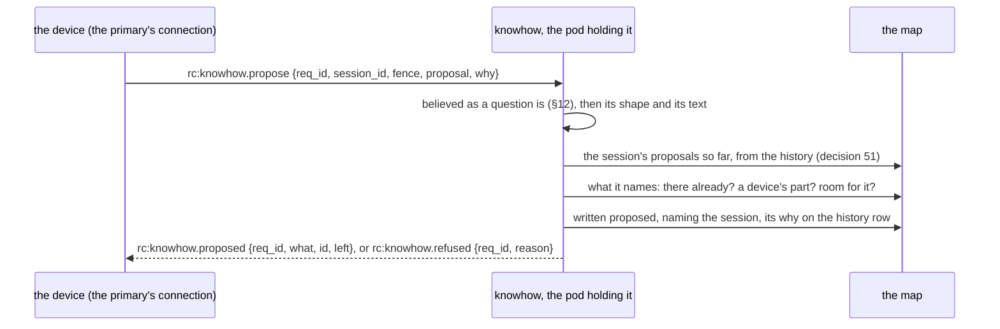

**What a session may propose** (decision 50): something new, never a change.
`proposal` holds one key:

| `proposal` | Writes |
|---|---|
| `{"entity": {kind, key, name, env?, attrs?, facts?}}` | a new entity, its facts with it |
| `{"fact": {kind, key, path, value}}` | one fact of a live entity, at a path no fact of it holds |
| `{"link": {from: {kind, key}, kind, to: {kind, key}, attrs?}}` | a link between two live entities |

Each is held as a person's write is ([`model.rs`](../crates/modules/knowhow/src/model.rs)):
the kinds, the key rules, the attributes' bounds, the map's 10,000 entities and
50,000 links. What it writes is `proposed` with source `session`, the session
named on the row, on each fact and on its history row. Its `why`, up to 500
characters, rides the history row
([`check_why`](../crates/modules/knowhow/src/propose.rs#L148)). No person
wrote it, so `created_by` and the history row's `by` stay empty. A person's
entity a session adds a fact to stays the person's, with that one fact
`proposed`.

| Check | Refused |
|---|---|
| one of the three, held as a person's write is, and a `why` | `bad_request` |
| no text of it, a name or a value, in a credential's shape, nor its `why` ([`credential_in`](../crates/modules/knowhow/src/propose.rs#L170)) | `refused` |
| fewer than 50 proposals by the session over its life, every fence counted, from the history (decision 51) | `ceiling` |
| never a device's part of the map (below) | `reserved` |
| nothing there already: an entity by that kind and key, a fact at that path, a link of that kind between the two | `exists` |
| a fact's entity and a link's two ends, live | `not_found` |
| room: the map's entities, its links, the entity's facts | `full` |

Nothing of a refused proposal is written. An accepted one is answered with
what it was (`entity`, `fact` or `link`), the id of the entity or link it wrote
(for a fact, its entity's), and how many proposals the session has `left`.

> [!IMPORTANT]
> **A session never proposes into a device's part of the map.** The fleet and
> the device's own scans keep it, and each leaves a key, a path or a link that
> another source holds as it is. So a proposal parked there would hold it
> against the device's next scan. Refused `reserved`:
> - a `machine`;
> - a key in a scan's shape, a node id then `/` or `:`
>   ([`devices_key`](../crates/modules/knowhow/src/intake.rs#L97));
> - a fact at a path the fleet keeps on a machine, or a scan keeps on its
>   entities;
> - a link a scan makes: from a scan's own checkout `checked_out_at` or
>   `part_of`, from its own endpoint `runs_on`, or a cluster `reachable_via` a
>   machine ([`scans_link`](../crates/modules/knowhow/src/intake.rs#L111)).
>
> A fact of a machine at a free path, and a link to a machine a scan never
> makes (`service runs_on machine`), are proposals like any other.

**The ceiling** is counted from the history: one row a proposal, found by its
session through a partial index on `{tenant_id, session}`
([`count_by_session`](../crates/modules/knowhow/src/dao.rs#L428)). A
session's questions are answered in order on their connection, so its
proposals are counted one at a time.

| Refusal | Means | Proposing again |
|---|---|---|
| `exists` | it is on the map already; a proposal never changes it | will not help: read it with `knowhow_get` |
| `reserved` | that part of the map is a device's | will not help |
| `refused` | some of its text holds a credential's shape | not with that text |
| `full` | the map, or the entity, has no room | once there is room |
| `ceiling` | the session made its 50 | will not help |

### 12.3 A person's word on a proposal (P4-4-3)

A proposal stays `proposed` until a person confirms it, or a probe does
(P4-5). Decision 52 as recommended: the person is one holding
`KNOWHOW_EDIT`, decision 36's writer, through three routes (§6):

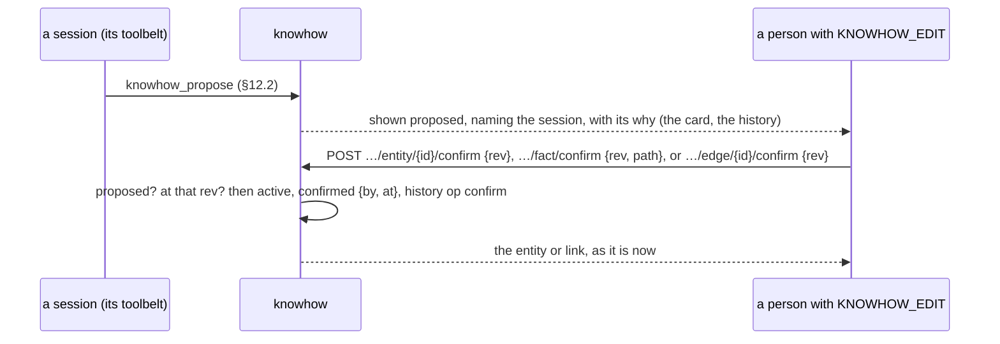

| Word | What it does |
|---|---|
| confirm an entity | `active` from now on, its `confirmed` set to who and when, at the rev it was read. Its facts are each confirmed on their own: a reviewer may believe the database and doubt its port |
| confirm a fact | one proposed fact, or (P4-5-3) one turned stale, by its path, at its entity's rev: `active`, with its own `confirmed`, which makes a stale one young again (§13.4). Its entity is left as it is, so a person's entity stays the person's |
| confirm a link | as an entity, at the link's rev |
| reject | what the routes already do: archive a proposed entity or link (`DELETE`), remove a proposed fact (`PATCH` with its path set to null) |

What was proposed keeps naming its session after it is confirmed, so the
card says both who proposed it and who believed it. The history's `confirm`
row is the person's (`source: person`, `by`), never the session's. Only a
proposal is confirmed, and (P4-5-3) a fact turned stale: anything else is
**409**, as a rev already gone is.

> [!NOTE]
> **Confirming changes nothing that decides a reach.** The map is still not a
> gate (§1): a confirmed fact tells the next session where to look, and the
> vault, the network and each device decide every reach as before.

## 13. Probes (P4-5-1a)

A probe is the server's request and a device's answer, as a scan is (§11): a
device tries to reach one thing the map says is there, and what it measured is
recorded on the facts it measured
([`probe.rs`](../crates/modules/knowhow/src/probe.rs)). Decisions 53–56 as
recommended, designed in the FR-90 spec's §3e "P4-5, verification, as
designed". P4-5-1a is the server's half; the device's (its
`knowhow_probe_reach`, the connect) is P4-5-1b's (§13.2), and a session's
verify P4-5-2's (§13.3).

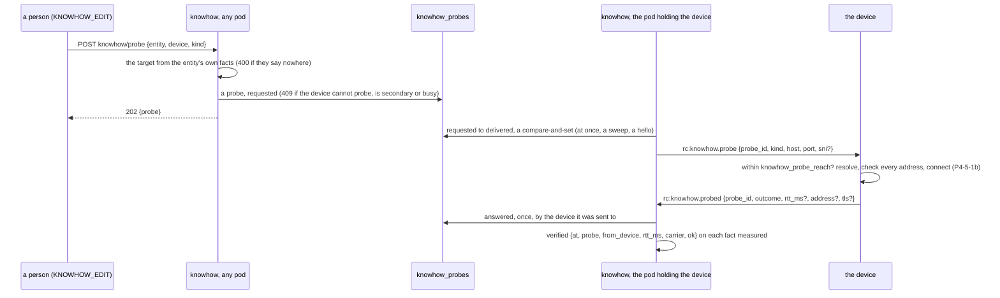

**Who asks, and which devices**
([`request`](../crates/modules/knowhow/src/probe.rs#L880)). A person with
`KNOWHOW_EDIT` (decision 54) asks a live device of the organization to probe a
live entity, as `tcp` or `tls` (decision 55). **202** with the probe, or with
the device's pending one when it is this same probe. One probe runs at a time a
device (a partial unique index on `pending`): another is **409**. A device is
refused **409** up front
([`refusal`](../crates/modules/knowhow/src/probe.rs#L112)) when its last hello
did not advertise `knowhow-probe`, and when it is a secondary enrollment, as a
scan's is. A device is asked at most 30 a minute, by anyone: past that, **429**
`rate_limited`, counted after every other gate so a refusal says which.

**The target is the map's, never the request's**
([`target`](../crates/modules/knowhow/src/probe.rs#L184)). The request names an
entity, and the server reads where it is from that entity's facts:

| Fact | Read as |
|---|---|
| `address`, else `host` | the host: an IP address or a DNS name, in one spelling ([`probe_host`](../crates/remote_control/src/knowhow.rs#L772)). `host` is read when there is no `address` a probe reaches, as when a scan's listener says `0.0.0.0` |
| `port` | a number from 1 to 65535, or one written as text |
| `sni` | for `tls`, the server name: else the `host` fact or the host when it is a name, and none for an address alone |

An entity that says nowhere a probe reaches is **400**, and the message says
why: no address, host or port; a value that is no host (a URL, a path, a port
written into it); a listener's bind address; or an address never probed.

> [!WARNING]
> **Some addresses are never probed, whatever any list says**
> ([`never_probed`](../crates/remote_control/src/knowhow.rs#L814)). Link-local
> (`169.254.0.0/16`, `fe80::/10`), where every major cloud's metadata service
> answers, and the two metadata addresses outside it: AWS's IPv6
> `fd00:ec2::254`, and Alibaba's `100.100.100.200`, which sits inside
> `100.64.0.0/10`, the range an overlay's own addresses come from. So a list
> that allows the mesh still never reaches it, at the cost of one host of that
> range. Also `0.0.0.0/8` and `::`, where a connect may reach the device itself,
> multicast and broadcast, and any of these carried in IPv6 (`::ffff:a.b.c.d`,
> `64:ff9b::/96`). The server refuses such a target, and the device checks
> every address a name resolves to before it connects (P4-5-1b).

⚠️ **A loopback address is the device itself.** `127.0.0.1`, `::1` and
`localhost` reach whichever device probes, so such a target is probed only from
the device whose scan found it (the entity's `device`, §11.1). From any other it
would test that other device's own port, and is **400**. An answer that says it
connected to a loopback address measures nothing on another device's entity.

**The delivery** is a scan's
([`deliver`](../crates/modules/knowhow/src/probe.rs#L260)): the row is the bus,
on the same link a scan goes out on. A connection is linked at its hello when the
device can scan or probe. A probe goes out at once from the pod holding the
device, at that pod's sweep when it landed on another, at the device's next hello
when it was away, and again at a hello after a connection died unanswered. The
device runs a probe id once.

**The record.** `knowhow_probes`, one row per request, kept 90 days. The probe
row holds what was asked: the entity, the device, who asked, the kind and the
target as the server read it. It also holds what the device said: the round
trip, the address it connected to, how it reached it, what TLS showed, and
which facts it measured (`measured`).

| State | Means | Its fix |
|---|---|---|
| `requested` | asked, not yet sent | the device comes online, or this pod's sweep runs |
| `delivered` | sent, not yet answered | the device answers, or is sent it again at its next hello |
| `ok` | it connected, and for `tls` read the leaf certificate | — |
| `unreachable` | no connection: refused, timed out, no route, a name that did not resolve | the map's fact, or the network |
| `not_allowed` | the device may not reach it: outside its owner's `knowhow_probe_reach`, or never probed | the device's owner lists it (P4-5-1b) |
| `failed` | not measured: a handshake that failed past the connect, a certificate the server could not read, or a probe the device could not run; why is `detail` | the detail's |
| `expired` | 10 minutes without an answer | ask again |

**The answer** ([`read_answer`](../crates/modules/knowhow/src/probe.rs#L356)).
It is recorded once, and only from the device the probe was sent to. A round
trip past 11 s is dropped, and an address is kept only as an IP literal. A
`tls` answer's certificate is read by the wire's rules (names lowercase, the
fingerprint 64 lowercase hex, a credential's shape refused). An `ok` from a
`tls` probe that showed no certificate the server can read is recorded
`failed`, and so is any answer saying it reached an address never probed. A
`detail` is clamped to 200 characters, and withheld if it holds a credential's
shape.

### 13.1 What a probe confirms (decision 56)

Only what it measured ([`measure`](../crates/modules/knowhow/src/probe.rs#L440)).
On each fact it measured, `verified {at, probe, from_device, rtt_ms, carrier,
ok}`, the card's view of the last probe that measured it:

| The answer | Measures | `ok` |
|---|---|---|
| `ok` | the host's fact and `port`, each while it still says what the probe was aimed at | `true` |
| `ok`, `tls` | and `tls.fingerprint` (in any of its spellings) and `tls.names` (every name it lists among the certificate's), when the entity has them | whether the certificate says the same |
| `unreachable` | the host's fact and `port` | `false` |
| `not_allowed`, `failed` | nothing: "the device may not reach it" is not "it did not answer" | — |

A fact found as it says (`ok: true`) gets `verified_at`. When it is `proposed`
(or `stale`), it turns `active`. A fact found otherwise keeps its status, and
`verified` records `ok: false`. The probe's write is a compare-and-set at the
entity's rev, read again when a person's write came between, with a history row
`op: verify`, `source: probe` and the probing `device`, whose `set` names the
probe and each fact's `{path, ok, status}`.

| Carrier | When |
|---|---|
| `overlay` | the address the device connected to is in the organization's overlay network (§10.2) |
| `direct` | any other address the device reached |
| absent | the device named no address |

> [!NOTE]
> **`verified` is the last probe's word, from wherever it ran.** In the field
> (2026-10-24, the FR-90 spec's §8), a corporate laptop whose network inspects
> TLS was shown roomler.ai's names under another key, and its probe recorded
> `tls.fingerprint` `ok: false` over six other devices' `ok: true`, until the
> next probe overwrote it. A card read on its own cannot tell "the certificate
> changed" from "one device's network rewrites TLS". The probes listing can:
> it keeps a row per probe, with the device that ran it.

> [!IMPORTANT]
> **A probe confirms facts, never an entity.** A proposed entity whose facts all
> verify still waits for a person's word on the entity itself (§12.3), and
> `confirmed` stays a person's: `verified` names the probe instead. A probe never
> writes a fact it found that the map did not hold, either. What it found is
> kept on the probe (`tls`, `address`), and the map's fact keeps its value.

| Setting | Effect |
|---|---|
| `knowhow.scan_sweep_secs` | the same sweep: each pod looks for scans and probes asked of the devices connected to it |

### 13.2 A device's probe (P4-5-1b)

The device decides where it connects
([`knowhow_probe.rs`](../agents/roomlerd/src/hive/knowhow_probe.rs)): its
owner lists the places in `knowhow_probe_reach` (decision 53), and the list is
empty until they do, which means nowhere. It is device-owned like
`knowhow_scan_roots`: live, read from the config file again at each probe, and
absent from `DesiredConfig`, so no server can set it. Every OS that runs
sessions advertises `knowhow-probe`, on the primary's connection alone.

```bash
roomler config set knowhow_probe_reach '100.64.0.0/10:22,db.example.com:5432,*.example.com:443'
```

| An entry ([`parse_entry`](../crates/agent-core/src/probe_reach.rs#L36)) | Matches |
|---|---|
| `10.0.0.0/8`, `100.64.0.7`, `[fd00::/8]`, `[::1]` | an address the probe connects to (IPv6 in brackets) |
| `db.example.com` | that name, when a probe asks for it |
| `*.example.com` | a name under it, never the suffix itself |
| `…:5432`, `…:8000-8999` | one port, or a range; every port when absent |

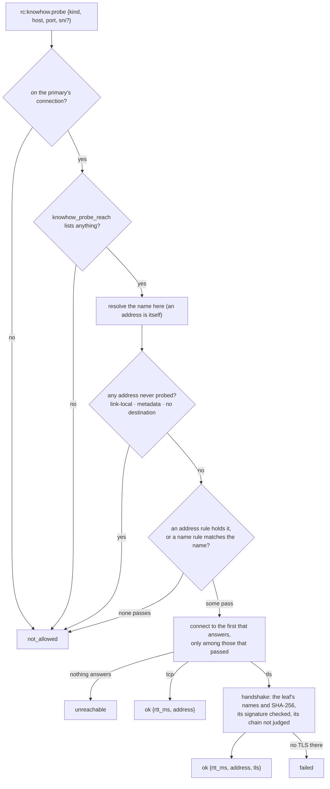

| Rule ([`measure`](../agents/roomlerd/src/hive/knowhow_probe.rs#L257)) | Why |
|---|---|
| a name is resolved here, and **every** address is checked before any connect; one never-probed address refuses the whole probe | a name that points at a metadata service is not one to reach through its other addresses |
| a connect goes only to an address that passed, the first that answers | a name that resolves elsewhere by the time of the connect reaches nothing new |
| an address rule holds addresses, a name rule matches the name asked for ([`allows`](../crates/agent-core/src/probe_reach.rs#L181)) | listing `db.example.com` trusts that name's resolution; listing `10.0.0.0/8` trusts no name |
| `tcp`: a connect and a close, not a byte sent | connect, never converse (decision 55) |
| `tls`: a ClientHello, the leaf certificate read, the handshake signature checked (so the server holds the key of the certificate recorded), the chain neither trusted nor refused ([`SeeOnly`](../agents/roomlerd/src/hive/knowhow_probe.rs#L475)) | a private CA is what an organization's own services have; a probe says what the address presents |
| ten seconds for the whole probe; a probe id run once, and one sent again answered as it was | the server sends a probe again at a hello while it is unanswered |

> [!WARNING]
> **Link-local and the cloud metadata addresses are never reached, whatever
> the list says** (`never_probed`, §13). An owner who lists `0.0.0.0/0` still
> never sends a probe to `169.254.169.254`. A list whose entry no longer reads
> after a hand edit loses that entry: it can only narrow what is reached
> ([`rules`](../crates/agent-core/src/probe_reach.rs#L170)).

### 13.3 A session's verify (P4-5-2a)

A session asks its own device to probe an entity of the map, by the entity's
kind and key (decision 54), answered by
[`verify`](../crates/modules/knowhow/src/session.rs#L414). It travels as
a question does, on the device's primary connection, and is believed as one is
(§12): the same checks, in the same order, and the same 120 a minute. The
probe is then asked as a person's is
([`ask`](../crates/modules/knowhow/src/probe.rs#L783)), and what it
measured is recorded as a person's probe's is (§13.1). P4-5-2a is the server's
half. The toolbelt's `knowhow_verify`, which carries it and asks a person at
each call, is P4-5-2b's (§12.1).

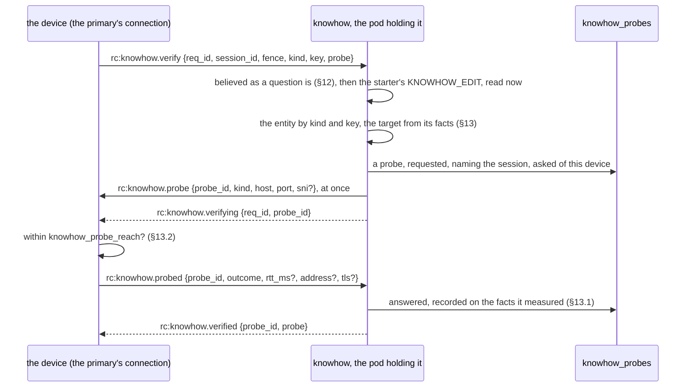

| Piece | Design |
|---|---|
| the offer | `rc:knowhow.served` names `knowhow_verify` only for a device whose hello advertised `knowhow-probe` ([`served`](../crates/modules/knowhow/src/session.rs#L258)): a session is offered it only where its own device runs probes |
| who may ask | a session whose starter holds `KNOWHOW_EDIT`, read at every verify ([`may_probe`](../crates/modules/knowhow/src/session.rs#L575)), as a person's probe needs: a probe writes what it measured onto the map, and a session asks only what its starter may ask. A starter who holds `KNOWHOW_VIEW` alone has sessions that read the map and verify nothing |
| what is probed | the live entity by `kind` and `key`, its target read from its own facts (§13); `probe` is `tcp` or `tls` |
| from where | the session's own device, the one the question came from: never another |
| the answer, at once | `rc:knowhow.verifying {req_id, probe_id}`: the probe asked, or the one the device is already running for this same entity and kind. The probe itself goes out as soon as it is asked, so the device may be sent it before this answer: a device reads the two in either order |
| the answer, after | once the device's answer is recorded, `rc:knowhow.verified {probe_id, probe}` on the same connection, the probe as the people's listing shows it: its state, round trip, address, carrier, what TLS showed and the facts it measured ([`answered`](../crates/modules/knowhow/src/probe.rs#L585)) |
| the record | the probe row names the `session`, and no person: `requested_by` stays empty. One probe at a time a device and its 30 a minute are the device's, whoever asks |

| Refusal | Means | Asking again |
|---|---|---|
| `denied` | its starter may not ask a probe: no `KNOWHOW_EDIT` | once their role holds it |
| `bad_request` | `probe` is not `tcp` or `tls`, or the kind or key is malformed | not as it is |
| `not_found` | no live entity by that kind and key | once one is on the map |
| `unprobeable` | the entity's facts say nowhere a probe reaches: no address, host or port, a listener's bind address, an address never probed, or another device's loopback (the route's **400**) | once its facts say where |
| `busy` | the device is running another probe, or was asked its 30 this minute (the route's **409** and **429**) | later |
| `unavailable` | the probe could not be asked | later |

> [!NOTE]
> **A verify asks; it does not wait.** The probe runs on the device's own
> prober, within its owner's `knowhow_probe_reach` (§13.2), so a list that
> says nowhere answers `not_allowed` in `rc:knowhow.verified` as it would to a
> person. The device's tool decides how long a session waits for the second
> answer. A probe it stopped waiting for is still recorded, and the card shows
> it.

### 13.4 Staleness (P4-5-3-1)

A fact nothing has confirmed for a while turns `stale` (decisions 40 and 57),
so a card says how far to trust it
([`stale.rs`](../crates/modules/knowhow/src/stale.rs)). Designed in the FR-90
spec's §3e "P4-5-3, staleness, as designed".

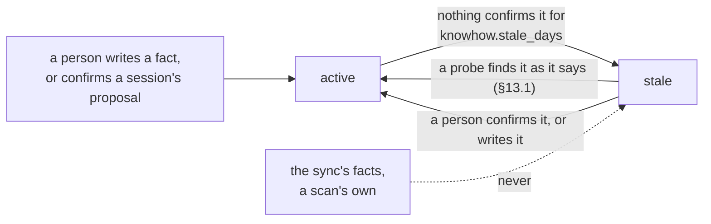

| Piece | As built |
|---|---|
| which facts | an `active` fact whose source is a person or a session ([`ages`](../crates/modules/knowhow/src/stale.rs#L57)). A session's fact is `active` only once a person or a probe confirmed it. Never the sync's (it changes with its source) and never a scan's own (a scan retires what it no longer finds, which is its staleness, §11.1). A `proposed` fact stays `proposed` |
| its age | from the newest of `verified_at` (a probe found it as it says), `confirmed.at` (a person's word) and `observed_at` (its writing) ([`confirmed_at`](../crates/modules/knowhow/src/stale.rs#L63)). A probe that found it otherwise does not make it younger |
| the turn | past `knowhow.stale_days`, on a compare-and-set at the entity's rev, read again when a write came between; a history row `op: stale`, `source: system`, no person, naming each fact turned and since when |
| back to `active` | a probe that finds it as it says (§13.1); a person's confirm, which takes a stale fact as it takes a proposed one (§12.3); a person's write of it, its value as it was or another |
| the sweep | every pod, every `knowhow.stale_sweep_secs`, a page of 200 entities at a time, only in the organizations knowhow serves ([`sweep_once`](../crates/modules/knowhow/src/stale.rs#L91)) |

| Setting | Effect |
|---|---|
| `knowhow.stale_days` (`ROOMLER__KNOWHOW__STALE_DAYS`) | the days a fact may go unconfirmed; absent: 30; `0`: no fact ever turns stale, and no pod sweeps |
| `knowhow.stale_sweep_secs` (`ROOMLER__KNOWHOW__STALE_SWEEP_SECS`) | how often each pod sweeps, in seconds; 0 or absent: 3600 |

> [!NOTE]
> **Every pod sweeps, and one write lands.** The host schedules no periodic
> module job yet (`run_startup_jobs` logs and skips one), so the sweep runs on
> every pod, as the reconciler does (§10). Two pods that read the same entity
> race one compare-and-set at its rev: the loser reads it again, finds nothing
> left to turn, and writes nothing.

> [!IMPORTANT]
> **A stale fact is shown, never hidden.** The card and a session's
> `knowhow_get` show it with its status, as any fact. Stale says "confirm me",
> not "gone": it keeps its value, its provenance and its last `verified`.

### 13.5 What each device found (P4-5-4, P4-5-4b)

A fact's `verified` holds the last probe's word, whichever device said it.
When devices disagree, the last word alone cannot tell "the certificate
changed" from "one device's network rewrites TLS". The P4-5-1 field run was
that case: six devices found roomler.ai's certificate as the map says, and
one, behind a network that inspects TLS, found another key. So a card also
carries `probes`: each device's last probe of the entity that found
something, a row of each probe kind (decision 58 and P4-5-4b,
[`last_per_device_and_kind`](../crates/modules/knowhow/src/dao.rs#L764)).

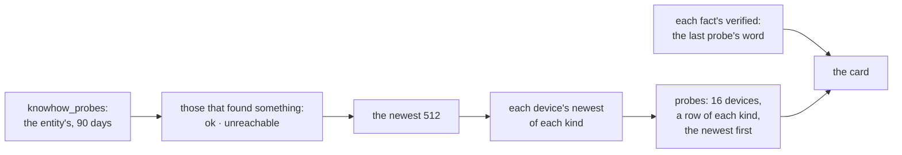

| Piece | As built |
|---|---|
| which probes | an `ok` or an `unreachable` one: it reached the target, or tried to. A `not_allowed` one (its owner's list) and a `failed` one (it could not ask) say nothing of the target, so the device's earlier finding stands behind them; a probe never answered is no one's finding |
| how many | at most 16 devices ([`MAX_CARD_DEVICES`](../crates/modules/knowhow/src/routes.rs#L72)), each with a row of each kind it found (`tcp`, `tls`), so at most 32 rows, the newest first, and `probes_truncated` when a device was left out. A device is shown by its newest finding and brings its other kind's row along, however old. They are read from the entity's newest 512 findings, so a device whose last one lies further back is not shown; the probes listing (§6) still has it |
| each row | the probes listing's own view (§6): its id, which a fact's `verified.probe` names; its device; who asked, or which session; its kind and target; its state, round trip, address and carrier; what TLS showed; and what it measured |
| the read | one aggregate over the entity's probe index, at every card read ([`card`](../crates/modules/knowhow/src/routes.rs#L446)); which devices are shown is a pure function of what it read ([`card_rows`](../crates/modules/knowhow/src/probe.rs#L974)) |
| a session's card | the same rows. Past the card's 64 KiB they go first, the oldest first, before any link ([`bounded`](../crates/modules/knowhow/src/session.rs#L680)), so a card a session was given whole before them still is |

> [!NOTE]
> **The last word stays the last word.** `verified` and `verified_at` are
> written as before (§13.1), and staleness reads `verified_at` (§13.4): a
> device that sees a fact otherwise neither ages it nor revives it. The rows
> say where the devices disagree, and change nothing.

> [!TIP]
> **A row of each kind a device** (P4-5-4b, the operator, 2026-10-25: "2 rows
> per device"). A `tcp` probe after a `tls` one adds a row of its own and
> leaves the device's certificate on the card. P4-5-4 showed a device's last
> finding of either kind, and its field check found a device whose `tcp`
> probe had hidden what TLS showed it. Every probe stays in the probes
> listing (`GET …/probe?entity=`) for 90 days.

### 13.6 A session's connect (P4-6-1a)

A session names an entity of the map, and knowhow says what reaching it
takes: the engine, the upstream and the credential the entity's own facts
say, and the paths its devices' findings measured, the session's own device
first ([`compile`](../crates/modules/knowhow/src/connect.rs#L148)). The
question travels on the device's primary connection and is believed as any
question is (§12): the same checks, in the same order, and the same 120 a
minute, its starter holding `KNOWHOW_VIEW` (decision 61), read at every
connect ([`connect`](../crates/modules/knowhow/src/session.rs#L390)).
P4-6-1a is the server's half, decisions 59–61 as recommended. The toolbelt's
`roomler_connect`, which takes the access, leases the credential, dials a
path and asks a person at each call, is P4-6-1b's. The design is the FR-90
spec's §3e "P4-6, `roomler_connect`, as designed".

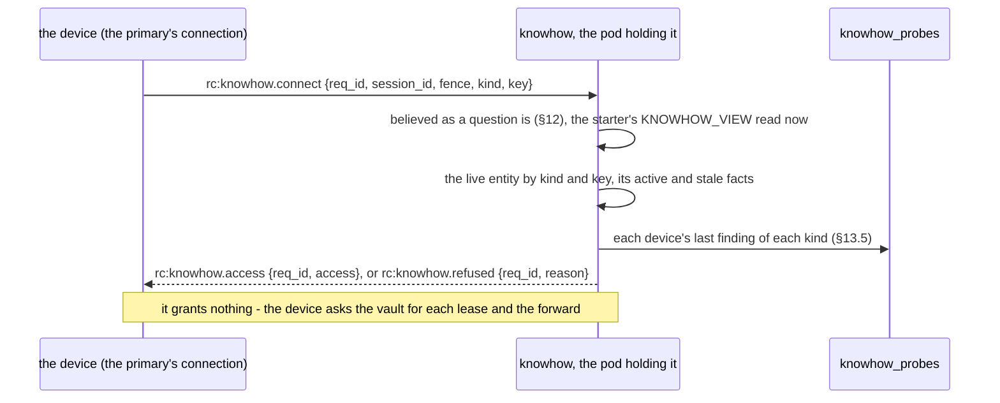

**What an entity says** (decision 59,
[`access_facts`](../crates/remote_control/src/knowhow.rs#L452)).
Reserved fact paths, read only when the fact is `active` or `stale`
([`read`](../crates/modules/knowhow/src/connect.rs#L79)):

| Fact | Holds | Read as |
|---|---|---|
| `engine` | what the endpoint speaks: `postgres`, `mongodb`, `http`, `kubernetes` or `ssh`, as `vault_connect` takes it, or `tcp` for a service with no credential ([`Engine`](../crates/remote_control/src/knowhow.rs#L476)) | any other word is `unknown_engine`, and `engine` is missing |
| `host`, else `address` | where the upstream is, read as a probe's host is (§13): lower case, no root dot, never a link-local or metadata address | `host` first: it is the name a secret's `audiences` and the upstream's certificate carry |
| `port` | a whole number from 1 to 65535, or one written as text | |
| `credential` | a vault handle: a structured secret by its path or RRN, never a value | needed by every engine but `tcp` |
| `database`, `auth`, `auth_source`, `ca` | `vault_connect`'s options, as its call takes them | in `options`, when present |
| `user` | `ssh`'s: the one account the key signs in as | in `options`, and in the `ssh` upstream (`ssh://user@host`) |

**The access** (`rc:knowhow.access {req_id, access}`,
[`signaling.rs`](../crates/remote_control/src/signaling.rs#L5241)):

| Field | Holds |
|---|---|
| `entity` | its id, kind, key and name |
| `engine`, `upstream`, `host`, `port` | the upstream spelled as `vault_connect` takes it and as a secret's `audiences` must name it ([`upstream`](../crates/modules/knowhow/src/connect.rs#L115)): `host:port` for a database and for `tcp`, `https://host[:port]` for `http` and `kubernetes`, `ssh://[user@]host[:port]` for `ssh`, each default port left out and an IPv6 address bracketed. `null` while anything it needs is missing |
| `credential`, `options` | the handle, and the options the entity says |
| `missing`, `proposed` | each path the access needs that the map does not say (`engine`, `host`, `port`, and `credential` for an engine that needs one), and which of those a session only proposed |
| `here` | the session's own device's last word: `verified` (its last finding is `ok` and fresh), `unreachable` (fresh and `unreachable`) or `unmeasured` (not fresh, or none) |
| `paths` | each device whose last finding is `ok` and fresh, the session's own first, at most 16: the device, `here`, the probe's id, its kind, carrier, round trip, address and time |
| `seen` | every finding of a device that is no path, at most 16, newest first: its device, `here`, kind, state, time and `fresh` |
| `fresh_secs` | how fresh a path must be |

**The paths** (decision 60). Measured, never assumed. A device's last word is
its newest finding of either kind (§13.5), so an `ok` behind a newer
`unreachable` is no path. A path is a last word that is `ok` and no older than
`knowhow.connect_fresh_secs`, read from the entity's newest 512 findings at
every connect, as a card's are. The device takes them in that order: its own,
else one probe from here when its word is `unmeasured`, else another device's
through a forward whose proxy leg has no listener (P4-6-1b). Nothing else is
ever dialled.

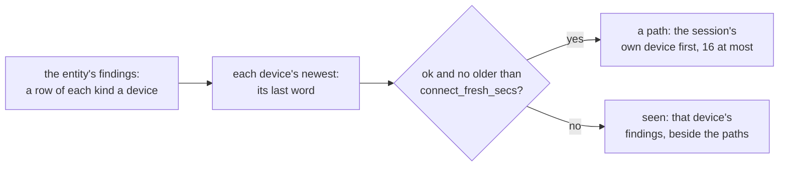

| Setting | Effect |
|---|---|
| `knowhow.connect_fresh_secs` (`ROOMLER__KNOWHOW__CONNECT_FRESH_SECS`) | how old a finding may be and still be a path, in seconds; 0 or absent: 86400, a day ([`fresh_secs`](../crates/modules/knowhow/src/connect.rs#L43)) |

| Refusal | Means | Asking again |
|---|---|---|
| a question's (§12) | `not_served`, `not_located`, `stale_fence`, `ended`, `denied` (no `KNOWHOW_VIEW`) and `busy`, as there | as there |
| `bad_request` | the kind or key is malformed | not as it is |
| `not_found` | no live entity by that kind and key | once one is on the map |
| `unavailable` | a read failed | later |

`roomler_connect` is named in `rc:knowhow.served` for a device whose hello
advertised `vault` ([`served`](../crates/modules/knowhow/src/session.rs#L258)): the
tool leases its credential through the device's own vault client. An older
agent keeps only the tools it knows (§12.1).

> [!IMPORTANT]
> **A session's proposal never places a credential.** A fact a session
> proposed stays `proposed` until a person or a probe confirms it (§12.3,
> §13.1), and the access reads the entity as if it were absent. A session
> cannot choose where a credential goes, or the host it is sent to, by
> proposing `credential` or `host`. The path is named in `missing` and in
> `proposed`, so the tool can say that a person's word is what it waits for.

> [!NOTE]
> **A map, still not a gate.** The access grants nothing. The device asks the
> vault for each lease and, for a path through another device, for the
> forward, each decided where it is decided today. The upstream is the
> string a secret's `audiences` must name, so a `host` fact naming another
> host gets no lease there.

> [!TIP]
> **What is missing is an answer, not a refusal.** An entity that lacks its
> engine or its credential is still answered, with `missing` and `proposed`
> naming each path, and with its paths. A refusal is one word, and the person
> who must add the fact needs its path. The tool's `no_access` is read from
> `missing` (P4-6-1b).

### 13.7 A session's connect, from this device or through another (P4-6-1b)

The toolbelt's `roomler_connect` takes the access §13.6 answers and opens it,
a person approving each call
([`call`](../agents/roomlerd/src/hive/connect_tool.rs#L322)). It opens it
from the session's own device when a probe from here found it (P4-6-1b-1), or
else through each other device that reached it lately, newest first, until one
opens (P4-6-1b-2,
[`through`](../agents/roomlerd/src/hive/connect_tool.rs#L251)). What
it does from here is a pure function of the access
([`plan`](../agents/roomlerd/src/hive/connect_tool.rs#L148)).

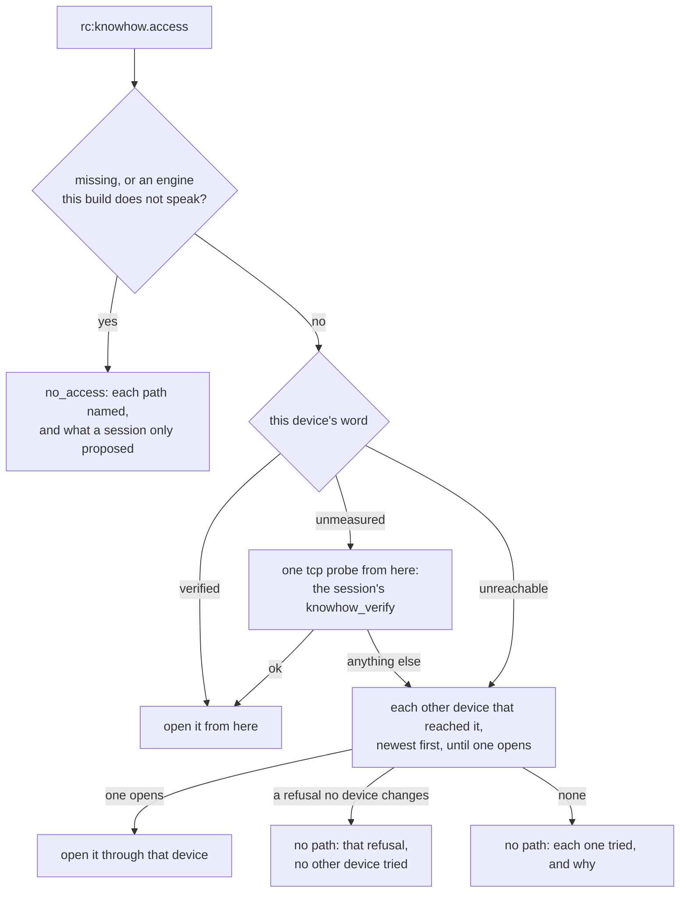

| Piece | As built |
|---|---|
| a path from here | `vault_connect`'s endpoint, asked with the access's credential as its `handle`, its engine and upstream, and its options `database`, `auth`, `auth_source` and `ca` ([`connect_args`](../agents/roomlerd/src/hive/connect_tool.rs#L213)). Its leases, its endpoint served only to the session's account, and its connection string with no credential in it are `vault_connect`'s own, as for a session that names them by hand. The answer adds the entity, `path: direct`, and a probe asked first. A path from here that does not open is answered as it failed: the vault's refusal, or a misdescribed entity, is no reason to go through another device |
| `tcp` | no credential and no endpoint: from here, the answer says where to dial; through a device, it is the forward itself, `net_forward`'s, served to the session's account |
| the probe from here | when this device's word is `unmeasured`: one `tcp` probe, asked as the session's own `knowhow_verify` is (§13.3), so it is recorded on the map. Only `ok` opens anything from here |
| through a device (P4-6-1b-2) | for a credentialed engine, `vault_connect`'s endpoint, its upstream connections riding a flow toward the upstream that only this daemon may use, with TLS verified against the upstream's host (`docs/vault.md` §19, "An endpoint through another device"). For `ssh`, a forward the session's own `ssh` dials, its host key checked with `HostKeyAlias`, and `vault_connect`'s agent beside it: the agent holds the key, so it is opened once, and only once a forward has. Each through `rc:vault.net`'s `net:forward` toward that device, then that device's own gates. The answer names `path: through <device>`, its carrier, and `tried`. "Opens" means the vault granted the forward and the flow was made here: that device's own gates (`forward_acl`, tunnel policies) are met at the first connection through it, so a refusal there fails that connection, its error naming the path (`… (through <end>)`), and does not try the next device |
| no path | nothing is opened. The answer names each path tried, in order, and why: this device's first (its last probe found it unreachable, the probe from here found something else, or none could be asked), then each device's ([`no_path`](../agents/roomlerd/src/hive/connect_tool.rs#L303)). A refusal that no other device changes ends the trying at once ([`Failed`](../agents/roomlerd/src/hive/connect_tool.rs#L76)): this device's vault or egress turned off, or the vault refusing the credential. The vault's word on one device's forward, or a flow not made, tries the next |
| `no_access` | each path the map lacks, which of them a session only proposed, and what a person adds ([`no_access`](../agents/roomlerd/src/hive/connect_tool.rs#L124)). An answer naming no engine this build speaks, no upstream, or no credential for an engine that needs one opens nothing either, whatever the server said |

> [!IMPORTANT]
> **Measured, never assumed.** Nothing is dialled that no device's probe
> found: from here, a probe from here; through a device, that device's own
> finding. A device whose owner has not listed the target in
> `knowhow_probe_reach` never finds it from here (its probe is `not_allowed`),
> so it opens nothing toward it from here through the map, though a session
> naming the same handle and upstream to `vault_connect` by hand still could.

> [!NOTE]
> **Through a device needs `hive_net`.** A path through another device is the
> session's egress, which the device's owner turns on (`hive_net`). Without it
> there is no path through another device, and the answer says so. The
> vault's `net:forward` policy and the other device's `forward_acl` each
> refuse on their own.

> [!NOTE]
> **The probe from here needs `KNOWHOW_EDIT`.** It is the session's own
> verify, and a probe writes what it measured onto the map (decision 54). A
> starter who may only read the map has sessions that connect when this
> device's last finding is fresh and `ok`, and are told what the devices
> found otherwise.

## 14. What comes next

| Step | Builds |
|---|---|
| P4-3b-4 | Windows, every root read as the console user (decision 45) |
| P4-6-2 | a person's `roomler connect <kind>/<key>`, if decision 62 asks for it |
| P4-7, P4-8 | the map in the web app; `#` chips |
| P4k | the field run in the test organization (AC15) |
