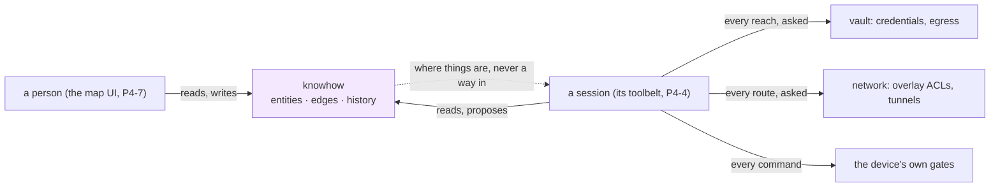
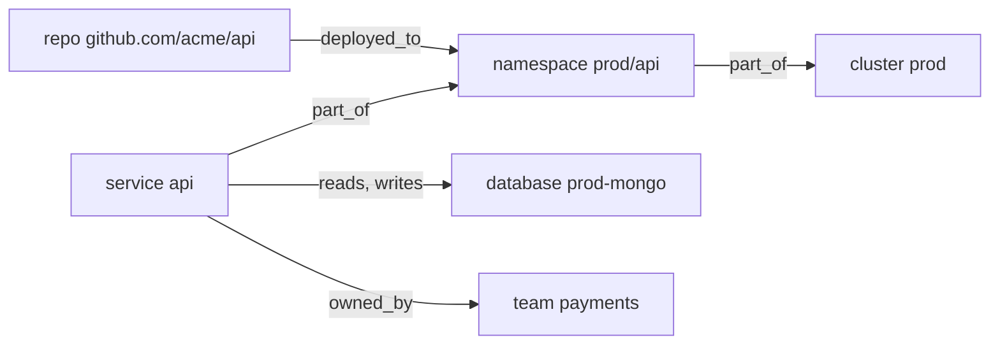
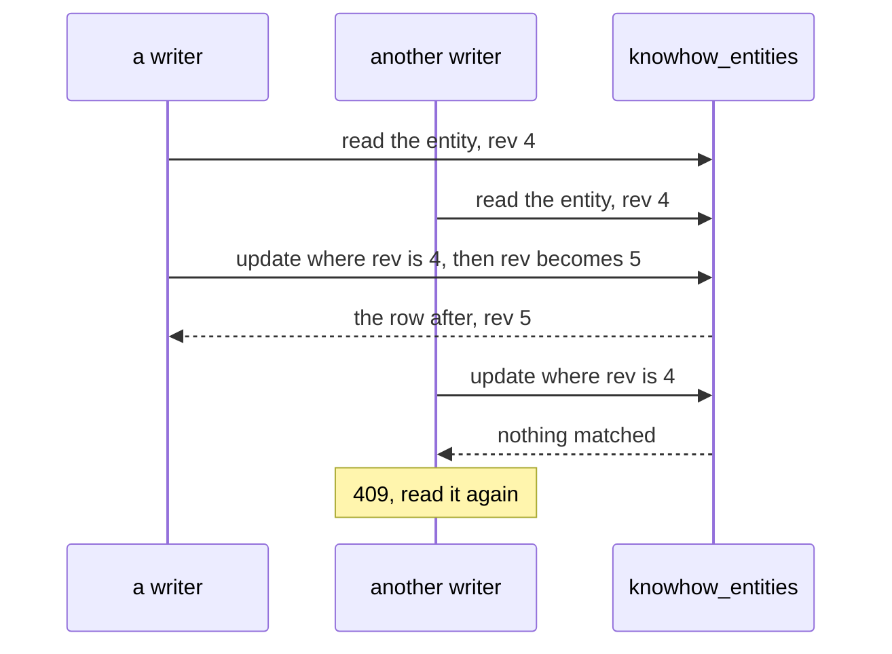
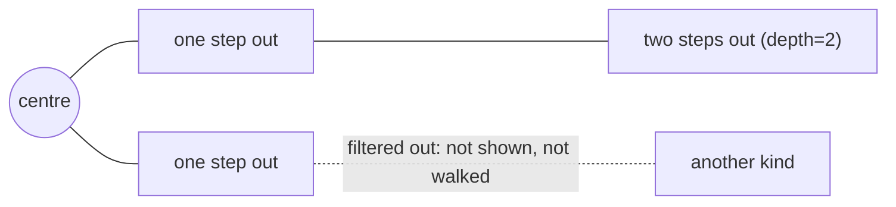

# Knowhow: the organization's map

Knowhow is the organization's map. It records what exists (machines,
repositories and their checkouts, databases, clusters, services), where each
lives, and how a session reaches each. Its facts are meant to be verified by
probes rather than remembered, and every fact says where it came from. People
read it to find their way around their own infrastructure. From P4-4 agent
sessions read it too, through their toolbelt.

> Spec, steps and the field log: [`fr/FR-90-hive-agent-sessions.md`](fr/FR-90-hive-agent-sessions.md)
> §3e "P4, knowhow, as designed" (#1827). The design is
> [`roomler-hive-design.md`](roomler-hive-design.md) §9. **This page describes
> what is built: P4-1, the module, its store and the people's routes.** Nothing
> fills the map yet but people: fleet and network sync (P4-2), device scans
> (P4-3), a session's reads and proposals (P4-4), probes (P4-5) and
> `roomler_connect` (P4-6) come with the steps that build them (§10).

## 1. A map, not a gate

Knowhow grants nothing, and nothing that decides consults it. The vault
decides every credential and every egress, the network every route, and the
device its own gates, as they do without knowhow. A wrong fact misleads a
session toward a host. It never opens anything.

> [!WARNING]
> **What the map holds is information, so it is read with a permission of its
> own** (`KNOWHOW_VIEW`, §5): where the production database lives is worth
> keeping from a guest. But no answer of the vault, the network or a device
> ever depends on it. A planted fact can send a session toward a host; the
> reach is still decided as any other is, and P4-6's `roomler_connect` asks a
> person first.

## 2. The model

An **entity** is one thing the organization has
([`model.rs:111`](../crates/modules/knowhow/src/model.rs#L111)):

| Field | Meaning |
|---|---|
| `kind` | what it is: one of `KINDS` (below). Never changes |
| `key` | its name among the live of its kind in the organization: lowercase segments of `a-z 0-9 . _ : @ -` joined by `/` (`github.com/acme/api`, `prod/payments`, `db-1:5432`). Never changes: a chip and a session name an entity by its kind and key, so another name is another entity |
| `name` | what a person reads, up to 200 characters |
| `env` | an environment, one lowercase word (`prod`, `staging`), or none |
| `owner_id` | the member who answers for it, or none. A member of the organization, checked on every write |
| `attrs` | a JSON object, up to 16 KiB stored: what describes it |
| `facts` | what is known of it, each with its provenance (below), up to 64 |
| `status` | `active`; `archived` once tombstoned. `proposed` and `stale` come with P4-4 and P4-5 |
| `source` | where it came from: `person` in P4-1; `sync`, `scan` and `session` later |
| `rev` | bumped by every write. A write names the rev it read (§3) |

Kinds: `machine`, `repo`, `checkout`, `database`, `cluster`, `namespace`,
`service`, `endpoint`, `bucket`, `cloud_account`, `domain`, `environment`,
`team`, `doc`. An **edge** relates two entities, `from` `kind` `to`
([`model.rs:174`](../crates/modules/knowhow/src/model.rs#L174)), its
kind one of `runs_on`, `checked_out_at`, `deployed_to`, `depends_on`, `reads`,
`writes`, `part_of`, `owned_by`, `documented_in`, `authenticates_with`,
`reachable_via`, with attributes of its own (up to 4 KiB). No rule pairs an
edge kind with the kinds at its ends yet.

A **fact** is a path, a value and where the value came from
([`model.rs:155`](../crates/modules/knowhow/src/model.rs#L155)):

| Field | Meaning |
|---|---|
| `path` | `[a-z0-9]` then `[a-z0-9._-]`: `port`, `tls.fingerprint`. Stored beside the value, never as a key in the document, so a `.` is safe |
| `value` | any JSON but null, up to 2 KiB |
| `source`, `by` | `person` and who, in P4-1 |
| `observed_at`, `verified_at` | when it was said; when a probe last confirmed it (P4-5) |
| `status` | `active` for a person's. A session's will be `proposed` until a probe or a person confirms it (decision 39) |

> [!IMPORTANT]
> **A person's change to one fact never restamps another**
> ([`merge_facts`](../crates/modules/knowhow/src/model.rs#L433)). An
> update names facts by path: a value sets that fact, as the caller's; null
> removes it; a fact it does not name keeps who said it, from where and when,
> and so does one set to the value it already holds while active. Restamping
> every fact on every edit would make a person the source of what a device or
> a probe said.

> [!NOTE]
> **One spelling per name, and nothing a document reads as a path.** A key is
> lowercase by rule, not folded, as the vault's paths are: two keys differing
> only in case would be one thing to a person and two to the unique index. An
> attribute's name is a key in the stored document, so it is a word of
> `A-Z a-z 0-9 _ -`, never a `.` path or a `$` operator, at every depth.
> A kind, an edge kind, a status and a source are strings in the row, never
> enums: a newer server writes values this build has never heard of, and a
> reader shows an unknown one. Only a write is held to the lists.

⚠️ **A `machine` is never a person's.** A machine mirrors a device, and P4-2's
sync records it, with its node id and overlay address beside its name: labels
move and are reused, and MagicDNS can be dead on a GPO-locked desktop and is
absent on macOS. A create naming `machine` is refused **400**
([`SYNCED_KINDS`](../crates/modules/knowhow/src/model.rs#L46)). A host
that is no device is an `endpoint`.

## 3. The store

Three collections, per organization
([`lib.rs:129`](../crates/modules/knowhow/src/lib.rs#L129)):

- **`knowhow_entities`**, unique on `(tenant_id, kind, key)` among the live (a
  partial index on `deleted_at: {$type: "null"}`, so a live row stores an
  explicit null).
- **`knowhow_edges`**, unique on `(tenant_id, from, kind, to)` among the live,
  so a kind of link between two entities exists once.
- **`knowhow_history`**, every write appended.

An organization's map holds at most 10,000 live entities and 50,000 live links
([`dao.rs:25`](../crates/modules/knowhow/src/dao.rs#L25)); a write past
either is **409**.

**A write is a compare-and-set on `rev`**
([`dao.rs:156`](../crates/modules/knowhow/src/dao.rs#L156)): its filter
names the rev the writer read, its update `$inc`s it, and the row after is
returned. A writer that lost the race matches nothing and is told so, rather
than overwriting what it never saw.

⚠️ **The history is appended after the write it records, never before**
([`routes.rs:224`](../crates/modules/knowhow/src/routes.rs#L224)).
Without a transaction, a row written first could name a write that then lost
its compare-and-set. A row appended after can only go missing: the write
stands, the failure is logged, and the entity still names who changed it last
(`updated_by`, `updated_at`).

**Archiving an entity** tombstones it at the rev it was read, which frees its
key, and archives every live link to it, each in the history with the cause
`entity_archived`
([`archive_links`](../crates/modules/knowhow/src/routes.rs#L793)).
Nothing links to an archived entity: a link's ends are resolved live, within
the organization, before it is made. A link the archive raced is invisible,
because a card and a neighbourhood show only the links whose other end is live.

## 4. The switch and the org gate

| Switch | Effect |
|---|---|
| `[modules] knowhow` (`ROOMLER__MODULES__KNOWHOW`) | **default OFF**, like `hive` and `vault`: no route is mounted |
| `knowhow.tenants` (`ROOMLER__KNOWHOW__TENANTS=<id>,<id>`) | the organizations whose map it keeps ([`KnowhowSettings`](../crates/config/src/settings.rs#L163)). A list alone mounts the module ([`knowhow_on`](../crates/config/src/settings.rs#L1591)), the form a hosted server uses, because no older image reads it. Clearing it is the kill switch |

`knowhow.tenants` reads like `vault.tenants`: empty or `*` is every
organization, and an entry that is not an organization id matches nothing
([`scope.rs`](../crates/modules/knowhow/src/scope.rs)). Every route checks, in
this order ([`routes.rs:74`](../crates/modules/knowhow/src/routes.rs#L74)):

1. **membership**: someone outside the organization is told `403 not_a_member`,
   and so learns nothing about whether its map is kept;
2. **the scope**: a member of an organization knowhow does not serve is told
   `404 knowhow is not available to this organization`;
3. **the permission** (§5);
4. **the id**, resolved within the organization: another organization's
   entity answers **404**, as a bogus id does, on every route that names one.

## 5. Who reads and who changes it

| Bit | Grants | In the managed roles |
|---|---|---|
| `KNOWHOW_VIEW` (bit 33, [`role.rs:121`](../crates/db/src/models/role.rs#L121)) | every read: the status, a search, a card, a neighbourhood, the history | in `DEFAULT_MEMBER`, so `member`, `moderator` and `admin` hold it, and `owner` by `ALL`. Never `guest` |
| `KNOWHOW_EDIT` (bit 34, [`role.rs:125`](../crates/db/src/models/role.rs#L125)) | every write, and every read | in `DEFAULT_ADMIN` |

These are decisions 37 and 36 as recommended, built pending the operator's word
(the FR-90 spec, §6). Every alternative stays open: a bit no route reads grants
nothing, so "every member, as a wiki" or `MANAGE_AGENTS` would move the gate
without taking a grant back.

> [!NOTE]
> **The startup reconcile hands both bits to every existing organization.**
> The managed roles are reconciled additively at boot
> ([permissions.md](permissions.md) §3), so the first boot of a build with
> P4-1 grants `KNOWHOW_VIEW` to each org's `member`, `moderator` and `admin`
> rows and `KNOWHOW_EDIT` to its `admin` row, and records each stratum in
> `role_reconcile_audit`. With the module switched off the bits open nothing.

The UI mirror lists both under *Knowhow* (`ui/src/utils/permissions.ts`), as
`2 ** 33` and `2 ** 34`: a shift cannot express either in JS.

## 6. Routes

All under `/api/tenant/{tenant_id}/knowhow`
([`routes.rs`](../crates/modules/knowhow/src/routes.rs)):

| Method | Path | Does | Needs |
|---|---|---|---|
| GET | `` | `{entities, edges}`: how much the map holds, live | `KNOWHOW_VIEW` |
| GET | `/search` | the live entities whose key or name holds `q` (as written, case aside, never a pattern), of a `kind`, in an `env`, by kind and key; `?limit=` 1–200 (default 50) and `truncated`. Each as a node: no attributes, no facts. A kind this build does not know is searched for, not refused | `KNOWHOW_VIEW` |
| GET | `/entity?kind=…&key=…` | one live entity's card, by the name a chip and a session use | `KNOWHOW_VIEW` |
| GET | `/entity/{id}` | its card: `{entity, links[{direction: out · in, edge, other}], truncated}`, up to 200 links to live entities | `KNOWHOW_VIEW` |
| GET | `/map/{id}` | its neighbourhood (§7): `?depth=` 1 (default) or 2, `?kind=`, `?env=` → `{center, entities, edges, truncated}` | `KNOWHOW_VIEW` |
| GET | `/history` | the writes, newest first; `?entity=` one entity's, its links' included, archived or not; `?limit=` 1–200 | `KNOWHOW_VIEW` |
| POST | `/entity` | `{kind, key, name, env?, owner_id?, attrs?, facts?: {path: value}}` → **201**. **409** when a live entity holds the kind and key; **400** for `machine`, a kind or a spelling outside the rules, a null fact, an owner who is no member; **422** for an unknown field | `KNOWHOW_EDIT` |
| PATCH | `/entity/{id}` | `{rev, name?, env?, owner_id?, attrs?, facts?: {path: value or null}}`: `""` clears `env` and `owner_id`; `attrs` is replaced whole; `facts` is merged by path (§2). **409** at a rev already gone; a change that changes nothing writes nothing and answers the entity as it is. `kind` and `key` are unknown fields (**422**) | `KNOWHOW_EDIT` |
| DELETE | `/entity/{id}?rev=…` | archive it and its links: `{archived, links_archived}`. **409** at a rev already gone, **404** once archived | `KNOWHOW_EDIT` |
| POST | `/edge` | `{from, to, kind, attrs?}`: two live entities of the organization → **201**. **409** when they are already linked by that kind; **400** for a link to itself | `KNOWHOW_EDIT` |
| PATCH | `/edge/{id}` | `{rev, attrs}`: its attributes, replaced. Its ends and kind never change: a different link is archived and made again | `KNOWHOW_EDIT` |
| DELETE | `/edge/{id}?rev=…` | archive the link | `KNOWHOW_EDIT` |

## 7. A neighbourhood

The map route walks the links both ways, one step at a time
([`routes.rs:427`](../crates/modules/knowhow/src/routes.rs#L427)). Each step
is one indexed read of the live links from or to the step's entities, at most
500 ([`touching`](../crates/modules/knowhow/src/dao.rs#L214)), each way on
its own index (`(tenant_id, from, deleted_at)`, `(tenant_id, to, deleted_at)`).
The entities they lead to are read live, and filtered by `kind` and `env`; the
centre is always shown. A filtered entity is not walked through. A link is
shown only when both its ends are.

⚠️ **Bounded at the source.** The design named `$graphLookup`, whose traversal
has no limit of its own: a hub two steps out would load most of the map before
any cap applied. A step that reaches the bound sets `truncated`, and the walk
stops there.

## 8. History

One row per write ([`model.rs:204`](../crates/modules/knowhow/src/model.rs#L204)):

| Field | Meaning |
|---|---|
| `target`, `target_id` | `entity` or `edge`, and which |
| `entity_ids` | the entity, or the link's two ends: an entity's history is read by it, so a link made or archived shows in the history of both its ends |
| `rev`, `op` | the rev the write made; `create`, `update` or `archive` |
| `source`, `by`, `at` | `person` and who, in P4-1; when |
| `set` | what the write set: a create's whole body, an update's changed fields (facts as `{path, value}` rows, a null value for one removed), an archive's status and, for a link an entity's archive took, `cause: entity_archived` |

The history is kept as long as the map: a fact's provenance may be asked for
years after it was written, so it has no TTL.

## 9. Collections

| Collection | One row per | Indexes | Retention |
|---|---|---|---|
| `knowhow_entities` | entity: kind, key, name, env, owner, attributes, facts, status, source, rev | unique `(tenant_id, kind, key)` over live rows (partial on `deleted_at: {$type: "null"}`); `(tenant_id, deleted_at, kind, key)` | tombstoned, kept |
| `knowhow_edges` | link: from, to, kind, attributes, status, source, rev | unique `(tenant_id, from, kind, to)` over live rows; `(tenant_id, from, deleted_at)`, `(tenant_id, to, deleted_at)` | tombstoned, kept |
| `knowhow_history` | write | `(tenant_id, at desc, _id desc)`, `(tenant_id, entity_ids, at desc, _id desc)` | kept, no TTL |

## 10. What comes next

| Step | Builds |
|---|---|
| P4-2 | fleet and network sync: each device's machine (name, OS, owner, overlay addresses, node id, MagicDNS name), its approved routes, exit, declared tunnel routes and SSH; on enrolment, rename and removal, and at boot. Brings the module's first edges, `knowhow → fleet` and `knowhow → network` |
| P4-3a, P4-3b | device scans, the server's half and the device's: `knowhow_scan_roots`, a device-owned list as decision 38 says; repositories and checkouts, kube contexts, manifests, listening services, metadata only |
| P4-4 | the toolbelt's reads, `knowhow_search` and `knowhow_get`, believed from the session's record (`knowhow → hive`), and `knowhow_propose` as decision 39 says |
| P4-5 | verification: `rc:knowhow.probe`, `knowhow_verify`, a proposal a probe confirms, staleness as decision 40 says |
| P4-6 | `roomler_connect(entity)`: the best verified path from the session's device, its listener and its credential, each asked of the vault, a person approving |
| P4-7, P4-8 | the map in the web app; `#` chips |
| P4k | the field run in the test organization (AC15) |
