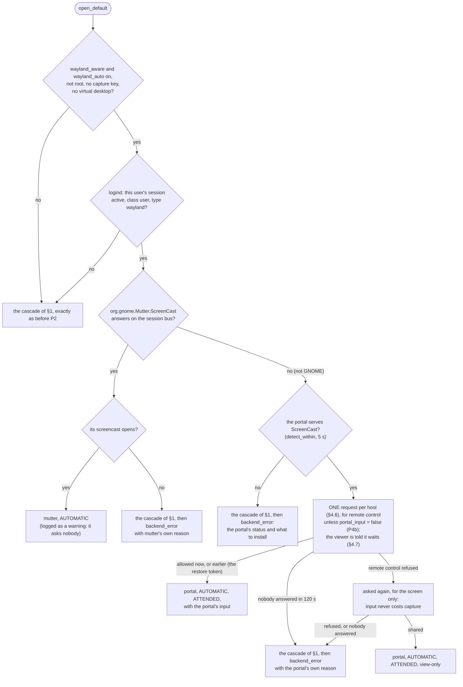
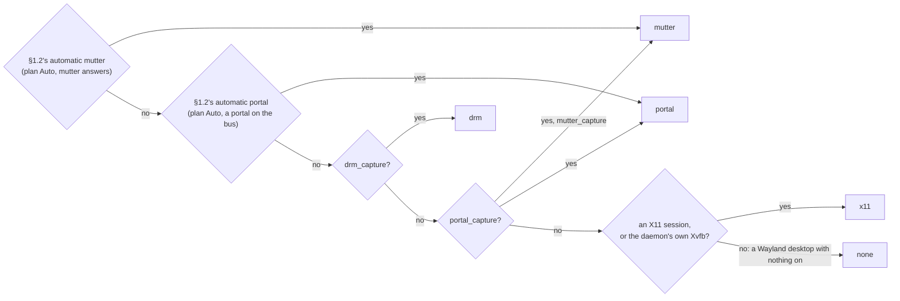
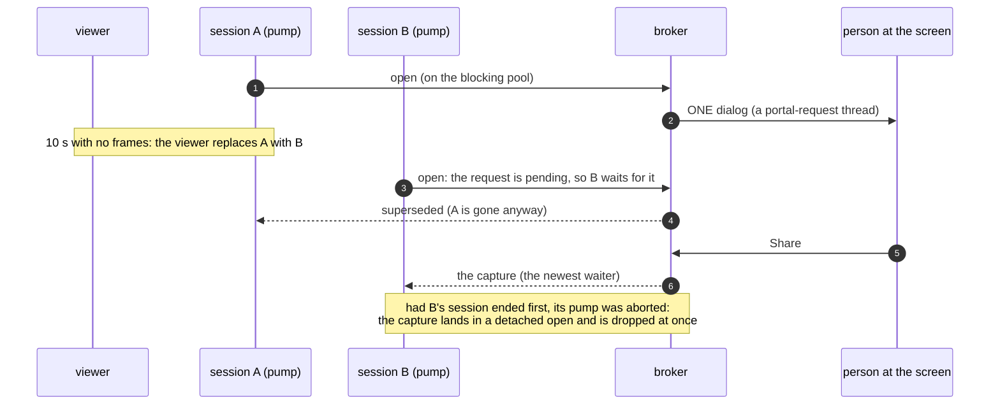
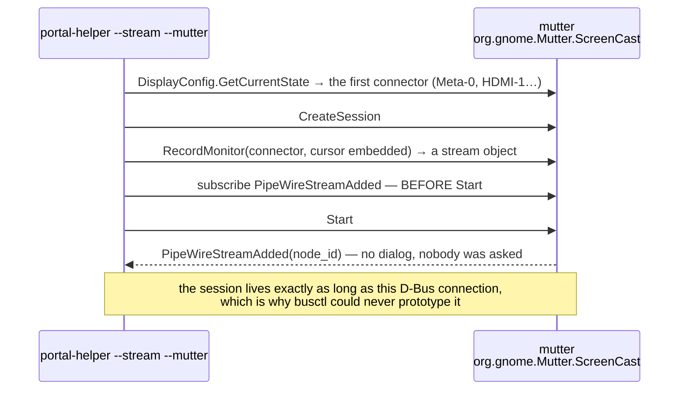

# Linux capture — X11, DRM, the desktop portal, and mutter

How `roomlerd` gets pixels off a Linux desktop, and why there are four ways
rather than one. This is the Linux half of the capture cascade that
[`encoders.md`](encoders.md#capture-backends) summarises and
[`remote-control.md`](remote-control.md#51-capture-targets-per-os) tabulates
per OS; the two portal-shaped arms are FR-45's
([spec](fr/FR-45-portal-capture.md), #1041), the DRM arm is FR-36's
([spec](fr/FR-36-wayland-capture.md)), and the X11 damage tracking is FR-29's.

The shape of the problem, in one paragraph: **the daemon runs as root, outside
every user session, and Linux has no capture API that works from there for
every desktop.** X11 gives root a readable root window; Wayland deliberately
does not. Reading the kernel's scanout plane works below any compositor — but
only where a display controller exists. The desktop portal works on any
compositor — but only inside a logged-in session, and only after a human says
yes. Mutter's own screencast API works where the portal cannot even start — but
asks nobody, and only exists on GNOME. Each arm sees something the others
cannot and pays for it in a different currency, so the cascade tries them in a
fixed order and every non-default arm is **opt-in**, with one exception from
FR-93 P2: a per-user daemon in its own Wayland session, with no capture key
set, switches mutter on by itself, or the portal where mutter is absent (§1.2).

## 1. The cascade

`capture::open_default` (`agents/roomlerd/src/capture/mod.rs:1382`) tries the
backends in this order and returns the first that opens. On Linux the Windows
arms (SystemContext, WGC) do not exist, so the order is:


A per-user daemon in its own Wayland session, with no capture key set, runs
§1.2's automatic arm (mutter, else the portal) before this chart.

| Arm | Reads | Sees a locked screen / the greeter | Asks the person at the screen | Needs | Default | Gate |
|---|---|---|---|---|---|---|
| **DRM/KMS** (`drm_backend.rs`) | the primary CRTC's scanout framebuffer, via `/dev/dri/cardN` | **yes** — it reads below the compositor, so a lock screen is just more pixels | no | a real display controller with a live, linear-modifier scanout buffer | **off** | `ROOMLERD_DRM_CAPTURE=1` (`mod.rs:1658`) |
| **portal** (`portal/screencast.rs`) | a PipeWire stream the compositor publishes through `org.freedesktop.portal.ScreenCast` | **no** — mutter refuses to create *or restore* a screencast while locked | **yes**, once; a restore token skips the dialog afterwards | an active `x11`/`wayland` logind session, `xdg-desktop-portal` + a backend for the compositor, PipeWire | **off**; automatic in a per-user Wayland session with no key where mutter is absent (§1.2) | `ROOMLERD_PORTAL_CAPTURE=1` (`mod.rs:1697`) |
| **mutter direct** (`portal/mutter.rs`) | the same kind of PipeWire stream, from `org.gnome.Mutter.ScreenCast` | no (a session API) | **no** | GNOME's mutter on the user's session bus; no portal backend required | **off**; automatic in a per-user GNOME Wayland session with no key (§1.2) | `ROOMLERD_PORTAL_CAPTURE=1` **and** `ROOMLERD_MUTTER_CAPTURE=1` (`portal/backend.rs:62`) |
| **scrap** (`scrap_backend.rs` + `x11_damage.rs`) | the X root window over XShm, with XDamage saying whether anything changed | X11: yes for whatever the X server shows; Wayland: nothing (Xwayland's root is empty), so since FR-93 scrap is never pointed at Xwayland (§1.1) | no | an X display: the session's `DISPLAY`, or the Xvfb the daemon starts itself | **on** — the last real arm | always tried (`mod.rs:1766`), after the Xwayland guard (`mod.rs:1739`) |

Two things about the order are deliberate and worth defending when the next
backend arrives:

- 🔑 **DRM stays first wherever a CRTC exists.** It needs no consent and sees a
  locked screen, so a host that *has* scanout must never be handed to an arm
  that asks. Measured on a host with both (FR-45 field log): DRM flag alone →
  `backend=drm`; both flags → **still `backend=drm`**; neither → the portal
  never engages (no helper spawned, no dialog).
- ⚠️ **DRM and the portal are opt-in, which is the inverse of this repo's usual
  kill-switch shape** — and for two different reasons. DRM reports no damage at
  all (`Damage::Unknown` on every frame), so defaulting it on where X11 works
  would undo FR-29's idle-CPU win (45.8 % → 2.8 % of a core on a static
  screen). The portal is **attended**: defaulting it on would leave an
  unattended host waiting on a consent dialog nobody will answer — a hang
  dressed up as a feature. Both arms therefore log **loudly** when the operator
  asked for them and they fell through (`mod.rs:1674`, `mod.rs:1714`), because
  silently serving X11 instead would look like the feature simply not working.
  Since FR-93 that error also travels: it becomes the session's `detail`
  (§1.1). And since FR-93 P2d-3 a per-user daemon in its own Wayland session,
  with no key set, switches the portal on by itself where mutter is absent
  (§1.2). There a person is signed in by definition, an unanswered request costs
  one dialog per host and ends at 120 s with a reason, and the viewer says it is
  waiting (§4.6, §4.7). A root daemon keeps both arms opt-in.

### 1.1 A Wayland desktop with nothing switched on (FR-93 P1)

Every Wayland arm above is opt-in, so a stock install on a Wayland desktop
reaches the bottom of the cascade. Before FR-93 it said something false there,
and a different false thing per install type. Measured on the FR-93 lab
(GNOME 50.1 on Ubuntu 26.04, the released 0.4.125):

| Install | What the viewer got | Why |
|---|---|---|
| per-user (`install.sh`'s default) | a **live black picture**: `backend=scrap`, content `lit=0.0 %`, no reason anywhere | the user unit's `DISPLAY` is Xwayland; XShm on it *opens*, and Xwayland's root window is empty |
| system (root) | *"This host has no display to capture (headless…)"*, `no_display`, while the guest's own screen showed GNOME and the companion banner | a systemd unit has none of the session's variables, and the classifier read the **daemon's** environment as if it described the **host** |

Two changes stop both:

- 🔑 **The Xwayland guard** (`mod.rs:1739`). Before scrap opens, the daemon
  asks the X server named by its `DISPLAY` whether it is Xwayland
  (`x_server_is_xwayland`, `mod.rs:1069`). There are two signals, the same two
  keep busy reads (FR-92): the `XWAYLAND` extension, which Xwayland has carried
  since 23.1, and before that its RandR monitors, all named `XWAYLAND<n>`. If
  it is Xwayland, scrap is refused, and the session gets a reason instead of
  black. The answer comes from the server, never from `XDG_SESSION_TYPE`, so a
  real Xorg and the daemon's own Xvfb are captured exactly as before.
- 🔑 **The seat, not the daemon's environment, decides "headless"**
  (`linux_no_pixels_code`, `mod.rs:986`). When every arm has failed and the
  daemon has no display variables, logind is asked whether a graphical session
  is showing (`seat_shows_wayland`, `mod.rs:1053`, through
  `companion::graphical_session`). A Wayland session there means
  `wayland_not_enabled`. No session at all means `no_display`, and that is now
  true.

| The daemon sees | An arm the operator switched on failed? | → `code` | `detail` |
|---|---|---|---|
| `DISPLAY` is Xwayland | no | `wayland_not_enabled` | which display, and why XShm would be black |
| `DISPLAY` is Xwayland | yes | `backend_error` | that arm's own error (`drm_capture is on, but DRM capture could not open: …`) |
| no display variables; the seat shows Wayland | no | `wayland_not_enabled` | what was found (logind, or `WAYLAND_DISPLAY`), then X11's own words: on their own, "connection refused" reads like a network fault |
| no display variables; the seat shows Wayland | yes | `backend_error` | that arm's own error |
| no display variables; no graphical session | — | `no_display` | scrap's own error |
| a `DISPLAY` that is not Xwayland, which scrap could not open | — | `backend_error` | scrap's own error |

The `wayland_not_enabled` hint names the keys **this install** can use,
because only root can read the scanout or create a uinput device:

- a system daemon is told `drm_capture` + `uinput`;
- a per-user one is told `portal_capture`, plus `mutter_capture` on GNOME.

A failed arm is never told to "switch it on". It is already on, and its own
error is the useful sentence.

⚠️ **The probe dials Unix sockets only** (`x_server_query`, `mod.rs:1144`).
`x11rb::connect` falls back to TCP `localhost:6000+N` when the socket is
missing. Under WSL2's mirrored networking a localhost connect to a closed port
hangs instead of being refused, and systemd's `/tmp` handling there had hidden
WSLg's `X0` socket. Together, the first draft of this probe stalled **for over
a minute**, measured, in front of every capture open. Xwayland is a local
server, so a display reached over TCP is not probed at all. Locked by
`a_tcp_display_is_never_dialled`.

⚠️ **A rootful Xwayland is refused too**: one that draws a whole X desktop
inside a Wayland window (a nested session, `Xwayland -rootful`). The probe does
not tell the two modes apart, and the trade is deliberate. The rootless case is
every stock GNOME and KDE desktop; the rootful one is rare, and it gets a
sentence rather than a black stream. `wayland_aware = false` restores XShm
there.

**Kill switch**: `wayland_aware` / `ROOMLERD_WAYLAND_AWARE=0` (default on)
gives back the behaviour before FR-93 unchanged. The X server is not even
asked.

CI proves the half it can run, against Xvfb in the X11 lane (`ci.yml`, the
"against a real X server" step):

- A server that is not Xwayland is captured. A control checks that the
  Unix-only path really reads the server's extensions (`XFIXES`), so a probe
  that never connected cannot pass by answering "no".
- An `XWAYLAND0` monitor that the test defines reads as Xwayland. This is the
  only place the pre-23.1 fallback runs at all, because the lab's GNOME 50
  carries the extension.

The Xwayland half itself is proven on the lab's GNOME guests (§6).

### 1.2 A per-user Wayland session switches itself on (FR-93 P2, decision D1)

From P2, one case is no longer opt-in. A **per-user** daemon whose own user is
signed in to an active **Wayland** session, with **no capture key set**,
switches capture on by itself before the cascade above runs:

- **mutter** (§5), where GNOME's own screencast answers on the session bus
  (P2a). It asks nobody, opens in milliseconds, and is the unattended peer of
  DRM.
- **the desktop portal** (§4), where mutter does not answer: KDE, and every
  other desktop with an `xdg-desktop-portal` ScreenCast backend (P2d-3). It is
  **attended**. The first session shows the person at the screen a dialog, and
  their answer is kept as a restore token, so later sessions open with no
  dialog.

`capture::wayland_plan` (`capture/mod.rs`) decides whether, as a pure function,
and the session's open decides which:



⚠️ **The portal waited for P2d, although D1 asked for "the portal elsewhere" from
the start.** The lab ran it automatically on KDE (2026-10-11), before P2d, and
found three problems. Each has its fix:

| Before P2d | Fixed by |
|---|---|
| **A dialog storm.** The viewer's media watchdog re-creates a session that has shown no frames for 10 s, and every new session opened its own portal request: one more "Share screen with" dialog every 10–20 s, four stacked within a minute | P2d-1: one request per host, which a newer session joins (§4.6) |
| **A capture for nobody.** Answering a stale dialog late started a capture for a session already gone, with the desktop's sharing indicator on | P2d-1: the newest waiter takes the answer, and one whose session ended drops it (§4.6) |
| **Parked workers, then a dead daemon.** Each pending open held a runtime worker for up to `HANDSHAKE_DEADLINE` (120 s), and four of them starved a 4-core host until its watchdog killed the daemon | P2d-1: the open runs on the blocking pool (§4.6) |
| The viewer saw a blank canvas, re-created the session every 10 s, and an answer often reached a session already gone | P2d-2: `rc:media-waiting`, and a watchdog that waits until the dialog's deadline (§4.7) |

| | auto? | why |
|---|---|---|
| a per-user daemon in its own Wayland session, no capture key | **yes**: mutter, else the portal | D1's per-user half |
| a root (system) daemon | no | D1's system half: DRM and uinput stay opt-in until a desktop companion ships for non-Debian hosts, because without one a system install there has no "being viewed" banner and no Disconnect |
| any of `drm_capture`, `portal_capture`, `mutter_capture`, `window_capture` set, **to anything** | no | an explicit key always wins. `portal_capture = false` keeps the portal off, as before |
| `ROOMLERD_VIRTUAL_DESKTOP=1` | no | the daemon's own Xvfb is what it captures |
| X11, a tty only, nobody signed in, no logind | no | auto applies only where logind says Wayland, so an X11 host keeps FR-29's idle numbers byte for byte |
| `wayland_auto = false` or `wayland_aware = false` | no | the kill switches |

⚠️ **An automatic arm that fails reports `backend_error`, never
`wayland_not_enabled`.** The arm was switched on, by policy, so "switch it on"
would be the wrong sentence. That covers mutter that answered and still failed,
a portal that cannot capture this desktop (the detail names its status, such as
`portal-absent` or `no-screencast`, and what to install), and a person who did
not share (refused, or nobody answered within the request's 120 s). The detail
is the arm's own reason. This is the same rule §1.1 gives an arm the operator
switched on. So since P2d-3 a per-user daemon in its own Wayland session reads
`wayland_not_enabled` only when the operator switched the automatic arm off
(the kill switch, or a capture key set), and its hint says how to give the
choice back.

⚠️ **Locked or not, both are tried.** What a locked session shows is the
compositor's to decide. **Measured on KDE** (Plasma 6.7): with a restore token,
a session opened while the screen is locked restores the screencast with no
dialog, and the viewer shows KDE's lock screen. The token survives it, and the
first session after the unlock opened with no dialog too. Not measured: mutter
on a locked GNOME session, and a locked KDE session with no token, whose dialog
would wait behind the lock screen.

**Measured** on the FR-93 lab's KDE guest (Plasma 6.7 on Fedora 44, a per-user
install, no capture key, no restore token), 2026-10-13:

| | 0.4.131, the release | P2d-3 (`ba6ab497f`) |
|---|---|---|
| the brief | `capture_arm=none` | `capture_arm=portal` |
| a session | `wayland_not_enabled` at once, with the old hint; no request, no dialog | **one** dialog, and the viewer told at +2 s that the host waits for the person (for up to 117 s) |
| the person answers, at +40 s | — | the picture in that session (`lit=81.7 %`), the pill "desktop portal · allowed at the screen", and the journal's `capture: backend=portal, AUTOMATIC` |
| the next session | — | the restore token: the capture 85 ms after the offer, no dialog |
| the screen locked | — | the token still restores: KDE's lock screen at +4 s, no dialog |
| after the unlock | — | the token still opens the session, no dialog |
| `wayland_auto = false` | — | `wayland_not_enabled` again, now with the hint that names `roomler config clear wayland_auto`; no request, no dialog |
| GNOME 50 per-user, the same build | — | mutter still first: "GNOME screencast · asks nobody", `lit=90.0 %`, no portal request |

⚠️ **Input follows on both automatic arms.** From P4 the automatic mutter arm
is driven by mutter's own RemoteDesktop, which takes the viewer's mouse and
keyboard and asks nobody (§5.2; kill switch `mutter_input`). From P4b
(operator, 2026-10-13) the automatic portal's one dialog asks for **remote
control**, seeing and controlling, unless `portal_input = false`
(`capture::auto_portal_input`). Nothing was granted there before, so the first
dialog may as well ask for both. A configured `portal_capture` keeps input
opt-in, because there a screen share may already be granted and would be asked
again (§4.3).

- **KDE's dialog** is titled *Remote Control* and names both privileges: *See
  what's on the screen* and *Control input devices*. *Allow restoring* comes
  ticked, and the answer is restored like a screen share's, from its own token
  (`portal-restore-token-rd`).
- **A person who refuses remote control is asked again, for the screen only**,
  and a session they share runs view-only: input never costs capture (§4.3).
  The refusal is not remembered, so the next session asks for remote control
  again. `portal_input = false` makes the arm a screen share for good.

**Measured** on the lab's KDE guest (Plasma 6.7 on Fedora 44, a per-user
install, no capture key), 2026-10-13, by the AC4 oracle of §5.2 and a typing
stress: 112 keystrokes, 40 of them the second of a doubled letter, typed at the
oracle's 80 ms into the probe's focused text entry. The two candidates differ
only in how the helper sends its calls (§4.3):

| | calls unawaited (`fe0c3ae93`) | calls awaited (`9a8e20699`, then `64f00509f`) |
|---|---|---|
| the dialog | *Remote Control*: see the screen, control input devices | the same |
| the next session | the restore token, no dialog | the same |
| AC4 oracle: three pointer targets, a click, a wheel notch down, "hello 123", Shift+A | passed once, then typed `helo 123A` | **7/7, three times** |
| typing stress, the entry's text | **41 of 452 characters wrong** over four runs (10, 17, 6, 8), KDE's input method on or off | **all 113 exact, four runs** |
| one call, event to reply | not waited for | 0.5 ms median, under 4 ms at p99 |
| the person denies remote control | — | KDE asks again, for the screen only; shared, the session runs view-only and its reach banner says to reconnect and allow remote control. The next session asks for remote control again |

The two awaited builds differ only by a refactor (`Target::delivery`). The lab
built each candidate before the branch was rebased onto master; the commits
named carry the same diffs.

The wheel notch went down only after the helper corrected KDE's negated smooth
scroll (§4.3).

⚠️ **The recorder asks too.** `roomler record` opens the same cascade in its own
process (FR-85), so on KDE the person at the console is asked once for their
own recording. The broker is per process, so a viewer's pending request and a
recording started at the same moment are two dialogs.

**Sized before the flip (P2b's counts, prod, 2026-10-13).** 14 Linux devices
sent a desktop brief. The only per-user Wayland hosts with no arm were this
lab's KDE guests. The flip therefore changed no customer device on the day; it
is for the installs to come, on KDE and the rest.

The arm is on the wire: `rc:video-info` carries `capture_arm` (`drm`, `mutter`,
`portal` or `x11`) and `attended` (`true` only for the portal). Both are absent
from Windows, macOS and older agents.

**Kill switch**: `wayland_auto` / `ROOMLERD_WAYLAND_AUTO=0` (default on) gives
back the behaviour before P2.

### 1.3 What a device reports, and the fleet's count (FR-93 P2b)

A Linux daemon tells the server which desktop it would show a controller now, and
what would capture it. An exec sweep cannot answer "how many hosts are Wayland,
and which arm serves each": a sweep reaches only the devices that are online.
The server can, because every device says it in its hello.

The hello's caps carry `desktop` (`crates/remote_control/src/models.rs:1164`),
all strings, so a newer agent's word reaches an older server as a word:

| field | values | from |
|---|---|---|
| `session` | `user` · `greeter` · `lock-screen` · `none` | logind's class for the session a controller would see. A root daemon sees the seat: a person's session first, else the greeter. A per-user daemon sees only its own user's sessions. A tty or an SSH login is no desktop |
| `type` | `wayland` · `x11` · `tty` · `none` | that session's type |
| `desktop` | `gnome`, `KDE`, … (absent when logind names none) | logind's `Desktop` |
| `capture_arm` | `mutter` · `drm` · `portal` · `x11` · `none` | the arm a session opened **now** would try first |
| `input_reach` | `full` · `xwayland_only` · `none` | the `rc:input-reach` verdict (`input/reach.rs:265`), with the portal's input route predicted for a portal or mutter arm with `portal_input` on. ⚠️ **It never starts an X server.** GNOME starts Xwayland **on demand** for any client that connects, so on a Wayland desktop the brief connects only to an Xwayland already running (found in `/proc`), and with none it reads "no X server". It is also read again only when another field changed. The per-session `rc:input-reach` stays the authority |

`capture_arm` is `capture::planned_arm` (`capture/mod.rs:758`), a pure function
that walks `open_with`'s own order (`:1290`). The two sit together in one file
because they must not drift:



⚠️ **A plan, not a promise.** An arm that fails at session time falls through,
and that session's `rc:video-info` names what actually served it (§1.2). The
brief answers what the fleet is configured to do. The session answers what
happened.

⚠️ **The brief never starts the portal.** It asks the bus daemon whether
`org.freedesktop.portal.Desktop` has an owner or is installed to start on demand
(`portal::reachable`), and the bus daemon activates nothing for either question.
So the brief cannot see whether a ScreenCast backend serves it: a desktop whose
portal serves none reads `portal` in the brief and `backend_error` in a session,
whose own open asks the portal itself (`portal::detect_within`). Introspecting
the portal every minute would start it on every host that does not run it.

⚠️ **logind never runs on the signalling path.** `loginctl` is a subprocess, and
a wedged logind must not stall the hello. A `desktop-brief` thread
(`desktop_brief.rs:31`) reads it every 60 s into a cache. The hello and the
heartbeat only read that cache (`signaling.rs:5391`). A changed brief (a login, a
logout, the greeter) re-announces the caps on the next heartbeat (`:1806`).
Until the first read lands, which is milliseconds after start, the hello
carries none.

The brief rides `agents.capabilities`, so the device listing returns it with no
server change. The count is one aggregate (`crates/api/src/routes/stats.rs:357`),
grouped by `type` and `capture_arm`, with `total` and `online`:

| route | scope |
|---|---|
| `GET /api/tenant/{tid}/stats/overview` → `desktops` | the org, for any member |
| `GET /api/admin/stats/orgs` → `desktops` | the whole fleet, for a platform admin: the denominator a field check after a roll needs |

A device that never sent a brief (Windows, macOS, an agent older than P2b) is not
counted. `machines.total` beside it says how many devices there are.

## 2. The X11 arm, and the virtual desktop

`scrap` on Linux is XShm: a full-screen `GetImage` per frame, which XShm cannot
tell you was unnecessary. FR-29 bolted an XDamage listener beside it
(`agents/roomlerd/src/capture/x11_damage.rs`) so an unchanged screen produces
*no frame* and the pump idles; a forced grab every second bounds the failure
mode of a missed damage event at a stale tile rather than a frozen stream.

On a host with no X session at all — a headless server, a container, **WSL2**
(WSLg's rootless XWayland root has no readable framebuffer, so `XGetImage`
fails) — the daemon can bring up its **own** display:
`ROOMLERD_VIRTUAL_DESKTOP=1` (`agents/roomlerd/src/main.rs:2626`,
`virtual_desktop.rs:528`) starts Xvfb at `ROOMLERD_VIRTUAL_DESKTOP_RESOLUTION`
(default `1920x1080`) with the window manager named by
`ROOMLERD_VIRTUAL_DESKTOP_WM` (default `openbox`) and the comma-separated
`ROOMLERD_VIRTUAL_DESKTOP_STARTUP` apps, points `DISPLAY` at it before the caps
probe and every capture, and captures it with the unchanged scrap + damage
path. This is the hardware-encode test bed on the WSL2 dev host, and the
remote-apps surface of FR-56 rides on it.

The children are spawned into their **own process group**, and on any graceful
exit the daemon tears the whole tree down —
`virtual_desktop::teardown` — SIGTERM → 2 s grace → SIGKILL, reaching
every descendant including a setsid'd grandchild (`at-spi-bus-launcher`, a D-Bus
service that **ignores SIGTERM**) via the parent-link closure of the daemon's
direct children. Without it, under systemd `KillMode=control-group` that
grandchild held the unit's cgroup non-empty until systemd's `TimeoutStopSec`
(90 s) SIGKILLed it, so `roomler restart` took 96 s (#1684). See
[`desktop-companion.md` §7](desktop-companion.md#7-apply-now--restarting-the-service-from-the-companion).

⚠️ **A virtual-desktop host is not a consent surface**, even though its X
display connects: the only viewer of that Xvfb is a remote controller, so the
native consent panel would be drawn where nobody can see it (`indicator/x11.rs:499`
reads the daemon's own `ROOMLERD_VIRTUAL_DESKTOP` and declines). Detail in
[`remote-control.md` §11.2](remote-control.md#112-consent).

## 3. The DRM arm (FR-36)

Read the scanout plane from the kernel: `drmModeGetFB2` → `PrimeHandleToFD` →
`mmap`, repacked to BGRA. One code path for GNOME, KDE, XFCE, X11 and *no
session at all*; it works at the greeter and on a locked screen, which is the
normal state of an unattended machine and exactly where the portal refuses.
What it does **not** do is documented at the top of `drm_backend.rs` and each
omission is a design decision, not a gap: no damage tracking (neither buffer
identity nor a page flip is a proxy for "changed"), primary CRTC only, and a
**refusal** on any non-linear modifier rather than emitting tiled garbage that
would read as a codec bug. Pair it with `ROOMLERD_UINPUT=1` on a Wayland host:
XTest reaches Xwayland clients only, so DRM capture without uinput is a
read-only session. The rest — the device-node scan, the 10-bit repack, the
field numbers — is in the [FR-36 spec](fr/FR-36-wayland-capture.md).

### 3.1 The cursor plane (FR-93 P3c)

A compositor keeps the pointer on the CRTC's **cursor plane** wherever the
hardware has one. mutter and KWin both do, in a virtio-gpu VM and on real GPUs.
So the pointer is absent from every frame this arm reads off the primary plane,
and before P3c the viewer showed the controller's initials badge in its place.
From P3c the DRM worker also reads the cursor plane on every frame it grabs, and
the cursor data channel carries it (`cursor:shape`, `cursor:pos`,
`cursor:hide`), the wire Windows has always used:

```mermaid
sequenceDiagram
    participant K as the kernel<br/>(the CRTC's cursor plane)
    participant W as the DRM worker<br/>(drm_backend.rs)
    participant S as drm_cursor::publish / latest
    participant T as CursorTracker::poll<br/>(the cursor channel, 120 Hz)
    participant V as the viewer
    Note over W: at open: UNIVERSAL_PLANES, then ATOMIC,<br/>then CURSOR_PLANE_HOTSPOT; each plane's type
    loop every frame a session pulls
        W->>K: the primary plane, by its type: the frame
        W->>K: the cursor plane on that CRTC: CRTC_X/Y, HOTSPOT_X/Y
        W->>K: its ARGB buffer, on a new framebuffer or every 250 ms
        W->>S: straight alpha, cropped, an id from pixels + hotspot
    end
    T->>S: the latest, while under 2 s old
    T->>V: cursor:shape once per id, cursor:pos each tick
```

| | what | why |
|---|---|---|
| the caps | `DRM_CLIENT_CAP_ATOMIC`, then `CURSOR_PLANE_HOTSPOT` | `CRTC_X/Y` are atomic-only properties. On a paravirtual GPU (virtio-gpu, qxl, vmwgfx) the kernel then hides the cursor plane from an atomic client that does not also set the hotspot cap. Neither refusal is fatal: capture goes on, and the viewer keeps its badge |
| the position | `CRTC_X/Y`, plus `HOTSPOT_X/Y` where the driver has them | real GPUs have no hotspot property, because their compositor already placed the buffer so the hotspot lands on the pointer. There the visible image's top-left stands in for it. Either way the viewer draws the crop's top-left exactly where the plane shows it |
| the image | ARGB8888, premultiplied, straightened to the wire's straight alpha; cropped to the visible pixels | hardware cursor buffers are 64×64 or 256×256 whatever the image, so the crop keeps a `cursor:shape` small |
| the id | a hash of the cropped pixels and the hotspot | the viewer caches a shape per id for the session and never replaces one, so the id must change whenever either does |
| the primary plane | chosen by its `type` (P3b's half) | the first bound plane used to stand in, on the assumption that cursor and overlay planes are unbound. The cursor plane is bound wherever the pointer shows |
| only this arm | mutter's and the portal's streams embed the pointer, and publish nothing here | a cursor from the channel there would draw a second pointer over the streamed one |

⚠️ **The hardware cursor is the compositor's.** Where a compositor draws the
pointer into the primary plane itself (a software cursor, or a GPU without a
cursor plane), the cursor plane stays unbound and the pointer is already in the
frame. The tracker then reports it hidden, and the viewer shows its badge, as
before.

**Kill switch**: `ROOMLERD_DRM_CURSOR=0` reads no cursor plane and sets none of
the caps it needs.

**Measured** on the lab's GNOME 50 system guest (Ubuntu 26.04, virtio-gpu,
`drm_capture` + `uinput`), 2026-10-13, by the AC5 `cursor` plan of the viewer
oracle. The person at the screen moves the pointer over QMP, outside every
roomler input path, and the oracle reads where the viewer draws it:

| | 0.4.132, the release | P3c (`1de8d54da`) | P3c, `ROOMLERD_DRM_CURSOR=0` |
|---|---|---|---|
| the pointer in the stream | no: it is on the cursor plane | no | no |
| the viewer's overlay at the pointer (targets (0.30, 0.60) and (0.70, 0.60)) | none at either: **FAIL** | **(0.295, 0.592) and (0.695, 0.592): PASS** | none at either: **FAIL** |
| the worker's log | — | `the cursor plane is read for the viewer planes=2 cursor_planes=1 atomic=true hotspot=true` | `the cursor plane is not read (ROOMLERD_DRM_CURSOR=0 …)` |

The overlay sits a few pixels up and left of each target because the oracle
reports the cursor canvas's top-left, and the arrow's hotspot is that far into
the cropped image.

## 4. The portal arm (FR-45 P1–P4)

### 4.1 Why a helper process, and why it dlopens

The portal is **per user session**: it lives on the session bus, checks
`SO_PEERCRED`, and `XDG_RUNTIME_DIR` is `0700`. A root daemon with no session
bus asking it anything gets `no-session-bus`, which is the architecture rather
than a misconfiguration. So the daemon spawns **itself** — the hidden
`roomlerd portal-helper` subcommand — as the console user, with that session's
`XDG_RUNTIME_DIR`, `DBUS_SESSION_BUS_ADDRESS`, `DISPLAY` and `WAYLAND_DISPLAY`
(`capture/portal/mod.rs:905`), through a verified privilege drop rather than
`CommandExt::uid()` (which leaves the child in root's supplementary groups — a
silent retention bug, not a visible failure).

⚠️ **Only a root daemon drops.** A per-user daemon (`roomler.service`, the
`install.sh` default) already *is* the session's owner, and "dropping" to
itself is not a no-op: `setgroups(2)` needs `CAP_SETGID` even to set the groups
a process already holds, so the drop's pre-exec hook failed `EPERM`, the helper
never started, and the cascade fell through to Xwayland's empty root — a black
stream on every per-user install that set `portal_capture`. Every FR-45 field
run was under root, which hid it until the vmtest per-user cell ran with the
keys set (#1719 run B). The rule is now three-way (`run_as`,
`capture/portal/mod.rs:1004`): root drops, the session's owner runs as itself,
anyone else is refused with both uids named — and a per-user daemon looks up
its **own** session, not the first active one.

🔑 **The subcommand buys the session context; only `dlopen` buys the linkage.**
A helper *subcommand* is the same ELF as the daemon, so linking `libpipewire`
for the helper's sake would put it in every Linux build's `DT_NEEDED` — and a
missing `.so` there does not degrade a feature, the loader refuses to start the
daemon at all, on every headless fleet host that will never run a portal.
`portal/pipewire.rs:307` therefore `dlopen`s `libpipewire-0.3.so.0` at runtime
and reports `unavailable — libpipewire not present (tried …)` where it is
absent; `readelf -d` shows **zero** PipeWire entries on both architectures, and
the daemon was run with the library bind-mounted away to prove the degradation
is graceful. The SPA POD builders are `static inline` in PipeWire's headers
(nothing to `dlsym`), which is why `portal/pod.rs` serialises them by hand.

### 4.2 The handshake

```mermaid
sequenceDiagram
    participant D as roomlerd<br/>(root, no session bus)
    participant H as roomlerd portal-helper<br/>(the session user)
    participant XDP as xdg-desktop-portal<br/>+ the compositor's backend
    participant PW as PipeWire<br/>(dlopen'd libpipewire)

    D->>D: companion::graphical_session()<br/>a logind session with Type=x11|wayland, Active=yes
    D->>H: spawn as that user: XDG_RUNTIME_DIR, DBUS_SESSION_BUS_ADDRESS,<br/>DISPLAY / WAYLAND_DISPLAY; stdout piped, stderr inherited
    H->>XDP: CreateSession — on ScreenCast, or on RemoteDesktop when input is wanted
    opt portal_input
        H->>XDP: SelectDevices (keyboard + pointer, persist)
    end
    H->>XDP: SelectSources (monitor, cursor embedded, persist_mode, restore_token if stored)
    H->>XDP: Start
    Note over XDP: first use: a consent dialog for the person at the screen<br/>later uses: restored from the token, ~15 ms, no dialog
    XDP-->>H: Response: streams (node_id, logical size), restore_token
    H->>XDP: OpenPipeWireRemote → fd
    H->>PW: connect the fd; pw_stream with the EnumFormat POD
    PW-->>H: param_changed (a fixated format) → process (buffers)
    H-->>D: one marked handshake line, then RPWF-framed BGRA frames on stdout
    D->>D: PortalCapture → the media pump → the encoder
```

Every portal method returns a `Request` path and answers later as a `Response`
**signal**, because a call can take as long as a human takes to read a dialog.
⚠️ The subscription is armed **before** the call (`screencast.rs:625`,
`:351`, `:376`): arming afterwards is a race the portal wins whenever it
answers without asking anyone — exactly the restore-token case.

The daemon side is `PortalCapture::open` (`portal/backend.rs:106`). It reads
the handshake under a **120 s deadline** (`HANDSHAKE_DEADLINE`,
`backend.rs:372`) because a portal `Start` blocks until the dialog is answered
and `open_default` runs synchronously on a media-pump worker — an unanswered
dialog fails the open with *"a consent dialog left unanswered, most likely"*
and the cascade falls through, instead of parking that worker forever. Frames
cross as **a pipe and a copy**, not `SCM_RIGHTS` buffer fds: `Frame` owns a
`Vec<u8>` so the daemon copies regardless, and passing the compositor's own
buffers means not queueing them back until the daemon has read them — a stall
the compositor can see and, got wrong, torn frames that look like a codec bug.
`wire.rs` puts a `RPWF` magic on every header so a desynchronised reader fails
at the next boundary rather than reading pixels as a length. ⚠️ After the
handshake **stdout is binary; diagnostics go to stderr** — a stray `println!`
in the helper corrupts a frame.

**Tokens.** The restore token is kept **by the helper**, in
`$XDG_STATE_HOME/roomler/portal-restore-token` (mode `0600`, the session
user's; `-rd` for a see+touch grant, `-win` for a window grant —
`screencast.rs:537`). The daemon never receives it, by construction: an early
`SessionReport` carried it and it turned up in plaintext in a redirected log,
so the report now says only *whether* a grant was persisted. A caller that
cannot hold a credential cannot leak it.

### 4.3 Input rides the same session (P4)

On the hosts this arm exists for, the portal is also the only thing that can
*touch* the desktop: uinput creates a device and libinput even enumerates it,
but a **nested** compositor reads its parent, not evdev, so injected events
are published and nothing consumes them (measured on WSL2). With
`ROOMLERD_PORTAL_INPUT=1` the helper opens the session on the **RemoteDesktop**
interface instead — the same session, one dialog covering see and touch, one
token — and the daemon's input arbiter forwards `InputMsg` JSON lines down the
helper's stdin (`portal/input_route.rs:113`), which the helper maps to
`NotifyKeyboardKeycode` (evdev codes from the shared FR-36 table),
`NotifyKeyboardKeysym` (typed text), `NotifyPointerMotionAbsolute` (in the
stream's **logical** size, which differs from the pixel size under a HiDPI
scale) and the axis calls (`portal/input.rs`).

- ⚠️ On a **configured** portal arm `portal_input` defaults **OFF**: a
  `WithInput` session needs its own consent grant and token, so defaulting it
  on would make every portal capture — including one already granted and
  persisted — demand a fresh dialog, and block or fall through if unanswered.
  Input must never cost capture: a `WithInput` session that fails is retried
  capture-only (`portal/mod.rs:502`). The **automatic** portal (§1.2) asks for
  remote control unless `portal_input = false` (FR-93 P4b): nothing was granted
  there before, so its first dialog may as well ask for both.
- ⚠️⚠️ **Every call waits for its reply, and must keep doing so (FR-93 P4b).**
  xdg-desktop-portal handles each portal method call on its own worker thread
  (`HANDLE_METHOD_INVOCATIONS_IN_THREAD`, in its `xdp-context.c`), so two calls
  sent back to back reach the backend in either order. FR-45's self-review had
  made them fire-and-forget (`call_noreply`), for latency. On KDE that typed 41
  of 452 characters wrong (§1.2): a key's release overtook its press, KWin
  dropped the release because the key was not down, the key stayed held, and
  the letter's next press was dropped as a repeat. A button's release overtaking
  its press would hold a mouse button down the same way. The frontend forwards
  each call to the backend before it replies, so waiting for the reply keeps the
  order, for 0.5 ms a call at the median and under 4 ms at p99, against the
  viewer's 8 ms floor between pointer moves (`Target::delivery`,
  `portal/input.rs:348`; pinned by `portal_calls_wait_for_their_replies`).
  Mutter's own RemoteDesktop (§5.2) answers on its main loop, in order, and
  keeps fire-and-forget.

  ```mermaid
  sequenceDiagram
      participant H as portal-helper
      participant F as xdg-desktop-portal<br/>(a worker thread per call)
      participant B as xdg-desktop-portal-kde
      participant K as KWin
      Note over H,K: unawaited, before P4b: "l" typed, press and release 0.05 ms apart
      H->>F: NotifyKeyboardKeysym(l, pressed)
      H->>F: NotifyKeyboardKeysym(l, released)
      F->>B: released: its thread ran first
      F->>B: pressed
      B->>K: the release, for a key that is not down: dropped
      B->>K: the press: "l" is now held until the next "l"
      Note over H,K: awaited, P4b
      H->>F: pressed
      F->>B: pressed
      F-->>H: reply
      H->>F: released
      F->>B: released
      F-->>H: reply
  ```

- ⚠️ **KDE's backend negates the vertical smooth scroll** on its way to KWin
  (`requestPointerAxis`: `wl_fixed_from_double(-y)`), while the portal's
  convention, GNOME's backend, KDE's own horizontal axis and its discrete path
  all keep positive = down. Measured on Plasma 6.7: a notch down reached the
  probe as a notch up. Where KDE's backend owns its bus name
  (`org.freedesktop.impl.portal.desktop.kde`), the helper negates first
  (`for_backend`, `portal/input.rs:224`); kill switch
  `ROOMLERD_PORTAL_KDE_SCROLL_FIX=0`.
- `ROOMLERD_PORTAL_INPUT_TRACE=1` logs every event and every call the helper
  made for it, on the wall clock, so a lab can line what was sent up against
  what a window received. That is how the ordering fault above was found. Off by
  default: a keystroke log does not belong in a journal.
- ⚠️ **GNOME hides input behind a second switch in the same dialog.** The
  *Remote Desktop* dialog carries `Share`, a monitor picker, *Remember This
  Selection* — and an **Allow Remote Interaction** toggle that is **off by
  default**. A person who clicks *Share* without flipping it grants capture
  only; the helper reports `input_granted=false` and the session runs
  view-only. Enabling the key is not enough; the person at the screen has to
  flip that switch.
- ⚠️ Axis sign follows **libinput** (positive = down/right), not evdev — the
  uinput backend's `REL_WHEEL` inversion scrolls backwards here. Confirmed in
  the field: `dy:+4` scrolled the page down.
- ⚠️ `NotifyKeyboardKeysym` is **not layout-proof**: the keysym must exist in
  the host's active keymap, or the compositor drops it silently and reports
  success (`é` and `€` vanished on a US keymap; `@ # ~` typed fine). The pump
  warns once when it forwards a non-ASCII keysym.

### 4.4 The attended-only rule — no greeter, no locked screen

This arm **cannot** capture a login greeter or a locked screen, and nothing in
configuration changes that. The reasons are the portal's, established in FR-36
P0 and re-measured in FR-45:

- ScreenCast needs an active user session and, the first time, an interactive
  consent dialog; `restore_token` only avoids re-prompting *after a human
  approved once* — it is not a headless grant.
- **While the session is locked, mutter refuses to create or restore a
  screencast**, and the failed attempt tends to **consume the saved token**,
  dropping the next attempt back to the picker.
- Tokens are per-compositor and die with a logout or reboot.

So the daemon refuses early rather than waiting: `graphical_session()` finding
no `x11`/`wayland` session that is `Active=yes` ends the open with
*"nobody is at this machine's screen — the portal is attended-only"*
(`portal/mod.rs:802`), and an unanswered dialog ends it at the 120 s
deadline. Both fall through to the rest of the cascade with the reason in the
log. Unattended access on Linux is FR-36's DRM arm (or §5's mutter arm where
there is no scanout) — never this one. ⚠️ Where the product says so: the spec,
this page, the `portal_capture` description in the config surface
(`crates/agent-core/src/config_surface.rs:988`, which every `roomler config`
reader sees) and the helper's own log line. Since FR-93 P2c the web viewer says
it too: `rc:video-info` carries `capture_arm` and `attended`, and the viewer
names the arm ("desktop portal · allowed at the screen"), FR-45 AC8's option (b).

### 4.5 Detecting the portal, and why the answer is never cached

`roomlerd capture-smoke` runs the detector *inside the session* and prints one
line an operator can act on (`main.rs:5526`): `capture-smoke: portal=<status>
— <advice>`.

| `portal=` | Means | The advice it prints |
|---|---|---|
| `available (screencast vN, remote_desktop=true)` | ScreenCast and RemoteDesktop both exposed | usable for capture and input |
| `available (screencast vN, remote_desktop=false)` | ScreenCast without RemoteDesktop (wlroots backends, measured) | capture would be read-only |
| `no-screencast` | `xdg-desktop-portal` is on the bus but exposes no ScreenCast | check the backend for your compositor is **installed and running**, then **restart the frontend** — it caches its backend selection at startup |
| `portal-absent` | no `xdg-desktop-portal` on the session bus | install it plus a backend |
| `no-session-bus` | no session bus reachable | the portal needs a logged-in user session — an attended path by design |

🔑 **`no-screencast` on a host with everything installed is the normal failure,
not the exotic one.** On the fleet's GNOME Wayland host the interface was
missing because `xdg-desktop-portal-gnome` — a `static`, D-Bus-activated unit
— had never been triggered; starting it alone did **not** help, because the
frontend had cached its backend list at startup and had to be restarted after
the backend was up. A host can have every package and still offer nothing,
depending on start order — which is why availability is detected **at session
time and never cached**, and why the advice string stopped saying "install the
backend". ⚠️ Backends declare their interfaces in `.portal` files, so the
frontend can *advertise* ScreenCast while the backend that would serve it
cannot start: on WSL2 the frontend listed ScreenCast + RemoteDesktop the whole
time, and `CreateSession` timed out activating `…impl.portal.desktop.gnome`.
"The interface is exposed" proves nothing on its own.

### 4.6 One request per host, and an open that holds no worker (FR-93 P2d)

An attended open shows the person at the screen a dialog and waits for them for
up to `HANDSHAKE_DEADLINE` (120 s, `portal/backend.rs:372`). The FR-93 lab ran
the portal automatically on KDE and measured what that did with nobody answering:

- **A dialog storm.** The viewer's media watchdog re-creates a session that has
  shown no frames for 10 s, and every session opened its own request. Four
  "Share screen with" dialogs stacked within a minute.
- **A capture for nobody.** Answering a stale dialog late started a capture for a
  session already gone, with the sharing indicator on.
- **A held worker, then a dead daemon.** The pumps called
  `capture::open_default` inline, so each unanswered dialog blocked one runtime
  worker for the whole wait (`hs_rx.recv_timeout`, `backend.rs:170`). Four of
  them is every worker of a 4-core host. Measured on the released **0.4.130**
  (the KDE guest, 4 cores, `portal_capture` on, one viewer trying):
  - The viewer's watchdog re-created the session 4 times in 30 s, raising 4
    helpers and stacking 4 dialogs.
  - The runtime then stopped. The daemon logged nothing for 86 s, and a fifth
    session sat at `awaiting_consent` because nothing answered it.
  - Then `watchdog-of-watchdog: async watchdog has not heartbeat in 60.0s;
    forcing exit(2)`, and systemd restarted the daemon.

  So a viewer that keeps trying a host where nobody answers takes the daemon
  down.

The explicit `portal_capture` path had all three from the start. P2d's agent half
fixes them there, and is the precondition for the portal ever going automatic:



| | what | where |
|---|---|---|
| the open runs off the workers | `capture::open_default_async`: on Linux, `open_default` on the blocking pool. The pump stays droppable while it waits, and a capture that opens after its session is gone is dropped as it arrives. Elsewhere it stays inline | `capture/mod.rs:1402`, the eight pump call sites in `peer.rs` |
| one request per host | `portal::pending::open_with`, which the configured and the automatic (P2d-3) arms share: a session that asks while a request is pending waits for **that** request, and an older waiter leaves (`Superseded`) | `portal/pending.rs:59`, `Broker::open` `:146` |
| the newest waiter wins | the outcome goes to the session that asked last, which is the one the viewer shows now | `Request::wait` `:229` |
| nobody there, nothing starts | a waiter is a blocking thread, not a session. A session's end aborts its pump (`AgentPeer::stop_serving`, `peer.rs:1520`), which detaches the open, so the capture its waiter takes is dropped as it arrives: the helper is killed and the screencast stops. An outcome that outlives its **last waiter** (each waits 5 s past the request's own deadline) is dropped in `Request::land`, the backstop | `capture/mod.rs:1402`, `Request::land` `:216` |
| mutter is not brokered | `mutter_capture` asks nobody and opens in milliseconds, so concurrent sessions never wait on each other for it | `pending.rs:60` |

**Measured** on the FR-93 lab's KDE guest: Plasma 6.7 on Fedora 44, 4 cores, a per-user install with
`portal_capture` on and no restore token. One viewer opens three sessions in about 60 s with nobody at the
screen, and the viewer's own watchdog re-creates each one. A sampler on the guest counts the live
`portal-helper` processes; each is one pending request and one dialog.

| | 0.4.130, the release (two runs) | P2d-1 (two runs) |
|---|---|---|
| requests raised by the burst | 4 in 30 s, all 4 dialogs stacked | 1 |
| most helpers alive at once | 4 | 1 |
| the third session | sat at `awaiting_consent`, never answered | connected within 1 s |
| the daemon | no log line for 83–86 s, then `watchdog-of-watchdog: … forcing exit(2)` and a systemd restart, both runs | never restarted, logging throughout |
| the person answers while the viewer waits | — | the capture 1.6 s after the click, the picture in the viewer, one request in all, no restore token |
| the person answers after the viewer's last session ended | — | dropped: no pump took it. The restore token it left opened the viewer's next session with no dialog |

⚠️ Two controllers opening the same host at once: the older one is superseded,
not served, and reads the reason as a `backend_error`. A pump registers its shared
pipeline (P5, `media_share`) only once its capture has opened, so while the
request is pending the second viewer has nothing to join. That is acceptable for
a path where one person at the screen allows one share, but it is a known edge.

### 4.7 The viewer is told, and waits (FR-93 P2d-2)

P2d-1 left the viewer guessing. It still re-created its session every 10 s
while no frames arrived. Each new session joined the one request, so no second
dialog appeared, but the canvas stayed blank. An answer that came while the
viewer sat in its re-create back-off reached a session already gone. The
picture then came from the restore token, one session later (§4.6's last row).

```mermaid
sequenceDiagram
    autonumber
    participant V as viewer
    participant P as the session's pump
    participant K as broker
    P->>K: open (blocking pool, with the pump's hook)
    Note over K: 2 s and still parked (a restore token answers sooner, with no dialog)
    K-->>P: the hook: the request gives up in N ms
    P->>V: rc:media-waiting {for: person_at_screen, waits_ms, hint} (control DC, retried)
    Note over V: "Waiting for the person at the screen to share it."<br/>the watchdog counts no stall until the deadline
    K-->>P: the person shared: the capture
    P->>V: frames; the first one clears the notice
```

| | what | where |
|---|---|---|
| the hook | `capture::open_default_async` takes an `OnOpenWait`, held for the open's blocking thread by `ParkHook`, which clears it on drop, so a pooled thread never carries one into the next open, not even after a panic | `capture/mod.rs` (`ParkHook`, `tell_open_waiting`) |
| when it fires | a waiter still parked `TELL_AFTER` (2 s) in fires it once, with the **request's** start, so a session that joins a pending request is told that dialog's deadline, not one counted from its own join | `portal/pending.rs` (`Request::wait`, `TELL_AFTER`) |
| the message | `rc:media-waiting {"for":"person_at_screen","waits_ms":N,"hint":…}`, retried until the control channel takes it, and never past the dialog's own deadline. A duration, not a time of day, so the viewer reads it on its own clock | `peer.rs` (`media_waiting_payload`, `media_waiting_hook`) |
| the viewer | the deadline is set at receipt. Until it passes, plus a 10 s grace (`RC_MEDIA_WAITING_GRACE_MS`), the watchdog counts no stall and re-creates nothing. A session that ends while waiting is not dead air | `useRemoteControl.ts` (`agentIsWaiting`, the watchdog tick, `isDeadAir`) |
| what clears it | the first frame; `rc:media-unavailable` (the wait ended without an answer, and that message says why); a new connect | the same |
| kill switch | `ROOMLERD_MEDIA_WAITING=0` sends nothing, and the viewer behaves as before P2d-2. An older viewer ignores the message (an unknown `t`) | `peer.rs` |

**Measured** on the FR-93 lab's KDE guest, set up as in §4.6 (`portal_capture`
on, no restore token), against prod's viewer, which has carried P2d-2's half since
`hosted-20261012-f07ba2c`. One viewer connects, nobody answers for 75 s, then the
lab answers the dialog over QMP (2026-10-13):

| | 0.4.131, the release (P2d-1 only) | P2d-2 (master `b5871e47f`) |
|---|---|---|
| sessions while nobody answered | 5: the watchdog re-created it 4 times (`media stalled 10 s … re-creating session`), with "Reconnecting" in between | **1** |
| the notice | never: 0 of 51 samples | from +3 s, in every sample until the answer |
| the answer | landed while the viewer sat in its re-create back-off, so the capture went to a session already gone | the capture about **2 s** after the click, in the session that waited |
| the picture | 48 s after the answer, from the restore token, one session later | at once (`lit=81.5 %`) |
| portal requests | 2: the dialog, then the restore | 1 |

⚠️ A request nobody answers still ends at its own 120 s deadline. The viewer
then shows the reason, and only a new connect raises another dialog: at most one
per two minutes, where it was one every 10–20 s before P2d-1.

## 5. The mutter arm (FR-45 P5) — the unattended sibling

The portal is the obstacle on the host FR-45 was opened for, not the
compositor: on WSL2 `xdg-desktop-portal-gnome` exits immediately without a real
GNOME session, while `mutter --headless --wayland --virtual-monitor 1920x1080`
runs perfectly with software EGL (`LIBGL_ALWAYS_SOFTWARE=1` → llvmpipe on the
surfaceless platform, no `/dev/dri` needed) and exposes
`org.gnome.Mutter.ScreenCast` v4. `ROOMLERD_MUTTER_CAPTURE=1` swaps **only the
session broker**; the SPA negotiation, buffers, wire format and `ScreenCapture`
backend are the portal code unchanged.



⚠️⚠️ **This path does not ask, and must never be described as a portal
variant.** `org.gnome.Mutter.ScreenCast` is a privileged session API: anything
on the user's bus may call it and mutter shows no consent dialog. That is not a
privilege escalation — reaching that bus already means running as the session
user, who can screenshot at will, and the daemon is root regardless — but it
puts this arm beside **FR-36's DRM backend**, the same unattended bargain by a
different mechanism, and it is gated the same way: opt-in on a root daemon,
automatic only in a per-user GNOME session with no key set (§1.2), and the
helper logs `opening an org.gnome.Mutter.ScreenCast session (UNATTENDED)` when
it engages. It is **GNOME-only**; KDE and wlroots hosts keep the portal. Its
input is mutter's own RemoteDesktop, which drives the screencast (§5.2, FR-93
P4).

Two things that read as a broken capture and are not:

- ⚠️ **Mutter's screencast is damage-driven.** An idle virtual monitor
  delivers **zero** frames — `capture-smoke` reported `30 attempts, 30 empty,
  ZERO frames delivered` against a monitor nothing was drawing on, and
  `30/30` frames the moment a client mapped. Put something on the monitor
  before believing "no frames".
- ⚠️ `GetCurrentState` returns **four** fields, and zvariant matches the whole
  body: a deserialiser that reads "just the monitors" fails every live call
  with a signature mismatch while a unit test pinned to the inner type passes.
  The test now pins the entire reply (`mutter.rs:595`).

### 5.1 The logind gate, and why P5 is unreachable through the daemon on WSL2

Both portal-shaped arms spawn the helper through `spawn_child`, which resolves
the session user with `companion::graphical_session()`
(`agents/roomlerd/src/companion.rs:615`) — the same `loginctl` walk the FR-27
consent companion uses. It accepts a session only when
`Type=x11` or `Type=wayland` **and** `Active=yes` (`companion.rs:653-658`),
which is the right test for the attended portal and the wrong one for a
headless mutter: **a WSL2 distro has only `tty` sessions**, and so does any
box that runs `mutter --headless` from a service. The daemon then answers
*"nobody is at this machine's screen — the portal is attended-only"* and
falls through — while mutter itself, and `portal-helper --stream --mutter`
started by hand as the user, work fine. The 2026-09-01 P5 verification drove
the helper by hand, which is how the gap stayed hidden until 2026-09-25.

What makes the daemon path work today, without code: give logind the session
the lookup wants. `pam_systemd` reads `XDG_SESSION_TYPE` from the unit's
environment, so a transient unit that logs in through PAM registers a
`wayland` session — seatless, hence `Active=yes` — and can run the compositor
at the same time:

```bash
systemd-run --unit=headless-mutter -p User=<user> -p PAMName=login \
  -p Environment=XDG_SESSION_TYPE=wayland -p Environment=XDG_SESSION_CLASS=user \
  -p Environment=XDG_RUNTIME_DIR=/run/user/<uid> \
  -p Environment=DBUS_SESSION_BUS_ADDRESS=unix:path=/run/user/<uid>/bus \
  -p Environment=LIBGL_ALWAYS_SOFTWARE=1 \
  /usr/bin/mutter --headless --wayland --no-x11 --wayland-display wayland-1 \
  --virtual-monitor 1920x1080
```

`loginctl` then lists a `Type=wayland Class=user Active=yes` session for the
user, `busctl --user list` shows mutter owning `org.gnome.Mutter.ScreenCast`,
and the daemon's own cascade reaches `backend=portal` via `mutter node N on
Meta-0`. (`PAMName=login` logs `unable to dlopen(pam_lastlog.so)` on Ubuntu
24.04 — harmless, the module is `optional`.) Whether the product should instead
carry an operator-named session user, fall back to whichever uid's bus owns
`org.gnome.Mutter.ScreenCast`, or bless this recipe as the supported way is
FR-45's **open decision P5b** — pillar-1 code with its own field verification,
not a docs tweak.

### 5.2 Input: mutter's own RemoteDesktop (FR-93 P4)

Before P4 a mutter capture was view-only. The viewer's mouse and keyboard went
to the OS injector, and on a GNOME Wayland session XTest reaches nothing:
GNOME 49 and later route Xwayland's XTest through the EI portal (P1d). The
viewer said so, and the session could not be driven.

From P4 a mutter screencast that carries input is created inside an
`org.gnome.Mutter.RemoteDesktop` session, the API gnome-remote-desktop itself
is built on. The session drives the screencast and takes the viewer's input:

```mermaid
sequenceDiagram
    participant H as portal-helper --stream --mutter --input
    participant R as mutter<br/>org.gnome.Mutter.RemoteDesktop
    participant S as mutter<br/>org.gnome.Mutter.ScreenCast
    H->>R: CreateSession → the session and its SessionId
    H->>S: CreateSession {remote-desktop-session-id: SessionId}
    H->>S: RecordMonitor(connector, cursor embedded) → a stream
    H->>S: subscribe PipeWireStreamAdded, BEFORE Start
    H->>R: Start, which starts the linked screencast first
    S-->>H: PipeWireStreamAdded(node_id)
    Note over H: frames go to the daemon on stdout;<br/>InputMsg lines come from it on stdin
    H->>R: NotifyPointerMotionAbsolute(stream, x, y) · NotifyPointerButton ·<br/>NotifyPointerAxis · NotifyKeyboardKeycode …
```

| the arm | its input | why |
|---|---|---|
| the automatic mutter arm (§1.2) | **on**, unless `mutter_input = false` | it asks nobody, like the screencast it drives |
| a configured `mutter_capture` | only with `portal_input` too, and `mutter_input` not false | the operator chose this arm, and input stays opt-in there, as on the portal |
| the automatic portal (§1.2) | **on** (P4b), unless `portal_input = false` | its one dialog asks for remote control; a refusal is asked again for the screen only |
| a configured `portal_capture` | `portal_input` | a separate grant at the screen, with a restore token of its own, so an already-granted screen share would be asked again |

The viewer's events map onto mutter's calls as pure data
(`input::MutterCall`, `portal/input.rs`), beside the portal's:

| event | mutter's call | note |
|---|---|---|
| pointer motion | `NotifyPointerMotionAbsolute(stream, x, y)` | the stream's object path, and its own coordinates: the PipeWire size, which mutter divides by the monitor's scale |
| button | `NotifyPointerButton(BTN_*, pressed)` | evdev codes, as on the portal |
| wheel, in pixels | `NotifyPointerAxis(dx, dy, 2)` | flag 2 says a wheel. With no source flag mutter assumes a touchpad finger, which waits for a finish and then scrolls on kinetically |
| wheel, in lines or pages | `NotifyPointerAxisDiscrete(axis, steps)` | positive is down or right |
| key | `NotifyKeyboardKeycode(evdev, pressed)` | the shared HID→evdev table |
| typed text | `NotifyKeyboardKeysym(keysym, pressed)` | bound by the session's keymap, as on the portal (§4.3) |

⚠️ **mutter accepts a session's `Notify*` calls only from the D-Bus peer that
created it.** Its `check_permission` compares the sender's unique name, so input
rides the helper's own connection (`MutterSession::connection`). A second
connection would be refused on every event.

⚠️ **Input never costs capture.** A RemoteDesktop that refuses (a mutter built
without it, a session it will not create) makes the helper retry capture-only,
view-only, the portal path's rule. "Not GNOME" is not retried.

The route is the portal's seam (`input_route`), and each route now carries its
kind: while a mutter route is live, `rc:input-reach` is `full`, from "mutter's own
RemoteDesktop session (GNOME)". The desktop brief predicts the same
(`capture::planned_input_route`), so a per-user GNOME host reports
`input_reach: full` without a session open.

**Measured** on the FR-93 lab's GNOME guest (GNOME 50 on Ubuntu 26.04, a per-user
install with no key), 2026-10-13, by the lab's AC4 oracle
(`measure/viewer-input.sh … points`). The viewer clicks, scrolls and types into
the probe, a native GTK4 Wayland window, and the probe's log on the guest says
what arrived:

| | 0.4.131, the release | P4 (`3f9ad6464`) | P4 with `mutter_input = false` |
|---|---|---|---|
| the brief's `input_reach` | `none` | **`full`** | `none` |
| three pointer targets, within ±2 px | none arrived: no motion at all | **all exact**: (320,200), (960,200), (640,600) | none |
| a click | no | **press and release**, button 1 | no |
| a wheel notch down | no | **one scroll, downward** | no |
| "hello 123", typed | nothing | **`hello 123`** | nothing |
| Shift held, then a | nothing | **`A`** | nothing |
| the picture | `lit` at 1280×800 | the same | the same |

⚠️ How the kill switch was measured matters. The first run wrote the key while
the released daemon still ran, and that daemon's shutdown save erased it before
the candidate started (#2078). Written while the new build runs, the key holds.

## 6. Where each arm has been proven

| Arm | Host | What was measured |
|---|---|---|
| portal, capture | `scw-m2-asahi`, GNOME Wayland (aarch64) | root → helper → session: **15 ms, no dialog** on the second run (1,831,429 ms on the first, which is a human answering the dialog — the 122,000× gap is what makes "did it prompt?" falsifiable); `negotiated BGRx 1920x1080` in 12 ms; `capture-smoke` `backend=portal delivered=5 empty=0 … mean_ms=27.70`, and the dumped frame a correct picture with the cursor composited in |
| portal, input | same | absolute motion exact to the hotspot at three points; click focused an editor; `Key` typed `abc`; Ctrl+S — a modifier held across another key — **saved a file** (22 bytes on disk, not a reading of pixels); a full helper restart restored from `portal-restore-token-rd` with no dialog |
| portal, wlroots | WSL2 dev host, sway + `xdg-desktop-portal-wlr` | the handshake ran to `Start` and the wlr backend echoed our `SelectSources` options back — a second, independent parser accepting the hand-written POD; but `wlr_screencopy` advertised no format (**no `/dev/dri` ⇒ wlroots has no renderer**, even with `WLR_RENDERER=pixman`), and the wlr backend has no RemoteDesktop at all |
| mutter direct | `scw-m2-asahi` | `mutter node 82 on HDMI-1 (ScreenCast v4)` in 10 ms, no dialog; 85 bytes while idle, 904 MB once the pointer moved |
| mutter direct | **WSL2 dev host** — the host the FR was opened for | headless mutter, no portal backend on the bus at all: `node 32 on Meta-0`, BGRx 1920×1080, 4.92 GB of frames, 2025/2025 sampled bytes non-zero, frame 2 ≠ frame 1. Through the **daemon's own cascade** (with the §5.1 session): `delivered=30 empty=0 … mean_ms=18.46`, and live remote-desktop sessions encoding with **`av1_nvenc` at `avg_encode_ms` 11.4 ms mean at native 1920×1080** (109 pump heartbeats over five sessions, the longest 2.2 min at 11.7 ms; 8.25 ms at the 1280×720 the slow-link profile had opened at earlier that day) against the host's 10.4 ms Xvfb baseline — the two halves FR-45 was opened to join, joined |
| portal, automatic (FR-93 P2d-3) | `wlab-kde`: Plasma 6.7 on Fedora 44, a per-user install with no capture key | one dialog, answered by the lab's QMP click: the picture in the session that waited (`lit=81.7 %`); the restore token 85 ms after the next offer; KDE's lock screen from the token while locked (§1.2) |
| portal, automatic, with input (FR-93 P4b) | the same guest | KDE's *Remote Control* dialog, approved: the AC4 oracle 7/7 twice, the typing stress's 113 characters exact in four runs (41 of 452 wrong before the calls waited, §4.3), a wheel notch down arriving down. Denied: KDE asked again for the screen only, and the session ran view-only with its picture (`lit=95.9 %`) and a reach banner naming the fix |
| cascade order | a host with DRM **and** the portal | DRM alone → `backend=drm`; both flags → `backend=drm`; neither → no helper, no dialog |
| dependency rule | x86_64 and aarch64 builds | `readelf -d`: **0** `DT_NEEDED` entries matching `pipewire`/`libspa`; a live run with the library bind-mounted away still completed the portal handshake |

The full logs, including the wrong turns, are the specs' field-verification
tables: [FR-45](fr/FR-45-portal-capture.md#field-verification-log),
[FR-36](fr/FR-36-wayland-capture.md).

## 7. Configuration

Every key below is `restart required`; env wins over the config file. The
keys are `crates/agent-core/src/config_surface.rs:1131-1202`, and they reach
the daemon through the env bridge (`env_bridge_bools`, `crates/agent-core/src/config.rs:2585`).

| Key | Env | Default | What it does |
|---|---|---|---|
| `drm_capture` | `ROOMLERD_DRM_CAPTURE` | off | the DRM/KMS arm (§3). Unattended; sees the greeter and a locked screen; no damage information |
| `uinput` | `ROOMLERD_UINPUT` | off | inject through `/dev/uinput`, below the compositor — the input pair of `drm_capture` on Wayland. Host-global: it injects into whatever has focus, the greeter included |
| `portal_capture` | `ROOMLERD_PORTAL_CAPTURE` | off | the portal arm (§4). **Attended**: a logged-in user and a consent dialog on first use; tried after DRM, before X11. A per-user daemon in its own Wayland session uses the portal by itself where mutter is absent (§1.2, P2d-3), so there this key only forces it (`true`) or keeps it off (`false`) |
| `portal_input` | `ROOMLERD_PORTAL_INPUT` | off for a configured arm; **on** for the automatic portal | input through the portal's RemoteDesktop, on the same session. A configured `portal_capture` takes input only with it `true`. The automatic portal (§1.2) asks for remote control unless it is `false` (FR-93 P4b). On GNOME the dialog's own *Allow Remote Interaction* switch must also be flipped. On a configured mutter arm (`mutter_capture`) it means mutter's own RemoteDesktop (§5.2) |
| `mutter_input` | `ROOMLERD_MUTTER_INPUT` | **on** | FR-93 P4 (§5.2): a mutter screencast is driven by mutter's own RemoteDesktop, which takes the viewer's input. **It asks nobody**, like the screencast. The automatic arm carries it; a configured one only with `portal_input`. Off = mutter capture is view-only, the behaviour before P4 |
| `mutter_capture` | `ROOMLERD_MUTTER_CAPTURE` | off | the mutter arm (§5), **inside** `portal_capture`. **Unattended, GNOME-only, no input** |
| `window_capture` | `ROOMLERD_WINDOW_CAPTURE` | off | FR-56 P4: one application window instead of the monitor. Attended **by construction** — the portal answers with a window picker, and nothing agent-side can name a window (GNOME refuses `Introspect.GetWindows`) |
| `wayland_aware` | `ROOMLERD_WAYLAND_AWARE` | **on** | FR-93 P1 (§1.1): a Wayland desktop that no arm may capture reports `wayland_not_enabled`, never black and never "headless". Switches no capture on. Off = the behaviour before FR-93, unchanged |
| `wayland_auto` | `ROOMLERD_WAYLAND_AUTO` | **on** | FR-93 P2 (§1.2): a **per-user** daemon in its own Wayland session, with no capture key set, switches capture on by itself: mutter on GNOME (it asks nobody), else the desktop portal (it asks the person at the screen once, P2d-3). Never on a root daemon. Off = the behaviour before P2 |
| — | `ROOMLERD_VIRTUAL_DESKTOP` (+ `_RESOLUTION`, `_WM`, `_STARTUP`) | off | the daemon's own Xvfb (§2). Turn it **off** when testing the portal arms on a host that has it, or the X11 fallback quietly serves the session in the portal's place |
| `virtual_desktop_apps` | — | — | the FR-56 launch allowlist — for a virtual desktop **or** a logged-in X11/Xwayland session; [`remote-apps.md`](remote-apps.md) §7 |

### ⚠️ Flipping any of these forces a fresh capability probe — do it with the box unloaded

The encoder-capability cache is keyed on **build × hardware × knobs**, and the
knob half is a SHA-256 over **every** `ROOMLERD_*` variable the daemon can see
(`agents/roomlerd/src/encode/caps_cache.rs:24-27`, `:185-205`; the reasoning
is in [`encoders.md`](encoders.md#the-probe-lifecycle)). So a capture flag
that has nothing to do with encoding still changes the key, the single-entry
cache misses (`a ROOMLERD_* knob changed`), and the next start runs the full
probe in a child process bounded at 60 s per phase (`encode/caps.rs:165`).
Restoring the old knob set afterwards is a **second** miss, because the cache
now holds the new key.

Measured on the WSL2 dev host, 2026-09-25: with the test rig loading the box
(a headless mutter and two weston clients rendering through llvmpipe) the
fresh NVENC probe **hung** — `caps probe: the probe child hung` after 60 s,
`env -i roomlerd caps` reproducing a 75 s stall while the same command from an
interactive login shell finished in ~5 s — the daemon's pumps then missed the
watchdog's 90 s window (`main.rs:3386-3392`, `watchdog.rs:382`) and it forced
`exit(2)`, which systemd answered by restarting it straight back into the same
probe. Pre-warming the cache with a matching key did not hold. With the rig
stopped, the identical probe completed in **4.6 s** (10.4 s that evening on a
host at load 5 with no compositor rig — slower, but nowhere near the bound).

The sequence that works, and that the AC2 field run followed:

1. Change the knobs (a drop-in, or `roomler config set …`) while **nothing else
   is loading the host** — no compositor rig, no build in flight.
2. `systemctl daemon-reload && systemctl restart roomlerd`, then wait for
   `caps probe: child reported …` and `rc:agent.hello sent` in the journal,
   and for `roomler peers` to show the node online.
3. **Only then** start whatever loads the box.
4. Tear the load down **before** restoring the knobs, for the same reason.

If it hangs anyway: stop the load, remove the drop-in, `daemon-reload`,
restart, and confirm the hello. The hang itself looks like a latent WSL/NVENC
issue under the daemon's minimal service environment rather than a capture
defect — the capture arms only expose it by being knobs.

## 8. Code map

| File | Owns |
|---|---|
| `agents/roomlerd/src/capture/mod.rs` | `ScreenCapture`, `open_default` (`:1382`), `open_default_async` (`:1402`) and the cascade (`open_with` `:1499`); the FR-80 failure classifier (`:1269`); FR-93's verdicts: `linux_no_pixels_code` (`:986`), `xwayland_verdict` (`:1035`), the Xwayland guard (`:1739`) and its socket-only probe (`x_server_query` `:1144`), the hints (`wayland_hint` `:560`, `wayland_not_enabled_detail` `:1020`); P2's automatic arm: `wayland_plan` (`:675`), `open_auto_mutter` (`:864`), and P2d-3's `open_auto_portal` (`:933`) with `auto_portal_unusable` (`:967`) and P4b's `auto_portal_input` (`:917`) |
| `agents/roomlerd/src/desktop_brief.rs` | FR-93 P2b: the hello's `desktop` brief, its `desktop-brief` refresher (`start` `:31`) and the session a controller would see (`seen_session` `:80`); `planned_arm`, P4's `planned_input_route` and `arm_facts` live beside the cascade in `capture/mod.rs` (`:758`, `:785`, `:801`) |
| `agents/roomlerd/src/capture/scrap_backend.rs` · `x11_damage.rs` | the X11 arm and its damage listener |
| `agents/roomlerd/src/virtual_desktop.rs` | Xvfb + WM + startup apps for `ROOMLERD_VIRTUAL_DESKTOP=1` |
| `agents/roomlerd/src/capture/drm_backend.rs` | the DRM/KMS arm (`env_enabled` `:168`, `primary` `:304`) |
| `agents/roomlerd/src/capture/portal/mod.rs` | `PortalStatus` and the detector (`detect` `:161`, P2d-3's bounded `detect_within` `:171`, `detect_in_session` `:318`); the brief's non-activating `reachable` (`:198`); `pub mod helper` (`:337`): the `portal-helper` subcommand, `spawn_streaming` (`:779`), `spawn_child` (`:905`) |
| `agents/roomlerd/src/capture/portal/pending.rs` | FR-93 P2d: the host's one request (`BROKER` `:48`), which the configured arm (`open` `:51`) and the automatic one (`open_with` `:59`) share; the handoff (`Broker::open` `:146`, `Request::land` `:216`, `Request::wait` `:229`) |
| `agents/roomlerd/src/companion.rs` | `graphical_session()` (`:615`) — the logind lookup the consent companion, the helper and FR-93's "is a Wayland desktop showing" all share |
| `agents/roomlerd/src/capture/portal/screencast.rs` | the portal handshake (`open` `:264`), `SessionKind`, the `TokenStore` (`:532`) |
| `agents/roomlerd/src/capture/portal/mutter.rs` | the mutter broker (`open` `:251`, `RecordMonitor` `:322`, `PipeWireStreamAdded` `:337`); FR-93 P4's RemoteDesktop session (`remote_desktop_session` `:403`) and its kill switch (`input_enabled` `:197`) |
| `agents/roomlerd/src/capture/portal/pipewire.rs` · `pod.rs` | `dlopen` (`:307`), `negotiate` (`:1015`), `stream` (`:1156`); the hand-written SPA PODs |
| `agents/roomlerd/src/capture/portal/wire.rs` · `backend.rs` | the `RPWF` frame wire; `PortalCapture` (`open` `:102`, `HANDSHAKE_DEADLINE` `:368`) |
| `agents/roomlerd/src/capture/portal/input.rs` · `input_route.rs` | FR-45 P4 and FR-93 P4: the helper's `Notify*` mapping (`plan` `:123`, mutter's `mutter_call` `:274`); FR-93 P4b's KDE correction (`for_backend` `:224`) and the awaited portal calls (`Target::delivery` `:348`); the arbiter-side per-event route (`try_route` `:113`) and whose session it feeds (`active` `:97`) |
| `crates/agent-core/src/config_surface.rs` | the keys in §7 and the descriptions `roomler config` prints (`:1131-1202`) |
| `agents/roomlerd/src/main.rs` | `capture-smoke` (`:5499`, the portal line `:5526`); the virtual desktop (`:2598`) |
