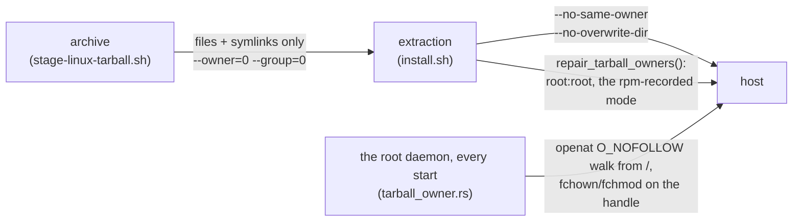
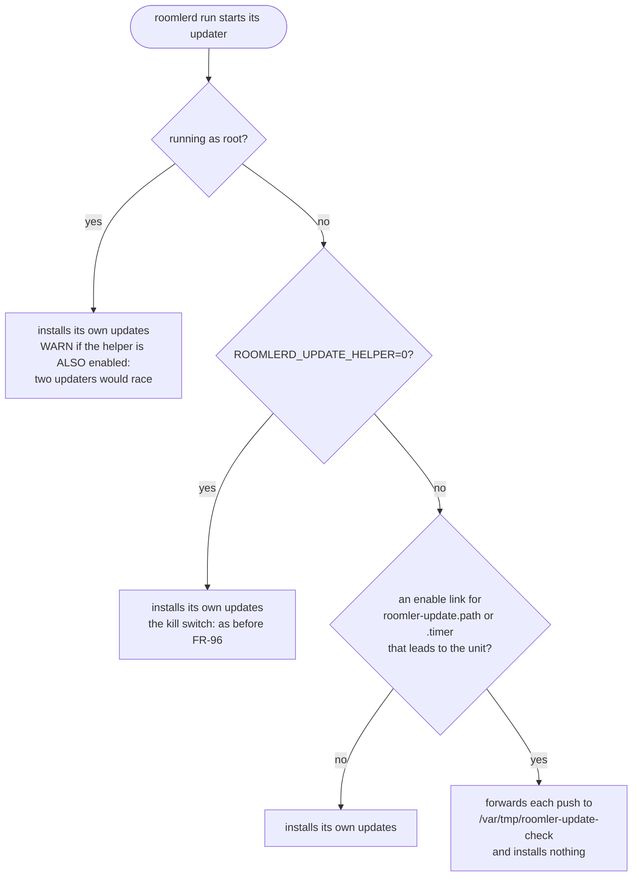
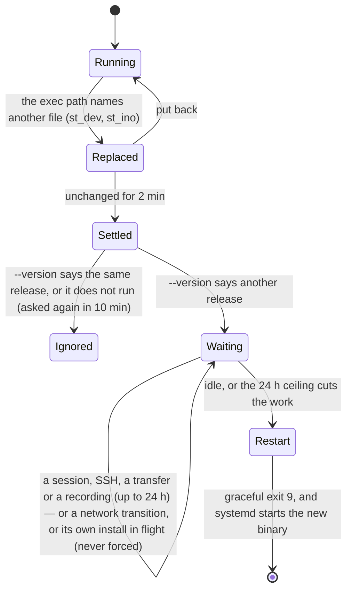
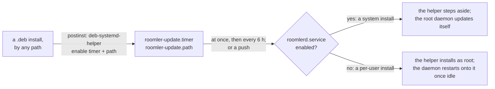

# Linux self-update — design

**Status:** shipped for **system** installs: the tarball path landed in #462 (2026-08-15), after
[#456](https://github.com/gjovanov/roomler-ai/pull/456) (the arch-aware picker and the aarch64 `.deb`). A
**per-user** daemon cannot install its own update, whichever format, so a root update half installs for
it: [FR-96](fr/FR-96-per-user-linux-installs-update-themselves.md) (#2052),
[below](#the-update-half-of-a-per-user-install-fr-96). `install.sh` enables it for a per-user install (P3,
0.4.137), and from 0.4.138 the `.deb` enables it too, however it was installed (P5).

## The problem

`Update all` from the web UI is a permanent no-op on any Linux host that is not
Debian-family **or** not x86_64. Three independent gaps, found 2026-08-15 on
`scw-m2-asahi` (Fedora Asahi Remix 42, Apple M2):

1. **No aarch64 asset.** Releases shipped an x86_64 `.deb`, two Windows MSIs and
   a macOS `.pkg`. `pick_asset_for_unix` found no match and every check ended
   `no installer asset for this platform in release <tag>`. Fixed by #456.
2. **The picker was arch-blind.** It accepted any `*.deb` while gated on
   `target_arch = "x86_64"`, so publishing a second architecture would have made
   x86_64 agents install a foreign package. Fixed by #456.
3. **The installer is Debian-only.** `linux_install_candidates` tries `apt-get`
   and `dpkg` (root) or `pkexec`/`sudo apt-get` (non-root). A Fedora / RHEL /
   SUSE / Arch host has none of them, so **no published artifact can install
   there on any architecture**. This document addresses (3).

`scripts/install.sh` has the same limitation for FIRST install: it hardcodes
`x86_64-unknown-linux-gnu\.deb` and `sudo dpkg -i`.

## Decision: a self-contained tarball as the universal path

Ship a per-arch `.tar.gz` carrying exactly what the `.deb` installs, and teach
the updater to use it when the host has no Debian tooling. Keep the `.deb` for
Debian-family hosts so `apt`/`dpkg` stay the source of truth there.

**Why a tarball rather than an `.rpm`:** one artifact per arch covers Fedora,
RHEL, openSUSE, Arch, Alpine-with-glibc and anything else, where an `.rpm`
covers only the RPM family and would make it three formats × two arches. The
payload is already self-contained — the `.deb` bundles FFmpeg + libvpx into
<!-- RETIRED-NAME-ANCHOR-BEGIN
     usr/lib/roomler-agent is baked into the binary as an RPATH. The whole
     section is about why the bundled libraries live there, so the
     directory name is the subject, not a leftover. -->
`/usr/lib/roomler-agent` with an RPATH precisely so it does not depend on the
distro's libraries — so the package manager is buying us very little beyond its
own bookkeeping. An `.rpm` lane stays available later for hosts where the
package DB matters; it is not needed to make self-update work.

**Cost is near zero in CI:** both Linux jobs already stage this exact payload for
`cargo deb`. The tarball is a `tar czf` over the same tree, no extra build.

## Artifacts

Per Linux arch (`x86_64`, `aarch64`), mirroring `release-tunnel.yml`'s naming:

```
roomler-agent-<version>-<arch>-unknown-linux-gnu.deb        (existing / #456)
roomler-agent-<version>-<arch>-unknown-linux-gnu.tar.gz     (new)
roomler-agent-<version>-<arch>-unknown-linux-gnu.tar.gz.sha256
```

Tarball layout — a prefix dir so extraction is never a surprise, mirroring the
`.deb` asset map in `agents/roomlerd/Cargo.toml`:

```
roomler-agent-<version>-<arch>-unknown-linux-gnu/
  usr/bin/roomlerd                       # the daemon
  usr/bin/roomler                        # the CLI shim (re-execs `roomlerd cli`)
  usr/lib/roomler-agent/*.so.*           # bundled FFmpeg + libvpx ($ORIGIN RPATH)
  usr/lib/systemd/system/roomlerd.service
  usr/lib/systemd/user/roomler.service
  usr/share/doc/roomler-agent/README.Debian
```

## Asset selection

`pick_asset_for_unix` already qualifies by arch after #456. Add a format
preference resolved from the host, and **log the choice** — a silent pick is
indistinguishable from a wrong one:

| Host | Preferred | Fallback |
|---|---|---|
| `dpkg` or `apt-get` on PATH | `.deb` | `.tar.gz` |
| otherwise | `.tar.gz` | — (skip, as today) |

Detection is "is the tool actually on PATH", not `/etc/os-release` parsing: the
question we care about is whether the install can run, and a distro ID is a
proxy for that. Falling back to the tarball when a Debian host somehow lacks the
`.deb` keeps a missing artifact from becoming a dead end.

## Installing the tarball

New `install_tarball_linux` alongside `run_linux_install_candidates`.

⚠️ **It has no privilege ladder**, whatever this design first said. It refuses any
non-root daemon (`agents/roomlerd/src/updater.rs:2078-2087`). It places the files
in-process rather than running one command it could hand to `sudo`, so there is
nothing to escalate. A per-user tarball install therefore never updated (#2046)
until FR-96 gave it a root helper ([below](#the-update-half-of-a-per-user-install-fr-96)).
The `.deb`'s ladder for a non-root daemon is `pkexec`, then `sudo -n`
(`updater.rs:2009-2023`).

1. Extract to a staging dir under the same filesystem as `/usr`.
2. **Assert the expected members exist** before touching anything installed —
   a truncated download that passed the size floor must not half-install.
3. Copy `usr/bin/roomlerd` to `/usr/bin/roomlerd.new`, then `rename(2)` over the
   live path. Replacing a running executable this way is safe on Linux (the
   running process keeps its inode) and is already how the `.deb` path behaves.
   Keep the previous binary as `/usr/bin/roomlerd.prev` for the rollback path.
4. Same for `/usr/bin/roomler` and each `/usr/lib/roomler-agent/*.so.*`.
5. **Systemd units: write only if absent.** An update must never clobber a unit
   the operator edited — the field-test host carries a hand-written unit with
   `ROOMLERD_VIRTUAL_DESKTOP=1`, and silently reverting that on upgrade
   would be a data-loss-class bug. First install places them; upgrades leave
   them alone.
6. Exit and let the service manager restart, exactly as the `.deb` path does.

Integrity is unchanged: the updater already verifies GitHub's `sha256:` `digest`
per asset before install (`verify_sha256`), and that covers the tarball too.

## `scripts/install.sh`

First install currently only handles x86_64 + `.deb`. Teach it the same two
axes:

- arch from `uname -m` (`x86_64` → `x86_64`, `aarch64`/`arm64` → `aarch64`)
- format from the same PATH probe, with the tarball extracted to `/` under
  `sudo` and the units enabled as today

## Ownership: a tarball install never hands a system directory to anyone

⚠️ **Up to 0.4.126 every tarball install left `/usr` another account's.** The
archive was a plain `tar czf` of the staged tree, so it recorded every
*directory* too (`usr/`, `usr/bin/`, `usr/lib/` …) under the CI builder's uid,
1001. `install.sh` extracted it with `sudo tar -xzf … -C /`. GNU tar running as
root restores each entry's owner from the archive, and applies a directory
entry's metadata to a directory that already exists. On the FR-93 lab (Fedora 44,
the released 0.4.126) that left these owned by UID 1001, a person's account on
these distributions:
- `/usr`, `/usr/bin`, `/usr/lib`, `/usr/lib/systemd/{system,user}`,
  `/usr/share`, `/usr/share/doc`;
- and roomler's own files.

Write access to every binary and every unit is root. Three layers close it, and
each one alone stops new damage:



| layer | where | what |
|---|---|---|
| the archive | `scripts/stage-linux-tarball.sh` | files and symlinks only, owned by 0:0 in the archive. With no directory entries, extraction creates only missing parents, as root, and never touches an existing directory |
| the extraction | `scripts/install.sh` | `--no-same-owner --no-overwrite-dir`, so even the already-published archives cannot do it again. Then `repair_tarball_owners()` repairs a host an earlier install damaged: parent before child, stops at a symlink, takes the mode `rpm -qf` records for the path (Fedora ships `/usr/bin` and `/usr/lib` 0555), and otherwise only strips group and other write |
| the daemon | `agents/roomlerd/src/tarball_owner.rs`, called from `run_cmd` after the instance lock | a damaged host updates through its OLD updater, which copies files and never looks at a directory. So the root daemon repairs at every start: a dozen `fstat`s on a healthy host |

⚠️ The daemon's walk is root changing directories another account may own:
the case where a symlink swap becomes a write anywhere. So it never resolves a
path by name:
- it opens `/`, then each component with `openat(…, O_NOFOLLOW)` from the
  previous component's descriptor;
- it changes owner and mode through the opened descriptor;
- parents go before children;
- files are opened `O_NONBLOCK` and checked to be regular.

A symlink anywhere ends that walk and everything below it. ⚠️ With
`O_DIRECTORY|O_NOFOLLOW` the kernel answers a symlink with **ENOTDIR**, not
ELOOP, because it checks the type first. The walk asks the entry itself
(`fstatat(…, AT_SYMLINK_NOFOLLOW)`) before it reports why.

**Detection on a host:** `rpm -V filesystem` flags the directories `UG` (user and
group changed). `sudo rpm --setugids filesystem && sudo rpm --setperms
filesystem` restores the package's own directories, but not roomler's
(`/usr/lib/roomler-agent`, the units). Re-running the fixed `install.sh` repairs
both. Measured on the lab: the fixed `install.sh` repaired a damaged guest to a
clean `rpm -V filesystem`, and changed nothing at all on a pristine one, with the
old archive.

## Verification

- **Unit**: picker preference matrix (deb-preferred with tooling present,
  tarball when absent, arch never crossed, missing-asset fallback), and the
  tarball member assertion.
- **CI**: both Linux jobs must emit and upload the tarball; the existing
  stock-Ubuntu-24.04 load check already proves the payload runs.
- **Field, x86_64 Debian (no regression)**: the cluster nodes (`buildhost`, `fleet-host-2`,
  `fleet-host-1`, all Ubuntu) must keep taking `.deb` updates — they are the
  regression canary for the preference logic.
- **Field, aarch64 non-Debian (the target)**: `scw-m2-asahi` installs from the
  tarball and then takes an `Update all` end-to-end. That host is currently a
  source build with `auto_update = false` precisely because nothing publishable
  can install on it; this is the change that lets it rejoin the normal fleet
  lifecycle.

## Sequencing

1. #456 — arch-aware picker + aarch64 `.deb` *(open, rehearsal-verified)*
2. CI: stage + emit the tarball in both Linux jobs
3. Updater: format preference + `install_tarball_linux` + tests
4. `install.sh`: arch + format detection
5. Field-verify on `scw-m2-asahi`, then re-enable `auto_update` there

## The update half of a per-user install (FR-96)

A per-user daemon runs as the user, and writing `/usr` needs root, whichever
format the host takes. So a per-user install could never install its own update
(#2046). The tarball path refuses outright, and the `.deb` ladder's `pkexec` puts
a password prompt in front of whoever is at the screen. FR-96 gives it the root
half macOS has had since FR-5: `roomlerd update-helper`, run as root by
`roomler-update.service`.

```mermaid
sequenceDiagram
    autonumber
    participant D as per-user roomlerd
    participant W as /var/tmp/roomler-update-check
    participant P as roomler-update.path / .timer
    participant U as roomlerd update-helper (root)
    D->>W: touch: a wake, its content never read (P2a)
    W-->>P: PathExists
    Note over P: the timer fires too: 5 min after boot (at once if started later), then every 6 h
    P->>U: start roomler-update.service
    U->>U: consume/move-aside the wake; space ≥60 s from the last run; the opt-out; the cooldown
    U->>U: check_once, then download_asset → a FRESH private dir (the pinned release key)
    U->>U: install as root: apt-get / dpkg, or the tarball
    Note over D: notices its binary was replaced, restarts onto it once idle (P2b)
```

| unit | what | the macOS twin (`com.roomler.update.plist`) |
|---|---|---|
| `roomler-update.service` | `Type=oneshot`, `ExecStart=/usr/bin/roomlerd update-helper` | the program |
| `roomler-update.timer` | `OnBootSec=5min` (already past for a timer started after boot, so that one fires at once), `OnUnitActiveSec=6h`, `RandomizedDelaySec=30min` | `RunAtLoad`, `StartInterval` |
| `roomler-update.path` | `PathExists=/var/tmp/roomler-update-check` | `WatchPaths` |

- **Shipped in both packages, disabled.**
  - The `.deb` lists the three units as assets (`agents/roomlerd/Cargo.toml`).
  - The tarball stages them (`scripts/stage-linux-tarball.sh`) and installs each
    only where absent (`TARBALL_INSTALL_IF_ABSENT`, `updater.rs`).
  - The `.deb`'s `postinst` enables nothing, by rule (`deb_postinst_is_a_unix_shell_script`,
    `watchdog.rs`).
- ⚠️ **One owner per host.** `install.sh` enables the timer and the path for a
  **per-user** install only (FR-96 P3). A system install's root daemon updates
  itself in-process, and two updaters must never race.
- ⚠️ **The wake file is a wake, never an instruction.** Its content is never read,
  and a symlink at its path is deleted, never followed. Whoever can write
  `/var/tmp` can cause an update *check* as root, never choose what gets
  installed: the helper resolves and verifies the release itself
  (`update_trigger_path`, `queue_update_check`, `run_update_helper`, `updater.rs`).
- **The opt-out** is the macOS one, `/etc/roomler/disable-auto-update`, honoured
  by the helper itself.
- **Root only.** The helper refuses any other uid before it touches the wake
  file, the network or the install.

### A hostile local user cannot subvert the root helper (security review, #2055)

The helper runs as root and is woken by a world-writable path, so its two
exposures to an unprivileged local user were closed before P1 shipped.

- ⚠️ **The download is staged where nobody else can reach it.** `/tmp` is sticky
  but a *subdirectory* of it is not, so the old fixed `/tmp/roomlerd-update/<asset>`
  let any user own the directory, wait for root's verified `.deb` to land, and
  `rename` an attacker package over it before `apt-get install <path>` /
  `tar -xzf <path>` re-read the path — root would then install it (dpkg maintainer
  scripts run as root). Each download now goes to a FRESH private directory
  (mkdtemp, 0755, owned by the caller; the write is `O_EXCL`), which a non-owner
  cannot create, rename or unlink inside, and it is removed once the installer has
  read it (`stage_dir`, `write_installer`, `discard_staging`, `updater.rs`). **The
  verified bytes are the installed bytes.** macOS (per-user
  `_CS_DARWIN_USER_TEMP_DIR`) and Windows (SYSTEM `GetTempPath2`) keep the shared
  dir; Windows 10's `C:\Windows\Temp` has the same shape and is a separate
  follow-up.
- ⚠️ **A wake storm costs one check a minute and fails nothing.** `PathExists=` is
  level-triggered and the service had systemd's default start limit (5/10 s), so —
  measured on systemd 255 — six touches in 10 s, or a single `mkdir` at the wake
  path, left `roomler-update.path` `failed (unit-start-limit-hit)` until reboot,
  and a pushed update then silently degraded to the 6 h timer. The helper now
  spaces its own runs ≥60 s (`UPDATE_HELPER_MIN_GAP`, launchd's `ThrottleInterval`
  twin, `updater.rs`); the service carries `StartLimitIntervalSec=0` and
  `Restart=on-failure`/`RestartSec=60s` (a helper that fails *before* its gate —
  203/EXEC, a startup panic — would otherwise hit the path unit's own 200/2 s
  trigger limit, which also fails it); and `consume_wake` unlinks a planted symlink
  without following it and moves a planted directory aside into a fresh root-owned
  dir. Never `PrivateTmp=` — it would hide `/var/tmp` and the wake could never be
  consumed.

| what a local user does to `/var/tmp/roomler-update-check` | what it costs |
|---|---|
| touches it in a tight loop | ≤ one root check per minute (the 60 s gate); no unit ever fails |
| plants a symlink there | unlinked, never followed; the target is untouched |
| plants a directory there | moved aside into a fresh root-owned dir and removed; the path re-arms |
| plants a mount point there (`fusermount3`) | logged; the helper re-runs once per gap, the path unit stays `active` — same bounded residual as macOS (macFUSE) |
| owns a pre-fix `/tmp/roomlerd-update/` | never touched (the guard matches only the `roomler-update.` mkdtemp prefix) |

Even at its worst, a user who makes every check find "a newer release" is bounded
by the 5-minute install cooldown to one verified ~100 MB download per 5 minutes,
and can never choose *what* is installed — the helper resolves and verifies the
release itself.

### The per-user daemon steps aside (P2a)

On a host whose helper is enabled, a per-user daemon installs nothing: a pushed
`rc:agent.update` becomes a touch of the wake file, and the helper's timer
replaces the daemon's own periodic check. The daemon decides once, at its start
(`run_periodic` → `decide_update_owner`, `updater.rs`):



- **"Enabled" is a file check**, not `systemctl is-enabled`: the `.wants` link
  `systemctl enable` (or `enable --runtime`) leaves under `/etc` or `/run`,
  followed, so a link a removed package left dangling does not count
  (`UPDATE_HELPER_ENABLE_LINKS`). No bus and no child process, and it reads the
  same inside the unit's sandbox.
- ⚠️ **On doubt, in-process.** A wrong "helper" answer would freeze the host
  (wakes nobody hears — #2046 again). A wrong "in-process" answer costs a failed
  `pkexec`, and the helper's own timer still installs.
- ⚠️ **The user unit grants `/var/tmp`** (`ReadWritePaths=-/var/tmp`,
  `packaging/linux/roomler.service`). `ProtectSystem=strict` leaves it read-only
  wherever the user manager applies the sandbox. Measured on Fedora 44 KDE: the
  0.4.128 unit answered `Read-only file system` there, so every push would have
  failed. Only the directory can be granted: the helper deletes the file each run,
  and a `ReadWritePaths` entry binds only what exists when the sandbox is built.
  A daemon still on an older unit logs the failure and names the cure: re-run
  `install.sh`. The updater's own tarball install writes units only where absent.
- **A per-user `auto_update = false` stops the forwarding too**, so a push is
  dropped. The helper's timer still installs, so on a helper host the opt-out is
  `/etc/roomler/disable-auto-update`.
- **Enabling the helper takes effect at the daemon's next start**, so `install.sh`
  (P3) reloads the user manager (`systemctl --user daemon-reload`, or the old
  sandbox stays) and restarts the per-user daemon after enabling the units.

Field-verified on the lab's Fedora KDE guest. A real server push reached the
daemon, which touched the wake file. The helper installed 0.4.133 as root 61 s
later: its first run waits the full 60 s gap, because it has no stamp yet. The
daemon logged no install attempt of its own
([FR-96 §8](fr/FR-96-per-user-linux-installs-update-themselves.md#8-field-verification-log)).

### The per-user daemon onto the new binary (P2b)

Nothing else restarts a per-user daemon after its binary is replaced. The helper
never speaks to it, and the `.deb`'s postinst never restarts anything, by rule.
So the daemon watches its own binary (`replaced_binary.rs`), and restarts once
nothing it serves would be cut. The same watch covers the helper's install, an
admin's `apt upgrade` and a hand install:



- **"Replaced" is an inode, not ` (deleted)`.** The tarball's install renames the
  old binary to `.prev`, which `/proc/self/exe` then names. At start the exec
  path and `/proc/self/exe` must be one file, or the watch stands down: that
  filesystem cannot tell a replacement.
- ⚠️ **A binary that does not run is never restarted onto.** Its `--version` is
  asked first, so a replacement that cannot even load (a missing shared library)
  leaves the daemon online on its old image instead of in a crash loop.
- ⚠️ **An SSH session counts.** The likeliest replacement outside the helper is an
  admin's `apt upgrade` typed into a roomler SSH session on that device, so open
  SSH connections defer the restart like a remote-control session does.
- **The restart is "Apply now"'s** (FR-84 D3): only under a supervisor that
  relaunches the process, rate-limited by the persisted record, and checked
  against systemd's own policy first. An orphan `roomlerd run` never exits for it.
- **What does not stop it:** `auto_update = false`, because running what is
  already installed is not an update. **What does:** `ROOMLERD_UPDATE_HELPER=0`,
  FR-96's kill switch. A root daemon is not watched at all, since a system
  install is unchanged.

Field-verified on the lab's Fedora KDE guest, with the stock build failing
first: four minutes after its binary was replaced, it was still running the
deleted image. The run went:
- A viewer session was held open across a real push, and the helper installed
  0.4.134.
- The daemon logged `restart deferred busy=1 remote-control session(s)`. The
  session was never cut (32 of 32 checks connected).
- At the first check after the viewer left, the daemon restarted onto 0.4.134,
  and the server reported the new version
  ([FR-96 §8](fr/FR-96-per-user-linux-installs-update-themselves.md#8-field-verification-log)).

### The installers turn it on (P3)

`install.sh` decides per install, from what the release's binary says it can
do (`roomlerd update-helper --capabilities`: `wake-file`, `step-aside`,
`restart-on-replace`):

| install | the helper | the running daemon |
|---|---|---|
| per-user, the binary lists `step-aside` | enabled, BEFORE the daemon starts | a fresh install starts it; a re-run restarts it only when nothing else will (below) |
| per-user, it does not | left off, with a NOTE | as before |
| `--system` | turned off, if a per-user install left it on | the root daemon installs its own updates |

A re-run finds the daemon already running. It decided at its start who
installs its updates, and P2b restarts it only onto **another** version. So
the script compares the running image (`/proc/<pid>/exe`) with the installed
one, and reads the helper's state before and after by the daemon's own test
(the same four enable links):

| the running daemon | the helper | a re-run |
|---|---|---|
| the installed version | unchanged | leaves it |
| the installed version | just turned on | restarts it, so that it decides again |
| another version, lists `restart-on-replace` | either | leaves it: P2b restarts it once idle |
| another version, older | either | restarts it (anyone connected drops for a few seconds) |
| any, while the installed binary does not answer `--version` | either | leaves it, with a WARNING |

- ⚠️ **A capability, not a version.** The script ships with a server
  promote and the daemon with an agent release, and the two need not arrive
  in order. Enabling the helper beside a daemon that still installs its own
  updates would put two updaters on one host.
- A non-root `roomlerd self-update` wakes the helper where it owns updates,
  through the daemon's own decision, so the CLI and the daemon never disagree.
- `README.Debian` describes the manual flow: check that the helper is on, then
  start the user unit. With the system unit, the helper steps aside.

### The package turns it on too (P5)

A per-user daemon runs under its unit's `NoNewPrivileges=true`, so it can
never install a release itself, on any distro. The kernel ignores the setuid
bit of everything it spawns: pkexec exits 127 (*"must be setuid root"*), and
sudo exits 1 (*"the 'no new privileges' flag is set"*). P3 turns the helper on
through `install.sh` only, so a per-user `.deb` installed any other way (apt,
the Software app, `dpkg -i`) never updated again. From P5 the package takes
care of it.



| what | how |
|---|---|
| `postinst` turns the update half on | `deb-systemd-helper` enables `roomler-update.timer` and `.path` on the first configure of a version that ships it, which is an existing host's first upgrade too. It never re-enables them over an administrator's `systemctl disable`. The daemon units stay untouched, as they always were. |
| the helper steps aside on a system install | with `roomlerd.service` enabled, after its 60 s gate, so one updater per host holds however the units got enabled |
| the timer it starts fires at once | an `OnBootSec` already in the past elapses immediately (`systemd.timer(5)`; measured, FR-96 §8), so the unit needs nothing more |
| a daemon that cannot install says so | with the helper off it downloads nothing and logs `sudo systemctl enable --now roomler-update.timer roomler-update.path`. It hands its updates to the helper as soon as one is on, with no restart |

⚠️ A host whose daemon is already stuck cannot receive this by itself: one
install by a person heals it (`sudo apt install ./roomlerd.deb`, the Software
app, or a re-run of `install.sh`). The running daemon then follows on its own
only if it has P2b: once idle, and once its own last failed attempt is 10 min
old. An older daemon runs its old image until its next start, a re-login or a
reboot (`install.sh` restarts it). Details:
[FR-96 §3.6](fr/FR-96-per-user-linux-installs-update-themselves.md#36-the-package-turns-on-its-own-update-half-p5-as-built).
The devices page marks such a host **not updating** once the first release it
missed has been out for a day, and its tooltip carries the same remedy
([FR-106](fr/FR-106-devices-say-when-not-updating.md),
[ui.md](ui.md#the-devices-lists-needs-a-person-chips)).

The phases:

| phase | ships |
|---|---|
| **P1** | the helper on Linux, and the three units in both packages, disabled |
| **P2a** | the per-user daemon wakes the helper instead of installing, and its unit may write the wake file |
| **P2b** | the per-user daemon onto its replaced binary once idle, whatever replaced it |
| **P3** | `install.sh` enables the units for a per-user install, and turns them off for `--system`; a non-root `self-update` wakes the helper |
| **P5** | the `.deb` enables them itself (`postinst`, the Debian way), the helper steps aside on a system install, and a daemon that cannot install waits for the helper |

Status and evidence: [FR-96](fr/FR-96-per-user-linux-installs-update-themselves.md).

## Deliberately out of scope

- **`.rpm` lane** — the tarball makes self-update work on every distro: for a
  system install directly, and for a per-user one through FR-96's helper. An
  `.rpm` only adds package-DB integration for one distro family. Revisit if a
  customer needs `dnf` to own the install.
- **musl / Alpine** — the payload is glibc-linked. A musl target is a separate
  build, not a packaging change.
- **arm64 FFmpeg** — the aarch64 build ships without `ffmpeg-encoder` (no
  linux-arm64 vendored FFmpeg exists, and its encoders dispatch to
  nvenc/qsv/amf, none of which exist on these hosts). Unrelated to install.
<!-- RETIRED-NAME-ANCHOR-END -->
