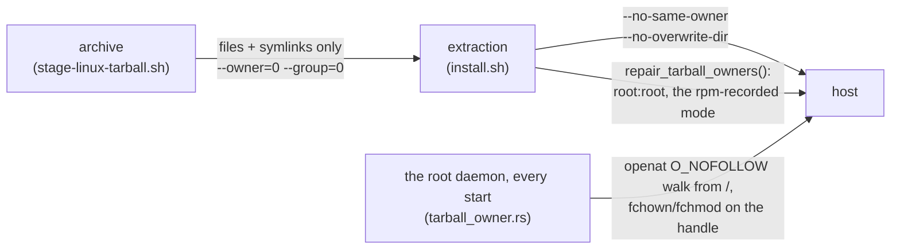

# Linux self-update — design

**Status:** shipped for **system** installs: the tarball path landed in #462 (2026-08-15), after
[#456](https://github.com/gjovanov/roomler-ai/pull/456) (the arch-aware picker and the aarch64 `.deb`). A
**per-user** install cannot install its own update, whichever format. Its root update half is
[FR-96](fr/FR-96-per-user-linux-installs-update-themselves.md) (#2052), [below](#the-update-half-of-a-per-user-install-fr-96).

## The problem

`Update all` from the web UI is a permanent no-op on any Linux host that is not
Debian-family **or** not x86_64. Three independent gaps, found 2026-08-15 on
`scw-m2-asahi` (Fedora Asahi Remix 42, Apple M2):

1. **No aarch64 asset.** Releases shipped an x86_64 `.deb`, two Windows MSIs and
   a macOS `.pkg`. `pick_asset_for_unix` found no match and every check ended
   `no installer asset for this platform in release <tag>`. Fixed by #456.
2. **The picker was arch-blind.** It accepted any `*.deb` while gated on
   `target_arch = "x86_64"`, so publishing a second architecture would have made
   x86_64 agents install a foreign package. Fixed by #456.
3. **The installer is Debian-only.** `linux_install_candidates` tries `apt-get`
   and `dpkg` (root) or `pkexec`/`sudo apt-get` (non-root). A Fedora / RHEL /
   SUSE / Arch host has none of them, so **no published artifact can install
   there on any architecture**. This document addresses (3).

`scripts/install.sh` has the same limitation for FIRST install: it hardcodes
`x86_64-unknown-linux-gnu\.deb` and `sudo dpkg -i`.

## Decision: a self-contained tarball as the universal path

Ship a per-arch `.tar.gz` carrying exactly what the `.deb` installs, and teach
the updater to use it when the host has no Debian tooling. Keep the `.deb` for
Debian-family hosts so `apt`/`dpkg` stay the source of truth there.

**Why a tarball rather than an `.rpm`:** one artifact per arch covers Fedora,
RHEL, openSUSE, Arch, Alpine-with-glibc and anything else, where an `.rpm`
covers only the RPM family and would make it three formats × two arches. The
payload is already self-contained — the `.deb` bundles FFmpeg + libvpx into
<!-- RETIRED-NAME-ANCHOR-BEGIN
     usr/lib/roomler-agent is baked into the binary as an RPATH. The whole
     section is about why the bundled libraries live there, so the
     directory name is the subject, not a leftover. -->
`/usr/lib/roomler-agent` with an RPATH precisely so it does not depend on the
distro's libraries — so the package manager is buying us very little beyond its
own bookkeeping. An `.rpm` lane stays available later for hosts where the
package DB matters; it is not needed to make self-update work.

**Cost is near zero in CI:** both Linux jobs already stage this exact payload for
`cargo deb`. The tarball is a `tar czf` over the same tree, no extra build.

## Artifacts

Per Linux arch (`x86_64`, `aarch64`), mirroring `release-tunnel.yml`'s naming:

```
roomler-agent-<version>-<arch>-unknown-linux-gnu.deb        (existing / #456)
roomler-agent-<version>-<arch>-unknown-linux-gnu.tar.gz     (new)
roomler-agent-<version>-<arch>-unknown-linux-gnu.tar.gz.sha256
```

Tarball layout — a prefix dir so extraction is never a surprise, mirroring the
`.deb` asset map in `agents/roomlerd/Cargo.toml`:

```
roomler-agent-<version>-<arch>-unknown-linux-gnu/
  usr/bin/roomlerd                       # the daemon
  usr/bin/roomler                        # the CLI shim (re-execs `roomlerd cli`)
  usr/lib/roomler-agent/*.so.*           # bundled FFmpeg + libvpx ($ORIGIN RPATH)
  usr/lib/systemd/system/roomlerd.service
  usr/lib/systemd/user/roomler.service
  usr/share/doc/roomler-agent/README.Debian
```

## Asset selection

`pick_asset_for_unix` already qualifies by arch after #456. Add a format
preference resolved from the host, and **log the choice** — a silent pick is
indistinguishable from a wrong one:

| Host | Preferred | Fallback |
|---|---|---|
| `dpkg` or `apt-get` on PATH | `.deb` | `.tar.gz` |
| otherwise | `.tar.gz` | — (skip, as today) |

Detection is "is the tool actually on PATH", not `/etc/os-release` parsing: the
question we care about is whether the install can run, and a distro ID is a
proxy for that. Falling back to the tarball when a Debian host somehow lacks the
`.deb` keeps a missing artifact from becoming a dead end.

## Installing the tarball

New `install_tarball_linux` alongside `run_linux_install_candidates`.

⚠️ **It has no privilege ladder**, whatever this design first said. It refuses any
non-root daemon (`agents/roomlerd/src/updater.rs:1826-1835`). It places the files
in-process rather than running one command it could hand to `sudo`, so there is
nothing to escalate. A per-user tarball install therefore never updated (#2046)
until FR-96 gave it a root helper ([below](#the-update-half-of-a-per-user-install-fr-96)).
The `.deb`'s ladder for a non-root daemon is `pkexec`, then `sudo -n`
(`updater.rs:1761-1775`).

1. Extract to a staging dir under the same filesystem as `/usr`.
2. **Assert the expected members exist** before touching anything installed —
   a truncated download that passed the size floor must not half-install.
3. Copy `usr/bin/roomlerd` to `/usr/bin/roomlerd.new`, then `rename(2)` over the
   live path. Replacing a running executable this way is safe on Linux (the
   running process keeps its inode) and is already how the `.deb` path behaves.
   Keep the previous binary as `/usr/bin/roomlerd.prev` for the rollback path.
4. Same for `/usr/bin/roomler` and each `/usr/lib/roomler-agent/*.so.*`.
5. **Systemd units: write only if absent.** An update must never clobber a unit
   the operator edited — the field-test host carries a hand-written unit with
   `ROOMLERD_VIRTUAL_DESKTOP=1`, and silently reverting that on upgrade
   would be a data-loss-class bug. First install places them; upgrades leave
   them alone.
6. Exit and let the service manager restart, exactly as the `.deb` path does.

Integrity is unchanged: the updater already verifies GitHub's `sha256:` `digest`
per asset before install (`verify_sha256`), and that covers the tarball too.

## `scripts/install.sh`

First install currently only handles x86_64 + `.deb`. Teach it the same two
axes:

- arch from `uname -m` (`x86_64` → `x86_64`, `aarch64`/`arm64` → `aarch64`)
- format from the same PATH probe, with the tarball extracted to `/` under
  `sudo` and the units enabled as today

## Ownership: a tarball install never hands a system directory to anyone

⚠️ **Up to 0.4.126 every tarball install left `/usr` another account's.** The
archive was a plain `tar czf` of the staged tree, so it recorded every
*directory* too (`usr/`, `usr/bin/`, `usr/lib/` …) under the CI builder's uid,
1001. `install.sh` extracted it with `sudo tar -xzf … -C /`. GNU tar running as
root restores each entry's owner from the archive, and applies a directory
entry's metadata to a directory that already exists. On the FR-93 lab (Fedora 44,
the released 0.4.126) that left these owned by UID 1001, a person's account on
these distributions:
- `/usr`, `/usr/bin`, `/usr/lib`, `/usr/lib/systemd/{system,user}`,
  `/usr/share`, `/usr/share/doc`;
- and roomler's own files.

Write access to every binary and every unit is root. Three layers close it, and
each one alone stops new damage:



| layer | where | what |
|---|---|---|
| the archive | `scripts/stage-linux-tarball.sh` | files and symlinks only, owned by 0:0 in the archive. With no directory entries, extraction creates only missing parents, as root, and never touches an existing directory |
| the extraction | `scripts/install.sh` | `--no-same-owner --no-overwrite-dir`, so even the already-published archives cannot do it again. Then `repair_tarball_owners()` repairs a host an earlier install damaged: parent before child, stops at a symlink, takes the mode `rpm -qf` records for the path (Fedora ships `/usr/bin` and `/usr/lib` 0555), and otherwise only strips group and other write |
| the daemon | `agents/roomlerd/src/tarball_owner.rs`, called from `run_cmd` after the instance lock | a damaged host updates through its OLD updater, which copies files and never looks at a directory. So the root daemon repairs at every start: a dozen `fstat`s on a healthy host |

⚠️ The daemon's walk is root changing directories another account may own:
the case where a symlink swap becomes a write anywhere. So it never resolves a
path by name:
- it opens `/`, then each component with `openat(…, O_NOFOLLOW)` from the
  previous component's descriptor;
- it changes owner and mode through the opened descriptor;
- parents go before children;
- files are opened `O_NONBLOCK` and checked to be regular.

A symlink anywhere ends that walk and everything below it. ⚠️ With
`O_DIRECTORY|O_NOFOLLOW` the kernel answers a symlink with **ENOTDIR**, not
ELOOP, because it checks the type first. The walk asks the entry itself
(`fstatat(…, AT_SYMLINK_NOFOLLOW)`) before it reports why.

**Detection on a host:** `rpm -V filesystem` flags the directories `UG` (user and
group changed). `sudo rpm --setugids filesystem && sudo rpm --setperms
filesystem` restores the package's own directories, but not roomler's
(`/usr/lib/roomler-agent`, the units). Re-running the fixed `install.sh` repairs
both. Measured on the lab: the fixed `install.sh` repaired a damaged guest to a
clean `rpm -V filesystem`, and changed nothing at all on a pristine one, with the
old archive.

## Verification

- **Unit**: picker preference matrix (deb-preferred with tooling present,
  tarball when absent, arch never crossed, missing-asset fallback), and the
  tarball member assertion.
- **CI**: both Linux jobs must emit and upload the tarball; the existing
  stock-Ubuntu-24.04 load check already proves the payload runs.
- **Field, x86_64 Debian (no regression)**: the cluster nodes (`buildhost`, `fleet-host-2`,
  `fleet-host-1`, all Ubuntu) must keep taking `.deb` updates — they are the
  regression canary for the preference logic.
- **Field, aarch64 non-Debian (the target)**: `scw-m2-asahi` installs from the
  tarball and then takes an `Update all` end-to-end. That host is currently a
  source build with `auto_update = false` precisely because nothing publishable
  can install on it; this is the change that lets it rejoin the normal fleet
  lifecycle.

## Sequencing

1. #456 — arch-aware picker + aarch64 `.deb` *(open, rehearsal-verified)*
2. CI: stage + emit the tarball in both Linux jobs
3. Updater: format preference + `install_tarball_linux` + tests
4. `install.sh`: arch + format detection
5. Field-verify on `scw-m2-asahi`, then re-enable `auto_update` there

## The update half of a per-user install (FR-96)

A per-user daemon runs as the user, and writing `/usr` needs root, whichever
format the host takes. So a per-user install could never install its own update
(#2046). The tarball path refuses outright, and the `.deb` ladder's `pkexec` puts
a password prompt in front of whoever is at the screen. FR-96 gives it the root
half macOS has had since FR-5: `roomlerd update-helper`, run as root by
`roomler-update.service`.

```mermaid
sequenceDiagram
    autonumber
    participant D as per-user roomlerd
    participant W as /var/tmp/roomler-update-check
    participant P as roomler-update.path / .timer
    participant U as roomlerd update-helper (root)
    D->>W: touch: a wake, its content never read (P2)
    W-->>P: PathExists
    Note over P: the timer fires too: 5 min after boot, then every 6 h
    P->>U: start roomler-update.service
    U->>U: consume the wake file; the opt-out; the cooldown
    U->>U: check_once, then download_asset (the pinned release key)
    U->>U: install as root: apt-get / dpkg, or the tarball
    Note over D: runs the new binary from its next restart (P2 asks it, once idle)
```

| unit | what | the macOS twin (`com.roomler.update.plist`) |
|---|---|---|
| `roomler-update.service` | `Type=oneshot`, `ExecStart=/usr/bin/roomlerd update-helper` | the program |
| `roomler-update.timer` | `OnBootSec=5min`, `OnUnitActiveSec=6h`, `RandomizedDelaySec=30min` | `RunAtLoad`, `StartInterval` |
| `roomler-update.path` | `PathExists=/var/tmp/roomler-update-check` | `WatchPaths` |

- **Shipped in both packages, disabled.**
  - The `.deb` lists the three units as assets (`agents/roomlerd/Cargo.toml`).
  - The tarball stages them (`scripts/stage-linux-tarball.sh`) and installs each
    only where absent (`TARBALL_INSTALL_IF_ABSENT`, `updater.rs`).
  - The `.deb`'s `postinst` enables nothing, by rule (`deb_postinst_is_a_unix_shell_script`,
    `watchdog.rs`).
- ⚠️ **One owner per host.** `install.sh` enables the timer and the path for a
  **per-user** install only (FR-96 P3). A system install's root daemon updates
  itself in-process, and two updaters must never race.
- ⚠️ **The wake file is a wake, never an instruction.** Its content is never read,
  and a symlink at its path is deleted, never followed. Whoever can write
  `/var/tmp` can cause an update *check* as root, never choose what gets
  installed: the helper resolves and verifies the release itself
  (`update_trigger_path`, `queue_update_check`, `run_update_helper`, `updater.rs`).
- **The opt-out** is the macOS one, `/etc/roomler/disable-auto-update`, honoured
  by the helper itself.
- **Root only.** The helper refuses any other uid before it touches the wake
  file, the network or the install.

The phases:

| phase | ships |
|---|---|
| **P1** | the helper on Linux, and the three units in both packages, disabled |
| **P2** | the per-user daemon wakes the helper instead of installing, and is restarted onto the new binary once idle |
| **P3** | `install.sh` enables the units for a per-user install |

Status and evidence: [FR-96](fr/FR-96-per-user-linux-installs-update-themselves.md).

## Deliberately out of scope

- **`.rpm` lane** — the tarball makes self-update work on every distro: for a
  system install directly, and for a per-user one through FR-96's helper. An
  `.rpm` only adds package-DB integration for one distro family. Revisit if a
  customer needs `dnf` to own the install.
- **musl / Alpine** — the payload is glibc-linked. A musl target is a separate
  build, not a packaging change.
- **arm64 FFmpeg** — the aarch64 build ships without `ffmpeg-encoder` (no
  linux-arm64 vendored FFmpeg exists, and its encoders dispatch to
  nvenc/qsv/amf, none of which exist on these hosts). Unrelated to install.
<!-- RETIRED-NAME-ANCHOR-END -->
