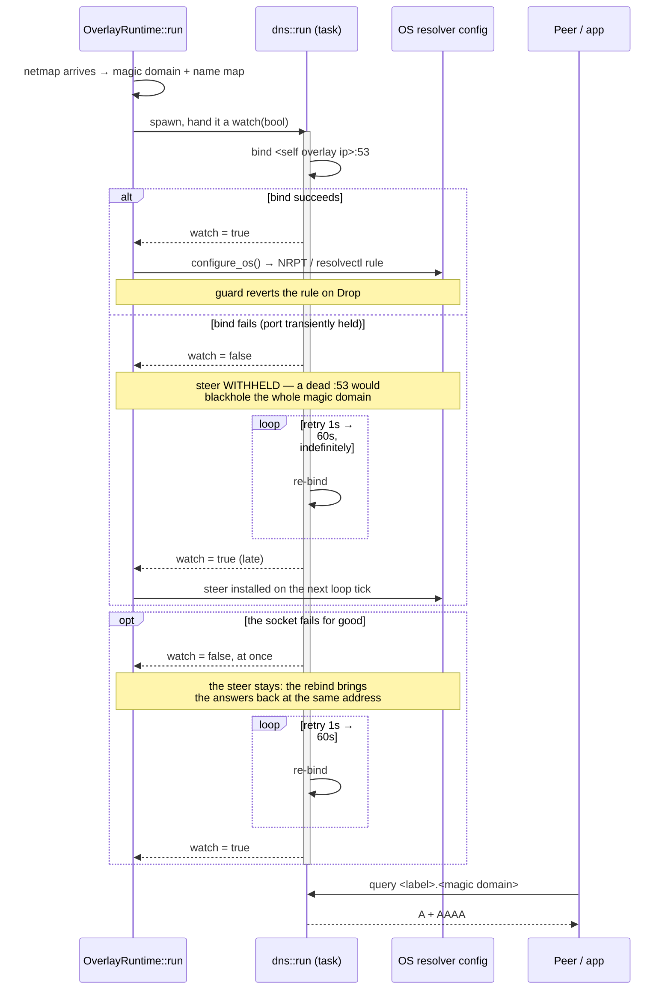
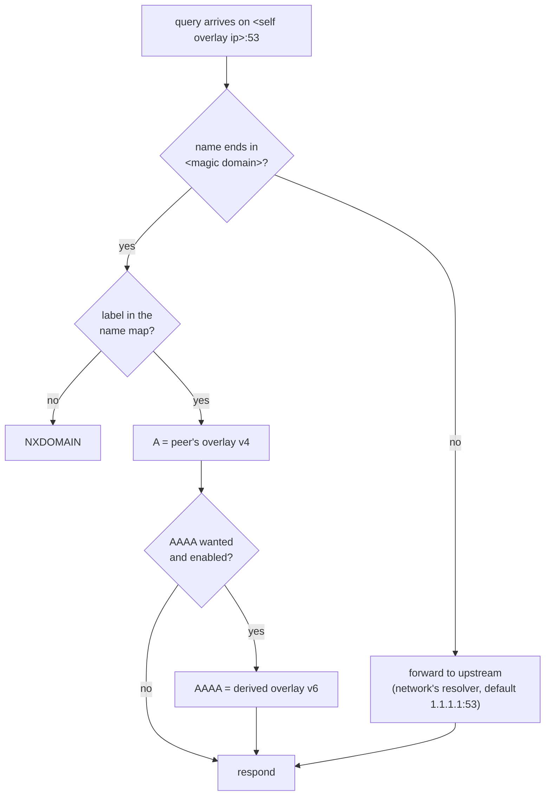
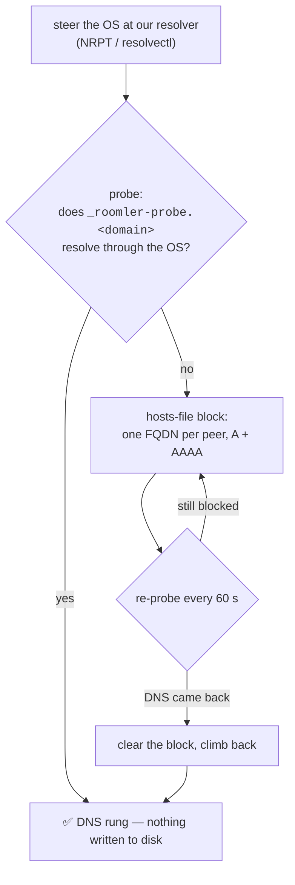

# MagicDNS — resolving peers by name

**`<label>.<tenant magic domain>` → a peer's overlay address, on every enrolled
host, with no DNS server to run and no `/etc/hosts` to maintain.**

This document covers the **resolver and the OS steer** — how a name becomes an
answer. Where the *label* comes from (fleet name vs overlay label, renames,
de-duplication) is [`device-naming.md`](device-naming.md).

## Two halves, and both must be live

| Half | What it is | Where |
|---|---|---|
| **The resolver** | a UDP server the daemon binds on `<self overlay ip>:53`, answering from a name map synced off the netmap | `crates/tunnel-core/src/overlay/dns.rs:95` (`run`) |
| **The OS steer** | a host rule sending *only* `<magic domain>` at that resolver | `dns.rs:431` (`configure_os`) |

🔑 **Either alone is useless, and the failure modes differ.** A resolver nobody
is steered at answers nothing anybody asks. A steer pointing at a resolver that
never bound is *worse than nothing*: on Windows the NRPT is registry-global, so
it blackholes the magic domain **host-wide**. That asymmetry is why the steer is
gated on the bind, never the reverse.

🔑 **Whether the two meet is measured, never inferred** (#1363). Both halves can
be up while the host's own lookups never arrive: a policy-managed NRPT ignores
the rule, or an enforced corporate DNS layer refuses the query. So the daemon
asks the OS for a name only an overlay resolver answers, and `roomler status`
says `active` only on that answer
([What `roomler status` says](#what-roomler-status-says)).

## Who sets the domain and the upstreams

The org's MagicDNS domain and its upstream resolvers are the org's settings
(`…/magic-dns`, the web app's **Network → MagicDNS** page), and every overlay node of
the org applies them: its resolver answers for the domain and forwards every other
name upstream, and under an exit node the host's whole DNS goes there (`dns.rs:650`).

| Route | Who | Why |
|---|---|---|
| `GET …/magic-dns` | any member | every node of the org receives both in its netmap, and a member reaches peers by `<node>.<domain>` |
| `PUT …/magic-dns` | **`MANAGE_AGENTS`**, decided first | it changes every node's DNS, a device-management action like the overlay ACL's mode and the retired-key switch |

⚠️ The bit is decided before the body is read, so a member without it gets one 403
`forbidden` whatever the body says (a valid domain, one the route would refuse 400,
switching MagicDNS off, or a body that does not parse, #4218), never `not_a_member`.
The page shows such a member the current settings read-only, and a save the server
refuses turns it read-only rather than showing an error ([security-baseline.md](security-baseline.md#the-orgs-magicdns-manage_agents-to-change-it-any-member-to-read-it)).

## Bring-up



⚠️ **The runtime is scoped to ONE WebSocket session.** Every reconnect tears the
whole thing down and rebuilds it — including this resolver. That single fact is
behind both bugs in [FR-72](fr/FR-72-magicdns-without-an-os-port.md).

🔑 **The bound signal is live for the whole session** (#1363). The resolver
reports `false` the moment its socket fails for good (`dns.rs:133`), not only
when a first bind fails, and the runtime reads it on every 5 s tick. Before, a
resolver in its rebind loop read as bound for the rest of the session, and the
status said `active` over a port nobody served. The steer is not withdrawn (the
runtime only ever installs it), so the rebind brings the answers back at the
same address.

## Answering a query



The name map is re-synced from the peer set whenever the netmap changes
(`sync_name_map`), so a renamed or newly-joined peer resolves without a restart.

⚠️ **AAAA is on by default and is a mixed-fleet hazard.** An old peer's OS does
not own its derived overlay v6, so v6 traffic to it blackholes; happy-eyeballs
clients fall back, strictly-sequential ones hang. `ROOMLERD_DNS_AAAA=0` reverts
to A-only without a rebuild.

## The OS steer, per platform

| Platform | Mechanism | Notes |
|---|---|---|
| **Windows** | `Add-DnsClientNrptRule -Namespace '.<domain>' -NameServers '<ip>'` (`dns.rs:534`) | ⚠️ The NRPT is **registry-global**, not per-interface — which is why a steer at a dead resolver breaks the domain for the whole host. ⚠️ NRPT nameservers carry **no port**: `-NameServers 'ip:port'` silently stores an *empty* list, so "just use another port" is not available here. ⚠️⚠️ **On a GPO-managed host a locally-written rule may not take effect until a policy refresh** — see below. |
| **Linux** | `resolvectl dns/domain <link>` (`dns.rs:547`) | ⚠️ `resolvectl` **replaces** a link's settings, so multi-org hosts must write all orgs' entries together rather than one at a time. ⚠️ The steer lives in systemd-resolved, so it reaches only lookups that ask resolved. When nsswitch has no `resolve` and `/etc/resolv.conf` does not name resolved's stub (`127.0.0.53`), nothing asks it. WSL is that case: its generated `resolv.conf` names the Windows host's DNS proxy. `roomler status` then says `the OS does not reach the resolver`, or `names resolve through another resolver` when another node answers for this host (WSL whose Windows host runs roomlerd in the same org), each with where lookups go instead (FR-97 P3h, `dns.rs:468`, `resolver_bypass`; measured since #1363). |
| **macOS** (FR-97 P1c) | a supplemental resolver in the SCDynamicStore: `State:/Network/Service/roomler-dns-<utun>/DNS` = `ServerAddresses [<ip>]`, `SupplementalMatchDomains [<domain>]`, `SupplementalMatchDomainsNoSearch 1` (`dns.rs`, `mod scdns`) | Per utun, so sibling orgs' zones coexist. Added as a **temporary** value of the daemon's one store session, so configd removes it when the daemon ends, crash included (measured: gone within 1–4 s of a SIGKILL). Honoured by the system resolver, not by `dig` (which reads `/etc/resolv.conf`); check with `scutil --dns`. `ROOMLERD_MACOS_DNS_STEER=0` turns it off. |
| **everything else** | none — `setup_os` returns `false` | Names still resolve through the SOCKS path (which does its own DOMAIN resolution); the OS itself is simply not steered, and `roomler status` says `resolver up, OS steer FAILED`. |

The rule is owned by a `DnsOsGuard` (`dns.rs:400`) that reverts it on `Drop`, so
a teardown leaves no stale steer behind.

### ⚠️ Windows: on a GPO-managed host a local rule waits for a policy refresh

On a domain-joined, policy-managed host a rule we write to the local store can
sit there **without taking effect**. Everything else looks perfect and no query
reaches the resolver:

```
Get-NetUDPEndpoint 53               ->  <self overlay ip>  by roomlerd   ← bound
Get-DnsClientNrptRule   (local)     ->  .<magic domain> -> <self ip>     ← written
Get-DnsClientNrptPolicy -Effective  ->  0 rules                          ← honoured by nobody
```

⚠️ It is **pending, not ignored**: after a policy refresh the same local rule was
observed effective and correct on the same host. So the likely fix is to
*trigger* a refresh after writing, rather than to write the Group-Policy store
(the `detectWriteAsGP` approach), which would mean a SYSTEM-level registry writer
whose stale rules the daemon could never revert. Tracked as **P5** of
[FR-72](fr/FR-72-magicdns-without-an-os-port.md), parked.

Since #1363 `roomler status` names this host: `the OS does not reach the
resolver`, with the NRPT's reason on the line below
([the reasons](#what-roomler-status-says)). A policy store that lacks the rule
reads `…policy-managed on this host`. A store that holds it reads `the NRPT holds
a rule for this domain, …`, and `Get-DnsClientNrptPolicy -Effective` then tells
a pending refresh (no rule listed) from the enforced-DNS case below (rule
listed).

🔑 This also explains the intermittency on such hosts: the daemon rewrites the
rule on every WS reconnect, so it can sit perpetually "just written" while the
next scheduled refresh is up to ~90 min away.

🔑 **Diagnostic rule of thumb**: `Get-DnsClientNrptRule` says *we wrote it*;
`Get-DnsClientNrptPolicy -Effective` says *the registry agrees*. **Neither
predicts whether a name resolves** — see the next section for a host where the
rule was effective and correct and nothing resolved anyway.

### ⚠️ Enforced corporate DNS — where MagicDNS cannot work at all

Some managed hosts run a DNS-enforcement layer that intercepts the machine's own
DNS egress: queries to public resolvers are dropped, and queries to any
non-approved address are refused — **including the host's own overlay address**.
On such a host every layer we control is healthy and no name resolves.

Measured, same resolver, same moment:

| query | result |
|---|---|
| from a **peer** → the host's `:53` | **ANSWERS**, correct A + AAAA |
| the **host itself** → its OWN `:53` | **REFUSED (rcode 5)** |
| the host → `1.1.1.1` / `8.8.8.8` | **timeout** (dropped) |

🔑 `roomlerd` holds that socket and this resolver **never returns REFUSED** — it
answers in-zone from the map and forwards out-of-zone. A REFUSED coming back
therefore proves the query never reached us.

This is a property of the host, not of the product. Do not spend time on NRPT
stores here — no choice of store changes it.

**The answer is the ladder's last rung**: the hosts file is not on the DNS path
at all, so it works where every DNS mechanism fails. See below.

## The resolution ladder

MagicDNS picks its mechanism **by measurement, never by assumption** — the same
rule the carrier cascade follows:



🔑 **The probe is what makes this safe.** `_roomler-probe.<magic domain>` is
answered by our resolver and by **nothing else**, so resolving it through the OS
succeeds exactly when the steer reaches us. ⚠️ The hosts fallback must never
write that name — it would answer its own probe, and the ladder could never
climb back. A check that cannot fail is not a check.

Since #1363 the probe is one task that the ladder and the status share
(`OsProbe`, `crates/tunnel-core/src/overlay/dns_probe.rs:257`), and while the
hosts rung is switched on it keeps the ladder's cadence: one lookup a minute.
It never runs on the runtime loop, because a host whose DNS drops queries
rather than refusing them holds `getaddrinfo` for the whole 5 s timeout. The
ladder reads the latest reading on each tick (`hosts.rs:254`) and counts any
answer as the DNS rung, as before. The status is stricter: it says `active` only
when the answer is this node's own address.

### The hosts rung, and what it is careful about

Enabled by `ROOMLERD_MAGICDNS_HOSTS` (default off). ⚠️ **The hazard is a stale
entry, not the write**: overlay addresses are recycled, so a line left behind
can route to a *different machine* — the same class of bug as pooling an address
before its tombstone.

| guard | why |
|---|---|
| a **delimited block** | every foreign line (a VPN's, an operator's) is preserved byte for byte |
| an **unterminated block is discarded** | a process killed mid-write must not have its half-block adopted as live entries |
| cleared on teardown, on climb-back, **and at construction** | the boot reconciler: what a dead process left is removed and re-derived, never trusted |
| **FQDNs only** | a bare `mars` would shadow a real corporate host of that name |
| temp + rename, falling back to a direct write | refusing to write when an AV holds a handle would silently disable the fallback on exactly the hosts it exists for |

Field-verified on an enforced-DNS corporate laptop: with the switch off, zero
entries and no resolution; with it on, names resolve to overlay v4 + v6 and
`ping <name>` replies — then switching off restores the file to its original
lines with every foreign entry intact.

### 🔑 The raw-UDP probe — the only instrument that sees this

`Resolve-DnsName` cannot distinguish "our resolver said no" from "your query
never got there". A raw DNS packet can, and it is worth keeping:

```powershell
$n='<peer>.<magic domain>'; $b=New-Object System.Collections.Generic.List[byte]
$b.AddRange([byte[]](0x12,0x34,0x01,0x00,0,1,0,0,0,0,0,0))
foreach($l in $n.Split('.')){ $b.Add([byte]$l.Length); $b.AddRange([Text.Encoding]::ASCII.GetBytes($l)) }
$b.Add(0); $b.AddRange([byte[]](0,1,0,1))
$u=New-Object Net.Sockets.UdpClient; $u.Client.ReceiveTimeout=4000; $u.Connect('<resolver ip>',53)
[void]$u.Send($b.ToArray(),$b.Count)
$ep=New-Object Net.IPEndPoint ([Net.IPAddress]::Any),0; $r=$u.Receive([ref]$ep)
"rcode=$($r[3] -band 0x0F)  answers=$($r[7])"      # 0=ok 3=NXDOMAIN 5=REFUSED
```

Run it **from the host and from a peer**. The two answers disagreeing is the
whole diagnosis: a peer that gets answers while the host gets REFUSED means
something on the host is eating its own DNS.

## What `roomler status` says

`roomler status` and the companion's DNS line print the same words, from one
function (`DnsStatus::health`, `crates/localapi/src/dns_health.rs:202`). 🔑 **They come
from a measurement, not from what was attempted** (#1363). The daemon resolves
`_roomler-probe.<magic domain>` through the OS (`getaddrinfo`, the path an
application takes), and only an overlay resolver answers that name. The probe
runs whenever the steer is written or the hosts rung is switched on, on the
schedule in [What the probe costs the host's DNS](#what-the-probe-costs-the-hosts-dns).

| `magicdns <domain> (…)` | What was measured | What to do |
|---|---|---|
| `active` | the OS resolved the probe name to **this node's own** overlay address, in the latest reading | nothing |
| `names resolve through another resolver` | the OS resolved it to **another** address, so something else answers the domain on this host. On WSL that is the Windows host's resolver, through its DNS proxy, when that host runs roomlerd in the same org. The second line names who answered, and the bypass | nothing urgent: names work, through another node. For this node's own resolver, fix the bypass (the Linux row above) |
| `names served from the hosts file` | the hosts rung serves the names ([below](#the-hosts-rung-and-what-it-is-careful-about)), and the second line says why the DNS rung does not | nothing urgent: the ladder climbs back on its own |
| `resolver binding (retrying)` | the resolver has no socket: it never bound, or it lost the socket and its rebind fails (1 s → 60 s) | who holds `<overlay ip>:53` ([below](#diagnosing-it--and-the-probes-that-lie)) |
| `resolver up, OS steer FAILED` | the steer could not be written, or the platform has none | the log: `magicdns: OS-config command failed` |
| `the OS does not reach the resolver` | the probe had no answer within 5 s. The second line names why, when the daemon can tell | by the reason, next table |
| `not measured yet` | the first reading is not in | wait a few seconds |
| `not measured for <N> min` | the next reading is more than 2 min later than the time the last one announced (`next_at_ms`): the measurement stopped. `<N>` is the last reading's age | the daemon's log |
| `steered, not measured (probe off)` | nothing: the probe is switched off on this node (`ROOMLERD_MAGICDNS_PROBE=0`). The other words of an older daemon (`resolver DOWN`, `resolver up, OS steer FAILED`, `steered but BYPASSED`) can show too | nothing, or switch the probe back on to see the outcome |

The second line under `the OS does not reach the resolver`:

| Second line | Read from | What it means |
|---|---|---|
| `the NRPT rule is written but not in effect, because the NRPT is policy-managed on this host` | Windows: the policy store (`HKLM\SOFTWARE\Policies\Microsoft\Windows NT\DNSClient\DnsPolicyConfig`) exists and holds no rule for the domain | Windows ignores every local rule while that key exists, even an empty one. The host's policy owns the NRPT, and the daemon cannot fix it (FR-72 P5) |
| `the NRPT holds no rule for this domain` | Windows: there is no policy store, and the local store lacks the rule | something removed the rule after the daemon wrote it; the next reconnect writes it again |
| `the NRPT holds a rule for this domain, and the host's own lookups still do not reach the resolver` | Windows: the store Windows reads holds the rule | the registry cannot tell more. `Get-DnsClientNrptPolicy -Effective` without the rule means a policy refresh is pending ([above](#️-windows-on-a-gpo-managed-host-a-local-rule-waits-for-a-policy-refresh)). With the rule, something below the NRPT takes the lookups ([enforced corporate DNS](#️-enforced-corporate-dns--where-magicdns-cannot-work-at-all)) |
| `the steer is bypassed: <where lookups go>` | Linux: nsswitch and `/etc/resolv.conf`, read when the steer is written | nothing asks systemd-resolved (the Linux row above) |

⚠️ The Windows reason is read from the registry by the daemon itself
(`dns_probe.rs:448`), without starting PowerShell, and only after a probe that
was not answered. It chooses the words and never the state: a rule the NRPT
holds is still not an answer.

🔑 **The order is the operator's.** The hosts rung comes first, because it is
what serves the names. A resolver without a socket comes next, because the
bound signal is fresher than any reading. The reading comes last. A daemon
older than #1363 sends no reading, and a newer client prints that daemon's own
words without the claim: `resolver DOWN`, `resolver up, OS steer FAILED`,
`steered but BYPASSED`, or `steered, not measured (older daemon)` where the old
client said `active`.

⚠️ **What `active` does not prove.** It does not prove that every name resolves:
a label missing from the name map is NXDOMAIN. Nor does it prove that an
application which does its own DNS takes the OS path (a browser with
DNS-over-HTTPS, a container with its own `resolv.conf`).

### What the probe costs the host's DNS

Where the steer reaches this node, the probe is answered by this node's own
resolver, on its own overlay address, and nothing leaves the host. ⚠️ Where it
does not, the lookup goes wherever the OS sends it: on a corporate laptop whose
DNS is enforced, to the corporate resolver. One name asked at one fixed period
is what a SOC's beacon detection looks for, and before #1363 only the opt-in
hosts rung asked it. So the probe that only the status reads backs off:

| Who reads it | Schedule | Lookups |
|---|---|---|
| the hosts rung, switched on (`ROOMLERD_MAGICDNS_HOSTS=1`) | every 60 s, with no jitter, as FR-72 P6's own lookup was before #1363 | 60 an hour, as before |
| only the status (the default) | 2 s after it starts, then 60 s, doubled after each reading that changed nothing, up to 15 min (`dns_probe.rs:84`). Each wait varies by up to a tenth either way, so no host asks at a fixed period and a fleet never asks in step | about 7 in the first hour, then 4 an hour |
| nobody: the steer is not written and the hosts rung is off | none | 0 |

🔑 **A change is measured when it happens, not when the schedule comes round.**
A changed reading starts the waits over at 60 s, and so does each of these,
measured 2 s after it (kicks that come together cost one lookup):

| Kick | Where |
|---|---|
| the steer is written late, once the resolver binds | `runtime.rs:3103` |
| the resolver gets its socket back | `runtime.rs:3122` |
| the network materially moves (a VPN connects, the default route changes). netstate publishes at most one such change per 120 s, so a VPN's route war never drives it | `runtime.rs:3502` |
| the host slept: the wall clock ran more than 30 s past the monotonic one, which stops in a suspend on Linux and macOS | `dns_probe.rs:104` |

Each reading says when the next one comes (`next_at_ms`), so a client reads a
backed-off reading as current and calls it stale only when that time is more
than 2 min past (`DnsProbeStatus::stale_after_ms`,
`crates/localapi/src/dns_health.rs:72`).

`ROOMLERD_MAGICDNS_PROBE=0` switches the status's probe off on a host where even
that is unwanted. The status then says what was attempted, never `active`. It
does not stop the hosts rung's probe: the rung needs the readings.

## Failure modes worth recognising

| Symptom | Cause | Tell |
|---|---|---|
| `resolver binding (retrying)` (`resolver DOWN` before #1363), names don't resolve | the bind failed, or the socket failed and the rebind fails | `magicdns: bind failed; retrying`, after `magicdns: recv failed; rebinding the resolver` for a lost socket |
| **Windows**: `the OS does not reach the resolver`, second line `…policy-managed on this host` (`active` before #1363) | the host has a Group Policy NRPT store, so Windows ignores the rule the daemon wrote to the local one. Measured on a corporate laptop whose policy key held no rules at all (#1363) | `Get-DnsClientNrptPolicy -Effective` lacks `.<domain>`; `reg query "HKLM\SOFTWARE\Policies\Microsoft\Windows NT\DNSClient\DnsPolicyConfig"` finds the key |
| `active` on one read, `DOWN` on another, same host | **two runtimes' resolvers**, the dead one holding the port (fixed 0.4.71) | two `resolver up` for one address in one daemon lifetime |
| bound and healthy-looking, answers nothing | the survivor served the **dead session's** name map (fixed 0.4.71) | port owned by `roomlerd`, every name NXDOMAIN |
| dead for hours, port demonstrably free | a failed bind was **never retried** (fixed 0.4.73) | a `bind failed` with no later `resolver up` |
| **Windows**: nothing on `<overlay ip>:53`, status still `active` (before #1363), every lookup fails at once. Under an exit, *every* name on the host fails, not just the zone | the resolver **exited** on `WSAECONNRESET` (10054) while the steer stayed ([#2213](https://github.com/gjovanov/roomler-ai/issues/2213), fixed after 0.4.135). Windows reports an ICMP port-unreachable for a reply sent to a closed client port on the NEXT receive. The Windows DNS client closes ports routinely: it gives up on a slow answer and retries from a new one. | `magicdns: recv failed; resolver exiting … (os error 10054)`. Since the fix, such errors are served through (`receive reported an earlier datagram`), and a truly failed socket is rebound (`recv failed; rebinding the resolver`) |
| **Linux**: `the OS does not reach the resolver` in `roomler status`, or `names resolve through another resolver` where another node answers, each with `the steer is bypassed: …` (`steered but BYPASSED` before #1363). Names resolve only if the host's own resolver happens to forward the domain; on WSL, the Windows host's NRPT does when that host runs the agent | the steer went into resolved, but nothing asks resolved: nsswitch has no `resolve`, and `/etc/resolv.conf` names another resolver (WSL's generated file, a static one, resolved's non-stub `resolv.conf`). Found by the FR-97 P3h census on a WSL instance | `magicdns: the OS steer is in place, but this host's resolver bypasses it (…)`; `resolvectl query <name>` answers from `roomler0` while `getent hosts <name>` does not use it |

🔑 **The line that tells a reconnect from a process restart**: a healthy cycle
logs `OS split-DNS reverted` ≈25 s *before* the next `resolver up`. A failure
with **no** revert line before it is a process restart — a different bug with a
different fix.

## Diagnosing it — and the probes that lie

⚠️ Three instruments give confident wrong answers here. Each cost real debugging
time, one of them a whole session spent suspecting the firewall layer.

| ❌ Don't | Why it lies | ✅ Do |
|---|---|---|
| `nslookup <name>` | it is a raw DNS client and **bypasses the NRPT entirely** → NXDOMAIN on hosts where resolution works | `Resolve-DnsName <name>` / `ping <name>` |
| `Resolve-DnsName … -Server <own overlay ip>` | returns **NO ANSWER even on known-good hosts** | query by name (through the steer), or from **another** host |
| reading `AddressAlreadyInUse` as "someone else has the port" | *"another process owns it"* and *"we own it twice"* are the identical error | `Get-NetUDPEndpoint -LocalPort 53 \| … OwningProcess`, then map PID → process |

Useful checks:

```powershell
roomler status                              # the measured state, in words (see What roomler status says)
Get-NetUDPEndpoint -LocalPort 53            # who holds the port, on which address
Get-DnsClientNrptPolicy -Effective          # which rule actually wins
Resolve-DnsName <peer>.<magic domain>       # the real path an application takes
```

⚠️ A wildcard `0.0.0.0:53` holder (Internet Connection Sharing, a local DNS
proxy) does **not** block our specific-address bind — measured both plain and
with `SO_REUSEADDR`. Do not design around it.

## Related

- [`device-naming.md`](device-naming.md) — where the label comes from
- [`overlay-communication.md`](overlay-communication.md) — the carrier the answer travels over
- [`fr/FR-72-magicdns-without-an-os-port.md`](fr/FR-72-magicdns-without-an-os-port.md) — the resolver-lifecycle bugs, with the measurements that refuted three wrong causes
