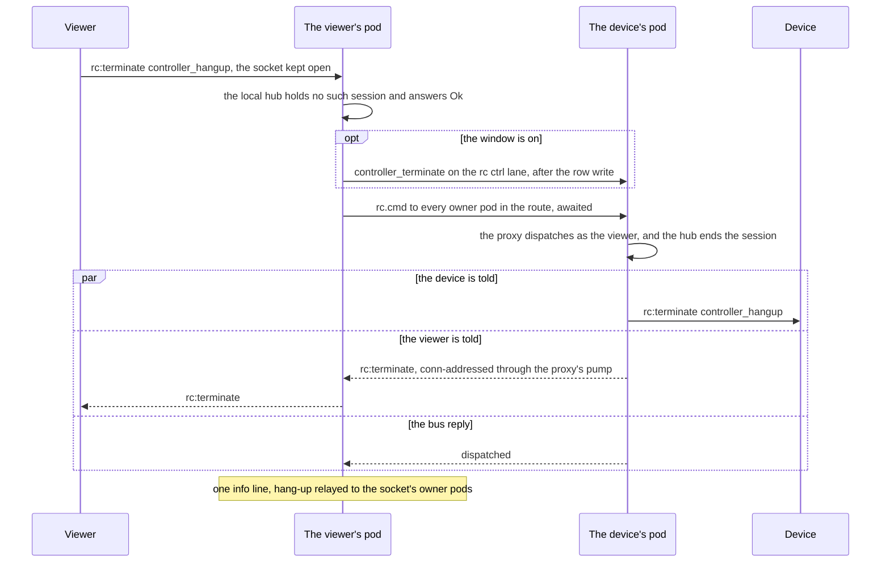
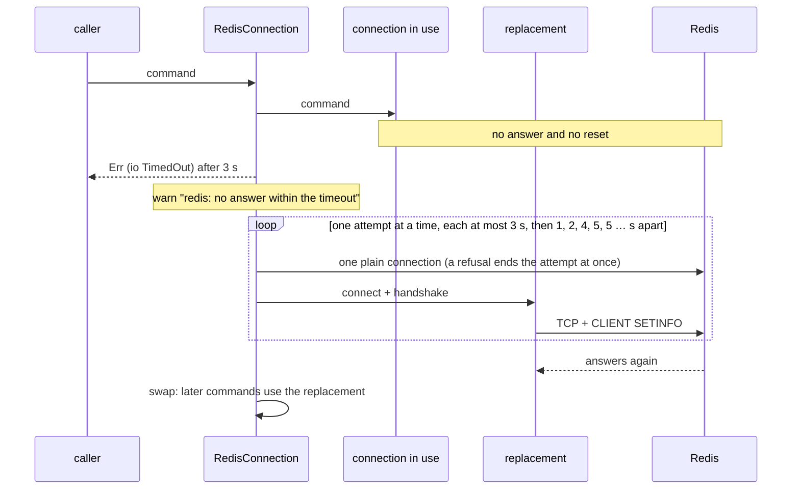
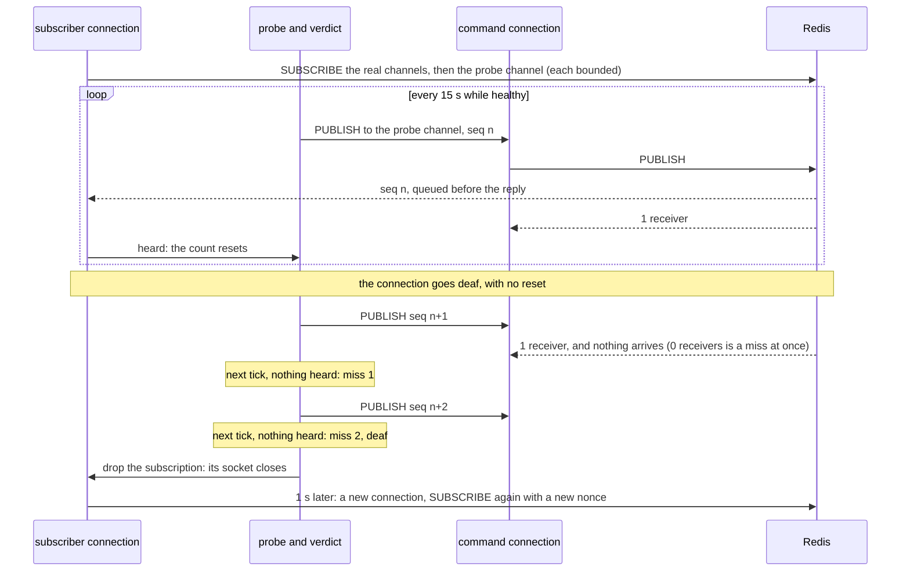

# Multi-pod scale-out — the settled architecture

> Goal: **any client on any pod, any pod count** — correctness never depends
> on the front LB's tenant-affinity hashing; affinity is demoted to a
> placement *optimization*. Four pod-local in-memory subsystems become
> location-transparent: the **rc-hub** (remote-control sessions), the
> **tunnel-hub** (tunnel flows), the **DERP relay** (WG frame forwarding),
> and **mediasoup conferences** (rooms/routers/transports).
>
> Origin: the 2026-07-29 + 2026-08-02 S6 incidents (green badge,
> `agent not online`, "stalled" overlay, silent split-brain risk in
> conferences). Design pass 2026-08-02; staged rollout C-1..C-6 below.
> Pod-2 is parked (single-pod) until C-4 lands.

## Governing principles

1. **The entity's live connection is the source of truth; Redis is a
   directory, not a database.** Every record is re-derivable from a live
   socket/registry. Redis down ⇒ every path degrades to today's
   affinity-co-location behavior — never worse.
2. **Move endpoints, not state.** Everything that can redial (browsers,
   tunnel CLIs, agents, DERP sockets) converges by redialing through the
   LB. Server-side proxying exists ONLY where redial provably cannot work
   (media signaling — see below).
3. **No data plane on the bus.** Redis carries control frames only. rc
   media is P2P WebRTC, tunnel data is P2P QUIC/DC or coturn, mediasoup
   media reaches the owner pod directly via per-pod announced IPs, DERP
   converges by *rehoming* rather than forwarding.
4. **Fold, don't migrate.** On unresolvable conflict or owner death,
   in-memory islands fold (participants kicked with a rejoin signal) and
   rebuild via the normal join path. No live-state handoff anywhere.

## C-1 — identity, directory, bus (implemented)

### Pod identity (`crates/core/src/cluster/identity.rs`)

`pod_id` — stable across restarts: `ROOMLER__APP__POD_ID` override (tests
inject per-app values) → `ROOMLER__POD_HOST_IP` (hostNetwork ⇒ ≤1 API pod
per node, so the node IP IS the pod identity — the same key the LB
upstream list and `ROOMLER__MEDIASOUP__ANNOUNCED_IP_MAP` use) → hostname →
random dev id. `epoch` — a per-process random token: a restarted pod
re-subscribes to the same bus channel but must never be mistaken for the
process that owned the previous epoch's entities.

The pub/sub **origin** stamped on every envelope is `<pod_id>/<epoch>`
(replaces the old random per-process UUID; the self-echo guard and the
user-online SREM semantics are unchanged because the epoch differs per
process).

### Ownership directory (`crates/core/src/cluster/directory.rs`)

One Redis STRING per live entity, value = the canonical owner token
`"<pod_id>/<epoch>/<extra>/<since_ms>"` (`OwnerRecord::parse`). Key
builders live in ONE place per namespace:

| Key | Discipline | TTL / refresh | Since |
|---|---|---|---|
| `roomler:agent-online:<agent_id>` | **LWW** (newest live socket wins — mirrors the rc-hub's displacement rule) | 90 s / on received heartbeat + a 30 s pod sweep | A-1/C-1 |
| `roomler:own:tunnel:<session_id>` | LWW | 90 s / 30 s | C-3 |
| `roomler:own:derp:<net>:<pubkey>` | LWW (+ per-network set key) | 90 s / 30 s | C-5 |
| `roomler:own:media:<room_id>` | **NX mutex** — media rooms have no client-owned socket; two creations = silent split-brain, so creation itself is mutually exclusive | 30 s / 10 s | C-4 |
| `roomler:pod-alive:<pod_id>` | plain SET | 45 s / 15 s | C-1 (advisory only) |

Three shared operations (Lua where atomicity matters):
- **claim** — LWW: plain `SET … EX`; NX: `SET … NX EX` (loser learns the
  holder).
- **refresh-if-mine** — mine or absent ⇒ full re-`SET` (a wrongful delete
  or a Redis flap self-heals within one beat); **foreign ⇒ CONFLICT** —
  the caller folds its local copy, never overwrites.
- **release** — compare-and-delete on the full token (a bare GET+DEL races
  a fresh re-home; a stale release must no-op against a newer claim).

### Inter-pod bus (`crates/core/src/cluster/bus.rs`)

Each pod subscribes to `roomler:pod:<pod_id>` (stable — a restarted
process re-subscribes and NACKs requests for entities it doesn't hold,
actively pruning its predecessor epoch's stale records). Envelope:

```json
{"v":1, "origin":"<pod/epoch>", "kind":"req"|"rep", "class":"sys"|"rc"|"media"|"derp",
 "corr":"<id>", "reply_to":"<pod_id>", "conn":null, "body":{}}
```

- Request/reply with correlation ids; deadlines 2 s (5 s for
  router-creating media ops). **The RPC deadline is the ACTIVE failure
  detector**: expiry ⇒ owner presumed dead ⇒ compare-DEL the record acted
  on + subsystem fallback. Directory TTLs are the passive backstop;
  `pod-alive` is advisory (metrics/fast-fail), never the primary detector.
- Delivery: at-most-once, per-publisher FIFO (Redis pub/sub), no bus-level
  retries — every consumer path has a redial/retry fallback. Handlers are
  idempotent. Unknown class/entity ⇒ structured NACK.
- The pre-existing global channel `roomler:ws` keeps its contract
  (`{origin, user_ids|broadcast, message}`); C-4 adds an additive `conn`
  field for connection-addressed media events; consent/kick become
  idempotent broadcast control events in C-2.

Rejected: Redis Streams (durability for state that is re-derivable from
live sockets buys nothing), pod↔pod TCP/gRPC mesh (with DERP forwarding
rejected there is NO data plane crossing pods), keyspace notifications
(off by default, lossy).

## Per-subsystem routing (C-2, C-3, C-4, C-5)

- **rc (C-2)** — *client redial + idle-agent nudge*. On session-request
  hub-miss with a fresh foreign directory record: reply
  `rc:error {code: "agent_on_other_pod"}` (designed as `rc:session.rehome{tid}`); the browser re-pins its WS
  (`setTenantAffinity` + a new `forceRedial` for the parked-socket case)
  and retries ONCE. After topology changes the *agent's* WS may sit on an
  old-hash pod: the owning pod closes it — **only when idle** (no active
  sessions, no tunnel sessions targeting it) — so its reconnect re-lands
  at the current hash. Sessions stay pod-local (FR-138 rebuilds one on the pod its device's claim reaches, [below](#a-live-rc-session-through-its-pods-death-fr-138)); **cross-pod
  session frame-relay is rejected permanently** (a `LiveSession` pins its
  `controller_tx` on the creating pod; relaying is a durable bidirectional
  proxy with new failure modes, for a signaling-only channel whose media
  is P2P). **Reversed since by PR-2:** a session-request miss is now relayed first: the controller's `rc:*` frames cross the per-pod bus to the owning pod's hub (`crates/modules/remote/src/relay.rs`), and media stays P2P. The rehome reply above is the fallback when the relay is unavailable (`crates/modules/remote/src/controller.rs`). Consent + admin-kick become broadcast control events every pod
  applies to its local hub. A viewer's own hang-up is not broadcast: it rides the relay to the pod that holds its session, at every resume window ([below](#a-viewers-hang-up-across-pods-4042)).
- **tunnel (C-3)** — same pattern: open-path miss ⇒
  `TunnelOpenReject{reason:"rehome"}` ⇒ the headless CLI redials itself
  (it owns its WS; tid from its JWT) + retry-once. No post-open relay:
  tunnel DATA is P2P/coturn and survives pod loss; the dropped
  agent→client WS bookkeeping gets a metric, not a proxy.
- **media signaling (C-4)** — *the ONE server-proxy*. Redial is wrong here
  (the room's owner is wherever `call/start` landed, not `hash(tid)`; one
  browser WS serves all the user's tenants). Viewer→owner commands ride an
  owner-RPC over the bus (a routing shim in every `media:*` handler +
  `call_leave`/`call_end`/recording routes); owner→viewer pushes ride the
  global channel with connection-id addressing (UUIDs are globally unique
  — no per-connection directory). The media data plane is unchanged:
  browsers already reach the owner pod's transports directly via its
  announced IP.
  **Claim-or-route replaces the split-brain get-or-create belt**
  (`ws/handler.rs` media:join): local room ⇒ serve; else GET the claim ⇒
  absent ⇒ Mongo `in_progress` check ⇒ `SET NX` (winner creates, loser
  routes); foreign owner ⇒ route; self-with-stale-epoch ⇒ release +
  re-claim (race-free owner-restart healing). Owner death: claim released
  by graceful shutdown (zero window on deploys) or ≤30 s TTL (crash) ⇒
  participants' ICE fails ⇒ UI rejoins ⇒ fresh claim on a live pod. Claim
  CONFLICT (possible only after a Redis outage window) ⇒ the claim-loser
  folds its island and pushes a rejoin. The old belt is retained SOLELY as
  the Redis-down fallback, logged + counted.
- **DERP (C-5)** — *registration-driven rehome, NO cross-pod frame
  forwarding*. A network is tenant-scoped and both ends carry the same
  tid, so under any consistent LB map the whole network converges to one
  pod; splits are stale-socket artifacts. On register, read the network's
  sibling records; the convergence target is the pod of the **newest**
  registration (`since_ms` max — the newest dial reflects the LB's
  *current* verdict; a "majority wins" rule would chase the parked past
  during a topology flip). Every other pod is asked (`derp.rehome` RPC)
  to close its `/derp` sockets for that network; the clients' reconnect
  re-lands converged. Ping-pong guard on the closing side: ≥60 s cooldown
  per (net, pubkey), 3 attempts per 10 min, then the split-evidence
  counter (`derp_rehome_stuck_total`). DERP scales by distributing
  NETWORKS across pods, never splitting one. (Frame forwarding rejected:
  it is the only mechanism that would put WG-rate bytes on the bus, buys
  correctness only for a transient window the rehome already bounds, and
  makes Redis a bandwidth SPOF. Revisit only if affinity is dropped or
  multi-region.)

## Mediasoup scale ladder

Stage (a) = C-4 (room-pinned signaling routing — N-pod conferencing is
correct with zero media-path changes). Stage (b) — **PipeTransport mesh**
(mediasoup 0.20 has all primitives: `create_pipe_transport`,
`pipe_producer_to_router`, manual cross-host param exchange = a
`media.pipe.*` req/rep on the bus): claim holder = home pod = sole
coordinator; satellite routers per pod, piped pairwise over node IPs
(SRTP on); pipe-all-producers with refcounts; satellite death folds the
satellite, home death folds the room. **Deferred behind a trigger
metric**: any room sustaining ≥12–15 active AV participants (≈450+
consumers vs the ~500/worker ceiling) or pod aggregate >60 % of
`num_workers × 500`, measured by the C-6 gauges. Below that, stage (b) is
pure risk with no benefit.

## Failure model

Detector precedence: (1) the entity's own socket death → drives redial;
(2) the RPC deadline → prunes records on demand; (3) directory TTL →
bounded passive staleness; (4) pod-alive → advisory only.

| Entity | Owner-pod death | Blast radius |
|---|---|---|
| Agent WS | socket breaks ⇒ agent redials; LWW re-register | that pod's rc sessions end (P2P media freezes → controller reconnect), except those FR-138 keeps: a live session on `direct` or `turn` whose device is in the resume scope with its switch on goes on peer to peer and is claimed back on the pod the redial reaches, about 3 s later in the field ([below](#a-live-rc-session-through-its-pods-death-fr-138)); listing stale ≤90 s |
| Tunnel session | **data plane survives outright** (P2P); new opens rehome | bookkeeping blip only |
| DERP peer | reconnect loop; the tenant pin answers 502 until the replacement listens, with no failover to the survivor. `ws_flat_redial` (default OFF) redials that 502 flat instead of climbing the ladder (FR-28) | ~3.4 s of WG loss since the image pre-pull (p50 over eight promotes to 2026-11-16, FR-28), and ~2.1 s with `ws_flat_redial` on (p50 over 8 sockets on two hosts, two promotes of 2026-11-21, FR-28's AC3), against ~7.6 s over 14 rolls in October: a replacement starts 2 s after its SIGTERM instead of 5–6 s, and a whole roll takes 25 s instead of 33.9 s; corp pairs re-handshake |
| Media room | claim gone (graceful: zero window; crash: ≤30 s TTL) ⇒ rejoin claims a live pod | one conference, ≤30 s gap on crash |

**Redis-down degradation (hard requirement)**: directory ops fail soft to
"no record" ⇒ rc/tunnel answer pod-local (= today), rehome/nudge
suppressed, media falls back to the S6 belt (logged
`media_belt_fallback_total`). On recovery, heartbeats re-assert every
record within one beat and the fold rule resolves any belt-era splits. A Redis that refuses, restarts or stops answering without a reset reaches these paths within the response timeout ([below](#a-redis-that-stops-answering-3840)).

### A live RC session through its pod's death (FR-138)

The rc hub is still pod-local, and nothing in a dying pod's memory survives it. What survives is
the session's `remote_sessions` row, so the fourth principle holds: no live-state handoff. The pod
that the device's next hello reaches folds the session back in through two join paths, the
device's claim and the viewer's rejoin
([remote-control.md §11.18](remote-control.md#1118-a-session-outlives-its-control-socket-the-servers-half-fr-138-p1b)):

| What | Where it lives through the gap | What brings it back |
|---|---|---|
| The peer: pixels, input, its channels | the device and the page, peer to peer. No pod ever carried it | nothing has to: it never stopped |
| The session's state | its row, still live, with `detached_at`, `resume_by` and the fencing number `attach_seq` when the dying pod got to write them | the device's claim, on whichever pod it reaches: it commits at the `attach_seq` it read, bumps it, and rebuilds the hub entry (`claim`, `crates/modules/remote/src/resume.rs:137`) |
| The viewer's binding | nothing: the page holds the session and asks | the viewer's rejoin binds its new socket on the pod that holds the session, through the relay when that is another pod (`rejoin`, `crates/modules/remote/src/rejoin.rs:216`) |
| An end issued during the gap | the row, written there because no hub holds the session | read by the claim and by the rejoin |
| A row nobody claims | the row, past its `resume_by` | the sweep, one pod at a time (`run_sweep`, `crates/modules/remote/src/sweep.rs:94`) |

The fencing number keeps a pod that no longer holds the session from undoing a resume: its late
detach or end carries the number it held, and lands nowhere. A session on `derp` is the exception to
the table's first row: `/derp` is pod-local, so its path goes down with the pod. It is kept when the
mesh rebuilds that path before ICE gives up on the pair, as a Windows session's was about 4 s after
the cut on 2026-11-12, and it redials otherwise, with no `agent_busy` either way. The switches, and
what an operator reads before and after a roll, are in
[deployment.md](deployment.md#a-roll-and-a-live-remote-session-fr-138).

### A viewer's hang-up across pods (#4042)

When the viewer's socket is on one pod and the device's on the other, the session lives in the hub
of the device's pod. The viewer's pod keeps only the socket's route: the owner pods it relayed a
frame to that they took (`remote_rc_conns`, recorded at `crates/modules/remote/src/relay.rs:500-504`).
A hub answers the terminate of a session it does not hold with `Ok`, on purpose, because the agent's
teardown races rely on it (`crates/modules/fleet/src/hub.rs:3701-3708`). So a viewer's
`rc:terminate` never errs on its own pod. The session-scoped relay forwards only a frame that missed
there with `SessionNotFound` (`crates/modules/remote/src/controller.rs:415-423`), so it never sees a
hang-up either. Before #4042, nothing else carried the hang-up at the window's default of 0. The
device was not told, and the session lived on until the socket closed or the device gave up on its
peer. The same tab's next Connect was coalesced back into it (`hub.rs:1685`). With the window on,
the `controller_terminate` event carried it.

The controller's dispatch is now `relay::dispatch` (`relay.rs:871`, called at `controller.rs:271`).
It gives every frame to the local hub, as before. Then it relays an `rc:terminate` of a session that
hub does not hold, over `rc.cmd`, to **every** owner pod the socket's route names, at every resume
window. It asks them all, because an owner answers `dispatched` whether it held the session or not
(`relay.rs:305`): one answer says nothing of where the session was (`hang_up_to_each`,
`relay.rs:843`). The owner's proxy dispatches the frame as the viewer (`relay.rs:295`), so the party
check holds as it does on one pod.



How each kind of hang-up reaches the pod that holds the session:

| Hang-up | How it reaches that pod | Window 0 | Window on |
|---|---|---|---|
| The viewer's `rc:terminate`, with its socket open: Disconnect, leaving the viewer for another page of the app, the reconnect ladder's hang-up before a retry, a ghost release, a refusal's hang-up | `relay::dispatch`: `rc.cmd` to every owner pod in the route, awaited | the owner's hub ends it `controller_hangup` and tells the device | the row is written and `controller_terminate` published first (`controller_end`, `crates/modules/remote/src/row_end.rs:166`). The owner applies that (`crates/modules/fleet/src/ctrl.rs:146`) or the relay ends it, whichever lands first; the other finds it gone. One end, the device told once |
| The viewer's socket closes: a closed tab, a reload, leaving the app | `rc.conn_closed` to every owner pod in the route (`forward_conn_closed`, `relay.rs:534`), then `remove_proxy` (`relay.rs:404`) and `unregister_controller` | ended `controller_hangup` | held for the window (`viewer_gone`, `crates/modules/fleet/src/hub/hold.rs:102`), then ended `controller_hangup` with `limit: hold_expired` if nobody rejoins |
| The viewer's pod dies without a word | the owner pod's janitor: every 60 s it asks the origin pod about each proxy quiet for 120 s (`rc.conn_alive`, judged by `probe_verdict`, `relay.rs:714`). It reaps a proxy whose socket is gone, or whose pod does not answer, as a close does. It never reaps while the socket lives | as a close | as a close |
| The device ends it | the device's pod ends it, and the proxy's pump tells the viewer | the same | the same |
| An admin ends it (`POST …/session/{id}/terminate`) | the local hub, and the ctrl lane's `terminate` (published at `crates/modules/remote/src/routes.rs:136`), which a pod applies to a session of that org it holds (`ctrl.rs:108`) | the same | the row is written first (`admin_end`, `row_end.rs:141`) |
| Another member's `rc:terminate` of a session that is not theirs, from a socket whose route names that pod | relayed as the viewer's | refused there by the party check (`check_session_party`, `hub.rs:3443`). The refusal reaches the sender as on one pod (`rc:error`, `session_id` null), and the session stays live | the same: the row names another person, so `controller_end` writes and publishes nothing |

An external viewer's `rc:terminate` takes the same dispatch. `extauth::intercept` takes only
`rc:extauth.*` frames (`crates/modules/remote/src/extauth.rs:1466`), and the extauth relay records
the socket's route like any relayed frame (`extauth.rs:316`).

**The bound.** The relay is awaited, and a socket's frames are read one at a time
(`crates/api/src/ws/handler.rs:261-274`). So the owner pod has ended the session before the tab's
next frame is read, and a Connect right after a Disconnect gets a new session. A hang-up across pods
reaches the device within the same-pod time plus `RPC_DEADLINE` (2 s,
`crates/core/src/cluster/bus.rs:42`), the longest one relayed frame waits on a live bus. The tests
measure both times in one run and hold the cross-pod one to that bound (`bound_from`,
`crates/tests/src/rc_cross_pod_hangup_tests.rs:145`).

**The log line.** Each relayed hang-up writes ONE line at info on the viewer's pod:
`rc relay: hang-up relayed to the socket's owner pods` (`HANGUP_RELAYED_LINE`, `relay.rs:827`). Its
fields are `session` (the last 6 characters), `owners` (the pods it went to), `took` (how many
answered `dispatched`) and `refused`. On a two-pod deployment a hang-up the owner took reads
`owners=1 took=1 refused=false`, whether the relay or the ctrl lane ended the session. The owner pod
logs nothing new. With the window on, it logs
`rc ctrl: a controller's end applied from another pod` (`ctrl.rs:147`) when the ctrl lane lands
first, and nothing when the relay does.

**When the relay fails.** An owner's refusal reaches the viewer as above. A relay that Redis lost is
dropped with `rc relay: frame dropped, Redis failed its relay` and `frame=rc:terminate`
([below](#a-redis-that-stops-answering-3840)). The route is kept and the viewer is told nothing,
and the session ends as it did before #4042: at the socket's close, or by the device's own end once
its peer is gone. An owner that does not answer costs `RPC_DEADLINE` once, and its route is
forgotten (`settle_failed_relay`, `relay.rs:681`).

**What did not change.** The relay acts on an explicit `rc:terminate` only. A lost socket is still a
hold with the window on, and `rc.conn_closed`, the janitor and the rejoin work as they did. There is
no new wire frame and no new bus verb, and nothing new is written at window 0. An owner pod that
predates #4042 dispatches a relayed `rc:terminate` as it does any relayed frame (`relay.rs:88`). So
while a roll serves old and new side by side, the hang-up still ends the session, unless it was sent
through a viewer's pod still on the old image: at window 0 that one is lost, as before.

### A Redis that stops answering (#3840)

Every Redis command the server sends, except a subscription, goes through ONE multiplexed
connection: the fan-out publisher, the presence registries, the ownership directory, the bus and
the session slots all hold clones of it (`RedisConnection`, `crates/core/src/ws/redis_conn.rs:144`,
made at `crates/api/src/state.rs:140`). The crate's default connection, which both settings at 0
restore, turns two kinds of outage into a wait instead of an error:

- **A Redis lost without a TCP reset** (a dropped path, a frozen machine, an address left
  black-holed by a failover) gives the client no error at all. Every command in flight waits for as
  long as the kernel keeps the socket: about 15 minutes with data in flight, and for ever while the
  peer's kernel still acknowledges.
- **A Redis that refuses or restarts** makes the crate reconnect, and every command sent meanwhile
  waits for that reconnect: the first attempt, then six more, the first 1 to 2 s later and the
  others 60 to 120 s apart. A restart longer than about 2 s holds those commands for one to two
  minutes.

With the bound, each command answers or fails within the response timeout, so both outages reach
the "Redis down" paths ([above](#failure-model)) on every Redis restart longer than about 2 s and
on every pause longer than the bound. A Redis error says nothing about the other pod, so where a
caller would end, reap, release or forget something on one error, it reads the error as
"unknown" and asks again: the relay, the session slots and the DERP and tunnel registrations in
the table below.

| Setting | Default | What it bounds | 0 |
|---|---|---|---|
| `ROOMLER__REDIS__RESPONSE_TIMEOUT_MS` | 3000 | one command or pipeline, end to end: the queue in front of the socket, the wait for a reconnect, the reply (`redis_conn.rs:286-312`) | no bound |
| `ROOMLER__REDIS__CONNECTION_TIMEOUT_MS` | 3000 | one connection attempt: TCP connect and the handshake the crate sends (`CLIENT SETINFO`) | no bound |
| `ROOMLER__REDIS__SUBSCRIBER_PROBE_MS` | 15000 | not a bound: how often each subscriber publishes a probe to itself, so that one gone deaf is found and subscribes again ([the subscriptions](#the-subscriptions-3952)) | no probe: a deaf subscriber stays deaf until the kernel gives its socket up |

A value from 1 to 999 is used as 1000 (`BOUND_FLOOR_MS`, `redis_conn.rs:62`), and the pod says so
once at boot, at warn: `redis: a timeout setting under 1000 ms is used as 1000 ms`, with `setting`,
`given_ms` and `used_ms` (`redis_conn.rs:480-491`); for the probe the line is
`redis: a subscriber probe interval under 1000 ms is used as 1000 ms`, with the same fields
(`crates/core/src/ws/sub_probe.rs:104-118`). A bound under a second would fail commands on a
Redis that answers: a value of 3, meant as seconds, would put both pods into "Redis down" at once.
Linux also sends its first SYN retransmission after 1 s, so a connection timeout under 1 s fails a
connection that one lost packet only delays. No number refuses boot (a value that is not a number
fails the settings load, as it does for every number setting): a pod that will not start holds a
roll. Both at 0 is the crate's default `ConnectionManager` with no outer timeout and no
replacement, restored by a setting on the deployment and a restart, with no new image
(`crates/config/src/settings.rs:1335-1347`). The boot line `Redis Pub/Sub publisher connected`
names the bounds in use, `response_timeout_ms` and `connection_timeout_ms` (0 is no bound), and
`addr`, Redis's host and port (`crates/core/src/ws/redis_pubsub.rs:465-479`).

The crate's own response timeout does not cover the wait for a reconnect or the queue in front of
the socket, so each call runs under an outer timeout of the same length. A timed-out command does
not make the crate reconnect, so a timeout starts ONE background replacement
(`redis_conn.rs:319-373`). Each attempt first makes one plain connection, so a Redis that refuses
fails the attempt at once instead of inside the crate's own retries; then it builds the connection
like the first one, and swaps it in only once Redis has answered its handshake:



| Bound | Value | Where it comes from |
|---|---|---|
| a command, whatever the connection does | ≤ 3 s | the outer timeout; measured 3.0 s (`crates/tests/src/redis_bound_tests.rs`) |
| commands queued in front of a socket Redis stopped reading | ≤ 3 s each | the outer timeout counts the queue; measured: 160 queued writes all failed after 3.0 s |
| a script that Redis lost in a restart | ≤ 3 × 3 s | the crate sends `EVALSHA`, and on `NOSCRIPT` sends `SCRIPT LOAD` and `EVALSHA` again, each bounded |
| `claim_nx` | ≤ 4 × 3 s | `SET NX` then `GET`, sent once more when the holder vanished in between (`crates/core/src/cluster/directory.rs:116`) |
| a request that awaits k commands one after another | ≤ k × 3 s | the paths below that loop |
| a bus request | ≤ 3 s + its deadline (2 s, 5 s for a router-creating media op) | the request PUBLISH (`crates/core/src/cluster/bus.rs:233`) is awaited before the deadline starts (`:244`) |
| Redis answering again → the server using it again | ≤ 8 s | an attempt in flight ends at its 3 s bound, then at most a 5 s wait (`REPLACE_WAIT_MAX`, `redis_conn.rs:67`); measured 2.8 s |
| Redis listening again after a refusal → the server using it again | ≤ 5 s + one attempt | a refused attempt fails at once, then at most a 5 s wait |

Why 3 s, for both:

- A Redis that answers answers every command the server sends in about a millisecond. Each is
  O(1) or small: the largest are the presence sweep's `MGET` over a fleet's agent keys,
  `SCAN COUNT 100` and short Lua scripts, and an `MGET` of 10 000 keys took 1.2 to 2.1 ms inside
  Redis. 3 s sits three orders of magnitude above the slowest of them, so the bound fires on a
  Redis that does not answer, not on one that is busy.
- The callers that keep a shorter bound of their own keep it, and it fires first: the bus deadline
  (`RPC_DEADLINE`, 2 s, `crates/core/src/cluster/bus.rs:42`), `CLAIM_RELEASE_BOUND` (2 s,
  `crates/modules/conference/src/media_cluster.rs:481`), the 200 ms and 250 ms reads of a listing
  or a route, and the 2 s read of `close-dead`. What they do is as it was.
- The room delete's `ROOM_REMOVED_BOUND` (5 s, `crates/modules/chat/src/room.rs:351`) bounds
  several commands in a row. One that gets no answer now fails inside it, at 3 s.

**A timeout means the reply was lost, not that the write was.** A write may be applied behind a
timed-out command, and a write still queued in the socket of a connection that was replaced can
reach Redis after newer writes sent on the replacement. What each Redis user does with an error,
whatever its cause, and what heals a write applied behind a lost reply, or one that lands late:

| Redis user | Commands | On an error | A write applied behind the lost reply |
|---|---|---|---|
| Fan-out on `roomler:ws` (`crates/core/src/ws/dispatcher.rs:57`, `:85`, `:139`) | PUBLISH | logged; users on other pods miss that one event (at-most-once, never retried); the request that sent it still answers (a chat post: 200 in 3.0 s) | delivered: nothing to heal |
| Online registry (`crates/core/src/ws/redis_pubsub.rs:110`, `:129`) | SADD + EXPIRE, SREM | logged; the 30 s heartbeat (`crates/api/src/state.rs:449`) writes it again | the 90 s TTL |
| Push gate (`crates/core/src/notify.rs:39`) | EXISTS | read as offline: the web push (and a mention's email) is sent | — |
| Agent presence (`crates/modules/fleet/src/socket.rs:436`, `:977`, `:1050`, `:1054`; `presence.rs:281`) | SET EX 90, compare-DEL, EXISTS, MGET | logged; a teardown announces the device offline and the next sweep (≤ 30 s) corrects it; the sweep skips a cycle | the next heartbeat, or the 90 s TTL |
| Cycle claims (`try_claim`, `redis_pubsub.rs:247`: alerts, org daily, stats rollup, presence sweep, ephemeral reaper, relay allowance, RC resume sweep, SaaS pulls) | SET NX EX | that pod skips the cycle | the claim is held and run by nobody until its TTL ends: one cycle (the org daily: that day's run, recomputed the next day) |
| TURN usage dedupe (`crates/core/src/turn_bytes.rs:101`) | SET NX EX 7 d | warn, the total is not booked | **lasting**: that total is never booked |
| Relay load baseline (`crates/core/src/relay_load.rs:521`) | advance_baseline (Lua) | logged, the poll goes on | **lasting**: that delta is never booked |
| OAuth attribution (`crates/core/src/attribution.rs:298`, `:313`) | SET EX 600; GET + DEL in MULTI | own 250 ms bound first; sign-in goes on without it | the take: **lasting**, that sign-up is not attributed |
| Relay allowance (`crates/modules/network/src/relay_allowance.rs:260`, `:265`, `:282`) | DEL, SET EX 900, GET | a failed read is an empty set: throttles lift (fails open, as the code intends) | the previous set until the next job (300 s) |
| Ownership directory (`crates/core/src/cluster/directory.rs`) | GET, SET (NX) EX, Lua refresh and release, SCAN | "no record": rc and tunnels answer pod-local, media serves the join here (the belt) | records are re-asserted within one beat or end by TTL |
| Media claim-or-route (`crates/modules/conference/src/media_cluster.rs:62`, `:226`, `:624`) | GET, Lua claim and refresh, bus requests | a join whose claim cannot be read is served here (the belt), and the orphan pass folds it ≤ 10 s after Redis answers; a media command whose bus request fails prunes the owner's record as a deadline does, and a join that claims the room meanwhile makes the owner fold its room at its next refresh (≤ 10 s): every participant rejoins once; a member's removal whose claim read fails counts the room as this pod's, closes nothing here and reports 0 seats, and the serving pod's seat check ends the seat once the room guard refuses it, within 40 s (`crates/modules/conference/src/revoke.rs:322`) | the claim's 30 s TTL |
| DERP registration (`crates/modules/network/src/derp_cluster.rs:72`, `:352`) | Lua LWW claim, SADD, convergence reads | the registration keeps its token whatever the claim answered, and its socket goes on; `finish_registration` writes what the error left owed once Redis answers, 1 s apart doubling to 30 s: the record by `claim_if_newer`, which never takes it from a later registration, and which is released again by its token when the registration ended while the claim was in flight (`keep_late_claim`); the index member; a convergence sweep (measured: settled 9.2 s after Redis answered) | the record holds this registration's own token: the heartbeat refreshes it |
| Tunnel ownership record (`crates/modules/network/src/tunnel.rs:801-816`) | Lua LWW claim | the session keeps its token whatever the claim answered; the 30 s heartbeat re-sets an absent record (`refresh_if_mine`, `crates/modules/network/src/lib.rs:391-402`); only the split-evidence probe reads it | the record holds the session's own token: the heartbeat refreshes it |
| Pod bus (`bus.rs:233`, `:336`) | PUBLISH | a request fails before its deadline starts; a lost reply is a deadline at the requester | handlers are idempotent |
| Cross-pod RC relay (`crates/modules/remote/src/relay.rs:714`, `:524`) | bus requests `rc.conn_alive`, `rc.cmd` | "unknown": the janitor keeps the proxy and asks again at the next sweep; a frame that cannot be relayed is dropped with a warn, the route is kept, and the viewer's own timers recover the setup. A hang-up is dropped the same way, and its session then ends at the socket's close or by the device's own end, as before #4042 ([above](#a-viewers-hang-up-across-pods-4042)). A deadline, or the owner's answer (`alive: false`; a NACK, which to a relayed frame is also the owner's refusal of that one frame), still reaps a proxy or forgets a route. A deadline says only that the owner did not answer: after a Redis lost without a reset, it can be this pod's own deaf bus subscriber, until its probe finds it deaf ([the subscriptions](#the-subscriptions-3952): at most 45 s once the command connection answers) | nothing is written |
| Session slots (`crates/core/src/cluster/session_slots.rs:209`, `:263`, `:346`, `:366`) | Lua claim, renew pipeline, keep, release | a claim error, or a set full only by stale leases Redis did not let go (`crates/modules/remote/src/slots.rs:206-210`), lets the session proceed uncounted (fails open, as the code intends); a keep is tried again 1, 2, 4, 8, 16 s apart while its lease can still exist (`keep_retrying`, `session_slots.rs:417`); renew and release log | a lease lapses in 90 s; a keep only lengthens a live lease, so trying it again is harmless |
| Reads with a shorter bound of their own (`crates/modules/fleet/src/agent.rs:2147`, `crates/modules/remote/src/resume.rs:610`, `extauth.rs:305`, `rejoin.rs:360`, `controller.rs:293`, `dead_rows.rs:365`, `crates/modules/network/src/tunnel.rs:607`) | GET, MGET | their own bound fires first, as before | — |

Paths that wait more than one bound, because they await Redis once per item: a call start (two
commands per member, `notify.rs:270`), a post with mentions (two per mention), a member's removal
(per call room), the agent hello's resume claims (per claimed session), the heartbeats and refresh
passes (per record), and the shutdown release loops (per record, with no overall bound). Each step
is bounded; the sum is k × 3 s.

#### The subscriptions (#3952)

The fan-out on `roomler:ws`, the pod bus on `roomler:pod:<pod>` and TURN usage on coturn's
statistics each subscribe on a connection of their own (`redis_pubsub.rs:442`,
`crates/core/src/cluster/bus.rs:270`, `crates/modules/network/src/turn_usage.rs:100`). A subscribed
connection is asked nothing, so neither bound above sees it go silent, and the crate gives it no
ping: a subscriber whose Redis went silent without a reset would stay subscribed to nothing until
the kernel gave the socket up, and a bus deadline it caused would read like a pod that is gone. So
each subscriber proves its own connection, end to end (`crates/core/src/ws/sub_probe.rs`):

- **The probe.** On the same connection, after its real channels, a subscriber subscribes to a
  channel of its own, `roomler:sub-probe:<fanout|bus|turn>:<nonce>` (`sub_probe.rs:61`), with a new
  nonce for every subscription, so a registration Redis still holds for a dead connection is never
  counted as a receiver. Every `SUBSCRIBER_PROBE_MS` it PUBLISHes a sequence number there over the
  shared command connection, which the two bounds above cover.
- **The verdict** (`Verdict`, `sub_probe.rs:590`; each tick, `:636`). A PUBLISH that fails, gets
  no answer or gets an error reply other than an ACL's `NOPERM` (a script holding Redis answers
  `BUSY`) is unknown: it neither counts nor resets. A reply of 0 receivers is a miss at once, and
  so is a reply of 1 or more with nothing heard by the next tick. Any probe heard resets the count,
  and two misses in a row (`DEAF_AFTER`, `:54`) are deaf. A tick that finds a PUBLISH still out
  waits for it.
- **Deaf.** The subscription is dropped, which closes its socket and ends the crate's driver task
  for it at once, and the subscriber's own loop subscribes again on a new connection 1 s later
  (`redis_pubsub.rs:399-429`, `bus.rs:130-150`, `turn_usage.rs:149-165`): break-before-make, so
  nothing is delivered twice.
- **Every subscribe is bounded** (`within`, `sub_probe.rs:213`): the connect, TCP and the handshake,
  by the connection timeout, and each SUBSCRIBE by the response timeout. A probe SUBSCRIBE that gets
  no answer fails the whole subscription: the connection did not answer the next thing asked of it.
  A subscribe that fails is tried again 1, 2, 4 … 30 s apart, as before.



Why a Redis that answers, however slowly, does not trip it:

1. Redis queues a message to its subscribers while it serves the PUBLISH, before it replies, so a
   healthy subscriber hears its probe within network time of the reply: measured from 35 µs before
   it to 183 µs after it, over five runs of 20. 15 s is about 10⁵ times that.
2. A PUBLISH slower than the response timeout is unknown, never a miss.
3. It takes two misses in a row: one late arrival, or one stall of the pod's own runtime, costs at
   most one.
4. While the command connection is down every probe is unknown, and readiness already fails on its
   PING (`crates/api/src/lib.rs:487`).

| Subscriber | A subscribe that gets no answer | A subscription gone deaf |
|---|---|---|
| Fan-out, `roomler:ws` (`redis_pubsub.rs:399`) | fails after the connection timeout (the connect) or the response timeout (each SUBSCRIBE), and is tried again | found and subscribed again within the bound below; `redis_sub_alive`, so `/health/ready`, is false from the verdict to the new subscription |
| Pod bus, `roomler:pod:<pod>` (`bus.rs:263`) | the same | the same; its `sub_alive` is not part of readiness |
| TURN usage, coturn's statistics (`turn_usage.rs:124`) | the same | the same; each total is handed to a recorder task (`hand_over`, `:76`, a queue of 4096), so a slow MongoDB cannot hold the probe |
| The DERP relay's statistics (`crates/derp-relay/src/main.rs:420`) | fails after 3 s (`STATS_REDIS_BOUND`, `:400`), at the connect and at each PSUBSCRIBE, and is tried again | not probed: at a PoP its Redis runs on the same host, so a connection gone deaf there is a frozen Redis, which coturn cannot publish to either |

**The bound.** Once the command connection answers, a deaf subscriber is found within three
intervals, 45 s at the default (two, when Redis answers its probe with 0 receivers, as it does once
it no longer holds the subscription), and subscribes again 1 s later; the new subscribe takes
milliseconds on a Redis that answers. After an outage the command connection answers at most 8 s
after Redis does (the bounds table above), so at the default a deaf subscriber hears again at most about
55 s after Redis answers. Measured with a 1 s interval (`crates/tests/src/redis_subscriber_tests.rs`):
the fan-out heard a post 6.4 s after Redis answered again, the bus answered a ping at 6.8 s and TURN
usage booked a total at 7.0 s; a subscribe to a listener that never answers gave up after 3 s and
connected 3 times in 10 s, and the relay's gave up after 3.0 s.

**What a subscribing again costs, and what readiness says.**

- **Fan-out.** The events published between the connection going deaf and the new subscription do
  not reach that pod's sockets: at-most-once, as on any reconnect, but bounded now. None arrives
  twice.
- **Bus.** A request to this pod in the gap ends at its deadline (2 s, 5 s for a router-creating
  media op), and the requester treats this pod as gone, as in the table above; a reply due to this
  pod in the gap ends its own request at its deadline. A request is handled once or not at all. A
  false verdict would cost about 1 s plus a connect, so the tests hold the other side too: a healthy
  Redis whose replies are slowed by 1.5 s every 37 s, for 3 min at the default interval, and by
  500 ms every 2.3 s, for 2 min at the 1 s floor, gives no miss, no verdict and no new connection,
  and every post, ping and total arrives once.
- **TURN usage.** Totals published in the gap are not booked; the per-leg dedupe books none twice.
- **Readiness.** `/health/ready` answers 503 with `redis_subscriber: false`
  (`crates/api/src/lib.rs:493-495`, `:514`) only from the verdict to the new subscription, about
  1 s, usually shorter than the readiness probe's failure threshold; before the verdict it reads
  true. Liveness is `/health`, so a deaf subscriber never restarts a pod.

**Off.** `ROOMLER__REDIS__SUBSCRIBER_PROBE_MS=0` and a restart, on the same image: no probe channel
and no probe, and a deaf subscriber stays deaf as before #3952 (a test pins it). The subscribe
bounds ride #3840's two settings and lift only with them.

#### Field read

Each wording below is one fixed line at warn. The lines of #3840 are written at most once a second
per pod, with `suppressed`, the lines held back since the one before it (`LineBound`,
`redis_conn.rs:419`); the counters behind them count every event, so the events a line stands for
are 1 + `suppressed`. A subscriber's lines come at most once a subscription. On a healthy pod every
count is 0.

| Wording | What it says | Fields |
|---|---|---|
| `redis: no answer within the timeout` (`redis_conn.rs:71`) | Redis took the bytes and said nothing: a command, or a replacement's connection attempt (`command="connect"`), got no answer within its bound | `command`, `timeout_ms`, `timeouts`, `suppressed` |
| `redis: no connection could be made` (`redis_conn.rs:77`) | Redis refused or closed the connection: a replacement's attempt failed for another reason than a timeout (`error`, `retry_in_ms`), or a command timed out while it waited for the crate's reconnect after one (`command`, `waited_ms`) | those, `connect_failures`, `suppressed` |
| `rc relay: frame dropped, Redis failed its relay` (`crates/modules/remote/src/relay.rs:648`) | a session frame the relay could not publish, a viewer's hang-up (`frame=rc:terminate`) among them; the route is kept | `frame`, `session`, `suppressed` |
| `rc relay: sweep stopped, Redis failed a probe` (`relay.rs:652`) | a janitor sweep that Redis stopped; its proxies are kept and asked about at the next sweep | `unsettled` |
| `redis: a subscriber stopped hearing its probe; subscribing again` (`crates/core/src/ws/sub_probe.rs:65`) | a subscriber missed two of its own probes in a row: its subscription is dropped and made again ([the subscriptions](#the-subscriptions-3952)). With Redis healthy and `receivers` 1 or more, it points at the pod's own runtime or at a path that lost that one connection | `subscriber` (`fanout`, `bus`, `turn`), `missed`, `receivers` (the last reply's count), `probe_ms` |
| `redis: a subscriber's probe channel was refused; this subscription runs unprobed` (`sub_probe.rs:69`) | Redis refused the probe's PUBLISH with `NOPERM`, as an ACL that does not allow the channel does: that subscription runs unprobed until it ends. Any other error reply is unknown, like no answer | `subscriber`, `error` |
| `subscribe failed` with `no answer within 3000 ms (<step>)` (`sub_probe.rs:213`) | a subscribe got no answer within its bound, and is tried again. The step is `connect`, `SUBSCRIBE <channel>` or `PSUBSCRIBE <pattern>`. The lines: `Redis Pub/Sub subscribe failed` (the fan-out, the error in the text), `pod bus subscribe failed`, `turn usage: subscribe failed`, and at the relay `derp-relay: subscribing to coturn's statistics failed` | the error |
| `turn usage: a total was not recorded: the recorder is behind (under-reports)` (`crates/modules/network/src/turn_usage.rs:85`) | 4096 totals were waiting for MongoDB, and this one is not booked; at most once a second | `dropped`, `suppressed` |

Every hour each subscriber logs its running totals at info, `redis: subscriber probe totals`
(`sub_probe.rs:76`), with `subscriber`, `probe_ms`, `sent`, `heard`, `missed`, `unknown` and
`deaf`: on a healthy pod `heard` equals `sent` (one may be in flight) and `missed` and `deaf` are 0.
`/api/cluster/status` carries the same totals for each pod as `counters.subscriber_probes`
(`crates/api/src/cluster/metrics.rs:79-83`). A miss alone logs at debug,
`redis: a subscriber probe went unheard` (`sub_probe.rs:73`), and each subscribed line names the
interval in use, `probe_ms` (0 is off).

A replacement that succeeds logs `redis: the shared connection was replaced after a timeout` at
info. A pod whose own runtime stalls for longer than the bound (a blocked executor, a starved or
paused machine) times out the commands it had in flight on a Redis that is healthy: the timer
fires when the runtime runs again, before the reply is read. `redis: no answer within the timeout`
then points at the pod, not at Redis; the other pod, on the same Redis, logs nothing.

## Stages

| Stage | Content | Gate |
|---|---|---|
| **C-1** | `crates/api/src/cluster/{identity,directory,bus}.rs` (in `crates/core/src/cluster/` since FR-69 P1b), origin swap, A-1 agent keys canonicalized, directory heartbeat, two-pod tests | zero behavior change |
| C-2 | rc rehome + `forceRedial` + idle-agent nudge + consent/kick broadcast | |
| C-3 | tunnel rehome + CLI redial-retry + session ownership records | |
| C-4 | media claim-or-route + command shim + conn-addressed events + conflict fold | **THE un-park gate** |
| C-5 | DERP directory + rehome — convergence toward the NEWEST registration (cooldown + cap + `derp_rehome_stuck_total`) | |
| C-6 | shutdown sweep for all four classes (media/agents from C-4/A-1; + tunnel + derp records) + `cluster::metrics` counters (`rc_rehome`, `tunnel_rehome`, `agent_nudge`, `bus_deadline`, `media_fold`, `media_belt_fallback`, `derp_rehome_close`, `derp_rehome_stuck`, `split_evidence` — all `_total`) + per-pod media gauges (rooms/participants/consumers → the stage-(b) PipeTransport trigger) + `GET /api/cluster/status` (auth-gated) | un-park pod-2 once C-4..C-6 are deployed |

## Not building (scope honesty)

~~rc session frame-relay~~ (built since by PR-2: the signalling relay, `crates/modules/remote/src/relay.rs`); DERP cross-pod frame forwarding / pod-TCP data
mesh; live mediasoup room migration (fold-and-rejoin only); PipeTransport
before the trigger fires; cross-pod piping for the (nonexistent) rc SFU
bridge; Redis Streams / gRPC / gossip / Redlock; a per-WS-connection
directory; viewer-WS redial for media; LB/readiness coupling.

## Ops notes

- `kubectl rollout restart` is **unreliable under ArgoCD selfHeal** (the
  restart annotation is drift and gets reverted mid-roll — observed
  replacing only one of two pods, twice, 2026-08-02). Restart via a
  git-driven image/annotation bump or `argocd app actions run`.
- Park/un-park runbook stays as documented in CLAUDE.md (S6 bullet);
  un-parking pod-2 is gated on C-4.
