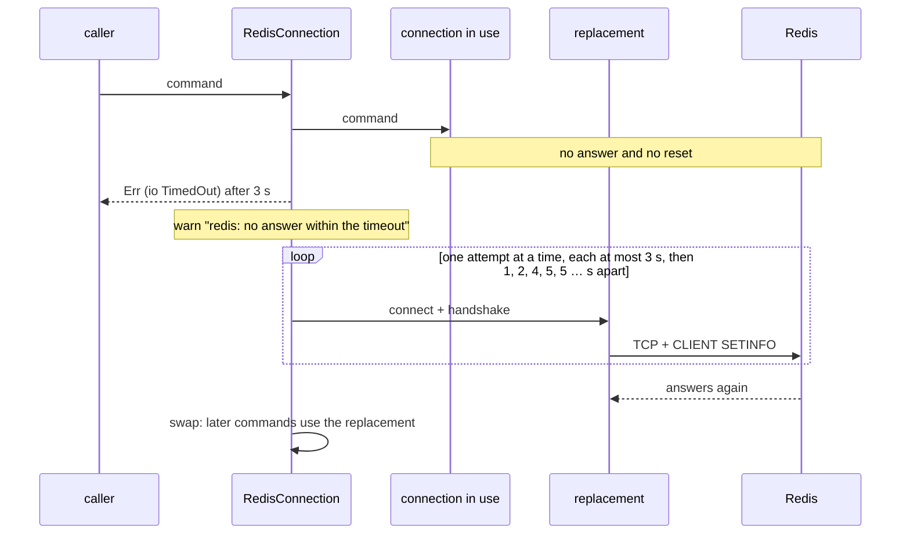

# Multi-pod scale-out — the settled architecture

> Goal: **any client on any pod, any pod count** — correctness never depends
> on the front LB's tenant-affinity hashing; affinity is demoted to a
> placement *optimization*. Four pod-local in-memory subsystems become
> location-transparent: the **rc-hub** (remote-control sessions), the
> **tunnel-hub** (tunnel flows), the **DERP relay** (WG frame forwarding),
> and **mediasoup conferences** (rooms/routers/transports).
>
> Origin: the 2026-07-29 + 2026-08-02 S6 incidents (green badge,
> `agent not online`, "stalled" overlay, silent split-brain risk in
> conferences). Design pass 2026-08-02; staged rollout C-1..C-6 below.
> Pod-2 is parked (single-pod) until C-4 lands.

## Governing principles

1. **The entity's live connection is the source of truth; Redis is a
   directory, not a database.** Every record is re-derivable from a live
   socket/registry. Redis down ⇒ every path degrades to today's
   affinity-co-location behavior — never worse.
2. **Move endpoints, not state.** Everything that can redial (browsers,
   tunnel CLIs, agents, DERP sockets) converges by redialing through the
   LB. Server-side proxying exists ONLY where redial provably cannot work
   (media signaling — see below).
3. **No data plane on the bus.** Redis carries control frames only. rc
   media is P2P WebRTC, tunnel data is P2P QUIC/DC or coturn, mediasoup
   media reaches the owner pod directly via per-pod announced IPs, DERP
   converges by *rehoming* rather than forwarding.
4. **Fold, don't migrate.** On unresolvable conflict or owner death,
   in-memory islands fold (participants kicked with a rejoin signal) and
   rebuild via the normal join path. No live-state handoff anywhere.

## C-1 — identity, directory, bus (implemented)

### Pod identity (`crates/core/src/cluster/identity.rs`)

`pod_id` — stable across restarts: `ROOMLER__APP__POD_ID` override (tests
inject per-app values) → `ROOMLER__POD_HOST_IP` (hostNetwork ⇒ ≤1 API pod
per node, so the node IP IS the pod identity — the same key the LB
upstream list and `ROOMLER__MEDIASOUP__ANNOUNCED_IP_MAP` use) → hostname →
random dev id. `epoch` — a per-process random token: a restarted pod
re-subscribes to the same bus channel but must never be mistaken for the
process that owned the previous epoch's entities.

The pub/sub **origin** stamped on every envelope is `<pod_id>/<epoch>`
(replaces the old random per-process UUID; the self-echo guard and the
user-online SREM semantics are unchanged because the epoch differs per
process).

### Ownership directory (`crates/core/src/cluster/directory.rs`)

One Redis STRING per live entity, value = the canonical owner token
`"<pod_id>/<epoch>/<extra>/<since_ms>"` (`OwnerRecord::parse`). Key
builders live in ONE place per namespace:

| Key | Discipline | TTL / refresh | Since |
|---|---|---|---|
| `roomler:agent-online:<agent_id>` | **LWW** (newest live socket wins — mirrors the rc-hub's displacement rule) | 90 s / on received heartbeat + a 30 s pod sweep | A-1/C-1 |
| `roomler:own:tunnel:<session_id>` | LWW | 90 s / 30 s | C-3 |
| `roomler:own:derp:<net>:<pubkey>` | LWW (+ per-network set key) | 90 s / 30 s | C-5 |
| `roomler:own:media:<room_id>` | **NX mutex** — media rooms have no client-owned socket; two creations = silent split-brain, so creation itself is mutually exclusive | 30 s / 10 s | C-4 |
| `roomler:pod-alive:<pod_id>` | plain SET | 45 s / 15 s | C-1 (advisory only) |

Three shared operations (Lua where atomicity matters):
- **claim** — LWW: plain `SET … EX`; NX: `SET … NX EX` (loser learns the
  holder).
- **refresh-if-mine** — mine or absent ⇒ full re-`SET` (a wrongful delete
  or a Redis flap self-heals within one beat); **foreign ⇒ CONFLICT** —
  the caller folds its local copy, never overwrites.
- **release** — compare-and-delete on the full token (a bare GET+DEL races
  a fresh re-home; a stale release must no-op against a newer claim).

### Inter-pod bus (`crates/core/src/cluster/bus.rs`)

Each pod subscribes to `roomler:pod:<pod_id>` (stable — a restarted
process re-subscribes and NACKs requests for entities it doesn't hold,
actively pruning its predecessor epoch's stale records). Envelope:

```json
{"v":1, "origin":"<pod/epoch>", "kind":"req"|"rep", "class":"sys"|"rc"|"media"|"derp",
 "corr":"<id>", "reply_to":"<pod_id>", "conn":null, "body":{}}
```

- Request/reply with correlation ids; deadlines 2 s (5 s for
  router-creating media ops). **The RPC deadline is the ACTIVE failure
  detector**: expiry ⇒ owner presumed dead ⇒ compare-DEL the record acted
  on + subsystem fallback. Directory TTLs are the passive backstop;
  `pod-alive` is advisory (metrics/fast-fail), never the primary detector.
- Delivery: at-most-once, per-publisher FIFO (Redis pub/sub), no bus-level
  retries — every consumer path has a redial/retry fallback. Handlers are
  idempotent. Unknown class/entity ⇒ structured NACK.
- The pre-existing global channel `roomler:ws` keeps its contract
  (`{origin, user_ids|broadcast, message}`); C-4 adds an additive `conn`
  field for connection-addressed media events; consent/kick become
  idempotent broadcast control events in C-2.

Rejected: Redis Streams (durability for state that is re-derivable from
live sockets buys nothing), pod↔pod TCP/gRPC mesh (with DERP forwarding
rejected there is NO data plane crossing pods), keyspace notifications
(off by default, lossy).

## Per-subsystem routing (C-2, C-3, C-4, C-5)

- **rc (C-2)** — *client redial + idle-agent nudge*. On session-request
  hub-miss with a fresh foreign directory record: reply
  `rc:error {code: "agent_on_other_pod"}` (designed as `rc:session.rehome{tid}`); the browser re-pins its WS
  (`setTenantAffinity` + a new `forceRedial` for the parked-socket case)
  and retries ONCE. After topology changes the *agent's* WS may sit on an
  old-hash pod: the owning pod closes it — **only when idle** (no active
  sessions, no tunnel sessions targeting it) — so its reconnect re-lands
  at the current hash. Sessions stay pod-local (FR-138 rebuilds one on the pod its device's claim reaches, [below](#a-live-rc-session-through-its-pods-death-fr-138)); **cross-pod
  session frame-relay is rejected permanently** (a `LiveSession` pins its
  `controller_tx` on the creating pod; relaying is a durable bidirectional
  proxy with new failure modes, for a signaling-only channel whose media
  is P2P). **Reversed since by PR-2:** a session-request miss is now relayed first: the controller's `rc:*` frames cross the per-pod bus to the owning pod's hub (`crates/modules/remote/src/relay.rs`), and media stays P2P. The rehome reply above is the fallback when the relay is unavailable (`crates/modules/remote/src/controller.rs`). Consent + admin-kick become broadcast control events every pod
  applies to its local hub.
- **tunnel (C-3)** — same pattern: open-path miss ⇒
  `TunnelOpenReject{reason:"rehome"}` ⇒ the headless CLI redials itself
  (it owns its WS; tid from its JWT) + retry-once. No post-open relay:
  tunnel DATA is P2P/coturn and survives pod loss; the dropped
  agent→client WS bookkeeping gets a metric, not a proxy.
- **media signaling (C-4)** — *the ONE server-proxy*. Redial is wrong here
  (the room's owner is wherever `call/start` landed, not `hash(tid)`; one
  browser WS serves all the user's tenants). Viewer→owner commands ride an
  owner-RPC over the bus (a routing shim in every `media:*` handler +
  `call_leave`/`call_end`/recording routes); owner→viewer pushes ride the
  global channel with connection-id addressing (UUIDs are globally unique
  — no per-connection directory). The media data plane is unchanged:
  browsers already reach the owner pod's transports directly via its
  announced IP.
  **Claim-or-route replaces the split-brain get-or-create belt**
  (`ws/handler.rs` media:join): local room ⇒ serve; else GET the claim ⇒
  absent ⇒ Mongo `in_progress` check ⇒ `SET NX` (winner creates, loser
  routes); foreign owner ⇒ route; self-with-stale-epoch ⇒ release +
  re-claim (race-free owner-restart healing). Owner death: claim released
  by graceful shutdown (zero window on deploys) or ≤30 s TTL (crash) ⇒
  participants' ICE fails ⇒ UI rejoins ⇒ fresh claim on a live pod. Claim
  CONFLICT (possible only after a Redis outage window) ⇒ the claim-loser
  folds its island and pushes a rejoin. The old belt is retained SOLELY as
  the Redis-down fallback, logged + counted.
- **DERP (C-5)** — *registration-driven rehome, NO cross-pod frame
  forwarding*. A network is tenant-scoped and both ends carry the same
  tid, so under any consistent LB map the whole network converges to one
  pod; splits are stale-socket artifacts. On register, read the network's
  sibling records; the convergence target is the pod of the **newest**
  registration (`since_ms` max — the newest dial reflects the LB's
  *current* verdict; a "majority wins" rule would chase the parked past
  during a topology flip). Every other pod is asked (`derp.rehome` RPC)
  to close its `/derp` sockets for that network; the clients' reconnect
  re-lands converged. Ping-pong guard on the closing side: ≥60 s cooldown
  per (net, pubkey), 3 attempts per 10 min, then the split-evidence
  counter (`derp_rehome_stuck_total`). DERP scales by distributing
  NETWORKS across pods, never splitting one. (Frame forwarding rejected:
  it is the only mechanism that would put WG-rate bytes on the bus, buys
  correctness only for a transient window the rehome already bounds, and
  makes Redis a bandwidth SPOF. Revisit only if affinity is dropped or
  multi-region.)

## Mediasoup scale ladder

Stage (a) = C-4 (room-pinned signaling routing — N-pod conferencing is
correct with zero media-path changes). Stage (b) — **PipeTransport mesh**
(mediasoup 0.20 has all primitives: `create_pipe_transport`,
`pipe_producer_to_router`, manual cross-host param exchange = a
`media.pipe.*` req/rep on the bus): claim holder = home pod = sole
coordinator; satellite routers per pod, piped pairwise over node IPs
(SRTP on); pipe-all-producers with refcounts; satellite death folds the
satellite, home death folds the room. **Deferred behind a trigger
metric**: any room sustaining ≥12–15 active AV participants (≈450+
consumers vs the ~500/worker ceiling) or pod aggregate >60 % of
`num_workers × 500`, measured by the C-6 gauges. Below that, stage (b) is
pure risk with no benefit.

## Failure model

Detector precedence: (1) the entity's own socket death → drives redial;
(2) the RPC deadline → prunes records on demand; (3) directory TTL →
bounded passive staleness; (4) pod-alive → advisory only.

| Entity | Owner-pod death | Blast radius |
|---|---|---|
| Agent WS | socket breaks ⇒ agent redials; LWW re-register | that pod's rc sessions end (P2P media freezes → controller reconnect), except those FR-138 keeps: a live session on `direct` or `turn` whose device is in the resume scope with its switch on goes on peer to peer and is claimed back on the pod the redial reaches, about 3 s later in the field ([below](#a-live-rc-session-through-its-pods-death-fr-138)); listing stale ≤90 s |
| Tunnel session | **data plane survives outright** (P2P); new opens rehome | bookkeeping blip only |
| DERP peer | reconnect loop; the tenant pin answers 502 until the replacement listens, with no failover to the survivor. `ws_flat_redial` (default OFF) redials that 502 flat instead of climbing the ladder (FR-28) | ~7.6 s of WG loss (p50 over 14 rolls, FR-28); corp pairs re-handshake |
| Media room | claim gone (graceful: zero window; crash: ≤30 s TTL) ⇒ rejoin claims a live pod | one conference, ≤30 s gap on crash |

**Redis-down degradation (hard requirement)**: directory ops fail soft to
"no record" ⇒ rc/tunnel answer pod-local (= today), rehome/nudge
suppressed, media falls back to the S6 belt (logged
`media_belt_fallback_total`). On recovery, heartbeats re-assert every
record within one beat and the fold rule resolves any belt-era splits. A Redis that stops answering without a reset degrades the same way, within the response timeout ([below](#a-redis-that-stops-answering-3840)).

### A live RC session through its pod's death (FR-138)

The rc hub is still pod-local, and nothing in a dying pod's memory survives it. What survives is
the session's `remote_sessions` row, so the fourth principle holds: no live-state handoff. The pod
that the device's next hello reaches folds the session back in through two join paths, the
device's claim and the viewer's rejoin
([remote-control.md §11.18](remote-control.md#1118-a-session-outlives-its-control-socket-the-servers-half-fr-138-p1b)):

| What | Where it lives through the gap | What brings it back |
|---|---|---|
| The peer: pixels, input, its channels | the device and the page, peer to peer. No pod ever carried it | nothing has to: it never stopped |
| The session's state | its row, still live, with `detached_at`, `resume_by` and the fencing number `attach_seq` when the dying pod got to write them | the device's claim, on whichever pod it reaches: it commits at the `attach_seq` it read, bumps it, and rebuilds the hub entry (`claim`, `crates/modules/remote/src/resume.rs:137`) |
| The viewer's binding | nothing: the page holds the session and asks | the viewer's rejoin binds its new socket on the pod that holds the session, through the relay when that is another pod (`rejoin`, `crates/modules/remote/src/rejoin.rs:216`) |
| An end issued during the gap | the row, written there because no hub holds the session | read by the claim and by the rejoin |
| A row nobody claims | the row, past its `resume_by` | the sweep, one pod at a time (`run_sweep`, `crates/modules/remote/src/sweep.rs:94`) |

The fencing number keeps a pod that no longer holds the session from undoing a resume: its late
detach or end carries the number it held, and lands nowhere. A session on `derp` is the exception to
the table's first row: `/derp` is pod-local, so its path goes down with the pod. It is kept when the
mesh rebuilds that path before ICE gives up on the pair, as a Windows session's was about 4 s after
the cut on 2026-11-12, and it redials otherwise, with no `agent_busy` either way. The switches, and
what an operator reads before and after a roll, are in
[deployment.md](deployment.md#a-roll-and-a-live-remote-session-fr-138).

### A Redis that stops answering (#3840)

Every Redis command the server sends, except a subscription, goes through ONE multiplexed
connection: the fan-out publisher, the presence registries, the ownership directory, the bus and
the session slots all hold clones of it (`RedisConnection`, `crates/core/src/ws/redis_conn.rs:150`,
made at `crates/api/src/state.rs:140`). A Redis lost without a TCP reset (a dropped path, a frozen
machine, an address left black-holed by a failover) gives the client no error at all. Before the
bound, every command in flight waited for as long as the kernel kept the socket, about 15 minutes
with data in flight and for ever while the peer's kernel still acknowledged, and so did every
request that awaited one. Now each command answers or fails within the response timeout, and the
error takes the path "Redis down" always took.

| Setting | Default | What it bounds | 0 |
|---|---|---|---|
| `ROOMLER__REDIS__RESPONSE_TIMEOUT_MS` | 3000 | one command or pipeline, end to end: the queue in front of the socket, the wait for a reconnect, the reply (`redis_conn.rs:191-212`) | no bound |
| `ROOMLER__REDIS__CONNECTION_TIMEOUT_MS` | 3000 | one connection attempt: TCP connect and the handshake the crate sends (`CLIENT SETINFO`) | no bound |

Both at 0 is the crate's default `ConnectionManager` with no outer timeout and no replacement: the
behaviour before the bound, restored by a setting on the deployment and a restart, with no new
image (`crates/config/src/settings.rs:1296-1304`).

The crate's own response timeout does not cover the wait for a reconnect or the queue in front of
the socket, so each call runs under an outer timeout of the same length. A timed-out command does
not make the crate reconnect, so a timeout starts ONE background replacement
(`redis_conn.rs:216`), built like the first connection and swapped in only once Redis has answered
its handshake:



| Bound | Value | Where it comes from |
|---|---|---|
| a command, whatever the connection does | ≤ 3 s | the outer timeout; measured 3.0 s (`crates/tests/src/redis_bound_tests.rs`) |
| a request that awaits k commands one after another | ≤ k × 3 s | the paths below that loop |
| a bus request | ≤ 3 s + its deadline (2 s, 5 s for a router-creating media op) | the request PUBLISH (`crates/core/src/cluster/bus.rs:225`) is awaited before the deadline starts (`:236`) |
| Redis answering again → the server using it again | ≤ 8 s | an attempt in flight ends at its 3 s bound, then at most a 5 s wait (`REPLACE_WAIT_MAX`, `redis_conn.rs:59`); measured 2.8 s |

Why 3 s, for both:

- A Redis that answers answers every command the server sends in well under a millisecond: each is
  O(1) or small (the largest are the presence sweep's MGET over a fleet's agent keys, `SCAN COUNT
  100` and short Lua scripts). A timeout that fires on such a Redis would turn a healthy cluster's
  work into errors, so the bound sits far from it.
- The longest stall a Redis that is up imposes by design is the write delay of up to 2 s under
  `appendfsync everysec` when its disk falls behind; 3 s is above it.
- `/health/ready` already takes a pod out of rotation after 2 s without a PING answer
  (`crates/api/src/lib.rs:485`), so a command never fails before the probe could.
- The shorter bounds some callers keep fire first and are unchanged: `CLAIM_RELEASE_BOUND` 2 s
  (`crates/modules/conference/src/media_cluster.rs:481`), the 200 ms and 250 ms reads of a listing
  or a route, the 2 s read of `close-dead`. The room delete's `ROOM_REMOVED_BOUND` (5 s,
  `crates/modules/chat/src/room.rs:342`) bounds several commands in a row, each now at most 3 s.

**A timeout means the reply was lost, not that the write was.** A write may be applied behind a
timed-out command. What each Redis user does with the error, which is what it did when Redis was
down, and what heals a write applied behind it:

| Redis user | Commands | On a timeout | A write applied behind the lost reply |
|---|---|---|---|
| Fan-out on `roomler:ws` (`crates/core/src/ws/dispatcher.rs:57`, `:85`, `:139`) | PUBLISH | logged; users on other pods miss that one event (at-most-once, never retried); the request that sent it still answers (a chat post: 200 in 3.0 s) | delivered: nothing to heal |
| Online registry (`crates/core/src/ws/redis_pubsub.rs:109`, `:128`) | SADD + EXPIRE, SREM | logged; the 30 s heartbeat (`crates/api/src/state.rs:443`) writes it again | the 90 s TTL |
| Push gate (`crates/core/src/notify.rs:39`) | EXISTS | read as offline: the web push (and a mention's email) is sent | — |
| Agent presence (`crates/modules/fleet/src/socket.rs:436`, `:977`, `:1050`, `:1054`; `presence.rs:281`) | SET EX 90, compare-DEL, EXISTS, MGET | logged; a teardown announces the device offline and the next sweep (≤ 30 s) corrects it; the sweep skips a cycle | the next heartbeat, or the 90 s TTL |
| Cycle claims (`try_claim`, `redis_pubsub.rs:246`: alerts, org daily, stats rollup, presence sweep, ephemeral reaper, relay allowance, RC resume sweep, SaaS pulls) | SET NX EX | that pod skips the cycle | the claim is held and run by nobody until its TTL ends: one cycle (the org daily: that day's run, recomputed the next day) |
| TURN usage dedupe (`crates/core/src/turn_bytes.rs:101`) | SET NX EX 7 d | warn, the total is not booked | **lasting**: that total is never booked |
| Relay load baseline (`crates/core/src/relay_load.rs:521`) | advance_baseline (Lua) | logged, the poll goes on | **lasting**: that delta is never booked |
| OAuth attribution (`crates/core/src/attribution.rs:298`, `:313`) | SET EX 600; GET + DEL in MULTI | own 250 ms bound first; sign-in goes on without it | the take: **lasting**, that sign-up is not attributed |
| Relay allowance (`crates/modules/network/src/relay_allowance.rs:260`, `:265`, `:282`) | DEL, SET EX 900, GET | a failed read is an empty set: throttles lift (fails open, as the code intends) | the previous set until the next job (300 s) |
| Ownership directory (`crates/core/src/cluster/directory.rs`) | GET, SET (NX) EX, Lua refresh and release, SCAN | "no record": rc and tunnels answer pod-local, media serves the join here (the belt) | records are re-asserted within one beat or end by TTL; a DERP node whose claim failed stays out of convergence until it reconnects (`crates/modules/network/src/derp_cluster.rs:85`) |
| Pod bus (`bus.rs:225`, `:317`) | PUBLISH | a request fails before its deadline starts; a lost reply is a deadline at the requester | handlers are idempotent |
| Session slots (`crates/core/src/cluster/session_slots.rs:209`, `:263`, `:346`, `:366`) | Lua claim, renew pipeline, keep, release | a claim error lets the session proceed uncounted (fails open, as the code intends); renew and release log | a lease lapses in 90 s |
| Reads with a shorter bound of their own (`crates/modules/fleet/src/agent.rs:1984`, `crates/modules/remote/src/resume.rs:610`, `extauth.rs:305`, `rejoin.rs:360`, `controller.rs:293`, `dead_rows.rs:365`, `crates/modules/network/src/tunnel.rs:607`) | GET, MGET | their own bound fires first, as before | — |

Paths that wait more than one bound, because they await Redis once per item: a call start (two
commands per member, `notify.rs:270`), a post with mentions (two per mention), a member's removal
(per call room), the agent hello's resume claims (per claimed session), the heartbeats and refresh
passes (per record), and the shutdown release loops (per record, with no overall bound). Each step
is bounded; the sum is k × 3 s.

**Not covered: the subscriptions.** The `roomler:ws` and bus subscribers hold their own connections
(`redis_pubsub.rs:427`, `bus.rs:258`), which nothing bounds yet: a subscriber whose Redis went silent
stays subscribed to nothing until the kernel gives the socket up.

**Field read.** Every timeout, of a command or of a replacement's connection attempt, logs one warn
line in one wording: `redis: no answer within the timeout`. On a healthy pod its count is 0. A
replacement that succeeds logs `redis: the shared connection was replaced after a timeout` at info.

## Stages

| Stage | Content | Gate |
|---|---|---|
| **C-1** | `crates/api/src/cluster/{identity,directory,bus}.rs` (in `crates/core/src/cluster/` since FR-69 P1b), origin swap, A-1 agent keys canonicalized, directory heartbeat, two-pod tests | zero behavior change |
| C-2 | rc rehome + `forceRedial` + idle-agent nudge + consent/kick broadcast | |
| C-3 | tunnel rehome + CLI redial-retry + session ownership records | |
| C-4 | media claim-or-route + command shim + conn-addressed events + conflict fold | **THE un-park gate** |
| C-5 | DERP directory + rehome — convergence toward the NEWEST registration (cooldown + cap + `derp_rehome_stuck_total`) | |
| C-6 | shutdown sweep for all four classes (media/agents from C-4/A-1; + tunnel + derp records) + `cluster::metrics` counters (`rc_rehome`, `tunnel_rehome`, `agent_nudge`, `bus_deadline`, `media_fold`, `media_belt_fallback`, `derp_rehome_close`, `derp_rehome_stuck`, `split_evidence` — all `_total`) + per-pod media gauges (rooms/participants/consumers → the stage-(b) PipeTransport trigger) + `GET /api/cluster/status` (auth-gated) | un-park pod-2 once C-4..C-6 are deployed |

## Not building (scope honesty)

~~rc session frame-relay~~ (built since by PR-2: the signalling relay, `crates/modules/remote/src/relay.rs`); DERP cross-pod frame forwarding / pod-TCP data
mesh; live mediasoup room migration (fold-and-rejoin only); PipeTransport
before the trigger fires; cross-pod piping for the (nonexistent) rc SFU
bridge; Redis Streams / gRPC / gossip / Redlock; a per-WS-connection
directory; viewer-WS redial for media; LB/readiness coupling.

## Ops notes

- `kubectl rollout restart` is **unreliable under ArgoCD selfHeal** (the
  restart annotation is drift and gets reverted mid-roll — observed
  replacing only one of two pods, twice, 2026-08-02). Restart via a
  git-driven image/annotation bump or `argocd app actions run`.
- Park/un-park runbook stays as documented in CLAUDE.md (S6 bullet);
  un-parking pod-2 is gated on C-4.
