# Roomler overlay communication — every path, inside and outside a VPN

> **Scope.** How any two Roomler nodes actually exchange packets: the control
> plane that introduces them, the five data-plane **carriers** they can pick
> from, and exactly which one wins on each kind of network — open internet,
> home NAT, corporate VPN, and the strict TCP-only firewall that only **DERP**
> can serve.
>
> Companion docs: the carrier-selection mechanics live in
> [`overlay-nat-traversal.md`](./overlay-nat-traversal.md); the Windows firewall
> override in [`overlay-wfp.md`](./overlay-wfp.md); full-tunnel egress in
> [`overlay-exit-nodes.md`](./overlay-exit-nodes.md); **per-tenant address
> blocks and the renumber runbook** in [`multi-org.md`](./multi-org.md) §4; the
> subsystem this belongs to in [`remote-control.md`](./remote-control.md).

---

## 1. Two planes, one rule

Roomler separates **who may talk** from **how bytes travel**. The rule that
falls out of it: *the server introduces peers; it never carries their plaintext.*

| | Control plane | Data plane |
|---|---|---|
| Transport | ONE WSS to `roomler.ai:443` | a **carrier** — see §3 |
| Payload | JSON `rc:overlay.*` messages | WireGuard ciphertext |
| Who terminates it | the Roomler API | the two nodes, end-to-end |
| Server sees | membership, endpoints, pubkeys | nothing — opaque bytes at most |

Every node holds the control WS open for its whole life. Through it the server
hands out a **netmap**: the list of peers in this tenant's overlay network with
their overlay IP, WireGuard public key, candidate endpoints, and capability
flags. The netmap is the *only* introduction mechanism — there is no peer
discovery protocol on the wire.

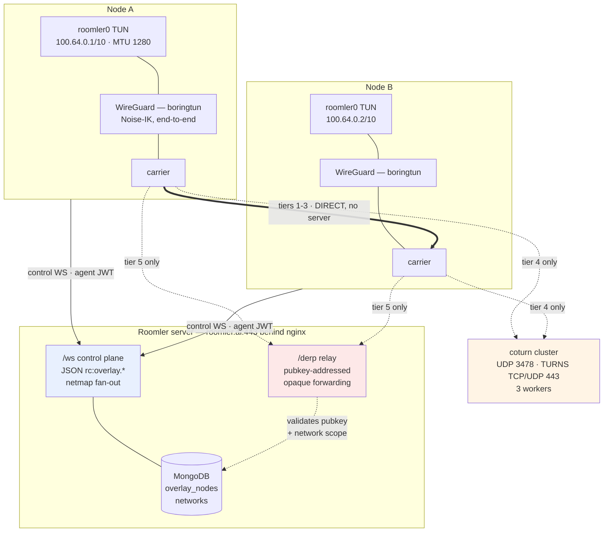

**Control-plane messages** (`crates/remote_control/src/signaling.rs`):

| Direction | Message | Purpose |
|---|---|---|
| node → server | `rc:overlay.join` | pubkey, LAN endpoints, MTU, capability flags; the routes it offers and, when it withholds them, why (FR-97 P0b, #3562); whether an exit serves IPv6 (`exit_serves_v6`, #3562) |
| node → server | `rc:overlay.endpoints` | trickle current relay candidates |
| node → server | `rc:overlay.srflx` | trickle STUN-learned public mapping + NAT type |
| node → server | `rc:overlay.relay_request` | ask for coturn credentials for a peer |
| node → server | `rc:overlay.leave` | drop out of the mesh |
| server → node | `rc:overlay.netmap` | full peer list |
| server → node | `rc:overlay.netmap_delta` | incremental upsert/remove |
| server → node | `rc:overlay.relay_grant` | coturn ICE servers + a symmetric `pair_key` |

The data plane is always **WireGuard**: a userspace boringtun tunnel presenting
a `roomler0` TUN on `100.64.0.0/10` (CGNAT range, Tailscale convention) at MTU
1280. Only the *envelope* under WireGuard changes between tiers.

**A node's identity on the data plane is its WireGuard public key**, minted on the
device at enrollment; the server distributes the public half in the netmap and never
holds the private one. An admin can retire it from the device grid — the server
*orders* a re-mint it never sees, the device persists the new key and re-joins under
it, and every peer reinstalls the carrier on the resulting netmap upsert:
[`overlay-key-rotation.md`](overlay-key-rotation.md) (FR-40).

### Address leases — allocation and release

Each tenant has one `overlay_networks` row: a CIDR (`100.64.0.0/10`), a
monotonic `next_host` cursor, and `free_hosts`, a pool of **recycled** host
numbers. On `rc:overlay.join` the server looks the machine up by
`(tenant_id, machine_id)`:

- **a live node** → rehydrate it; the lease is unchanged. The rehydrate
  refreshes the row from the join (the offered routes and their withheld
  reason, an exit's IPv6 statement, the LAN endpoints) and empties what the
  join does not carry: srflx and its NAT type, the dialer bit, the measured
  capability vector, the warm relay. So a node that joins again mid-session
  (a control-WS Reattach, or an exit whose setup changed its offer, #3562)
  follows the join with what it wiped (`rejoin_plan`,
  `crates/tunnel-core/src/overlay/runtime.rs:4684`), and an exit's re-offer
  reaches the admin row and every peer at once
  ([`overlay-exit-nodes.md`](./overlay-exit-nodes.md#the-offer-follows-the-setup-3562)).
- **no live node** → `allocate_host` pops the head of `free_hosts` (FIFO, so an
  address gets the longest possible cool-down before reuse) and falls back to
  bumping `next_host` when the pool is empty. Both branches are single atomic
  `find_one_and_update`s, so concurrent joiners can never be handed the same
  number.

The IPv6 address is **derived**, never allocated: `derive_overlay_v6` embeds the
v4 in the low 32 bits of the pinned ULA `fd72:6f6f:6d6c::/96`. There is one
allocator, and freeing the v4 frees both.

Consequences of derivation (from the shipped dual-stack work; the historical
plan doc is retired):

- **No per-peer v6 routing state anywhere**: the router *unmaps* a derived-ULA
  destination back to its embedded v4 at packet-extraction time
  (`Router::dst_of_ip_packet`) and routes on the existing v4 table.
- **No wire/DB `overlay_ip6` field** — it would only be a consistency liability;
  every consumer (LocalAPI `status`/`peers`, the tray, the admin nodes table via
  a TS mirror of the derivation) computes it locally.
- **MagicDNS answers AAAA** with the derived v6 by default;
  `ROOMLERD_DNS_AAAA=0` reverts to A-only — the mixed-fleet escape hatch,
  since a pre-v6 peer's OS doesn't own its derived address and v6 toward it
  blackholes (happy-eyeballs apps fall back on their own).
- `roomler ping <name> -6` resolves a peer's derived v6; the netstack SOCKS
  front accepts genuine ATYP=IPv6 targets when they are derived-ULA (v4-mapped
  unwraps; any other v6 is host-unreachable by design).

**Removal releases the lease.** Every removal path (`DELETE …/agent/{id}`, `DELETE …/overlay-node/{id}`
(admin evict), `DELETE …/tunnel-client/{id}`, an archived org, a tunnel client whose owner left the
org) goes through one writer, and the order is load-bearing:

1. read the peer list while the node is still live;
2. **compare-and-swap** the node's `deleted_at` (winning that CAS is the release
   *token* — only the winner proceeds, so two concurrent removals can't pool one
   host twice);
3. return the host number to `free_hosts`;
4. fan `rc:overlay.netmap_delta { removes: [node_id] }` to those peers, and to
   the released node itself.

Pooling *before* the tombstone would hand the address to a second joiner while
the old row still held it, and the unique index would lock that joiner out of
the overlay permanently. In this order a crash merely leaks one host number out
of a 4.2 M-address `/10`.

The node row is **tombstoned, not deleted**: its address, name and pubkey stay
as the record of who held them — which matters precisely because addresses now
recycle. The three unique indexes on `overlay_nodes` are scoped to live rows, so
a tombstone holds neither its address nor its MagicDNS name.

Two consequences worth knowing:

- **Removal is final.** A removed machine that re-enrolls comes back as a *new*
  node with a fresh lease and a freshly de-duplicated name; the tombstone is never
  revived. A fresh lease is the pool's head, so in an org whose pool holds no
  older host it is the machine's own old address, handed out as it would be to
  any joiner. Its agent row comes back as a new device too (#3627,
  [`device-credentials.md`](device-credentials.md#a-revived-device-starts-from-a-new-devices-settings-3627)):
  before that row is live, the revive releases a lease the removal left behind
  (normally none), through this same writer and in this order.
  Until it does, it takes no lease at all: a join is refused while the row behind
  the socket is a tombstone (#1829), or its org is archived (#3042), and it is the
  kick or the revocation poll that tells it why. A relay request naming a released
  peer gets no grant.
- **Evict is "force a new lease", not "ban".** It doesn't touch the backing
  agent / tunnel client, so a still-enrolled device rejoins on its next connect
  with a *different* address. To remove a device for good, delete it. There is
  deliberately no per-machine overlay denylist.

### Pre-release gaps: reclaimed through `release_host`, never by hand (FR-47 P3)

Every device removed *before* the release mechanism shipped (2026-07-29) burned
its host number with nothing to hand it back, so a long-lived tenant's cursor
sits above its live-node count with holes below. The fleet tenant was the worked
example: `next_host = 33`, 14 live nodes, and 16 numbers (`.3 .5 .8–.13
.16–.23`) that belonged to no row at all.

Those numbers aren't attached to any document, so eviction cannot reach them,
and writing `free_hosts` directly would bypass every guard in `release_host`:
the `next_host: {$gt: host}` sanity filter, the `$addToSet` dedup and the
pool's size cap. On a carved `/22` (1 022 addresses, not the `/10`'s 4.19 M)
the holes are no longer cosmetic, so FR-47 P3 recovers them the guarded way.
`POST /api/tenant/{tid}/overlay-block/reconcile-hosts`
([`overlay_block.rs:1158`](../crates/modules/network/src/routes/overlay_block.rs#L1158))
computes `(1..next_host) − live − pooled` server-side and returns each number
through `release_host`, so every guard still applies. It is platform-operator
only, and anyone else gets a 404. It is a dry run unless the body says
`{"dry_run": false}`. Run on production on 2026-08-31, it released exactly 17
ordinals in the oldest org and refused none, and a second dry run read
`orphaned: []` ([#1071](https://github.com/gjovanov/roomler-ai/issues/1071#issuecomment-5486189495)).
Run it again a month later to tell a historical leak from a live one.

Because addresses are reused, the client keys every routing teardown by
**pubkey**, never by address, and drops an OS `/32` only when no surviving peer
still claims it. Those two rules are what stop a late reap of a stale peer from
blackholing the address's new owner; the paths that exercise them are the delta
`removes` arm and `sweep_carrier_health`'s lazy reap. A *name* in
`overlay_exit_node` is pinned to the node it first resolved to — see
`docs/overlay-exit-nodes.md`.

A **disconnect is pruned at the re-join**, not at the loss. Since rc.307 the
node runtime outlives its control WS: losing the WS leaves `by_node`, the
WireGuard device, the TUN and every carrier running, one runtime per tenant
(`RUNTIME_SLOTS`, `agents/roomlerd/src/overlay.rs:110`). The next connection
re-attaches it (`OverlayEvent::Reattach`, `:275`) instead of starting another,
the runtime joins again, and the full netmap the server answers that join with
is the reconcile: whatever the runtime still holds that the netmap no longer
lists is pruned (`crates/tunnel-core/src/overlay/runtime.rs:4223`). What the
device's own peer list says in between is in
[§8](#the-peer-list-while-the-control-socket-is-down-4367).

---

## 2. What a "carrier" is

A carrier is whatever moves one WireGuard datagram from A to B. All five
implement the same tiny contract, so the WG layer is identical everywhere:

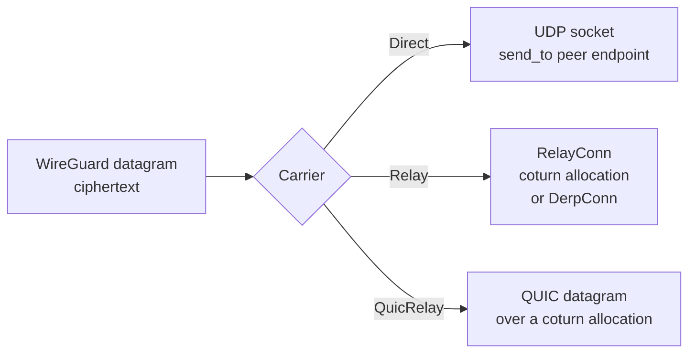

That uniformity is why adding DERP touched no WireGuard code: `DerpConn` is just
another `RelayConn`.

A remote-desktop session can read the carrier too. Behind `ROOMLERD_RC_CARRIER_RANK`
(FR-148 P4, off by default), a session asks LocalAPI `peers` at its offer for the
carrier to the viewer's device. Unless that carrier is `Direct`, neither upgrading nor
stalled, every candidate only the mesh carries ranks below every TURN relay, so the
video crosses the mesh only when nothing else connects
([remote-control.md](remote-control.md#the-carrier-rank-fr-148-p4)).

A candidate's rank cannot see one route, though: a LAN socket whose checks reach a mesh
address rides the mesh too, because the destination picks the route. Under the switch's
`route` value (step 2) the unit is the pair: a pair rides the mesh when either end sits on
the mesh's own blocks or its local candidate is ranked last, never on the whole
`100.64.0.0/10` (`rides_the_mesh`,
`crates/vendored/webrtc-ice/src/agent/agent_config.rs:183`). While a sibling on the mesh
carries that route, the agent forms no pair from a socket off the mesh into it, and it
holds the pairs the mesh carries, unanswered, for at most 2.5 s while a TURN relay can
still come. A TURN pair that connects inside the hold wins; the mesh carries the video
when none does, and the session's path line names the route and the hold
([remote-control.md](remote-control.md#the-route-rank-fr-148-p4-step-2)).

A TURN relay that allocates after the hold still takes the session off the mesh (phase
B). While the selection rides the mesh, the agent checks each pair off it that ranks
above, on every 200 ms tick of its ICE loop, up to 13 checks of the pair's own
(`ROUTE_MOVE_CHECKS`, `crates/vendored/webrtc-ice/src/agent/agent_config.rs:130`). It
answers the browser's nomination of such a pair before its own check has validated the
pair, and moves onto it only once that check succeeds, so it never sends on a pair it
has not validated (`answers_before_validating`,
`crates/vendored/webrtc-ice/src/agent/agent_selector.rs:221`). Each move writes one
`session carrier moved` line, from the carrier the session left to the one it took
([remote-control.md](remote-control.md#the-move-off-the-mesh-fr-148-p4-step-2-phase-b)).

### The direct carrier's socket buffers (FR-110)

A direct carrier is one UDP socket, and the kernel holds whatever arrives
between two reads of it. At the OS default (208 KB to receive on Linux) a burst
at line rate fills that in under 2 ms. The kernel then drops WireGuard
datagrams before the daemon reads them, and TCP inside the tunnel reads every
drop as congestion: CPU idle, throughput low. So every direct carrier socket
asks for **7 MiB each way** as it is bound. That is `tune_carrier`
(`crates/tunnel-core/src/overlay/sockbuf.rs:145`), called from the one seam that
binds them all, `bind_direct_socket` (`direct.rs:1570`).

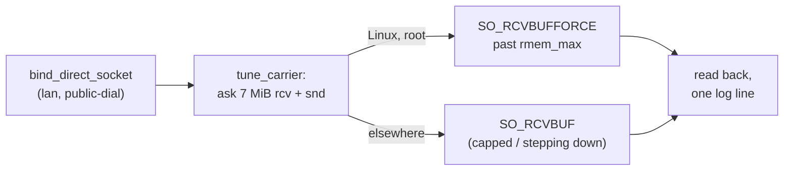

| OS | How | What caps it |
|---|---|---|
| Linux, root | `SO_RCVBUFFORCE` / `SO_SNDBUFFORCE` (`sockbuf.rs:87`) | nothing: past `net.core.rmem_max` |
| Linux, no `CAP_NET_ADMIN` | `SO_RCVBUF` / `SO_SNDBUF` | `net.core.rmem_max`, which is **212992 on most distributions**. That is why FORCE matters: the plain option alone changes nothing there. Under 1 MiB the line is a WARN |
| Windows | `SO_RCVBUF` / `SO_SNDBUF` | nothing: it takes the size |
| macOS | `SO_RCVBUF` / `SO_SNDBUF`, stepping down 7 → 4 → 2 → 1 MiB | `kern.ipc.maxsockbuf`, which refuses a larger size outright |

Measured into an M2 Pro Linux host over the overlay, 256 MiB from a server
17 ms away: **116 / 128 Mbit/s with 455 / 623 drops** (`RcvbufErrors`) on
0.4.140, against **516 / 543 Mbit/s with none** on the released 0.4.141. CPU was
~1% on both ends both times. Windows and macOS grant the full 7 MiB to the plain
option. A Windows receiver was not dropping at its default (UDP Receive Errors
0), so it gains little: 416 → 435 Mbit/s, interleaved with the old build under
one load.

⚠️ **Check the size with `ss`, not with a throughput test.** `ss -uampn` shows
each socket's `rb`. Linux reports twice the request, so a carrier socket shows
`rb14680064`, and every other socket of the daemon keeps the default. The
daemon logs the granted sizes once per socket (*"overlay: carrier socket
buffers"*) whatever `RUST_LOG` says. The packaged Linux units set
`RUST_LOG=roomlerd=info,warn`, which drops `tunnel_core` INFO, so the logger
appends this one target on its own (`crates/agent-core/src/logging.rs:521`). On
Windows that line is the only evidence of the size.

⚠️ **A per-user Linux install gains nothing until the host allows it.** It runs
without `CAP_NET_ADMIN`, so FORCE is refused. Under a distro-default
`rmem_max` its carrier sockets stay at 416 KB (`rb425984`), and the daemon says
so in a WARN line. Raise `net.core.rmem_max` and `net.core.wmem_max` to at least
7340032 (persisted in `/etc/sysctl.d/`), or install the daemon system-wide.

⚠️ **A full buffer delays instead of dropping.** A queue builds only when the
reader falls behind the arrival rate. Datagrams then wait rather than vanish,
and for TCP inside the tunnel a drop costs more than the wait. The kernel
charges a socket only for what is queued, so an idle carrier costs nothing.
Kill switch: `ROOMLERD_OVERLAY_SOCKBUF=0`.

---

## 3. The carrier cascade

The **PathMonitor** (`overlay/path.rs`, the one selection implementation since
rc.282) decides the tier on every netmap, health sweep, authenticated inbound
INIT, resume, and a ~30 s re-upgrade tick. Cold-start the decision follows the
priority order below (tier priors); after that, measured evidence — decaying
failure penalties, probe latencies, traffic credits — refines it, demoting
only on a typed carrier death. Best latency first, server-dependency last.

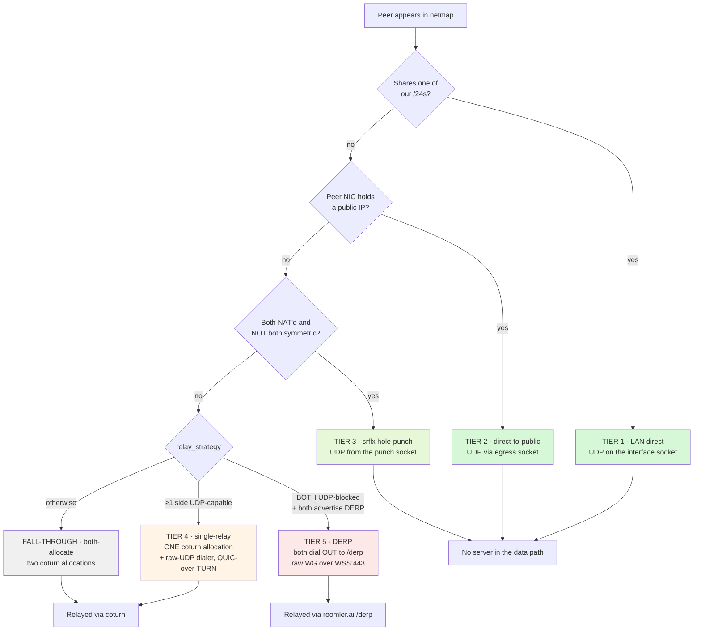

| # | Tier | Carrier | Wins when | Flag — `ROOMLERD_OVERLAY_…` |
|---|---|---|---|---|
| 1 | LAN direct | UDP, interface socket | peer shares a /24 | `DIRECT` (**on**) |
| 2 | direct-to-public | UDP, egress socket | peer's NIC is public | `PUBLIC_DIRECT` (off) |
| 3 | srflx hole-punch | UDP, punch socket | both NAT'd, not both symmetric | `SRFLX` (**on**, rc.200) |
| 4 | single-relay | 1 coturn alloc + raw dialer, QUIC | ≥1 side UDP-capable | `RELAY_SINGLE` (**on**, rc.200) |
| 5 | **DERP** | `/derp` WSS, pubkey-addressed | **both** UDP-blocked | `DERP` (**on**, rc.203) |
| 5′ | **org relay** (FR-19) | a tenant-owned `roomlerd` forwarding WG ciphertext on UDP 3478, Geneve-framed | the server **minted a session** for the pair — org switch on, an ACL rule granting each member the relay node, an approved + serving relay. A relay *kind* beside TURN/DERP on the relay tier, not a new tier | `ORG_RELAY` (off) |
| — | both-allocate | 2 coturn allocations | mixed capability / fall-through | always available |

Every gate accepts `0`/`false`/`no`/`off` to disable. Each direct tier carries
its **own** per-peer decaying failure penalty on the PathMonitor, so a failing
punch can never poison a proven LAN path (the CC1 rule — mechanics in
[`docs/overlay-nat-traversal.md`](./overlay-nat-traversal.md), "Path
selection: the two-plane PathMonitor").

---

## 4. Use cases — who wins, and why

### UC-1 · Both nodes on the same LAN (no VPN)

The happy path: L2 reachability, no NAT, no server in the data path.

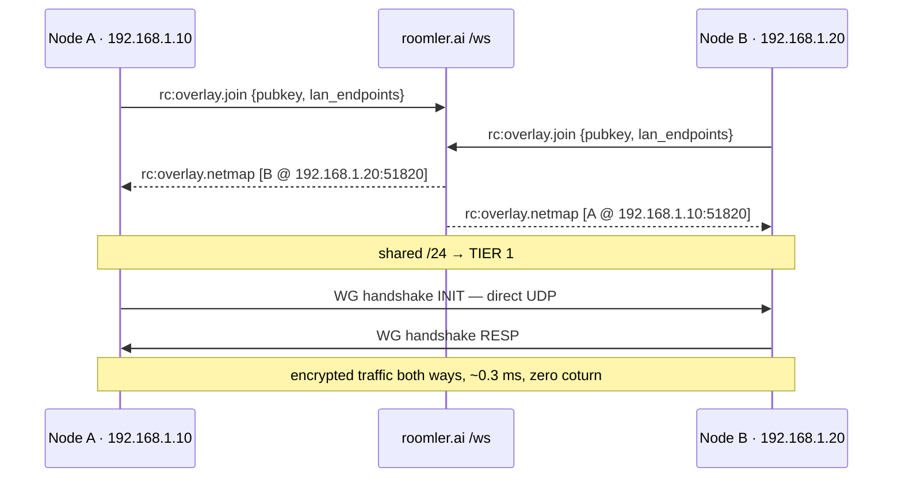

Direct carriers initiate **bilaterally** — each side's outbound INIT opens its
own stateful firewall hole for the other's inbound.

### UC-2 · One node has a public IP (cloud / fleet host)

A NAT'd client dials the public peer directly; no STUN needed, since the public
side has no NAT filter to open. The public side *accepts* an INIT from an
address it couldn't know in advance, after cryptographically authenticating it.

### UC-3 · Both behind home NAT — the hole-punch (outside VPN)

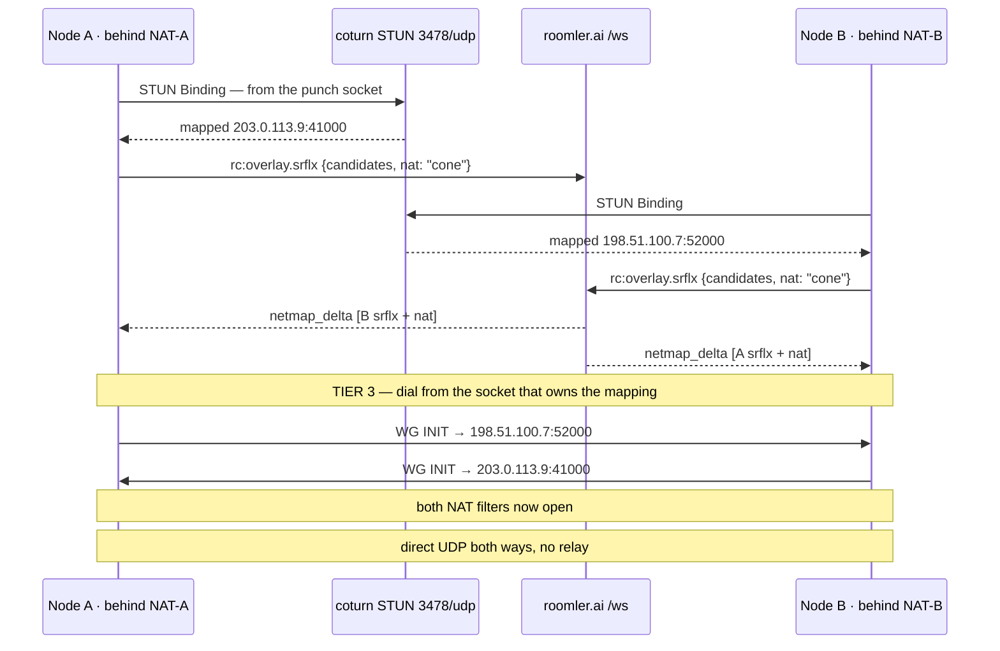

Two properties make this simpler than a generic ICE agent: **WG is the punch
burst** (boringtun retransmits INIT every ~5 s for ~90 s), and **the netmap
fan-out is the rendezvous**. Symmetric↔symmetric is skipped up front — neither
side can predict the other's per-destination port.

### UC-4 · Corporate VPN that still allows UDP — single-relay

This is the common corp case. A TLS-inspecting VPN typically **still permits**
UDP/3478 and UDP/443, so the host can reach coturn; it just can't be punched.
Single-relay uses exactly **one** coturn allocation, and — key point — the role
is chosen by **UDP capability, not pubkey**:

* the **UDP-blocked** side becomes the **anchor** (it can still *allocate* over
  the TURNS/TCP-443 fallback),
* the **UDP-capable** side becomes the **dialer** (a plain raw-UDP sender to the
  anchor's relayed address — no allocation of its own).

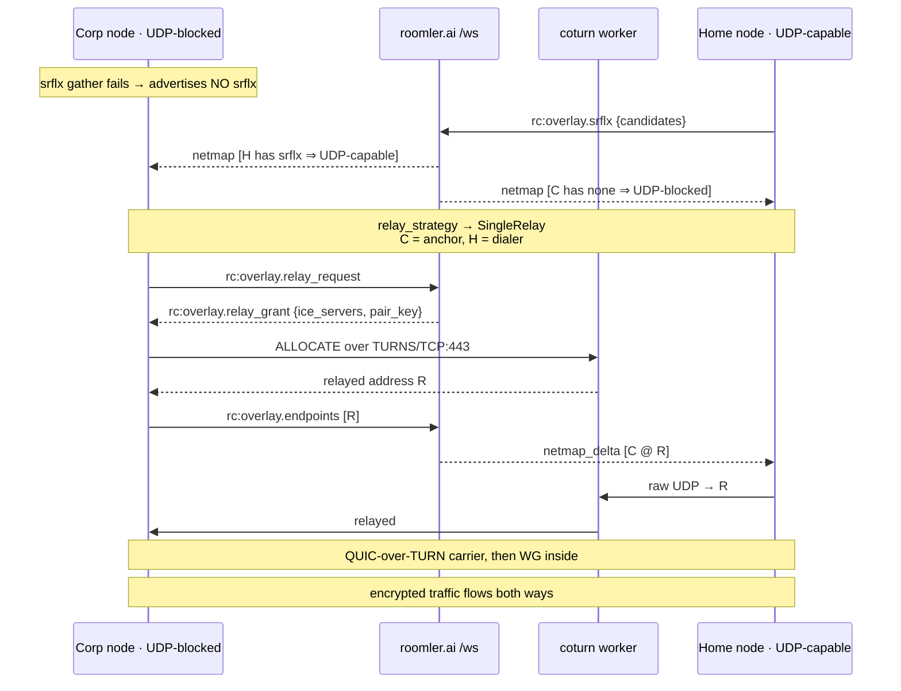

Single-relay **forces** the QUIC carrier: a raw relay carrier discards the recv
source, so the anchor couldn't reply to a symmetric dialer's coturn-observed
port — only quinn's server consumes the observed path.

The signal for "is my peer UDP-capable?" is beautifully cheap: **does it have
`srflx_endpoints` in the netmap?** A successful STUN round-trip *is* proof that
raw UDP to coturn works, so no extra wire field is needed and both ends compute
the same roles from the same inputs.

### UC-5 · Both sides UDP-blocked, TCP-only — **DERP**

The one topology no other tier can serve. Single-relay provably cannot: exactly
one side must be the raw-UDP dialer, and neither has UDP. DERP breaks the
deadlock because **both peers dial OUT** over TCP/TLS-443.

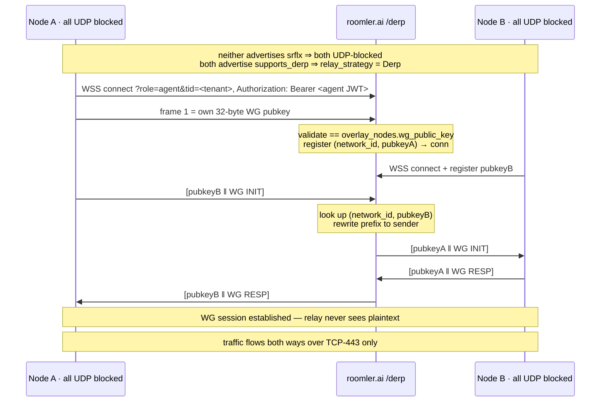

**Field-proven 2026-07-21**: buildhost↔fleet-host-2 network namespaces with *all* UDP and
*all* coturn TCP blocked — only `roomler.ai:443` reachable. Both nodes reached
`/derp`, `relay_strategy` chose `Derp`, the WG handshake completed over the relay
(INIT 148 B → RESP 92 B → data), and ping ran **0 % packet loss, ~2.7 ms RTT**
both directions.

### UC-6 · Fall-through: both-allocate

When single-relay isn't mutually supported and DERP doesn't apply, the pair
falls back to two coturn allocations. This path is cross-NAT fragile: it needs
both allocations on the **same** coturn worker, and a worker-co-location failure
was the root cause of the historic `REKEY_TIMEOUT`. Tiers 4 and 5 exist largely
to avoid it.

### UC-7 · Org relay (FR-19)

A pair that would otherwise sit on TURN or DERP can be routed through a node the
**org itself** owns — an HQ box with a public address — so relayed traffic never
crosses the API pod. The server decides (`docs/fr/FR-19-peer-relays.md` §1–§7):
on a `relay_request` it checks the org switch, the ACL grant for **each** member
to the relay node, an approved relay that is online and advertising
`relay-server`, and the per-(requester, relay) ceiling; then it pushes
`relay_serve` to the relay (both members' bind secrets) and `relay_session` to
each member (its own secret, the relay's endpoints). Each member binds with a
3-way authenticated handshake (`tag₁` covers no address — a NAT'd member cannot
know its mapping on its first packet; the cookie binds it at the challenge) and
installs an `OrgRelayConn` as a raw relay carrier: `relay:org/udp` in `roomler
peers`. Revocation is a **push** (org off, an ACL edit, approval cleared, a
party gone), because the idle deadline never fires under a WireGuard keepalive.
Sessions are 24-bit VNIs unique **per relay node**, capped at 64 per relay, 1 h
absolute lifetime. The floor is untouched: a node with no UDP stays on DERP.
Full treatment, including what the relay operator can still see:
[peer-relays.md](peer-relays.md).

---

## 5. Inside vs outside a VPN — what each network actually permits

The **corp VPN** column is measured — a real corporate VPN host probing the
fleet's coturn on 2026-07-21 via `coturn_test.html`. The other two columns are
the characteristic shape of those networks, not a single measurement.

| Transport | Open internet | Typical corp VPN | Strict TCP-only firewall |
|---|---|---|---|
| UDP 3478 — STUN/TURN | ✅ | ✅ | ❌ |
| UDP 443 — TURNS/UDP | ✅ | ✅ | ❌ |
| **TCP 443 — TLS** | ✅ | ✅ | ✅ |
| TCP 3478 — plain | ✅ | ❌ | ❌ |
| TCP 5349 — TURNS/TCP | ✅ | ❌ | ❌ |
| Inbound UDP / punchable | usually | ❌ | ❌ |

Reading across the rows gives the whole story:

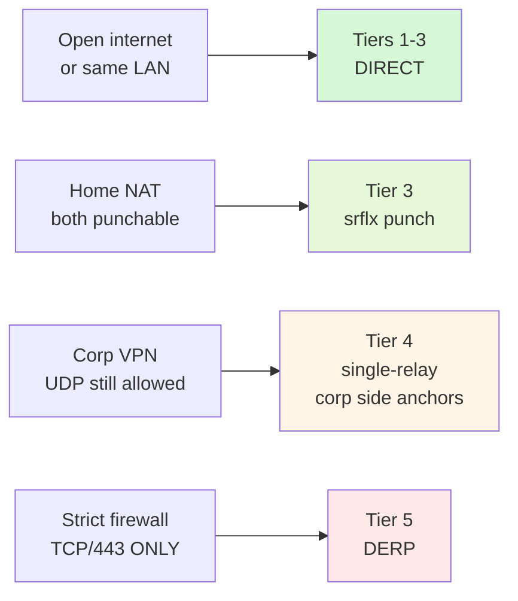

The load-bearing insight: **a corp VPN is usually not as restrictive as it
feels.** Because it still passes UDP/3478 and UDP/443, such a host is
*UDP-capable* and single-relay already covers it — which is why live telemetry
found no naturally-occurring both-UDP-blocked pair. DERP exists for the strictly
harder network where the only thing that survives is TCP/443-TLS. It was built
for **completeness of the solution**, not because demand forced it.

### The node's own firewall (FR-97 P3i)

The networks above sit between two nodes. A Linux node can also run a host
firewall of its own, firewalld or ufw. Measured on 2026-10-17 (FR-97 §8), it
affects the mesh in one way only.

| What crosses it | Behind firewalld | Why |
|---|---|---|
| A hole-punched carrier | ✅ passes (a Fedora host, zone `FedoraServer`) | direct carriers initiate bilaterally (UC-1): each side's outbound probe makes the conntrack entry that lets the other side's reply in |
| A LAN-direct carrier | ✅ passes (`tier=Lan`, 497 ms; zone `public`) | the same |
| A service on the node's overlay address | ❌ refused unless the zone admits it | the overlay adapter is in no zone, so the default zone governs it |
| Roomler's own services | ✅ untouched | roomler SSH is intercepted below the OS; exec, remote control and tunnels ride the daemon's own connections |

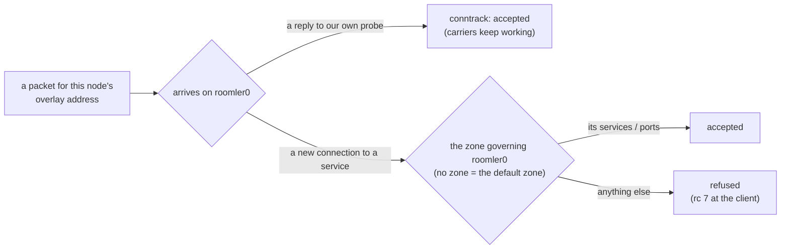

**The daemon reports this and never changes it** (FR-97 D13). The firewall
belongs to the host's owner, and putting the adapter in a trusting zone would
open every service on the host to every peer the overlay ACL admits. What it
does instead:

- The overlay runtime asks firewalld, then ufw, what governs its adapter,
  once the adapter is up and every ten minutes
  ([`runtime.rs:2230`](../crates/tunnel-core/src/overlay/runtime.rs#L2230),
  [`hostfw.rs:220`](../crates/tunnel-core/src/overlay/hostfw.rs#L220)), off
  the run loop.
- The answer is `HostFirewallStatus`
  ([`lib.rs:130`](../crates/localapi/src/lib.rs#L130)), parsed from
  `firewall-cmd --info-zone` ([`hostfw.rs:45`](../crates/tunnel-core/src/overlay/hostfw.rs#L45))
  or `ufw status verbose` ([`hostfw.rs:130`](../crates/tunnel-core/src/overlay/hostfw.rs#L130)).
- `roomler status` prints it only when the firewall limits what a mesh peer
  reaches ([`localclient.rs:3231`](../agents/roomler-cli/src/localclient.rs#L3231)):

  ```text
    host fw     firewalld has roomler0 in no zone, so the default zone public applies: mesh peers reach only dhcpv6-client, ssh here
  ```

To open the mesh, the owner runs one of these. Measured: the overlay address
answered while the LAN address stayed as its zone said.

```bash
sudo firewall-cmd --zone=trusted --add-interface=roomler0              # until firewalld reloads
sudo firewall-cmd --permanent --zone=trusted --add-interface=roomler0  # and after
sudo ufw allow in on roomler0
```

⚠️ **`trusted` admits every port to every peer the overlay ACL admits.** A
narrower zone, or `--add-port` on the governing one, opens less.

⚠️ **Rich rules and source-bound zones are not interpreted.** The status counts
a zone's rich rules ("2 rich rules") rather than guessing what they admit, and
a zone bound to a source range can admit more than the interface's zone says.

⚠️ **ufw needs root to answer**, so a per-user daemon reports no ufw line rather
than a guess. `ROOMLERD_HOST_FW_PROBE=0` switches the probe off. macOS's
Application Firewall is not asked: it passes forwarded traffic and filters per
application ([`overlay-exit-nodes.md`](overlay-exit-nodes.md)).

---

## 6. DERP in detail

### Wire protocol

Every frame is a WebSocket **binary** message on `wss://roomler.ai/derp`.

| Frame | Layout | Meaning |
|---|---|---|
| Registration — first frame only | `pubkey(32)` | "I am this WireGuard key" |
| Data — client → relay | `dst_pubkey(32) ‖ payload` | "deliver to this peer" |
| Data — relay → client | `src_pubkey(32) ‖ payload` | "this came from that peer" |

The relay rewrites only the 32-byte prefix. The payload is opaque WireGuard
ciphertext and is never inspected, decrypted, or stored.

### Server side

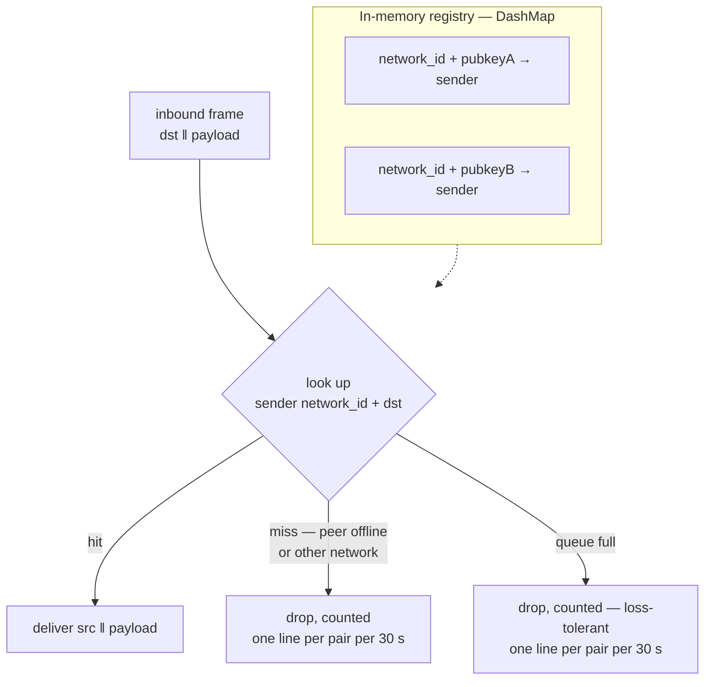

Three guarantees fall out of the key shape:

1. **Auth** — the agent JWT, same audience as `/ws?role=agent`. The database is
   authoritative for the agent's tenant, so a forged claim can't widen scope.
2. **Registration authz** — a node may only register the pubkey that matches its
   own `overlay_nodes.wg_public_key`. It cannot claim a peer's key to intercept
   that peer's frames.
3. **Network scoping** — `network_id` is part of the registry *key*, so a
   cross-network delivery is structurally impossible, not merely checked.

Backpressure is a bounded per-connection queue with drop-on-overflow; WireGuard
retransmits, so a dropped carrier datagram is harmless. Re-registration is
last-writer-wins, because corp middleboxes routinely leave half-open TCP. Both
drops are counted and logged on the central relay and on a regional one
([every drop on the relay path](#every-drop-on-the-relay-path-and-where-it-reports-fr-148-d52)).

### Client side

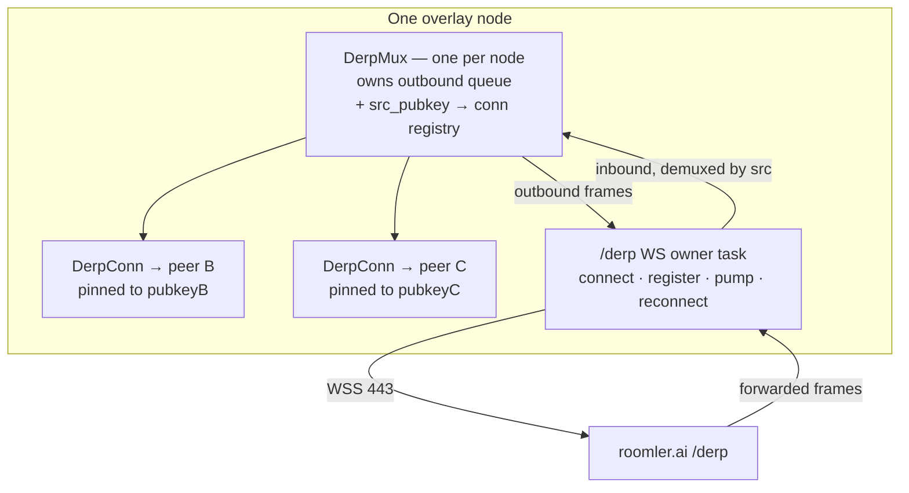

`DerpConn` implements the same `RelayConn` contract as a coturn allocation, so
the WireGuard layer is untouched. It is **pinned to exactly one peer pubkey**,
and that pinning is what makes **raw** WireGuard correct here: every datagram it
receives is, by construction, from that one peer, so the carrier's
recv-source discard can never be wrong. That is precisely the property
single-relay lacks — which is why single-relay must force QUIC while DERP
deliberately stays raw. QUIC over a reliable WebSocket would be double-reliable,
head-of-line blocking on top of head-of-line blocking.

### Queue discipline: the age bound and the kernel send-buffer cap (FR-18)

For a host whose corporate VPN blocks every UDP path, DERP is the only carrier
there is, so the two buffers a frame waits in on its way out are the latency
this carrier adds. FR-18 bounds both. The first is the node's outbound queue.
The second is the kernel's TCP send buffer under the `/derp` WebSocket.

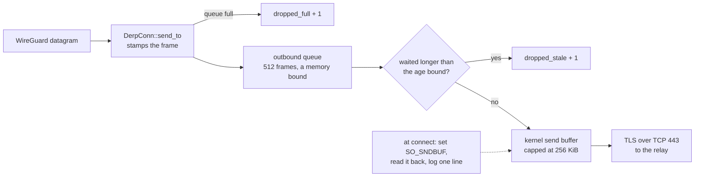

| Lever | Where | What it does |
|---|---|---|
| Age bound | `crates/tunnel-core/src/transport/derp.rs:72` (`queue_max_age`), checked by the WS writer at `agents/roomlerd/src/derp.rs:550` | The writer drops a frame that waited longer than `ROOMLERD_DERP_QUEUE_MAX_AGE_MS` (default 100) instead of sending it. That bounds the queue in time whatever the link rate: 512 frames are 33 ms at 160 Mbit/s and 1.8 s at 3 Mbit/s. `0` turns the check off, the behaviour before FR-18 |
| Send-buffer cap | `cap_send_buffer` (`agents/roomlerd/src/derp.rs:77`), called once per connect (`:435`) | Asks for `SO_SNDBUF` = 256 KiB (`DERP_SNDBUF_BYTES`, `:40`), above the bandwidth-delay product of these paths (3 Mbit/s × 200 ms is about 75 KB) and far below the megabytes that autotuning grows. Without it, a frame the age check let through could still sit for seconds in the kernel. The cap has no switch of its own |
| Counter | `DerpMux::note_stale_drop` (`crates/tunnel-core/src/transport/derp.rs:456`) | `dropped_stale` counts what the age bound shed. The keepalive tick logs it, with the mux's three other drop counts, when any of them changed (`agents/roomlerd/src/derp.rs:522`): *"overlay derp: carrier frames dropped (stale, full, backpressure, unrouted)"*, which keeps the `dropped_stale` and `since_last` of FR-18's shed line, *"overlay derp: shed stale carrier frames (queue age bound)"* ([every drop on the relay path](#every-drop-on-the-relay-path-and-where-it-reports-fr-148-d52)) |

⚠️ **A successful set is not a cap.** The OS may apply less than was asked and
still return success, so the daemon reads the size back with
`getsockopt(SO_SNDBUF)` right after the set
(`cap_tcp`, `agents/roomlerd/src/derp.rs:96`) and judges it in the request's
units (`SndbufCap::read_back`, `agents/roomlerd/src/derp.rs:141`). This is
FR-18's AC4. In a Linux 6.6 container at stock sysctls (2026-10-30), a 262144
request returned `Ok`, and the kernel then reported 425984: **212992 in
force**. The daemon used to assume 256 KiB.

How each OS answers, from its documentation or source:

| OS | `getsockopt` returns | What can change the request | Why one read is enough |
|---|---|---|---|
| Linux | **twice** the size in force, for kernel bookkeeping (socket(7)). The daemon halves it (`KERNEL_DOUBLES_SNDBUF`, `agents/roomlerd/src/derp.rs:110`) | `net.core.wmem_max` clamps it **without an error**. The default was 212992 until Linux 6.18 raised it to 4 MiB, so a stock older kernel holds 208 KiB of the 256 asked | The set takes `SOCK_SNDBUF_LOCK`, so TCP neither grows nor shrinks the buffer afterwards (`tcp_should_expand_sndbuf`, `sk_stream_moderate_sndbuf`) |
| Windows | the size in force | Winsock "can succeed even if the implementation did not provide the whole amount requested" and tells the caller to check with `getsockopt` | Dynamic send buffering "is enabled unless an application sets the SO_SNDBUF socket option" |
| macOS | the size in force (`sb_hiwat`) | `kern.ipc.maxsockbuf` (8 MiB by default) clamps a larger request, far above this one | The set clears `SB_AUTOSIZE`, which TCP's send-buffer growth and trim both require. The MSS rounding runs only on a SYN, before the cap |

Every connect logs one line, and every message opens with *"overlay derp: send
buffer"* (`SndbufCap::log`, `agents/roomlerd/src/derp.rs:171`). It carries
`relay`, `requested` and, where it was read, `applied` in the request's units:

| Read-back | Level | Message |
|---|---|---|
| applied = requested | INFO | *"… capped — the kernel holds the requested size (FR-18)"*, `clamped=false` |
| applied < requested | INFO | *"… capped below the request — the OS clamped it …"*, `clamped=true`. A tighter cap is still a cap |
| applied > requested | WARN | *"… not capped — the kernel holds more than requested"*. No OS is documented to do this. The read-back is there to catch it if one does |
| the set failed | WARN | *"… cap refused — the OS keeps its own size"*, with that size when it reads back |
| the read failed | WARN | *"… cap set but not read back — the size in force is unknown"* |
| no TCP socket under the WebSocket | WARN | *"… left at the OS default — unrecognised TLS wrapper"* |

The verdict per OS and the line's fields are pinned by unit tests
(`agents/roomlerd/src/derp.rs:1033`, `:1199`). Two more use a real loopback
socket. In one, the cap reaches the socket under the WebSocket and reads back
as the kernel under the test applies it (`agents/roomlerd/src/derp.rs:1111`).
In the other, a socket filled until the kernel takes no more keeps the size its
cap read back (`agents/roomlerd/src/derp.rs:1139`). CI runs them on Linux and
Windows.

⚠️ **To read the cap on a host, grep its log for `overlay derp: send buffer`.**
A node writes the line each time its `/derp` socket connects. Since the
always-on floor (`ROOMLERD_OVERLAY_DERP_FLOOR`, default on since rc.400) opens
the central `/derp` socket at startup (see the lazy connection below), that is
every node, and a regional relay's socket logs a line of its own under its
`relay` name. Expect
`clamped=true applied=212992` on a stock Linux kernel before 6.18, and
`applied=262144` on Windows and macOS. On Linux, `ss -tmp` shows the same
socket's `tb` as twice `applied`. All three OSes read that way on the fleet on
0.4.191 ([FR-18's field log](fr/FR-18-carrier-queue-discipline.md#field-log)).

⚠️ **A full outbound queue drops the frame uncounted.** `DerpConn::send_to`
answers `Ok` when the queue is full (`crates/tunnel-core/src/transport/derp.rs:299`)
so that a transient overflow never latches the carrier dead. FR-18's design
also named a `dropped_full` counter, and it was never built.

### Every drop on the relay path, and where it reports (FR-148 D52)

A frame on the DERP path leaves one node's mux, crosses a relay (the central
`/derp` on the API pods, or a regional `derp-relay`) and enters the other
node's mux. Each place that drops it counts the drop where it happens, and the
host that dropped it reports the count on a line. On the mesh relay a lost
carrier frame is what fires an SCTP T3-rtx expiry in a remote-control session
(FR-148 AC4), so a read has to tell which drop moved, on which node, or that
none did. The drop on a full outbound queue, which the warning just above
calls uncounted, is counted since FR-148 D52, in `dropped_full`, and `send_to`
still answers `Ok` (the table's first row).

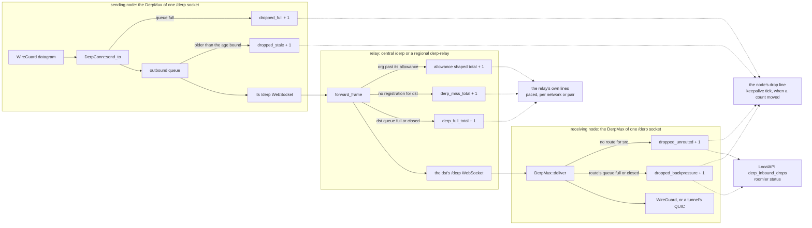

Every node is both ends: its drop line carries its two outbound counts and its
two inbound ones, so the sending node's line tells `stale` and `full`, and the
receiving node's line tells `backpressure` and `unrouted`.

| Where | It drops a frame when | Counted in | Reported on |
|---|---|---|---|
| sending node, `DerpConn::send_to` (`crates/tunnel-core/src/transport/derp.rs:307`) | the shared outbound queue already holds 512 frames (`OUTBOUND_QUEUE`, `:55`) | `dropped_full` (`:308`), one count for every conn of the mux | the drop line |
| sending node, the WS writer (`agents/roomlerd/src/derp.rs:550`) | the frame waited past the age bound (above) | `dropped_stale` (`DerpMux::note_stale_drop`, `crates/tunnel-core/src/transport/derp.rs:456`) | the drop line |
| relay, both: central `forward_frame` (`crates/modules/network/src/derp.rs:693`), regional (`crates/derp-relay/src/main.rs:1092`) | a bulk frame of an org past its plan's monthly relay (FR-115) | `derp_allowance_shaped_total` | INFO, at most one per network and source per 30 s (central) or per network per 10 s (regional) |
| central relay only (`crates/modules/network/src/derp.rs:676`, `:711`) | the overlay ACL denies the pair; a tunnel-leg frame over its rate | the ACL drop is not counted; `derp_tunnel_shaped_total` | INFO `derp: dropped a frame the overlay ACL denies`; the shaper's INFO at most one per network and source per 30 s |
| relay, both: central (`crates/modules/network/src/derp.rs:727`), regional (`crates/derp-relay/src/main.rs:1103`) | no registration for (network, dst) here: the peer is offline, or registered on another pod or relay | `derp_miss_total` | INFO, at most one per network and destination per 30 s; on the central relay also its census line each minute (`crates/modules/network/src/derp.rs:286`) |
| relay, both: central (`crates/modules/network/src/derp.rs:751`), regional (`crates/derp-relay/src/main.rs:1126`) | the destination's send queue refused it: full (a slow or half-open consumer), or closed by a socket on its way out | `derp_full_total` | WARN, at most one per network and destination per 30 s; the central relay's census line |
| receiving node, `DerpMux::deliver` (`crates/tunnel-core/src/transport/derp.rs:622`) | the mux holds no route for the frame's source | `dropped_unrouted` (`:623`), and `DERP_INBOUND_UNROUTED`; the runtime is told to follow that peer onto DERP | the drop line; `NodeStatus.derp_inbound_drops`, which `roomler status` prints |
| receiving node, `DerpMux::deliver` (`crates/tunnel-core/src/transport/derp.rs:603`, `:611`) | a routed consumer's queue (256 frames, `INBOUND_QUEUE`, `:80`) is full, or closed since a better tier replaced the carrier | `dropped_backpressure` (`:604`, `:617`), and `DERP_INBOUND_BACKPRESSURE` | the drop line; `NodeStatus.derp_inbound_drops` |

In no count, so in no line: a frame shorter than 32 bytes, at either relay or
at the receiving node, and one longer than 2,048 bytes at either relay. A
0.4.199 peer's Hive frame is counted apart (`dropped_hive`, FR-137) and read by
nothing outside `derp.rs`, so it is not on the drop line either.

**The node's drop line.** The `/derp` WS owner reads its mux's four counts
(`DerpMux::drops`, `crates/tunnel-core/src/transport/derp.rs:468`) on every
keepalive tick, every 25 s from the connect (`DERP_KEEPALIVE`,
`agents/roomlerd/src/derp.rs:56`), and writes one INFO line when any of them
moved since the line before (`DropLine::due`, `:232`, called at `:522`). A
carrier that drops nothing stays silent. A node with a regional relay writes
one line per socket, each under its own `relay`. The counts are the mux's for
its life, so a reconnect keeps them, and a line's moves read across it.

*"overlay derp: carrier frames dropped (stale, full, backpressure, unrouted)"*
(`DropLine::log`, `agents/roomlerd/src/derp.rs:243`):

| Field | Meaning |
|---|---|
| `relay` | which `/derp` socket: `central`, or a regional relay's host. The path reader keeps it in the database |
| `dropped_stale`, `since_last` | the stale count and its move since the line before: FR-18's shed line's two fields, with their names and meaning |
| `dropped_full`, `full_since_last` | outbound frames the full queue refused |
| `dropped_backpressure`, `backpressure_since_last` | inbound frames a full or closed consumer queue refused |
| `dropped_unrouted`, `unrouted_since_last` | inbound frames from a peer the mux holds no route for |

It replaced FR-18's shed line, *"overlay derp: shed stale carrier frames (queue
age bound)"*, which an older agent still writes when its stale count moved, so
read both. `roomler status` prints the inbound pair only (its `derp drops`
line, from `NodeStatus.derp_inbound_drops`): the outbound counts are on the
drop line alone. To read a host, grep its log for
`overlay derp: carrier frames dropped`. To pair the lines with a
remote-control session's T3 expiries, on both ends of the mesh relay pair, use
the path reader's `--timeline` with `--viewer-agent`
([production-mongo-reads.md §8a](production-mongo-reads.md#8a-one-devices-window-line-by-line---timeline)).

**The relays' lines.** The central relay writes
*"derp: dropped a frame for an unregistered dst (peer offline, or registered on
another pod/relay)"* and *"derp: dropped a frame on a full destination queue
(slow or half-open consumer)"*, each with `network_id`, `src` and `dst` (each
key as its first 8 hex characters) and the running total. A regional relay writes
the same two as *"derp-relay: dropped a frame …"*, with `network`, `src`, `dst`
and its own totals (`ForwardDrops`, `crates/derp-relay/src/main.rs:996`). It has
no periodic census line, so its totals are on these lines alone
([the regional relay's doc](../scripts/relay-pop/README.md#the-drop-lines-fr-148-d52)).
A drop on a relay is in no node's line: a T3 that no node's count explains
needs the relay's log of the same minutes.

### Lazy connection

⚠️ **Since rc.400 the always-on floor opens `/derp` on every node at startup**
(`ROOMLERD_OVERLAY_DERP_FLOOR`, default on;
`crates/tunnel-core/src/overlay/runtime.rs:2713`), so that DERP can carry every
fresh pair from birth while better tiers upgrade over it. A DERP verdict from the
server opens it mid-run too (below). The lazy rule below is what a node does with
the floor switched off.

DERP is default-ON, but the `/derp` WS is opened **only when the node is itself
UDP-blocked** — that is, when its own srflx gather came back empty, the same
signal that already picks the single-relay anchor role. A UDP-capable node can
never be in a both-UDP-blocked pair, so it never opens the socket:

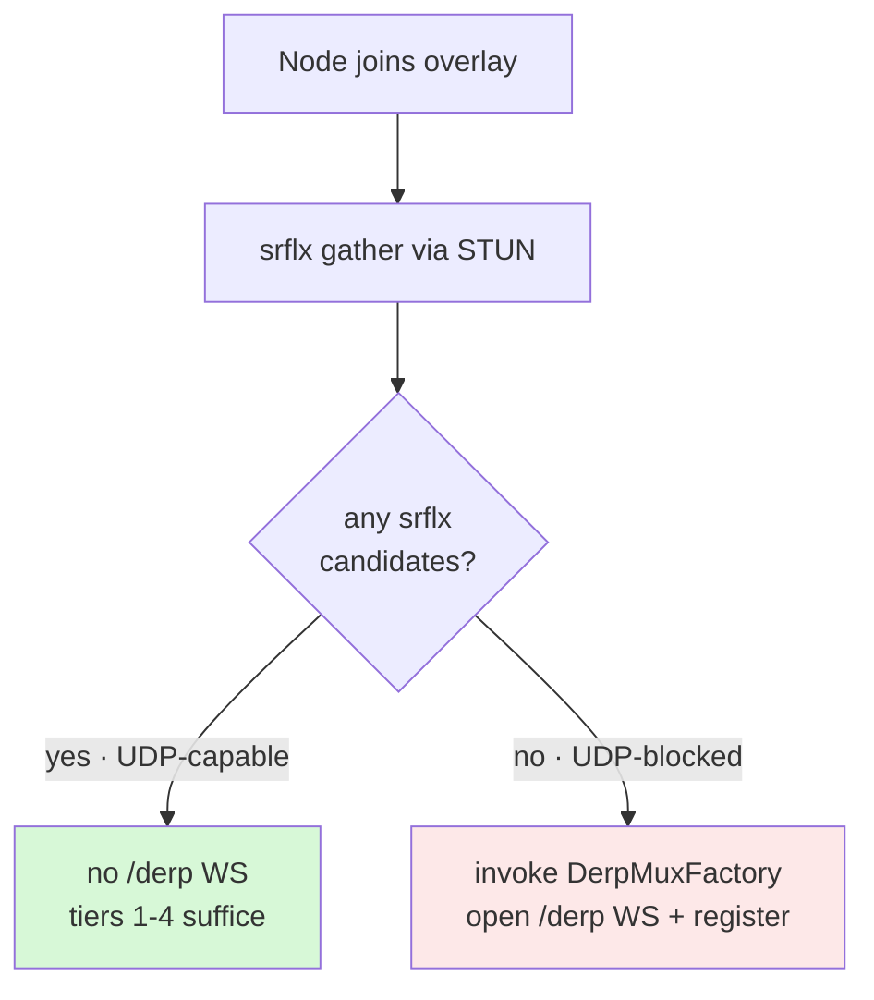

A reconnect re-runs the decision against a fresh gather, so a host that *becomes*
UDP-blocked — moving onto a restrictive network — opens `/derp` at that point.

**A DERP verdict opens it on a node that has none (#2992).** The server asks a
UDP-capable node for DERP in three ways: a force-DERP pin (P7), a DERP stamp on a
pair that rides TURN (FR-115 P4c-1's, which #2820 moves a live pair on), and the same
stamp when a pair is established. Before #2992 only the pin could open the socket, so
with the floor off the other two did nothing: the stamp's probe never started, and an
establishing pair waited in `derping` with no carrier and no deadline. The relay
coordinator now holds the opener, and the first DERP verdict that finds no mux opens
it, once (`RelayCoordinator::open_derp_mux_for_verdict`,
`crates/tunnel-core/src/overlay/relay_link.rs:835`).

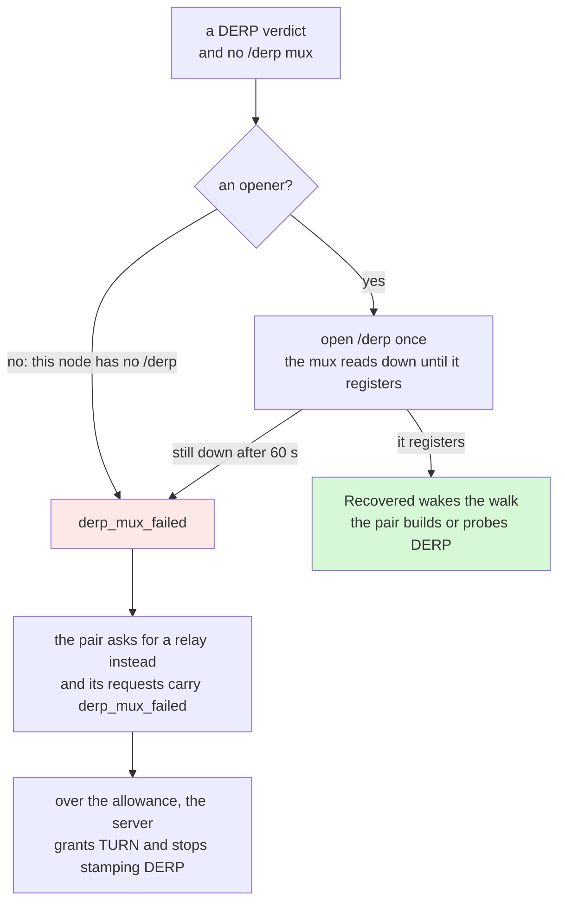

- **The mux starts connecting, not alive** (`DerpMux::begin_connecting`,
  `crates/tunnel-core/src/transport/derp.rs:688`). No carrier is built on it until its
  WS registers, and the registration wakes the walk (`MuxEvent::Recovered`), so a
  stamped pair moves within a tick of `/derp` coming up. The startup mux is unchanged:
  it is born alive, and floors are built at birth.
- **A WS that never registers reads down from the moment it was opened.** After
  `DERP_WS_DOWN_EVIDENCE` (60 s, `relay_link.rs:118`) the verdict is one this node
  cannot serve (`derp_servable`, `:870`): the pair takes the tier it would have had
  without the verdict, and its relay requests report `derp_mux_failed`
  (`derp_evidence_failed`, `:930`). A single-relay dialer asks the server for nothing
  (its anchor does), so it sends one request only to report (`request`, `:1704`). The
  grant that answers it is dropped, as PR-B2's warm leg drops its own; the re-stamp is
  what moves the anchor back to TURN, and the dialer dials the anchor's relayed address
  as before.
- **The server listens.** A pair with an end that reported it cannot hold `/derp`
  keeps TURN and its capability verdict while its org is over the relay allowance, and
  the report re-stamps that node's pairs at once
  ([plans-and-limits.md](plans-and-limits.md), *The relay allowance*).
- **Only the central mux is bounded.** A pair pinned to a regional relay keeps the pin
  through a regional outage, as before: falling back without the evidence would only
  make the server push the pin again.
- **Each wait says why**, one line a peer per reason per 5 minutes
  (`note_derp_wait`, `:907`): the stamp waits on the mux, a carrier build is withheld
  until it registers, or the node cannot serve the verdict. Before #2992 a stamped pair
  that never moved logged nothing.

### Deployment shape

`/derp` is served by the same API pods behind the same nginx as `/ws`, on its own
`location` block with 86400 s idle timeouts. It is a **separate** endpoint from
`/ws` on purpose: WireGuard data at line rate would head-of-line-block the JSON
control channel. The registry is in-memory and per pod, and the front nginx pins a
tenant to one pod (`hash … consistent`, `max_fails=0`, `proxy_next_upstream off`),
so a roll closes each pod's sockets in turn and they rebuild via the dead-latch.

### What a pod roll costs (FR-28)

Read on 15 production rolls in October 2026
([FR-28](fr/FR-28-derp-drain-on-pod-roll.md#where-it-stands-2026-10-31)):

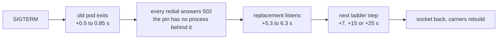

| Measure | Value |
|---|---|
| `/derp` down, per socket | p50 7.6 s, p90 15.9 s, p99 26.2 s (310 sockets) |
| A whole roll | 33.9 s on the live read: two waves about 17 s apart, each hitting one pod's tenants |
| `relay carrier send hard-errored` | 14–73 lines per roll on 10–15 hosts. The line marks a close, not a fault |
| An RC session | Ends on the control WS on any carrier, 9 of 9. A new one is Active 8.4–18.6 s after the cut |

⚠️ **Make-before-break has no pod to dial here.** The strict pin sends a second dial to the
same dying pod, and with hostNetwork and `maxSurge: 0` the replacement cannot exist until
that pod is gone. The pin is deliberate: a ring that walked to the survivor parked
long-lived sockets on the wrong pod after a roll.

⚠️ **The downtime is mostly Kubernetes, the image and the agent's ladder.** The binary listens
under 0.4 s after its container starts. The rest is scheduling (about 1.5 s), the image pull
(3–4 s), and the wait for the next backoff step (`agents/roomlerd/src/derp.rs:50`), which is
why per-roll medians land on 7.5, 15 and 25 s.

**Since the pre-pull** (2026-11-07, the second lever below), the image is on both nodes before the roll
begins ([FR-28](fr/FR-28-derp-drain-on-pod-roll.md#ac4-the-rolls-since-the-pre-pull)):

| Measure | Before the pre-pull | Since the pre-pull | Since, with `ws_flat_redial` on |
|---|---|---|---|
| A replacement starts | 5.1–5.9 s after its SIGTERM, 3–4 s of it the pull | 2 s after its SIGTERM, `Container image … already present on machine` | Unchanged: the switch acts on the device |
| A whole roll, first SIGTERM to second Ready | 33.9 s | 25 s on 2026-11-07; 24–28 s on five promotes to 2026-11-16 | Unchanged |
| Each wave, SIGTERM to Ready | 16.9 s and 17.1 s | 12 s and 13 s | Unchanged |
| `/derp` down, per socket | p50 7.6 s, p90 15.9 s (310 sockets, October) | p50 3.4 s, p90 3.7 s (156 sockets on eight promotes to 2026-11-16) | p50 2.1 s, max 2.7 s (8 sockets on two hosts, two promotes of 2026-11-21) |
| Control socket close to `control-WS reattached` | p50 7.8 s, p90 8.8 s (2026-11-02) | p50 3.5 s, p90 4.0 s (84 sockets, the same eight) | 1.9–2.9 s to the hello (8 sockets, the same two promotes). These hosts cannot log the reattach line, which follows the hello by 47 ms at most where it is logged |

What is left of a wave is the old pod's exit, the scheduling and the start (about 2 s), then 10–12 s until
Kubernetes marks the replacement Ready, which releases the second wave. That paces the roll, not the reattach:
the front nginx sends to the node's address and never sees readiness, so a socket can land as soon as the
binary listens. On the ladder it lands at the +3 s dial, as 80 of the 84 reattaches did, where it used to wait
for +7 s. With the flat redial on, it lands within a second of the replacement listening
([FR-28](fr/FR-28-derp-drain-on-pod-roll.md#the-switch-on-half-2026-11-22)):

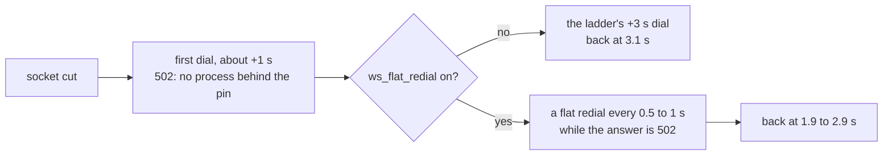

The two hosts that ran it were back 1.9–2.9 s after their cut on two promotes, after one or two flat redials,
where the same hosts took 3.1 s on the ladder and the same promotes' other hosts p50 3.4 s.

**Two levers go at that wait** ([FR-28](fr/FR-28-derp-drain-on-pod-roll.md#p2-the-flat-redial)):

| Lever | What it changes | Switch |
|---|---|---|
| Flat redial | On a 502 at the upgrade, the control socket and the central `/derp` socket redial every 0.5 to 1 s instead of waiting out the next step (`agents/roomlerd/src/ws_connect.rs:75`), up to 30 times an outage. Every other failure keeps the ladder. In every agent since 0.4.200. With the pre-pull it had about 1 s a wave left to buy, and it bought most of it: 1.9–2.9 s with it on, against 3.1 s for the same hosts on the ladder (FR-28's AC3, read 2026-11-22) | `ws_flat_redial`, default OFF |
| Pre-pull | With #3320, a promote puts the image on both nodes 30 s before the roll, so a replacement starts without pulling ([deployment.md](deployment.md)). In force since 2026-11-07: a roll takes 25 s instead of 33.9 s (the table above) | The deploy repo's DaemonSet file |

⚠️ **A server that accepts and drops must still climb** (#2221), or a fleet reconnects to it every second. So only a
502 is flat, an accepted socket that does not last refills nothing, and the allowance bounds a 502 that never ends,
such as a corporate proxy's.

**A session that outlives the wait** ([FR-138](fr/FR-138-the-session-outlives-its-control-socket.md) P2a). With
`rc_sessions_survive_reattach` on (default ON since P4-1: only `0`, `false`, `no` or `off` turns it off) and a
window announced by the server, the device keeps a live remote-control session through the control socket's loss and
claims it back in its next hello, for that window, capped at 120 s ([remote-control.md §11.16](remote-control.md#1116-a-session-outlives-its-control-socket-the-devices-half-fr-138-p2a)).
With either off, the table's last row above still holds: with no window the switch on changes nothing (P4-0), so
the server's resume scope decides.

---

## 7. What the server can and cannot see

| | `/ws` control | coturn relay | `/derp` relay |
|---|---|---|---|
| Peer membership, pubkeys, endpoints | ✅ sees | — | sees pubkeys only |
| Ciphertext passes through | ❌ never | ✅ | ✅ |
| **Plaintext** | ❌ | ❌ | ❌ |
| Can impersonate a peer | ❌ | ❌ | ❌ registration is key-bound |

WireGuard's Noise-IK handshake authenticates both ends by static key, so a
relay — coturn or DERP — is a blind pipe. Compromising it yields traffic timing
and volume, never content. On tiers 1–3 the server isn't in the data path at
all.

### What a node may learn about the other nodes

The netmap is also the boundary of what a **node** may be told about its
tenant. The companion app's Devices page asks the server, with the device's
agent token, for `GET /api/agent/self/{devices,mesh}` (FR-84 D5), and the answer
is exactly **this node ∪ the peers its netmap carries** — computed by the same
join-time ACL shaping (`shape_full_netmap`), so under `enforce` a withheld peer is
absent from the list and the mesh graph as well as from the netmap. It adds
display names, OS and version; machine ids, owner ids and keys never leave the
server. Detail and the negative-control test:
[desktop-companion.md](desktop-companion.md) §6.

### A rule that names a role

An overlay ACL rule can name its sources by role (`RoleId`). A node matches such a
rule through its owner: the roles the owner holds in the node's org, as that org has
them when the rule is compiled
([permissions.md](permissions.md#which-roles-count-the-orgs-own-read-where-they-are-used)).
Each compile (a node's netmap, a delta fan, the DERP allow table, an org-relay
decision) reads the org's role ids once and reuses them for every node it resolves
(`CompileRoles`, `crates/modules/network/src/overlay.rs:2706`), so a role the org
has deleted, or one of another org, never matches.

When someone is given a role or loses one, or a role is deleted, the org's nodes are
re-fanned about 750 ms later, one re-fan for a burst of changes, while the org's ACL
is `warn` or `enforce` (`refan_for_role_change`,
`crates/modules/network/src/routes/overlay_policy.rs:346`). Under `off` a role shapes
nothing, so nothing is re-fanned. A node whose owner's roles cannot be read matches
no role rule, with a WARN (`overlay acl: roles unreadable; role-scoped rules will not
match this node`), and an org-relay grant that needs them is refused.

---

## 8. Failure handling

* **Handshake deadlines** — a punch that never completes is invisible to the
  data-traffic health sweep, so a lock-free `handshake_complete` flag lets the
  sweep tear down a stalled srflx carrier at **12 s** and a public-direct one at
  **30 s**, then demote a tier.
* **Dead latch** — a relay carrier whose send hard-errors latches `dead`, so the
  next sweep rebuilds within ~5 s instead of waiting out the ~20 s rx-flat
  heuristic. `DerpConn` returns an error the moment its WS is down for exactly
  this reason.
* **Strategy recompute** — a peer's `srflx_endpoints` arrive on a *later* trickle
  than its join, so during that window a UDP-capable peer briefly looks
  UDP-blocked. The relay coordinator therefore stores the strategy each link was
  established with and re-evaluates it on every netmap, forgetting and
  re-establishing the link if it changed. Without this a pair could deadlock
  with both sides having chosen "dialer".
* **Decaying penalties** — per-(peer, tier) on the PathMonitor, never shared,
  so a routinely-failing punch cannot poison a proven LAN or public path.
  Repeated failures stretch the penalty half-life (60 s → 900 s) instead of
  hard-denying, so every tier retries eventually — lockout is impossible by
  construction.
* **Route erasure** — the route guard reacts to OS route-change events
  (Windows `NotifyRouteChange2`, Linux `ip monitor route`, macOS
  `route -n monitor`) with an immediate
  re-assert of the per-peer `/32`s, a router peer's approved subnet routes
  (put back only when missing: the bullet after the ⚠️ note below) and any
  exit `/1`s (waves rate-limited to
  ≥3 s apart; an event inside the quiet window pulls the next tick to the
  due boundary, so no erase waits longer than that). The blind tick is a
  30 s belt-and-braces heartbeat while the subscription is live
  (`…_ROUTE_TICK_SECS` to override; `2` = the pre-demotion cadence) and
  drops back to 2 s automatically whenever the subscription is unavailable
  or dies.
* **A re-assert must not write a route that is already ours** (#1856). Every
  wave re-asserts every peer, so a write that changes nothing still costs
  two things. It emits a route-change event, which arms the next wave
  through the trailing edge above and keeps the guard driving itself. And
  wherever the write is not atomic, it opens a hole. Linux
  (`ip route replace`) skips a matching route. Windows did for peer `/32`s
  (`winroute::ensure`) but **not** for prefixes: `add_cidr_route` deleted and
  re-added the four block-floor prefixes per adapter on every wave (field,
  NEO16: their route Age never passed 2 s while the peer `/32`s were 6 h old),
  and those writes are what ran the Windows guard at ~20 waves/min per adapter
  (#1282). Every write was also a brief hole in an exit client's `/1`s. It now
  checks `winroute::is_installed` first: no #1328 strike bookkeeping, so a VPN
  that keeps deleting an exit `/1` is still fought exactly as before.
  macOS has no idempotent `route` write: a re-assert is `route -n get`, and
  only a route that is missing or foreign gets the delete-then-add. A wave
  that wrote anyway left each peer's `/32` absent for 2.5–3.0 ms every 3 s,
  and macOS answers a socket **bound to the overlay address** with
  `EHOSTUNREACH` in that hole instead of falling through to the default
  route. That socket is WebRTC's host candidate whenever the controller's
  browser runs on an overlay node, so remote desktop to a Mac broke a few
  seconds into every session. The macOS monitor (`route -n monitor`) also
  counts only change headers: an `RTM_GET` is somebody's lookup, including
  netstate's own snapshot, and once counted it kept the monitor awake by
  itself.

> ⚠️ **`ROUTE_WAVES_TICK` ≫ `ROUTE_WAVES_EVENT` does not mean "no live
> subscription".** An event inside the quiet window does not run a wave. It
> pulls the TICK arm forward, and the tick counts the wave. A guard that feeds
> itself therefore reads as tick-driven: the MacBook showed tick 22512, event
> 8, with its monitor demonstrably live (#1282). `roomler status` now prints
> `pulled=N` inside the arms bracket (`ROUTE_WAVES_PULLED`): the tick waves an
> event pulled forward. `pulled ≈ tick` is a guard re-arming itself, and
> `tick − pulled` is the real heartbeat.

* **A router peer's subnet routes are put back, never taken back** (#4279).
  Until #4279 a wave re-asserted the peers' `/32`s but not the subnet routes
  `install_subnets` writes for a router peer, so a subnet route that anything
  deleted stayed missing until that peer's next carrier install. On
  2026-11-21 every route on a Windows host's overlay adapter was deleted: the
  peers' `/32`s were back within seconds, a router peer's three subnet routes
  stayed missing for 35 minutes, and the network behind that router was dark
  while the router read online. A wave now also restores them:
  - **What is defended.** Per installed peer, the subnets its crypto-router
    entry holds (what install routed, `WgDevice::peer_subnets`, read on the
    select loop at `crates/tunnel-core/src/overlay/runtime.rs:3600` and
    `crates/tunnel-core/src/overlay/runtime.rs:3800`) that the network map
    still approves (`defended_subnets_of`,
    `crates/tunnel-core/src/overlay/runtime/route_guard.rs:138`). An approved
    subnet that no install has routed yet is not defended: an OS route with
    no crypto-router entry behind it would pull the range into the TUN and
    drop it there. A revoked subnet is not defended, and nothing deletes its
    route either: the next carrier install does, as before.
  - **Never a default route.** The set goes through install's own P5/A1
    filter (`installable_subnets`, `route_guard.rs:114`, which install applies
    at `route_guard.rs:709`), so no prefix of length 0 or 1 enters it. An exit
    node's `0.0.0.0/0` approval and the `/1` halves an exit client's
    crypto-router holds stay with the exit path, which re-asserts them inline.
  - **Once per CIDR**, however many routers claim it (`defended_routes`,
    `route_guard.rs:166`): one OS route serves them all, and the
    crypto-router's tie-break picks the carrier. The wave hands each one
    (`route_guard.rs:252`) to `TunIo::defend_subnet_route`
    (`crates/tunnel-core/src/overlay/tun.rs:140`), whose default does nothing:
    the userspace netstack has no OS routes, and `SplitTun` forwards the call
    to its OS device (`crates/tunnel-core/src/overlay/split_tun.rs:345`).
  - **It fills a hole and never displaces a route that holds the prefix**, on
    every OS. Multi-org gives each org its own adapter
    ([multi-org.md](multi-org.md)), and two orgs may approve the same subnet,
    because private ranges overlap across tenants. A guard that took the
    prefix back would flip it with the sibling org's guard on every wave, and
    each flip is a route change that arms the next wave in both runtimes. So a
    sibling org's adapter, another product or the host's own LAN keeps a
    prefix it holds. Holding means holding the entry the guard would write:
    where the OS keys our route apart from the holder's (Windows always,
    Linux at another metric, such as a LAN route at metric 100), ours goes
    back beside it, where install put it, and the OS picks between the two by
    metric, as it did before the deletion. Install is unchanged: the last
    carrier install still takes the prefix (Linux `replace`, macOS
    delete-then-add), and which org's
    route should win there is an open decision of FR-68's C3
    ([FR-68](fr/FR-68-stress-cells-multi-org-and-ipam.md)).
  - **Logs.** A restore is a DEBUG line, `overlay: route guard restored a
    missing subnet route`: a VPN that deletes the route on every wave would
    make an INFO a flood. A holder is named once, when it starts, by one INFO,
    `overlay: another route holds this subnet's prefix …`, whose `holder`
    field is the interface that holds it, or `unnamed` when the OS did not say
    (Linux and macOS: `say_subnet_held`, `tun.rs:6315`, called from
    `subnet_restored`, `tun.rs:6269`). It is named again only after our route
    was back in between. On Windows a route that keeps going missing gets
    #1328's WARN and stand-down instead.
  - **Kill switch:** `ROOMLERD_OVERLAY_SUBNET_GUARD=0` (default on,
    `subnet_guard_enabled`, `route_guard.rs:205`, read on every wave). Off, a
    wave writes no subnet route and every other arm runs as before; a subnet
    route that goes missing stays missing until its router peer's next carrier
    install, as before #4279, and the first wave that carries a subnet logs
    one INFO per process naming the switch (`route_guard.rs:258`). Its use: a
    host that deletes our route on purpose, such as a Linux host whose own LAN
    is the advertised subnet and that wants the LAN's route back. Whether our
    route should be installed over a connected LAN route at all is install's
    policy, not the guard's.
  - **Both INFO lines reach the log on every packaged host** (#4380). They
    are said on a target of their own, `tunnel_core::overlay::route_guard`
    (`ROUTE_GUARD_LOG`, `crates/tunnel-core/src/overlay/mod.rs:121`), which
    the daemon's log filter keeps at INFO whatever `RUST_LOG` says
    (`crates/agent-core/src/logging.rs:533`), as FR-110 does for `sockbuf`
    ([fleet-rpc.md](fleet-rpc.md)). The Linux package's units and the macOS
    package's LaunchAgent set `RUST_LOG=roomlerd=info,warn`, which drops every
    other `tunnel_core` INFO and, until #4380, dropped these two as well; the
    Windows service sets no `RUST_LOG` (the default keeps `tunnel_core` at
    INFO), and the macOS root daemon sets `info`. No other line uses the
    target, so nothing else of `tunnel_core` comes with them. The kill
    switch's line is said on every OS, the holder's on Linux and macOS only.

  How each OS restores one:

  | OS | The guard reads | It writes | A route that already holds the prefix |
  |---|---|---|---|
  | Linux | `ip [-6] route show exact <cidr> dev <if>`, our device only (`linux_subnet_show_args`, `tun.rs:626`; `linux_route_shown`, `tun.rs:8103`) | install's argv with `replace` → `add`, only when ours is not listed (`linux_subnet_restore_writes`, `tun.rs:610`) | holds install's exact key (the prefix at metric 0 in the main table), so it refuses the `add` with EEXIST (`File exists`), the quiet held answer. A refused netlink write is answered to the writer alone, so no route monitor sees it |
  | macOS | install's exact `route -n get`, read three ways as #4117 reads the utun's block: ours, another interface's, absent (`utun_block_held`, `tun.rs:1188`) | install's `add` alone, never its `delete`, and only when nothing holds the prefix (`bsd_subnet_restore_writes`, `tun.rs:724`; `bsd_subnet_restore`, `tun.rs:8481`) | is never added over. `route` exits 0 when the kernel refuses a write, and the refused add still reaches every routing-socket listener as `RTM_ADD … errno 17`, which the route monitor counts (`classify_bsd_monitor_line`, below), so an add over a holder would arm the next wave, be refused, and arm the one after |
  | Windows | `winroute::ensure` on our adapter's LUID: the row install makes, on-link at metric 1 (`SystemTun::defend_subnet_route`, `tun.rs:6639`; `ensure`, `tun.rs:3122`) | that row, only when it is missing | is another interface's row, which Windows keys apart from ours, so nothing touches it |

  Windows restores through `ensure`, not install's `add_cidr_route`, because
  only `ensure` carries #1328's stand-down: a subnet is a peer-class route, so
  before a VPN that keeps deleting it the guard stands down as it does for a
  peer's `/32`, where `add_cidr_route` (deliberately, for the exit `/1`s)
  never does, and an endless re-add fight is what ran the Windows guard at
  ~20 waves/min per adapter (#1282). Linux and macOS have no stand-down for a
  peer's `/32` either, and a subnet behaves as a peer does there.

* **The OS change feed survives its own monitor dying** (#1867). On Linux and
  macOS, netstate's feed is a child process (`ip -o monitor`, `route -n
  monitor`). When that child exited, netstate used to stop for the life of the
  process. The runtime never even saw the feed close, so it ran on the 30 s
  heartbeat alone until a restart. The child is now supervised: it is respawned
  with a capped backoff (250 ms → 30 s), and each respawn sends one synthetic
  wake-up, so whatever changed while nothing was watching is re-sampled and
  re-asserted.

  **A stop is not a death** (#4382). A service manager's stop signals every
  process of the daemon's unit at once: the packaged systemd units keep the
  default `KillMode`, and a terminal's Ctrl-C reaches the whole process group.
  So the child usually exits before the daemon's run loop has heard the stop,
  and #1867's WARN used to go out on every restart. The daemon now marks its
  stop as the first thing each arm of `run`'s shutdown `select!` does
  (`roomlerd::note_stopping`, `agents/roomlerd/src/app.rs:5851`, `:5887`,
  `:5899`). After the child exits, the supervisor waits out the first part of
  the backoff, at most 1 s (`STOP_GRACE`,
  `crates/tunnel-core/src/overlay/netstate.rs:1277`), before it says anything:

  | The child exits | Logged | Respawned |
  |---|---|---|
  | and the stop is marked before that grace ends | one INFO, `exited as the process stops — not respawning it (#4382)` | no, and the supervisor ends |
  | after nothing reads the feed any more | nothing | no |
  | in any other way: a crash, an OOM kill, a `kill` of its pid (SIGTERM included) | #1867's WARN, once the grace has passed | yes |

  The grace is carved out of the backoff, so a dead child comes back exactly
  when it did before, and the WARN's `retry_in_ms` counts what is left of the
  backoff (0 at a first death). The mark is a `watch` that is never cleared,
  so a mark set before the grace began is seen at once, and one set during it
  ends the wait at once. The same wait runs between respawn attempts, so a
  mark that comes after the WARN still stops any attempt it finds waiting.
  **What is left:** the mark is set when the arm runs, not when the signal
  lands. An arm that runs later than the grace after the child's exit (250 ms
  at a first death) still lets one WARN out at a stop, and at a first death
  one respawn, whose child the process's exit then ends (`kill_on_drop`). The
  packaged units' `RUST_LOG=roomlerd=info,warn` drops tunnel-core's INFO, so
  on such a host a stop logs nothing from the monitor at all.

  **The network monitor reads the same mark** (#4435). The supervisor's
  reader task holds the feed's only sender, so once the supervisor ends at a
  stop, the feed closes, and netstate's network monitor, which reads it,
  stops with it, as it always did. That close used to be a WARN, `OS backend
  channel closed — monitor stopping (subscribers degrade to timers)` or its
  `mid-burst` twin, so a restart still logged one WARN from netstate. When
  its feed closes, the network monitor now reads the mark (`feed_closed`,
  `crates/tunnel-core/src/overlay/netstate.rs:631`), on every OS:

  | The feed closes | Logged |
  |---|---|
  | as the process stops | one INFO, `the network monitor stops with the process (#4435)` |
  | while the process runs | the WARN, in its words as before: subscribers fall back to their timers |

  The mark is set before the close can be seen: the supervisor ends at a stop
  only once it has read the mark, and the runtime's shutdown, which drops the
  reader too, comes after the arm that set it. An exit that takes none of
  those arms sets no mark, so a close seen on such an exit is still the WARN.
  On a packaged host, a stop that meets the grace now logs nothing from
  netstate at all.
* **The sample after a burst runs on the blocking pool** (#3018). It is two
  to six `route -n get` processes on macOS (~2.5 ms each on an idle Mac),
  `ip route get` on Linux, and on Windows a route-table read that can also
  repair a LAN route (`lan_repair`). It used to run inline on a tokio worker,
  so every burst of a carrier flap held a worker for the whole sample. It now
  runs under `spawn_blocking` (`crates/tunnel-core/src/overlay/netstate.rs:541`),
  the monitor's log lines carry `sample_ms`, and a sample over 1 s is a WARN.
  A sample that panics still stops the monitor, as it did inline: the panic
  hook records one crash, and a sampler that panicked on every burst would
  otherwise record one per burst.
* **Evict a competing route only when it wins, and stop when it is futile**
  (#1405, Windows). AnyConnect mirrors our prefixes onto its miniport: every
  peer `/32`, the floor `/24`s, and the derived ULA `/96`. It re-adds a
  deleted mirror within milliseconds. Two rules stop the guard fighting a war
  it either already won or cannot win:
  1. **Only a winner is evicted.** Before deleting anything, the guard asks
     the FIB which interface it would use (`GetBestRoute2` on the host, or on
     the first address inside a prefix). If that is ours (a sibling roomler
     adapter counts as ours), the competitor's row loses every lookup and
     carries no traffic, so it is left alone. On CORPLAP-3 our v4 rows win
     (effective 1 vs Cisco's 26), so the per-wave v4 evictions stop entirely.
     Kill switch: `overlay_route_evict_winners_only` (default on).
  2. **A winner that comes straight back is a futile fight.** If the same
     prefix needs evicting on 4 consecutive waves, eviction of it pauses for
     the #1328 ladder (1 min, doubling, capped at 15 min) and the pause is
     counted in `yielded`. That is the ULA `/96` behind AnyConnect: their
     mirror wins 26 vs 261 and returns within milliseconds, so deleting it
     ~20×/min never held the prefix (v6 overlay stayed 100% lost). Each
     deletion only re-armed the guard: 0.4.121 measured ~200 evictions/min
     with `pulled == tick`. Shares the `overlay_route_yield` switch.

  ⚠️ IPv6 overlay behind AnyConnect stays unroutable either way. Winning the
  `/96` by metric gets our connected row deleted (rc.289, re-confirmed in
  #1405). The remaining lever is routes we ADD, more specific than `/96`,
  which AnyConnect tolerates for v4. Nothing opens overlay-v6 sockets today
  (#1405), so that stays unbuilt until something does.

### A peer whose clock stepped back (#3528)

WireGuard refuses a handshake initiation that is not stamped later than the last
one the responder accepted from that peer. That is its replay guard. boringtun
keeps the stamp per `Tunn` (`last_handshake_timestamp`, boringtun 0.7.1
`src/noise/handshake.rs:307`, checked at `:543`). An initiator stamps from the
wall clock its `Tunn` read when it was built, plus the monotonic time since
(`handshake.rs:187`). So a clock step while a `Tunn` lives changes nothing on
the wire. The harm comes when a device's clock steps **back** and the device
then builds a fresh `Tunn`: a restart, or a carrier rebuild. Every peer that
kept its own `Tunn` refuses the device (`WrongTai64nTimestamp`) until the
device's clock passes that peer's mark, which takes up to the size of the step.

Measured before the fix (agent 0.4.203, two lab devices, the issue's AC2):

| Pair | Step back | What happened |
|---|---|---|
| LAN | 300 s, 900 s | refused at the first initiation every time, but masked within 0.05 s: the peer demote-follows onto `/derp` with a fresh `Tunn` |
| DERP-held | 300 s | 2 stalls of 15.5 s, 48 refusals over 234 s |
| DERP-held | 900 s | 8 stalls of 13.7–15.5 s, the first at +93 s, then every ~104.5 s; 169 refusals over 835 s |
| either | none, or forward | no refusals (12 controls) |

The stall comes back because the device's own refused initiation keeps
retrying for 90 s (`REKEY_ATTEMPT_TIME`, boringtun `src/noise/timers.rs:21`).
Then `clear_all` (`timers.rs:142`) also drops the session that was working.
Every peer of the stepped device stalls at once. A stall lasts ~15 s when the
peer has replied since the device's last packet, ~30–35 s when it has sent
nothing.

**The fix is on the refusing side, and the replay guard stays.** A refused
initiation has passed both AEAD opens under the peer's static key, so the
peer's private key made it. It is either the peer, behind the mark, or an old
initiation arriving again, and only the peer can tell the two apart. So the
session answers it from a **shadow**: a second `Tunn` built from the same
recipe, whose mark starts at zero (`HandshakeHeal`,
`crates/tunnel-core/src/overlay/wg.rs:644`). It has the same keys and the same
session index, so the carrier plane's index route reaches it. The session's own
`Tunn` stays as it is. The shadow takes its place only when a data packet or a
keepalive decrypts under one of the shadow's sessions (`HandshakeHeal::promote`,
`wg.rs:776`). That needs the ephemeral private key of the initiation the shadow
answered, so only the peer completing its own handshake can do it.

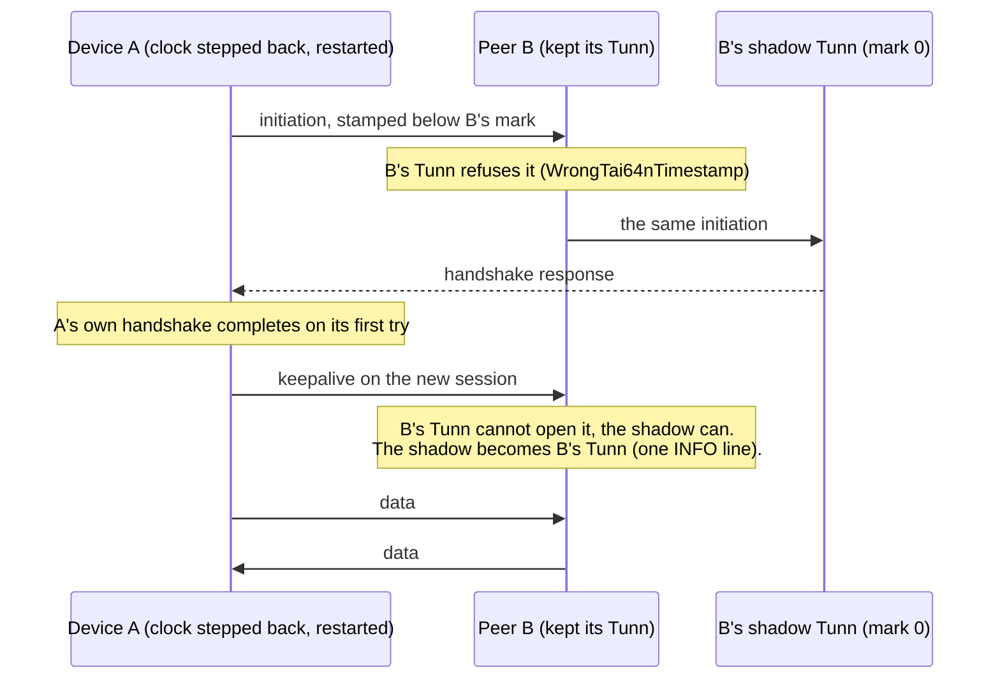

What each initiation gets (`process_inbound`, `wg.rs:2713-2776`):

| Initiation | B's `Tunn` | The shadow | The working session |
|---|---|---|---|
| stamped above the mark: no step, a forward step, a rekey | accepts it | none | stock WireGuard |
| an ephemeral key B's `Tunn` already accepted: a duplicate or a replay | dropped before boringtun | none | untouched |
| refused within 5 s of an accept (`HEAL_REORDER_WINDOW`, `wg.rs:587`): a reordered burst | refuses it | none | untouched |
| refused otherwise: a stepped-back peer, or a replay | refuses it | answers it, at most once a second (`SHADOW_MIN_INTERVAL`, `wg.rs:592`) | untouched, until the peer completes the shadow's handshake; then the shadow carries it |

* **A replay costs nothing.** The shadow's answer to a replayed initiation is
  useless to anyone without that initiation's ephemeral private key, and the
  working session keeps carrying the real peer's data. The unit test measures a
  blip of zero packets
  (`replayed_unseen_initiation_never_disturbs_the_working_session`).
* **A stepped-back peer heals in about one round trip.** It completes its own
  initiation, so nothing is left outstanding to expire 90 s later
  (`backward_step_then_rebuild_heals_in_one_round_trip`, with the no-step and
  forward-step controls beside it).
* **It heals once the peers run the fix**, whatever the stepping device runs. A
  peer on an older agent still refuses as above.
* **The screen keeps the guard after a promotion.** A promoted shadow's mark is
  the stepped-back peer's stamp, below the initiations the session accepted
  before the step. The session remembers the ephemeral keys of the last 32
  initiations its `Tunn` accepted (`HEAL_SEEN`, `wg.rs:606`: about an hour of
  rekeys, 1 KiB a session) and drops a replay of any of them before boringtun
  sees it (`already_accepted`, `wg.rs:716`). After a step larger than that, an
  initiation the peer made more than an hour before the step can still be
  accepted by the promoted `Tunn` until the peer's clock passes its old mark.
  Such a replay opens a session nobody can use. Each one takes one of
  boringtun's 8 session slots, so it takes a handful of them to push out the
  session in use, and then a new handshake restores it within about 15 s of the
  next traffic.
* **A shadow is bounded.** There is one per session. It is rebuilt when it
  refuses an initiation too and is older than 5 s (`SHADOW_REBUILD_AFTER`,
  `wg.rs:596`), so a shadow that a replay built cannot lock out a peer that
  steps back later. It is dropped when nobody completes it within 180 s
  (`SHADOW_TTL`, `wg.rs:600`). A carrier rebuild or a restart on this side
  starts over with an empty screen, beside a `Tunn` whose mark is zero anyway,
  as stock WireGuard does after an interface restart.

**What the logs say.** A promotion is one INFO line on the refusing side,
naming the peer: `overlay: this peer's handshake was refused as a replay: its
clock is behind the last handshake this session accepted …`. Refusals that do
not heal are DEBUG lines, and `WgDevice::peer_replay_counts` reads both
counters. When boringtun's own handshake expiry marks a carrier dead, the
rebuild WARN now says so (`overlay: relay carrier's WireGuard handshake expired
(its own initiation went unanswered for 90 s …)`), where it used to blame a
`/derp` WS that never closed
(`crates/tunnel-core/src/overlay/runtime/establish.rs:634`, `:750`, and the
direct carrier's line at `:713`).

### Only the daemon holds the TUN device

The OS TUN's descriptor is close-on-exec, so no program the daemon starts
holds the device, and a device that is not persistent goes away with the
daemon that made it. The next daemon's bring-up finds the name free even while
an installer the old daemon started is still running.

| Platform | How | Window in which a fork on another thread gets a copy |
|---|---|---|
| Linux | the daemon opens `/dev/net/tun` itself, close-on-exec in the `open`, attaches it with `TUNSETIFF`, and hands the descriptor to the `tun` crate, then applies the address, netmask, MTU and up as tun's own create would (`create_device`, `crates/tunnel-core/src/overlay/tun.rs:4344`) | none |
| macOS | a utun is a socket, and macOS takes no close-on-exec flag at `socket()`, so the descriptor is marked on the line after the create | create → mark. The long-lived children and every child that runs a caller's code sweep everything above stderr ([`roomler-ssh.md`](roomler-ssh.md#interactive-sessions-p4a-unix-p4b-windows)) |
| Windows | Wintun has no descriptor to inherit | — |

`tun_kernel_tests` (`agents/roomlerd/src/overlay.rs:1411`) checks it against a
real kernel in CI, as root.

### A Mac's utun: its own address as peer, and the block routed on it (#4117)

A utun is a point-to-point interface, and macOS routes nothing from a
point-to-point address that has no peer. The `tun` crate sets the address and
the netmask with no peer (SIOCSIFADDR, then SIOCSIFNETMASK), so through 0.4.228
a Mac's utun came up without the overlay block's route:

```text
utun4: flags=8051<UP,POINTOPOINT,RUNNING,MULTICAST> mtu 1280
        inet 100.65.0.5 --> 28.30.0.0 netmask 0xff000000
```

`netstat -rn -f inet` listed no IPv4 route on the utun, so the node's own
address had no route, and neither had any address of the block that no peer
holds. `28.30.0.0` is not an address the kernel holds: it is `ifconfig`
printing an empty peer. Each peer's own `/32` was on the utun all along (route
guard, above), which is why a mesh with peers kept working.

The bring-up now gives the first address the shape wg-quick gives a utun on
macOS, routes the block on it while the gate below allows it, and reads both
back (`shape_utun_v4`, `crates/tunnel-core/src/overlay/tun.rs:8558`, called
from `up_with` at `tun.rs:5953`). Every route-guard wave then decides the
block's route again, with the function the bring-up used
(`decide_utun_block`, `tun.rs:8431`):

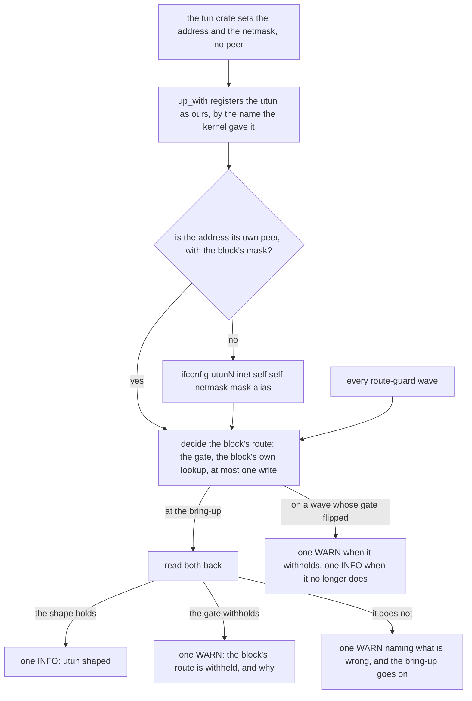

| Step | Command (argv from) | Skipped when | What the kernel does (measured on a macOS 26 CI runner) |
|---|---|---|---|
| The address as its own peer, with the block's mask | `ifconfig <utun> inet <self> <self> netmask <mask> alias` (`utun_self_peer_args`, `tun.rs:924`) | the `inet` line already reads `--> <self> netmask <mask>` (`parse_bsd_inet_line`, `tun.rs:871`) | changes the address in place and adds a host route for it on the utun (`UH`). The block still has no route |
| The block on the utun | `route -n add -inet -net <block> -prefixlen <plen> -interface <utun>` (`bsd_block_add_args`, `tun.rs:959`) | the gate withholds, or `route -n get -inet -net <block> -prefixlen <plen>` answers a route for exactly the block, on the utun or on any other interface | adds `100.65/22 utun4 USc`: every address of the block now routes on the utun, and each peer's `/32` still wins for that peer |
| Read both back | `ifconfig <utun>` and the block's `route -n get` (`utun_v4_problems`, `tun.rs:1009`) | — | — |

After it, the `inet` line reads `inet <self> --> <self> netmask <block mask>`,
`netstat -rn -f inet` lists the block and `<self>` on the utun, and `route -n
get <self>` answers the utun. Both routes belong to the utun: the kernel removes
them when the utun closes, with the daemon or on a re-address, so a bring-up
never finds an old one.

**The gate** is the one Windows' block floor has, `floor_safe`
(`tun.rs:264`): the block is routed on the utun only while no address of
another interface and no default gateway sits inside it, and a read that
fails withholds (`utun_block_gate`, `tun.rs:1106`).

| Input | Read from | Withholds when |
|---|---|---|
| Every IPv4 address of every other interface | `getifaddrs`, through the `if-addrs` crate (`bsd_non_overlay_v4_now`, `tun.rs:8377`). Left out: loopback's, this utun's, and those of every utun this daemon created, by the name the kernel gave each one (`own_adapters`; `bsd_non_overlay_v4`, `tun.rs:1255`) | one of them sits inside the block; or the list cannot be read, or does not show this utun |
| The default gateway | `route -n get -inet default`, read again for every decision (`bsd_default_gateway_v4_now`, `tun.rs:8395`). When the default route has no next hop, as a full-tunnel VPN's interface route has none, the IPv4 uplink the overlay holds for its exit pins (`utun_gate_gateway`, `tun.rs:1139`). The bring-up holds none yet | it sits inside the block; or `route` cannot run |

"Ours" is never a name prefix: another product's utun is named the same way.
A sibling org's utun carries an address inside this one's block whenever the
two blocks nest or are the same (the legacy `/10`), and counting it would
withhold the block, which is the trap #1237 was on Windows. So `up_with`
registers each utun as soon as the kernel has named it, before its own
decision runs (`tun.rs:5951`); the registration at the end of `up_with` stays.

**The decision** (`utun_block_step`, `tun.rs:1233`) takes the gate and the
block's own lookup (`utun_block_held`, `tun.rs:1188`), and writes at most once:

| The gate | The block's own lookup answers | Written |
|---|---|---|
| allows | no route for exactly the block | `route -n add -inet -net <block> -prefixlen <plen> -interface <utun>` |
| allows | the block on this utun | nothing |
| allows | the block on another interface | nothing: it is never added over |
| withholds | the block on this utun | `route -n delete -inet -net <block> -prefixlen <plen>` (`bsd_block_delete_args`, `tun.rs:1048`) |
| withholds | no route for exactly the block, or the block on another interface | nothing: a delete names only the block's key and mask, so it is written only after the lookup has shown our own route |
| either | `route` could not run | nothing |

The lookup carries the block's mask, so it answers a route for exactly the
block whenever one exists. When none does, it answers `not in table` or a
route that only covers the block. On a macOS 26 CI runner it answered `not in
table` before the block had ever been routed, and the default route
(`destination: default`, on `en0`) right after the block's own route was
deleted. Both read as no route for the block. An add over a block another
interface holds would be refused, and a refused add still reaches every
routing-socket listener (measured on the runner: `RTM_ADD: Add Route: …
errno 17`). The daemon's route monitor counts an `RTM_ADD` whatever its errno
(`classify_bsd_monitor_line`,
`crates/tunnel-core/src/overlay/netstate.rs:998`), so a wave that retried the
add would start the next wave every time.

* **Every wave decides again.** The route guard's wave runs
  `defend_block_floor` on every platform
  (`crates/tunnel-core/src/overlay/runtime/route_guard.rs:268`). Windows keeps
  its block floors there; a Mac has none, and its arm is this decision for
  the utun's block, on the blocking pool (`tun.rs:6695`, `tun.rs:6803`). A
  Mac that joins a network with an address or a gateway inside the block
  loses the block's route on the next wave, and gets it back on the first wave
  after it leaves. A route something else deleted, such as a VPN that reaps
  routes it did not add, is back by the next wave. Waves come on the 30 s
  heartbeat, and after a routing-table change at most every 3 s (route
  erasure, above).
* **One line per flip.** The decision is logged when it changes, per block,
  starting from the bring-up's. The WARN reads `overlay: the utun's block
  route is withheld: <why>; the address keeps its own host route and each peer
  its /32`, where `<why>` names what sat inside (`100.65.2.77 on lo0 sits
  inside the block`, `the default gateway <ip> sits inside the block`) or the
  read that failed. The INFO reads `overlay: the utun's block route is no
  longer withheld: no other interface address and no default gateway sits
  inside the block`. The bring-up logs the same WARN. A write inside an
  unchanged decision, such as a reaped route put back, is a DEBUG line,
  `overlay: the utun's block route written by the route guard`, with the step,
  what the lookup found and what `route` complained about.
* **A wave that finds the table as decided writes nothing.** Its reads are the
  interface list and two `route -n get` lookups, and the monitor does not count
  a lookup (`RTM_GET`, `netstate.rs:1006`), so a steady state does not start
  the next wave. On a Mac, `roomler status`'s `pulled=` does not climb with
  `tick=` (the ⚠️ note above).
* **What a withhold leaves.** The address stays its own peer with its own host
  route, and every peer keeps its `/32`. Only the block's route is not there.
* **It fails open.** No step can fail the bring-up. A read-back that is not
  this shape is ONE WARN, `overlay: the utun's IPv4 shape is not the one the
  overlay needs; each peer still gets its own /32`. Its `problems` field says
  what is wrong (`the address's peer is …, not itself`, `the netmask is …, not
  the block's`, `the block's lookup answers … on …`, `the block has no route`)
  and its `complaints` field carries what `ifconfig` or `route` printed. A
  block the gate withholds is not one of its problems: the withheld WARN says
  so instead. A shaped utun logs one INFO, `overlay: utun shaped: its address
  is its own peer and the block routes on it`. macOS `route` exits 0 when the
  kernel refuses a write (`route: writing to routing socket: File exists`,
  measured), so the read-back decides, never an exit status (`run_bringup`,
  `tun.rs:8517`).
* **Another product may route the CGNAT range.** Another mesh on the same Mac
  can hold `100.64.0.0/10`. A per-org block is usually narrower than that, so
  its route is added beside the other one and wins by longest prefix. A route
  for exactly the same block (a tenant on the legacy `/10`) is left where it
  is: nothing is added over it, nothing is deleted, the WARN names the
  interface the block answers on, and the bring-up goes on with the address's
  own host route and every peer's `/32`. A second org on the legacy `/10` on
  the same Mac is that case too: the first org's utun holds the block, and the
  second org's WARN names it. When the first org's utun closes its route goes
  with it, and the second org's next wave routes the block on its own utun.
* **A peer's `/32` is unchanged.** A wave still re-asserts the routes the
  runtime installed (peers' `/32`s, subnet routes, exit `/1`s; a subnet route
  only when it is missing, §8). It reads the
  block's route as a cover, never as a peer's own, so a peer's `/32` is still
  written and deleted as before.
* **Kill switch:** `ROOMLERD_OVERLAY_UTUN_BLOCK_ROUTE=0` leaves the utun as the
  `tun` crate made it, as through 0.4.228, logs `overlay: utun left as
  created`, and no wave decides anything for the block
  (`utun_block_route_enabled`, `tun.rs:8217`). It is read from the daemon's
  environment; there is no `config.toml` key.

The `macos_kernel_tests` run as root against a real utun in the CI step `macOS
overlay against a real utun`:

| Test | Asserts |
|---|---|
| `the_first_address_is_its_own_peer_and_the_block_routes_on_the_utun` (`tun.rs:10295`) | the shape |
| `a_block_another_product_holds_is_left_alone_and_the_bring_up_stands` (`tun.rs:10368`) | a route for exactly the block on `lo0` stays there, and the address still gets its shape and its host route |
| `the_kill_switch_leaves_the_utun_as_the_tun_crate_made_it` (`tun.rs:10454`) | 0.4.228's shape, and no wave routes the block |
| `a_peer_route_comes_and_goes_beside_the_block_route` (`tun.rs:10506`) | a peer's `/32` beside the block |
| `an_address_inside_the_block_withholds_the_block_route_at_bring_up` (`tun.rs:10567`) | an `lo0` alias inside the block withholds at the bring-up, with one WARN naming it; the address keeps its shape and its host route |
| `a_wave_takes_our_block_route_back_while_an_address_sits_inside_and_restores_it` (`tun.rs:10618`) | the alias added after the bring-up: the next wave deletes our route, one WARN for two waves; the alias gone: the next wave routes the block again, one INFO |
| `a_reaped_block_route_is_restored_by_the_next_wave` (`tun.rs:10682`) | a deleted block route is back after one wave |
| `a_withhold_never_deletes_another_products_route_for_the_block` (`tun.rs:10729`) | with the block on `lo0` and an address inside it, the wave withholds and the `lo0` route stays |
| `no_utun_of_ours_withholds_a_siblings_block` (`tun.rs:10848`) | three utuns of ours, one block nested in another and two sharing one, withhold nothing |
| `a_wave_that_finds_the_block_route_as_decided_writes_nothing` (`tun.rs:10891`) | three waves write nothing under `route -n monitor`, routed and withheld alike |
| `a_subnet_route_is_restored_when_missing_and_never_added_over_a_holder` (`tun.rs:11084`) | #4279: a deleted subnet route is back after one restore; while `lo0` holds exactly the prefix, three restores write nothing (no `RTM_ADD` under `route -n monitor`, not even a refused one, with a positive control) and name the holder once; the holder gone, the next restore routes it on the utun |

The parsers, the argv builders, the gate and the decision are pure and tested
on every platform (`utun_shape_tests`, `tun.rs:1276`; `utun_block_gate_tests`,
`tun.rs:1486`), with the line the lab Mac printed on 0.4.228 as a fixture.

### A Mac answers its own overlay address (#4125)

A utun is point-to-point, and macOS adds no local route for a utun's own
address. With #4117's shape the address's host route is on the utun, so a
packet the Mac sends to its own overlay address goes into the utun, and the
daemon reads it. No peer holds that address, so on #4117's code `ping <self>`
on the Mac got no answer, and neither did the Mac's own lookups of overlay
names: MagicDNS listens on `<self>:53`
(`crates/tunnel-core/src/overlay/runtime.rs:2532`), and macOS sends the overlay
zone there (`runtime.rs:2572`, then
`crates/tunnel-core/src/overlay/dns.rs:566`). Linux and Windows deliver such a
packet through their kernel's local route for the address, and the daemon
never sees it.

The utun's read path now hands such a packet back to the OS. It writes the
packet back into the same utun, unchanged but for the checksum of an IPv6 TCP
or UDP packet (below), and the kernel takes it as inbound and delivers it, as
it delivers a peer's packet (`past_own_packets`,
`crates/tunnel-core/src/overlay/tun.rs:8340`, called from `read_packet` at
`tun.rs:6341`). A reply to it is a packet to the same address, so it takes the
same way back:

```mermaid
flowchart TD
    app["a program on the Mac sends to the node's own overlay address, such as ping or a lookup at the resolver"] --> utun["the kernel sends it into the utun, by the address's host route"]
    utun --> read["the utun's read path reads it"]
    read --> own{"is the destination this utun's own address?"}
    own -- yes --> back["written back into the utun, an IPv6 TCP or UDP checksum finished first"]
    back --> deliver["the kernel takes it as inbound and delivers it"]
    back --> next["the read goes on to the next packet"]
    next --> read
    own -- no --> pump["returned to the outbound path, which sends it to the peer that holds the address"]
```

| Rule | What the read path does |
|---|---|
| Which packets | those whose destination is the utun's own address (`utun_hands_back`, `tun.rs:9403`), read as `Router::dst_of_ip_packet` reads it (`crates/tunnel-core/src/overlay/router.rs:475`): an IPv4 destination, or the IPv4 a derived overlay IPv6 carries. So the node's derived IPv6 is handed back too, and no other IPv6 is |
| As it came | no TTL or hop-limit change: the node is not routing it. The one change is the checksum of an IPv6 TCP or UDP packet, finished before the write (below) |
| Never forwarded | a handed-back packet never reaches the outbound path |
| A failed write | drops the packet, and it is never written again. The write is the device's own non-blocking one, without the wait for writability that the write of a peer's packet has, so a write the kernel does not take at once fails as well, and a hand-back never holds up the read. A DEBUG line, at most once a minute, reads `overlay: a packet to this node's own overlay address could not be handed back to the OS; dropped`, with the count of failed writes |
| Cost | one comparison per packet read, with no allocation and no lock. A handed-back IPv6 TCP or UDP packet is also summed once, for its checksum |
| Platforms | macOS only. Linux and Windows read as before |

* **The utun's own address** is the one it was brought up with, read once, at
  the bring-up (`SelfDelivery`, `tun.rs:8245`, from `up_with` at
  `tun.rs:6180`). It does not change while the utun lives: a runtime whose
  netmap names another address exits for a rebuild (`runtime.rs:4188`), and
  the daemon reuses a utun only for the same address. Each utun hands back only
  its own address; a sibling org's utun hands back its own.
* **IPv6.** macOS routes the derived IPv6 as a local address, and still, on
  #4117's code, a datagram the Mac sent to it was read from the utun and never
  delivered (measured on a macOS 26 CI runner). The same comparison covers it,
  so it is handed back like the IPv4 address and never reaches the outbound
  path.
* **The IPv6 checksum.** On this path macOS leaves the checksum of an IPv6
  TCP or UDP packet for the network device to finish, and a utun finishes
  nothing. Measured on the same runner: a UDP datagram's checksum field holds
  the pseudo-header's sum alone, and written back as it came the datagram is
  dropped and counted `with bad checksum`; a TCP connection whose segments
  are written back as they came gets no answer. The hand-back therefore
  computes that checksum again, in full, before the write
  (`finish_v6_transport_checksum`, `tun.rs:9426`, called at
  `tun.rs:8345`): an IPv6 packet whose Next Header is TCP or UDP and whose
  lengths agree gets it over the pseudo-header and the whole segment with the
  field zeroed, and a UDP checksum of 0 is written as `0xffff`. A complete
  checksum computes to itself, so there is no test for "unfinished". Anything
  else goes back as it came: ICMPv6, whose checksum the kernel computes
  itself, a packet with an extension header, and every IPv4 packet, whose
  checksum macOS finishes (measured).
* **The count.** `SystemTun::self_delivered` (`tun.rs:8364`) counts the packets
  a utun has handed back. The first one logs ONE INFO, `overlay: a packet to
  this node's own overlay address was handed back to the OS; the next ones are
  counted, not logged`. There is no line per packet.
* **Kill switch:** `ROOMLERD_OVERLAY_UTUN_SELF_DELIVERY=0` stops the hand-back:
  such a packet is then read like any other and gets no answer, as with #4117
  alone (`utun_self_delivery_enabled`, `tun.rs:8228`). It is read
  once, at the bring-up, which then logs `overlay: packets to this node's own
  overlay address are not handed back to the OS
  (ROOMLERD_OVERLAY_UTUN_SELF_DELIVERY=0)`. It is independent of
  `ROOMLERD_OVERLAY_UTUN_BLOCK_ROUTE=0`: in that shape a self-addressed packet
  never enters the utun, so the hand-back never fires. It is read from the
  daemon's environment; there is no `config.toml` key.

The `macos_kernel_tests` drive the read path the daemon runs, as root on a real
utun in #4117's shape, in the CI step `macOS overlay against a real utun`:

| Test | Asserts |
|---|---|
| `a_datagram_to_its_own_address_is_delivered_and_answered` (`tun.rs:11881`) | a UDP datagram the Mac sends to `<self>:53` reaches a socket bound there, and its reply comes back |
| `a_ping_to_its_own_address_is_answered` (`tun.rs:11920`) | `ping -c 3 -t 5 <self>` gets its 3 answers, two hand-backs per echo |
| `a_handed_back_packet_is_delivered_once_and_never_read_again` (`tun.rs:11961`) | one datagram is one hand-back and its reply one more; no packet to `<self>` comes out of the read, nothing more comes into the utun in the 2 s after, and one INFO is logged |
| `the_kill_switch_hands_nothing_back` (`tun.rs:12062`) | switched off, the datagram is read from the utun and never delivered, and the bring-up's INFO says so |
| `a_datagram_to_its_own_derived_v6_is_delivered_and_answered` (`tun.rs:12132`) | the same datagram to the derived IPv6 reaches a socket bound to `[<self v6>]:53`, and its reply comes back. The route macOS answers for the address, and what `ping6 -c 3` to it gets, are printed |
| `a_handed_back_v6_datagram_is_delivered_once_and_never_read_again` (`tun.rs:12213`) | for that datagram, one hand-back and one more for its reply; no packet to the address comes out of the read, and nothing more comes into the utun in the 2 s after |
| `measure_what_the_utun_reads_for_a_datagram_to_its_own_derived_v6` (`tun.rs:12286`) | with the hand-back off: the checksum of that datagram as the utun reads it, beside the IPv4 one's, and whether macOS delivers it when it is written back in as read, with its checksum finished, or from a peer's derived address. Printed; it asserts only that both datagrams are read |
| `the_resolver_on_its_own_address_answers_a_lookup_from_the_mac` (`tun.rs:12366`) | the overlay's resolver, bound to `<self>:53` as the runtime binds it, answers a lookup the Mac sends it |
| `a_tcp_connection_to_its_own_derived_v6_carries_bytes_both_ways` (`tun.rs:12520`) | a TCP connection from the Mac to a listener on the derived IPv6 carries a few bytes each way, and its segments are handed back. How much of a 64 KiB write arrives within 3 s is printed |
| `a_tcp_connection_to_its_own_address_carries_bytes_both_ways` (`tun.rs:12550`) | the same over the IPv4 address, as a control |

The rules are pure and tested on every platform: the hand-back's
(`utun_self_delivery_tests`, `tun.rs:9475`), and the checksum's, against
checksums the tests compute another way (`v6_transport_checksum_tests`,
`tun.rs:9592`).

### The peer list while the control socket is down (#4367)

The mesh keeps carrying sessions through a control-socket outage (§1), so the
device's own peer list keeps what the mesh still holds. Before #4367 it did not:
two devices without a control socket for 62 minutes kept a direct WireGuard path
to a third, with a live SSH session on it, while `roomler peers` on each printed
`(no peers)`. The LocalAPI's answer returned nothing whenever the primary's
control socket was down, under a rule written before the runtime outlived it.

Each org's list is now decided by that org's own control socket (`fn peers`,
`agents/roomlerd/src/localapi_state.rs:1196`, through `Listing`, `:2566`):

| That org's control socket | Its overlay runtime | Listed |
|---|---|---|
| up | any | the live list, unmarked |
| down | running | what its mesh still holds, each peer marked `control_down` |
| down | gone: never started since the daemon's start, the overlay off, or ended on its own | none |
| down | the org ended: disabled, or its loop stopped for good | none |

- **The data plane decides, never the last list the server sent.** A runtime's
  view keeps its last list after the runtime ends, so the probe is
  `overlay::runtime_alive` (`agents/roomlerd/src/overlay.rs:122`): the tenant's
  runtime slot exists and its event channel is open. The daemon builds its
  LocalAPI state only with that probe (`DaemonState::for_daemon`,
  `localapi_state.rs:591`, from `agents/roomlerd/src/app.rs:5192`); the
  constructor without one is test-only.
- **The mark** (`PeerInfo::control_down`, `crates/localapi/src/lib.rs:1026`) is
  additive. Its `since_ms` is when this device lost that socket, stamped by the
  connection's guard before its flag drops
  (`agents/roomlerd/src/signaling.rs:887`); the server's last frame came at most
  the socket's 80 s receive deadline before. In a kept row `connection`,
  `stalled`, `rtt_ms` and `last_seen_ms` stay live, and `online` is the server's
  word from before the loss, never rewritten. A token refused at the upgrade is
  kept and marked too: any HTTP 401 there refuses it (`signaling.rs:1880`), and a
  middlebox the machine trusts can answer one while the mesh runs on.
- **Several orgs.** Each org's rows carry their own mark and time: the primary's
  outage no longer hides a secondary's live peers, and a secondary's outage no
  longer lists its peers as live.
- **What reads it.** `roomler peers` prints the rows as it always did, then one
  line per org whose socket is down and which columns are live
  (`control_down_lines`, `agents/roomler-cli/src/localclient.rs:3400`):

  ```
    control plane unreachable (lost 12m ago): peers listed from what this device's mesh still holds.
    CONN, RTT and LAST SEEN are live; ●/○ is the server's last word from before the loss.
  ```

  `--json` carries the mark on each kept peer, and the desktop app draws a kept
  peer's dot amber ([desktop-companion.md](desktop-companion.md#the-companions-side)).
  A remote-control session's relay-tier cap (`overlay_remote_is_relay_tier`,
  `agents/roomlerd/src/peer.rs:2236`) and the carrier readers of FR-128 and
  FR-148 read the live carrier instead of an unknown peer: a session on a relay
  stays capped through the outage rather than going uncapped at its next 5 s
  recheck.
- **Mixed versions.** An older CLI or desktop app shows the kept rows without the
  note (it ignores the key). An older daemon sends no mark and lists none during
  an outage, so a newer CLI prints `(no peers)` as before.

---

## 9. Configuration reference

<!-- RETIRED-NAME-ANCHOR(4): names the legacy env prefix env::node_env still honours; an
     operator with it in a script needs to be able to grep for it. -->
All flags take the `ROOMLERD_OVERLAY_` prefix; the legacy `ROOMLER_AGENT_`
prefix is still honoured.

| Variable | Default | Effect |
|---|---|---|
| `…_DIRECT` | on | LAN-direct tier |
| `…_PUBLIC_DIRECT` | off | direct-to-public tier |
| `…_SRFLX` | on | srflx hole-punch tier |
| `…_SRFLX_KEEPALIVE_SECS` | 20 | STUN keepalive holding the mapping open |
| `…_RELAY_SINGLE` | on | single-relay tier |
| `…_DERP` | **on** since rc.203 | DERP tier |
| `…_DERP_FLOOR` | **on** since rc.400 | the always-on floor: every node opens its central `/derp` socket at startup, and DERP carries each fresh pair while better tiers upgrade over it (§6); off = open `/derp` only when UDP-blocked, or when a force-DERP push asks |
| `…_ORG_RELAY` | off | ride a tenant-owned org relay when the server mints a session for a pair (FR-19 P4b); serving is `RELAY_SERVER_ENABLED` |
| `…_PATHMON` | **on** | path-monitor telemetry (`on`/`shadow`/`off`). Selection is always monitor-driven since rc.282 — non-`on` values only silence the 10-min decision summaries |
| `…_ROUTE_EVENTS` | **on** | event-driven route guard: OS route-change subscription driving immediate re-asserts; off = 2 s blind tick only |
| `…_ROUTE_TICK_SECS` | 30 | route-guard heartbeat seconds while the subscription is live (2–300; `2` = pre-demotion cadence). Ignored — always 2 s — without a live subscription |
| `…_ROUTE_EVICT_WINNERS_ONLY` | **on** | Windows: evict a competing VPN route only when it wins the FIB lookup (#1405); off = evict every competing row every wave |
| `…_SUBNET_GUARD` | **on** (#4279) | the route guard puts a router peer's approved subnet route back when it is missing, and never over a route that holds the prefix (§8); off = a wave writes no subnet route, so one that goes missing stays missing until the router peer's next carrier install, as before #4279, and the first such wave logs one INFO naming the switch. For a host that deletes our route on purpose, such as a Linux host whose own LAN is the advertised subnet. Read on every wave |
| `…_NETSTACK_SOCKS` | unset | userspace netstack + SOCKS5 instead of an OS TUN |
| `…_SOCKBUF` | **on** (FR-110) | every direct carrier socket asks for 7 MiB receive and send buffers (§2); off = the OS default |
| `…_UTUN_BLOCK_ROUTE` | **on** (#4117) | macOS: the utun's first address is its own peer, and the overlay block is routed on the utun while no other interface's address and no default gateway sits inside the block, decided again on every route-guard wave (§8); off = the utun as the `tun` crate made it, as through 0.4.228, and no wave decides anything for the block. Environment only |
| `…_UTUN_SELF_DELIVERY` | **on** (#4125) | macOS: the utun's read path hands a packet the Mac sends to its own overlay address, IPv4 or derived IPv6, back to the OS, so it is answered (§8); off = it is read like any other packet and gets no answer, as with #4117 alone. Environment only |

One DERP knob sits outside that prefix: the queue's age bound,
`ROOMLERD_DERP_QUEUE_MAX_AGE_MS`, default 100, where `0` turns the check off
(FR-18, §6). The `/derp` socket's send-buffer cap has no switch.

Joining the mesh at all additionally requires `overlay_enabled = true` in the
node config and a build carrying the `overlay-l3` (or `overlay-netstack`)
feature.

---

## 10. Field-proof record

| Tier | Proven | Result |
|---|---|---|
| LAN direct | 4-node single-Wi-Fi mesh | fully direct, ~3–9 ms, zero coturn |
| direct-to-public | NAT'd netns ↔ public host | 0 % loss, ~0.9 ms |
| srflx punch | buildhost↔fleet-host-2 netns, cone↔cone | 0 % loss, ~0.6 ms |
| single-relay | buildhost↔fleet-host-2 netns, sym↔sym | 0 % loss, ~1.3 ms |
| single-relay, UDP-aware anchor | UDP-blocked ↔ UDP-capable | 0 % loss, ~1–6 ms |
| **DERP** | buildhost↔fleet-host-2, both UDP **and** coturn-TCP blocked | **0 % loss, ~2.7 ms** |

**Throughput (FR-110):** TCP over a direct carrier into an M2 Pro Linux host
went from 116–128 Mbit/s to **516–543 Mbit/s** on the released 0.4.141, with the
receiver's drops from +455–623 per 256 MiB to none, once the carrier sockets
asked for 7 MiB buffers (§2).

Every tier in the cascade has now carried real WireGuard traffic between two
genuinely separated hosts. The cascade is complete: there is no longer a network
shape in which two Roomler nodes can reach `roomler.ai` yet fail to reach each
other.

---

### Testing note

The netns lab that validates these tiers blocks egress with a default-DROP
`OUTPUT` chain. That chain also matches the overlay's *own* traffic to
`roomler0`, which makes a perfectly healthy carrier look like 100 % packet loss.
Always add `iptables -I OUTPUT 1 -o roomler0 -j ACCEPT` inside the namespace, and
pin `roomler.ai` in `/etc/netns/<ns>/hosts` — DNS via the systemd-resolved stub
does not resolve inside a namespace.
