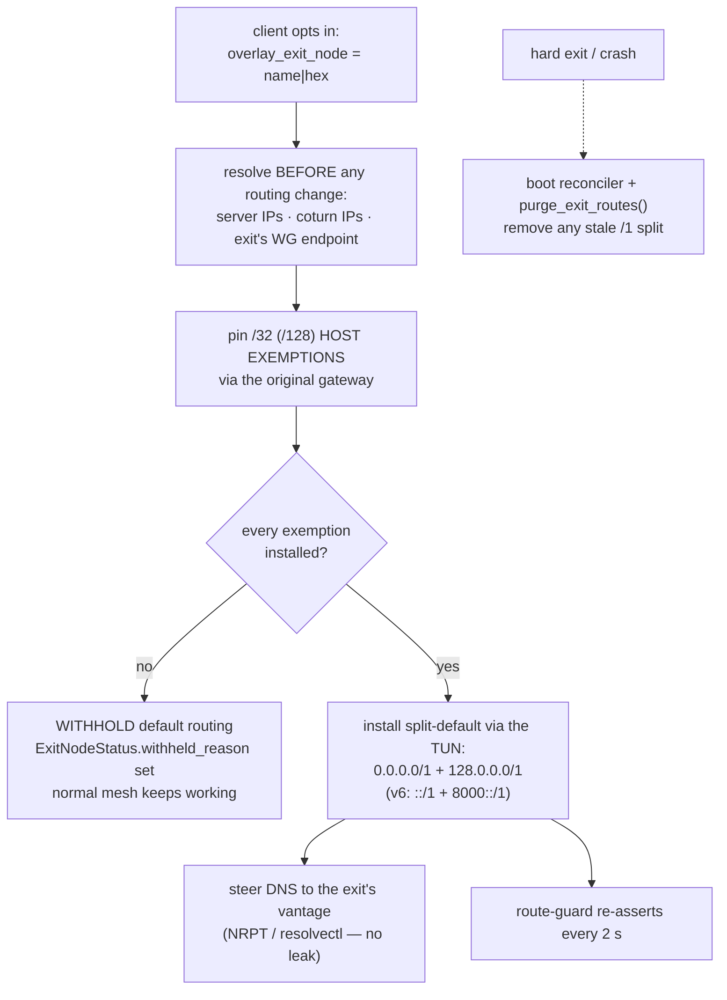
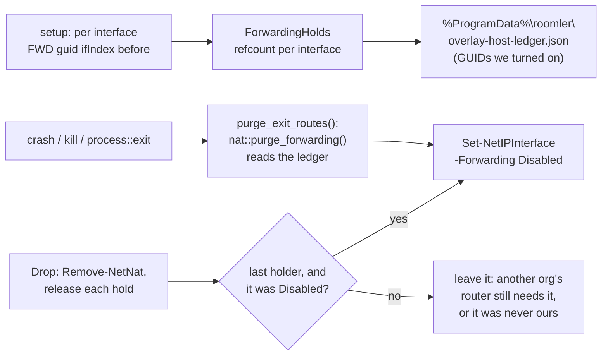
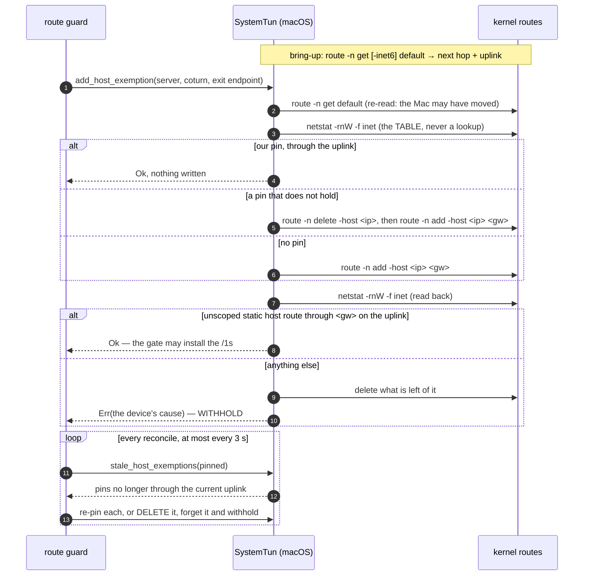

# Overlay exit nodes (default-route egress)

> Cross-ref: the L3 overlay mesh is part of the remote-control / tunnel
> subsystem ([`docs/remote-control.md`](./remote-control.md),
> [`docs/agent-tunnel-architecture.md`](./agent-tunnel-architecture.md)). This
> doc covers **exit nodes** — the Tailscale-style feature where one mesh peer
> routes another peer's *entire* internet egress. Related overlay docs:
> [`overlay-wfp.md`](./overlay-wfp.md) (Windows firewall override).

## What it is

An **exit node** is a mesh peer that forwards a **client's** whole internet
egress — `0.0.0.0/0` **and** `::/0` — out through *its* uplink, so the client
appears on the internet from the exit node's IP (and resolves DNS from the
exit's vantage). This is the Tailscale "exit node" model.

Feature-gated on **`overlay-l3`** (the OS-TUN carrier); **default-OFF**. The
userspace `overlay-netstack` build has no OS routing table, so it silently
no-ops for exit routing. Everything below is `overlay-l3` only.

The design's north star is **"never self-wedge."** A client that routes all
egress through a peer can trivially cut off its own control channel (the
WebSocket to roomler.ai) and the WireGuard carrier itself — so the whole
feature is built around *exemptions* and a *safety gate* that refuses to install
default routing unless the escape hatches are provably in place.

## The three roles

Setting up an exit node touches three parties. All config lives in the agent's
`config.toml` (no env-var overrides for these keys).

### 1. The exit node (offers egress)

```toml
overlay_enabled          = true
overlay_exit_node_enabled = true      # OFFER to be an exit node
```

`overlay_exit_node_enabled` makes `AgentConfig::effective_overlay_advertised_routes()`
union `0.0.0.0/0` into what the node advertises to the coordination server.
Advertising `/0` is **just an offer** — it does nothing until an admin approves
it (below), and a generic advertised `/0` is *inert on every client* (see
[Safety model](#the-self-wedge-safety-model)).

When a client actually uses the exit, NAT engages automatically on the exit
(Linux: `iptables` MASQUERADE for the overlay CIDR + `FORWARD -i roomler0
ACCEPT` + established-return, `net.ipv4.ip_forward=1`; IPv6: `ip6tables`
MASQUERADE for the overlay ULA + forwarding + `accept_ra=2` so the host keeps
its own v6 default). Windows uses WinNAT (v4 only — see
[Platform support](#platform-support)).

### 2. An admin (approves it)

```
PUT /api/tenant/{tenant_id}/overlay-node/{node_id}/exit-node   { "enabled": true }
```

(UI: **Admin → Overlay → Subnet routes**, the exit-node toggle, gated on the
node having advertised `/0`.) This calls the DAO `set_exit_node`, which does
**two** things:

1. sets `is_exit_node = true`, and
2. adds `0.0.0.0/0` to the node's **`approved_routes`** — the *data-plane
   signal* the mesh actually acts on.

`approved_routes` is the source of truth: the server only propagates the exit
`/0` into peers' netmaps when it's in `approved_routes`, and this admin path is
the **only** way a `/0` gets there — the per-CIDR `set_approved_routes` rejects a
bare `/0` (guard **A6**). A direct DB edit of `is_exit_node` alone is *not*
enough; you must also set `approved_routes`, and the coordination hub only
re-reads a node when it (re-)joins.

### 3. A client (opts in to use it)

```toml
overlay_enabled  = true
overlay_exit_node = "buildhost"   # the exit node's name (or wg-pubkey hex)
```

This is distinct from the offer flag: `overlay_exit_node` is the client saying
"route my egress through that peer." The agent resolves the selector to a peer
and only installs default routing when the peer is **present + carriered +
admin-approved** (its netmap carries `/0`).

> **Prefer the node-id hex for long-lived configs.** A *name* is not a stable
> identity: removing a device from the fleet releases its MagicDNS name back to
> the network, so the same label can later belong to a different machine — and
> following it would silently move this host's entire internet egress. Once a
> name selector has resolved, the agent PINS that node for the daemon's
> lifetime; if the label later resolves elsewhere it withholds default routing
> and reports `exit-node name now resolves to a DIFFERENT machine` in
> `roomler status`. A node-id hex selector is unambiguous and never drifts.

## How it works end-to-end

```
exit:   overlay_exit_node_enabled=true  ──advertise /0──▶  roomler.ai
admin:  PUT …/exit-node  ──is_exit_node=true, approved_routes+=/0──▶ hub
client: overlay_exit_node="buildhost"
          │  resolve peer "buildhost" in netmap (name|hex)
          │  peer present + has a live carrier + /0 in approved routes?     ──no──▶ WITHHOLD (egress stays local)
          │  pin carrier/control exemptions (/32 + /128 via original gw)    ──any fail──▶ WITHHOLD
          ▼  all exemptions pinned →
          install split-default:  v4 0.0.0.0/1 + 128.0.0.0/1  → exit peer (wg allowed_ips + OS routes)
                                  v6 ::/1 + 8000::/1           → overlay NIC (crypto-router → v6_exit peer)
          steer DNS "." → local resolver / upstream  (captured by split-default → resolves from exit)
          route-guard re-asserts the /1s + DNS on OS route events + a 30 s heartbeat
```

The **split-default** is two `/1` halves rather than a literal `/0`. A `/1`
beats the kernel's `/0` default route but *loses to any more-specific route*
(a `/24` LAN, a CNI pod CIDR, a pinned `/32` exemption). So intra-LAN,
intra-cluster, and exempted traffic stay on the real uplink; only what would
have hit the default route reroutes through the exit.

## The self-wedge safety model



The split-default (`/1` + `/1`) out-specifics the OS default route without ever
*replacing* it — removing the two halves instantly restores normal routing.

Four layers, each defending against a different way to cut yourself off:

- **Exemptions first.** Before *any* default route is installed, the client
  pins host-route exemptions (`/32` v4, `/128` v6) via the **original default
  gateway** for every endpoint the tunnel itself needs: the coordination
  server IP(s) and every relay carrier's coturn IPs. A direct (same-subnet)
  carrier is on-link and needs no exemption. This keeps the control WebSocket
  and the WG carrier off the exit path so they can't loop.
- **The withhold gate.** The split-default is installed **only if every
  exemption pinned successfully.** If discovery failed or a pin errored, the
  client *withholds* — egress stays on the local uplink — and surfaces a
  reason (`roomler status` → `exit node <sel> (withheld — <why>)`), logged once
  per reason-change. It never installs a half-configured reroute.
- **Generic `/0` is inert (A1).** The normal `install_subnets` path strips
  default routes from **every** peer's allowed-ips + OS routes. Only the peer
  you *explicitly chose* via `overlay_exit_node` **and** that is admin-approved
  gets the split-default. A stray advertised `/0` from any other peer can never
  wedge a client.
- **Route-guard (A7).** OS route-change events (Windows `NotifyRouteChange2`,
  Linux `ip monitor route`) trigger an immediate re-assert of the
  split-default `/1`s (and a DNS-steering re-evaluation) the moment a
  competing route-write lands — so a transient flap or a VPN client's route
  grab can't silently drop egress. The blind tick is a 30 s belt-and-braces
  heartbeat while the subscription is live (`…_ROUTE_TICK_SECS` overrides;
  `2` = the pre-demotion cadence) and returns to 2 s automatically if the
  subscription is unavailable or dies. Kill-switch:
  `ROOMLERD_OVERLAY_ROUTE_EVENTS=0` reverts to the 2 s tick-only guard.

Teardown is symmetric: a clean exit reverts everything; an unclean exit
self-heals because the OS default route is *never deleted* (the `/1`s just
shadow it) and Linux `dev`-scoped routes auto-cull when the TUN disappears. See
[Crash-safety](#crash-safety) for the Windows nuance.

## IPv6

IPv6 egress (S3b) is real, not a fallback. A single `Router.v6_exit` sends all
**global** v6 (`is_global_v6_dst` = strictly `2000::/3`) to the chosen exit
peer; ULA, link-local, multicast, mapped, etc. **drop fail-closed**. The
v4/v6 gates are **independent**: v4 activates on v4 exemptions, v6 on v6
exemptions — a v6 hiccup can't regress v4, and vice-versa. When v6 can't be
made safe (no v6 exemptions, or a Windows exit with no WinNAT v6), v6 stays
**fail-closed** (global v6 is dropped rather than leaked around the tunnel).
The WG carrier is v4-only (webrtc-rs TURN is v4-only), so v6 rides *inside* the
tunnel; MTU is 1280 (v6 minimum, safe).

## DNS steering (no leak)

While an exit is active, the client re-points the OS **catch-all** (`"."`) so
DNS resolves from the *exit's* vantage instead of the local uplink's — otherwise
you'd egress via the exit but still leak your queries to your ISP's resolver.

The mechanism reuses what's already there — **zero new wire or model fields**:

- **MagicDNS on** (tenant `magic_dns_domain` set): point `"."` at the node's
  own MagicDNS resolver (`self_v4`). Its upstream forward is ordinary egress,
  captured by the split-default → resolved from the exit.
- **MagicDNS off**: point `"."` directly at the configured upstream — again
  captured by the split-default.
- **Linux**: `resolvectl domain roomler0 ~.` (plus the magic domain when set).
  Per `systemd-resolved(8)`, an explicit `~.` routing domain is the
  best-matching route and wins over a `DefaultRoute=yes` physical link — so we
  do **not** need to demote the physical link.
- **Windows**: a `.`-root NRPT rule tagged `roomler-exit-dns` (idempotent
  pre-add clear; the tag scopes purges so we never clobber foreign NRPT rules).

Steering is gated on the local resolver having **actually bound** its socket —
we never point `"."` at a dead `:53` (which would black-hole all DNS). Status
shows in `roomler status` (`… DNS steered` / `DNS NOT steered`).

## Crash-safety

`process::exit` bypasses Rust's `Drop`, so the paths that hard-exit (watchdog
stall, self-update, agent-deleted) never run RAII teardown. Two sync,
context-free purges — `overlay::tun::purge_split_default()` and
`overlay::dns::purge_exit_dns()` — are folded into
`roomlerd::purge_exit_routes()` and called:

- at **startup** (a boot-reconciler that heals a stale `/1` *before* the runtime
  reinstalls anything, regardless of `overlay_enabled`), and
- immediately **before every `process::exit`** on the hard-exit paths.

Why it matters most on Windows: a Wintun adapter **persists by name** across a
crash, so a leftover `0.0.0.0/1 → roomler` would black-hole all egress to a dead
NIC until the next clean run. On Linux the `dev`-scoped routes auto-cull, but the
boot-reconciler covers kill-9/reboot there too. The NRPT DNS rule likewise
persists across reboot, so `purge_exit_dns()` removes the tagged rule.

### IPv4 forwarding on a Windows exit or subnet router (FR-97 P0b-2b)

Windows forwards a packet only when **both** interfaces have
`Forwarding: Enabled`, and every interface ships `Disabled`. So the router turns
it on for the overlay adapter and for the egress adapter of every route it
serves. Until P0b-2b its revert ran `Remove-NetNat` alone, and a device that
stopped serving kept routing between its adapters for as long as it ran
(#2077, defect 2).



| Rule | Where | Why |
|---|---|---|
| The setup script reports each interface's adapter GUID and the forwarding state it **found** | `nat.rs` Windows `setup` | Only what we turned on is ours to turn off |
| Holds are refcounted per interface, and the **first** holder's observation decides | `host_ledger::ForwardingHolds` | Two orgs' routers can share one egress adapter; the second sees `Enabled` because the first enabled it |
| Only GUID identities reach the disk | `ForwardingHolds::ledger` | An ifIndex can name a different interface after a reboot |
| GUIDs are validated strictly before going back into PowerShell | `host_ledger::is_guid` | The ledger is read back from disk at boot |
| `New-NetNat` failures carry WinNAT's own message to the log | `nat.rs` Windows `setup` | `-ErrorAction SilentlyContinue` used to hide why a NAT never appeared (an overlapping Docker/WSL prefix) |

> ⚠️ Linux is deliberately unchanged: the revert there leaves `ip_forward` on.
> That sysctl is host-global and routinely shared with Docker and Kubernetes,
> so switching it off on the way out could break them.

## Platform support

| Capability | Linux (`overlay-l3`) | Windows (`overlay-l3`) | macOS (`overlay-l3`) |
|---|---|---|---|
| **Client**: v4 egress through an exit | ✓ | ✓ | ✓ (FR-97 P1a) |
| **Client**: v6 egress through an exit | ✓ | ✓ | ✓ when the uplink has v6, else **fail-closed** |
| **Client**: `/32`/`/128` exemptions | `ip route replace … [onlink]` | IP Helper route via the original gateway | `route -n add/change -host`, read back, re-pinned when the uplink moves ([below](#macos-client-fr-97-p1a)) |
| **Client**: DNS steering | `resolvectl … ~.` | NRPT `.`-root rule | ✗ not yet (FR-97 P1c): `roomler status` says `DNS NOT steered` |
| **Exit**: v4 egress + NAT | iptables MASQUERADE | WinNAT; not on Windows Home, which withholds the offer (#2077) | ✗ not yet (FR-97 P1b): the offer is withheld |
| **Exit**: v6 egress + NAT | ip6tables MASQUERADE | ✗ → v6 **fail-closed** | ✗ |

A device that cannot serve as an exit advertises nothing and says why, in
`roomler status` and in the admin routes table (FR-97 P0b), rather than
offering a `/0` that every client taking it would black-hole.

### macOS client (FR-97 P1a)

Until 0.4.132 a Mac had no exemption arm at all, and inherited one that
reported every pin as done: the `/1`s then captured the control WebSocket,
coturn and the exit's own endpoint (#2081). 0.4.132 made it refuse, so the exit
was withheld. P1a gives it the real arm:



| Step | Where | What it guards against |
|---|---|---|
| Capture the uplink per family, re-read before every pin | `tun.rs:3878`, `current_uplink` `tun.rs:5441`, `bsd_default_uplink` `tun.rs:316` | A Mac changes networks under a running daemon. A default on our own utun, a route narrower than `/0`, or one with no next-hop address (another VPN's interface route) is never an uplink |
| Read pins from the table, never a lookup | `BsdTableRow` `tun.rs:362`, `bsd_pin_row` `tun.rs:398`, `bsd_pin_holds` `tun.rs:411`, `bsd_table` `tun.rs:5343` | The pin is the **unscoped static** host route for the address (`H`+`S`, never `W` or `I`), flagged `G` through the uplink's next hop. A lookup answers with the scoped clone a connection left instead (below) |
| Look first, then add; replace with delete + add | `add_host_exemption` `tun.rs:4740` | BSD `route` has no idempotent write, and a re-write is a route-monitor event (#1856). `route change` resolves its target the way the lookup does, so it cannot repoint a pin |
| Re-check the pins | `stale_host_exemptions` `tun.rs:4838`, the gate `route_guard.rs:570` | Wi-Fi ↔ Ethernet, a new network: a `/32` left on the old next hop black-holes the endpoint it was pinned for, the coordination server included |
| A pin that cannot follow is deleted before it is forgotten | `route_guard.rs:570` | An untracked host route outlives every teardown, and turns into a black hole at the next network change |
| One WARN per cause, and the cause in `roomler status` | `note_exemption_failure` `route_guard.rs:370`, `exemption_withheld_reason` `route_guard.rs:382` | The gate retries every few seconds; 0.4.132 logged the same failure every ~5 s and reported a guess (`no original default route?`) |

> ⚠️ **A lookup does not show a pin.** A destination a connection has used
> keeps an interface-scoped clone of the default route (`WASCLONED,IFSCOPE`).
> The coordination server always has one, held by the control WebSocket. An
> unscoped `route -n get` answers with that clone even after the pin is in.
> Measured on a tart Mac on 0.4.133, before P1a shipped:
>
> | step | `route -n get <server>` | `netstat -rnW -f inet` |
> |---|---|---|
> | before | the clone (`WASCLONED,IFSCOPE`) | — |
> | `route -n add -host` (rc 0) | still the clone | `UGHS en0`, the pin |
> | `route -n change -host … 127.0.0.1` (rc 0) | still the clone | the pin, unchanged |
> | `route -n delete -host` | still the clone | gone |
>
> The first P1a read back by lookup, so it refused every pin for the server
> and left each one in the table untracked. That is why pins are read from
> the table and replaced by delete + add.

> ⚠️ **DNS is not steered on a Mac yet (P1c).** Egress goes through the exit,
> but queries go to whatever resolver the Mac already uses. A LAN resolver is
> on-link, so a `/1` never captures it. `roomler status` says `DNS NOT steered`.

> 🔑 **Kill switch:** `ROOMLERD_EXIT_CLIENT_MACOS=0` refuses every exemption
> again, as 0.4.132 did, so the exit is withheld with that reason. The Linux
> and Windows arms do not read it.

> ⚠️ **Linux and Windows pin through the default captured at bring-up and do
> not re-read it** (`TunIo::stale_host_exemptions` keeps its empty default
> there). On those hosts an uplink change leaves the pins on the old next hop
> until the next restart; FR-97 tracks it.

> **`onlink` gateways (Hetzner + many clouds).** When the host's original
> default route is `onlink` (the gateway isn't in a connected subnet), the
> `/32`/`/128` exemptions must carry `onlink` too, or the kernel rejects them
> with *"Nexthop has invalid gateway"* and the exit stays permanently withheld.
> The agent captures and propagates the flag from the discovered default route
> (fixed after it bit a Hetzner field-test).

## Caveats & gotchas

- **An exit reroutes the client's *inbound*-connection replies too.** If you
  manage the client host over SSH from an un-exempted external IP, activating an
  exit will **break your own session** (the reply routes out via the exit →
  asymmetric/rp_filter-dropped). Manage the host over an *exempted* path (the
  coordination server / a relay IP), or pre-pin your management source as a
  `/32` exemption, before enabling exit routing. Do **not** enable exit routing
  on a host you can only reach over its default route.
- **Windows exits are v4-only** (no WinNAT v6): clients get v4 egress and v6
  fail-closed.
- **Consent** is currently auto-granted on the agent (see the remote-control
  known issues); an exit node forwards for any approved client in its tenant.
- **Approval requires a re-join.** After the admin toggle, the exit node's
  netmap change reaches clients when the hub re-reads the node — restart or
  reconnect the exit agent if a client isn't picking up the `/0`.

## Verifying it works

From the client, after `roomler status` shows `exit node <name> (active, v6 on,
DNS steered)`:

```bash
curl -4 https://1.1.1.1/cdn-cgi/trace | grep ^ip=    # → the EXIT's public v4
curl -6 'https://[2606:4700:4700::1111]/cdn-cgi/trace' | grep ^ip=   # → EXIT v6
# No DNS leak: on the client's PHYSICAL iface there should be NO outbound :53
sudo tcpdump -ni <phys-iface> port 53          # → silent while the exit is up
```

(Use IP-literal targets like `1.1.1.1` for the egress check so it doesn't
depend on DNS.)

## Turning it off

- **Per client:** remove `overlay_exit_node` from `config.toml` and restart the
  agent (clean teardown reverts routes + DNS). On a Mac,
  `ROOMLERD_EXIT_CLIENT_MACOS=0` withholds the exit without touching the config.
- **Stop offering:** set `overlay_exit_node_enabled = false` on the exit; the
  admin can also un-approve via `PUT …/exit-node { "enabled": false }` (clears
  `/0` from `approved_routes`).
- **Whole feature:** it's `overlay-l3`, default-OFF — a build without the
  feature, or `overlay_enabled = false`, has no exit paths at all.
