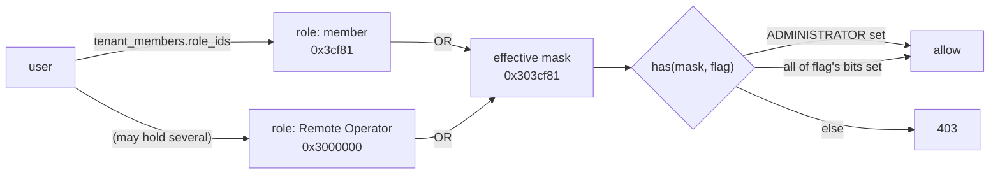
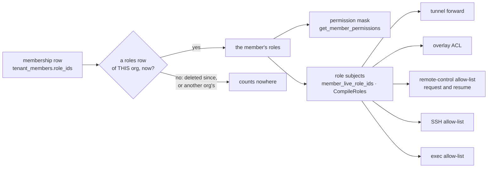
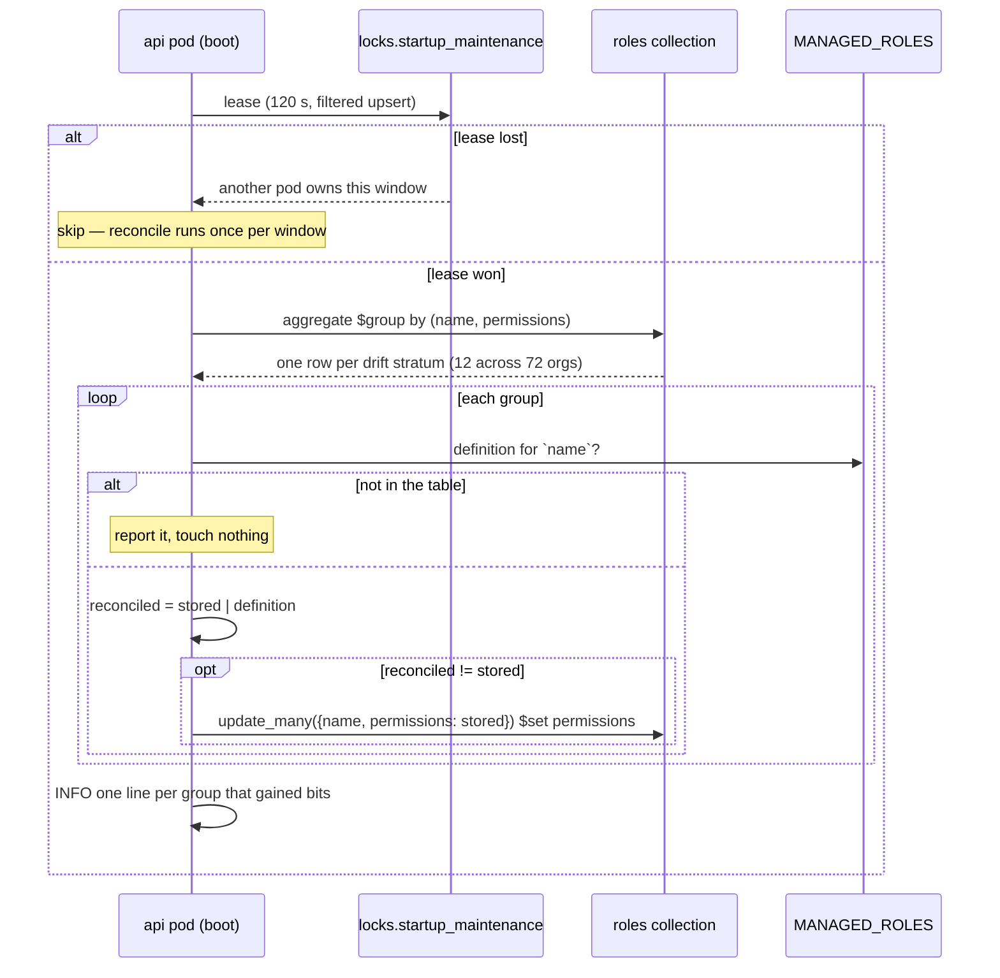
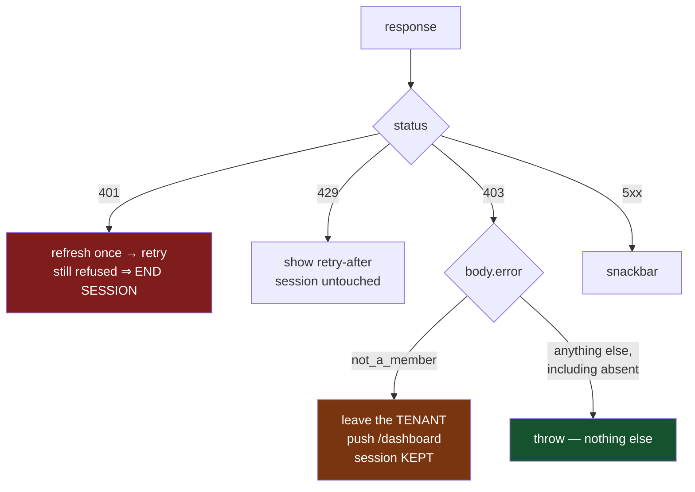

# Permissions, roles, and what a refusal means

*Who may do what in an organisation, where each decision is made, and — the part
that bit us — what the client is allowed to conclude from a `403`.*

> **Related:** [use-cases.md](use-cases.md) walks the model in plain language ·
> [api.md](api.md) lists every route · [fleet-rpc.md](fleet-rpc.md) and
> [roomler-ssh.md](roomler-ssh.md) describe the four-gate chains that *start*
> with a permission bit · [FR-82](fr/FR-82-permission-refusal-is-not-a-logout.md)
> is the arc that wrote this page.

## 1 · The shape

Authorization is a `u64` bitfield per role, OR-ed across the roles a member
holds in one tenant. `ADMINISTRATOR` (bit 23) is a bypass: `has(mask, flag)` is
true whenever it is set. Only the roles **of that tenant** count, read at each
decision ([below](#which-roles-count-the-orgs-own-read-where-they-are-used)).



Source of truth: `crates/db/src/models/role.rs`. The UI mirrors the catalogue in
`ui/src/utils/permissions.ts` and does its mask arithmetic **without bitwise
operators** — JS coerces those to signed int32, which is what capped the
catalogue at bit 30 until #888. Bit 52 is the ceiling (a mask crosses the wire
as a JSON number, exact only below 2^53).

⚠️ **A bit defined in Rust that the UI does not list is a permission nobody can
grant from the product.** The mirror is hand-maintained.

### Which roles count: the org's own, read where they are used

A membership row (`tenant_members.role_ids`) lists role ids. **A role counts in an
org only if it is a `roles` row of that org at the moment a decision is made.** An
id the row lists for a role the org has deleted since, or for a role of another
org, adds no permission bit and satisfies no rule that names it. One read applies
the rule for every consumer, `TenantDao::org_roles_among`
(`crates/services/src/dao/tenant.rs:660`): the permission mask and every
role-scoped rule read through it, so the two never disagree on who holds what.



**Nothing caches a member's roles**: not an enrollment, a socket's connect or a
session's start. Each reader asks when it decides, so a role given counts from the
next decision, and a role taken back or deleted stops counting there.

| reader | decides | asked | a read that fails |
|---|---|---|---|
| `get_member_permissions` (`tenant.rs:712`) | the permission mask behind `require_permission` and every gate that asks for a bit | every request | the request fails; no mask is guessed. No membership row is `not_a_member` |
| `forward_role_ids` (`crates/modules/network/src/tunnel.rs:1000`) | a tunnel policy's `RoleId` subjects ([tunnels.md](tunnels.md#who-a-forward-is-matched-as-3635)) | every forward, when a live policy names a role | no roles, WARN |
| `CompileRoles` (`crates/modules/network/src/overlay.rs:2516`) | the overlay ACL's `RoleId` sources: netmap shaping, the DERP allow table, org-relay grants | every compile: the org's role ids in one query, kept for the nodes it resolves, intersected with each node owner's row | shaping: no roles, WARN; a relay grant: refused; the relay reconcile: no decision for that member |
| `resolve_session_authz` (`crates/modules/remote/src/controller.rs:979`) | a device's remote-control allow-list (`access_policy.allowed_role_ids`) | every session request | no roles, WARN |
| `resume_gate` (`controller.rs:1174`) | the same allow-list when a session resumes | every resume | the resume is refused, and the viewer's redial runs the whole gate |
| `authorize` gate 3 (`crates/modules/network/src/routes/agent_ssh.rs:259`) | `ssh_policy.allowed_role_ids` | every SSH request, when the list names a role | no roles, WARN |
| `authorize` gate 3 (`crates/modules/fleet/src/agent_exec.rs:317`) | `exec_policy.allowed_role_ids` | every exec request, when the list names a role | no roles, WARN |

Two readers only show or notify. The members list keeps each row to the org's roles
with one roles query per listing (`list_members`, `crates/api/src/routes/user.rs:119`),
so the role chips show what counts. Who is told that a device was paired, or that
someone from outside came near a device (FR-52), comes from `members_with_permission`
(`tenant.rs:802`), the same fold over the org's own roles.

⚠️ **No roles is a refusal for role entries, and nothing else.** A user who is not a
member, a read that fails and a row whose ids the org no longer has all give an
empty role set: an entry that names a role does not match, the failure is logged at
WARN, and every other subject (a user, a device, everyone) is decided as before. A
failed read never becomes an allow.

⚠️ **An empty role SET is not an empty allow-LIST.** The first makes a rule's role
entries miss. The second, an allow-list with no entries, means "no restriction by
role" on a device's remote-control, SSH and exec policies. Nothing turns one into
the other.

⚠️ **The overlay compile reads the org's role set once**, because a netmap build
resolves every node of the org and the set is the same for all of them; a query per
node would multiply on the busiest path. The compile is still the point of use, and
a change of roles re-fans the org ([below](#the-overlay-on-a-role-change)).

### Who may write a role id

Every write that stores a role id accepts only the org's own roles, **for every
caller, `ADMINISTRATOR` included**. `ADMINISTRATOR` passes the permission-bit check
of a grant, never the lookup.

| write | gate | a role that is not the org's |
|---|---|---|
| assign a role, `POST …/role/{rid}/assign/{uid}` | `MANAGE_ROLES` | 404: `check_grant_roles` (`crates/api/src/routes/role.rs:82`) resolves each id in the org, then `check_grant` (`:50`) checks the bits; `TenantDao::assign_role` (`tenant.rs:620`) refuses it as well |
| add a member with roles, `POST …/member` | `INVITE_MEMBERS` | 404, the same two checks (`TenantDao::add_member`, `tenant.rs:520`) |
| create an invite, `POST …/invite`, `…/invite/batch` | `INVITE_MEMBERS` | 404, `check_grant_roles` |
| redeem an invite, `POST /api/invite/{code}/accept` or registering with its code | the invitee | the invite's roles the org still has (`redeemed_role_ids`, `crates/api/src/routes/invite.rs:166`). If none is left, 409 `conflict` and nothing is spent: the inviter sends a new invite. An invite that names no role gives `member` |
| a device's remote-control, exec or SSH allow-list: `PUT …/agent/{aid}`, `…/exec-policy`, `…/ssh-policy` | `MANAGE_AGENTS` | 400 `bad_request` `Unknown role id: <hex>` (`guards::require_org_roles`, `crates/core/src/guards.rs:71`; called at `crates/modules/fleet/src/agent.rs:1530`, `crates/modules/fleet/src/agent_exec.rs:996`, `crates/modules/network/src/routes/agent_ssh.rs:1006`) |
| a tunnel policy's `RoleId` subject, `POST`/`PUT …/tunnel-policy` | `MANAGE_AGENTS` | 400, the same guard (`crates/modules/network/src/routes/tunnel.rs:961`, `:1042`) |
| an overlay ACL rule's `RoleId` source, `POST`/`PUT …/overlay-acl` | `MANAGE_AGENTS` | 400, the same guard (`crates/modules/network/src/routes/overlay_policy.rs:195`, `:251`) |

A role named by a member-row write is an object the request resolves in the org,
like any id, hence the 404. A role named in a policy is a value of the body, hence
the 400, the sibling of the routes' `Invalid role id`.

⚠️ **A policy write accepts back an id it already stores.** The editors send a
policy's stored lists back on every save, so a stored id of a role deleted since
must not make the rest of the policy unsaveable. It matches nobody (above). Only an
id the write adds must be the org's; a create has nothing stored.

⚠️ **A role id is never pruned from a policy**, not on a write and not when the role
is deleted. Because an empty role allow-list means "no restriction by role",
dropping the last id would widen a rule that matches nobody into one that matches
everybody.

### Deleting a role

`DELETE …/role/{rid}` (`MANAGE_ROLES`) looks the role up in the org, so another
org's role is a 404 like no role at all, and a managed or default role is refused
with 403. `RoleDao::delete` (`crates/services/src/dao/role.rs:114`) deletes the row,
then pulls the id from the org's membership rows. The row goes first on purpose:
once it is gone the id counts nowhere, so a pull that fails (logged at WARN) or an
assign that races it leaves an id that grants nothing and matches no rule. Policies
that name the role keep the id, and it matches nobody.

### The overlay on a role change

The overlay ACL is compiled into each node's netmap, the DERP allow table and the
org-relay grants, so a change of who holds which role reaches the nodes when they
are recompiled. Every write that changes it (assign, unassign, delete, adding a
member, an invite's redemption, registration with an invite) calls
`HookRegistry::org_roles_changed` (`crates/core/src/hooks.rs:346`) after its write.
The network module's hook (`crates/modules/network/src/membership.rs:85`) re-fans the
org 750 ms later, one re-fan for a burst of changes, and only while the org's overlay
ACL is `warn` or `enforce` (`refan_for_role_change`,
`crates/modules/network/src/routes/overlay_policy.rs:334`): under `off` a role shapes
nothing. The request never waits for the re-fan.

## 2 · The managed roles

Five roles are seeded into every new tenant and are **system-managed**: the
product refuses to delete them, because their definitions belong to the code
rather than to the org.

| role | mask | carries | notes |
|---|---|---|---|
| `owner` | `permissions::ALL` | everything, incl. `ADMINISTRATOR` | the tenant creator |
| `admin` | `DEFAULT_ADMIN` | channels, roles, members, fleet management, all three audit views | ⚠️ **not** `MANAGE_TENANT` |
| `moderator` | member + moderation + `REMOTE_CONTROL` | | |
| `member` | `DEFAULT_MEMBER` | read/write in channels, join calls | `is_default` — the invite path resolves it **by name** |
| `guest` | `VIEW_CHANNELS \| READ_HISTORY` | | |

⚠️ **`EXEC_DEVICE` and `SSH_DEVICE` are in no row below the `ADMINISTRATOR`
bypass, and a test enforces it**
(`no_managed_role_below_administrator_seeds_a_root_shell`). They run as
SYSTEM/root with nobody watching, so they stay grants an owner makes on
purpose. Because the reconcile in §3 hands out whatever the table says,
`DEFAULT_ADMIN |= EXEC_DEVICE` — a one-token edit that reads as tidying —
would open exec-as-SYSTEM on every existing org at the next boot, with no
migration to review and no admin action to audit.

⚠️ **`RECORD_REMOTE_SCREEN` (bit 31, FR-85) follows the same rule, for a
different reason.** It runs nothing as SYSTEM/root; what it makes is a **copy**.
A controlled screen is visible to whoever is at it and ends with the session,
but a recording outlives both. The same test checks it, and
`admins_can_read_the_audits_without_gaining_the_powers` keeps it out of
`DEFAULT_ADMIN`. The session bit it gates, and the other gates in the chain, are
in [recording.md](recording.md) §10.

⚠️ `owner` holds these bits, as part of `ALL`. That is not an exception to the
rule so much as outside it: the row carries `ADMINISTRATOR`, so `has()` already
answers true for every bit, and the two bits confer nothing there. The test
skips any row with the bypass for exactly that reason — a check that fails on
`owner` is failing for a reason that says nothing about the risk.

⚠️ **`MANAGE_TENANT` is deliberately absent from `DEFAULT_ADMIN`.** Configuring
the organisation — including the `exec`, `ssh` and ephemeral-key org switches —
is the owner's job. This is policy, not an oversight, and it is why an org's
admins do not see the Devices page's enrollment-keys card.

### Reserved bits 32-34 (FR-137)

⚠️ **Bits 32–34 are reserved and never reused.** They were parked FR-90's
`HIVE_RUN` (bit 32, starting and driving an agent session), `KNOWHOW_VIEW` (33)
and `KNOWHOW_EDIT` (34). Nothing grants or checks them now, but stored roles
still hold them:

- `owner` holds all three, as part of `ALL`;
- every managed `member`, `moderator` and `admin` row holds bit 33, and every
  `admin` row bit 34, because FR-90's presets carried them and §3's reconcile
  handed them to every organization at the first boot that did;
- any role an owner granted `HIVE_RUN` holds bit 32.

§3's reconcile only adds (`stored | definition`,
`crates/services/src/dao/tenant.rs:459`), so nothing takes them out. A new
permission on one of these bits would reach every role that ever held the old
one at the next boot, with no migration to review. Deleting a name opens the
same door: `all_contains_every_named_permission` and
`every_named_permission_is_a_distinct_single_bit`
(`crates/db/src/models/role.rs:554`, `:569`) read the name table, so a new
permission on an unnamed bit 33 would pass both.

So the bits keep their consts (`crates/db/src/models/role.rs:116-122`), their
names (`:224-226`), which `names()` and the escalation guard's 403 still print,
and their place in `ALL` (`:183`). No managed row below the owner seeds them,
and the UI catalogue lists none of them (`ui/src/utils/permissions.ts:197-199`).
`the_reserved_bits_stay_named_and_seeded_by_no_row_below_the_owner` (`:472`)
fails on a rename, a deletion or a reuse. The other surfaces FR-90 left
reserved are listed in
[retired-names.md](retired-names.md#reserved-after-fr-90-was-parked-fr-137).

## 3 · A managed role is reconciled, not frozen (FR-82)

Until FR-82 a managed role's mask was written **once, at tenant creation, and
never again**, so adding a permission bit reached only organisations created
afterwards.

Measured on the hosted deployment before the fix — 72 orgs, 360 managed roles:

| role | stored | orgs | what it was missing |
|---|---|---|---|
| `owner` | `0xffffff` | 63 | everything above bit 23 (no-op in effect — the `ADMINISTRATOR` bypass covered it) |
| `admin` | `0x7ffff7` | 63 | `MANAGE_AGENTS`, `REMOTE_CONTROL`, `VIEW_REMOTE_AUDIT`, `VIEW_EXEC_AUDIT`, `VIEW_SSH_AUDIT` |
| `moderator` | `0x7ef91` | 63 | `REMOTE_CONTROL` |

Each distinct `owner` mask is a snapshot of `permissions::ALL` on the day that
org was created — the freeze, visible in the data. The one non-managed role on
the whole deployment was a hand-made `Remote Operator`
(`MANAGE_AGENTS | REMOTE_CONTROL`) an operator had built *because* their own
`admin` role could not see the fleet.



⚠️ **Additive: `new = stored | definition`, never a replace.** A managed role's
mask *is* editable through `PUT …/role/{id}` (only *deletion* is refused), so an
org may legitimately have added a bit; overwriting would silently revoke it.
**The cost, stated so nobody rediscovers it: a bit REMOVED from a definition — a
tightening — does not propagate**, and needs its own migration that says out
loud whose permissions it takes away.

⚠️ **The mirror case is the surprising one: a bit an ORG removed comes back.**
OR-ing cannot tell *"this org never had `REMOTE_CONTROL`"* from *"this org took
it away on purpose"* — one stored mask, both read as absent — so an org that
narrowed a managed role sees it silently widened at the next boot. That is the
price of protecting org-ADDED bits, and it means **narrowing a managed role is
not a supported way to restrict a team**: make a custom role instead. The
reconcile matches `is_managed: true` only, so a custom role is never in its
aggregation at all.

⚠️ Matching the **exact stored value** in the filter makes the update idempotent
*and* safe against a concurrent editor: a role changed underneath simply falls
out of its group's filter instead of being clobbered.

⚠️ A managed row whose name is not in the table is **reported and left alone**.
Visible drift beats drift corrected by guesswork.

⚠️ It is logged at INFO with the arithmetic, never silently — this grants
permissions across every tenant on the deployment. Every later boot prints
*"managed roles already match their definitions"*.

### The record that outlives the pod — `role_reconcile_audit`

⚠️⚠️ **A log line is a notification, not an audit trail.** This paragraph used
to end *"…so the one run that does something has to be readable in `kubectl
logs` afterwards"*. Measured on the 2026-09-09 roll: **~10 minutes later it was
readable nowhere.** `kubectl logs` serves only the *current* container, the
emitting pod had been replaced, and the sole record of a one-way grant across
63 organisations survived purely because somebody was watching live and had
captured a before-state. Neither is guaranteed next time.

So each **changed** stratum also writes a row: role, how many organisations it
covered, `stored` → `granted`, the `gained` mask, and the permission **names**
added — the masks are the record, the names are what a human reads years later
without re-deriving a bitfield. Written from inside the reconcile, one statement
after the `update_many` it describes, so the two cannot drift.

| property | here | every other audit collection | why |
|---|---|---|---|
| scope | deployment-wide | tenant + device + user | there is no tenant, no device and no requester — one row covers every org that shared a stale mask |
| TTL | **none** | 90 days | already bounded: ~12 rows once per deployment, then nothing. A TTL would delete the only record of an irreversible grant and re-create the gap |
| on failure | logged, reconcile continues | same | the roles are already correct; failing a migration over its receipt trades a real outage for a bookkeeping one |

⚠️ An idempotent run writes **nothing** — otherwise every restart buries the one
row that matters.

**Kill switch:** `ROOMLER__AUTH__RECONCILE_MANAGED_ROLES=false` (default on;
the daemon warns at startup when it is off). Two legitimate uses and no
others: a deployment that has deliberately edited a managed role *down* and
wants it left alone — the reconcile is additive, so it would restore the bit
on every boot — and stopping the job without rolling back an image. It is not
a way to opt out of new permissions; a role frozen at its creation-day mask is
the bug, not a configuration.

## 4 · What a refusal means

Two refusals share the `403` status code and mean different things, and a third
family deliberately does not use it at all. Getting the first two confused cost
a week of users being signed out of the product.

| server produces | status + `error` | means | client does |
|---|---|---|---|
| `ApiError::NotAMember` | 403 `not_a_member` | you are not in this tenant | leave the **tenant** → `/dashboard`, session intact |
| `ApiError::Forbidden(msg)` | 403 `forbidden` | you are, and you may not do that | throw; the caller renders `msg` |
| `require_platform_admin` | **404** | not on the operator allowlist | ordinary 404 — the allowlist is itself what is hidden, so a 403 would confirm the surface exists |
| `require_tenant_stats` | **404** | not a member, or without `MANAGE_AGENTS` | ordinary 404 — these are polled dashboards, and an empty panel beats an error on every tick |



⚠️ **A 403 never ends a session — on any method.** It is a verdict on a
credential the server just *accepted*, the opposite of a 401.

⚠️ **The default direction is the guarantee.** An *unclassified* 403 does
nothing but throw, which is what makes a newly-added permission-gated route
inert on the client by construction, rather than dangerous until someone
remembers to add a predicate for it.

⚠️ **The distinction is sent by the server, not sniffed from the message.**
`chat`'s `Forbidden("Not a member of this room")` is a 403 of exactly the same
shape; evicting someone from their organisation over a private channel would be
absurd.

⚠️ **A refusal about someone other than the caller is a plain `forbidden`.** An
enrollment credential whose issuer has left the org, or no longer holds
`MANAGE_AGENTS` there, and a tunnel enrollment token whose subject has left, are
refused with 403 `forbidden` and the server's sentence, never `not_a_member`,
which would say the caller is the one outside the org: the person in question is
not the caller, and the caller is a device, not a page
([`security-baseline.md`](security-baseline.md#an-enrollment-credential-ends-with-its-issuers-right-to-enroll-devices)).

### How it went wrong

`ui/src/api/client.ts` used to read *any* `403` on a `GET` as a dead session —
clear the sign-in hint, push `/login`. On 2026-09-08 a member opened
`/tenant/{id}/devices`:

```
mask 0x303cf81  (member + a custom MANAGE_AGENTS|REMOTE_CONTROL role)
  ├─ MANAGE_AGENTS ⇒ the "Devices" nav item renders
  └─ MANAGE_TENANT ABSENT
      └─ EnrollKeysSection mounts unconditionally and GETs
         /tenant/{id}/ephemeral-key-settings   ⇒ 403 ⇒ signed out
```

Four things worth keeping:

1. **Only the owner of any org was safe.** `MANAGE_TENANT` is not in
   `DEFAULT_ADMIN`, so an org's own admins were logged out by opening their own
   Devices page. The `ADMINISTRATOR` bypass hid it for a week.
2. **The store's `catch` was correct and never ran on the branch that
   mattered** — the logout fired one layer below it, inside `request()`, before
   the throw the store was waiting for. A handler cannot defend against a
   side effect its own transport performs first.
3. **A unit test asserted the logout as correct behaviour**, with a comment
   explaining the case it existed for.
4. **Three fail-closed predicates in `utils/permissions.ts` exist only to route
   around the rule** — `canQueryAnalytics`, `canManageInvites`,
   `canViewExecAudit`/`canViewSshAudit` — each written after the same bug
   surfaced in a different corner. The codebase had been paying for the rule in
   instances for months without anyone pricing the rule itself.

Those predicates are kept, with their reasons rewritten: they are **UX** now —
don't draw a door that opens onto a refusal, don't spend a round-trip learning
what the mask already says — not session protection.

## 5 · Where a gate belongs

⚠️ **In the store, not at the call site.** The `MANAGE_TENANT` GETs
(`exec-settings`, `ssh-settings`, `ephemeral-key-settings`) are gated inside
`ui/src/stores/agents.ts`. This is the rule FR-75 (#1447) paid for on the
`network` module's routes: a per-caller predicate leaks the moment one caller
reaches for the wrong one — and `ephemeral-key-settings` had no caller-side
gate at all, because the page that mounts the card never had one to forget.

⚠️ It **awaits** `ensureMyMembership` rather than reading `myPermissions`:
AppLayout's `/member/me` is in flight while the page mounts, so a synchronous
read is a coin-flip between "hidden from the owner" and "fires anyway".

A device's diagnostics are gated there too: its crash reports and uploaded logs
(`…/agent/{id}/crash`, `…/agent/{id}/logs`) need `MANAGE_AGENTS`
([security-baseline.md](security-baseline.md#device-diagnostics-manage_agents-and-a-second-scrub)).
`fetchCrashes` and `fetchLogs` answer `null` for a caller who may not read them,
whether the mask said so or the server's 403 did, and the two dialogs explain
that rather than show an error. Their predicate, `canReadDeviceDiagnostics`, fails
**open** while the mask is unknown, unlike the org-settings one: the device menu
renders before `/member/me` lands, and a refusal it lets through costs one
explained dialog, not a broken page.

The org's tunnel ACL is gated there too. Every `…/tunnel-policy` route is
`MANAGE_AGENTS`, the reads included, as on the Overlay ACL beside it
([security-baseline.md](security-baseline.md#a-tunnel-policy-is-a-grant-manage_agents-reads-included)).
`fetchPolicies` (`ui/src/stores/tunnelPolicies.ts:152`) sends nothing for a caller
the mask refuses and sets `refused`, and a server 403 lands in the same state; the
Tunnel ACL tab then says who manages policies, with no editor and no "New policy".
Its predicate, `canManageTunnelPolicies` (`ui/src/utils/permissions.ts:375`), fails
**open** while the mask is unknown, like the diagnostics one: the store awaited the
membership, so `null` means that fetch failed, and a holder must not lose the page
over it. The Network pages are drawn for `REMOTE_CONTROL` too (`canSeeFleetNav`),
which is not the bit, so a `moderator` reaches the tab and reads that explanation.

The MagicDNS page is the other half of that rule. Reading the org's settings is any
member's (every node receives them), changing them is `MANAGE_AGENTS`
([security-baseline.md](security-baseline.md#the-orgs-magicdns-manage_agents-to-change-it-any-member-to-read-it)).
So the gate is on the editor, not the page: `mayEditMagicDns`
(`ui/src/stores/overlayRoutes.ts`) awaits the membership and asks `canEditMagicDns`
(`ui/src/utils/permissions.ts:392`, fail-open the same way). A member without the bit
sees the settings read-only with a note and no Save, and a save the server refuses
turns the page read-only, never an error.

⚠️ The client gate is never the enforcement. Every route re-checks server-side;
the UI only avoids offering what it already knows will be refused.

## 6 · Permission bits that are deliberately NOT implied

The catalogue splits powers that look adjacent, and each split was paid for:

| holding | does **not** imply | why |
|---|---|---|
| `MANAGE_AGENTS` | `EXEC_DEVICE` | managing a device's metadata and running a root shell on it are different powers |
| `EXEC_DEVICE` | `SSH_DEVICE` | a bounded command is not an interactive session that lasts and grows file transfer and port forwarding |
| `VIEW_EXEC_AUDIT` | `EXEC_DEVICE` | an admin should see every command the fleet ran without silently gaining the power to run one |
| `VIEW_SSH_AUDIT` | `SSH_DEVICE` | same asymmetry, and `VIEW_SSH_AUDIT` *is* in `DEFAULT_ADMIN` while `SSH_DEVICE` is not |
| `REMOTE_CONTROL` | `RECORD_REMOTE_SCREEN` | watching a screen ends with the session; a recording is a copy that outlives it (FR-85) |
| `ADMINISTRATOR` under break-glass | recording | break-glass skips the host's consent, so a recording made under it would be covert — the hub strips `RECORD` whatever the mask says |
| `ADMINISTRATOR` under break-glass | privacy mode | the same session never covers the device's screen: a curtain would hide it from the one person who could object — the hub strips the session's `PRIVACY` bit (FR-99) |
| any bit below `ADMINISTRATOR` | `MANAGE_TENANT` | configuring the org is the owner's job — nothing in `DEFAULT_ADMIN` reaches it, only the bypass does |

And the escalation rule that ties them together: **you cannot grant a permission
you do not hold** (#600/#605). Enabling exec on a device needs `MANAGE_AGENTS`
*and* `EXEC_DEVICE`; any `ssh_*` key needs `SSH_DEVICE`. Clearing an approval
needs only `MANAGE_AGENTS` — revocation is not a grant.

## 7 · Reference

| what | where |
|---|---|
| bit catalogue, `has`, `DEFAULT_*`, `NAMED` | `crates/db/src/models/role.rs` |
| managed-role table | `role::MANAGED_ROLES` (same file) |
| seed at tenant creation | `TenantDao::create_default_roles` |
| reconcile at boot | `TenantDao::reconcile_managed_roles`, called from `crates/api/src/main.rs` under the `startup_maintenance` lease |
| which roles a member holds | `TenantDao::org_roles_among`, `get_member_permissions`, `member_live_role_ids`, `org_role_ids` (`crates/services/src/dao/tenant.rs`); the overlay's `CompileRoles` (`crates/modules/network/src/overlay.rs`) |
| a role id in a write | `check_grant_roles` (`crates/api/src/routes/role.rs`), `TenantDao::add_member` / `assign_role`, `redeemed_role_ids` (`crates/api/src/routes/invite.rs`), `guards::require_org_roles` |
| a role's delete, the re-fan | `RoleDao::delete` (`crates/services/src/dao/role.rs`); `MembershipLifecycle::org_roles_changed` (`crates/core/src/hooks.rs`) |
| the tenant/permission guards | `crates/core/src/guards.rs` |
| error → wire | `crates/core/src/error.rs` |
| client contract | `ui/src/api/client.ts` |
| UI mirror + predicates | `ui/src/utils/permissions.ts` |
| tests | `crates/tests/src/member_role_ids_tests.rs`, `crates/tests/src/role_reconcile_tests.rs`, `crates/tests/src/device_diagnostics_tests.rs`, `crates/tests/src/tunnel_policy_permission_tests.rs`, `crates/tests/src/magic_dns_permission_tests.rs`, `ui/src/__tests__/api/client.spec.ts`, `ui/src/__tests__/stores/agents.spec.ts`, `ui/src/__tests__/stores/tunnelPolicies.spec.ts`, `ui/src/__tests__/stores/overlayRoutes.spec.ts` |
