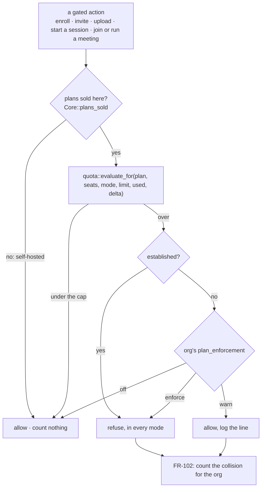
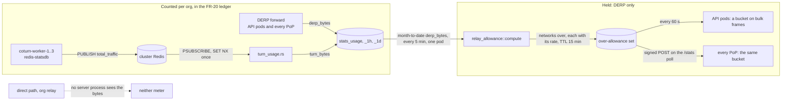
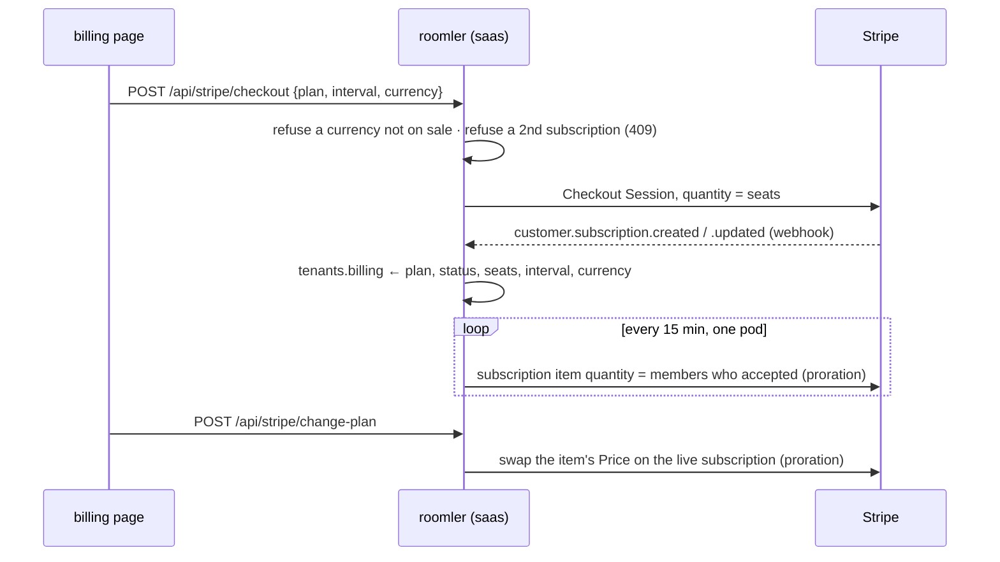

# Plans and limits — what each plan allows, and where the code holds the line

**Status:** shipped in [FR-115](fr/FR-115-pricing-reshape.md) (#2557): the ladder and per-seat
billing (P1+P2), the concurrent-session cap (P3, counted cluster-wide by P3b since
2026-10-21), and the meeting cap (P5). The relay allowance on DERP (P4a) has been on since
2026-10-21, and per-org TURN bytes (P4b) have been counted on the cluster's coturn since
2026-10-22. Throttling TURN (P4c) is not built. Claims were checked against the code at
`8ab970586`, and the relay allowance section at `d13831d31`.

The price list and the reasoning behind it are in [business-model.md](business-model.md) §4.
This page is the engineering view: where the numbers live, the one place they are compared,
which limits can be softened and which cannot, and the switches that turn each off.

## 1. Where the numbers live

One function holds the matrix: `Plan::limits_for(seats)` (`crates/db/src/models/tenant.rs:554`). Fields priced
per seat (concurrent sessions on Pro, relay, storage) are multiplied by the org's billed
seats, `Tenant::billed_seats` (`crates/db/src/models/tenant.rs:466`): one on Free, the subscription's quantity
on a paid plan, never below one. A paid org whose webhook has not landed yet is computed at
one seat, so a missing number can only under-grant.

| Limit (`PlanLimits` field) | Free | Pro (per seat) | Business (per seat) |
|---|---|---|---|
| `max_members` | **10** | unlimited (every user is a seat) | unlimited |
| `max_devices` · `max_tunnel_clients` | 100 · 100 | 1,000 · 1,000 | 5,000 · 5,000 |
| `max_concurrent_sessions` | **1 per org** | 1 per seat | unlimited |
| `video_max_participants` · `meeting_max_minutes` | **10 · 60** | 50 · unlimited | 100 · unlimited |
| `storage_bytes` | 1 GiB | 10 GiB per seat | 50 GiB per seat |
| `relay_bytes_per_month` | 10 GB | 25 GB per seat | 100 GB per seat |
| `magic_dns` · `exit_nodes` · `recordings` | yes · no · no | yes · yes · no | yes · yes · yes |

"Unlimited" is spelled `u32::MAX`, never `Option`: a counted cap reads it as "no cap"
(`count_cap`), and the published JSON carries the number. `billing_tests` reads most of
these cells back through `GET /api/stripe/plans`; the code is the source, this table its
summary.

## 2. One decision point

`services::quota::evaluate_for` (`crates/services/src/quota.rs:301`) is the only place a limit is
compared. Call sites go through `roomler_core::quota::check` (`crates/core/src/quota.rs:38`), which adds
two things: the FR-102 collision count per org (`growth_daily`), and `Core::plans_sold`
(§6).

## 3. Which limits ignore the mode

`plan_enforcement` (`off` → `warn` → `enforce`, per org; new orgs start on `warn`) exists to
stage a new gate safely. An **established** limit ignores it and refuses in every mode,
`off` included (`Limit::is_established`, `crates/services/src/quota.rs:93`):

| Established | Since | Why |
|---|---|---|
| devices, tunnel clients | before FR-32 | the original caps; the mode was never meant to reach them |
| members | FR-115 D2 | with per-seat pricing, Free's ten users is the line a team crosses into a paid plan |
| concurrent remote sessions | FR-115 P3 | Free's objective fence, in place of "personal use" detection |
| meeting participants, meeting length | FR-115 P5 | "10 people, 60 minutes" is what Free sells |

Everything else (storage, channels, recordings, exit nodes, MagicDNS, cloud integrations) is
staged by the mode.

## 4. The gates

| Limit | Checked at | Refusal |
|---|---|---|
| devices | enrollment (`crates/modules/fleet/src/agent.rs:234`) | 403, before the single-use token is claimed |
| tunnel clients | `crates/modules/network/src/routes/tunnel.rs:138` | 403 |
| members | invite and admin add (`crates/api/src/routes/invite.rs:199`) | 403 naming the counts |
| storage | upload (`crates/modules/chat/src/file.rs:312`) | 403; the check is `current + incoming`, so a file that exactly fills the quota fits |
| meeting participants | `media:join` on the owner pod (`crates/modules/conference/src/ws_media.rs:286`) | `media:error`; a rejoining participant keeps their seat |
| meeting length | the sweep (`crates/modules/conference/src/meeting_cap.rs:100`) | `room:call_ending_soon` at 55, `room:call_ended {reason: plan_limit}` at 60 |
| concurrent sessions | the hub, after its coalesce (`crates/modules/fleet/src/hub.rs:1577`); with `rc.session_slots` on, a cluster-wide slot claimed on the pod that owns the device before the hub runs (`crates/modules/remote/src/slots.rs`) | `org_session_limit`, naming who holds the slot and where; an external session gets `session_limit` |
| relay past the month's allowance | the DERP forward path, on the API pods (`crates/modules/network/src/derp.rs:620`) and on every PoP (`crates/derp-relay/src/main.rs:147`) | **never refused**: bulk frames are held to the plan's rate (*The relay allowance* below) |
| recordings, exit nodes, MagicDNS | `require_feature` at each route | 403 in feature wording ("not available on the Free plan") |

The two fences that are not a request — a meeting that runs long, a session started on
another pod — are where the design is unusual:

- **Meeting length is a sweep, not a timer.** Every pod reads the calls in progress every
  30 s; the warning and the end are writes conditional on the call it read, so two pods act
  once and a restarted meeting is never ended by a stale read. Detail:
  [FR-115 *Meetings, as built*](fr/FR-115-pricing-reshape.md#meetings-as-built-p5).
- **Concurrent sessions are counted by the hub that owns the device.** Tenant affinity puts
  an org's devices and controllers on one pod, so that pod's count is the org's; a request
  relayed from another pod carries the cap its gate read.
- **P3b makes the count cluster-wide** (`rc.session_slots`, on in production since 2026-10-21): one record per
  payer in Redis (`crates/core/src/cluster/session_slots.rs`), claimed atomically, renewed
  every 30 s by the pod that holds the session, and freed within 90 s of a pod dying. An
  org's own sessions and the external (FR-52) sessions its members run for it share its
  slots: the outsider picks the org on `/connect`, from any of theirs, and no paid org is
  needed. An account in no org gets Free's one session, counted against the account. When
  Redis cannot answer, the hub's count decides, as before.

### The relay allowance: a throttle, never a refusal (P4a, P4b)

An org past its month's `relay_bytes_per_month` (§1) is never disconnected. Its mesh keeps
the DERP floor, the path that always connects, and only that floor's **bulk** frames slow
down: to 1 Mbit/s on Free and 4 Mbit/s on a paid plan (`relay_allowance.free_rate_kbps` and
`paid_rate_kbps`, `crates/config/src/settings.rs:383`). A WireGuard handshake and disco are
never held. A throttle that delayed a handshake past its retry window would turn "slow" into
"down" for exactly the hosts that have no other path.

| Piece | Where | What it does |
|---|---|---|
| The numbers | `crates/services/src/relay_allowance.rs:25` (`allowance_bytes`), `:41` (`rate_for`) | the allowance for the plan and seats, and the rate for an org past it |
| Month to date | `crates/services/src/dao/stats.rs:206` (`relay_month_to_date`) | `derp_bytes` from the hourly rollups since the month began, plus the current hour's raw buckets |
| The job | `crates/modules/network/src/relay_allowance.rs:114` (`compute`), every 5 min (`:42`) | one pod (a Redis claim), only where plans are sold, publishes the networks of every org past its allowance, each with its rate, for 15 min (`:45`) |
| The refresh | `crates/modules/network/src/relay_allowance.rs:253`, every 60 s (`:47`) | every pod's own copy of the set. An absent or unreadable set is an empty one, so a stopped job, a Redis outage and the kill switch all fail open |
| The bucket on the API pods | `crates/modules/network/src/derp.rs:620` | a bulk frame of a network in the set takes tokens (`relay_allowance.rs:82`). Without one it is dropped, and the TCP inside the tunnel settles at the rate |
| The bucket on the PoPs | `crates/derp-relay/src/main.rs:147`, the set arriving on `POST /stats` (`:291`) | the same bucket, fed by the set the API signs and pushes on its `/stats` poll (`crates/core/src/relay_load.rs:211`). It goes only to endpoints whose last `/stats` reported an `allowance` (`:169`). A PoP that holds no set throttles nothing |
| What the org sees | `crates/api/src/routes/cost.rs:501` (`relay_quota`), on `GET /api/tenant/{tid}/stats/resources` | `quota.relay`: used, allowance, rate, `enforced` and `throttled` |
| TURN bytes per org (P4b) | `crates/modules/network/src/turn_usage.rs:175`; the username from `crates/remote_control/src/turn_creds.rs:388` | coturn's end-of-allocation totals become `turn_bytes` for the org the username names, recorded once across pods. Counted, never held: holding them is P4c |

⚠️ **The allowance counts DERP bytes only.** TURN bytes have been attributed per org since
2026-10-22, on the cluster's coturn; the PoPs' coturn is P4b-2. Nothing reads them for the
throttle until P4c. A username that names no org (the session-less pre-fetch) is logged as
unattributed, never guessed.

⚠️ **A direct path and an org relay meet neither meter**, because no server process ever sees
their bytes. That is placement, not a filter, and a future meter fed from agent-reported
counters would break it. So AC7 was proven on prod as a pair. Between the same two devices,
8 MiB over an org relay added 7,424 B of background. Over DERP it added 9,807,954 B and ran at
866 kbit/s, with the org past its allowance (FR-115 field log, 2026-10-22).

## 5. Seats and billing

A seat is a member who accepted; a pending invite is not one. Checkout bills
`quantity = seats` (`crates/services/src/stripe.rs:286`); the reconcile keeps it equal to the member count
(`crates/services/src/stripe.rs:553`, spawned by `crates/modules/saas/src/stripe.rs:173`); a plan change moves the existing
subscription's item instead of starting a second one (`crates/services/src/stripe.rs:442`).

| Setting | Effect | Default |
|---|---|---|
| `ROOMLER__STRIPE__PRICE_PRO`, `…__PRICE_BUSINESS` | the monthly Prices (one unit per seat) | — |
| `ROOMLER__STRIPE__PRICE_PRO_ANNUAL`, `…__PRICE_BUSINESS_ANNUAL` | the annual Prices (two months free); empty hides annual | empty |
| `ROOMLER__STRIPE__CURRENCIES` | the currencies on sale; a currency joins once every Price carries it | `usd` |
| `ROOMLER__STRIPE__SEAT_SYNC` | the 15-minute quantity reconcile | on |

## 6. Plans bind only where they are sold

Every org is created on `free`, on every server (`crates/services/src/dao/tenant.rs:284`).
On the hosted service that is a plan; on a self-hosted server it only means nobody sold the
org anything. `Core::plans_sold` (`crates/core/src/state.rs:131`) is true only where the
hosted `saas` module is compiled in and switched on (`crates/api/src/state.rs:298`); the
published self-host image and the compose build both leave it out. With it false,
`roomler_core::quota` refuses nothing and counts nothing (`crates/core/src/quota.rs:49`), and
the session cap (`crates/modules/remote/src/controller.rs:745`) and the meeting sweep
(`crates/modules/conference/src/meeting_cap.rs:104`) stand down.

⚠️ Until FR-115 found it, nothing exempted a self-hosted server: the device cap had always
bound its orgs, and FR-115's own new caps would have too, from the next self-host image on.
Each fence now has an integration test on a server without `saas`.

## 7. Kill switches

| Switch | Turns off |
|---|---|
| `ROOMLER__RC__ORG_SESSION_CAP=false` | the concurrent-session cap |
| `ROOMLER__RC__SESSION_SLOTS=false` | P3b's cluster-wide count: back to P3's count on the device's hub, and external (FR-52) sessions uncapped. On in production; it takes effect on a rollout restart, since the ConfigMap carries no content hash |
| `ROOMLER__RELAY_ALLOWANCE__ENABLED=false` | the relay allowance on DERP (P4a): no over-allowance set is published, and the API pods and every PoP drop the one they hold within a period. On in production since 2026-10-21; like the line above, it takes effect on a rollout restart |
| `ROOMLER__RELAY_ALLOWANCE__TURN_ATTRIBUTION=false` | per-org TURN bytes (P4b): no subscription to coturn's statistics, so no `turn_bytes`. On in production since 2026-10-22, and also applied on a rollout restart. coturn keeps publishing, and a message nobody hears is dropped. An empty `coturn_redis_statsdb` in `k8s-cluster-multi`'s coturn role stops the publishing itself |
| `ROOMLER__MEETINGS__FREE_CAP=false` | the meeting-length cap |
| `ROOMLER__STRIPE__SEAT_SYNC=false` | the quantity reconcile (the quantity is then set at checkout only) |
| an org's `settings.plan_enforcement = off` | every **staged** limit for that org (never an established one) |
| `ROOMLER__MODULES__SAAS=false` | the hosted billing module itself, and with it every plan limit (no plans sold). Not a switch for the hosted service: it also takes checkout away |

## 8. Not built yet

- **The relay allowance on TURN (P4c):** TURN bytes past the plan's allowance are throttled,
  never refused (a host behind symmetric NAT has no other path). The per-org TURN attribution
  it needs has existed on the cluster's coturn since 2026-10-22 (P4b). The PoPs' coturn
  (P4b-2) comes first. The DERP half (P4a) has been on since 2026-10-21, on the API pods and
  the regional PoPs.
- **Exit nodes on Free (P4d):** after the throttle exists.
