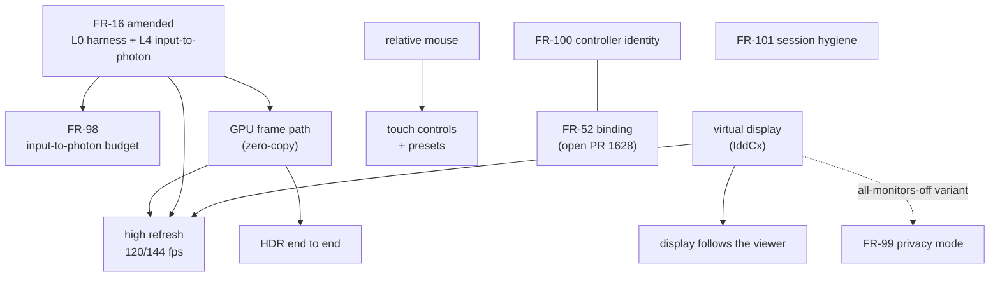

# StarDesk teardown: what a gaming-grade remote desktop does that Roomler should

## Context

**StarDesk Remote** is GearUP Portal Pte. Ltd.'s remote desktop: Singapore, the GearUP game-booster
company, beta 2025-09-28, v1.0 2025-10-12. Its hosts are Windows and macOS. Its controllers are **native
apps only**: Windows, macOS, iOS, Android. It is free, built for gaming, and sold on numbers.

On 2026-10-13 the operator asked for the performance and security features it has that would be useful in
Roomler to be identified and broken down, and for a plan to reverse-engineer them with integration and
field testing. Operator scope decisions in that session:
- **include:** relative mouse and key lock, touch key-mapping presets, HDR end to end;
- **exclude:** gamepad passthrough;
- **the teardown:** runs on a spare non-fleet Windows box, black-box only.

This document is the program: the teardown, the decomposition into FRs, the order, and the field method.
The FR specs are authoritative for each piece.

### How we reverse-engineer: clean-room only

- **What we learn from:** StarDesk's public claims and observations of our own install. That means the
  drivers and services it adds, packet headers, `nvidia-smi` encoder-session statistics, measured latency
  and frame rate, and behaviour.
- **What we never do:** decompile, or copy code from StarDesk or from GPL/AGPL projects (RustDesk,
  Sunshine, Moonlight). `agents/**` is MPL-2.0 and the server AGPL-3.0. MIT sources such as Microsoft's
  IddCx samples and VirtualDrivers/Virtual-Display-Driver are fine.
- ⚠️ **Measurements of StarDesk stay private.** [`docs/compare/README.md`](../compare/README.md) rule 3:
  "We do not benchmark competitors." The numbers inform engineering, in the private docs repo. Public pages
  describe StarDesk only by what StarDesk publishes.

### The difference that shapes everything below

StarDesk controls from a native app, which owns decode, render, pointer and keys. Roomler's thesis is
*nothing to install on the controlling side*, so the browser has to deliver the same experience. Several of
the hard parts are already in place: a data-channel video path that skips Chrome's jitter buffer, an
opaque desynchronized canvas, `pointerrawupdate` sampling, the Keyboard Lock API, and the FR-77 4:4:4 cells.

## 1. The teardown: StarDesk's claims against the code

Sources: stardesk.net (home, /help, /blog, /games) and its Grokipedia entry, read 2026-10-13. Roomler anchors
are master `c2e79221b`.

| # | StarDesk claims | Roomler today | Verdict |
|---|---|---|---|
| P1 | "under 50 ms" (vs "200–300 ms" for others) | **No input-to-photon metric anywhere.** Paint age via `rc:clock`; the §12 budget in `docs/remote-control.md` was never measured | no instrument: [FR-16](../fr/FR-16-rc-quality-benchmark.md) amended + [FR-98](../fr/FR-98-input-to-photon-budget.md) |
| P2 | 4K at up to 144 fps; fps lock 60/120/144 | hard 60 (`agents/roomlerd/src/peer.rs` L98, L105, `ffmpeg_target_fps` L8240); MF and openh264 30; a whole-millisecond sleep runs before the WGC slot check (`capture/wgc_backend.rs` L259, L293–302); `TIME_BASE_DEN = 1000` (`encode/ffmpeg/encoder.rs` L86) | gap: high-refresh FR (wave 2) |
| P3 | "Zero-Copy pipeline" | CPU readback on every capture arm; `Frame.data: Vec<u8>` (`capture/mod.rs` L59–64); `hwframes.rs` has no D3D11VA | gap: GPU frame path FR (wave 2) |
| P4 | HDR | FP16 tone-clipped to 8-bit sRGB (`capture/fp16.rs`); BT.601 8-bit throughout | gap: HDR FR (wave 3) |
| P5 | 4:4:4 "True Color" | FR-77's cells | **parity** |
| P6 | GPU encode and decode | many hardware encoders; WebCodecs decode | **parity** |
| P7 | "Follow current display", else a virtual "Universal Screen" | `display_match.rs` (rc.191): Windows-only, existing modes, no check that nobody is at the screen, no virtual display | partial: display FR + virtual-display FR (wave 2) |
| P8 | several displays at once | one display per session | partial: display FR |
| P9 | Host / Client (relative) / Auto mouse modes | absolute only; `cursor:hide` already emitted; no Pointer Lock | gap: relative-mouse FR (wave 3) |
| P10 | system keys reach the host | Keyboard Lock API in fullscreen | **parity** |
| P11 | 200+ touch key-mapping presets, macro keys | `MobileKeyboard.vue` only; the viewer sends no touch input; `InputMsg::Touch` is parsed and ignored | gap: touch FR (wave 3) |
| P12 | "300+ relay nodes", P2P first | regional relay PoPs with a measured `relay_home` (behind `ROOMLER__RELAY__REGIONS_ENABLED`), DERP floor, FR-19 peer relays | parity in design; node count is an ops decision |
| P13 | remote audio, mute host | WASAPI / Pulse, opt-in; silent on macOS; no host mute | partial: [FR-99](../fr/FR-99-privacy-mode.md) |
| S1 | E2E, mutual authentication, "zero-knowledge" | ephemeral per-session ECDSA and mutual DTLS, but on master the fingerprints are bound to nothing the device can check: the hub rebuilds the offer around the raw SDP (`crates/modules/fleet/src/hub.rs` L1391, L1450). FR-52's open PR #1628 binds them for outsiders only | gap: [FR-100](../fr/FR-100-controller-identity.md) |
| S2 | DTLS 1.2/1.3, AES-128, ECDHE with PFS | DTLS 1.2, ECDHE, SRTP AEAD-GCM including AES-256; CBC suites still offered | parity, harden: [FR-101](../fr/FR-101-rc-session-hygiene.md) |
| S3 | replay protection | **on**: webrtc-srtp's `Session::new` gives every session a 64-packet SRTP/SRTCP window when none is set. This row first said "off", from the no-protection fallback in `Context::new`, which a session never reaches. FR-16 L0's replay cells corrected it on 2026-10-13: a replayed SRTCP PLI is refused even with no window set | **parity**; FR-101 P1a pins the window |
| S4 | certificate pinning | deliberately absent so corporate TLS inspection works (`agents/roomlerd/Cargo.toml` L285–293) | by design; FR-100 gives the integrity pinning would |
| S5 | Privacy Mode: black out the local display | nothing; `WDA_EXCLUDEFROMCAPTURE` already hides our own panels from capture | gap: FR-99 |
| S6 | auto-lock after the session | none | gap: FR-99 |
| S7 | clipboard, files and audio off by default | clipboard auto-sync on, files requested by default, audio off; no policy switch | gap: FR-101 |
| S8 | Remote Support by device ID and code | FR-52's connect codes and device-held password, built on open PRs | built, unmerged |
| S9 | — | Roomler exceeds StarDesk: five consent modes with a device floor, audited break-glass, on-device recording, Ed25519 DERP tickets, HMAC TURN credentials, quarantine | exceeds |

Found on the way, claimed by neither product and outside this program: no 2FA/WebAuthn, and user sessions
that cannot be revoked (open Known Issues).

## 2. The program

New FRs are claimed wave by wave, so the registry does not fill with idle numbers. The security FRs do not
depend on the performance chain and run beside it.

| Wave | FR | Depends on |
|---|---|---|
| 0 | [FR-16](../fr/FR-16-rc-quality-benchmark.md), amended: the L0 harness, L4 input-to-photon, the StarDesk comparison cell | — |
| 1 | [FR-98](../fr/FR-98-input-to-photon-budget.md) input-to-photon budget | L4 |
| 1 | [FR-99](../fr/FR-99-privacy-mode.md) privacy mode, lock on end, host mute | — |
| 1 | [FR-100](../fr/FR-100-controller-identity.md) controller identity | FR-52's binding seam |
| 1 | [FR-101](../fr/FR-101-rc-session-hygiene.md) session hygiene | — |
| 2 | GPU frame path (zero-copy) | L4, FR-70's media thread |
| 2 | High refresh: D1 (≤ 1440p at 120, direct paths), then D2 (4K at 144) | L4; D2 needs zero-copy; above 60 on relays waits for FR-17 stage C, FR-74 P5 or FR-63 B1, FR-70 M3 |
| 2 | Display follows the viewer: a guard for the person at the screen, Linux, several displays | — |
| 2 | Virtual display (IddCx) | the operator's signing decision |
| 3 | Relative mouse and auto-switch | — |
| 3 | Touch controls, key-mapping presets, macros | relative mouse, for trackpad mode |
| 3 | HDR end to end | zero-copy; its own feasibility probe |

The performance build order is L0/L4 → FR-98's cuts → the zero-copy contract and its first cell → D1 → the
display guard → relative mouse → touch → the virtual display → D2 → HDR.

## 3. What each wave-2 and wave-3 FR will say

These get their numbers when they start. Their designs are recorded here so the decisions made during the
teardown are not lost.

**GPU frame path (zero-copy).**
- **The contract first.** `enum FrameData { Cpu, D3d11, IoSurface, DmaBuf }` with a `to_cpu()` that
  reproduces today's path, so every consumer that has not moved (resample, FP16, damage, the idle re-encode,
  the recorder, the VP9 pump) keeps working by paying the copy.
- **Windows:** `HwKind::D3d11va` wraps the **capture's** `ID3D11Device` (`av_hwdevice_ctx_alloc`, not
  `_create`). Copy into an FFmpeg pool texture on the GPU.
- **Gate on the capture adapter's LUID matching the encoder's.** neo16's panel may hang off its Radeon
  iGPU, so the honest first cell is `hevc_qsv` on CORPLAP-3, not NVENC on neo16, unless measured.
- **macOS:** IOSurface → `CVPixelBuffer` → VideoToolbox. **Linux:** dma-buf → VAAPI through `DRM_PRIME`.
- A probe proves an open; only a session proves a cell.

**High refresh.**
- **Gate.** Above 60 fps only when the transport is not constrained (`peer.rs` L1604), the probe RTT is
  ≤ 20 ms, and FR-79's belief floor covers the 120-fps ceiling. The picker greys 120/144 unless the hello
  advertises `fps-high` and the measured display refresh.
- **Timestamps:** move `pts` to microseconds (`TIME_BASE_DEN = 1000` collides at 144 fps).
- **Rate changes:** an fps change is an encoder rebuild, so FR-70 M2a's make-before-break covers it.
- **Bitrate:** the ceiling law becomes `bpp · fps^α` with an fps-class band top. Today 1080p144 clamps to
  48 Mbps and 4K144 lands at 0.04 bpp.
- **Capture:** WGC delivers at the **monitor's** refresh, so 144 needs a 144 Hz panel or the virtual
  display.
- **The rate class:** fps is a per-host rate class proven by a session (≥ 0.9× target for 60 s), with an
  `fps_deny` list.
- **Measure the vendored webrtc-rs 0.12 data-channel ceiling first.** A move to webrtc-rs 0.20 (Sans-I/O,
  689 Mbps single-connection DC, ICE-TCP, RTX, still no congestion control) would be its own FR and an
  operator decision.

**Display follows the viewer.**
- **Never surprise the person at the screen.** `display_match` refuses while someone is at the screen:
  not locked, and real input within N minutes (`GetLastInputInfo`, already read by keep-busy). It answers
  `refused: attended`.
- **Linux:** a declared Xvfb mode ladder.
- **Several displays at once:** one pump and one `video-bytes` channel per display, the viewer's windows
  placed with `getScreenDetails`.
- **macOS:** out (private API).

**Virtual display (IddCx).**
- **Signing:** 64-bit Windows loads only attestation- or WHQL-signed drivers. The MIT,
  SignPath-signed VirtualDrivers driver can be bundled only unmodified, because any change voids its
  signature. The alternative is our own build, attested with an EV certificate. **Operator decision.**
- **Install:** perMachine MSI only, `pnputil` next to the Wintun component. `roomlerd` creates and owns the
  monitor: one daemon, no second service.
- **Config:** the driver's `C:\VirtualDisplayDriver` config ACL is locked down. Nothing the signed-in user
  writes may steer what SYSTEM does (FR-94).
- Never the only display on an attended machine without a dead-man restore.

**Relative mouse.**
- **Wire:** `InputMsg::MouseRel {dx, dy}`, advertised as `mouse-rel` and gated at both ends. Every injector
  decides; the portal refuses by name.
- **Viewer:** `requestPointerLock({unadjustedMovement: true})` on a gesture.
- **Auto-switch** on `cursor:hide`, only on the next gesture and never on a locked host. Fullscreen video
  and the lock screen also hide the cursor.

**Touch controls.**
- **G1 is viewer-only:** buttons, a d-pad, a stick and a trackpad mode, emitting today's key and mouse
  messages, so they work with every deployed agent.
- **G2:** the layout editor and macros (click / press / release with delays, as StarDesk has). Presets are
  tenant-scoped data.
- **G3:** native touch injection for the already-parsed `InputMsg::Touch`.

**HDR end to end.**
- **Host (Windows):** FP16 capture → BT.2020 PQ P010 on the GPU → HEVC Main10 / AV1 10-bit with HDR10
  metadata, in its own probe phase.
- **Viewer:** WebGPU's `importExternalTexture` tone-maps to 8-bit SDR, and canvas HDR is still behind a
  flag. So **the feasibility probe** measures `VideoFrame.copyTo` → WebGPU → a PQ shader → an
  `rgba16float` canvas with extended tone mapping, against MSE `<video>`.
- **If neither works,** HDR stops at the host, which still beats today's clip.

## 4. Field method

- **Cells:**
  - neo16: Windows, RTX 5090 + Radeon 610M.
  - CORPLAP-1/2/3: corporate VPN, relay-only, EDR; CORPLAP-3 is Intel QSV.
  - The MacBook: VideoToolbox, ProMotion 120 Hz, an XDR panel.
  - zeus: VAAPI; the vmtest guests and the Wayland lab.
  - mars: Playwright against the production viewer.
  - The spare box.
- **Topologies:** direct LAN, direct WAN, structural relay, the DERP/TCP floor, CGNAT. The CLAUDE.md §2 axes
  are each FR's checklist.
- **Rules:**
  - Every cell runs on the deployed build first and records the red result.
  - A cell that asserts something did not happen first shows that it could.
  - Distributions, never means.
  - Verify the surface (`virsh screenshot`, the HUD, the audit row), not the log line that claims it.
  - An exec sweep is a biased sample; the server holds the denominator.
  - Never restart a daemon on a machine someone is using.
- Implementation agents for this program run on the top model tier at maximum effort (CLAUDE.md §3).

## 5. Decisions the operator owns

1. **Merge FR-52** (#1197, #1563, #1628). FR-100 builds on its binding.
2. **Clipboard auto-sync's default** (FR-101).
3. **The virtual-display driver:** bundle the signed upstream driver unmodified, or attest our own.
4. **webrtc-rs 0.20:** only if the 0.12 data-channel ceiling cannot carry 4K144.
5. **Privacy mode under break-glass,** and the person's way out (FR-99).
6. **When `peer_auth` moves from audit to enforce,** and the unattended default (FR-100).
7. **The spare box:** an NVIDIA GPU, ideally a ≥ 120 Hz panel, an isolated network, a client device, the
   GearUP account.
8. **The high-refresh default.**
