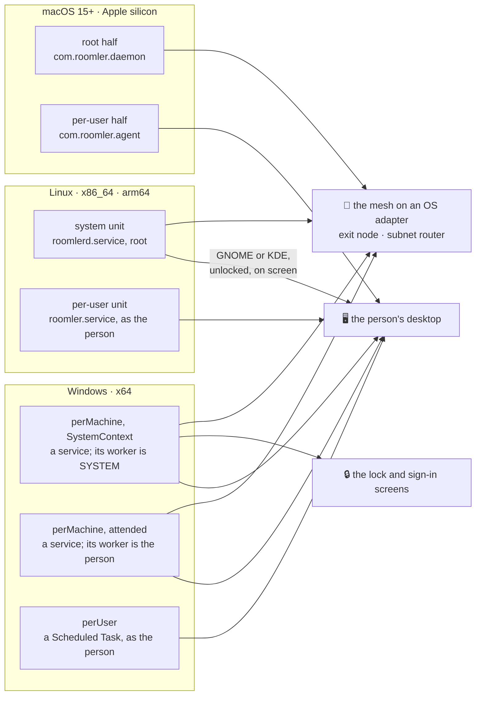
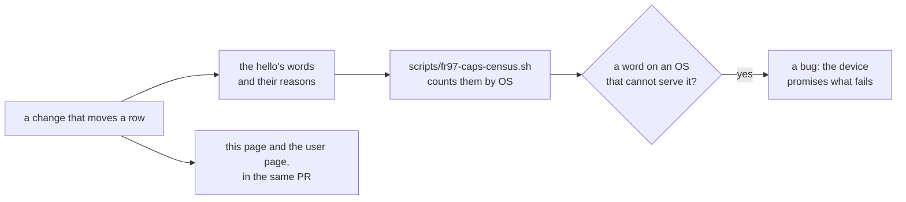

# Platform support — what each OS serves, and why where it does not

> **FR-97** ([#2082](https://github.com/gjovanov/roomler-ai/issues/2082),
> [spec](fr/FR-97-os-feature-parity.md)). This is agent **0.4.170** (2026-10-25); a row that says
> "from 0.4.171" or "since 0.4.171" is on master for the next release. The spec's §2 is the register this page was built from: each
> gap's evidence, its phase and its field run. This page says what is true now. A change that
> moves a row moves it here, in the same PR.
>
> **For users:** the same tables without the anchors, at
> [roomler.ai/docs/reference/platform-support](https://roomler.ai/docs/reference/platform-support/)
> (`ui/docs/content/reference/platform-support.md`).

Roomler is one product on three operating systems. A feature that ships on one ships on the
other two, or the device says why it cannot, in its hello and on screen.

| | Meaning |
|---|---|
| ✅ | served |
| 🟡 | served in part; the cell says which part |
| ❌ | not served yet, although the OS could do it. Where the viewer has a control for it, the device says why (§1) |
| ⛔ | not applicable by OS design. Each one has its reason in §8 |

## 1. The rule: a word in the hello is a promise

A capability word in the hello promises that this device serves the feature, on this OS, now.
What a host cannot keep, the daemon takes out and explains in `AgentCaps.unavailable`, a map
of feature → `{code, reason}` (`crates/remote_control/src/models.rs:541`, its keys at `:564`).
One seam decides it, `with_honest_words` (`agents/roomlerd/src/encode/caps.rs:1452`), over
plain facts about the host, so the decision runs and is tested on every OS. Features with a
channel of their own say no there: capture as `rc:media-unavailable` (FR-80), input as
`rc:input-reach` (FR-93), Remote Apps in its `unavailable` reply (FR-56), and privacy mode as
`device_cannot_curtain` (FR-99).

The viewer shows the reason on the control. It hides a control only for `not-applicable`, a
feature that means nothing on that OS (Ctrl+Alt+Del on a Mac).

⚠️ **Never gate on `agent.os` to cover a missing capability.** A Windows Home host is Windows,
a Mac without its root half is macOS, and a later release closes a gap with no UI release. The
device says what it can do.

⚠️ **Count, don't sample.** `scripts/fr97-caps-census.sh` counts the advertised words and the
`unavailable` codes by OS from the server's own records. An exec sweep reaches only the
devices that are online.

## 2. The map: what each install serves

The OS decides most of this page through one question: who does the daemon run as? Creating a
network adapter and changing routes needs the machine's identity on every OS. Capture and
input need a way into the person's desktop.

- An install that runs as the person cannot create an OS adapter. Netstack mode
  (`ROOMLERD_OVERLAY_NETSTACK_SOCKS`, in every OS's release build) still gives it the mesh,
  outbound, through a loopback SOCKS5 front. Other nodes cannot reach the host's own services
  that way, but Roomler SSH answers, because it terminates inside the daemon
  (`agents/roomlerd/src/overlay.rs:334-340`).
- A Mac needs both halves for both planes: a root process has no WindowServer, and the person
  cannot create a `utun`. Each half is its own enrollment, so such a Mac is two device rows
  until FR-43 P3 (`docs/installation.md`, macOS). With `macos_supervise_gui_worker` on (default
  off), the root half starts a worker in the person's session itself, and stands down while the
  LaunchAgent runs one (`agents/roomlerd/src/macos_supervisor.rs:3-36`).
- On Windows, an attended install's commands and SSH sessions run as the signed-in person until
  an administrator anchors the device to its service (FR-94, `docs/fleet-rpc.md`).

## 3. Remote desktop

| Feature | Windows | Linux | macOS | Why, and where |
|---|---|---|---|---|
| A system install shows the person's desktop, no key set | ✅ | 🟡 a person's Wayland session (FR-95, verified on GNOME and KDE), or an X11 one where GNOME Shell or KDE runs (FR-113); only while it is unlocked and on screen, and its person can be told who is viewing | 🟡 opt-in: `macos_supervise_gui_worker` | Linux X11: a desktop that does not report its lock to logind (XFCE, i3, xscreensaver) is refused with `x11_not_enabled`, or the automatic input would type into its lock screen's password field (`docs/linux-capture.md` §1.2.2). macOS: §2 |
| The lock and sign-in screens, nobody signed in | ✅ SystemContext | 🟡 only with `drm_capture = true`, set by the operator | ⛔ | §8 |
| The computer's sound in a session | ✅ WASAPI loopback | ✅ the default output's monitor, through Pulse's client library, per-user and system installs (FR-97 P3c) | ✅ from 0.4.161 (FR-97 P2a): ScreenCaptureKit's mix of every app, in the person's session (on a supervised Mac the GUI worker, whose offer the root's row carries); before it, no track and `no-backend` | `agents/roomlerd/src/audio/pulse.rs:3-9`; macOS: `agents/roomlerd/src/audio/sck.rs` |
| Recording with sound | ✅ the computer and the microphone | ✅ | ✅ the computer's sound from 0.4.161 (FR-97 P2a). The microphone from 0.4.163 (P2f) where Roomler runs per user, and on a supervised Mac from 0.4.168 (P2f-2); 0.4.166–0.4.167 refuse it there by name (P2f-1b). From 0.4.170 (P2f-3) the first recording that asks waits while macOS's question is up; before it, that recording stopped at its 20 s start deadline. Proven with speech on a supervised MacBook, including an answer given after 44 s (2026-10-25) | macOS records silence from a microphone it never asks about. A supervised Mac's recorder answered to the root daemon, which macOS does not ask the person about (`agents/roomlerd/src/recording/mic_permission.rs`); since P2f-2 it is its own responsible process (`agents/roomlerd/src/macos_spawn.rs`) |
| Ctrl+Alt+Del | ✅ the real sequence from a SystemContext install where the policy lets services; elsewhere three ordinary keys, and it says so | ⛔ keys only | ⛔ hidden | `agents/roomlerd/src/input/sas.rs:3-25`; the words at `agents/roomlerd/src/encode/caps.rs:1521-1533`; §8 |
| The consent panel on the host | ✅ | ✅ X11 · ⛔ Wayland: the companion asks | ✅ from 0.4.153: the native panel (FR-97 P2b), drawn by the root half too on a supervised Mac; the companion stays the fallback | `viewer-indicator-macos` joined the macOS release build (`.github/workflows/release-agent.yml:2733`) after the real-Mac procedure (FR-97 D3): on a tart Mac and on the operator's MacBook the panel came up, and Approve and Deny each answered |
| "Host is locked" hint, in a session and before consent | ✅ | 🟡 in a session: advisory, from logind's `LockedHint`; a Linux lock screen is captured and takes input like any other. Not yet while a request waits for consent | ✅ both since 0.4.150, advisory, from the session dictionary (FR-97 P2d-1); whether the lock screen takes typed input is not measured, so the viewer's chip claims neither way | `agents/roomlerd/src/lock_state.rs:335-349`; macOS: `agents/roomlerd/src/lock_state.rs:301-320`, `:352-366`; `docs/remote-control.md` §5.1d |
| The host's cursor shape, drawn by the viewer | ✅ | ✅ X11, read from XFixes (FR-97 P3a, from 0.4.147), and the DRM arm's hardware cursor (FR-93 P3c) · a per-user Wayland compositor draws it into the picture instead | ❌ WindowServer draws the pointer into the picture | `agents/roomlerd/src/capture/cursor.rs:128-165`, `agents/roomlerd/src/capture/x11_cursor.rs`; `docs/linux-capture.md` §2.1, `docs/wayland.md` §2 |
| Remote Apps | ✅ | ✅ X11 · 🟡 Wayland: the windows Xwayland owns | ✅ from 0.4.159 (FR-97 P2c): the window server's list, focus through the Accessibility API, launch through LaunchServices and Terminal; on a supervised Mac the GUI worker serves it | `agents/roomlerd/src/apps/macos.rs`; the root's hello carries the worker's words (`DelegateHost::effective_apps`); `docs/remote-apps.md` §2b |
| Keyboard layout report and switch | ✅ | ✅ an X11 desktop with a per-user install (FR-97 P3e, from 0.4.148); 🟡 GNOME on Xorg reports its layout and is not switched, because GNOME Shell puts its own input source back · ❌ under Wayland, where the compositor owns the layout and shares no way to read or set it, and on a system install, which has no X connection | ✅ from 0.4.156 (FR-97 P2d-2a): Text Input Sources, called on AppKit's main thread | `agents/roomlerd/src/input/layout_x11.rs:62`, `:79`, `agents/roomlerd/src/encode/caps.rs:1493`; a Mac's `agents/roomlerd/src/input/layout_mac.rs:54`; `docs/remote-control.md` §18.3.2, §18.3.3 |
| Typing text on a non-US layout | ✅ | ✅ through uinput, the host's own XKB keymap (FR-97 P3f, from 0.4.147); without libxkbcommon, a US table, and other layouts refuse rather than mistype | ✅ | `agents/roomlerd/src/input/keylayout/xkb.rs:82`, `agents/roomlerd/src/input/keylayout.rs:23-26`; `docs/linux-capture.md` §3 |
| Match the remote display to the viewer | ✅ | ✅ a person's own X11 display with one active output, a per-user install (FR-97 P3e-2, from 0.4.148), and the daemon's own virtual desktop on Xorg's dummy driver · ❌ Wayland, a system install, several active outputs | ✅ from 0.4.157 (FR-97 P2d-2b): the main display, with one active display, at its scale and refresh rate · ❌ several active displays | `agents/roomlerd/src/display_match.rs:1081-1086`, `:333`, `:351`; `docs/display-match.md` |
| Clipboard: text, HTML, images both ways | ✅ | ✅ per-user · ❌ a system install: no session to reach, said as `no-session` | ✅ | `agents/roomlerd/src/encode/caps.rs:1428-1446`; FR-93 P7 |
| Clipboard: a copied image reaches the viewer by itself | ✅ | ✅ an X11 session with a per-user install, through XFixes' selection events (FR-97 P3e-3a, from 0.4.148) · ❌ Wayland and a system install: on request only, said as `not-watched` | ✅ from 0.4.154, through the pasteboard's change count (FR-97 P2e-1); before it, on request only | image watching rides Windows' clipboard sequence number, on X11 the change gate (`agents/roomlerd/src/clipboard.rs:643`, `:1148`), on a Mac the change count (`agents/roomlerd/src/clipboard.rs:756`); `docs/remote-control.md`, the watcher on X11 and on a Mac |
| Clipboard: RTF with embedded images | ✅ | ❌ | ❌ | `agents/roomlerd/src/encode/caps.rs:2346-2350` |
| An idle desktop costs little CPU | ✅ dirty regions | ✅ X11 damage; Wayland's compositor sends frames on change; the DRM arm skips an unchanged frame | ❌ every frame is a full frame | `Damage::Unknown` (`agents/roomlerd/src/capture/scrap_backend.rs:600`); `docs/wayland.md` |
| The "being viewed" banner kept out of the stream | ✅ | ❌ | ❌ | `CGDisplayStream` ignores `NSWindowSharingNone` (`docs/desktop-companion.md:625`) |
| Privacy mode (the curtain) | ✅ Windows 10 2004 and later | ❌ | ⛔ | `docs/privacy-mode.md`, Platforms; §8 |
| Lock the computer when the last session ends | ✅ | ✅ `loginctl lock-session` | ❌ no mechanism yet: an end that should lock logs that it could not | `docs/privacy-mode.md`, lock on end |

At parity on all three: capture of the primary display, HiDPI, the hardware encoder families
each OS has (VideoToolbox on macOS: H.264 and HEVC), the relative mouse (FR-109), touch
controls (FR-111), keep-busy (FR-92), recording video, file transfer, the macOS permission
flow, and the consent chain's fallbacks.

## 4. Network

| Feature | Windows | Linux | macOS | Why, and where |
|---|---|---|---|---|
| In the mesh on an OS adapter | ✅ perMachine | ✅ system unit | ✅ root half, a second device row (FR-43 P3) | §2 |
| One adapter per organization (multi-org) | ✅ | ✅ | ✅ | `agents/roomlerd/src/overlay.rs:318-324`; `docs/multi-org.md` |
| Exit node, as a client | ✅ | ✅ | ✅ when the uplink has v6, else v6 fail-closed | `docs/overlay-exit-nodes.md`, Platform support |
| Exit node and subnet router, serving IPv4 | 🟡 WinNAT, which needs the Hyper-V feature: without it (always on Home) the offer is withheld, with the reason | ✅ iptables | ✅ pf, in our own anchor; root half only | each OS's probe (`crates/tunnel-core/src/overlay/nat.rs:211`, `:228`, `:257`) |
| Exit node, serving IPv6 | ⛔ v6 fail-closed | ✅ ip6tables | ✅ pf NAT66 to a stable address, where an unscoped v6 default exists | `crates/tunnel-core/src/overlay/nat.rs:451-453`; §8 |
| MagicDNS: names resolve on the host | ✅ NRPT | 🟡 through systemd-resolved; a resolver that nothing asks is reported `steered but BYPASSED` | ✅ an SCDynamicStore resolver per utun | `crates/tunnel-core/src/overlay/dns.rs:485-486`, `:510-511`, `:536-537`; the bypass at `:439`; `docs/magicdns.md` |
| Exit node: DNS goes through the exit | ✅ | 🟡 systemd-resolved only, else `DNS NOT steered` | ✅ | the same steer, with a catch-all domain |
| The host firewall admits the mesh | ✅ the daemon's Defender rule, and WFP | 🟡 firewalld and ufw left to the owner, and reported | ❌ the Application Firewall is left alone | carriers pass a host firewall by conntrack; only services on the overlay address need an allow (D13, `crates/tunnel-core/src/overlay/hostfw.rs:3-8`) |
| LAN-direct egress pin; repair of the LAN's own route | ✅ | ❌ | ❌ | out of scope until a field case asks for it (FR-97 §7); `crates/tunnel-core/src/overlay/lan_repair.rs:3-7` |
| Who holds a busy port | ✅ | ✅ | ✅ `lsof` | `agents/roomlerd/src/tunnel/port_holder.rs:315-329` |

At parity on all three: TUN bring-up; v4 and v6 ULA addressing; route-change subscriptions;
PathMonitor; every carrier (disco, direct, netcheck, relays, DERP, QUIC); org relay serving
(FR-19, primary org only); tunnels, SOCKS5 and declared routes; the in-daemon overlay ACL; key
rotation; ephemeral nodes; the subnet-router client; an exit client's pins following the uplink
and never outliving the daemon (FR-97 P0e).

## 5. SSH and Fleet RPC

| Feature | Windows | Linux | macOS | Why, and where |
|---|---|---|---|---|
| `exec` and SSH `daemon` mode | 🟡 SYSTEM on a SystemContext install, or once anchored (FR-94); the signed-in person on an attended one | ✅ root | ✅ root on the root half's row | `docs/fleet-rpc.md`, Who runs the command |
| `console_user`: the person at the screen | 🟡 where SYSTEM serves the session: SystemContext, or the device's service (FR-105); an attended install refuses it, saying why | ✅ logind's seat0 | ✅ the owner of `/dev/console` | refused while nobody is there (`agents/roomlerd/src/exec.rs:881-885`); Windows: `docs/roomler-ssh.md` |
| `named:<account>` | ⛔ | ✅ | ✅ | §8 |
| SFTP and `scp` as the signed-in person | 🟡 where OpenSSH's `sftp-server` is installed | ✅ | ✅ | `agents/roomlerd/src/ssh.rs:1246-1250` |
| A session starts in the person's home | ✅ | ✅ | ✅ | `agents/roomlerd/src/exec.rs:874` |

## 6. The desktop: companion, power, files, agent sessions

| Feature | Windows | Linux | macOS | Why, and where |
|---|---|---|---|---|
| The desktop companion | ✅ | 🟡 a `.deb` and an `.rpm` for x86_64 and, since 0.4.138, arm64 (FR-93 P6d, P6e); none for a host with neither dpkg nor rpm, such as Arch (FR-97 D17) | ✅ in the `.pkg` | `.github/workflows/release-agent.yml:764-775`, `:863-868`, `:955` |
| Its pages on a system install | ✅ | 🟡 the safety pages; Devices, the mesh and the live links (no endpoints) since 0.4.150 (FR-97 P2g, P2h) | 🟡 a two-half Mac: Devices, the mesh, the Connection column and Overview's network fields from the root half since 0.4.150 (FR-97 P2g, P2h) | `docs/desktop-companion.md` §6, §12 |
| The host stays awake during a session | ✅ `PowerCreateRequest` | ✅ a logind block inhibitor | ✅ `IOPMAssertion`; a closed lid with no external display sleeps anyway (§8) | `agents/roomlerd/src/power.rs:731-744` |
| A received file lands as the signed-in person | ✅ | ✅ the person at seat0's Downloads | ✅ | `agents/roomlerd/src/files.rs:209-227` |
| Hive: adopt a terminal session | ✅ a named pipe | ✅ | ✅ | `agents/roomlerd/src/hive/supervisor/adopt.rs:562` |
| The setup wizard installs the daemon | ✅ | ✅ on production since 2026-10-30 (FR-129 B1) | ✅ on production since 2026-10-30, the root half included (FR-129 B1, B2) | a GUI front end to the embedded `install.sh`, offered where the server advertises that OS on `GET /api/setup/features` (FR-129 B1-s, one switch per OS since B1-s2: `ROOMLER__SETUP__WIZARD_LINUX_DAEMON` and `ROOMLER__SETUP__WIZARD_MACOS_DAEMON`, each default off and flipped once a released wizard is field-proven there; the legacy `ROOMLER__SETUP__WIZARD_UNIX_DAEMON` turns both on, which is how production has them). Without that answer the wizard installs only the tunnel client there, and the enroll dialog, the landing page and the static `/` offer it for the daemon on Windows alone (FR-97 D5), failing closed (`ui/src/utils/enrollCommands.ts:165-170`) |

## 7. Install, update, architectures

| Feature | Windows | Linux | macOS | Why, and where |
|---|---|---|---|---|
| A per-user install updates itself | ✅ | ✅ a root update helper (FR-96) | ✅ | `docs/installation.md` |
| The artifact's own version checked against the manifest | ✅ MSI `ProductVersion` | ✅ the `.deb`'s `Version`, the tarball's top directory | ✅ the `.pkg`'s `PackageInfo` | `agents/roomlerd/src/artifact_version.rs:114` |
| A private staging directory per download | ✅ | ✅ | ✅ measured: the root helper's temp directory is root's own | `agents/roomlerd/src/updater.rs:1156`, `:1180` |
| One verb registers the system service | ✅ | ✅ | ✅ | `service install --as-service` (alias `--system`, `agents/roomlerd/src/service.rs:413-420`) |
| Uninstall | ✅ MSI, `install.ps1 -Uninstall` | ✅ `install.sh --uninstall` | ✅ the same | `docs/installation.md`, Uninstall |
| An ephemeral device removes itself on a clean stop | ✅ | ✅ | ✅ | `docs/ephemeral-nodes.md` |
| A crash in a worker is recorded by its supervisor | ✅ | ⛔ systemd | ✅ from 0.4.149, where the root daemon supervises the GUI worker (`macos_supervise_gui_worker`) | a signal, or an exit the agent did not choose; the record rides the root daemon's enrollment (`agents/roomlerd/src/macos_supervisor.rs:254-278`, FR-97 P6e-2) |
| The daemon survives a log sink it cannot write | ✅ | ✅ | ✅ | #1538 |
| An update's outcome is recorded | 🟡 written, never read | ❌ | ❌ | FR-67 |
| The tunnel client updates itself (`roomler self-update`) | ✅ | ✅ from tunnel-v0.4.149: the tarball, or the `.deb` where dpkg owns the binary (field-verified on its release) | ✅ from tunnel-v0.4.149 (field-verified on its release) | every OS checks the release's `.asc` against the pinned key (`agents/roomler-cli/src/update.rs:227`); FR-97 P6b |
| Processors the daemon runs on | 🟡 x64; ❌ ARM64 | ✅ x86_64 and arm64 | 🟡 Apple silicon; ❌ Intel | `agents/roomlerd/wix-perMachine/main.wxs:87`; `.github/workflows/release-agent.yml:2733`; FR-97 D6 |
| Hardware encoding on Linux arm64 | — | ✅ NVENC, field-verified on 0.4.189 ([FR-122](fr/FR-122-arm64-linux-hardware-cell.md)): on an NVIDIA GB10 the probe opens `h264_nvenc` and `hevc_nvenc` (4:2:0 and 4:4:4) and `av1_nvenc`, a session runs on them, and a recording writes H.264 + AAC. It needs NVIDIA driver 530.41 or newer from 0.4.188 (610 before, FR-122 P0c), and in a container the `video` driver capability. 🟡 VAAPI and Vulkan ship in the same build (FR-97 P7a, from 0.4.170) unproven on arm64; the lab's own arm64 host (an Asahi Mac) has no encoder Linux can drive | — | `.github/workflows/release-agent.yml` (`build-linux-arm64`); `vendor-ffmpeg-windows.yml` (`build-linux-arm64-minimal`) |
| The standalone tunnel client and the wizard on Linux arm64 | — | ✅ from 0.4.149 (FR-97 P7b): the wizard with the agent release, the tunnel client from tunnel-v0.4.149 (its aarch64 `.deb` and tarball run on real arm64, 16 KiB pages included). Before it, x86_64 builds only, and `install.sh --role tunnel` handed an arm64 host the x86_64 CLI; the served script picks the aarch64 build since the 2026-10-21 promote (field-verified on real arm64, FR-97 §8) | — | `.github/workflows/release-tunnel.yml:215`, `.github/workflows/release-setup.yml:255`; the proxy's `linux-aarch64` (`crates/modules/fleet/src/tunnel_release.rs:197`) |

Release feature sets per OS, which decide what ships: Linux x86_64
`.github/workflows/release-agent.yml:552`, Linux arm64 `:1180`, Windows x64 `:1667`, macOS arm64
`:2657`. A feature that compiles but is not in an OS's set does not ship there.

## 8. Every ⛔, and why

| Feature | OS | Why |
|---|---|---|
| Ctrl+Alt+Del | Linux | The desktop owns the chord, and GNOME and KDE bind it to log out, so the button types keys and says so (`agents/roomlerd/src/encode/caps.rs:1527-1530`). Hiding it would take away a key that does something |
| Ctrl+Alt+Del | macOS | The chord has no system meaning on a Mac, so the viewer hides the button (`not-applicable`, `agents/roomlerd/src/encode/caps.rs:1531-1534`) |
| The consent panel on a Wayland desktop | Linux | GNOME and KDE give an ordinary client no `wlr-layer-shell`, so nothing can draw a panel over their desktop. The companion asks instead, over the LocalAPI, by design (FR-27) |
| The lock and sign-in screens | macOS | A capture needs a GUI login session. Reaching the login window takes an agent in the LoginWindow session and an MDM privacy profile: a different product posture, out of scope until a customer asks (FR-97 §7) |
| Privacy mode | macOS | Since macOS 15 no public API keeps a window out of capture: ScreenCaptureKit ignores `NSWindow.sharingType = .none` (`docs/privacy-mode.md`, Platforms) |
| A closed lid keeps sleeping | macOS | Clamshell sleep ignores idle-sleep assertions on a laptop with no external display (`agents/roomlerd/src/power.rs:30-34`) |
| Exit node, serving IPv6 | Windows | WinNAT has no IPv6 API, so a client's v6 through a Windows exit is dropped, never leaked (`crates/tunnel-core/src/overlay/nat.rs:451-456`). Serving it would take a userspace egress (FR-97 D1) |
| `named:<account>` for SSH and `exec` | Windows | Windows has no way to become an arbitrary local account without its credentials (`agents/roomlerd/src/exec.rs:751-752`) |
| A worker's crash recorded by its supervisor | Linux | The daemon is systemd's own service: there is no supervising process of ours, and journald records how it died |
| SystemContext | Linux, macOS | A Windows service can attach a SYSTEM worker to the interactive desktop. macOS has no such API (`agents/roomlerd/src/macos_supervisor.rs:5-10`); a Linux system install reads the scanout instead (DRM) |
| WFP and the Defender rule; Wintun's stable GUID and the stray-adapter sweep | Linux, macOS | Windows-only machinery for Windows-only failures: a GPO-locked firewall, adapters that outlive their process (`docs/overlay-wfp.md`) |
| The companion refreshing itself | Linux, macOS | The companion is in neither MSI, so the Windows daemon keeps it at its own version (`agents/roomlerd/src/companion.rs:6-14`). The `.deb`, the `.rpm` and the `.pkg` own its version elsewhere |
| A probe cache key | macOS | The probe takes about 120 ms and VideoToolbox ships with the OS, so there is no driver identity to key a cache on (`agents/roomlerd/src/encode/hwid.rs:19-21`) |
| `--machine-global`, `set-service-env-var`, `restart-service` | Linux, macOS | Windows verbs whose outcomes Linux and macOS reach through `/etc/roomler`, the unit files and `launchctl` |

Not on any OS, by design: `ssh -R`, which would make the device bind a listening socket, the one
thing Roomler SSH exists to avoid (`docs/roomler-ssh.md`).

## 9. Not platform gaps

Some features are missing on all three alike: multi-monitor switching (the viewer sends `mon: 0`),
touch injection on the host, two-way audio, OS toast notifications, file copy-paste through the
clipboard, minidumps, and SSH agent and X11 forwarding (FR-97 §2.9). Each would be an FR of its
own, not a parity gap.

## 10. Keeping this page true

- A feature that lands on one OS adds its row here with the other two cells filled in, even when
  they say ❌.
- A ⛔ needs its reason in §8. A gap that the OS does not rule out is ❌, however long it stays.
- The user page (`ui/docs/content/reference/platform-support.md`) carries the same verdicts in
  plain words. The two disagreeing is a defect in one of them.
