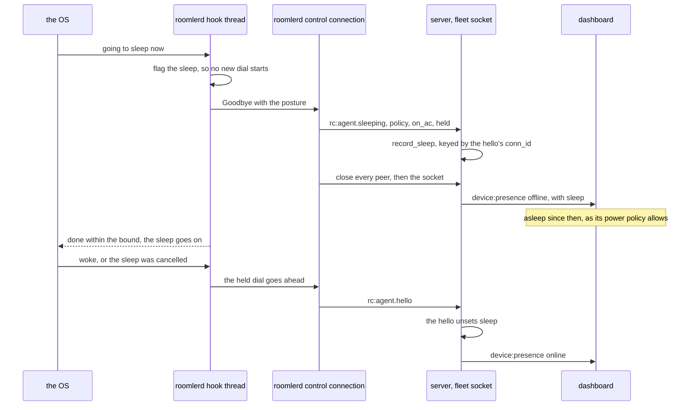

<!-- SPDX-License-Identifier: MPL-2.0 -->
# Power: staying reachable, and saying so when it sleeps

> **FR-55** ([#1154](https://github.com/gjovanov/roomler-ai/issues/1154),
> [spec](fr/FR-55-always-reachable.md)).
>
> **Status.** P1 and P2 shipped in 0.4.45 and 0.4.46. P3 was built under FR-97
> P3b. P4, the report, is built in #3148 and not released yet. ⚠️ P2's AC-power
> arm fails in the field on a Mac: one that dozed off on battery and was then
> plugged in stayed asleep all night with the hold in place (spec field log,
> 2026-09-24).
>
> | Part | What |
> |---|---|
> | P1 | a live remote-desktop or SSH session holds the machine awake, on all three OSes |
> | P2 | the standing `power_policy = never \| on-ac \| always`, default `never`, device-owned (macOS first) |
> | P3 | the same policy on Windows and Linux |
> | P4 | the report: the device says what it holds, and says goodbye before a sleep, so it reads **asleep** instead of **offline** |
> | P5 | Wake on LAN from a mesh peer (open) |

A computer that the OS has put to sleep cannot answer anything. The daemon can
do two things about that. It can ask the OS to stay awake (P1 to P3), and when
the OS sleeps the computer anyway, it can say so first (P4). This page maps
both: what is held, when, by which call on each OS, and what an operator sees.

## 1. What holds the machine awake

One rule decides, and it is pure so that every lane tests it
([`power.rs:105`](../agents/roomlerd/src/power.rs#L105) `should_stay_awake`):

1. **A live session always holds.** A remote-desktop or SSH session must not be
   cut by an idle timer, whatever the policy says.
2. **Otherwise the policy decides.** `never` holds nothing, `always` holds, and
   `on-ac` holds only on mains. A power source the device cannot read counts as
   battery, so `on-ac` never quietly becomes `always`.

The keeper (`PowerKeeper` in `power.rs`) re-reads the world every 5 s and holds
or releases one OS request:

| OS | the request | per-OS notes |
|---|---|---|
| Windows | `PowerCreateRequest` + `PowerSetRequest(PowerRequestSystemRequired)` | not `SetThreadExecutionState`, which is per thread and unreliable from a service |
| Linux | a logind **block** inhibitor | `sleep:idle` for a root daemon, `idle` only for a per-user one ([`remote-control.md` §5.1d](remote-control.md)) |
| macOS | `IOPMAssertionCreateWithName`, `PreventUserIdleSystemSleep` | ⚠️ inert in the transient wakes of a plugged-in dozing Mac (spec, 2026-09-24) |

⚠️ **macOS clamshell sleep ignores every assertion.** A Mac with its lid closed
and no external display sleeps whatever the policy says. That is an OS limit,
and the places where the policy is set say so (§2).

## 2. `power_policy`

| value | holds the machine awake | |
|---|---|---|
| `never` | only for a live session | the default. With it, the daemon takes no new assertion and no new inhibitor (FR-55 AC3) |
| `on-ac` | on mains, or for a live session | what a laptop usually wants |
| `always` | always | |

The policy belongs to the device. A server cannot push it (whether it should is
an open decision in the spec). It is set in two places, and both carry the
clamshell sentence from the key's description
([`config_surface.rs:323`](../crates/agent-core/src/config_surface.rs#L323)):

- **The companion's settings row** (Settings → Essentials), which renders the
  description under the control
  ([`settings.js:350`](../agents/roomler-desktop/src/front/settings.js#L350)).
- **`roomler config set power_policy <value>`**, which on a Mac prints the
  description's ⚠️ sentence after the change
  ([`localclient.rs:1611`](../agents/roomler-cli/src/localclient.rs#L1611)
  `config_set_note`).

A test pins the sentence in the description, so a rewrite that drops it fails
in CI and not on a Mac (`the_power_policy_says_a_closed_lid_still_sleeps_a_mac`).

## 3. Asleep, not offline (P4)

"Offline" used to be one word for crashed, network gone, powered off and asleep,
and each has a different fix. So the device now reports two things:

- **its posture**, on every heartbeat: the policy, the power source, and whether
  anything is held right now;
- **a goodbye**, just before the OS sleeps it: `rc:agent.sleeping`, with the
  posture at that moment.

### 3.1 The posture

`PowerBrief { policy, on_ac?, held }`
([`models.rs:2134`](../crates/remote_control/src/models.rs#L2134)) rides the
heartbeat as an optional `power`
([`signaling.rs:704`](../crates/remote_control/src/signaling.rs#L704)). It is a
claim by the device, shown and never enforced on. The keeper publishes it before
anything connects ([`app.rs:4623`](../agents/roomlerd/src/app.rs#L4623)) and
after every pass, with what it actually holds, not what it wanted
([`power.rs:319`](../agents/roomlerd/src/power.rs#L319)).

- `policy` is a string, so a policy a newer agent knows reaches an older
  dashboard as a word it can print.
- `on_ac` is absent when the device cannot tell. "On battery" and "cannot tell"
  stay two answers.
- `held: false` is what **asleep by policy** means: nothing was holding the
  machine, so the OS slept it as the policy allows
  ([`models.rs:2155`](../crates/remote_control/src/models.rs#L2155)
  `by_policy`). `held: true` means it slept past the hold: a closed lid, a
  person, or the OS overruling it.

### 3.2 The goodbye, per OS

Every hook only listens, takes nothing, and is bounded
([`sleep_notice.rs:392`](../agents/roomlerd/src/sleep_notice.rs#L392)
`will_sleep`). It tells the remote-desktop viewers first (FR-93 P5h), then hands
every live control connection its goodbye
([`sleep_notice.rs:211`](../agents/roomlerd/src/sleep_notice.rs#L211)
`register_control`), and returns within its bound whatever happened.

| OS | the hook | how long the OS waits | our bound |
|---|---|---|---|
| Linux | logind `PrepareForSleep(true)` ([`sleep_notice.rs:569`](../agents/roomlerd/src/sleep_notice.rs#L569)) | while we hold the delay inhibitor (`InhibitDelayMaxSec`, 5 s by default), else not at all | 3.2 s |
| Windows | `PowerRegisterSuspendResumeNotification`, `PBT_APMSUSPEND` ([`sleep_notice.rs:708`](../agents/roomlerd/src/sleep_notice.rs#L708)) | for the callback, about 2 s | 1.5 s |
| macOS | `IORegisterForSystemPower`, `kIOMessageSystemWillSleep` ([`sleep_notice.rs:783`](../agents/roomlerd/src/sleep_notice.rs#L783)) | until `IOAllowPowerChange`, 30 s at most | 1.5 s |

The connection's own arm sends the frame, says it has gone out, closes every
WebRTC peer and tunnel peer, and closes the socket
([`signaling.rs:2029`](../agents/roomlerd/src/signaling.rs#L2029)). Then the run
loop holds every new dial until the wake
([`signaling.rs:1003`](../agents/roomlerd/src/signaling.rs#L1003),
[`sleep_notice.rs:319`](../agents/roomlerd/src/sleep_notice.rs#L319)
`hold_while_asleep`). A dial inside the window the OS gave the computer to go to
sleep would say hello again and erase the reason.

### 3.3 The server

- The fleet socket treats `rc:agent.sleeping` as the goodbye
  ([`socket.rs:729`](../crates/modules/fleet/src/socket.rs#L729)). It records the
  notice first, then leaves its loop, so the ordinary teardown runs at once: the
  hub unregistration, the `Offline` write, and the offline transition. Without
  the goodbye the device would read online until the receive deadline reaped a
  socket nobody answers.
- `AgentDao::record_sleep`
  ([`agent.rs:529`](../crates/services/src/dao/agent.rs#L529)) is keyed by the
  connection's `conn_id`, like `mark_offline_if_conn`: a displaced connection's
  late notice matches nothing, so it can never mark a reconnected device asleep.
- The offline `device:presence` row carries `sleep`
  ([`presence.rs:134`](../crates/modules/fleet/src/presence.rs#L134)). A row
  without one is byte-for-byte the old shape
  ([`presence.rs:190`](../crates/modules/fleet/src/presence.rs#L190)).
- The next hello `$unset`s `sleep`
  ([`agent.rs:517`](../crates/services/src/dao/agent.rs#L517)), and every reader
  goes through `SleepView::of`, which shows a notice only on a device that is not
  online ([`models.rs:2184`](../crates/remote_control/src/models.rs#L2184)). A
  read between the reconnect and that write never shows a stale "asleep".

### 3.4 What each surface shows

| surface | field | reads |
|---|---|---|
| `roomler status` | `power` ([`lib.rs:211`](../crates/localapi/src/lib.rs#L211)) | `policy on-ac, on mains — held awake`, `policy never — held awake for a live session`, or `policy never — free to sleep (a sleep reads "asleep" in the device lists)`. On a Mac a held line adds `; a closed lid still sleeps a Mac with no external display` ([`localclient.rs:2441`](../agents/roomler-cli/src/localclient.rs#L2441)) |
| `roomler devices` | `asleep_since` | `◌ … asleep` instead of `offline` ([`localclient.rs:3112`](../agents/roomler-cli/src/localclient.rs#L3112)) |
| the dashboard's devices grid | `sleep { since, power }` ([`device.rs:119`](../crates/api/src/routes/device.rs#L119)) | an `asleep` chip with `mdi-sleep`; its title says since when, the posture, and how to keep the device reachable ([`devicePresence.ts:90`](../ui/src/utils/devicePresence.ts#L90) `sleepTitle`) |
| the admin agent API | `power`, `sleep` ([`agent.rs:629`](../crates/modules/fleet/src/agent.rs#L629)) | the posture as last reported, and the notice on a device that is not online |
| peers (the agent-facing device list) | `asleep_since` only ([`models.rs:3543`](../crates/remote_control/src/models.rs#L3543)) | the fact and the moment, never the policy: a peer sees the netmap's view, not the fleet record |

The dashboard's words, for a device that announced a sleep:

| posture | the chip's title |
|---|---|
| `held: false`, `never` | Asleep since …, as its power policy allows: nothing was holding it awake. It reconnects by itself when it wakes. To keep it reachable, set power_policy to on-ac or always on the device. |
| `held: false`, `on-ac` on battery | … on-ac holds only on mains: plug it in, or set power_policy to always on the device. |
| `held: true` | Asleep since …, past its hold: a closed lid, a person or the OS put it to sleep anyway. On a Mac, it adds the clamshell sentence. |

An offline row without `sleep` gave no reason and still reads `offline`.

### 3.5 Invariants

- ⚠️ **A notice is a promise, not a fact.** A suspend can still fail or be
  cancelled. The connection closes either way, and the agent reconnects at the
  wake or the cancel. That hello clears the record.
- ⚠️ **No hook blocks on the runtime.** `will_sleep` spawns the work and waits on
  a std channel with a hard bound. A hook that hung would hold a laptop awake in
  a bag.
- ⚠️ **The announcement ends itself after 60 s** (`HOLD_MAX`,
  [`sleep_notice.rs:308`](../agents/roomlerd/src/sleep_notice.rs#L308)), for a
  sleep that never came or a wake the OS never reported. It ends the
  announcement, not just one wait: an announcement that outlived it would hand
  every new connection its goodbye at once. On Linux and macOS the monotonic
  clock stops while the computer sleeps, so 60 s bounds awake time, not the nap.
- ⚠️ **No hook takes an assertion**, so `pmset -g assertions` and
  `powercfg /requests` show nothing new and `never` stays byte-for-byte (AC3).
  The Linux delay inhibitor keeps FR-93 P5h's scope on a `never` device, live
  sessions only, and covers the control connections only under `on-ac` and
  `always` ([`sleep_notice.rs:489`](../agents/roomlerd/src/sleep_notice.rs#L489)
  `inhibitor_wanted`). So a `never` device's goodbye on Linux is best effort,
  sent in whatever time logind leaves (an open decision in the spec).
- ⚠️ **Peers are closed, never dropped.** The goodbye closes every WebRTC peer
  before the socket. A dropped peer keeps its UDP sockets
  (`docs/tunnels.md`).
- **Wire compatibility.** A server that cannot decode `rc:agent.sleeping`
  ignores it and still sees the close that follows. An agent that predates P4
  sends no `power`, which reads as unknown, never as `never`.

### 3.6 Kill switches

| env | turns off |
|---|---|
| `ROOMLERD_SLEEP_ANNOUNCE=0` | the goodbye and the reconnect hold (P4). The Linux inhibitor goes back to sessions only |
| `ROOMLERD_SLEEP_NOTICE=0` | the viewers' notice (FR-93 P5h) |

### 3.7 Tests

| test | proves |
|---|---|
| `power_brief_rides_the_heartbeat_and_is_optional`, `the_sleep_announcement_carries_the_posture_and_belongs_to_fleet` (`remote_control`) | the wire, both ways, and that a pre-P4 heartbeat still parses |
| `an_announced_sleep_rides_the_offline_row_and_nothing_else_changes` (`fleet` `presence`) | the presence row, and the pre-P4 shape without a reason |
| `sleep_notice::tests` (`roomlerd`) | the goodbye registry, the hold, the bound, the inhibitor rule |
| `devices_tests` (`roomler-cli`), `devicePresence.spec.ts` (UI) | what `roomler devices`, `roomler status` and the dashboard print |
| [`sleep_announce_tests.rs:104`](../crates/tests/src/sleep_announce_tests.rs#L104) | the server's half through the real socket: the goodbye ends the connection at once, the agent row, the grid and the presence event carry the reason, the next hello erases it |
| [`sleep_announce_tests.rs:213`](../crates/tests/src/sleep_announce_tests.rs#L213) | only the connection that said hello can mark the device asleep |
| [`sleep_announce_agent.rs:158`](../crates/tests/tests/sleep_announce_agent.rs#L158) | the agent's half: the real signalling loop says goodbye, does not redial during the sleep, comes back at the wake, and then reads plain offline after a stop. Its own test binary, because the announcement is process-wide |

## 4. What this does not cover

- A device that crashes, loses its network or loses power gives no reason, and
  still reads `offline`.
- A `never` device on Linux sends its goodbye on a best-effort basis (§3.5).
- Waking a sleeping device is P5 (Wake on LAN from a mesh peer).
- Whether `power_policy` should be pushable through `DesiredConfig` is open in
  the spec.
