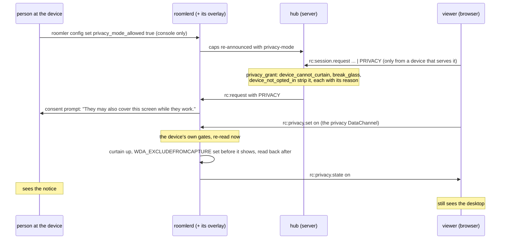
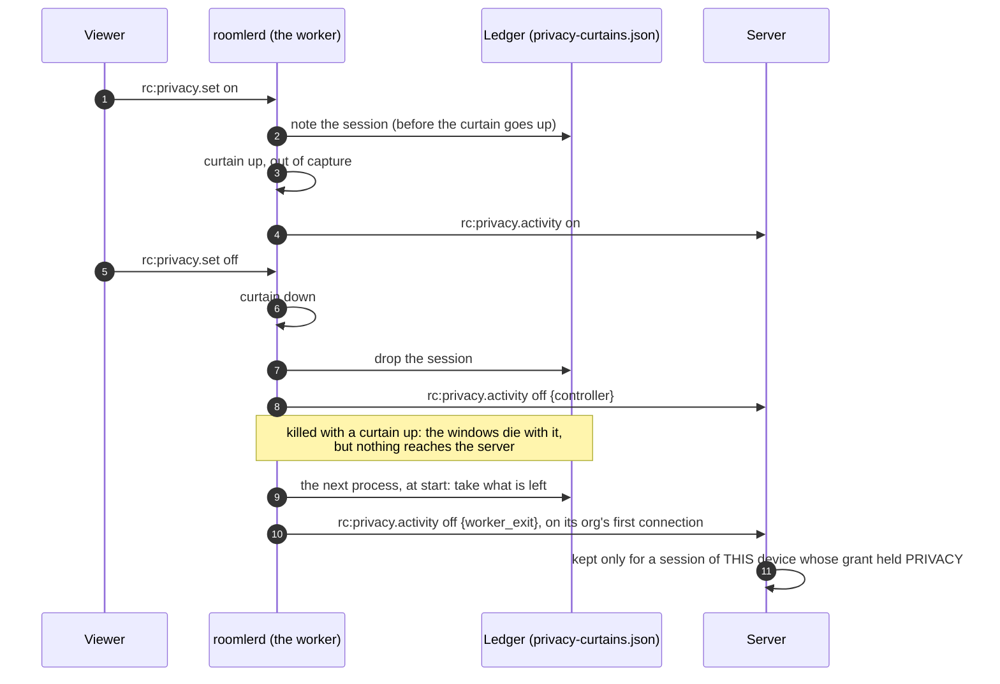

# Privacy mode

> **FR-99** ([#2091](https://github.com/gjovanov/roomler-ai/issues/2091),
> [spec](fr/FR-99-privacy-mode.md)).
>
> **Status: the curtain is released (agent 0.4.136, Windows 10 2004 and later) and
> field-verified end to end** through the production viewer: the host's own screen shows
> the curtain while the stream keeps showing the desktop ([spec §8](fr/FR-99-privacy-mode.md#8-field-verification-log)
> rows 9–10).
>
> | Part | What | State |
> |---|---|---|
> | P1a | the server's gate: the `PRIVACY` bit, the two capability words, the strip with its reason | shipped |
> | P1b | the device: the owner's switch, the curtain, the `privacy` channel, the device's own refusals | shipped (0.4.136) |
> | P1c | the viewer: the toggle, the refusal reasons | shipped |
> | P1d | the device's account: every curtain up, down (and why) and refused, in `privacy_activity`, including the curtain a killed process could not report | merged; the agent half ships in the next agent release |
> | P2 | blocking the person's keyboard and mouse (`BlockInput`, Ctrl+Alt+Del to take the computer back) | not built |
> | P3 | lock the computer when the session ends | not built |
> | P4 | mute the host | not built |

While a privacy-mode session runs, **the person at the computer sees a notice instead of the
desktop**: "This computer is being used remotely, by …". The controller keeps seeing the real
desktop, because the notice is kept out of screen capture. Nothing of it outlives the session.

An admin working on an unattended office PC uses it so as not to show the room what they are doing.

## Turning it on

Two parties have to agree, and the device's owner speaks first.

1. **The device's owner allows it.** `privacy_mode_allowed = true` in the device's config. It is
   off by default, takes effect at once, and is **never pushable**: it is absent from
   `DesiredConfig`, so no server can switch it on. Over the LocalAPI only the person at the
   console may change it, because it is their screen:
   ```
   roomler config set privacy_mode_allowed true
   ```
2. **The controller covers the screen.** On a device that allows it, the viewer's toolbar has an
   eye-off toggle ("Cover the device screen"). The session's consent prompt has already told
   the person "They may also cover this screen while they work."
   ([`privacy.rs:151`](../agents/roomlerd/src/privacy.rs#L151)).



The viewer asks for `PRIVACY` only from a device that advertises `privacy-mode`
([`withPrivacyAsked`, `usePrivacyMode.ts:80`](../ui/src/composables/usePrivacyMode.ts#L80)).
A device that could curtain but whose owner has not allowed it advertises only
`privacy-available`; the viewer then asks for nothing and shows no control.

## Who can say no, and what the viewer says

The server strips `PRIVACY` before the device ever sees it
([`privacy_grant`, `hub.rs:355`](../crates/modules/fleet/src/hub.rs#L355)). The first reason
that applies wins, and it reaches the viewer (`rc:session.created.privacy_refused`) and the
session's `session_requested` audit row (`privacy_stripped`):

| Reason | When | The viewer |
|---|---|---|
| `device_cannot_curtain` | an agent before FR-99, or a platform with no curtain (macOS, Linux) | no control: there is nothing anyone could switch on |
| `break_glass` | the session skipped consent (an ADMINISTRATOR force) | a disabled control with the reason |
| `device_not_opted_in` | the owner has not allowed it | a disabled control with the reason |

The device decides again at every "on", whatever the server sent
([`set`, `privacy.rs:501`](../agents/roomlerd/src/privacy.rs#L501)):

| # | Gate | Refusal |
|---|---|---|
| 1 | the session's grant holds `PRIVACY` | `not_granted` |
| 2 | the owner's `privacy_mode_allowed`, read now: the gate a compromised server cannot pass | `disabled_on_device` |
| 3 | a curtain is possible here | `unavailable` |
| 4 | the overlay put it up, verified out of capture | `no_curtain` |

Turning it off is never refused. The curtain comes down when the controller turns it off, when
the session ends, and when **the owner switches privacy mode off mid-session**. The viewer is
then told unasked ("Privacy mode is off: this device's owner hasn't allowed privacy mode").
Every reason is said in words ([`describePrivacyReason`, `usePrivacyMode.ts:46`](../ui/src/composables/usePrivacyMode.ts#L46)).

## How the curtain works

One window over the whole virtual desktop, drawn by the overlay that already paints the "being
viewed" border and badge ([`set_privacy`, `indicator/win.rs:344`](../agents/roomlerd/src/indicator/win.rs#L344)):

- topmost, click-through and never activated, so the controller's injected clicks reach the
  applications underneath;
- `SetWindowDisplayAffinity(WDA_EXCLUDEFROMCAPTURE)` is set **before** it is shown and read back
  after. A curtain the capture could see would hide the desktop from the controller too, so an
  affinity that does not read back is a refusal (`no_curtain`). Both capture paths see through
  it: SystemContext's DXGI duplication and the attended worker's WGC;
- every half second it retakes the top, then puts the border, the badge and any consent panel
  back above it, so the person's way out and a consent question are never behind it.

## What is recorded

Two records, written by two parties, as for recordings and transfers
([security-baseline.md](security-baseline.md) §4):

| Record | Written by | Says | Where |
|---|---|---|---|
| `session_requested` in `remote_audit` | the server, from its own decision | whether `PRIVACY` was granted, and if not why (`privacy_stripped`) | P1a |
| `privacy_activity` | the device, reporting (FR-99 P1d) | what it then did: each curtain up, each take-down and why, each "on" it refused | `rc:privacy.activity` ([`agent_socket.rs:170`](../crates/modules/remote/src/agent_socket.rs#L170)) |



| `kind` | `reason` | When |
|---|---|---|
| `on` | — | the curtain went up, verified out of capture |
| `off` | `controller` | the viewer turned it off |
| `off` | `session_end` | the session ended (the channel closed, or the overlay dropped the session) |
| `off` | `disabled_on_device` | the owner switched privacy mode off mid-session |
| `off` | `worker_exit` | the process that drew it died with it up, reported by the next one to start ([`collect_leftovers`, `privacy.rs:373`](../agents/roomlerd/src/privacy.rs#L373)) |
| `refused` | `disabled_on_device` · `unavailable` · `no_curtain` | the device's gates 2–4 above |

- **The ledger** is a small file in the worker's own local data dir: SYSTEM's profile for a
  service's worker, the person's for a per-user install. Each curtain is written there *before*
  it goes up, so a process killed in between leaves an entry rather than a curtain with none
  ([`Ledger`, `privacy.rs:265`](../agents/roomlerd/src/privacy.rs#L265)). A leftover is reported on
  the connection of the org its session belonged to, because the server looks the session up within
  that org.
- **The server keeps a report only for a session of that device whose grant held `PRIVACY`**,
  the live session first and the stored row after it ended. That is how a `worker_exit` from the
  next process is checked. A reason that is not a short code (`a-z`, `0-9`, `_`) is dropped and
  the row kept.
- The trail is read at `GET /api/tenant/{tid}/privacy-activity/{agent_id}` under
  `VIEW_REMOTE_AUDIT`, newest first. A removed device's trail still resolves. Rows expire after
  90 days, like the audit beside them.

## Platforms

| Platform | Curtain | Why |
|---|---|---|
| **Windows 10 2004+** (build ≥ 19041) | ✅ | `WDA_EXCLUDEFROMCAPTURE` |
| Windows before 2004 | ❌ | no capture exclusion |
| **macOS** | ❌ | since macOS 15 there is no public API that keeps a window out of capture; `NSWindow.sharingType = .none` is ignored by ScreenCaptureKit |
| Linux X11 | ❌ (later, perhaps DPMS-off) | injected input wakes the display, so it would have to be re-asserted |
| Linux Wayland | ❌ | — |

## Honest limits

- ⚠️ **The curtain hides the screen; it does not stop the person at the keyboard.** It must be
  click-through for the controller's input to land, so the person's own mouse passes through it
  too. Blocking local input is P2 (`BlockInput`, which only the blocking thread can inject past,
  and which Ctrl+Alt+Del lifts). It is not built.
- ⚠️ **The shell draws over every topmost window.** The Start menu, notifications and Alt+Tab's
  thumbnails show above the curtain.
- **The secure desktop carries no curtain.** On the lock screen, a UAC prompt or Ctrl+Alt+Del the
  person sees that screen, which shows no user content, and the session keeps streaming it.
- **The person's way out** today is the badge at the top edge of the screen: "To end the
  session, move the pointer to the top edge of the screen and choose Disconnect." With P2's block
  it becomes Ctrl+Alt+Del (the operator's decision 4).
- The notice is English only for now.
- ⚠️ **`privacy_activity` is the device's claim.** A compromised host can stay silent, so an empty
  trail is not proof that no curtain went up. The `PRIVACY` grant in `remote_audit` is what survives
  it. A report queued as the connection dies is lost, and a `worker_exit` arrives only when the next
  process starts: on a per-user install, at the person's next sign-in.

## Related

- [FR-99 spec](fr/FR-99-privacy-mode.md): the design, P0's `BlockInput` probes, the decisions, the
  field log.
- [remote-control.md](remote-control.md) §11.2: consent, whose prompt carries the privacy line.
- [keep-busy.md](keep-busy.md): FR-92's no-hooks rule, which is why the block will use
  `BlockInput` and never a keyboard hook.
