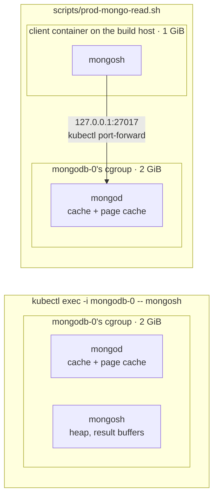
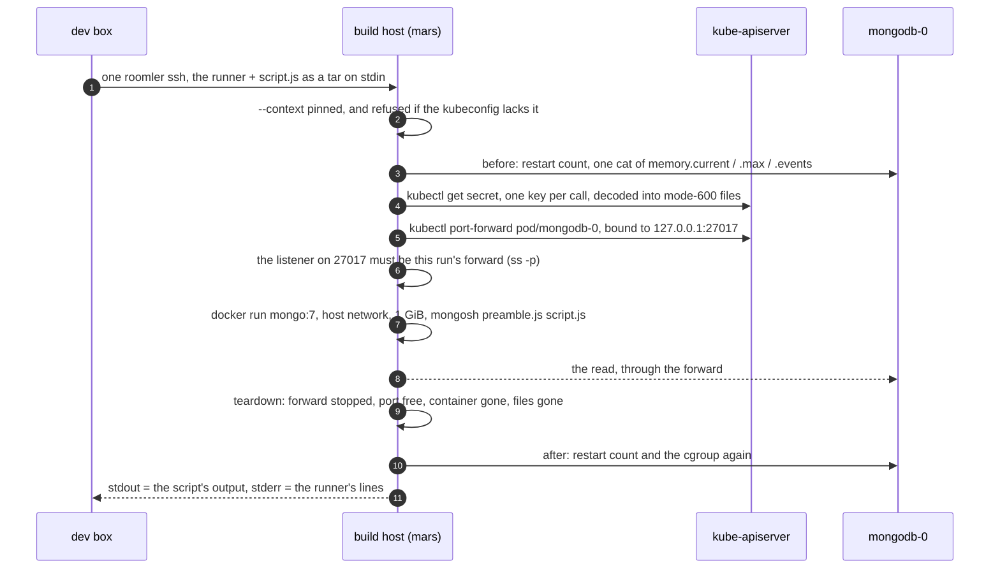

# Reading production Mongo — the client runs outside the database

Production Mongo is one standalone `mongo:7` pod, `mongodb-0` in namespace `roomler-ai`, and
its container may use 2 GiB. Every fleet read in this repository (`agent_logs`, `agents`,
`remote_sessions`) is a `mongosh` run against it. **Where that `mongosh` runs decides whose
memory it spends.** `kubectl exec -i mongodb-0 -- mongosh` starts it inside the database
container, so the client's heap and the database share that one 2 GiB limit. Run that way, an
unbounded read OOM-killed production Mongo on 2026-10-26. On 2026-11-10 two `$text` counts run
the same way took the container to within 2.3 MB of its limit
([#3632](https://github.com/gjovanov/roomler-ai/issues/3632)).

So every read now goes through one runner, which keeps the client in a container of its own on
the build host and reaches the database through a port-forward.

| | |
|---|---|
| The runner | `scripts/prod-mongo-read.sh` |
| From the dev box | `scripts/prod-mongo-read.sh --mars --yes SCRIPT.js` (or `-` for stdin) |
| On the build host | `scripts/prod-mongo-read.sh --kubectl --yes SCRIPT.js` |
| The path | `kubectl port-forward pod/mongodb-0 27017:27017 --address 127.0.0.1` |
| The client | a throwaway `mongo:7` container on the host network, its own 1 GiB limit |
| Refused | without `--yes` · while anything listens on port 27017 · on a host whose kubeconfig lacks the production context |
| Exit | 0 (or the script's own code) · 2 refused · 3 `mongodb-0` restarted or was OOM-killed · 5 teardown incomplete |

This page covers why the client must not run inside the database, how the runner works, what a
script sees, why this method won over a client pod, what it does not fix (the server's own
memory), every reader that uses it, and the production run that validated it.

## 1. Why the client must not run inside `mongodb-0`

A container's memory limit is one cgroup. Everything that runs in the container counts against
it, including a shell that `kubectl exec` started. mongod's own cache and mongosh's heap then
compete for the same 2 GiB. When the total cannot be reclaimed, the kernel's OOM killer acts
inside that cgroup, and on 2026-10-26 it took mongod (the container exited 137).



The two incidents differ, and the difference matters for what this change fixes:

| Date | What ran inside the container | What filled the cgroup | Outcome |
|---|---|---|---|
| 2026-10-26 | a version histogram written as `find({deleted_at: null}).toArray()` over every `tunnel` collection that carried a version field, which included the per-flow audit log | **the client's heap**: every document held in mongosh at once | mongod OOM-killed (exit 137), about 80 s with no database. Every database-backed request failed while `/health` stayed 200. It recovered on its own, and no data was lost |
| 2026-11-10 | two `countDocuments({$text: {$search: '"…"'}})` phrase counts over `agent_logs` | mostly **the server's page cache**: a phrase of common words pulled most of the collection through it | `memory.current` reached 2,145,165,312 of 2,147,483,648 (99.9 %). Nothing was killed, and it fell back within seconds |

Moving the client out removes the first kind entirely: a runaway client now meets its own 1 GiB
limit, in a cgroup where mongod is not. It does nothing for the second kind,
which §5 covers.

⚠️ `kubectl top pod` read the same figure before and after the 2026-11-10 spike and never
showed it. The container's own `/sys/fs/cgroup/memory.current` and `memory.events` did, which
is why the runner reads those (§2).

## 2. How the runner works



| Step | What it does | Where |
|---|---|---|
| The context | Every `kubectl` carries `--context`: `$ROOMLER_KUBE_CONTEXT`, else the production cluster's context on mars. The context's existence is checked against the local kubeconfig before any call reaches a cluster | `scripts/prod-mongo-read.sh:110-121` |
| `--mars` | Packs the runner and the script into one tar and runs `--kubectl` on mars over a single `roomler ssh`. A device limits SSH requests per caller, so one call is better than several | `:160-179` |
| Before | The restart count, then `memory.current`, `memory.max` and `memory.events` in one `cat` inside `mongodb-0`. That exec reads three files and starts no client | `:186-205` |
| The port | Refused when anything already listens on 27017, because every read connects to `127.0.0.1:27017` | `:206` |
| Credentials | `kubectl get secret mongodb-secret` with a `go-template` per key. Only the key's NAME is an argument, and the value flows from the pipe into a mode-600 file in a mode-700 directory | `:240-247` |
| The preamble | Opens `db` on the app database through the forward, `directConnection=true`, `authSource=admin` | `:249-255` |
| The forward | The `kubectl` binary itself, backgrounded, so `$!` is the forward's own pid. Up when its log says `Forwarding from 127.0.0.1:27017`. The listener on the port must carry that pid | `:257-271` |
| The client | `docker run --rm --network host --memory 1g --memory-swap 1g --pids-limit 256`, the two directories mounted read-only. The container's shell reads the credential files into its own environment, so `docker inspect` does not show them | `:273-284` |
| Teardown | Once, on every exit, including an interrupted run: removes the container, stops the forward, deletes the files, and prints proof of each. An incomplete teardown exits 5 | `:217-237` |
| After | The restart count and the cgroup again. A restart or a new `oom_kill` exits 3, and the run's output counts as harm, not data | `:286-296` |

⚠️ **The cluster is named, never inherited.** A run on a machine whose current context is some
other cluster must not reach that cluster, not even to fetch credentials for it. On a host
whose kubeconfig has no production context, every entry point is refused after one local
`kubectl config get-contexts -o name`. The other readers pin their own `kubectl` calls from
`prod-mongo-read.sh --print-context` (`scripts/fr97-caps-census.sh:28`,
`scripts/fr138-roll-read.sh:172`).

## 3. What a script sees

The same as inside `mongodb-0`, so a read written for that runs unchanged:

| | Inside `mongodb-0` (before) | Through the runner |
|---|---|---|
| `process.env.MONGO_INITDB_ROOT_USERNAME` / `_PASSWORD` / `MONGO_INITDB_DATABASE` | the pod's `envFrom: mongodb-secret` | the same secret, read into the client container's environment |
| The server | `127.0.0.1:27017`, mongod itself | `127.0.0.1:27017`, the forward |
| `db` | none (`--nodb`): the script connects itself | already open on `roomler2` (`--db NAME` for another), and a script that connects itself still can |
| How mongosh takes the script | on stdin, as a REPL, line by line (the by-hand recipes), or as a file copied into the pod (the census, the shadow report) | always as a FILE (`mongosh --nodb --quiet preamble.js script.js`) |
| A setting such as `FR65_SINCE` | `env NAME=VALUE mongosh …` inside the exec | `--env NAME=VALUE` on the runner. `MONGO_*` and `PMR_*` are refused, and a value is a docker argument on mars, so never a secret |

Reading the script as a file removes a trap of the stdin recipe. mongosh fed on stdin evaluates
line by line, so a line that parses on its own runs on its own. A `.replace(…)` or `.limit()`
on the next line is then read as a REPL keyword and silently dropped, and once that left a
masking function as the identity, so raw ids reached a transcript. A file is parsed whole.

## 4. Why a port-forward, and not a client pod

| | Port-forward + a client container on the build host | A short-lived client pod in `roomler-ai` | `kubectl exec` into `mongodb-0` (retired) |
|---|---|---|---|
| Client memory counts against mongod | no | no | **yes** |
| The scripts change | not at all: they already connect to `127.0.0.1:27017` with `MONGO_INITDB_ROOT_*` | every connect line moves to the service's name | — |
| Created in the cluster | nothing | a pod, an image pull on whichever node it lands on, perhaps beside the database | nothing |
| Where the credentials go | through the build host: files mode 600 in a mode-700 directory, mounted read-only, deleted on every exit | stay in the cluster (`valueFrom: secretKeyRef`) | stay in the pod |
| Topology | `mongodb-0` is a standalone (no replica set), so a direct connection through the forward needs no discovery | the service | — |
| Cleanup to prove | forward, port, container, files: the runner proves all four | the pod | — |

The port-forward wins because the scripts run byte-for-byte as they did, and nothing is
scheduled into the cluster. Its cost is the credentials passing through the build host. They
never reach an argument list, a log or the output (§7 checked each), and they are deleted on
every exit. Either method leaves the StatefulSet, the secret and the service untouched.

## 5. The server still pays: bound every query

The runner moves the CLIENT out. The query itself, its index scan, any sort, and every page it
touches still run in mongod, inside the 2 GiB. That is the 2026-11-10 kind, and only the query
can prevent it:

- **Size a collection first.** `db.<coll>.estimatedDocumentCount()` reads metadata and scans
  nothing. `agent_logs` held 354,193 batches on 2026-11-10.
- **Start with an indexed `$match`** (`created_at`, `tenant_id`, `pairing_id`, …), then `$limit`,
  `maxTimeMS` and `allowDiskUse: false`. Fold on the server (`$group`, `$count`) and project only
  the fields you need. Never `find().toArray()` on a collection you have not sized, and never
  generalise a read over "every collection with field X": an audit log carries the same field
  names as a small collection.
- **A `$text` phrase costs as much as its commonest word.** The index scan is an OR over the
  phrase's words, and the phrase filter then runs on every document fetched. So common words
  ("session", "request", "media") pull most of `agent_logs` through the cache. Prefer an indexed
  `$match` on `created_at` and a `$filter` on `lines.msg`, as the census and the shadow report
  do (`docs/rate-control.md`).
- **A `$limit` on a sorted per-agent read can cut the window without telling you.** Slice by day
  and `countDocuments` each slice first, so a truncated day shows.

## 6. Who uses it

| Reader | What it reads | How it runs |
|---|---|---|
| `scripts/rtp-reach-read.cjs` | how far the RTP path reaches (`docs/encoders.md`, "Reading RTP's reach") | `scripts/prod-mongo-read.sh --mars --yes scripts/rtp-reach-read.cjs \| grep -o 'OUT .*'` |
| `scripts/resource-watch-read.cjs` | FR-134's hourly handle lines (`docs/resource-watch.md` §3) | the same, with `scripts/resource-watch-read.cjs` |
| `scripts/fr65-stall-census.sh` + `.cjs` | FR-65's stall census (`docs/stall-watch.md` §7) | `--mars --yes` ships the census and the runner in one `roomler ssh`. `--kubectl` hands the census to the runner (`scripts/fr65-stall-census.sh:93`) |
| `scripts/rc-shadow-report.sh` + `.cjs` | FR-63's shadow report and its verdict: the flip criterion's agreement, and FR-148's under-drive clause (per class, spent ≤ 1.25 × shadow in ≥ 90 % of the clean windows at the class's gate, 2 Mbit/s direct and 0.5 Mbit/s constrained, over ≥ 20 sessions), whose thresholds were published on 2026-11-02, before the seven-day read (`docs/rate-control.md`) | the same shape (`scripts/rc-shadow-report.sh:142`) |
| `scripts/fr97-caps-census.sh` | FR-97's capability words by OS | on mars. The aggregation goes to the runner on stdin with `--db` (`scripts/fr97-caps-census.sh:78`). It no longer reads the app's database URL, which holds the password, from `roomler2` |
| `scripts/fr138-roll-read.sh` | FR-138's roll read | the same (`scripts/fr138-roll-read.sh:539`). `--mars` ships itself and the runner in one `roomler ssh` |
| `scripts/rc-path-report.sh` + `.cjs` | FR-148's path report: what a session opened at beside what its pair had carried (§8). With `--timeline`, `scripts/rc-path-timeline.cjs`: one device's window, line by line (§8a) | the same shape (`scripts/rc-path-report.sh:217`). `--mars` ships both files and the runner in one `roomler ssh` |
| By hand | the growth-observability field check, the `rc.connect` mining in `docs/remote-control.md`, the pairing audit in `docs/device-pairing.md` | `scripts/prod-mongo-read.sh --mars --yes - <<'JS'` … `JS`, with `db` already open |

```bash
# A by-hand read: size first, then a bounded, indexed query. `db` is open on roomler2.
scripts/prod-mongo-read.sh --mars --yes - <<'JS'
print('OUT agent_logs ~' + db.agent_logs.estimatedDocumentCount());
db.agent_logs.aggregate([
  { $match: { created_at: { $gte: new Date(Date.now() - 3600 * 1000) } } },
  { $limit: 5 }, { $project: { _id: 0, source: 1, n: { $size: '$lines' } } },
], { maxTimeMS: 30000, allowDiskUse: false }).forEach(r => print('OUT ' + JSON.stringify(r)));
JS
```

**What still runs inside a Mongo container, and why it stays:** `scripts/migrate-tier-policy.sh`
and `scripts/migrate-tier-policy-recover.sh`. They are a one-shot storage migration from
2026-05, and their only in-container call is a `mongorestore` into another namespace's
database. That is a write by a restore tool, run during a planned migration, not a read of
production, so it keeps its own recipe.

## 7. Validated on production, 2026-11-10

One read-only run through `--mars`, 12:27:33Z–12:28:03Z: `estimatedDocumentCount()` on
`agent_logs` and one `$match` on the last hour with `$limit` 5. Nothing else.

| Measure | Before | During | After |
|---|---|---|---|
| Result | | | `agent_logs` ~354,193 · 5 rows (7 lines) · mongosh 2.8.1 against server 7.0.30, `db` = `roomler2`, no replica set |
| `mongodb-0` `memory.current` | 1,592,307,712 (74.1 % of 2,147,483,648) | 1,592,479,744 | 1,592,475,648 (**+168 KB**) |
| `mongodb-0` restarts | 1 | | 1 |
| `memory.events` `max` / `oom` / `oom_kill` | 0 / 0 / 0 | 0 / 0 / 0 | 0 / 0 / 0 |
| The client container | | 180.3 MiB of its own 1 GiB | gone |
| The password in an argument list | | 0 of 394 processes | |
| … in `docker inspect`, the forward's log, the output | | 0 · 0 | 0 of 18 output lines |
| Teardown | | | forward stopped and port 27017 free, container gone, credential files gone: all yes |

The client held 180 MiB while the database's container grew by 168 KB. Run the old way, those
180 MiB would have counted against mongod's own limit. A positive control kept the zeros
honest: the same password grep matched the run's own credential file once.

## 8. FR-148's path report

`scripts/rc-path-report.sh` + `.cjs` read the agents' own lines in `agent_logs` and print, per
remote-desktop session, what it opened at beside what its pair had already carried, and the
plan's target beside the encoder's applied rate. Per pair, they print the trail of writes to
the rate memory, each marked inferred. They also print what the path carried while bytes waited
to be sent (the `path delivery` lines, #3968), when a session changed path, whether its picture
ever left the slow-link profile, and whether the entry it opened with was measured and was the
pair's (the P1 line, #3969). Three flags count the failures FR-148 fixes. It is P0's
first instrument, and AC1 reads the two reference chains through it
(`docs/fr/FR-148-path-measured-plan-follows.md` §2). What each column means, and what the lines
cannot tell, is in the script's header. This section is the read's contract with production.

| Bound | What it is | Where |
|---|---|---|
| Window | at most 8 days, read as one query per day | `scripts/rc-path-report.cjs:2086` |
| Index | pinned with `hint`: `created_at_1` for the fleet and for `--agent` alone, `tenant_id_1_agent_id_1_created_at_-1` for one agent of one `--tenant`, `tenant_id_1_source_1_created_at_-1` for any other `--tenant` read. Each returns the batches in `created_at` order, so the `$sort` is no blocking SORT stage | `scripts/rc-path-report.cjs:2116` |
| Time | `maxTimeMS` 240,000 per query | `scripts/rc-path-report.cjs:2121` |
| Memory | `allowDiskUse: false`. After the `$match`, only streaming stages: a `$project` whose `$filter` keeps the lines of the twelve messages read, `$unwind`, and a `$project` of 40 named fields | `scripts/rc-path-report.cjs:2009` |
| Cost | every batch in the window is examined once. `agent_logs` held 354,193 batches over its 7 days on 2026-11-10 (§7), so a 7-day run examines about 350,000 documents, about 50,000 per daily query, through the index | — |
| What leaves | the matching lines' named fields only. The memory key leaves as its carrier half and the controlling user as the last 6 hex of its id: no address, no host name, no person's name. The P1 line's key leaves the same way | `scripts/rc-path-report.cjs:2013` |

The runner prints `mongodb-0`'s restart count and memory before and after the read, and a
restart fails the run (exit 3), as for every reader in §6.

The two lines added on 2026-11-17 change nothing the read examines: the `$match` is the same.
What leaves grows by one `path delivery` line per pump per 10 s, about a fifth more lines than
an FFmpeg session's heartbeats and a tenth more than a VP9-444 session's, and by at most one P1
line per pump start. Agents built before #3968 and #3969 write neither, and their sessions read
`–` in the new columns.

The fields added for FR-148 P0's standing queue change nothing the read examines either: the
`$match` and the message filter are the same, and the `$project` names three more fields,
`queued` and `standing_ms` from the `path delivery` line and `relay_transport` from the carrier
line. Each is a count, a pair of milliseconds or a word, never an address. An agent built before
them writes none, and its sessions read `standing queue: –, relay no line`.

| Term | Rule | Constant |
|---|---|---|
| Pair | the agent, the controlling user and the carrier class. The viewer's device and network are not read, because the lines carry them only as addresses (FR-148 §9 O1) | — |
| Demonstrated rate | for every run of K consecutive heartbeat windows of one pump, all with a delivered rate and all clean, the run's lowest rate; the pair's is the highest of those in the window. A lower bound on what the path carries, never its capacity | `DEMO_K`: K = 15 FFmpeg heartbeats (about 2 s each) or 30 VP9-444 ones (about 1 s), a run of about 30 s |
| Clean window | the viewer reported an age, and it sat less than 70 ms over its floor | `AGE_SLACK_MS`, which the self-test checks against `encode/ratectl.rs` |
| F1 | the opening (the first heartbeat's `target_bps`) is below 0.5 × the pair's demonstrated rate in the window. AC6's line, 0.85 ×, is counted beside it, against the window and against what the pair had shown before the session opened | `F1_RATIO`, `AC6_RATIO` |
| F2 | the target's max is at least 1.5 × its min, the session lasted at least 5 min, and the encoder's applied rate (`maxrate_bps`, and the rate-apply counters) moved 0 times | `F2_SPREAD`, `F2_MIN_SESSION_MS` |
| Backlogged max | the highest backlogged rate among the pair's `path delivery` lines in the window: a rate the path carried while the sender had more to send, a floor like the demonstrated rate and never a capacity. F1's table counts the openings against it in a row of its own, which is not F1's verdict | — |
| Change of path | the pump's relay flag turns, or a carrier line or an ICE line repeats with another value, dated from the opening at the first heartbeat on the new side. A session keeps the class of its last carrier line, so its delivery lines and demonstrated runs count only on that side, and a line whose 10 s straddle a turn counts nowhere. A VP9-444 pump has no flag, so its lines and runs are never split by side | `MAX_CHANGES`: 8 kept per session, the rest counted |
| F3 | judged on a session that opened with the slow-link profile, had a size and frame rate at its opening, and lasted at least 5 min. Raised when its plan stood above 1,000,000 bit/s for at least 60 s in a row (an open at or below that engages the profile) and no heartbeat's picture was both larger and faster than the opening: AC14 asks for both back | `SLOW_LINK_PROFILE_BPS`, checked against `rate_profile.rs`; `F3_MIN_SESSION_MS`, `F3_RUN_MS` |
| At nominal after | for a session that opened on a relay below 3,000,000 bit/s (`relay_max_bps`'s default), the first heartbeat on the relay whose target reached it, or "left the relay first" | `RELAY_NOMINAL_BPS`, checked against `encode/mod.rs` |
| Entry at the open | the entry the open was seeded with. A P1 line goes to the same agent's earliest pump start in the 5 s after it. "Opened without the pair's entry" is an FFmpeg pump that started on a relay with no entry, although the pair's last write with evidence before it, at most 7 days old, left one. It is inferred, as the trail is: the key may have differed, no key may have formed, or the daemon may have run under another user's data directory | `OPEN_LAG_MS`; `MEMORY_TTL_MS`, checked against `rate_memory.rs` with its `<=` |
| Standing queue (the session row) | `standing queue: queued <q> of <n> samples, standing <p50>/<max> ms, relay <transport>`. Over every `path delivery` line of the session that carries `queued`, whatever its side, since a queue is the path's and not the pump's flag's: q is the sum of `queued`, n the sum of the line's samples (`delivery_samples`), and p50 and max are over each line's highest standing (`standing_ms`). A sample is queued when it acknowledged enough bytes to count and its least acknowledgement delay stood 250 ms or more over the session's least ([rate-control.md § The standing queue](rate-control.md#the-standing-queue-what-a-tcp-carrier-holds)). A session with no such line reads `–`, and a line none of whose samples counted gives no standing | — |
| Relay transport | the last carrier line's `relay_transport`: what carries the agent's own TURN allocation, `udp`, `tcp` or `tls`; `none` when the agent's candidate is no relay, though the browser's may be; `unknown` when the agent could not say, and for a word this build does not know. A session whose carrier line lacks the field, or that has none, is `no line` | `RELAY_TRANSPORTS` |
| Devices: the relay transport and the standing queue | per agent, its sessions by relay transport (udp, tcp, tls, none, unknown, no line), and by carrier class the sessions with a standing queue (at least 3 queued samples) of those whose lines carried the fields. One queued sample is no standing queue | `SQ_SESSION_MIN` |

**Rehearsed, not run on production.** On 2026-11-16 the self-test's invented sessions (both
reference chains and a healthy session) went into a throwaway `mongo:7` as 254 batches. The
mongosh read, the Node read of its own `--rows` output and the Node read of the fixtures agreed
exactly, in Markdown and in JSON, and both flags read RAISED. `--explain` read an index scan
with no SORT stage for all six combinations of `--tenant` and `--agent`. The rehearsal found
two faults, fixed before the first push. A heartbeat batch that reached the read after a later
one was counted as a new pump, and is now a replay. `--docker` with no other option handed
`docker exec` an empty argument as its container name.

**Rehearsed again on 2026-11-17, not run on production.** The self-test's fixtures, now with
`path delivery` lines, a change of path, the slow-link profile and a P1 line, went into a
throwaway `mongo:7` as 650 batches. The mongosh read (2,047 lines in 8 daily queries), the Node
read of its own `--rows` output and the Node read of the fixtures agreed exactly, in Markdown and
in JSON, and F1, F2 and F3 read RAISED. `--explain` read an index scan with no SORT stage for all
six combinations of `--tenant` and `--agent`. The functions that build and run the query
(`pipelineFor`, `runMongosh`, `connectDb`, `rowOut`) did not change; only the named fields and
the message filter grew. The container needs `MONGO_INITDB_ROOT_USERNAME` and `_PASSWORD` at its
start: without them the seed loads, and the read stops at "No connected database".

```bash
node scripts/rc-path-report.cjs --self-test                     # 179 cases: both chains, the rule's and the flags' edges, the path's lines, the standing queue and the relay transport, privacy, the seed
node scripts/rc-path-report.cjs --fixtures > seed.ejson          # the self-test's fixtures as agent_logs batches
bash scripts/rc-path-report.sh --docker NAME --seed seed.ejson   # the rehearsal, against a mongo:7 you started with MONGO_INITDB_ROOT_* (an --env-file)
bash scripts/rc-path-report.sh --mars --yes --label HEX=CORPLAP-1 --label HEX=CORPLAP-2   # the fleet read: the last 7 days
bash scripts/rc-path-report.sh --mars --yes --rows > rows.ndjson; node scripts/rc-path-report.cjs rows.ndjson   # the same, re-read offline
```

⚠️ `agent_logs` deletes a batch 7 days after it arrives. Read a chain before its first batches
turn 7 days old.

### 8a. One device's window, line by line (`--timeline`)

The report above folds the fleet into one row per session. `--timeline` reads the other way:
one agent of one org over a window of at most 24 h, with every FR-148 line in time order, so a
target move, a pipe state, a stall and the path memory's close can be read in sequence
(`scripts/rc-path-timeline.cjs`). It gives field evidence for AC3, AC6 to AC8, AC13, AC22, AC23,
O10 and O11, and judges none of them. Message texts and field names come from the call sites below, and
the self-test checks each message's text against the agent's source.

```bash
node scripts/rc-path-timeline.cjs --self-test     # 197 cases: every line kind, the counters, the relay transport and the standing queue, why the target moved (every cause, its words read from the agent's source; a heartbeat's count; an older agent's lines with neither), both generations of the memory lines, masking (in --rows too, and one last 4 hex taken twice), TRUNCATED, the query's shape, a field added in one place, the window's forms, the wrapper's refusals
bash scripts/rc-path-report.sh --timeline --mars --yes --tenant HEX --agent HEX \
     --from 2026-11-18T07:00:00Z --to 2026-11-18T18:15:00Z         # one device, one window
bash scripts/rc-path-report.sh --timeline --mars --yes --tenant HEX --agent HEX \
     --from ISO --to ISO --rows > rows.ndjson
node scripts/rc-path-timeline.cjs --intervals rows.ndjson          # the same rows offline, every heartbeat interval
bash scripts/rc-path-report.sh --timeline --docker NAME --seed seed.ejson --tenant HEX --agent HEX --from ISO --to ISO   # a rehearsal on §8's seed
```

| Section | Lines read | What it prints | Serves |
|---|---|---|---|
| Carrier | `session carrier recorded (FR-102 P9c)` (`agents/roomlerd/src/session_carrier.rs:474`), `per-session ICE path detected` (`agents/roomlerd/src/carrier_rank.rs:282`), `rc ICE: overlay …` (`agents/roomlerd/src/peer.rs:513`), `rc ICE: carrier rank (FR-148 P4)` and its 10 s line (`agents/roomlerd/src/rc_overlay.rs:359`, `:752`) | each line at its time, the carrier line with its `relay_transport`: what carries the agent's own TURN allocation (FR-148 P0); when the carrier was recorded, counted from the session's first line | AC22, AC23, O11 |
| Encoder | `ffmpeg encoder opened (…)` (`agents/roomlerd/src/encode/ffmpeg/encoder.rs:1702`), `FR-148: the QSV encoder opened at QVBR…` (`:3588`), `ffmpeg open_as_with rejected the quality options…` (`:2025`) | every open with its size, frame rate and cap, a later open as `REOPEN`, the QVBR open's rate and cap, each rejected option set | AC13 |
| Rate | `FFmpeg DC pump heartbeat` and `VP9-444 DC pump heartbeat` (`agents/roomlerd/src/peer.rs:10359`, `:5394`) | the sent bit rate and frame rate from the cumulative `bytes_written` and `frames_sent`, per minute (each interval with `--intervals`). A counter that drops is a new pump or a reopen, and the interval across it is not rated. Every change of `pipe_state`, `readings_refuted` or `link_unoffered` is its own row, with `pipe_measured` | AC6, AC8 (the opening), AC22 (transit-stalled windows) |
| Target | `VP9-444 set_bitrate (AIMD)` and `VP9-444 AIMD decrease (DC buffer over high watermark)` (`agents/roomlerd/src/peer.rs:5024`, `:5206`), `FFmpeg DC pump set_bitrate (AIMD)` (`:9578`), the two lines where a held FFmpeg target goes to the encoder once the scene is quiet, `FFmpeg DC pump: deferred bitrate scheduled (background rebuild)` and `FFmpeg DC pump: deferred bitrate applied at quiet` (`:9618`, `:9631`), and each heartbeat's `target_moves` (`:5339`, `:10169`) | each move a target line hands out as its own row, `a -> b bps why=…`, with `why` as the line carries it ([Why the target moved](rate-control.md#why-the-target-moved-fr-148-p0--every-move-of-the-live-target-says-why)) and the FFmpeg line's `deferred`. A line from an agent before 0.4.230 carries no `why` and prints "(reason: not logged)". A change a heartbeat shows with no target line is its own row, with that heartbeat's `target_moves`; a held target landing prints as `held b bps …` with its `why`, and is no new move | FR-148 P0's move causes (#4161) |
| Delivery | `path delivery (FR-148 P0, shadow, ≈10s)` and `path model (…)` (`agents/roomlerd/src/media_delivery.rs:88`, `:1306`) | each window with stalled time as a row, and each window with a queued sample as a `queue` row with its `queued`, `standing_ms`, `inflight`, `cwnd` and `rwnd_low`; the windows, the stalled ones, their share and the longest stall; the windows with a queued sample, the windows that carry the standing queue's fields, and the highest standing; `viewer_rx_bps` with its basis and age and `model_capacity_bps` with its basis, as a row where a basis changes | AC3, AC22, O11 |
| Open path | `path open (FR-148 P0, O10)` (`agents/roomlerd/src/media_delivery.rs:1381`), once a pump at its first media write (`agents/roomlerd/src/peer.rs:5243`, `:9915`) | each line at its time with every field it carries; the session's first one in its summary, and the device's sessions counted by `open_path` | O10 |
| Path memory | `FR-148 P1 path memory: the pair's entry at the open` and `…: what the close wrote` (`agents/roomlerd/src/media_pair_memory.rs:48`, `:50`), `FR-148 P1 rate memory: …` (`agents/roomlerd/src/encode/rate_memory.rs:182`) | every field the line carries, as it is, so a field or a `why` value added later prints too. Both generations read. Release 0.4.225's close carries `samples_not_counted` only; #4029 adds the counted and set-aside counts and `taken_why`, and FR-148 D46 B2 `samples_counted_p1` and `samples_counted_p3` (`CLOSE_FIELDS`, `agents/roomlerd/src/media_pair_memory.rs:1419`) | AC7, O7 |
| Keepalive | the heartbeat's `frames_keepalive` and `keepalive_bytes`, counted per window (`agents/roomlerd/src/media_window.rs:320` resets them) | frames, bytes, and bytes per frame beside `maxrate ÷ fps ÷ 8` | AC13 |

A field a line does not carry prints `-`, never 0. The heartbeat is matched at the start of its
message. The capture-timing line `system-context capture: worker-side scrap frame() timing
(compare to pump heartbeat …)` (`agents/roomlerd/src/system_context/capture_pump.rs:551`) names
"pump heartbeat" in its text but carries none of the heartbeat's fields. It is counted apart, and
the code gives it no byte count. A query that matched "pump heartbeat" anywhere in the message
printed `undefined` and NaN for it.

| Summary | Numbers |
|---|---|
| Per session | start, end and duration; the sent rate over the whole session, after its first 30 s and over its last 60 s; the frame rate; the opening target; the highest target; the share of time at the encoder's cap (`target_bps` equal to the heartbeat's `maxrate_bps`) and at 3 Mbit/s or more; the moves on the target lines by `why` (`moves 4: increase(app-limited) 2, open 1, decrease(stall)+ceiling(plan) 1`), beside every move the heartbeats counted (`target_moves`) by `why` with the heartbeats that carry it, and the held targets landing beside the changes a heartbeat showed with no target line (FR-148 P0); the heartbeat windows by pipe state; the delivery windows with a queued sample, beside those that carry the standing queue's fields, and the highest standing (FR-148 P0); the open path, `ssthresh` and `rwnd` at the first write, from the session's first open line (a session with more says how many) |
| Per device and window | sessions; sessions by carrier, from the agent's lines and from the server's record (`remote_sessions.carrier`); sessions with the carrier rank on that rode `turn` (AC22's "N of N"); stalled delivery windows and `transit-stalled` heartbeat windows over all sessions; path-memory closes by `wrote` and `why`; O7's counted samples by window state and each set-aside count, summed over the closes that carry them, beside the number of closes that do not; sessions by open path (O10): `cookie_echo`, `init_ack`, `unknown` and `unread`, beside the sessions with no open line |

| Bound | What it is | Where |
|---|---|---|
| Scope | one `--tenant` and exactly one `--agent`, and both ends of the window. The wrapper refuses anything else, and `--json`, before it looks at the target: an option given twice, and a window end that is not `YYYY-MM-DD` or `YYYY-MM-DDTHH:MM[:SS[.sss]]` with `Z` or `+HH:MM` (JavaScript would read a time without a zone in the zone of the machine running the read). The read checks the same pattern, and every value bound for `--mars`'s remote command line is plain characters only | `scripts/rc-path-report.sh:160`, `:124`, `:168`, `scripts/rc-path-timeline.cjs:1174` |
| Window | at most 24 h from `--from` to `--to`. A longer day is read in parts | `scripts/rc-path-timeline.cjs:1187` |
| Index | `tenant_id_1_agent_id_1_created_at_-1` (`crates/modules/fleet/src/lib.rs:872`), pinned with `hint`. Both leading keys are equalities, so the index serves the `$sort` on `created_at` | `scripts/rc-path-timeline.cjs:1042` |
| Match | `tenant_id`, `agent_id`, and `created_at` from 10 min before the window to 10 min after it (a batch is stored after its lines). Each line's `ts` is then compared as a BSON Date. A line whose batch was stored outside that range, uploaded over 10 min late or stamped by a clock over 10 min fast, is not read and leaves no mark, so the report's header prints the range read (`batches read: stored … -> …`) | `scripts/rc-path-timeline.cjs:993`, `:1007`, `:898` |
| Memory | `allowDiskUse: false`. After the match only streaming stages run (`$project` with `$filter`, `$unwind`, `$project`, `$limit`), with no `$group` | `scripts/rc-path-timeline.cjs:982` |
| Time | `maxTimeMS` 240,000 | `scripts/rc-path-timeline.cjs:1042` |
| Rows | `$limit` of 60,000 + 1 by default (`--limit` up to 200,000, one bound in the wrapper and the read). A read that reaches it prints `TRUNCATED` at the top and bottom of the report, and in `--rows`. Rows come in the order their batches were stored, so the cut misses every batch stored after the last one read, and some of their lines can be older than the last time printed: narrow the window or raise `--limit` | `scripts/rc-path-timeline.cjs:1038`, `:888`, `:1098` |
| What leaves | named fields only (`FIELDS`, by the row that prints them: a field added to a line kind is one entry there, and the read projects every field it names), plus the two path-memory lines' fields minus every key that could name an address, a host or a person. `viewers` leaves only as a number: the rank line's count, never the overlay-auto line's list of viewer addresses. `why` and `target_moves` leave as written: the agent builds both from fixed words and counts only (`agents/roomlerd/src/encode/aimd.rs:207`, `agents/roomlerd/src/encode/governor.rs:82`, `:129`), never an id, an address or free text, and the self-test fails when a line the timeline reads writes any other `why`. Ids and the memory's `key_id` print as their last 4 hex, in the report and in `--rows` alike; an id whose last 4 hex another id took earlier in the same read prints with `~2` after them, so two sessions never merge. Every printed line, and every string `--rows` prints, is scrubbed of addresses and 24-hex ids. So `--rows` carries the named fields masked and scrubbed, plus the window, the agent's last 4 hex, the limit and the server's carrier record, and its offline re-read renders byte for byte as the direct read | `scripts/rc-path-timeline.cjs:227`, `:986`, `:1029`, `:409`, `:1067`, `:426`, `:1379` |
| Carrier record | one `$group` by `carrier` over this agent's `remote_sessions` created in the window, on `agent_id_1_created_at_-1` (`crates/modules/remote/src/lib.rs:291`), `maxTimeMS` 30,000. That is tens of rows a day | `scripts/rc-path-timeline.cjs:1052`, `:1059` |

The estimate is for a ten-hour window with eight hours of FFmpeg sessions. That is about 14,400
heartbeats (one every 2 s), 2,880 delivery and 2,880 model lines (one each every 10 s), 960
capture-timing lines (one every 30 s of capture) and a few dozen other lines a session: about
21,200 rows. That is about 11 MB through `--rows` (about 600 bytes a heartbeat, 300 for the
others), and a report of a few thousand lines. The documents examined are this agent's batches in
the window, about 6,000 at ten a minute while a session runs, all through the index. A VP9-444
pump doubles the heartbeats. The target lines add one for each move a pump writes a line for: an
increase at most every 5 s, a ×0.85 at most every 500 ms and only while congested above the floor
(`agents/roomlerd/src/encode/aimd.rs:96`, `:93`), and a bound's move when its number crosses the
target, which a measured bound does at most once a window of about 1 s. A session that climbs and
backs off writes a few a minute; even one a second for all eight hours adds 28,800 rows of about
200 bytes, about 50,000 rows in all, under the default limit.

What the lines cannot tell:

- **Why a target moved, on an agent before 0.4.230.** Its target lines carry no `why` and its
  heartbeats no `target_moves`, so its moves print "(reason: not logged)". From 0.4.230 each
  target line says why ([Why the target moved](rate-control.md#why-the-target-moved-fr-148-p0--every-move-of-the-live-target-says-why)),
  and each heartbeat counts every move the governor handed out since the heartbeat before it
  (`record_applied`, `agents/roomlerd/src/encode/governor.rs:2216`; `take_moves`, `:2153`).
- **When a move with no target line happened.** The pumps write a target line for only some
  moves: the FFmpeg pump only when the number changed and not for the tick a rebuild's open runs
  first, neither pump at the gate's skip, the FFmpeg pump not at a send overflow, and the VP9-444
  pump writes a re-apply only with a quality change. Such a move is in the next heartbeat's
  `target_moves`, with its `why` but not its time, and prints at that heartbeat when the target
  there differs. So over a session read whole, the moves on its target lines are at most the
  heartbeats' total, plus the moves after a pump's last heartbeat, unless a heartbeat line was
  lost on upload.
- **Which session owns a line that names none.** The encoder lines and the rate-memory line carry
  no session id. Such a line goes to the session whose lines span its time, from 10 s before the
  session's first line to 30 s after its last; when two sessions qualify, the later-started one
  wins. Otherwise it is counted as being in no session.
- **Whether a session ended.** A session whose last line falls within 30 s of the window's end
  prints as open at the window's end.

**Rehearsed, not run on production.** On 2026-11-18 a throwaway `mongo:7.0.45` held 624 invented
batches (2,219 lines), with the indexes the fleet and remote modules declare on `agent_logs` and
`remote_sessions`. The seed put two sessions of one device in the window, and lines of another
device, of the same agent id under another org, of another day, and one stored 25 min after its
time. `--explain`, and an `executionStats` explain of both pipelines, read an index scan on the
hinted index, with no COLLSCAN, no SORT stage and no rejected plan. The read printed the 1,613
lines the seed put in the window and none of the others, the late-stored line included.
`--limit 100` printed `TRUNCATED` at the top and the bottom, a window with nothing in it printed
0 rows, and `--rows`, with and without `--limit 100`, rendered offline byte for byte as the direct
read, with no address and no 24-hex id in it. The seed was loaded with mongosh, not through
`--seed`. The `--mars` branch has not run against production.
