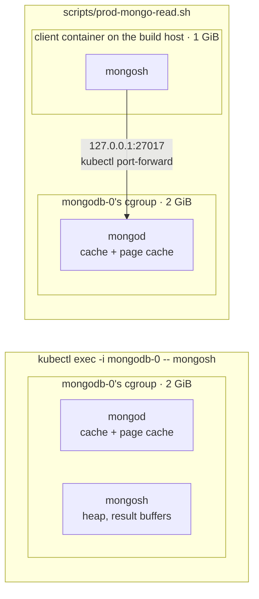
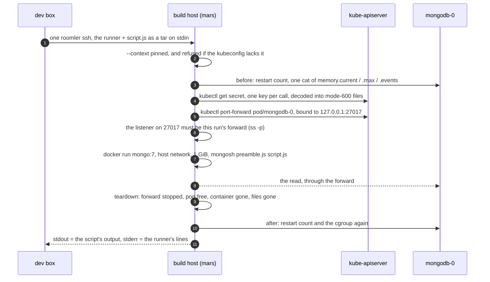

# Reading production Mongo — the client runs outside the database

Production Mongo is one standalone `mongo:7` pod, `mongodb-0` in namespace `roomler-ai`, and
its container may use 2 GiB. Every fleet read in this repository (`agent_logs`, `agents`,
`remote_sessions`) is a `mongosh` run against it. **Where that `mongosh` runs decides whose
memory it spends.** `kubectl exec -i mongodb-0 -- mongosh` starts it inside the database
container, so the client's heap and the database share that one 2 GiB limit. Run that way, an
unbounded read OOM-killed production Mongo on 2026-10-26. On 2026-11-10 two `$text` counts run
the same way took the container to within 2.3 MB of its limit
([#3632](https://github.com/gjovanov/roomler-ai/issues/3632)).

So every read now goes through one runner, which keeps the client in a container of its own on
the build host and reaches the database through a port-forward.

| | |
|---|---|
| The runner | `scripts/prod-mongo-read.sh` |
| From the dev box | `scripts/prod-mongo-read.sh --mars --yes SCRIPT.js` (or `-` for stdin) |
| On the build host | `scripts/prod-mongo-read.sh --kubectl --yes SCRIPT.js` |
| The path | `kubectl port-forward pod/mongodb-0 27017:27017 --address 127.0.0.1` |
| The client | a throwaway `mongo:7` container on the host network, its own 1 GiB limit |
| Refused | without `--yes` · while anything listens on port 27017 · on a host whose kubeconfig lacks the production context |
| Exit | 0 (or the script's own code) · 2 refused · 3 `mongodb-0` restarted or was OOM-killed · 5 teardown incomplete |

This page covers why the client must not run inside the database, how the runner works, what a
script sees, why this method won over a client pod, what it does not fix (the server's own
memory), every reader that uses it, and the production run that validated it.

## 1. Why the client must not run inside `mongodb-0`

A container's memory limit is one cgroup. Everything that runs in the container counts against
it, including a shell that `kubectl exec` started. mongod's own cache and mongosh's heap then
compete for the same 2 GiB. When the total cannot be reclaimed, the kernel's OOM killer acts
inside that cgroup, and on 2026-10-26 it took mongod (the container exited 137).



The two incidents differ, and the difference matters for what this change fixes:

| Date | What ran inside the container | What filled the cgroup | Outcome |
|---|---|---|---|
| 2026-10-26 | a version histogram written as `find({deleted_at: null}).toArray()` over every `tunnel` collection that carried a version field, which included the per-flow audit log | **the client's heap**: every document held in mongosh at once | mongod OOM-killed (exit 137), about 80 s with no database. Every database-backed request failed while `/health` stayed 200. It recovered on its own, and no data was lost |
| 2026-11-10 | two `countDocuments({$text: {$search: '"…"'}})` phrase counts over `agent_logs` | mostly **the server's page cache**: a phrase of common words pulled most of the collection through it | `memory.current` reached 2,145,165,312 of 2,147,483,648 (99.9 %). Nothing was killed, and it fell back within seconds |

Moving the client out removes the first kind entirely: a runaway client now meets its own 1 GiB
limit, in a cgroup where mongod is not. It does nothing for the second kind,
which §5 covers.

⚠️ `kubectl top pod` read the same figure before and after the 2026-11-10 spike and never
showed it. The container's own `/sys/fs/cgroup/memory.current` and `memory.events` did, which
is why the runner reads those (§2).

## 2. How the runner works



| Step | What it does | Where |
|---|---|---|
| The context | Every `kubectl` carries `--context`: `$ROOMLER_KUBE_CONTEXT`, else the production cluster's context on mars. The context's existence is checked against the local kubeconfig before any call reaches a cluster | `scripts/prod-mongo-read.sh:110-121` |
| `--mars` | Packs the runner and the script into one tar and runs `--kubectl` on mars over a single `roomler ssh`. A device limits SSH requests per caller, so one call is better than several | `:160-179` |
| Before | The restart count, then `memory.current`, `memory.max` and `memory.events` in one `cat` inside `mongodb-0`. That exec reads three files and starts no client | `:186-205` |
| The port | Refused when anything already listens on 27017, because every read connects to `127.0.0.1:27017` | `:206` |
| Credentials | `kubectl get secret mongodb-secret` with a `go-template` per key. Only the key's NAME is an argument, and the value flows from the pipe into a mode-600 file in a mode-700 directory | `:240-247` |
| The preamble | Opens `db` on the app database through the forward, `directConnection=true`, `authSource=admin` | `:249-255` |
| The forward | The `kubectl` binary itself, backgrounded, so `$!` is the forward's own pid. Up when its log says `Forwarding from 127.0.0.1:27017`. The listener on the port must carry that pid | `:257-271` |
| The client | `docker run --rm --network host --memory 1g --memory-swap 1g --pids-limit 256`, the two directories mounted read-only. The container's shell reads the credential files into its own environment, so `docker inspect` does not show them | `:273-284` |
| Teardown | Once, on every exit, including an interrupted run: removes the container, stops the forward, deletes the files, and prints proof of each. An incomplete teardown exits 5 | `:217-237` |
| After | The restart count and the cgroup again. A restart or a new `oom_kill` exits 3, and the run's output counts as harm, not data | `:286-296` |

⚠️ **The cluster is named, never inherited.** A run on a machine whose current context is some
other cluster must not reach that cluster, not even to fetch credentials for it. On a host
whose kubeconfig has no production context, every entry point is refused after one local
`kubectl config get-contexts -o name`. The other readers pin their own `kubectl` calls from
`prod-mongo-read.sh --print-context` (`scripts/fr97-caps-census.sh:28`,
`scripts/fr138-roll-read.sh:172`).

## 3. What a script sees

The same as inside `mongodb-0`, so a read written for that runs unchanged:

| | Inside `mongodb-0` (before) | Through the runner |
|---|---|---|
| `process.env.MONGO_INITDB_ROOT_USERNAME` / `_PASSWORD` / `MONGO_INITDB_DATABASE` | the pod's `envFrom: mongodb-secret` | the same secret, read into the client container's environment |
| The server | `127.0.0.1:27017`, mongod itself | `127.0.0.1:27017`, the forward |
| `db` | none (`--nodb`): the script connects itself | already open on `roomler2` (`--db NAME` for another), and a script that connects itself still can |
| How mongosh takes the script | on stdin, as a REPL, line by line (the by-hand recipes), or as a file copied into the pod (the census, the shadow report) | always as a FILE (`mongosh --nodb --quiet preamble.js script.js`) |
| A setting such as `FR65_SINCE` | `env NAME=VALUE mongosh …` inside the exec | `--env NAME=VALUE` on the runner. `MONGO_*` and `PMR_*` are refused, and a value is a docker argument on mars, so never a secret |

Reading the script as a file removes a trap of the stdin recipe. mongosh fed on stdin evaluates
line by line, so a line that parses on its own runs on its own. A `.replace(…)` or `.limit()`
on the next line is then read as a REPL keyword and silently dropped, and once that left a
masking function as the identity, so raw ids reached a transcript. A file is parsed whole.

## 4. Why a port-forward, and not a client pod

| | Port-forward + a client container on the build host | A short-lived client pod in `roomler-ai` | `kubectl exec` into `mongodb-0` (retired) |
|---|---|---|---|
| Client memory counts against mongod | no | no | **yes** |
| The scripts change | not at all: they already connect to `127.0.0.1:27017` with `MONGO_INITDB_ROOT_*` | every connect line moves to the service's name | — |
| Created in the cluster | nothing | a pod, an image pull on whichever node it lands on, perhaps beside the database | nothing |
| Where the credentials go | through the build host: files mode 600 in a mode-700 directory, mounted read-only, deleted on every exit | stay in the cluster (`valueFrom: secretKeyRef`) | stay in the pod |
| Topology | `mongodb-0` is a standalone (no replica set), so a direct connection through the forward needs no discovery | the service | — |
| Cleanup to prove | forward, port, container, files: the runner proves all four | the pod | — |

The port-forward wins because the scripts run byte-for-byte as they did, and nothing is
scheduled into the cluster. Its cost is the credentials passing through the build host. They
never reach an argument list, a log or the output (§7 checked each), and they are deleted on
every exit. Either method leaves the StatefulSet, the secret and the service untouched.

## 5. The server still pays: bound every query

The runner moves the CLIENT out. The query itself, its index scan, any sort, and every page it
touches still run in mongod, inside the 2 GiB. That is the 2026-11-10 kind, and only the query
can prevent it:

- **Size a collection first.** `db.<coll>.estimatedDocumentCount()` reads metadata and scans
  nothing. `agent_logs` held 354,193 batches on 2026-11-10.
- **Start with an indexed `$match`** (`created_at`, `tenant_id`, `pairing_id`, …), then `$limit`,
  `maxTimeMS` and `allowDiskUse: false`. Fold on the server (`$group`, `$count`) and project only
  the fields you need. Never `find().toArray()` on a collection you have not sized, and never
  generalise a read over "every collection with field X": an audit log carries the same field
  names as a small collection.
- **A `$text` phrase costs as much as its commonest word.** The index scan is an OR over the
  phrase's words, and the phrase filter then runs on every document fetched. So common words
  ("session", "request", "media") pull most of `agent_logs` through the cache. Prefer an indexed
  `$match` on `created_at` and a `$filter` on `lines.msg`, as the census and the shadow report
  do (`docs/rate-control.md`).
- **A `$limit` on a sorted per-agent read can cut the window without telling you.** Slice by day
  and `countDocuments` each slice first, so a truncated day shows.

## 6. Who uses it

| Reader | What it reads | How it runs |
|---|---|---|
| `scripts/rtp-reach-read.cjs` | how far the RTP path reaches (`docs/encoders.md`, "Reading RTP's reach") | `scripts/prod-mongo-read.sh --mars --yes scripts/rtp-reach-read.cjs \| grep -o 'OUT .*'` |
| `scripts/resource-watch-read.cjs` | FR-134's hourly handle lines (`docs/resource-watch.md` §3) | the same, with `scripts/resource-watch-read.cjs` |
| `scripts/fr65-stall-census.sh` + `.cjs` | FR-65's stall census (`docs/stall-watch.md` §7) | `--mars --yes` ships the census and the runner in one `roomler ssh`. `--kubectl` hands the census to the runner (`scripts/fr65-stall-census.sh:93`) |
| `scripts/rc-shadow-report.sh` + `.cjs` | FR-63's shadow report (`docs/rate-control.md`) | the same shape (`scripts/rc-shadow-report.sh:142`) |
| `scripts/fr97-caps-census.sh` | FR-97's capability words by OS | on mars. The aggregation goes to the runner on stdin with `--db` (`scripts/fr97-caps-census.sh:78`). It no longer reads the app's database URL, which holds the password, from `roomler2` |
| `scripts/fr138-roll-read.sh` | FR-138's roll read | the same (`scripts/fr138-roll-read.sh:539`). `--mars` ships itself and the runner in one `roomler ssh` |
| By hand | the growth-observability field check, the `rc.connect` mining in `docs/remote-control.md`, the pairing audit in `docs/device-pairing.md` | `scripts/prod-mongo-read.sh --mars --yes - <<'JS'` … `JS`, with `db` already open |

```bash
# A by-hand read: size first, then a bounded, indexed query. `db` is open on roomler2.
scripts/prod-mongo-read.sh --mars --yes - <<'JS'
print('OUT agent_logs ~' + db.agent_logs.estimatedDocumentCount());
db.agent_logs.aggregate([
  { $match: { created_at: { $gte: new Date(Date.now() - 3600 * 1000) } } },
  { $limit: 5 }, { $project: { _id: 0, source: 1, n: { $size: '$lines' } } },
], { maxTimeMS: 30000, allowDiskUse: false }).forEach(r => print('OUT ' + JSON.stringify(r)));
JS
```

**What still runs inside a Mongo container, and why it stays:** `scripts/migrate-tier-policy.sh`
and `scripts/migrate-tier-policy-recover.sh`. They are a one-shot storage migration from
2026-05, and their only in-container call is a `mongorestore` into another namespace's
database. That is a write by a restore tool, run during a planned migration, not a read of
production, so it keeps its own recipe.

## 7. Validated on production, 2026-11-10

One read-only run through `--mars`, 12:27:33Z–12:28:03Z: `estimatedDocumentCount()` on
`agent_logs` and one `$match` on the last hour with `$limit` 5. Nothing else.

| Measure | Before | During | After |
|---|---|---|---|
| Result | | | `agent_logs` ~354,193 · 5 rows (7 lines) · mongosh 2.8.1 against server 7.0.30, `db` = `roomler2`, no replica set |
| `mongodb-0` `memory.current` | 1,592,307,712 (74.1 % of 2,147,483,648) | 1,592,479,744 | 1,592,475,648 (**+168 KB**) |
| `mongodb-0` restarts | 1 | | 1 |
| `memory.events` `max` / `oom` / `oom_kill` | 0 / 0 / 0 | 0 / 0 / 0 | 0 / 0 / 0 |
| The client container | | 180.3 MiB of its own 1 GiB | gone |
| The password in an argument list | | 0 of 394 processes | |
| … in `docker inspect`, the forward's log, the output | | 0 · 0 | 0 of 18 output lines |
| Teardown | | | forward stopped and port 27017 free, container gone, credential files gone: all yes |

The client held 180 MiB while the database's container grew by 168 KB. Run the old way, those
180 MiB would have counted against mongod's own limit. A positive control kept the zeros
honest: the same password grep matched the run's own credential file once.
