# Rate control — how the remote-desktop stream spends its bits

How a session decides **bitrate, quality, frame rate, and resolution**, and why
(since rc.445) it never changes resolution mid-motion. Companion to
[encoders.md](encoders.md) (which encoder runs) — this doc is about what that
encoder is told to do. History and field evidence at the bottom. Since
`agent-v0.4.93` every loop here reads **one validity gate** before it acts,
so that is the first section: everything after it consumes its verdict.

## The validity gate (FR-79) — a window is evidence about the pipe, or it is not

Every loop in this document estimates the same quantity — what the path will
carry — from the same 1–2 s viewer window. Until `agent-v0.4.93` each loop
decided for itself whether a window could be trusted, and on 2026-09-08 one
host produced three field events through three different inputs with one
shape: a number taken while the pipe was *not free to be measured* was read as
the pipe (FR-71 T2 and T2b, then the opener — the record is in
[`fr/FR-79-one-validity-gate.md`](fr/FR-79-one-validity-gate.md)). FR-79
replaced the three per-input rules, their two kill switches and their four
counters with **one verdict per window, taken before any loop acts**:

> A window is evidence about the pipe only if **(1)** the agent's own loop was
> free — no pump pass overran its stall budget inside it, **(2)** the transport
> was past its opening, **(3)** the transport did not stall in it, and did not
> stall in the window before it, and **(4)** the carrier it will be attributed
> to is the carrier that produced it.

`encode::evidence::rejected(WindowFacts) -> Option<Reason>`
(`agents/roomlerd/src/encode/evidence.rs:194`) is pure — no clock, no I/O, no
configuration and **no switch**. Its inputs (`WindowFacts`, `evidence.rs:172`)
are things the governor already holds at the window boundary: this window's
pipe-state verdict, the previous window's, whether a pump pass stalled inside
it (`encode::stall`, counted per pass), whether the transport was still in its
opening, and whether the carrier moved.

**FR-119 P2b-8 — every window, and the whole window.** Three corrections, all
found when a freshly granted 120 fps was taken back one second into two of
four direct sessions on the MacBook:

- **The gate runs on every window.** It used to run on constrained windows
  only, and a direct window was evidence by definition, so FR-119's grant
  (which only runs on a direct path) read capacity claims nothing had gated.
  On a direct window the classifier does not run, so its state is `Unknown`
  with no predecessor, and only the agent's own stall and the opening apply
  (`governor.rs:1621`).
- **`Reason::Opening`.** The opening keyframe meeting a transport that is
  still ramping blocked sends for 43–82 ms, and the drain rate folded as a
  capacity of 14–22 Mbps against a 104 Mbps ceiling, which held for its 60 s.
  A window any pass of which falls inside FR-35's opener window (at least 2 s
  from the first keyframe and until the send ledger drains, at most 3 s, now
  kept for every session) is not evidence. FR-35 already declined to cut for
  that burst, so it is not congestion either.
- **The window is the sum of its passes.** The pump hands its sender facts
  over on every pass, as deltas since the previous one, and each call
  overwrote the last, so the "window" the classifier and the gate read was one
  pass long: a stalled pass anywhere but in the window's last iteration never
  reached `AgentStalled`, and `frames_sent` / `gate_skips` read 0–2 where the
  window held 30–120. `WindowSenderStats::absorb` now folds the passes: counts
  add, the longest wait wins, the average is weighted by frames sent, `opening`
  ORs, and the levels are the latest. ⚠️ On constrained sessions this also
  corrects the classifier's inputs: a gate skip anywhere in a window now makes
  it `overproduced`, and the silent-viewer gap rule sees real frame counts.

**FR-119 P2b-13 — a keyframe's ramp, later in the session.** The opening's
defect was not confined to the opening. SCTP grows its congestion window only
while data is queued (`on_cumulative_tsn_ack_point_advanced` in the vendored
`webrtc-sctp`). So on a fast path the deltas leave it about one delta's size,
and a keyframe many times larger spends its send growing the window back. On
the first Windows run, one ~625 KB keyframe on a mesh path blocked 71.6 ms and
folded as 69.9 Mbit/s of capacity, while the path carried 311 Mbit/s over TCP.
The measured-ceiling clamp cut the rate to 59 M, and FR-119's grant handed a
granted 120 fps back on `pipe`. Each blocked send now says whether it was a
keyframe (`BlockedSend::keyframe`, read by the send task from the frame's own
header), and on a **direct** window whose blocked sends include a keyframe the
gate answers `Reason::KeyframeBurst`. Constrained windows keep the old rule:
there a keyframe's drain is dominated by the path, and it may be the only
sample a session gets.

**P2b-14 widened it from "only keyframes" to "a keyframe at all".** P2b-13
still read a window when a delta blocked beside the keyframe, on the theory
that a narrow pipe shows in the deltas behind it. But at 120 fps eight deltas
queue behind a 66 ms keyframe send, and they block on the keyframe's own
backlog, so they measure the same ramp. On the second Windows run the
encoder's idle-settle keyframe after a motion burst did exactly that: the
window folded as 60.7 Mbit/s against the 88.8 Mbit/s ceiling at 120, on a LAN
path, and 120 went back after 6 s. A pipe really narrower than the stream
still shows: its deltas block in the keyframe-free windows either side, which
are read as before.

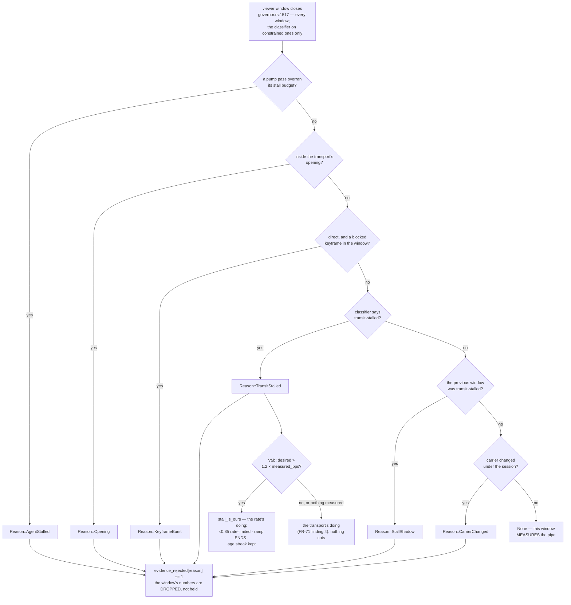

The heartbeat carries the tally as `evidence_rejected=[agent-stalled,
transit-stalled, stall-shadow, carrier-changed, opening, keyframe-burst]` (`Rejections`,
`evidence.rs:219`; printed at `peer.rs:10218` for the FFmpeg pump and `:5401` for
VP9's) — one field where T1b, T2 and
T2b each had their own counter. `opening` was appended (P2b-8) and then
`keyframe-burst` (P2b-13), so the earlier positions keep their meaning for a
reader that parses them.

### The classifier the gate reads (FR-71 T1a) — which plane is the limiter

Every loop below used to read one number, the viewer's paint age, and every one
of them read an excursion as "the encoder produced too much". On 2026-09-04
(CORPLAP-3 over DERP, session `6a9abaa8`) a head-of-line block held frames in
transit for **4.9 s** while the sender's queue held **1,485 bytes**, the worst
pump pass was 28 ms and the encoder averaged 14 ms — nothing sender-side was
wrong, and the AIMD and the FR-15 age loop cut the rate into an 8 Mbps link
(FR-71's finding 4, the FAIL on record in
[`fr/FR-71-transport-stall-classification.md`](fr/FR-71-transport-stall-classification.md)).
FR-70 M0 split the age into the three planes that can own it
(`viewer_rate::split_age`, `viewer_rate.rs:314`: sender wait, transit, the
browser's own share), and FR-71 T1a turns the split plus what the governor
already knows about its own send queue into **one verdict per constrained
viewer window** — `encode::pipe_state::PipeClassifier::classify`
(`pipe_state.rs:159`). The gate reads that verdict, and the previous window's,
as two of its facts (`WindowFacts::state` / `prev_state`, `evidence.rs:172`);
the classifier itself acts on nothing. Pure, like the gate: no clock, no I/O,
no switch — it unit-tests on the default build and runs inside the B0 simulator.

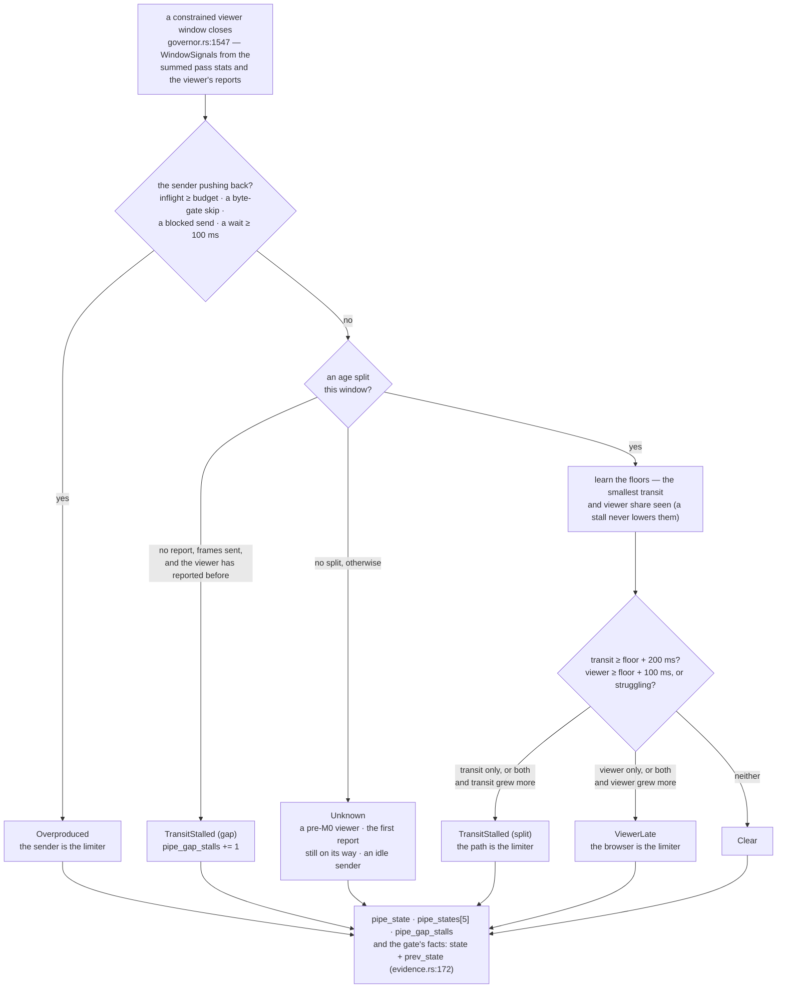

| verdict | says | the rule (`decide`, `pipe_state.rs:169`) | what the gate makes of it |
|---|---|---|---|
| `Overproduced` | the sender is the limiter | checked **first**: `inflight_bytes ≥ budget_bytes`, or a byte-budget skip, or a blocked send the goodput sink accepted, or `send_wait_max_ms ≥ SENDER_WAIT_MS` (100 ms, `:67`) — whatever the path is doing, a full queue is real back-pressure, the one case the loops were always right about | evidence: the window measures the pipe |
| `TransitStalled` | the path is the limiter | the transit share sits `TRANSIT_SLACK_MS` (200 ms, `:63`) or more over its learned floor while the browser's share is under its own slack (both over: the larger excess names the limiter); **or a report gap** — no report this window, frames were sent, and the viewer has reported at least once this session (`:193`) | rejected (`Reason::TransitStalled`), and the window after it too (`StallShadow`); under V5 it is also the transport pushing back — the rate-limited ×0.85 fires only while `desired > 1.2 × measured_bps` |
| `ViewerLate` | the browser is the limiter | the viewer share sits `VIEWER_SLACK_MS` (100 ms, `:65`) or more over its floor, or the viewer reports `struggling` (`rc:decodestat`) | evidence (an open decision in FR-79); the viewer-rate cap sheds frames, nothing cuts the bitrate |
| `Clear` | none of the above | | evidence |
| `Unknown` | nothing to classify | no split and no gap: a pre-M0 viewer, a report without an age, silence **before** the first report, or a window the sender was idle in — and every direct window, because the classifier runs on constrained windows only (`governor.rs:1582`) | evidence; the loops behave as they did before FR-71 |

Its inputs are `WindowSignals` (`pipe_state.rs:112`), assembled once at the
window fold (`governor.rs:1570`):

| input | where it comes from | note |
|---|---|---|
| `split` — sender / transit / viewer ms | `split_age` over the window's average age, the viewer's arrival stamp and the window's average send wait (`governor.rs:1554`) | `None` = no split this window |
| `reported` | any report this window — an age, a link report, or the raw count (`governor.rs:1572`) | the gap rule's subject |
| `inflight_bytes`, `budget_bytes`, `gate_skips`, `send_wait_max_ms`, `frames_sent` | `WindowSenderStats` (`governor.rs:488`), handed over by the pump on every pass and **summed per window** since FR-119 P2b-8 (`absorb`, `:519`) | ⚠️ until P2b-8 (2026-10-23) the governor kept only the last pass, so `frames_sent` and `gate_skips` read 0–2 where a window held 30–120, and a gate skip outside the final pass never made the window `overproduced`; every test fed whole windows, so the tests describe the classifier the field runs from then on |
| `blocked_sends` | the goodput sink's samples, drained at the fold | the same samples the fold then accepts or drops |
| `struggling` | the viewer's decode-backlog bit | |

The floors are learned the way the FR-15 age loop learns its floor — the
smallest share seen (`pipe_state.rs:202`) — so a permanently slow path is not
a permanent stall, and a stall never lowers the floor it is measured against.

**The heartbeat.** `pipe_state` is the last window's verdict, `pipe_states` the
session's windows per verdict as `[unknown, clear, overproduced,
transit-stalled, viewer-late]`, and `pipe_gap_stalls` the subset of the
transit-stalled count that came from the gap rule (`peer.rs:10232`–`:10242` for
the FFmpeg pump; `:5399`–`:5409` for VP9's, whose transit share is an upper
bound because that pump hands its split no send wait: it prints one since FR-148,
and its split still takes none). Three rules for reading them:

- a heartbeat spans about two windows, so `pipe_state` and the histogram are
  **offset by one window** when read side by side — count stalls from the
  histogram's deltas, not from the current verdict (measured 2026-09-07);
- the counters are per session: the governor is built with the session, so a
  new `session_id` restarts them at zero;
- on `0.4.67` every session showed one `transit-stalled` window at its start —
  the viewer's first report had not arrived yet. The "has reported once" clause
  (#1370) fixed it from `0.4.68`; nothing needs subtracting after that.

**What the field taught**, with the record in FR-71's spec:

- Finding 4 has **two shapes** on the corporate hosts, and the gate answers each
  with a different fact. The post-ack kind — an age in the hundreds of
  milliseconds to seconds with 0 B in flight and a 0.03 ms send wait (CORPLAP-2,
  2026-09-07 and 09-08 08:48) — is the split rule's `TransitStalled`. The
  blocked-send kind — a DC send blocked for 2.9 s and 7.4 s inside pump passes
  the runtime had stalled (CORPLAP-1 on the Check Point VPN, 2026-09-08 12:15)
  — is `AgentStalled`, the gate's first reason, whatever the classifier said of
  the window. The B0 freeze fixtures model a third: a frozen drain that fills
  the **sender's** queue, which the classifier rightly calls `Overproduced`
  (`t1a_freeze_stalls_are_sender_visible`, `sim.rs:2326`); the simulator's
  `transit_stalls` (acked on time, observed late) and the `finding4_transit_stall`
  cell (`sim.rs:1716`) model the first.
- **96 % of `transit-stalled` verdicts are report gaps**: 209 of 218 over four
  days of the operator's sessions (2026-09-05 → 09-08, about 15,000 constrained
  windows on `0.4.69` → `0.4.85`), one silent window every few minutes on a
  healthy relay, and nothing was ever classified stalled while its queue was
  over budget. A gap is still a rejected window; whether a hidden tab's silence
  should count as a stall is an open decision in FR-71.
- The cell that keeps the rate is `finding_4_keeps_the_rate_with_the_validity_gate`
  (`sim.rs:2452`): no window below the pre-stall target and the path reading
  clear within the stall's own length. Its FAIL arm,
  `finding_4_cuts_the_rate_without_the_validity_gate` (`:2284`), keeps the
  defect on record — the gate has no daemon switch, so the arm lives only in
  the simulator — and the thin pipe, the LAN burst and a genuinely slow relay
  trace **byte-identical** with the gate on and off
  (`t1b_hold_is_inert_where_nothing_stalls`, `:2355`).

⚠️ The classifier was a shadow for one release: `transit_classify` (T1a) and
the hold behind `transit_hold` (T1b, default off) shipped in `0.4.67`, and
FR-79 V1 **deleted** both the day the gate was built on the verdict. A
`transit_hold = true` left in a host's `config.toml` is an inert key.

### What each consumer does with the verdict

All of it is in one function, `RateGovernor`'s window fold (`governor.rs:1540`
onward). `valid` is the gate's `None`; `stall_is_ours` is V5's exception, below.

| consumer | on a valid window | on a rejected window | site |
|---|---|---|---|
| goodput fold (`GoodputEstimator::observe_window`) | folds the window's blocked sends | samples **dropped**, not quarantined; the next valid window is measured on its own merits | `governor.rs:1711` |
| FR-35 hard ×0.5 (a send blocked ≥ `HARD_STALL` = 1 s, `ceiling_learn.rs:71`) | `apply_hard_md` | nothing — only the window boundary knows whether the block was the pipe (12:15: 2.9 s and 7.4 s blocked sends inside stalled passes, on a path that carried 6.6 M twenty seconds later) | `governor.rs:1728` |
| FR-63 opener ramp | doubles on a clean window, ends on congestion | neither — unless `stall_is_ours`, which ENDS it | `governor.rs:1734` |
| FR-15 age loop | fires on a streak over the learned floor; always learns the floor | learns, does not fire, and the streak resets — unless `stall_is_ours`, which keeps both | `governor.rs:1779` |
| FR-59 P3 arrival-rate clamp | armed by a growing queue the sender offered (V5b rule (b)), released by the viewer's report | **neither armed nor released** — whatever it held, it still holds (14:52: the report *for* the stall set 834,800 on a path that had just carried 7.45 M) | `governor.rs:1823` |
| the rate-limited ×0.85 (`aimd.rs:366`, ≥ 500 ms apart, `aimd.rs:93`) | on `age_over` or `link_over` | on `stall_is_ours` | `governor.rs:1938` |
| FR-70 P1 prior | re-anchors on a live measurement, decays on a clean window | does not move. V5b: a stall carries no number, so it no longer walks it either | `governor.rs:1961` |
| the refutation (V5b rule q2) | a delivery that raised the floor takes out a reading it beats by 2× | nothing: a stall's shadow is its backlog draining | `governor.rs:1901` |
| FR-79 V3b belief (shadow) | a delivery every window; a capacity when the fold accepted, or the viewer's queue grew | the delivery is still recorded; no capacity | `governor.rs:1648`, `:1714`, `:1855` |
| pair-memory write-back (V2 + V4 + V5b) | a carried hold, else a reading, else the opener's measurement | nothing measured ⇒ nothing written | `media_pair_memory.rs:238` |

### V5 — a rejected window is not a measurement, but a stall is still push-back

V1 shipped the gate as an unconditional DROP, and on `agent-v0.4.95`
(2026-09-09 07:41, CORPLAP-2, AV1 over `relay:derp/tcp`) that was a live
regression: one accepted goodput sample of 1,058,145 all session, eleven
transit-stalled windows, `target_bps` 1.6–2.1× the measurement, paint age
240 → 4,022 → 7,784 ms, and **the rate ended higher than it started** —
because every loop that could lower it read `valid`, the local send queue
never filled (`bytes_inflight=0`), and the viewer's age report landed in
rejected windows.

🔑 The gate answers *is this window a measurement of the pipe?* V1 let every
consumer read it as *does this window say anything at all?* Those differ for
exactly one reason: a stalled transport is not a measurement, but it **is the
transport pushing back** — and on a relay-TCP session, where the queue sits
downstream of the agent, it is the only push-back there is.

| half | rule | anchor |
|---|---|---|
| which rejection also speaks about the rate | `Reason::is_congestion()` is true **only** for `TransitStalled`. `AgentStalled` would re-create the 12:15 defect, `StallShadow` double-counts one stall, `CarrierChanged` cuts for a path the session has left, `Opening` cuts for the opener draining into a transport still ramping | `evidence.rs:143` |
| whose fault the stall is | `stall_is_ours` = congestion **and** `desired > measured_bps × 1.2`. Above the measured pipe the stall is the rate's doing; at or below it, the transport's (FR-71's finding 4: an 8 Mbps leg head-of-line-blocked for 4.9 s with 1485 bytes queued, where a cut costs quality for an event the sender did not cause); **with nothing measured there is no claim to contradict, so no cut** | `governor.rs:1694` |
| what it reaches | only the rate-limited ×0.85, the ramp's end and the age streak. **Never `apply_hard_md`** — it has no spacing and would halve once per stalled window. Everything that sets a *number* still reads `valid` | `governor.rs:1734`, `:1779`, `:1938` |
| which estimate | since V5b, `measured_bps` (`governor.rs:883`: blocked-send goodput, the viewer's arrival rate inside its 15 s TTL, the lower of the two) and never the prior; before it, `pipe_bps` (`:735`), and **never** `blocked_send_bps` (`:701`). `0.4.96` shipped on the wrong accessor: the agent's sends block only when the queue is LOCAL, and CORPLAP-3 read `goodput_bps=None` with `goodput_samples=(0, 5)` for a whole relay session — V5 inert on that host. Fixed in **V5a, `agent-v0.4.97`** | `governor.rs:1672`–`1635` |

⚠️ The control that must stay green is
`finding_4_keeps_the_rate_with_the_validity_gate`. Its field twin is every
relay stall on a session that is *not* overdriving: on 2026-09-24 a
three-hour CORPLAP-2 session over `relay:derp/tcp` held its target through
**117 of 118** transit stalls (the exception, 10:33:30–34, is an 800 ms
locally blocked send inside an agent-stalled window — the AIMD's own occupancy
loop, not the gate) at a paint age of p50 76 ms / p95 99 ms / max 988 ms.

⚠️ **AC9, partly met 2026-10-31**: the positive half — the target *converging*
toward the measurement across repeated stalls — needs a stall inside a
**measured** minute. A sweep of the three relay laptops' daemon logs for
2026-09-10 → 09-25 (24,013 heartbeats, 7,442 constrained windows, 193 transit
stalls) found the pipe estimate absent at every one of the 193: the
blocked-send source was live in 2 % of the constrained windows and the prior in
none. That absence is the V3b finding, below. The first sustained run came on
2026-10-30 on CORPLAP-2, `0.4.187`: 27 stalls in 56 s at a live
`goodput_bps=180,484`, the target held at 1.11–1.40× it, bounded by the 200 kbps
floor. The weak point is the reading it converges to (the A/B below).

⚠️ **The 2026-10-29 fleet read found the inverse (FR-71).** Over 15 days and
40,654 constrained windows on the corporate laptops (`0.4.137` → `0.4.184`), a
transit stall on a session with no pipe estimate was held 433 times out of
482 — but 49 clean stall episodes cut, every one on a session whose prior stood
at 0.02–0.8 M: `stall_is_ours` compares against `pipe_bps`, whose last source
is the prior's stand-in (`governor.rs:769`), and pushes that prior back without
a measurement on every window it fires on (`:1655`), so each cut lowers the
number the next stall is judged against. One 25-minute HEVC session over DERP
went 3.63 → 0.94 M on 24 gap windows with 0 B in flight. A second edge: the
viewer's congested report in a stall's **onset** window (transit still under
the classifier's 200 ms slack, so the window is `clear` and valid) arms the P3
clamp at the collapsed arrival rate — 3.0 → 0.62 M at 09:17:07 on 10-19, 13
such drops in the fortnight. Both are recorded with their arcs in
[`fr/FR-71-transport-stall-classification.md`](fr/FR-71-transport-stall-classification.md)
(§Open decisions, field log); the law is not changed on this page.

⚠️ **The first is fixed by [V5b](#v5b--only-a-measurement-is-evidence-about-the-rate).**
A convergence read on a build before it may be toward the stand-in rather than a
measurement, so it cannot count as AC9. The rig AC8 and AC9 still need is in
[`fr/FR-79-one-validity-gate.md`](fr/FR-79-one-validity-gate.md) §Open decisions. The
second edge, the onset, stays FR-71's: there the sender really is offering.

⚠️ That prior's size did not come from the walk. The session's stand-in moved on
the measured ×11/10 ladder (`prior.rs:80`, `:167`) above a base of at most 17,799
bps, so a live reading anchored it, and the walk only moved it between rungs. A
congested viewer report stores the arrival rate with no floor (`governor.rs:1846`),
and the same window re-anchors the prior on it (`:1644`). V5b stops the cuts, but
the anchor stays in `pipe_bps` until it climbs back or a delivery takes it out.

⚠️ **The field A/B (2026-10-30 11:48–12:19, CORPLAP-2, `0.4.187`,
`relay:derp/tcp`).** Over one session, stalls cut the target 13 times of 16 while
a stand-in stood and 0 of 26 while nothing did. The same session shows that a live
reading can be wrong too. One 102 ms blocked send folded into a live
`goodput_bps=223,794`, because a window needs only 60 ms of blocked time
(`goodput.rs:82`), on a path that delivered 5.39 M. While it stood the target
fell 3.0 → 0.68 M in 22 s, most of it through the queue budget, which is
denominated in the same `pipe_bps`.

### V5b — only a measurement is evidence about the rate

Four field reads, one mistake: a number nobody measured was treated as one. A
stand-in judged stalls, a reading stood after the path disproved it, a hold nobody
carried was written as the pair's rate, and a trickle became the pipe.

`measured_evidence` (`ROOMLERD_MEASURED_EVIDENCE`, default on) is one switch for five
rules. All five are constrained-only, so a direct window moves nothing, and off is
V5a's rules byte for byte, apart from the heartbeat's new fields. The record, with
the chain they break to the unit, is in
[`fr/FR-79-one-validity-gate.md`](fr/FR-79-one-validity-gate.md).

| rule | what it says | anchor |
|---|---|---|
| **q1** a stall needs a reading | `stall_is_ours` reads `measured_bps`: the goodput, or the viewer's arrival rate inside its TTL, the lower of the two, and never the stand-in. With neither there is no claim to contradict, so nothing cuts, and a stall no longer walks the prior | `governor.rs:1689`, `:883` |
| **q2** a delivery can refute a reading | in a VALID constrained window whose delivery raised the demonstrated floor, every reading that delivery beats by `CONTRADICTION_FACTOR` (2×) stops counting: the goodput is forgotten, the arrival-rate clamp lifts, and with no reading left the prior re-anchors on the delivery | `governor.rs:958`, `:1901` |
| **q3** a hold must be carried | a hold reaches `stable_bps` only if a valid window sent at least 70 % of it | `ceiling_learn.rs:147`, `governor.rs:2006` |
| **(a)** the write-back records a reading or nothing | `session_evidence_bps`: a carried hold, else a live reading, else the last reading the session took. Never the stand-in. A session with none of them leaves the entry's value and age alone | `governor.rs:926` |
| **(b)** a growing queue must be offered | a congested verdict counts only once two windows running each offered more than arrived: `sent > 1.1 × rx`, or the classifier called the window `Overproduced` | `governor.rs:1811`, `viewer_rate.rs:676` |

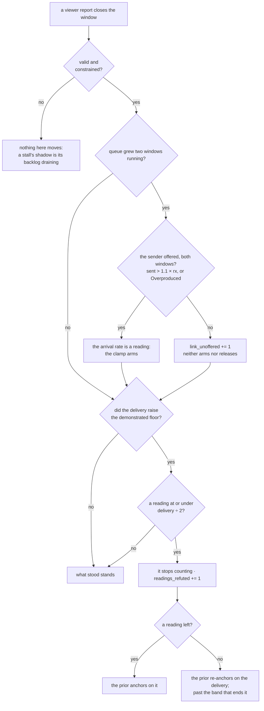

⚠️ **q2 asks whether the floor rose, not whether a reading sits below it.** The true
reading of a thin week of field data (180,484, 0.23 of the floor) sat lower than the
false ones (0.39 and 1.00). What told them apart was the order: both false readings
were followed within 2 s by a delivery at least 2× above them, and the floor never
moved in the true one's 60 s.

⚠️ **(b) reads two sources because `bytes_written` is not the whole offer.** It counts
what left the pump's own channel, and both pumps stamp a frame before it (`peer.rs:5275`,
`:9921`), so a queue growing INSIDE that channel reads sent ≈ rx. `Overproduced` is
that case. A window with no link report keeps the streak, and an unoffered congested
window neither arms nor releases, because the queue did grow.

⚠️ **The two streaks can sit a queue apart.** The growth a report reads is about
frames made a queue's depth ago, so a burst shorter than the queue may never line up
with its report. By then the sender has stopped, and the age loop and the drain still
read the viewer directly. Neither reads `offered`.

⚠️ **(a) reverses FR-70 P1**, which wrote the decayed prior so a session measuring
nothing could free a pair misremembered slow. Such a session no longer raises a low
entry at all, so the entry stands until a session measures or carries a hold, or its
7-day TTL runs out. Reasons and numbers are in FR-79.

The heartbeat carries `pipe_measured` (what a stall is judged against),
`readings_refuted`, and `link_unoffered`, a subset of `link_stats`' congested count: a
link loop gone quiet with this climbing is rule (b) (`peer.rs:5414`, `:10251`).

### The ceiling learner (FR-35 P1) — growth above the nominal

On a constrained (relayed) session the AIMD runs under a ceiling, and that
ceiling used to be a fleet constant: `relay_max_bps` = 3 Mbps (`mod.rs:911`,
env `ROOMLERD_RELAY_MAX_KBPS`), the encoder opened at 85 % of it. One constant
cannot be right for the fleet. The real `neo16 → CORPLAP-2` DERP path, measured
2026-08-29, sustains ~6–9 Mbps and absorbs short bursts far above; other corp
relays measured ~2 Mbps. At 2.55 Mbps that first pair's opening keyframe is a
5.6 KB max-QP smear repaired by inter frames over ~1.2 s; at a 25.5 Mbps cap the
whole desktop arrived as one 680 KB frame at +0.3 s — yet 12.8 Mbps *sustained*
choked it with a 7.9 s stall. So the cap must be **learned per pair**, and —
because every NVENC rate change *down* forces a starved keyframe that replaces
the picture (FR-31) — within a session it may only ever **climb**.

`encode::ceiling_learn::CeilingLearner` (`ceiling_learn.rs:96`) sits between the
plan's nominal ceiling and the AIMD. `RateGovernor::effective_ceiling`
(`governor.rs:786`) returns `plan.max(learned.min(hi))` on a constrained
session, so the learned ceiling only ever RAISES the plan's, never past `hi`
(`relay_max_hi_bps` = 8 Mbps, `mod.rs:969`). Once per viewer window the governor
hands the learner that window's evidence (`governor.rs:2000` → `on_window`,
`ceiling_learn.rs:220`), and it steps the ceiling up only when **all five** gates
pass:

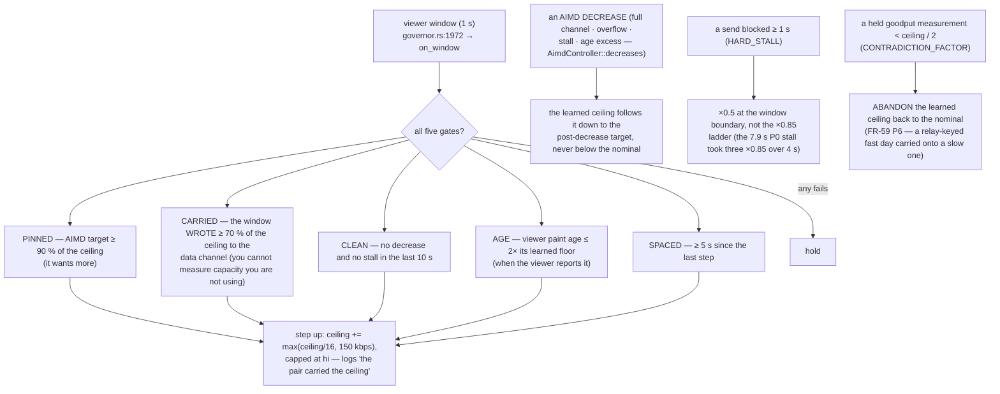

| gate / rule | constant | anchor |
|---|---|---|
| pinned | `PINNED_PCT` 90 | `ceiling_learn.rs:62` |
| carried | `CARRIED_PCT` 70 | `ceiling_learn.rs:64` |
| clean | `GROW_CLEAN` 10 s (decrease **and** stall) | `ceiling_learn.rs:58` |
| age | `AGE_FLOOR_FACTOR_PCT` 200 — was 150, until the first field run's 66–80 ms over a 43 ms floor turned out to BE the evidence | `ceiling_learn.rs:69` |
| spaced | `GROW_INTERVAL` 5 s | `ceiling_learn.rs:60` |
| step | `max(ceiling / 16, 150 kbps)`, capped at `hi` | `ceiling_learn.rs:76`, `:267` |
| hard stall | `HARD_STALL` 1 s ⇒ ×0.5, applied at the window boundary (FR-79: only there is it known the block was the pipe, not a pass the runtime stalled under) | `ceiling_learn.rs:71`, `governor.rs:1728` |
| contradiction | learned > 2 × a held measurement ⇒ abandon to the nominal, exactly once | `ceiling_learn.rs:202`, `:86` |

Two things the gates measure that read differently from their names, both found
in the 2026-10-27/28 field reads below:

- **CARRIED counts bytes the send task WROTE to the data channel in the window**
  (`governor.rs:1496`, the send task's running byte total over the elapsed
  window), not bytes the pipe delivered, and `on_window` runs on **every**
  constrained window — it does not read the FR-79 verdict (`governor.rs:2000`).
  So an opening burst the socket absorbs is "carried": on 2026-10-28 07:57:43 the
  first step landed 0.36 s *before* the opener grace ended, inside a 697 KB
  opener that had blocked a send for 164 ms — the very `Opening` window V4
  refuses as write-back evidence. The exposure is one step (+1/16) per session,
  capped by `hi`; the later steps need windows that really carry.
- **DECREASE means an AIMD decrease** — `AimdController::decreases` ticking
  (`aimd.rs:452`, `:467`; read at `governor.rs:1368`). The FR-59 P3 viewer bound
  (`governor.rs:1191`: the ceiling capped at 90 % of the viewer's reported arrival
  rate while its queue grows) lowers the AIMD's ceiling through `set_ceiling`,
  which clamps `desired` **without** counting a decrease (`aimd.rs:374`). The
  learner neither follows that bound down nor restarts its 10 s clean window on
  it — by the P3 ordering's own argument ("a live report that the receiver is
  falling behind outranks" the learner), but a reader of the heartbeat sees
  `target_bps` fall ×0.9 while `learned_ceiling_bps` holds.

The session's **stable rate** — the highest target that held 10 s
(`STABLE_HOLD`) with no decrease — is what the pair memory persists
(`ceiling_learn.rs:73`; next section), so the next session opens at 85 % of what
the pair proved and the learner climbs from that floor instead of the constant.
⚠️ "Held" was a hold of the AIMD *target*, not a delivery: on an idle session the
target sits at the opener's seed for the whole session, so `stable_bps()` was
that seed — see the write-back rows below for what that did to the memory. Since
V5b's q3 a hold counts only if a valid window carried at least 70 % of it.
Kill switches: `relay_ceiling_learn` (tribool, default on; off ⇒ `hi` = 0 ⇒ the
plan ceiling verbatim and no memory) and `relay_max_hi_kbps`
(`crates/agent-core/src/config_surface.rs:1145`, `:1257`; `mod.rs:969`). Direct
sessions never touch the learner (`governor.rs:786` gates on `constrained`).

⚠️ **Only the FFmpeg DC pump runs the learner.** `relay_max_hi_bps()` has one
caller (`peer.rs:6666`, `media_pump_ffmpeg_dc`), the VP9-444 pump builds its
governor with `hi = 0` (`peer.rs:4307`), and the RTP pump has no governor. There
is no software FFmpeg encoder, so a host with no hardware encoder never reaches
the learner, and `relay_ceiling_learn` reads the same on and off there. A VM
cannot prove that switch (FR-35 AC6). ⚠️ **On `h264_vaapi` the ceiling does not show in the bytes:** on jupiter (0.4.197, Raphael iGPU) one scroll delivered 10.7 Mbps under `maxrate` 2.55, 3.0 and 5.84 M alike, so on that cell read the target, `learned_ceiling_bps` and the memory ([FR-35's kill-switch A/B](fr/FR-35-relay-ceiling-learns-the-pair.md#the-kill-switch-ab-2026-11-02)).

> **Field, `CORPLAP-2` over `relay:derp/tcp`, 2026-10-27/28 — agent 0.4.177,
> 0.4.178 and 0.4.181** (the FR-35 surface is byte-identical from
> `agent-v0.4.177` through `agent-v0.4.185` and master; the host took 0.4.178 at
> 13:41Z and 0.4.179 at 18:01Z on 10-27, so no read here ran 0.4.179). Seven
> sessions on the pair `100.65.4.2|relay:derp/tcp` (AV1 NVENC, 1920×1200, DERP
> rtt 106–258 ms), read from the host's own log and `rate_memory.json`:
>
> - **Seeding (P2):** every session opened at 0.85 × the remembered rate —
>   `seed_bps` 4,750,677 ⇒ `opener_maxrate_bps` 4,038,075; 4,759,961 ⇒
>   4,045,966; 4,402,963 ⇒ 3,742,518 (×5) — against the 2.55 M a cold pair gets.
> - **Growth (P1):** the 10-27 09:23 session (79 s) stepped 4.04 → 4.29 → 4.56 →
>   4.84 M in its first 15 s while the 2 s heartbeats carried 6.2 / 6.3 / 4.4 /
>   7.6 Mbps, sat at 4.84 M through 45 s of an idle desktop (0.28–0.35 Mbps at
>   18 fps — not carried, no step), and stepped to 5.15 M at 09:24:34.8 on a
>   6.4 Mbps window. The 10-28 16:46:31 session (90 s) stepped 3.74 → 3.98 → 4.22
>   → 4.49 M during 12 s of motion (3.1–7.4 Mbps windows), then nothing for 60 s
>   of idle. Of the four 11–19 s sessions, three stepped once and the 07:57 one
>   three times (to 4.49 M on 4.7–7.3 Mbps windows); the idle 15:27 session never
>   stepped.
> - **Health** (the four sessions read heartbeat by heartbeat: 09:23 and 15:27
>   on 10-27, 07:57 and 16:46:31 on 10-28): `send_stalls=0` in every one;
>   `send_wait_max_ms` 0.04–2.1 except the heartbeat holding an opener burst
>   (52.4 ms on 09:23:26, 163.9 ms on 10-28 07:57:43) — never near `HARD_STALL`.
>   Viewer paint age p50 66–68 / p95 103–117 ms over a 45–50 ms floor, the maxima
>   (438, 775 ms) in a session's opening ten seconds (4 s and 10 s in). The
>   ceiling never passed 5,146,238 (`hi` = 8 M) in any of the seven.
> - **What held the opener at ~1.5×, not 2.5×:** the memory sat at 4.40–4.76 M
>   while the pipe carried 6–7.6 Mbps windows with sub-ms send waits. The
>   write-back rows below show why: a session that *proved* 4.84 M stable moved
>   the memory +0.2 % (`ALPHA_UP` 0.10 of the gap), the next idle session moved
>   it −7.5 % (its own seed written back as evidence). Nothing in these reads
>   measured a sustainable limit; the memory's level is the write-back's
>   dynamics, not the pipe's. (FR-35 AC1's numbers passed on 2026-10-31 without
>   moving this, and a cold opener passes them too:
>   [the opener A/B](fr/FR-35-relay-ceiling-learns-the-pair.md#the-opener-ab-2026-10-31).) ⚠️ **Compare opening keyframes only at equal `dc_unopen_drops`.** Every frame the pump encodes before the video channel opens is dropped and forces another keyframe (`peer.rs:9878`, `:9884`), and the one delivered shrinks as the count rises: 63,284 B at 2 drops and 23,435 B at 4 on one `maxrate`. At equal drops it follows `maxrate` ([what moved it](fr/FR-35-relay-ceiling-learns-the-pair.md#what-moved-the-openers-keyframe-2026-11-02), [#3334](https://github.com/gjovanov/roomler-ai/issues/3334)).

### The write-back and the seed (V2 + V4) — the pair memory

FR-35 P2 remembers a pair's rate so the next session opens at 85 % of it
instead of at the fleet constant. FR-79 changed **what** is remembered and
**under which key**. FR-148 P1 changed **which entry is read**: only a measured
one (the provenance row below):

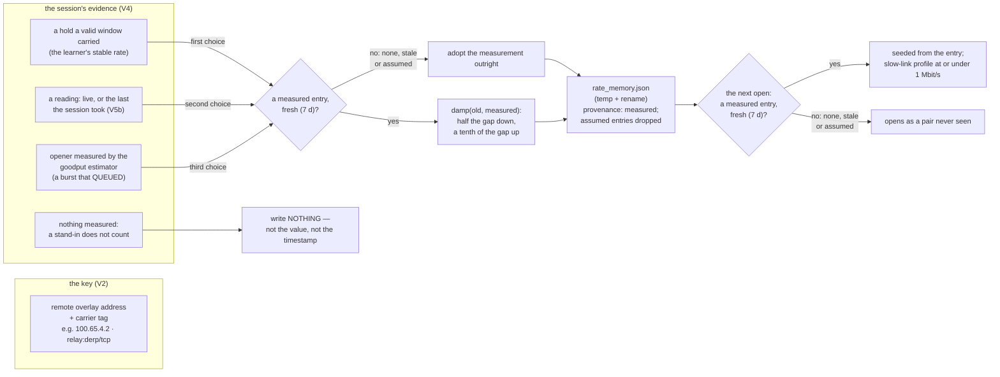

| piece | rule | anchor |
|---|---|---|
| the key | `remote_addr\|carrier` — `direct`, `tunnel`, `relay:<kind>/<transport>` from the LocalAPI peer record; a mid-churn carrier (`blocked` / `offline`) leaves the bare pre-FR-79 key. DERP-over-TLS and a UDP relay are different pipes on the same address, four times apart in capacity | `rate_memory.rs:42`, `:65`; `media_pair_memory.rs:163`, `:140` |
| the provenance | FR-148 P1. Every entry written carries `"provenance": "measured"`. An entry with no provenance, which is every entry written before this release, or with a value this agent does not know, is **assumed**. An assumed entry seeds nothing, so the pair opens as one never seen: no slow-link profile and no opening below the floor. It is no base for `damp`, so the first measurement replaces it outright. The next write for any pair drops it, because the file is written whole and an assumed value is never stored (FR-148 §4.1). A session that measured nothing leaves it as it is, unread, until it ages out. At the open, a fresh assumed entry logs `FR-148 P1 rate memory: … read as assumed …` with `assumed_bps` and `age_s`. **Rollback:** an older agent ignores the field and reads every entry again. Its whole-file write drops the field, so after a re-upgrade those entries are assumed: one session of learning per pair and carrier | `rate_memory.rs:107`, `:164`, `:173`, `:192`; `media_pair_memory.rs:571` |
| the opener | measured by the goodput estimator (bytes over blocked time) for a burst that queued; `None` for one the socket absorbed. The old `bytes × 8 / longest_single_wait × 75 %` recorded 6–8 M against a 1.8–3.4 M pipe | `peer.rs:9434` (`opener_measured_bps`) |
| the evidence | `RateGovernor::session_evidence_bps`: first `stable_bps()`, the highest AIMD target that held 10 s with no decrease, when above the nominal and, since V5b, carried by a valid window; then a live reading; then the last reading the session took; else 0 = nothing. ⚠️ Before V5b the first was a hold of the *target*, not a measurement: an idle session held the opener's seed for its whole length and wrote 0.85 × the memory back as evidence, and the second was `pipe_bps`, whose last source is the prior's stand-in, so a prior that stood low was written back too (field rows below) | `media_pair_memory.rs:708`; `governor.rs:926` |
| the write | `record_session(peer, evidence, now)`: `None` or 0 ⇒ **no write**; first evidence, or the first after an assumed entry ⇒ adopted outright; otherwise `damp` with the goodput estimator's own asymmetry (`ALPHA_DOWN` 0.50 / `ALPHA_UP` 0.10, `goodput.rs:94`, `:98`). The maximum rule, `had_decrease`, the unqueued ×1.5 step and its constants are gone | `rate_memory.rs:230`, `:79`; `media_pair_memory.rs:238` |
| the file | `rate_memory.json` in the daemon's data dir (`appdirs::project_dirs().data_dir()` — on a Windows SYSTEM service `…\config\systemprofile\AppData\Roaming\roomler\roomler\data\`); whole-file atomic write; a missing or corrupt file is an empty memory; an entry older than 7 days, or an assumed one, never seeds and is pruned on the next write | `rate_memory.rs:269`, `:22` |
| the log line | `FR-79 V4 rate memory: … peer=… evidence_bps=… kept_bps=…` at every session end that had a key. **`kept` lies between the old value and the evidence**, so `kept > evidence` on one line proves the entry moved DOWN — no old value needed | `media_pair_memory.rs:247` |

This memory moved out of the pump with FR-148 P1 (`RateMemoryGuard`,
`agents/roomlerd/src/media_pair_memory.rs:210`) and is otherwise unchanged: it still
seeds the opener, and its file is written byte for byte as before. Beside it P1 keeps
the path model's own memory, under a key that names the path
([§ The path memory](#the-path-memory-fr-148-p1--the-models-floor-under-a-key-that-names-the-path)).

Field reads of the write-back so far (key `100.65.4.2\|relay:derp/tcp` unless noted):

| when (UTC) | host · build | evidence → kept | what it shows |
|---|---|---|---|
| 2026-09-08 19:12–19:18 | CORPLAP-1 · 0.4.93 | 1.44 / 1.09 / — / 3.32 / 6.13 M, the max rule still in force | five openers 1.44–2.82 M inside a carrier measuring 1.09–6.13 M (AC5) |
| 2026-09-08 22:14–22:17 | CORPLAP-1 · 0.4.95 | `None → kept 2,264,993`, twice (`100.65.0.5`) | a session that measured nothing wrote nothing; the old rule would have written 3,825,000 from an absorbed burst (AC8, first half) |
| 2026-09-10 08:39:41 | CORPLAP-2 · 0.4.97 | `Some(3187500) → 3210512` from a seed of 3,233,525 | the entry moved **down** — `damp` exactly; the max rule would have kept 3,233,525. Marginal (0.7 %), but a direction the old rule could not take |
| 2026-09-10 14:03:44 | CORPLAP-1 · 0.4.97 | `Some(8000000) → 6318171` from 6,131,302 | the entry moved **up**, damped, after a session that measured the relay at 11.5–17.0 M — one ×0.10 step toward the learner's 8 M cap |
| 2026-10-27 09:24:41 | CORPLAP-2 · 0.4.177 | `Some(4843519) → 4759961` from 4,750,677 | the learner's stable rate (4.84 M held 57 s, windows carrying 6–7.6 Mbps) moved the entry **+0.2 %** — `ALPHA_UP` of a 93 kbps gap |
| 2026-10-27 15:29:46 | CORPLAP-2 · 0.4.178 | `Some(4045966) → 4402963` from 4,759,961 | **the P2b decay, in V4 form**: a 130 s session on an idle desktop (0.16–0.25 Mbps at 18 fps, a 405-byte opener) never stepped and never decreased, so `stable_bps()` was its own `opener_maxrate_bps` — 0.85 × the memory — and `damp` took half the gap: **−7.5 % for having measured nothing**. Ten such sessions halve the memory; one proving session restores a tenth of its gap |
| 2026-10-27 16:31 · 10-28 07:58, 12:38, 16:46 | CORPLAP-2 · 0.4.178 / 0.4.181 | `None → kept 4402963`, four times | sessions of 11–19 s: nothing held 10 s, nothing written — not the value, not the timestamp (as designed) |
| 2026-10-28 16:48:01 | CORPLAP-2 · 0.4.181 | `Some(4489010) → 4411567` from 4,402,963 | the 90 s session's stable rate (4.49 M after three steps) moved the entry **+0.2 %**; the file now holds `100.65.4.2\|relay:derp/tcp` = 4,411,567 at `at_unix` 1793206081 |
| 2026-10-30 12:22:06 | CORPLAP-2 · 0.4.187 | `Some(84195) → 84195`, a new entry | **the prior's stand-in written as evidence**: anchored at 180,484, it walked eight rungs in 28 s once the goodput expired, and `pipe_bps`'s last source wrote it. Nobody measured 84,195 |
| 2026-10-25 → 10-30 | CORPLAP-2 · up to 0.4.188 | 18 writes with evidence, `5955306 → 3379312` | **every one a rung of the session's own opener**, 0.85 × the memory × (17/16)^k, six at k = 0. 17 of the 18 sessions held no live measurement in any heartbeat, and the entry lost 43 % while they delivered up to 10.2 M |

⚠️ An entry written before V2 is keyed by the bare address, never matches
again and ages out. An entry that ages out is *replaced* by the next session's
first evidence, not damped toward it — the damping only ever acts inside the
7-day window.

⚠️ The 2026-10-27 15:29 row is the open question FR-79 q3 turns on. V4
dropped `had_decrease` because "the gate can tell a measurement from a
non-measurement" — but `stable_bps()` is not gated: a target that nothing pushed
is a hold, not a measurement, and on the connect-look-leave sessions this fleet
actually has it writes the opener's own seed back as evidence. The asymmetry
that protects against a flooded opener (believe a drop fast) then compounds it:
the pair that carried 6–7.6 Mbps windows is remembered at 4.4 M. A fix belongs
with the governor (`media_pair_memory.rs:708`: require the hold to have been *carried*, or
route the first-choice evidence through the gate); nothing here is changed yet.
The 2026-10-25 → 10-30 row is the same defect at scale: every write on that pair,
not only the idle sessions.
*2026-11-03: decided and built, V5b's q3 requires the hold to have been carried.*

**That week, replayed (2026-10-31).** `damp` reproduces all 24 sessions' logged
`kept` to within 2 bps, so the replay is the write-back itself. All 18 writes lie
within 0.2 % of a rung of the session's own opener, `0.85 × memory × (17/16)^k`,
which fixes what a write can do:

| rungs climbed `k` | evidence ÷ memory | the memory moves | writes that week |
|---|---|---|---|
| 0 | 0.850 | −7.50 % | 6 |
| 1 | 0.903 | −4.84 % | 2 |
| 2 | 0.960 | −2.02 % | 3 |
| 3 | 1.020 | +0.20 % | 4 |
| 4 | 1.083 | +0.83 % | 2 |
| 9 | 1.467 | +4.67 % | 1 |

A session raises the memory only by climbing at least three rungs and then
holding ten seconds; the week's mean was −2.98 % per write. Only 6 of the 18 held
a target that a 2 s window carried at ≥ 70 %. Counting only carried holds helps:

| rule | writes that count | end value, evidence as logged | end value, same rungs from the higher opener | opener, × the cold 2.55 M |
|---|---|---|---|---|
| today | 18 | 3.38 M | 3.38 M | 1.13× |
| the session's peak window reached 70 % of the evidence | 11 | 3.78 M | 5.51 M | 1.26–1.84× |
| a window at the held target reached 70 % of it | 6 | 4.13 M | 5.79 M | 1.38–1.93× |
| only rungs above the seed (`k ≥ 3`) | 7 | 4.23 M | 6.25 M | 1.41–2.08× |

The fourth column is an upper bound, because CARRIED is harder to pass under a
higher ceiling.

**Corrected 2026-10-31.** This section used to say a 2.5× opener needs a memory
of 7.5 M, on the assumption that the keyframe follows `maxrate`. It does not
follow it in a straight line ([the opener
A/B](fr/FR-35-relay-ceiling-learns-the-pair.md#the-opener-ab-2026-10-31)): on a
dense screen on AV1, 1.6× the maxrate gave 3.5–5.8× the keyframe, and on H.265
4:4:4, the same 2.55 M gave 23 to 63 KB. FR-35 AC1's numbers pass at the pair's
own 2.85–3.0 M, on a bar a cold opener clears too, so AC1 stays `[~]` until the
operator says which reading counts. The hold question is worth deciding for what
the memory buys on AV1, and AC1's numbers do not depend on it.

**Three writes in one night (2026-10-31, CORPLAP-2).** Evidence was
`stable_bps()`, else `pipe_bps()` (`peer.rs:9073`), and nothing clamps the
second to `hi`. ⚠️ V5b leaves this open: the 13.04 M was a live goodput, not a hold
and not a stand-in, so it is evidence by the new rules too:

| session | evidence | the memory |
|---|---|---|
| a 60 s drag, eight learner steps | 4,872,507 | 3,379,312 → 3,528,631, +4.4 % |
| opened and maximized an Explorer window | 3,187,500 | → 3,358,065, −4.8 % |
| 45 s, closed that window | 13,044,940 | → 4,326,752, +28.9 % |

One burst moved the memory six times further than a minute of real load. That
is the same question as the hold, from the other side: which sessions measured
the pair.

Below a memory of about 3.53 M the opener sits under the plan's 3 M, so an idle
session has no `stable_bps()` above the nominal (`ceiling_learn.rs:266`) and, with
nothing measured, writes nothing: an 8 min idle session read `evidence=None`. That
is where the week's decay stopped, at 3.38 M.

### V3b — ONE belief about the path (SHADOW since `agent-v0.4.98`, one consumer since V5b)

`encode::pipe::Pipe` (`pipe.rs:152`) answers a defect the shadow data made
undeniable: **there is no trustworthy, always-available estimate of what the
path carries.** The blocked-send source is silent whenever the queue is
downstream (every relay-TCP session), the viewer's arrival rate was being
thrown away unless the link loop called the window congested, and the pair
memory had almost nothing to remember. The type separates two kinds of
evidence the old `min(goodput, link_rx)` averaged together:

| evidence | meaning | source | accessor |
|---|---|---|---|
| a **delivery** | *"the path carried at least X"* — a lower bound, available every window on every carrier | the viewer's arrival rate (`governor.rs:1589`) | `floor_bps` — a MAX for the session, lowered only by contrary evidence, never by time |
| a **push-back** | *"the path refused above X"* — a limit | an accepted goodput fold (`governor.rs:1708`), or the arrival rate while the viewer's queue grows (`:1855`) | `capacity_bps` (`pipe.rs:657`), 60 s TTL |
| the anchor a ceiling may be built on | `max(capacity, floor)` — never `min` | — | `ceiling_anchor_bps` (`pipe.rs:683`) |

⚠️ **It is a shadow, with one exception.** The heartbeat prints `pipe_belief=(anchor,
floor, capacity)` and `pipe_belief_n=(deliveries, capacities)` (`peer.rs:8545`), and
none of the three values has a consumer: not V5, not the ceiling, not the memory.
V5b reads one fact and nothing else, whether a delivery RAISED the floor
(`Pipe::observe_delivered`, q2). The shadow corrected its own design three times in
five days, which is why this page stops here rather than describing a law:

| release | what the shadow found | correction |
|---|---|---|
| 0.4.99 (V3b-1) | a healthy idle relay session read `belief=1.8 M` from 35 deliveries and zero push-backs; a rule reading that as "the pipe" would have called a fine session overdriving | no single `believed_bps()`: `capacity_bps` answers *am I over?* (`None` = no claim to contradict), `ceiling_anchor_bps` answers *what may the ceiling be?* |
| 0.4.99 (V3b-2) | a host that had demonstrated 8.4 M read 12.8 kbps hours later on a static screen (`n=(10696, 0)`); a 30 s window cannot tell a degraded path from a quiet one | the floor is retired by **evidence**, not time: only a push-back lowers it, and damped (`rate_memory::damp`), never snapped |
| 0.4.100 (V3b-3) | a capacity of 13,163,844 expired after one TTL and the anchor fell back to a content floor of 4,050,945 while the target ran to the 34.56 M constant | a capacity sample **is also a delivery** — those bytes got through — so it raises the floor, and the demonstration survives the estimate expiring |

What two more weeks of shadow say (2026-09-24, CORPLAP-2, three hours over
`relay:derp/tcp`): `pipe_belief_n=(9912, 1)` — nine thousand deliveries, **one
push-back**, while the transport stalled 118 times with no number attached.
Whether V5 should read `capacity_bps`, and what a transit stall should feed
into the belief, is the open question the shadow exists to answer; do not
build on the anchor's semantics until it has. FR-74 P5's gate was read against
this shadow on 2026-09-25 — the result, and the floor-damping interaction it
found, are under [§ The direct path](#the-direct-path-fr-74--a-ceiling-that-is-a-bound-a-gate-that-measures-lag).

## The Priority dial

The viewer's Priority dial (`Sharper` / `Balanced` / `Smoother`) is the only
user-facing rate knob. Since rc.445 all three run at **native resolution all
the time**; they differ in the **bitrate ceiling** handed to the encoder:

| Dial | Ceiling factor | Feel |
|---|---|---|
| Sharper | 100 % | Maximum per-frame quality; fps dips first under load |
| Balanced | 85 % | Default |
| Smoother | 70 % | Smallest motion frames → steadiest fps on thin links |

Why this works: the encoders run **constant-quality VBR with a maxrate cap**
(`cq`/`global_quality` ≈ 22 + `maxrate` + a 2× HRD window). A settled desktop
costs almost nothing, so it *never touches the ceiling* — at rest every dial
delivers identical, full-quality text. During motion the HRD binds and the
encoder raises QP **continuously, frame by frame** — smaller frames, steadier
arrival, more fps through the same pipe. A lower ceiling simply moves that
trade further toward fluidity. No mode switch, no rebuild, no seam.

### Why resolution flips were removed (rc.445)

Until rc.443 Smoother/Balanced dropped to a 1024/1280 rung during motion and
refined back to native at rest. Field measurement (2026-08-21, three hosts)
killed the design: every flip is a **blocking encoder open on the pump
thread** — 865 ms down / 654 ms up on an Iris-Xe-class iGPU — plus a
new-resolution IDR queued behind stale frames. Users felt it as "drag takes
off ~1 s, freezes ~1 s, continues", and unanimously preferred Sharper (the
one dial that never flipped). The rungs remain available behind the
`priority_res_cap` config key for A/B, but the default is: **resolution is
not a rate-control lever**. (An explicit resolution pick by the viewer, and
the encode-bound auto-downscale tier, still apply — those change rarely and
deliberately, not per drag.)

## The per-session control loops

Each DC video pump runs these, owned by `encode::governor::RateGovernor`
(P8c) and executed by the pump:

| Loop | Signal | Actuator | Cadence |
|---|---|---|---|
| **CQ + HRD** | encoder-internal | per-frame QP | every frame, zero cost |
| **AIMD bitrate** (`encode::aimd`; every move says why, [§ Why the target moved](#why-the-target-moved-fr-148-p0--every-move-of-the-live-target-says-why)) | send-channel occupancy + byte budget | `set_bitrate` → ladder-coarsened maxrate | MD ≤1/500 ms, AI ≤1/5 s |
| **Byte-budget queue gate** (rc.442; FR-74 P1b on direct paths) | relay: bytes in flight vs `constrained_queue_ms` (450 ms) of the relay ceiling. Direct: the **measured send wait** vs `direct_queue_ms` (150 ms) once bytes exceed 150 ms of the ceiling; bytes alone gate only at the encoder's HRD reservoir ([§ The direct path](#the-direct-path-fr-74--a-ceiling-that-is-a-bound-a-gate-that-measures-lag)) | skip producing a frame | every loop iteration |
| **Viewer-rate divisor** (`encode::viewer_rate`) | browser's decoded-fps + struggling report. Since FR-119 P2b-7 the browser judges "struggling" on its decode backlog in TIME — a window whose mean backlog exceeds 33 ms, or a frame shed at 67 ms — not on a frame count, which halved its meaning at every doubling of the rate | send every Nth frame | 1 s windows |
| **Encode pressure + auto tier** (`encode::encode_pressure`) | avg encode ms | maxrate factor; long-edge cap when encode-bound | 2 s heartbeat |
| **Goodput estimate** (`encode::goodput`, rc.453) | blocked-send goodput from the send task, folded **only when the validity gate accepts the window** (§ above) | the measured-ceiling clamp (stage 1), FR-59 P1/P6 via `pipe_bps`, V5's `stall_is_ours` via `measured_bps`, the pair memory's write-back | folded on the viewer window |

Three rules keep them from stepping on each other:

- **Rebuild-bound bitrate applies are motion-deferred** (rc.445). NVENC
  reconfigures maxrate in place; QSV/AMF must rebuild the encoder — a
  blocking open. The pump holds AIMD applies while any real frame encoded
  ≥4 KB in the last 1.2 s (the motion clock; caret/keystroke deltas at
  0.5–3 KB never hold it) and flushes once quiet — the rebuild then stalls a
  static image nobody can see, and its first-frame IDR doubles as the
  post-motion refresh. ⚠️ At constant bitrate QSV pads every frame to `maxrate ÷ fps ÷ 8` bytes (10,638 at 2.55 Mbit/s), so every real frame, a caret blink's too, reads as motion, the clock never goes quiet while anything on the screen changes, and a deferred apply waits for good: [FR-148](fr/FR-148-path-measured-plan-follows.md) measured 0 rate moves in 16,719 s, and a still screen spending about 0.9 Mbit/s on keepalive filler. `qsv_rate_mode = qvbr` (FR-148 P2) opens QSV off constant bitrate, so a frame can be as small as its content ([encoders.md](encoders.md#qsv-off-constant-bitrate-fr-148-p2)); whether a still QSV frame then falls under 4 KB is FR-148 AC13's read, owed.
- **A rebuild bumps the send epoch** (rc.445): the send task discards
  queued frames from the previous encoder, so the fresh IDR ships
  immediately instead of behind up to 450 ms of obsolete motion.
- **A rate move is not a viewer limit** (FR-119 P2b-4). The viewer-rate cap
  starts at the capture rate, which means no cap, and it follows the capture
  rate when that moves: FR-119's 60 → 120 swap, or a relayed session going
  direct. Before, it stayed at the old rate and read as a clamp, so every
  other frame was dropped for the 3–5 s of the recovery climb. A cap below the
  capture rate is the viewer's own number and stays where it is.

Rebuilds also reuse the session's **proven encoder name** first instead of
re-walking the vendor cascade (a failed tiered open of an absent vendor's
encoder costs 100–300 ms), and open at `min(ceiling, AIMD target)` so the
governor's forced reapply cannot trigger an immediate second rebuild.

## The direct path (FR-74) — a ceiling that is a bound, a gate that measures lag

Everything above is about paths that push back. A direct path on a LAN or a
good WAN mostly does not, and until `agent-v0.4.77` the controller there was
fighting itself. The operator's own test that opened FR-74 (2026-09-06,
CORPLAP-3, `av1_qsv` 1920×1200 at 4 ms RTT, a Notepad++ scroll — the record is
[`fr/FR-74-text-clarity-on-direct-paths.md`](fr/FR-74-text-clarity-on-direct-paths.md)):
the direct ceiling was a constant, `0.07 bpp × 1920 × 1200 × 60 = 9.68 Mbps`,
and Sharper was 100 % of it; every scroll burst overran it; the send queue
crossed a byte budget denominated in the **applied** target; the gate skipped
frames; and the AIMD read its own cap as congestion — three ×0.85 cuts in six
seconds, ~40 s of additive climb back, and on QSV a rebuild plus an IDR at
every ladder crossing (37 swaps and 35 settle keyframes in 11 minutes). The
budget was self-reinforcing: at 2.5 Mbps it was ~47 KB, one text frame tripped
it, and a session sat at 2–3.7 Mbps for minutes.

Two changes fixed it, both on the direct branch of the FFmpeg pump, relay
paths untouched byte for byte, and **no new switch** — the operator's overrides
(`FFMPEG_MAXRATE_KBPS`, `direct_queue_ms`) are the way back in both directions.

### P1 (0.4.77) — the ceiling is a content-generous bound

`rate_profile::ffmpeg_maxrate_bps_scaled`
(`agents/roomlerd/src/encode/rate_profile.rs:219`) uses **0.25 bpp/s on a
direct path** (0.07 on a constrained one, min'd with the relay clamp as
before), clamped to **[3, 48] Mbps × the codec/chroma factor**
(`codec_rate_factor_pct`, `:129` — AV1 100, HEVC and VP9 125, H.264 150;
`chroma_rate_factor_pct`, `:155`, for 4:4:4 cells). The fleet's heartbeats
show the products: 34.56 M for AV1 at 1920×1200 @ 60, 43.2 M for HEVC and
`vp9_qsv` there, 38.88 M for HEVC at 1920×1080. It is a **ceiling, never a
target**: the encoders run constant quality under `maxrate`, so a settled
desktop spends almost nothing and only motion approaches the bound.

`policy::rate_plan` (`encode/policy.rs:241`) finishes the chain: × the dial
(`dial_rate_factor_pct` — 70 / 85 / 100, clamped to [30, 100]) × the
encode-pressure factor (`governor.encode_factor()`, `governor.rs:2187`),
floored at `MIN_BITRATE_BPS` (1.5 M, `encode/mod.rs:277`). On a direct
transport `effective_ceiling` is the plan's value unchanged (`governor.rs:683`
— the learner lifts it on constrained sessions only); the shared-pipeline split
divides it by the follower count; and the result is both the AIMD's ceiling
and the gate's reference rate (`last_ceiling_bps`, `peer.rs:7176`).

⚠️ The encode-pressure factor multiplies the bound, so a host whose encoder is
struggling lowers its own ceiling with no path evidence in it. On 2026-09-25
CORPLAP-3's ceiling fell to 13.82 M (0.4 ×) at 4 ms of viewer age and 0 bytes
in flight while its `av1_qsv` passes took 120–170 ms and the cadence was paced
60 → 20 fps, and it was back at 27.8 M eleven seconds later. Read
`ceiling_bps` on the `set_bitrate` line before calling a `target_bps` drop a
path event.

### P1b (0.4.79) — the gate is the measured wait's call

P1's budget (150 ms of the ceiling) still tripped once on 0.4.77: AV1's HRD
window is floored at 200 % of `maxrate` (Intel's VDENC hangs on a forced IDR
larger than its reservoir — the rc.443 incident), so the encoder was
*configured* to emit an 8.6 MB burst against a 648 KB budget, and the
controller cut on a burst it had itself legalised, at ≤ 20 ms of viewer age.
Bytes cannot tell a burst the wire is draining from a backlog the viewer
feels; the send wait can, and it is the quantity `direct_queue_ms` was always
meant to bound.

| piece | rule | anchor |
|---|---|---|
| soft budget | `direct_queue_ms` (150) × ceiling ÷ 8, floored at 48 KiB; `0` disables the gate | `rate_profile.rs:559` (`direct_queue_budget_bytes`) |
| hard budget | `max(soft, HRD reservoir)`, the reservoir being `maxrate × open_hrd_pct ÷ 8` — 100 % on direct (`direct_hrd_pct`, `:590`; config `direct_hrd_pct`, [25, 200]), 200 % for every `av1_*` encoder regardless | `rate_profile.rs:578` (`direct_queue_hard_budget_bytes`); `ffmpeg/encoder.rs` `open_hrd_pct` |
| measured wait | the larger of an EMA (α 0.3 per pass) of completed frames' enqueue→wire-complete waits and the **live age of the frame the send task is writing** (`send_head_enqueued_us`) — a stalled pipe completes nothing, so the EMA alone reads stale-low exactly when the queue grows | `peer.rs:6684`–`6266`; set and cleared by the send task at `:5947`, `:6015` |
| the verdict | bytes ≥ hard ⇒ trip; bytes ≥ soft **and** wait ≥ `direct_queue_ms` ⇒ trip; otherwise pass | `rate_profile.rs:597` (`direct_gate_trips`), called at `peer.rs:6728` |
| on a trip | the pass skips producing a frame (`frames_skipped_backpressure`) and drives the AIMD's multiplicative decrease, as the full-channel arm always did; the first trip logs `direct byte-budget gate engaged` with `inflight`, `budget`, `hard_budget` and `measured_wait_ms`, so a field read can tell which arm fired | `peer.rs:6807`, `:6682` |
| relay paths | unchanged: bytes vs `constrained_queue_ms` (450) of the relay ceiling, no wait term | `peer.rs:8031-8048` |

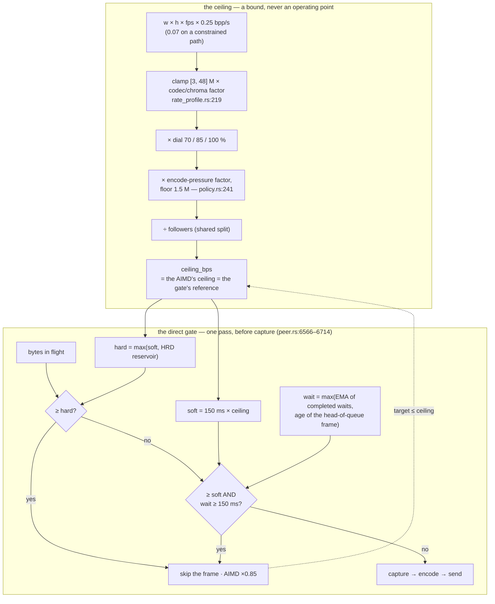

**Field.** The P1b gate on the release's defaults (0.4.79, 2026-09-07,
CORPLAP-3, the operator judging): no blur on AV1, VP9 4:2:0 or H.264, and the
sessions' heartbeats read 0 cuts, 0 gate skips and 0 gate lines at 20–36 Mbps
and 30–47 fps; the rate ladder stopped firing on direct paths altogether (0
swaps in 17 sessions on three hosts, where the baseline had 37 in 11 minutes),
which retired the planned QSV hysteresis. What the gate deliberately does not
see: a pipe throttled **below the socket** (an OS QoS policy, a thin Wi-Fi
driver queue) queues where `bytes_inflight` cannot look — measured 2026-09-07
with `roomlerd.exe` capped at 15 Mbps, the gate shed nothing and the cost
surfaced as 160–380 ms of viewer age instead. That standing lag is the viewer
age's call (FR-15), not this gate's.

The libvpx VP9 4:4:4 pump is a different machine and got its own fix in the
same arc (P3, 0.4.80: `rc_max_quantizer` 16 on direct transports, because
libvpx resets q to the worst on every wheel notch — [encoders.md](encoders.md)),
and the viewer's pixel chain, which no encoder setting can undo, got the
display-scale pill (P4 — [remote-control.md](remote-control.md) §18.6.1).

### P5 — the ceiling follows the path: decided, refined, and NOT built

A higher constant is still a constant. On 2026-09-10 a direct HEVC session on
another host (the Regal cell, 1920×1080 at 6–11 ms of paint age) ran for hours
between a 38.88 M ceiling with no measurement in it and a path that pushed
back at ~6 M: 4.5 minutes to first reach the ceiling, then a collapse to the
measurement every two to three minutes, every collapse a visible softening.
The decision (FR-74 §P5, refined 2026-09-15): the bpp product becomes a
**cap**, and the ceiling follows the FR-79 V3b belief above — with the
asymmetry that **only a refusal (`capacity`) may lower the ceiling, a delivery
(`floor`) may only raise it**, and the capacity trace decays upward while
nothing pushes back, so the loop has no ratchet in either direction.

It is gated on the shadow reading sane, and the gate was read on 2026-09-25
from the hosts' own daemon log files over Fleet RPC (agents 0.4.99–0.4.102;
four hosts; 104,698 heartbeats in 37 sessions, 09-11 → 09-25; the exec-enabled
population only — three corp laptops and the Regal cell):

| the gate asked | what the shadow said |
|---|---|
| on relay hosts the anchor is not `None` | **holds** — the two relay sessions (5,240 constrained windows) carried a floor within their first five windows and an anchor of 3.5–5.2 M for the rest (`pipe_belief_n` 9,912 / 1 over three hours, 155 / 0 over three minutes) |
| a quiet screen must not read as a thin pipe | **holds since 0.4.99 (V3b-2)** — 19 of 19 push-back-free direct sessions ended at their maximum floor, and each of the 7 whose floor fell carried a push-back; CORPLAP-3 held 34.27 M through 3.5 min of idle after one scroll. The 0.4.98 control on the same host: 16.4 M → 13.5 kbps over 4.3 h with no push-back |
| on a direct session the anchor tracks the path, not the content | **not as written, and not meetable** — before the first burst the anchor *is* the content's weight (the Regal sessions open at 0.07–2.4 M and take 4 s to 2.2 h to reach half their eventual floor; a 4.6-min CORPLAP-3 session never rose above 3.5 M on a path that carries 34 M). Nothing measures capacity on an uncongested direct path. The refinement already makes this harmless: a delivery never lowers the ceiling |
| the push-backs are real refusals | on the LAN-class hosts the only capacities are the encoder's burst drain **at the cap** (34.3 M against a 34.56 M ceiling; 45.6–59.7 M against 43.2 M) — not refusals, and `limit ≥ bound` leaves the ceiling alone. On the Regal cell: **14 accepted push-backs in ~51 h of sessions, 0.85–19.9 M**, send waits up to 1.36 s around them (two ≥ 1 s hard stalls); at every one the target had already collapsed from 38.88 M to 1.5–17.0 M (median 3.9 M) — today's sawtooth, at one accepted fold per ~3.6 h rather than the 2–3 min period of 09-10 |
| the floor guard holds | **it erodes** — V3b-2 damps the floor by half the gap on *every* push-back below it, whatever the spacing: 28.84 → 18.09 → 11.82 → 7.76 M on three push-backs 5.5 h apart; 38.90 → 22.26 → 14.04 → 8.57 → 9.78 → 14.21 M on five in 1.6 h, the demonstration re-arming to 16–25 M between them. The refined law's "never below what the path has demonstrably carried" assumed an undamped demonstration; with the damped floor, P5's ceiling on that cell would have sat at 8–18 M for hours of sessions whose path also carried 24–39 M, and an encoder under an 8 M ceiling cannot demonstrate 25 M, so recovery would rest on the upward decay alone |

⚠️ So P5 is **not built**. Whether a ceiling at 8–18 M beats the constant with
its ~90 % collapses cannot be read from the belief alone — it needs the
viewer's outcome under both laws, and the 09-23 daytime viewer on that cell
reported no paint age at all. What unblocks it, in order: (1) a decision on the
guard — an undamped demonstrated maximum kept beside the damped floor, or a
time-aware damping — a `Pipe` change and FR-79's to make; (2) the two numbers
the design leaves open, `HEADROOM` and the upward-decay rate (FR-70 P1's law);
(3) a replay of the Regal 09-25 arc in `encode::sim` under both laws, before
any release; (4) the release, and an A/B on that cell with a viewer that
reports age — the same log sweep reads the after.

## Crisp at rest

Orthogonal to the dials (the P7→P8 "sharp all the time" arc):

- **Damage-gated capture** — static screens produce no frames; DXGI/WGC
  report real dirty rects, judged by area (rung-invariant).
- **Polish loop** — at rest the pump re-encodes the last frame on the
  keepalive cadence; CQ-driven VBR spends the idle budget sharpening, so
  text converges to full quality within ~1 s of motion ending.
- **Settle IDR** (`SettleKeyframeGate`) — one resync keyframe after a real
  motion burst (≥10 frames), burst-gated so caret blinks never metronome
  IDRs.

## Software encoders at 60 fps (FR-112)

The two software pumps, VP9-444 on the DataChannel and OpenH264 on the RTP track, target **60** on Linux.
A software pace brings them down to what their encoder sustains, never below the 30 they had before. Full
treatment, with the clock that made 60 reachable: [`encoders.md` § Software encoders](encoders.md#software-encoders-the-clock-and-60-fps-fr-112).
What it changes here:

| Lever | Before FR-112 | Now |
|---|---|---|
| frame rate | a constant 30 | 60, paced by `SoftwarePace` (`encode/encode_pressure.rs:242`) in 5-fps steps, never below 30: down at once, up only with 2.5 fps of headroom (P2d) |
| bitrate base | `w·h·fps·0.20` at the target | `bitrate_base_for_fps` (`encode/mod.rs:842`): the old figure at 30, ×√(fps/30) at the rate the pump runs at |
| OpenH264's per-frame budget | configured for 30 whatever the rate | `set_frame_rate`: the rate the pump runs at, the keyframe period kept at 2 s |
| the auto-fps-cap (a software encoder dropped to 30) | always | only where the tier is off: Windows and macOS by default |

⚠️ The pace steps per heartbeat window on the encode cost alone. A host whose capture is the costly stage is not
paced by it, and is limited by its own loop as before.

⚠️ **A step up waits for headroom** (P2d, `SW_PACE_UP_MARGIN_FPS`, `encode/encode_pressure.rs:255`). FR-1's
`FpsPace` was meant to hold a pace until the estimate moved a full step, but it compared two 5-fps steps, which
always differ by at least a whole step. So on 0.4.142 an estimate hovering on a step boundary moved the pace every window it
crossed (a field trace: 55 → 50 → 55 → 50 → 45 → 50, five moves in ten windows). The software pace now steps down at
once and up only when the encoder clears the higher step by 2.5 fps. The hardware pace keeps margin 0 until it
is measured on hardware ([#2432](https://github.com/gjovanov/roomler-ai/issues/2432)).

## Above 60 fps (FR-119) — the ceiling law and the pipe, per rate

A viewer may ask for 120 or 144 fps, and the agent grants a rate only where the host has shown it can sustain
it ([`remote-control.md` §5.4](remote-control.md#54-above-60-fps-the-viewer-asks-the-host-proves-it-fr-119)).
Here is what the rate controller does differently above 60. At and below 60, every ceiling is byte-identical
to before.

**The rate law.** The ceiling is computed at `rate_law_fps` (`encode/rate_profile.rs:184`): the rate itself up to
60, and above that the 60 fps rate scaled by `(fps / 60)^α`, with `HIGH_FPS_ALPHA = 0.8`
(`encode/rate_profile.rs:179`). The band's top grows the same way. α is the upper envelope of FR-119 P0(d)'s
offline measurement, where α ran from about 0 to 0.8 by codec and content. A linear law would double the bits
at 120; a fixed band would halve them per frame.

| Rate | `rate_law_fps` | Bits per frame, as a share of 60 fps |
|---|---|---|
| 60 | 60.0 | 1.00 |
| 120 | 104.5 | 0.87 |
| 144 | 120.9 | 0.84 |

So 1080p at 144 gets 62.7 Mbit/s where the linear law clamped it to 48, and 2560×1600 or 4K at 144 reach the
class top, 96.7 Mbit/s.

**The pipe, per rate.** Before granting a rate the agent checks that rate's own ceiling against the session's
pipe push-back (`pipe_covers`, `encode/frame_rate.rs:297`). Since P2b-18, a pipe that covers 120's ceiling but
not 144's runs the session at 120 instead of the base rate. Only a push-back refuses: the FR-79 belief's
`capacity_bps`. The belief's floor is never read as a limit. At 60 fps the floor is the content's weight at 60,
which is always under the ceiling at 120, so read as a limit it would refuse every healthy session.

⚠️ **A keyframe is not a capacity measurement** (P2b-13, P2b-14, `Reason::KeyframeBurst`,
`encode/evidence.rs:90`). On a direct path, a window holding a blocked keyframe send is rejected as evidence.
Before that, one ~625 KB keyframe whose send blocked for 72 ms read as 70 Mbit/s of capacity on a mesh that
carried 311, and took 120 back on `pipe`.

## The media plan, in shadow (FR-70 M3a)

FR-70's M3 moves every rate and geometry decision out of the media loop into a
**plan** the loop reads. M3a (`agent-v0.4.144`+) ships the plan's producer and
runs it in SHADOW: nothing reads the plan yet, and the pump's inline decisions
are unchanged, but once per pass the FFmpeg DC pump computes the plan from the
facts it has at that instant and compares it, field by field, against the
inline value it computes later in the same pass. The retirement gate for the
inline arithmetic is the operator's standing rule — the counter must read
**fleet-zero** before M3b flips the loop — so a divergence is a measured bug in
the plan, not a regression in the field. Design and anchors:
`docs/fr/FR-70-media-pipeline-leaves-the-runtime.md` §"M3a — as built".

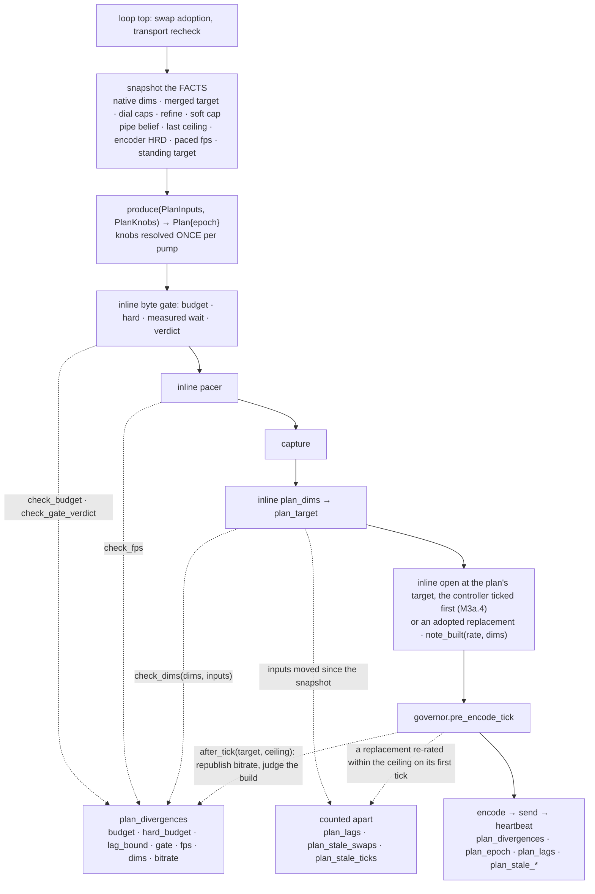

| plan field | what it is | the inline value it is compared with |
|---|---|---|
| `queue_budget_bytes` | FR-59 P2 / FR-74 P1 — link time at the reference rate (the pipe belief on a relay, the LAST frame's ceiling on direct) | the pump's `queue_budget` at the gate |
| `queue_hard_budget_bytes` | FR-74 P1b — the larger of the soft budget and the encoder's HRD reservoir; equal to the soft budget on a relay | the pump's `hard_budget` |
| `queue_lag_bound_ms` | the measured-wait bound that qualifies the soft budget; **0 = bytes alone trip it** (the relay's rule), which is what lets `direct_gate_trips` serve both transports | the bound the gate used |
| `fps` | the pace in force, else the target — the loop paces itself only below the target (rc.93) | `paced_fps.unwrap_or(target_fps)` |
| `dims` | `plan_dims` reduced by the resampler's rule; `(0, 0)` before the first frame | `target_dims(native, plan_target)` each frame, and the dims of every encoder the loop builds |
| `bitrate_bps` | the governor's standing target on the ladder — the one input that is itself a decision (the controller is M4's) | the rate of every encoder the loop builds by itself (the inline open, an adopted replacement), judged after the controller's next tick |
| `epoch` | moves when any other field moves | — (`plan_epoch` on the heartbeat counts distinct plans) |

What stays with the loop as a **fact**, deliberately: the bytes in flight, the
send-wait EMA and its cursors (a measurement that only reads like a decision),
the live head-of-queue age, the captured frame's own dims and the M2 pin.

Under `ROOMLERD_INFLIGHT_BUDGET=on` (FR-148 D46 B3) the relay byte gate shuts no
relayed pass. The pump still computes it as before and hands it to
`check_gate_verdict` before the budget's gate, so `plan_divergences` reads as it
does with the budget off, in every mode
([§ The budget acts under `on`](#the-budget-acts-under-on-d46-b3)).

**Reading it.** The heartbeat carries
`plan_divergences = PlanDivergences { budget: 0, hard_budget: 0, lag_bound: 0, gate: 0, fps: 0, dims: 0, bitrate: 0 }`
and `plan_epoch = N`. A field's FIRST divergence of the session also logs once,
with both values:

```
WARN FR-70 M3a: the shadow plan diverged from the pump's inline value (first time this session for this field)
     field="dims" plan="(1920, 1200)" inline="(944, 590)"
```

Read the line, not the count: it names the field and the two numbers.

Three things are counted **apart** from the divergences, because none is a bug
in the plan, and each logs its first occurrence once:

| heartbeat field | counts | since |
|---|---|---|
| `plan_lags` | a geometry difference whose INPUTS moved between the plan's snapshot and the inline read: a native-dims change under a live session (a display-mode switch), a resolution or Priority write landing in between, a viewer joining a shared pipeline, a refine flip or a soft-cap move. The log line names the input that moved (`moved="native"`, `"target"`, `"priority_cap"`, …) | FR-70 M3a.3 |
| `plan_stale_swaps` | a replacement adopted after the plan moved while it opened | FR-70 M3a.1 |
| `plan_stale_ticks` | a replacement adopted while the plan held, whose rate the controller moved on its very next tick within the frame's ceiling (a congestion decrease, often set off by the replacement's own IDR) | FR-70 M3a.3 |

The gate reads `plan_divergences` alone. A geometry divergence there had its
inputs hold, and a bitrate divergence is an encoder built at a rate the plan
did not stand behind: an inline open re-rated on its first tick, a replacement
built above its frame's ceiling, or one re-rated on a tick that did not move.
Each of those is a plan bug and blocks M3b. ⚠️ A `pipe_bps` TTL expiry between
the two reads would still read as a budget divergence: no counter classifies
the budget fields yet, and none has been seen.

**What a full rebuild is built at (FR-70 M3a.4).** The pump asks
`encode::plan::frame_step` (`agents/roomlerd/src/encode/plan.rs:974`) whether a
frame is served by the live encoder, dropped, or opened for. An open is for the
frame resampled to the plan's target, never to M2's pin, and
`encode::plan::open_rate` (`plan.rs:1024`) ticks the controller first, under the
ceiling of the dims it opens at, so the encoder opens at the rate the plan
holds when its first frame encodes; the pass's own tick is then skipped. A
keepalive of a frame the capture scaled under a cap since raised cannot reach
the plan's geometry: it waits for a fresh capture out of an allowance of its
own, 25 keepalives (about 1.5 s) refilled with the three-frame budget at each
cap change (`encode::plan::StaleBudget`, `plan.rs:915`), and only then spends
that budget and opens at its own size, as before. The AC10 week from
2026-11-11 found the two shapes this closes: a capture flapping between one
display and the virtual screen, whose rebuild opened at the virtual screen's
native size behind a `Native` pin, and an idle screen whose keepalives took the
rebuild at the old size just after a swap up was adopted. The cells are
`a_rebuild_racing_a_dims_swap_opens_at_the_plan_s_size_and_rate`,
`a_rebuild_through_a_native_geometry_flap_opens_at_the_plan_s_size_and_rate`,
`an_inline_open_is_built_at_the_rate_the_plan_holds_when_its_first_frame_encodes`
and, for the wait's bound,
`a_capture_that_never_reaches_the_plan_s_geometry_still_gets_an_encoder`, in
`encode::plan::tests`. ⚠️ What it leaves: after a swap to a larger geometry is
adopted on a still screen, a backend that does not capture again (DXGI-direct
captures again only on a cap lifted to none) encodes nothing for about 1.7 s
and then opens at the old size, as before, which the shadow counts as a `dims`
divergence. Design and anchors: FR-70 §"M3a.4".

⚠️ **No kill switch, on purpose.** The shadow changes no decision, takes no
await, adds no env read to the frame path (every knob is resolved once per pump
into `PlanKnobs`) and logs at most seven lines per session; a switch would be
the twelfth of the kill switches FR-70 exists to delete, guarding nothing.
⚠️ The VP9-444 pump and the RTP pump run no shadow (M3b decides whether the
software pump reads the same plan; the RTP pump has no governor).

## The shadow rate controller (FR-63 B1)

Everything above is eight estimators of one quantity — the pipe's rate —
composed with "the lower of" rules (the occupancy AIMD, the blocked-send
goodput, the FR-35 learner and pair memory, FR-59's floor relief / arrival clamp
/ drain / seed contradiction / remembered-rate opener, the FR-15 age loop). FR-63
([`fr/FR-63-one-delay-based-rate-controller.md`](fr/FR-63-one-delay-based-rate-controller.md))
replaces them with **one** delay-based controller, `encode::ratectl::Controller`
(`agents/roomlerd/src/encode/ratectl.rs`), and does it the way the rate-control
plan requires — **shadow-first**. B1 (`agent-v0.4.188`+) builds the controller
and runs it beside the live governor, emitting what it *would* decide into six
`shadow_*` heartbeat fields. It drives nothing; B2 flips it live on a fleet-log
flip criterion, B3 deletes the eight.

⚠️ **Containment is the whole safety property of this phase.** The governor owns
the controller as `shadow: Option<ratectl::Controller>` (`governor.rs`), fed only
through its methods at the five live positions and read only by the `shadow_*`
accessors. No live decision is a function of anything it computes, and
`governor::tests::the_shadow_never_moves_the_live_decision` proves it: two
governors identical but for `ratectl` (Off vs Shadow), driven through the same
frames and windows, must produce byte-identical `applied_bps`, relieved floor,
pipe-state tally, link stats, goodput samples and viewer age — and a red-run that
lets the shadow write a live field fails it.

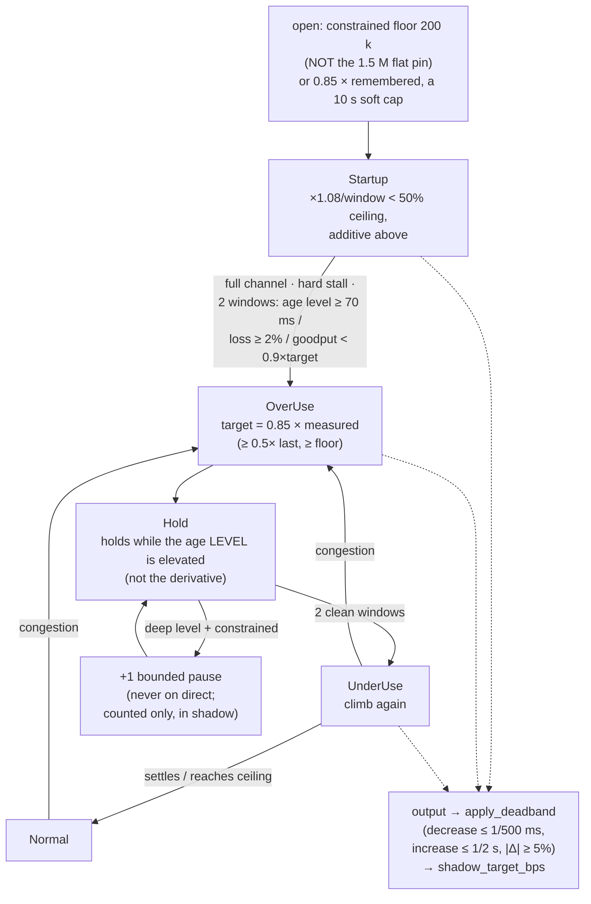

`measured` is the viewer's arrival rate on a constrained path, `min(goodput, rx)`
on a direct one; an `fps == 0` window (a DERP stall) is no evidence. The path
floor is **200 kbps constrained** — the controller's thesis is that the
governor's flat 1.5 M `area_min_bitrate_bps` is a pin, not evidence — and the
governor's area floor on a direct path.

The controller is fed at the five positions the governor already instruments,
from locals the live loops computed, with no hot-path signature change:

| position | call | signal |
|---|---|---|
| `pre_encode_tick` (per frame) | `set_domain` + `observe_frame` | the resolved floor/ceiling and the send-channel occupancy (the AIMD's own signal) |
| `on_backpressure_skip` | `on_budget_skip` | the byte-budget gate tripped — a congestion sample, NOT a blocked send |
| `on_send_overflow` | `on_overflow` | a send-channel overflow |
| `note_send_stall` | `on_stall` | a blocked send (hard ≥ 1 s halves; softer is rate-limited) |
| `tick_viewer_window` | `fold_window` | the window's age / arrival rate / queue growth / goodput / fps |

The heartbeat (both DC pumps) carries, in SHADOW:

| field | meaning |
|---|---|
| `shadow_target_bps` | what the controller would be targeting |
| `shadow_state` | `startup` / `normal` / `overuse` / `hold` / `underuse`, or `off` when `ROOMLERD_RATECTL=off` |
| `shadow_measured_bps` | the controller's own pipe estimate |
| `shadow_disagree_pct` | `(shadow − live) / live` — **negative = the shadow asked for less**, the safe direction, and the quantity the flip criterion counts |
| `shadow_pauses` | bounded pauses it would have ordered (constrained only; it cannot pause anything in B1) |
| `shadow_reason` | why its target last moved |

A `RateLaw` adapter (`sim::tests::RatectlLaw`) runs the controller on the same
B0 cells as the shipped laws, so its numbers are the baseline B2 must beat: on
the recorded 213 kbps cell its peak commitment is under half arm A's 2.55 M, it
never leaves `[floor, ceiling]`, and it never pauses on a direct cell.

⚠️ **B1 is the code, not the verdict.** Whether the shadow agrees with the live
governor closely enough to flip (AC2) is a release plus a week of `agent_logs`
read per path class — a field read, not a test, and the instrument for it is the
next section's. The config-surface tribool
`ratectl = shadow|live|off` and the `live` apply seam are **B2**; B1 is env-only
(`ROOMLERD_RATECTL`), so a B1 fleet cannot be made to let the shadow steer.

### Reading the shadow — AC2's instrument (FR-63 B1b)

`scripts/rc-shadow-report.cjs` measures the flip criterion. It does not decide it:
whether the bar is right, and whether to flip, stay the operator's calls.

> ≥ 20 constrained + ≥ 20 direct sessions, and shadow ≤ live in ≥ 90 % of the
> elevated-age windows (and all four B0 fixtures green).

Since FR-148 P0 the report's verdict has a second half, the **under-drive clause**,
because the agreement above cannot fail a shadow that asks for too little (§ "The
under-drive clause" below):

> and, per path class and never pooled, spent ≤ 1.25 × shadow in ≥ 90 % of the clean
> windows at or above the class's gate (2 Mbit/s direct, 0.5 Mbit/s constrained), over
> ≥ 20 sessions per class that reached the gate; fewer sessions is INCONCLUSIVE.

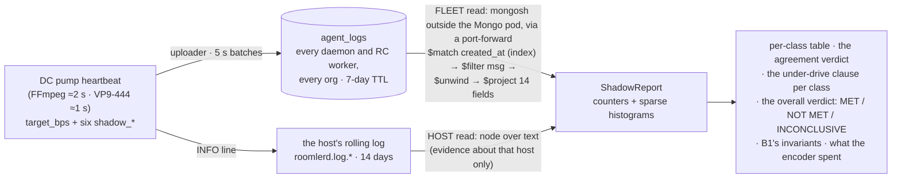

**One window is one DC-pump heartbeat.** A window without `shadow_state` came from a
build before B1 and is counted, never compared; `shadow_state="off"` is the kill
switch; an unopened shadow (`shadow_target_bps=None`) or a zero live rate is not
compared. Every other window compares the shadow with `target_bps` (the governor's
`applied_bps`, the same rate `shadow_disagree_pct` divides by): **shadow ≤ live is
agreement**, the safe direction. A window is **elevated** when
`viewer_age_ms − viewer_age_floor_ms ≥ 70 ms` — the controller's own level threshold
(`ratectl::AGE_SLACK_MS`; the self-test fails if the two drift apart). The path class
is the heartbeat's `constrained` flag, which the FFmpeg pump logs every window; the
VP9-444 heartbeat has no such field, so a VP9 session takes the `relay=` of its
"per-session ICE path detected" line and is `unknown` without one, never `direct`.
Windows classed that way are counted apart, because `relay` misses one case the
pump's flag catches (an overlay remote on a relay tier).

The agreement's verdict, the report's `Verdict:` line (`criterion.verdict` in `--json`),
is unchanged since B1b. The overall verdict reads it with the under-drive clause (below):

| agreement verdict | when |
|---|---|
| **MET** | both session clauses met and the pooled agreement ≥ 90 % over at least one elevated window |
| **NOT MET** | any clause below its bar |
| **INCONCLUSIVE** | no clause fails, but there is no elevated window to judge — zero evidence is never a pass |

The agreement clause is pooled, as the criterion words it; each class's own agreement
is printed beside it, and a class below 90 % on its own is flagged, so a pool that
passes on the strength of one class cannot hide the other. The fixtures clause is
CI's (`cargo test -p roomlerd --lib`), so the report says "not checked here" rather
than claiming it. The same pass reads two of **B1's invariants off the field**: a
`shadow_pauses` rise inside a DIRECT window (the "never on direct" rule — a count
carried over from an earlier constrained stretch is not a rise), and a constrained
shadow below its 200 kbps floor. Both must read 0.

⚠️ **The criterion judges elevated windows only, and the first field read showed why
that is not enough on its own.** On ten direct sessions on `agent-v0.4.188`
(2026-10-30) every window carried the shadow, and in all 43 clean windows it asked
for **96 % less** than the governor: it opens at the direct path's area floor
(2.46 Mbps at 2560×1600) and climbs ×1.08 per window, while the governor opens at its
content-generous ceiling (~90 Mbps). Asking for less passes the criterion. So the
report prints the clean-window disagreement under its own heading, with no
threshold of its own; the detail and the B2 question it raises are in the FR-63 spec
(§ "Day 0").

#### What the encoder spent: the reading the criterion cannot make

⚠️ **The agreement criterion can fail a shadow that asks for too much, never one that
asks for too little.** Pinned at its floor, the shadow scores 100 %:

| clause | why it cannot catch a shadow asking for too little |
|---|---|
| sessions | counts sessions, whatever the shadow asked for |
| agreement | `shadow ≤ live`, and the floor is one the live AIMD holds too: both take the same `floor_bps` (`governor.rs:1342`, `:1359`), and on a constrained path the shadow's 200 k (`ratectl.rs:293-294`) is the live floor's default stop (`encode/mod.rs:406-411`). The shadow also shares the live ceiling (`ratectl.rs:298`, `:318`) |
| fixtures | the four fixtures run the shipped laws. `RatectlLaw`'s three tests (`sim.rs:1843-1906`) assert a domain, an upper bound and no pause on direct, and a shadow pinned at its floor passes all three |

The self-test pins the result: pinned at its floor, with the encoder spending 20 Mbps,
the agreement verdict is MET (the under-drive clause reads NOT MET in both classes, and so
does the overall verdict). The clean-window disagreement cannot show it either, because
`target_bps` is a cap, usually far above what the encoder spends: the live cap climbs
past 200 Mbps on a desktop sending 5 kbps. So −96 % reads the same on a resting desktop
that lost nothing and on a scroll spending 14 times the shadow's target.

So the report also compares the shadow with what was actually sent. `bytes_written` is
the send task's running total of whole frames the transport took (`peer.rs:7425`,
`:4368`), on both heartbeats (`peer.rs:10184`, `:5374`):

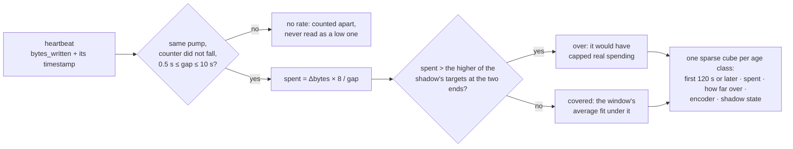

| reading | what it proves | what it does not |
|---|---|---|
| `spent > shadow`, clean window | the shadow would have capped spending the path was carrying | that the picture needed those bits. Every FFmpeg backend but NVENC anchors `bit_rate = maxrate` (`ffmpeg/encoder.rs:1887-1896`), so a high target can also draw spend, which is why the report splits by encoder. A small excess can be overshoot, hence the "by > 25 %" column |
| `spent ≤ shadow` | the window's average fit | that no burst inside the window was capped |
| the encoder's demand | `spent` bounds it from below | nothing bounds it from above: the heartbeat has no maxrate field (`peer.rs:10070-10085`), and a new field cannot help a read of logs already written |

The live cap cannot hide a bite: while `shadow < live`, a window capped by live spends
about live, which is over the shadow. Elevated windows are kept out of the table, since
spending over the shadow there is the safe direction; a window with no viewer age is
counted beside it, not judged clean. The table applies no bar of its own; the under-drive
clause below reads it at one gate per class. Each row carries the sessions, the share over
and the share over by more than 25 % at its spend or more, so any gate can be read off one
report, and `--json` keeps the whole cube.

**First read, 2026-11-02.** Every shadow heartbeat in one dev box's service log since
`agent-v0.4.188`: 20 sessions, 235 windows, all direct, all NVENC. It is evidence about
that host only. The last column is a counterfactual over the same lines, a shadow that
never left its opening target:

| spent, Mbps | clean windows | spent > shadow | at this spend or more: sessions | over | over by > 25 % | pinned shadow: over |
|---|---|---|---|---|---|---|
| < 0.5 | 143 | 0 | 19 | 8/200 = 4.0 % | 6/200 = 3.0 % | 14/200 = 7.0 % |
| 0.5 – 1 | 35 | 0 | 9 | 8/57 = 14.0 % | 6/57 = 10.5 % | 14/57 = 24.6 % |
| 1 – 2 | 8 | 0 | 8 | 8/22 = 36.4 % | 6/22 = 27.3 % | 14/22 = 63.6 % |
| 2 – 5 | 11 | 5 | 3 | 8/14 = 57.1 % | 6/14 = 42.9 % | 14/14 = 100 % |
| 10 – 20 | 1 | 1 | 1 | 3/3 = 100 % | 3/3 = 100 % | 3/3 = 100 % |
| 20 – 50 | 2 | 2 | 1 | 2/2 = 100 % | 2/2 = 100 % | 2/2 = 100 % |

- **The −96 % was mostly a gap between two caps.** In 192 of the 200 clean windows the
  shadow's target covered the spend and the session would have lost nothing.
- **Where the encoder worked, the bite was hard.** One session's second heartbeat spent
  40.7 Mbps against a 2.87 M target, ×14, on a path that carried it with a clean age.
- **A bar over all clean windows has no power.** B1 scores 96 % and the pinned shadow
  93 %, because resting windows dominate. Only a gate on the spend separates a working
  controller from a pinned one, which is why the table is binned.
- **It says nothing yet about after the climb.** All 8 fell within 14 s of the pump
  opening, with the shadow still in `startup`, and no session on that box ran past 59 s.
  The fleet read's "after the first 120 s" column is what answers it.
- **The derived rate is real.** It sits within ×2 of `shadow_measured_bps`, the viewer's
  own arrival rate on most windows, in 197 of 215 windows. The report prints that control
  on every run.

#### The under-drive clause: the verdict's second half (FR-148 P0)

The wording recommended on #1243 on 2026-11-02 is now part of the report's verdict (the
FR-63 spec, § "Open decisions", holds the same text with the reasons). Its numbers were
published before the seven-day read and FR-148's owner fixed them, so they are named
constants, `UNDERDRIVE_*` (`scripts/rc-shadow-report.cjs:115-119`), never tuned to fit a read:

| number | value | why, as published |
|---|---|---|
| the gate, direct | spent ≥ 2 Mbit/s | the direct floor is 1.5 to 4 M, so most lower spend cannot be capped at all; 186 of the first read's 200 clean windows sat under it |
| the gate, constrained | spent ≥ 0.5 Mbit/s | the constrained floor is 200 k against a ~3 M nominal cap. Not measured when published: no real constrained line had been read |
| the ratio | spent ≤ 1.25 × shadow | a small excess can be overshoot |
| the bar | ≥ 90 % of the gated windows, ≥ 20 sessions per class | the agreement's own numbers, so there is no new one to defend |

How it is read:

- **The sample is the spend view's.** A clean window with a rate counts when it spent its
  class's gate or more. `spent`, `shadow` (the higher of its targets at the window's two
  ends) and the class are the table's. Each gate is a row's lower edge and ×1.25 is a
  column's, so the clause is read off the same cube.
- **A pump's first 120 s count, on purpose.** B1's opener is what the clause is expected to
  fail first. The report prints the opening and later split beside the clause, for
  information: it decides nothing.
- **A session counts as the agreement counts one** (`--min-windows` applies), when it gave
  the class at least one clean window at the gate. With fewer than 20 such sessions the
  class reads INCONCLUSIVE whatever its share: never a pass, and never a fail.
- **Per class, never pooled.** The `unknown` class (VP9-444 without its ICE line) is judged
  at the lower gate, 0.5 Mbit/s, and printed. It never decides.

| overall verdict | when |
|---|---|
| **MET** | the agreement verdict is MET and the clause is MET for both `constrained` and `direct` |
| **NOT MET** | the agreement verdict is NOT MET, or either class's clause is NOT MET |
| **INCONCLUSIVE** | otherwise: a class with fewer than 20 sessions at its gate, or an agreement with no elevated window |

The agreement and its `Verdict:` line read the same numbers on the same input as before.
After them the report prints the clause, one line per class (the clean windows at the gate
or more, how many spent ≤ ×1.25 the shadow, the sessions, the opening and later split, the
status), then `Overall verdict:`. `--json` adds `underDrive` (the bar, and each class's
counts) and `overall`; no existing key moved. On the published row 2 (20 + 20 synthetic
sessions pinned at 200 k and 2.46 M while the encoder spends 20 Mbit/s) master's file read
MET. It now reads agreement MET, the clause NOT MET in both classes (0 of 40 gated windows
within ×1.25, from 20 sessions each), and overall NOT MET.

**Why the fleet read is server-side.** The plan assumed the API could serve it
(`list_for_agent(?session_id=…)`). It cannot: `GET /api/tenant/{tid}/agent/{aid}/logs`
takes only `limit`, clamped to 500 recent batches per agent — about 40 minutes of a
session. An exec sweep of host logs is worse than incomplete: it reaches only
exec-enabled, online hosts of one org, which is a biased sample of exactly the
proportion AC2 asks for. `agent_logs` holds the whole population, because every
daemon and every RC worker runs the uploader (a Windows host's RC pump runs in its
console-session worker, `roomlerd run --supervisor scm`, which uploads like the service
does).

**The fleet read is bounded by construction**, because an unbounded read inside the
Mongo container OOM-killed production Mongo once (2026-10-26). Its client now runs outside
that container, through `scripts/prod-mongo-read.sh` ([production-mongo-reads.md](production-mongo-reads.md)),
and the server still runs the query inside it:

| bound | how |
|---|---|
| time | a window of at most 8 days (`agent_logs` keeps 7), read one day per query, each with `maxTimeMS` 240 s |
| plan | `$match` on `created_at` + `$sort` served by an index — `IXSCAN created_at_1` for the fleet, `tenant_id_1_source_1_created_at_-1` (backward) for one org; `explain` shows no blocking SORT |
| memory | only streaming stages after the index scan, `allowDiskUse: false`; mongosh holds one row at a time and folds it into counters and sparse histograms. 2,000,000 synthetic rows over 2,000 sessions peak at 14 MiB of heap |
| data | only 14 fields are projected — never an address, a name or another line |
| credentials | from the database's secret into mode-600 files that the client container reads into its own environment: never argv, never `docker inspect`, never the output |
| consent | `--kubectl` / `--mars` refuse without `--yes`; the mongodb pod's restart count and its container's memory are printed before and after, and a restart or an OOM kill fails the run (exit 3) |

**Rehearsed, not assumed.** `--to-ejson` turns real log text into `agent_logs` batches
exactly as the uploader stores them (an integer an Int64, a `?Debug` value its printed
string, a lone quoted value its text), and `--docker NAME --seed FILE` runs the fleet
read against a throwaway `mongo:7` — the image production runs. On 2,274 lines (a dev
box's real 2026-10-29 heartbeats, all pre-B1, plus synthetic B1 lines) the Node read
over the text, the mongosh read over the seeded batches, and the Node read over the
fleet read's own `--rows` output agreed exactly on every class, the pool, the
criterion and the invariants.

The spend reading was rehearsed the same way on 2026-11-02, on the 235 real lines of the
table above. Master's file printed no spend section and its rows held no `bytes_written`.
The file as pushed printed the table, and the same three reads agreed exactly, cube
included, there and again with 17 synthetic lines for what that log does not hold (a
constrained session, VP9-444 with and without its ICE line). `explain` still reads
`IXSCAN created_at_1` with no SORT stage, and `rc-shadow-report.sh` did not change.

The under-drive clause was rehearsed the same way on 2026-11-16, on 2,979 invented lines in
27 batches: 48 sessions, constrained ones under-driven in their opening, direct ones covered,
five direct sessions under the gate, and VP9-444 with and without its ICE line. The mongosh
read, the Node read of its own `--rows` output and the Node read of the text agreed exactly
on every class, the pool, the criterion, the invariants, the clause and the overall verdict:
agreement MET; constrained 180 of 1,360 gated windows within ×1.25 from 21 sessions, NOT MET;
direct 1,300 of 1,300 from 20, MET; overall NOT MET. That run found `--docker` without an
`RC_SHADOW_*` option handing `docker exec` an empty container name; the runner now passes no
`-e` argument at all in that case.

```bash
node scripts/rc-shadow-report.cjs --self-test                       # 102 cases, incl. the bar's edges, red runs, the spend's edges and the clause's
node scripts/rc-shadow-report.cjs roomlerd.log.2026-10-30 …          # a host's logs: evidence about that host only
bash scripts/rc-shadow-report.sh --mars --yes --since 2026-10-30T14:21:00Z   # the fleet read AC2 is judged by (--until: now)
bash scripts/rc-shadow-report.sh --docker NAME --seed seed.ejson     # the rehearsal
node scripts/rc-shadow-report.cjs rows.ndjson                        # a read's --rows output, offline: the same verdict
```

FR-148's path report reads the same `agent_logs` per session: what it opened at beside what its pair had carried, the plan beside the encoder, what the path carried while bytes waited, a change of path, and whether the picture left the slow-link profile (`bash scripts/rc-path-report.sh --mars --yes`, [production-mongo-reads.md](production-mongo-reads.md) §8). One device's window reads line by line with `--timeline`, each target move with its `why` (§8a there).

⚠️ **The window starts at `agent-v0.4.188`** (published 2026-10-30 14:21Z), the first
release with B1. `agent_logs` deletes a batch 7 days after it arrives, so a window
anchored at the release loses its first hours the moment it turns 7 days old: read it
during its 7th day (`--until` = the time of the read), not after.

## Delivery samples (FR-148 P0) — what the path carried, and whether the sender was waiting

FR-148 P0, step 2 (#3953). **A shadow: nothing reads these numbers.** No rate, pacing or
queue budget changes, and neither the viewer nor the wire does. Each data-channel pump
cuts its session's SCTP association into **delivery samples** of about 2 s, marks each
one by whether bytes were waiting while it ran, and writes one line of its own every
10 s. The heartbeat lines stay as they were.

**Why the transport, not the write.** The goodput estimator (`encode::goodput`) times
the pump's `dc.send()`, which returns once SCTP has queued the bytes in its pending
queue of 128 KiB: it says how fast SCTP took them, and it is silent whenever the queue
is downstream ([§ V3b](#v3b--one-belief-about-the-path-shadow-since-agent-v0498-one-consumer-since-v5b)). A
sample reads the association's **acknowledgement clock** instead, two counters a patch
of the vendored webrtc-sctp keeps where the events happen:

| Counter | Counted in | Means |
|---|---|---|
| acknowledged bytes | the SACK handler (`crates/vendored/webrtc-sctp/src/association/association_internal.rs:1623`) | user data the peer acknowledged it received, each chunk once, over every stream of the association: by a gap block, or by the cumulative point. A partially reliable chunk is left out when a SACK reported it missing, or when it was outstanding as the retransmission timer expired, and the cumulative point then passed it: a FORWARD TSN skipped it (`DeliveryCounters::loss_mark`, `crates/vendored/webrtc-sctp/src/association/delivery.rs:41`) |
| fills and empties | the pending queue (`crates/vendored/webrtc-sctp/src/queue/pending_queue.rs:159`, `:583`) | how many times the queue of written, not yet sent chunks went from empty to holding bytes, and back |

The agent reads both without the association's lock (`Association::delivery_clock`,
`crates/vendored/webrtc-sctp/src/association/mod.rs:649`), through the peer
connection's SCTP transport (`RTCSctpTransport::delivery_clock`,
`crates/vendored/webrtc/src/sctp_transport/mod.rs:478`, a patch of the vendored
webrtc). That accessor never waits: `stop()` holds the transport's slot across the
association's close, so a held slot answers `None` and the sampler keeps the clock it
already has.

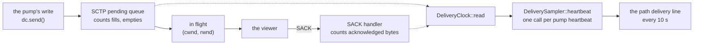

**A sample** runs between two readings at least 1.5 s apart (`SAMPLE_MIN`): the first
heartbeat that far after the last reading closes it. That is about 2 s on both pumps:
the FFmpeg pump beats every 2 s, and the VP9-444 pump every 30 encoded frames (about
1 s at 30 fps), so every other one of its beats closes a sample. Samples tile the time
from the association's first reading on, with no gap and no overlap. A new association
is a new clock, and no sample spans the two. Because the queue counts its own fills and
empties, a sample is classed right whatever its length and however late a heartbeat
runs (`agents/roomlerd/src/media_delivery.rs:227`):

| Class | When | What it says about the path |
|---|---|---|
| **backlogged** | the queue held bytes at the sample's start and never ran empty in it, and some bytes were acknowledged | it carried this rate while bytes waited: **evidence about capacity** |
| **application-limited** | the queue was empty at the start, or ran empty at least once: the path took everything offered | a **lower bound**, which never lowers a capacity |
| **stalled** | the queue held bytes throughout and nothing was acknowledged | **evidence about stalls, never about capacity** |

Calling a sample application-limited when in doubt is the safe direction: such a
sample can only raise a floor.

**The line** is `path delivery (FR-148 P0, shadow, ≈10s)`, at INFO, written by
`media_delivery::emit` (`agents/roomlerd/src/media_delivery.rs:1409`) at the first
heartbeat 10 s after the last line (`LINE_EVERY`), and once more when the pump ends with
samples not yet written. A test pins its field names (`the_line_names_its_fields`):

| Field | Meaning |
|---|---|
| `session_id` | the session |
| `span_ms` | the milliseconds the line's samples cover |
| `delivery_samples` | `(backlogged, application-limited, stalled)`: samples per class |
| `backlogged_bps` | `Some((lowest, over all their bytes, highest))`, bit/s, over the backlogged samples; `None` when there was none |
| `app_limited_bps` | the highest application-limited sample's rate, bit/s; `None` when there was none |
| `stalled_ms` | the milliseconds of stalled samples |
| `acked_bytes` | user-data bytes acknowledged over the line's samples, every stream of the association |
| `ack_ms` | `Some((session, lowest, highest))`, ms: the session's least acknowledgement delay, and the lowest and highest least of the line's samples that count; `None` when none counts ([§ The standing queue](#the-standing-queue-what-a-tcp-carrier-holds)) |
| `standing_ms` | `Some((lowest, highest))`, ms: how far those samples' least stood over the session's least |
| `queued` | how many of the line's samples were queued: they count, and stood 250 ms or more over the session's least |
| `inflight` | `(lowest, highest)`: the bytes in flight at a sample's close |
| `cwnd` | `(lowest, highest)`: the congestion window at a sample's close, bytes |
| `ssthresh` | the slow start threshold at the last sample's close, bytes |
| `rwnd_low` | the lowest peer receive window at a sample's close, bytes |
| `pending_high` | the most bytes waiting in SCTP's pending queue at a sample's close |
| `loss` | `(fast retransmissions, T3-rtx expiries)` over the line's samples |

The fields from `ack_ms` on are the standing queue's, from SCTP's gauges. They follow
when a sample of the line was read with the gauges, and are left out when none was:
the sampler fetches the gauges beside the clock, and a sample is read with them only
when both its start and its close took them. None of them carries an address. With
`ROOMLERD_INFLIGHT_BUDGET` not `off`, FR-148 D46's fields close the line after them
([§ The in-flight budget](#the-budgets-fields)).

**Its cost** is at most 360 lines a session hour per pump. In the daemon's log-file
format a busy line is 435 bytes and an idle one 368: 156,600 and 132,480 bytes a session
hour, measured by the same test. A busy line without the gauges is 264 bytes, as before
them. The VP9-444 pump's heartbeat counts frames, so a pump that encodes nothing writes
nothing until frames flow again; its next sample spans the quiet time and reads
application-limited.

**What a healthy line looks like.**

| Screen and path | Reads |
|---|---|
| an idle screen | every sample application-limited: `delivery_samples=(0, 5, 0)` at the FFmpeg pump's 2 s beat (the VP9-444 pump beats by frames, so it can write fewer, longer samples), `backlogged_bps=None`, `app_limited_bps` about what the still screen sends (its frames and the other channels), `stalled_ms=0` |
| a busy screen on a path with room (a LAN, a fast direct pair) | mostly application-limited: the encoder's rate is under the path's, so `app_limited_bps` is about the encoder's rate. A sample is backlogged only if the queue held bytes for its whole 2 s, which a keyframe's burst alone does not do, so backlogged samples are rare |
| a busy screen on a path at its limit (a relay, a slow link) | backlogged samples whose lowest, overall and highest rates sit close together near the path's rate, `stalled_ms=0` |
| a stall | `stalled_ms` above 0, and the third count of `delivery_samples` with it: bytes waited and the peer acknowledged none |
| a busy screen over a carrier that holds a queue (TURN over TCP) | `queued` above 0 and `standing_ms` in the hundreds or thousands, while the samples may read application-limited ([§ The standing queue](#the-standing-queue-what-a-tcp-carrier-holds)) |

**What a sample cannot tell.**

- A sample partly stalled reads as a low backlogged rate: the class covers the whole
  sample (the shaped link's first runs showed it, below). FR-148 §4.1 keeps FR-71's
  classifier and FR-79's gate for stalled windows.
- A viewer that stops reading closes SCTP's receive window. The queue stays full, and
  the sample reads backlogged or stalled though the path is fine.
- A pump that stops at its own mark (`dc_buffered_high`: 256 KiB on a constrained relay,
  1 MiB otherwise) under a wide congestion window leaves the queue empty while the path
  is full. Such a sample reads application-limited; its rate is still a valid floor.
  Under `ROOMLERD_INFLIGHT_BUDGET=on` a relayed session's VP9-444 pump sheds nothing at
  its mark: the budget's hold stops it before capture instead
  ([§ The budget acts under `on`](#the-budget-acts-under-on-d46-b3)).
- A path that dies while nothing is offered reads as idle (application-limited) until
  the queue fills.
- The acknowledged bytes are the association's: video, and the control, input and file
  channels beside it.
- On a partially reliable channel the count is close, not exact. The viewer's
  `video-deadline` channel (FR-148 P4b-2) is unordered with `maxRetransmits: 0`. Unless
  the agent marks it deadline-limited (P4b-1; P4b-3 marks it under `on` only, before
  its first write there), the vendored SCTP marks each such chunk
  abandoned at its first send and sends a FORWARD TSN after nearly every SACK, over
  everything then in flight. A lost chunk that a later one follows is reported missing
  and left out. A lost chunk that nothing follows before such a FORWARD TSN reaches the
  viewer is never reported missing, and it is counted: SCTP does not tell a sender which
  skipped chunks arrived. The lossy shaped-link cell measures that share (below): from a
  twentieth to over a third of the loss, depending on the timing. A chunk
  reported missing that then arrives late is left out, which reads low. On a reliable
  channel the count is exact: a FORWARD TSN never skips its chunks.
- A starved runtime runs its heartbeats late. The counts stay exact, but a sample
  stretches.
- Not sampled: the RTP pump (its media rides SRTP, not SCTP), and a shared pipeline's
  followers, whose packets the owner's pump fans out over their own associations.

**The switch** is `ROOMLERD_PATH_MODEL` (since P1 also the config key `path_model`), read
once per pump at its start through `tunnel_core::env::node_env`
(`agents/roomlerd/src/media_delivery.rs:157`). `off`
reads no clock, takes no sample and writes no line, which a test shows
(`off_takes_no_sample_and_writes_no_line`). Any other value, or none, samples. Since
FR-148 P1 it reads three values, `off`, `shadow` (the default) and `on`
([§ The switch](#the-switch-d28)), and it is deleted in P5. Its ledger row is `p0:PATH-1`
(`docs/plans/rc-media-debt.tsv`); the two pumps' calls are `p0:PATH-2` and `p0:PATH-3`.

| Where | Anchor |
|---|---|
| the sampler: readings, samples, the line | `agents/roomlerd/src/media_delivery.rs:635` (`DeliverySampler`), `:756` (`heartbeat`), `:878` (`on_reading_with`), `:948` (`take_line`) |
| the standing queue: the rule, the one take, the reading, the fold | `agents/roomlerd/src/media_delivery.rs:95` (`QUEUED_OVER_MS`), `:117` (`counts`), `:851-860` (`DeliverySampler::observe`, the one take), `:919` (`judge`), `:560` (`Fold::add_queue`) |
| the gauges | `crates/vendored/webrtc-sctp/src/association/gauges.rs:146` (`Gauges`), `:194` (`take`), `:202` (`peek`); through the transport, `crates/vendored/webrtc/src/sctp_transport/mod.rs:486` (`RTCSctpTransport::gauges`) |
| the VP9-444 pump | `agents/roomlerd/src/peer.rs:4006` (made), `:5440` (drained, after the heartbeat line) |
| the FFmpeg pump | `agents/roomlerd/src/peer.rs:6590` (made), `:10372` (drained, after the heartbeat line) |
| the clock | `crates/vendored/webrtc-sctp/src/association/delivery.rs:93` (`DeliveryClock`), `:101` (`read`) |

**The tests** (`cargo test -p roomlerd --lib -- media_delivery`):

| Test | Shows |
|---|---|
| `a_queue_that_held_bytes_throughout_and_delivered_is_backlogged`, `a_queue_that_ran_empty_once_is_application_limited`, `bytes_that_waited_with_nothing_acknowledged_are_a_stall`, `an_idle_association_is_application_limited_not_stalled` | the three classes, and an idle association |
| `samples_tile_the_readings_from_the_first_on`, `the_line_comes_every_ten_seconds_and_folds_its_samples`, `a_dropped_sampler_writes_its_last_samples` | the boundaries: the first reading, `SAMPLE_MIN`, the line's fold and its 10 s |
| `an_idle_trickle_yields_only_application_limited_samples` | the jupiter chain of 2026-11-02 as a cell: a still screen's keepalives give only application-limited samples, so none of them can stand for the path |
| `shaped_link::backlogged_at_{0_4,2,8}_mbps_reads_the_link`, `shaped_link::a_trickle_at_{0_4,2,8}_mbps_is_application_limited` | two in-process SCTP associations over a link the test shapes (serialised at its rate, 10 ms each way, a drop-tail queue of 200 ms, a viewer window of 7/8 of that queue, and messages that fit it): a writer that always has more reads backlogged at the link's rate within 20 %; a 164 kbit/s trickle reads application-limited at every rate |
| `shaped_link::a_new_association_starts_a_new_sample` | a new clock starts over, and a held slot keeps the clock the sampler has; the new association's gauges come with it, and the session's least starts over |
| `shaped_link::a_lossy_unordered_channel_counts_what_the_viewer_took` | an unordered `maxRetransmits: 0` channel, the shape of the viewer's `video-deadline` channel, unmarked, writing 1,000-byte messages over the 2 Mbit/s link while one full DATA packet in ten is lost: at each sample's end the clock has counted at least nine tenths of what the viewer took and less than that plus two thirds of what was lost. Of about 215,000 bytes lost by the third sample's end, four runs on a Windows box counted 11,000 to 21,000 more than the viewer took, and two on CI's Linux runners, under the whole suite, 75,000 and 70,000. Before the clock left lost chunks out it counted 2,128,000 against 1,920,000 taken, with 216,000 lost |

The fork's own tests (`src/association/association_internal/association_internal_test.rs`,
`test_delivery_clock_*`) pin the rule chunk by chunk: a chunk reported missing that a
FORWARD TSN then passes adds nothing, a chunk acknowledged by a gap block counts once,
a chunk out at a retransmission timeout adds nothing, and an abandoned chunk nothing
reported missing counts. The standing queue's cells are in
[§ The standing queue](#the-standing-queue-what-a-tcp-carrier-holds).

The shaped link proves the classes and the rate on a known pipe. It does not prove a real
carrier's loss, jitter, reordering or stalls, a browser's SCTP at the far end, or DTLS
and ICE beneath SCTP: those are FR-148 P0's standing relay cell (its step 5). Its first
runs showed the first limitation above, twice. With SCTP's default window of 1 MB,
three backlogged samples at 8 Mbit/s read 3.6, 0.9 and 6.9 Mbit/s. The likely cause,
inferred and not traced, is slow start overrunning the 200 ms queue and the
retransmission timeouts after it (1 s at least) idling the link inside the samples.
With a 48 KiB window over the 10,000 bytes the 0.4 Mbit/s queue holds, one sample read
68 % of the link during a run of the whole suite. The window is now 7/8 of the queue
at every rate (8,750, 43,750 and 175,000 bytes), and the writer's messages are a
quarter of it, at most 16 KiB: the receiver counts a message's chunks against its
window before the message is whole, and drops new data once the window is full. So
what is in flight stays under the queue, and the cells measure the sampler, not SCTP's
loss recovery.

### The standing queue: what a TCP carrier holds

FR-148 P0 (#3953), in shadow like the samples: nothing reads these fields. The classes
above cannot see a queue that a TCP carrier holds. TURN over TCP or TLS carries the
association to the TURN server over a TCP connection, which buffers what the link cannot
carry yet and loses nothing. So SCTP's congestion window grows past what the link
carries, the bytes wait in the carrier, and the queue of unsent chunks keeps running
empty: every sample reads application-limited while seconds of bytes stand on the link.
The shaped link's TCP cells showed it (`shaped_link::tcp_shape`,
`agents/roomlerd/src/media_delivery.rs:5922`), and so did the lab: on TURN over TCP 443
at 2 Mbit/s the viewer's round trip ended at 1,262 ms, against 154 ms on TURN over UDP at
the same rate.

SCTP's acknowledgement delay holds that wait. The vendored webrtc-sctp stamps a chunk
when it leaves SCTP's queue for the wire
(`crates/vendored/webrtc-sctp/src/association/association_internal.rs:2089`), and the
SACK handler stores the delay of the newest chunk sent once that a SACK acknowledges
(`:1413-1415`). The carrier's queue is in that delay; SCTP's own queue is not. The
association's gauges keep the least of those delays since the last take, beside the
congestion window, the slow start threshold, the peer's window, the bytes in flight and
pending, and the counts of fast retransmissions and T3-rtx expiries. The agent reads
them without the association's lock, through the transport, as it reads the clock.

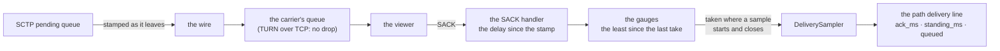

Over the shaped link's TCP cells, the 69 loaded seconds of the four deep cells that had
any and the 80 seconds of the four controls, the least and the most of four runs
(`shaped_link::tcp_shape`'s own table):

| Signal | Deep queue, no loss (TURN over TCP's shape) | Controls, a queue that drops (TURN over UDP's) |
|---|---|---|
| SCTP's acknowledgement delay 250 ms or more over its least | 69 | 0 (at most 65 ms) |
| in flight at least 3 times what the second delivered in the least delay | 69 | 7 to 11 |
| the viewer's transit 200 ms or more over its least (FR-71's) | 69 | 35 to 37 |
| backlogged | 24 | 76 |

Only the acknowledgement delay read every loaded second and no control second. The
viewer's transit also holds the wait in SCTP's own queue, so it read the controls'
backlog too.

**One reader takes.** A take of the gauges resets the least delay, so the least a take
reads covers the SACKs since the take before it. The delivery sampler is the one reader
that takes. It fetches the gauges with the clock, from the same slot, and takes them
only where a sample starts and where it closes, beside the clock's reading
(`DeliverySampler::observe`, `agents/roomlerd/src/media_delivery.rs:851-860`). So a
sample's least is the least of its own SACKs. A second reader that took would split a
sample's SACKs with the sampler, and each would read a least too high. A reader that
only looks peeks (`GaugeReader::peek`), which resets nothing, as FR-148 O10's open line
is built to do. The open-time train takes only in its own tests, over associations of
their own. A new association brings new gauges, and the session's least starts over with
it.

**When a sample is queued.** A sample is queued when it **counts** and its least stands
250 ms or more over the session's least (`QUEUED_OVER_MS`, `:82`). A sample counts
(`counts`, `:104`) when it acknowledged more than `max_payload × (ms / 200 + 2)` bytes.
The session's least is the lowest least of the samples that counted since the
association started, and `standing_ms` is how far a sample that counts stood over it.

The byte rule keeps a receiver's delayed SACK out of the reading. A receiver acknowledges
the second of two packets at once, and holds the SACK of a lone packet for up to 200 ms
(`DELAYED_ACK_MS`, `:87`: the vendored SCTP's `ACK_INTERVAL`, and the hold of Chrome's
dcSCTP and of usrsctp), a wait its delay then carries. A still screen sends lone packets,
so its least can stand 200 ms or more over a busy screen's with no queue anywhere. For
every SACK of a sample to have been held, each packet came after the hold of the one
before it ran out, so the SACKs left the receiver at least 200 ms apart. While the way
back varies by less than that, at most `ms / 200 + 2` of them reach the agent in a sample
of `ms`, each for one packet of at most `max_payload` bytes of user data: 1,200 on the
agent's association, whose packets are 1,228 bytes. A sample that acknowledged more had
a SACK sent at once, whose delay has no hold in it, and the sample's least is no higher
than that delay. A receiver that holds longer leaves fewer lone packets in a sample than
the rule allows.

| A sample of | Counts above | As a rate |
|---|---|---|
| 1.5 s (`SAMPLE_MIN`) | 10,800 bytes | 57.6 kbit/s |
| 2 s (the FFmpeg pump's heartbeat) | 14,400 bytes | 57.6 kbit/s |
| 6 s (a late heartbeat) | 38,400 bytes | 51.2 kbit/s |

Until #4033 the vendored SCTP's own timer made a lone packet's delay worse still: once
its delayed SACK had fired, the timer was not started again until a SACK went out at
once, so a lone packet after it waited for the sender's retransmission timer instead.
The still-screen cells' lines counted those expiries, `loss=(0, 4)` in each of four runs,
and as a chunk sent more than once gives no delay, only one to three of a line's five
samples carried one. With the timer armed again, every line reads `loss=(0, 0)` and
every sample carries a least, 263 to 266 ms: the 200 ms hold over the cells' 60 ms round
trip.

**What the cells read** (`cargo test -p roomlerd --lib -- media_delivery::shaped_link::tcp_shape
--skip clipboard:: --nocapture --test-threads=1`, on a Windows box):

| Cell | The sampler's samples | A line |
|---|---|---|
| deep, 0.4 Mbit/s, path I | 9 of 9 loaded samples queued, standing 744 to 6,438 ms | `ack_ms=Some((107, 3652, 6545)) standing_ms=Some((3545, 6438)) queued=5` |
| deep, 2 Mbit/s, path I, the pump's skip over 256 KiB | 9 of 9 loaded samples queued, standing 792 to 953 ms | `ack_ms=Some((75, 1002, 1028)) standing_ms=Some((927, 953)) queued=5` |
| the four controls (0.4 and 2 Mbit/s, paths I and C) | none queued, standing at most 25 ms | `ack_ms=Some((63, 63, 82)) standing_ms=Some((0, 19)) queued=0` |
| a still screen, one 200-byte message a second, deep and shallow | none counts: 400 bytes a sample (200 to 600 before #4033, as late SACKs moved bytes between samples) | `ack_ms=None standing_ms=None queued=0` |

The first sample of a deep cell stands at 0: it is where the session's least comes from.
The two deep cells that run in CI assert that at least half of their loaded samples are
queued, the controls that no sample is, and the still-screen cells that no sample counts.
The still screen's lines read no queue even without the byte rule, because the session's
least then comes from the same lone packets: the cells fail on the counted sample, not on
`queued`. The rule is for a session that was busy and then went still, and the unit cells
hold that case.

**What it cannot tell.**

- The session's least is learned from the session. A session that opens onto a standing
  queue has the queue in its least, and reads less standing than it holds. A path whose
  delay rises for good in a session (a renomination to a farther relay, a route change)
  reads the rise as standing.
- A sample's least is its best moment: a queue that drains for a moment inside a sample
  reads as that moment.
- A carrier whose way back varies by 200 ms or more could let a held SACK into a sample
  that counts.
- The delay is the association's: the control, input and file channels count too.
- The same pumps as the samples: not the RTP pump, nor a shared pipeline's followers.

| Test | Shows |
|---|---|
| `a_sample_counts_past_what_lone_packets_could_carry` | the byte rule's edges: 14,400 bytes in 2 s does not count and 14,401 does; 10,800 and 10,801 in 1.5 s; 38,400 and 38,401 in 6 s; no gauges stored counts nothing |
| `a_sample_is_queued_250_ms_over_the_sessions_least` | 249 ms over the session's least is not queued, and 250 ms is |
| `the_session_least_comes_from_samples_that_count` | a session that opens on a still screen (leasts of 40 ms, its SACKs sent at once) and then loads keeps the least of the first loaded sample, 60 ms: from the still screen's, one more sample would read queued |
| `a_still_screens_held_sacks_never_read_queued` | a session busy at a least of 61 ms whose screen goes still, its SACKs held to 321 ms: the still samples read no queue, and the same least with a loaded sample's bytes is queued |
| `the_gauges_are_taken_where_a_sample_starts_and_closes_only`, `a_sample_without_a_take_at_its_start_reads_no_gauges` | one take at a sample's start and one at its close, none at a reading sooner than `SAMPLE_MIN`; a sample whose start took none reads none |
| `the_line_folds_its_samples_gauges`, `the_line_names_its_fields` | the fold over a line's samples, and the line's field names and their order, with and without the gauges |
| `shaped_link::a_peek_leaves_the_least_to_the_samplers_take` | over a real association: a peek leaves the least to the sampler's take, and a second reader that took leaves the next sample none |
| `shaped_link::tcp_shape::deep_0_4_mbps_path_i_reads_under_half_backlogged`, `deep_2_mbps_path_i_with_the_pump_skip_reads_under_half_backlogged` | the two deep cells above: the queue drops nothing, fewer than half the loaded seconds read backlogged (the TCP cells' own hypothesis), at least half the loaded samples read queued, and SCTP's acknowledgement delay stands 250 ms or more over its least on at least half the loaded seconds. That pin was on every loaded second, where the lowest reading stood 1.36 to 1.40 times the 250 ms. Under FR-148 D44 it moved to half, so that a busy runner cannot flip it. Three runs of each, alone on a Windows box, after the change: 19 of 19 loaded seconds, the lowest 344, 350 and 346 ms over the least at 0.4 Mbit/s and 343, 339 and 343 ms at 2 Mbit/s under the skip; 9 of 9 loaded samples queued; 0 of 19 seconds backlogged |
| the other four `shaped_link::tcp_shape::deep_*` | ignored: red on the TCP cells' own hypothesis, as before |
| `shaped_link::tcp_shape::shallow_*_control` | the four controls above |
| `shaped_link::tcp_shape::a_still_screen_on_the_{deep,shallow}_queue_reads_no_queue` | the still screens above: at least two samples in their 10 s, none that counts, a delay from some SACK, and no sample queued. The precondition was four samples, and the first runs took five. Under D44 it moved to two: a still screen's 200 bytes a second never pass `counts`' byte bound, so two samples show the guard holds. Three runs of each, alone on a Windows box, after the change: five samples in every run, 200 to 600 bytes each |
| `shaped_link::tcp_shape::stalls_2_mbps_path_i_lift_the_floor_over_the_link`, `stalls_under_the_pump_skip_2_mbps_path_i_lift_the_floor_over_the_link` | ignored, a measurement (D44): head-of-line stalls of 0.8 s every 3.3 s on the deep lossless link at 2 Mbit/s, path I. The viewer window after a stall carries the stall's bytes too, and `Pipe`'s floor takes every window, so the floor ends over 1.3 times the link's 1,954 kbit/s of payload. The cells pin that defect, so as gates they would protect nothing in the product. Three runs of each with `--ignored`, alone on a Windows box: 1.50 to 1.55 times the link under a writer that offers 80 % of it, and 1.77 to 1.78 times under the pump's skip at 150 %, which is 1.15 to 1.20 and 1.36 to 1.37 times the 1.3 they assert |
| `shaped_link::tcp_shape::stalls_2_mbps_path_c_lift_the_floor_over_the_link` | ignored, red: path C's window caps what the link carries in a stall, at 1.27 to 1.28 times the link in 20 s |
| `shaped_link::tcp_shape::relay_writer::the_relay_writer_with_every_packet_in_one_frame`, `the_relay_writer_with_a_full_packet_in_two_frames` | FR-148 P4b-3 (D55): AC23's fast motion behind the mesh relay's writer (below), with every packet in one frame, or with a full packet in two as the mesh relay sends it (D20). Four arms run one after another on the same path. **r**, the reliable channel at the 100 ms age bound: frames dropped for their age; each chunk they lost sent again, fast retransmits among them and no more of those than chunks lost; every message read; ssthresh cut; writes blocked. **r0**, the bound off: no drop, no fast retransmit and no T3. **d**, the deadline stream, marked before its first write: no fast retransmit and no chunk sent again; the messages the viewer misses are exactly those with a dropped frame; FORWARD TSNs; and without a T3, no cut and no write longer than r's median blocked write. **u**, unmarked `maxRetransmits: 0`: d sends fewer FORWARD TSNs per SACK. Ten runs in a row on a Windows box, the host loaded as it was: 10 of 10 each, with the numbers in the table below |
| `shaped_link::tcp_shape::relay_writer::the_reliable_channel_with_every_packet_in_one_frame_takes_no_t3`, `the_reliable_channel_with_a_full_packet_in_two_frames_takes_no_t3` | ignored: r alone, with AC23's first read (D54) on top: no T3, and every chunk sent again a fast retransmit of one the writer dropped. Flaky with one frame and red with two, for the reason below. Ten runs by name: 10 of 10 with one frame, 0 of 10 with two. Over every r arm run on this writer and load, in the cells above and by name: a T3 in 2 of 46 with one frame and in all 47 with two |
| `shaped_link::tcp_shape::relay_writer::the_deadline_stream_with_every_packet_in_one_frame_takes_no_t3`, `the_deadline_stream_with_a_full_packet_in_two_frames_takes_no_t3` | ignored: r for its median blocked write, then d with no T3 on top, and so no cut and no write longer than that median. Flaky, for the reason below. Ten runs by name: 10 of 10 with one frame, 8 of 10 with two. Over every d arm run on this writer and load, in the cells above and by name: a T3 in 1 of 36 with one frame and in 8 of 36 with two |

They add about 23 s of test time, each cell timed alone: 10.1 s for each still-screen
cell, 2.2 s for the relay pair below, 0.3 s for the peek, and the unit cells nothing that
shows. The two still-screen cells wait their turn with the TCP cells, which run one at a
time, so that line of cells grows by about 20 s. Since D44 the line runs eight cells, in
141 s on a Windows box: the two stall cells and their 20 s each left it. The relay
writer's two cells join that line and add about 100 s to it: four arms a cell, each a 10 s
load, a 2 s still screen and the drain.

**The mesh relay's writer** (FR-148 P4b-3, D55). The relay writer's cells put a model of
the agent's /derp writer between SCTP and the shaped link (`RelayWriter`,
`agents/roomlerd/src/media_delivery.rs:11965`). Its mux queues each frame without waiting,
in a channel of 512 frames that drops a frame when full
(`crates/tunnel-core/src/transport/derp.rs:55`, `:290-318`). Its owner task drops a frame
that waited longer than the age bound and otherwise waits for the write
(`agents/roomlerd/src/derp.rs:550-558`): 100 ms, and 0 for off
(`crates/tunnel-core/src/transport/derp.rs:72-77`). Behind it the /derp socket holds
212,992 bytes, the 256 KiB the agent asks for as Linux clamps it
(`agents/roomlerd/src/derp.rs:40`, `:73-76`). The carrier is TCP and loses nothing it was
handed, so the socket and the 200 ms queue are one first hop of 262,992 bytes
(`Shaper::hop`) in front of a queue that drops nothing: the writer is the path's only
loss. A packet over the mesh's MTU of 1,280 bytes, as a full one's 1,293 are, leaves as two
IPv4 fragments, and so as two frames (D20). The age check is per frame, and the viewer's
end passes a pair on only whole (`RelayReader`, `agents/roomlerd/src/media_delivery.rs:12207`). The load is the deep 2 Mbit/s
cell's, frames at 1.5 times the link under the pump's skip over 256 KiB, for 10 s. Then
the screen goes still, one 200-byte message a second for 2 s, so that a later SACK
reports a loss among the load's last packets. Without it only a T3 found one: in one of
three runs, before the still screen was added, d lost its last chunk so, and the T3 cut
its window to one MTU.

| Ten runs of the cells above | Every packet in one frame | A full packet in two frames |
|---|---|---|
| r: frames dropped for their age; the packets they cost | 6 to 9; 6 to 9 | 41 to 46; 26 to 32, 8 to 13 of them by one frame of two |
| r: fast retransmits; T3s | 6 to 9, one for each chunk lost; none | 5 to 8; one in every run, and 27 to 108 chunks sent again in all, the 26 to 32 lost among them |
| r: ssthresh's least, from the peer's 1 MiB | 68,820 to 70,870 | 69,245 to 70,195 |
| r: writes blocked after the opening; their median; the longest | 100 to 109 of 120; 54 to 56 ms; 278 to 338 ms | 50 to 67 of 85 to 105; 22 to 30 ms; 590 to 1,833 ms |
| r0: frames dropped; fast retransmits and T3s; writes blocked | none; none; none | none; none; none |
| d: frames dropped; the packets they cost, whose chunks were abandoned | 18 to 23; 18 to 23 | 76 to 143; 48 to 92 |
| d: messages missed, each with a dropped frame, of those written | 13 to 20 of 196 | 9 to 20 of 173 to 190 |
| d: FORWARD TSN packets; T3s | 13 to 20; none | 8 to 17; two in each of 2 runs, which cut ssthresh to 4,912 and blocked 57 writes, the longest 758 and 760 ms |
| d: the longest write without a T3 | under 1 ms | under 1 ms |
| u: messages missed | 47 to 50 | 53 to 60 |
| FORWARD TSNs per SACK, d against u | 0.007 to 0.011 against 0.873 to 0.892 | 0.006 to 0.010 against 0.884 to 0.899 |

No cut means no relief either. d keeps the first hop full, as r0 and u do: their frames
wait 1,031 to 1,051 ms in the socket and the queue all through the load, and d's age drops
go on to its end. With every packet in one frame, r's cut leaves 242 to 320 ms there once
its burst is repaired.

**Why the no-T3 cells are ignored.** AC23's first read took no T3 on the reliable
channel, and the deadline stream is built to need none. Both take one here. On r, the
slow start's first overflow drops a burst of packets within a few hundred ms, and fast
recovery repairs it one packet a round trip: the vendored SCTP sends one packet of chunks
each time it is asked
(`crates/vendored/webrtc-sctp/src/association/association_internal.rs:502-565`), and in
recovery it is asked only when the cumulative point advances (`:1569-1571`). A T3 ends the
repair when the episode reaches its exit point (`:1546`, `:1321-1323`) while holes remain
past it whose miss indications already stopped at 3 (`:1539`), so that none starts another
episode, or when the viewer's window has filled behind the first hole of the ordered
stream. It sends again every chunk not yet acknowledged, those still on their way among
them. On d, a hole holds the cumulative point until its FORWARD TSN lands
(`forward_tsn_due`, `:1190`), a loaded round trip behind the full first hop, or longer when
the writer drops the FORWARD TSN too. The T3-rtx timer runs from the point's last advance,
with an RTO of srtt + 4 rttvar (`crates/vendored/webrtc-sctp/src/timer/rtx_timer.rs:56`),
barely longer while the queue stands still. On d the T3 abandons what is out
(`association_internal.rs:2636-2642`), and on either it cuts the window to one MTU
(`:2620-2621`).

**The carrier's relay transport.** The carrier line (`session carrier recorded (FR-102
P9c)`, [remote-control.md §11.9](remote-control.md#119-the-carrier-a-session-rides-fr-102-p9c))
names, right after `carrier`, what carries the agent's own TURN allocation for the
nominated pair: `relay_transport` (`relay_transport_of`,
`agents/roomlerd/src/session_carrier.rs:297`; the line, `:458`). A relay candidate names
its relayed address, which is UDP whatever carries the allocation to the TURN server, so
the pair alone cannot tell TURN over UDP from TURN over TCP or TLS. The vendored
webrtc-ice stamps each relay candidate it gathers with its TURN URL's transport and
scheme (`Candidate::relay_transport`, `crates/vendored/webrtc-ice/src/candidate/mod.rs:95`,
stamped at `crates/vendored/webrtc-ice/src/agent/agent_gather.rs:1137`), and the vendored
webrtc hands the stamp over with the selected pair
(`RTCIceCandidatePair::local_relay_transport`,
`crates/vendored/webrtc/src/ice_transport/ice_candidate_pair.rs:58`), both on the read
the carrier line makes and on the pair the selection's change handler is given
(`crates/vendored/webrtc/src/ice_transport/mod.rs:94`, `:165`).

| The nominated pair's local candidate | `relay_transport` |
|---|---|
| a relay allocated over `turn:…?transport=udp` | `udp` |
| a relay allocated over `turn:…?transport=tcp` | `tcp`. The fork gathers none today: it refuses the URL (`agent_gather.rs:1024`) |
| a relay allocated over `turns:…?transport=tcp`, TLS over TCP (`tcp_turn_conn`) | `tls` |
| host, srflx or prflx | `none`: no allocation of the agent's carries the pair, though the browser's relay may |
| a relay without a stamp, a relay over a URL pair the fork does not gather (TURN over DTLS), or a type webrtc-rs could not name | `unknown`, never a guess |

Every relay the fork gathers is stamped where it is made, so a relay should not read
`unknown` today. The browser's own transport to its TURN server never reaches the agent:
a session on the browser's relay reads `none`, and its leg may be TURN over UDP, TCP or
TLS. The field is in the log only: no wire carries it and the server stores nothing of
it. A session with no nominated pair within the wait writes no carrier line, as before.

| Test | Shows |
|---|---|
| `session_carrier::tests::the_relay_transport_reads_the_local_relays_stamp_and_never_guesses` | every answer: `udp`, `tcp` and `tls` from a relay's stamp; `none` on host, srflx and prflx whatever a stamp says; `unknown` on a relay without a stamp, on TURN over DTLS, a STUN URL or a part the URL parser could not name, and on an unnamed type |
| `session_carrier::tests::the_relay_transport_spellings_are_locked_and_distinct`, `the_carrier_line_names_its_fields` | the five spellings, and the carrier line's fields in order |
| `session_carrier::tests::a_pair_on_the_agents_udp_relay_names_its_transport` | two peer connections that gather relay candidates only, from a TURN server on loopback over UDP: the agent's nominated pair reads `Relay` and `udp`, through both vendored crates |
| the fork's `candidate_relay_test.rs`, `a_relay_candidate_names_what_carries_its_allocation` | a relay gathered over a UDP TURN URL carries `(Udp, Turn)`, and a host candidate carries none (CI's vendored-ice lane) |

FR-148's path report reads both from the fleet's logs: each session's queued samples and
its relay transport, and per device its sessions by relay transport and, by carrier
class, those with a standing queue ([production-mongo-reads.md](production-mongo-reads.md)
§8).

## The open-time train (FR-148 P0): reading the path before the first frame

FR-148 P0, step 4a (#3953). **Built and tested, and run by no session yet**: step 4b
wires it into a session's open, behind a switch. Nothing a session sends, reads or logs
changes.

At a session's open the encoder takes 0.65 to 2.8 s to start, and the path carries none
of the session's media in that time. The train spends it reading the path: it writes
bytes on a stream of its own, lets SCTP's slow start step them up, stops at the first
push-back, and reads the rate from SCTP's acknowledgements. Its rules are a pure state
machine, `media_train::Train` (`agents/roomlerd/src/media_train.rs:492`). It does no
I/O, starts no task, reads no clock or environment variable, and logs nothing. Each
call of `Train::step` (`:644`) takes the time, a reading of the association's
acknowledgement clock (the delivery samples' clock, above) and of its gauges, and
whether the first frame is ready, and answers `Write(n)` or `Stopped(reading)` (`:312`).
Every byte it asks for is a byte SCTP sends, after the stop too, so what the train costs
is what it wrote, and the reading says how much.

**The gauges.** The acknowledgement clock says what the peer received. The train also
needs to know why the sender sent what it did, so the vendored webrtc-sctp keeps the
association's congestion state as gauges: one relaxed store, add or min each, where the
association already holds its lock or where the pending queue counts its own bytes. A
reader takes them without the lock (`Association::gauges`,
`crates/vendored/webrtc-sctp/src/association/mod.rs:658`; the reading is `Gauges`,
`crates/vendored/webrtc-sctp/src/association/gauges.rs:146`), and nothing in the
association reads them back.

| Gauge | Stored | Means |
|---|---|---|
| `max_payload` | once, when the association is made (`crates/vendored/webrtc-sctp/src/association/association_internal.rs:213`) | the user data one DATA chunk carries, 1,200 bytes at SCTP's MTU of 1,228: the train's message length |
| `cwnd`, `ssthresh`, `rwnd`, `inflight_bytes` | by `store_gauges` (`crates/vendored/webrtc-sctp/src/association/association_internal.rs:379`) when the association is made (`:214`), at the INIT ACK (`:845`), after every SACK (`:1710`) and every send (`:2210`), and at a T3-rtx expiry (`:2624`) | the windows and the bytes in flight |
| `pending_bytes` | where the pending queue adds and pops bytes (`crates/vendored/webrtc-sctp/src/queue/pending_queue.rs:163`, `:585`) | bytes written and not yet sent, over every stream |
| `fast_retransmits`, `t3_expiries` | where the association's stats count them (`crates/vendored/webrtc-sctp/src/association/association_internal.rs:538`, `:2623`) | loss events since the association began; the train counts only those after its first step |
| `ack_delay`, `ack_delay_min` | in the SACK handler (`crates/vendored/webrtc-sctp/src/association/association_internal.rs:1415`) | how long the newest chunk a SACK newly acknowledged took from its send to that SACK, among the chunks sent once (Karn), and the least of those since the reader's last take |

**The twin test** shows that a reader changes nothing the association sends.
`test_gauges_a_reader_changes_nothing_the_association_sends`
(`crates/vendored/webrtc-sctp/src/association/association_internal/association_internal_test.rs:1072`)
runs one scripted exchange twice, with a loss, a fast retransmission and a T3-rtx expiry
in it, the second time with a thread reading both sides' gauges as fast as it can. It
then compares every byte both sides sent, packet by packet. Before the comparison it
rewrites only what each association draws at random (`normalised`, `:729`): a
verification tag becomes the side it belongs to, a TSN its offset from its sender's
initial TSN, and the state cookie and the checksum become zeros. Each run sent 101
packets and 76,168 bytes, and the two runs were the same. The same script losing the
fourth packet instead of the third sends differently, so the comparison does see a
change of one packet. Two more fork tests pin the acknowledgement delay: the newest
chunk sent once is the one that counts (`:1131`), and a clock that went backwards
stores nothing (`:1203`).

**A step**, in the order the machine takes it:

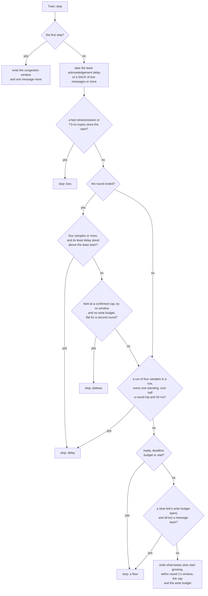

| Stop | When | The low edge is |
|---|---|---|
| `delay` | a queue stood: a delay 10 ms and one message's serialisation at the estimated rate above the least seen (`STANDING`, `agents/roomlerd/src/media_train.rs:37`; `standing`, `:1076`). Either a round of four samples or more ended with its least sample standing (`ROUND_SAMPLES`, `:75`; `close_round`, `:1128`), or four samples or more in a row stood, over half the least round trip and 50 ms (`EARLY_SPAN`, `:76`; `run_stands`, `:987`) | the link's rate: push-back |
| `plateau` | two rounds held at the in-flight cap once later samples confirmed it (below), and by neither of SCTP's windows nor the write budget, each delivered less than 10 % more than the round before (`PLATEAU_ROUNDS`, `:136`; `close_round`, `:1128`) | the link's rate: push-back |
| `loss` | a fast retransmission or a T3-rtx expiry after the first step (`:709`) | the link's rate: push-back |
| `budget` | the next message would pass 512 KiB (`BUDGET`, `:27`); or on a slow link the write budget is spent, and all but a message of what was written came back without a judgment (`:772`) | a floor |
| `deadline` | 2.5 s less 25 ms, or less two step intervals where steps come further apart (`DEADLINE`, `:30`; `DEADLINE_LEAD`, `:120`) | a floor |
| `ready` | the first frame is ready, and the session needs the path | a floor |
| `stall` | bytes in flight and nothing acknowledged for twice a delayed acknowledgement (200 ms) and the least round trip (`:741`) | a floor |

**What it writes.** The first step writes the congestion window and one message more,
within the budget (`:657`). SCTP sends the window at once, and the extra message is
waiting when the first SACK comes, because the vendored SCTP grows its window only
while bytes wait
(`crates/vendored/webrtc-sctp/src/association/association_internal.rs:1458`). Every
later step writes enough that bytes keep waiting until the next step: twice the most one
step saw acknowledged, and a message (`agents/roomlerd/src/media_train.rs:759`). Three
limits hold it back. Until the first round ends, what is in flight and waiting stays
within the first window (`:749`), so what that window acknowledges releases as much
again and not twice as much. Once a sample has sat 10 ms above the least (`QUEUED`,
`:45`; `judge`, `:818`), the bottleneck may have queued, and an in-flight cap applies
(`cap`, `:1109`), on trial until what was sent after it confirms it (the cap
on trial, below): the estimated rate's pipe and a queue of a third of the least round trip (of
50 ms at least), never less than the best round's pipe and a message, nor three
messages, and rounded to the nearest whole message. The estimate (`:1043`) is the
highest of three: the best whole round's delivery, the rate over the newest span of at
least 10 ms and four SACKs (`disperse`, `:900`), and the first sample's lead over the
least, read as one packet's serialisation (`pair`, `:1055`).

On every link a write budget applies from the same moment (`write_budget`, `:1034`): the
train writes no more than what had been acknowledged when the cap first applied (`:697`)
and what the estimate carries in 700 ms (`WRITE_SPAN`, `:116`). A round in which the
budget held the writer back is spent, and a spent round is never read as a plateau. Once
all but a message of what was written has come back without a judgment, the train stops on
`budget` (`:779`). Where the budget counts from is set once and never moves: the budget
holds whenever there is an estimate, on trial, confirmed or after a lift, so P-f's bound is
one sum however many trials come and go (the cap on trial, below). At 0.4 Mbit/s the cap
first applies with 5 to 6 KB acknowledged on path I and at 20 ms on path C, and 18 to
19 KB at 80 and 250 ms on path C, and the link's rate carries 35 KB in 700 ms, so the
budget holds the train inside P-f's 64 KB for an estimate up to 1.66 and 1.28 times the
link's rate, however late its judgment comes, and the packets it leaves in flight carry
the run of samples that judges the queue.

**The pacer (D43, D64, D65).** Unpaced, slow start reaches the bottleneck in bursts. A SACK
of two packets lets four leave back to back, so a flight arrives at the sender's line rate,
the bottleneck spaces it to the link, and its SACKs come back at the link's rate: every
later flight arrives at twice the link, and the bottleneck's queue holds half of it,
whatever the pipe. A queue shorter than half the pipe overflows before any round has
carried the link (the shallow buffer, below). So while a train runs, the association paces
its own sends, and slow start stays the step law. The pacer sits in the vendored
webrtc-sctp (`crates/vendored/webrtc-sctp/src/association/pacer.rs`), not in the train,
because SCTP grows its window only while chunks are pending
(`crates/vendored/webrtc-sctp/src/association/association_internal.rs:1458`): the train has
to keep bytes waiting, and only the association can time when each one leaves. It times the
move of new data from the pending queue into flight (`pop_pending_data_chunks_to_send`,
`:2117`):

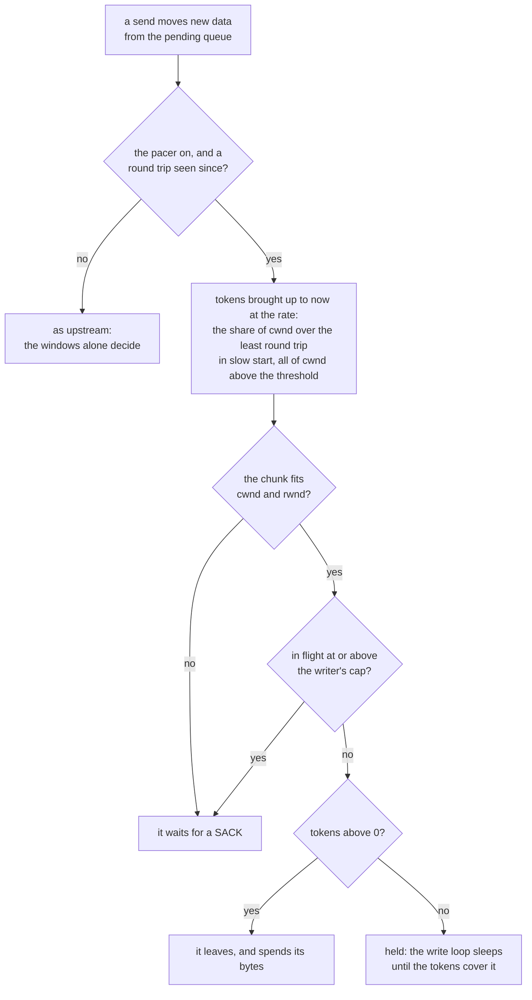

| Rule | Anchor (`crates/vendored/webrtc-sctp/src/association/`) | Why |
|---|---|---|
| Off unless a writer turns it on. Off, it keeps no state, gates nothing, and the write loop arms no timer for it | `PaceSwitch::set`, `pacer.rs:90`; `Pacer::begin`, `:187`; `until`, `:267`; the write loop's third wait, `mod.rs:630` | every other association, a tunnel's among them, sends every byte and arms every timer as before |
| The rate is the steered share of the window over the least round trip while cwnd is at most ssthresh (the growth rule's own test), and the whole window above it | `pace_rate`, `pacer.rs:279` | above the threshold a SACK frees only what it acknowledges |
| The least round trip is the least acknowledgement delay since the pacer was turned on: the gauges' own sample, the newest chunk sent once that a SACK newly acknowledged. Before the first, nothing is paced | `Pacer::on_rtt`, `pacer.rs:256`; `association_internal.rs:1418` | the first flight leaves as it always did |
| A pause saves up 2 ms of the rate, and a late wake lets out up to 17 ms of it | `IDLE_SPAN`, `LATE_SPAN`, `pacer.rs:48`, `:54` | a burst after an empty queue or a full window stays short, and a coarse timer (Windows' default tick is 15.6 ms) costs no rate |
| New data waits while in flight is at or above the cap its writer set | `Pacer::admit`, `pacer.rs:222`; the gate, `association_internal.rs:2170` | the train's cap binds the association (below) |
| A retransmission never waits, and the zero-window probe leaves and spends its bytes | `Pacer::spend`, `pacer.rs:242`; `association_internal.rs:2201` | the pacer changes no window, threshold, growth rule or retransmission |
| Turning it off, and a cap that rises or goes, wakes the write loop | `PaceSwitch::set`, `steer`, `pacer.rs:90`, `:102` | what it held leaves at once, as the windows allow |

The train's writer holds the switch while the train runs. `Pacing::on` turns it on
(`agents/roomlerd/src/media_train.rs:344`); `Pacing::follow` steers it after every step to
what `Train::pace` answers (`:350`, `:615`) and turns it off at the stop; and dropping a
`Pacing` turns it off too (`:358`), so an error that ends the writer leaves no pacing
behind. `Train::pace` reads only the machine's own state, as every rule above does.

**The paced rate law.** Paced at a share G of the window over the least round trip R, with
every SACK adding what it acknowledged to the window, the window and the rate grow as
e^(x·t/R), where x·e^x = G. At G = 1, x = 0.567 and a round grows 1.76 times; at G = ½,
1.42 times, where unpaced slow start doubles. Once the rate passes the link, the SACKs
still carry what left a round trip before, so the rate keeps that growth for one more round
trip. From then on it rises by G times the link each round trip, since the link's SACKs
keep adding to a window that chunks wait behind. The queue is what the rate put above the
link. The train sees it only when a sample sits 10 ms above the least (`QUEUED`, `:45`),
and that sample comes back a round trip and those 10 ms after its packet met the queue.
Paced at the whole window, the first experiment broke P-e in three grid cells for that
reason, and at half of it in one, while the 250 ms cells' push-backs became floors (D65).

**The exit (D65).** Two rules hold that queue within P-e:

- **The cap binds the association.** From the sample that shows the queue on, on trial or
  confirmed, the train's in-flight cap (`cap`, `:1109`) goes to the pacer with the whole
  window (`Train::pace`, `:615`), and chunks already pending wait while in flight is at or
  above it. The cap used
  to hold only what the train wrote (`:755`), and what the train had handed to SCTP before
  it still left.
- **The gain comes from the path, until the cap.** Until the bottleneck queued, the pacer
  lets out `pace_share` of the window (`:174`): the largest share G, up to the whole window,
  whose queue at the cap, by the law above (`pace_queue`, `:192`), stays within three
  quarters of P-e's bound, max(R, 50 ms). It is a function of the least round trip and
  `QUEUED` alone, and it follows the least as the least falls (`sample`, `:801`). From the
  cap on, the share is the whole window: the cap holds the queue, and a train paced at a
  fraction of its window with nothing pending at its SACKs stops growing, and reads a
  plateau under the link (0.82 at 0.4 Mbit/s and 20 ms on path I, in the model that ranked
  the candidates).

| Least round trip | 20 ms | 50 ms | 80 ms | 160 ms | 200 ms | 235 ms and longer |
|---|---|---|---|---|---|---|
| `pace_share`, thousandths of the window | 395 | 248 | 439 | 788 | 910 | 1,000 |
| The whole window's queue at the cap, by the law | 60.8 ms | 78.5 ms | 95.9 ms | 138.8 ms | 159.0 ms | 176.3 ms at 235, 183.5 ms at 250 |
| P-e's bound | 50 ms | 50 ms | 80 ms | 160 ms | 200 ms | the round trip |

The share is least near 50 ms: below that P-e's bound stays 50 ms however short the round
trip, so a shorter path has more room, counted in its round trips.

**The margin, a quarter (`PACE_MARGIN`, `:154`).** The law leaves out a step's lateness,
the second packet a SACK waits for, and the serialisation a least round trip carries. A
packet model of the vendored SCTP and the train, checked against the first experiment's
traces before any candidate was built, put their peak queues within 15 %: 52.0 ms where the
cell measured 51.6 at 2 Mbit/s and 20 ms, 116.3 for 104.1 at 2 Mbit/s and 80 ms and 92.1 for
90.2 at 8 Mbit/s and 80 ms, all at the whole window; and at half of it 53.8 for 54.9, 79.6 for
73.6 and 61.2 for 69.8. A quarter covers that error. It is also about the most that keeps the
whole window where the whole window is safe: at 250 ms its queue at the cap is 0.73 of the
round trip, so a margin above 0.27 would pace the 250 ms paths below their window for no
queue they build, and turn their push-backs into floors, as half the window did. The cap's
trial (4a-3c, below) engages at the same sample with the same bound, so it adds no lag to
this derivation and leaves the margin as it was.

**The rules, and the cell that forced each.** The rulings set the train's shape; these
are the numbers in it. The first four were found in a packet model of the vendored SCTP
before the cells ran, the rest by a cell below that failed without them:

| Rule | Anchor | Forced by |
|---|---|---|
| In flight and waiting stay within the first window until round 1 ends | `agents/roomlerd/src/media_train.rs:749` | 0.4 Mbit/s at 20 ms: SCTP's release of four packets for each SACK of two queued 77.7 ms, over P-e's 50 ms |
| A round ends when the first byte sent after it began is acknowledged | `Round::mark`, `:385` | a round counted from bytes already in flight closed in 2 ms and read 1.23 times the link |
| Twice the most one step acknowledged, and a message, wait | `:759` | 50 Mbit/s: with less waiting, slow start stopped growing between steps |
| No sample from a SACK of one message | `:685` | a lone packet's SACK may have waited for the delayed acknowledgement |
| The cap starts, on trial, at a sample 10 ms above the least | `QUEUED`, `:45`; `judge`, `:818` | 2 Mbit/s at 80 ms, path I: two packets sent together put 4.9 ms between samples, and a cap from 5 ms held the climb at round 1's rate, a plateau at 0.11 of the link |
| The cap's queue is a third of the least round trip, of 50 ms at least | `QUEUE_FLOOR`, `:50` | 2 Mbit/s at 250 ms, path I: with half, the peak queue reached 253 ms, over P-e's 250 |
| The cap is never below three messages | `CAP_FLOOR_MESSAGES`, `:127` | 0.4 Mbit/s at 20 ms and 2 Mbit/s at 80 ms, path C: with one message in flight the train stalled, every SACK a lone packet's, on the vendored acknowledgement timer that #4033 fixed (below). Any receiver still holds a lone packet's SACK up to 200 ms, so the floor stays |
| The cap is the nearest whole number of messages | `cap`, `:1109` | 0.4 Mbit/s at 80 ms, path C: a pair's round trip is the least and one serialisation, so a train that writes in pairs fills a pipe of 4.4 messages only with about 5.4 in flight; cut down to whole messages, the cap kept 4, and the rounds read a plateau at 0.74 |
| A standing queue is 10 ms and one message's serialisation at the estimate | `STANDING`, `:37` | 0.4 Mbit/s at 250 ms, path I: a pair's serialisation read 22.7 ms in round 4 with no queue at all |
| A plateau needs rounds held by the cap and by no window, and no queue | `PLATEAU_ROUNDS`, `:136` | 0.4 Mbit/s at 20 ms: three messages fill the path and no sample shows a queue, so the train ran to its deadline and wrote 118 KB, over P-f's 64; 2 Mbit/s at 80 ms, path C: rounds held by the congestion window grow one packet a round, and read as a plateau at 0.52 |
| Four samples over half the least round trip and 50 ms, every one standing, judge the queue before the round ends, and their delivery counts toward the low edge | `ROUND_SAMPLES`, `EARLY_SPAN`, `:75`, `:76`; `run_stands`, `:987` | 0.4 Mbit/s at 250 ms, path I: waiting for the round's end wrote 74.4 KB, over P-f; judged early in any round, 8 Mbit/s at 250 ms stopped on delay at 0.16; over a shorter span and with the round's own delivery left out, 2 Mbit/s at 250 ms stopped at 0.52 and 0.69 |
| The four are a run of samples in a row: one that does not stand starts it again, and so does one that comes later after the run's newest than its own queue and a message's serialisation, since the link may have idled between them | `extend_run`, `:957` | CI run 44383834538 (below): a dip sank the whole round it fell in, rounds 3 and 4 each took one, and the judgment came in round 5. Under noise, a run that passed over the samples of packets sent below the cap spanned an idle link at 2 Mbit/s and 250 ms and read 0.69, and a run across 148 ms without a SACK read 0.29 at 8 Mbit/s and 250 ms |
| A round's end judges delay only with four samples | `close_round`, `:1128` | 50 Mbit/s at 20 ms, path C, under noise: one late sample, alone in its round, read as a queue and stopped the train on delay at 0.04 of the link |
| Once a slow link queued, the train writes no more than what was acknowledged then and its estimate's 700 ms, and a round that budget held is no plateau | `WRITE_SPAN`, `:116`; `write_budget`, `:1034` | CI run 44383834538 (below): at 0.4 Mbit/s and 250 ms the train wrote 85,200 and 64,800 bytes while its judgment waited, over P-f |
| The write budget counts from what was acknowledged when the cap first applied, on any link, and never moves or turns off | `write_budget`, `agents/roomlerd/src/media_train.rs:1034`; `:697` | 0.4 Mbit/s at 250 ms, path I: counted afresh after a lift, the train wrote 60,000 bytes; at 80 ms on path C, only with a pair, 64,800 under noise, and in the model with two samples to confirm 78,000; moved to a lift that met no queue, 68,400 in the model (P-f: 64,000) |
| A rate from the spacing of SACKs spans 10 ms and four SACKs at least | `DISPERSION_SPAN`, `DISPERSION_ACKS`, `:61`, `:62` | 2 Mbit/s at 250 ms, path I: over one SACK it read 2.55 Mbit/s on a link that carries 1.95 |
| The deadline comes 25 ms early, or two step intervals | `DEADLINE_LEAD`, `:120` | 50 Mbit/s at 250 ms, path C: the train ran past 2,500 ms |
| The first write keeps within the budget | `:657` | a congestion window of 4 MiB (`the_first_write_keeps_within_the_budget`) |
| The association paces its sends while the train runs | `Pacing`, `agents/roomlerd/src/media_train.rs:340`; `pace_rate`, `crates/vendored/webrtc-sctp/src/association/pacer.rs:279` | the shallow buffer, 8 Mbit/s at 80 ms behind a 20 ms queue, path I (D43): unpaced, the bursts overflowed the queue before any round carried the link, and the low edge read 0.14 to 0.52 |
| Once the bottleneck queued, the cap binds the association's sends | `Train::pace`, `agents/roomlerd/src/media_train.rs:615`; `Pacer::admit`, `crates/vendored/webrtc-sctp/src/association/pacer.rs:222` | 2 Mbit/s at 20 ms, path I, paced at half the window: the queue peaked at 54.9 ms, over P-e's 50, from bytes handed to SCTP before the cap |
| The share is the largest whose queue stays within three quarters of P-e's bound, until the cap, and the whole window from then on | `pace_share`, `agents/roomlerd/src/media_train.rs:174`; `PACE_MARGIN`, `:154` | paced at the whole window, P-e broke at 2 Mbit/s and 20 ms (51.6 ms) and at 80 ms at 2 and 8 Mbit/s (104.1 and 90.2 ms); at half of it, at 2 Mbit/s and 20 ms, and the 250 ms push-backs became floors. Held past the cap, a share under the whole window starved 0.4 Mbit/s at 20 ms into a plateau at 0.82, in the model |
| The cap is on trial: only the sample of a packet sent at or after the step it engaged at judges it. Two that stand 10 ms above the least confirm it; eight that do not lift it, and the greatest sample is the least again | `Hold`, `agents/roomlerd/src/media_train.rs:428`; `judge`, `:818`; `TRIAL_STANDING`, `:88`; `TRIAL_CLEAR`, `:89` | a host stall of 40 ms in the first round (the stall cells, below): it capped 8 Mbit/s at 20 ms on path I into a plateau at 0.10 of the link, the shallow buffer at 0.03 and both viewer's window cells at 0.00, in every run, while the link's queue never passed 2.4 ms. One standing sample: a second stall confirmed a trial at 2 Mbit/s and 80 ms on path C under noise (a plateau at 0.11). Four clear: in the model 0.4 Mbit/s at 80 ms on path I queued 80.2 ms |
| A round held at a cap on trial is no plateau, and on trial the most one step acknowledged keeps its value | `agents/roomlerd/src/media_train.rs:766`, `:702` | the plateau: the stall cells' plateaus above, rounds held at a cap a stall set. The peak: 8 Mbit/s at 20 ms on path I, a stall at 250 ms: the SACKs the stall held came at once, the steps after them wrote twice that, and the queue reached 52.2 ms, over P-e's 50 |
| The pair is a first sample's whose packet left in the same step as the one ahead of it | `first_paired`, `agents/roomlerd/src/media_train.rs:692`; `pair`, `:1055` | 0.4 Mbit/s at 80 ms, path C, whose first window is paced: a first sample 10.7 ms over the least read 112 kB/s, 2.3 times the link, and the train queued 88.3 ms alone and 111.2 ms with 64,800 bytes under noise (P-e, P-f) |
| Under a least round trip of 60 ms, a lead shorter than the least round trip is a claim: a delivery more than a quarter above it over a least round trip refutes it, and one within it, the probe's messages out, confirms the cap | `Claim`, `agents/roomlerd/src/media_train.rs:452`; `test_claim`, `:879` | 0.4 Mbit/s at 20 ms, path C: under the cap's queue of 16.7 ms no sample stood 10 ms, the trial lifted, and the climb after it queued 140.1 ms, over P-e's 50. Confirmed untested, the lead was a stall's under noise at 50 Mbit/s and 20 ms on path C (a plateau at 0.01) and at 2 Mbit/s and 20 ms on path I (0.57) |
| While the claim is open the cap lets out the messages the claimed link serialises in the least round trip and 37.5 ms more | `Claim::probe`, `agents/roomlerd/src/media_train.rs:470`; `CLAIM_QUEUE`, `:104` | a 12 ms lead at a least round trip of 48 ms: one message more than 50 ms holds read 1.25 times the claim on a link four times faster, and confirmed it (`a_faster_link_refutes_the_claim_on_every_short_path`); in the model 8 Mbit/s at 50 ms with a 20 ms stall stopped on a plateau at 0.05 |
| A delivery rate spans the sends of its bytes where they took longer than its acknowledgements | `sent_at`, `agents/roomlerd/src/media_train.rs:929`; `span`, `:943` | 8 Mbit/s at 20 ms, path I, a stall at 250 ms: the SACKs it held read 3.9 MB/s over their own span on a 1 MB/s link, and the train stopped on delay at 2.25 of the link (P-a) |

**The reading** (`Reading`, `agents/roomlerd/src/media_train.rs:274`):

| Field | Means |
|---|---|
| `low_bps` | the best whole round's delivery rate; when a run of samples judges the queue, its delivery since the run's first sample counts too |
| `high_bps` | the rate offered in the round that pushed back, when that round's queue stood and it delivered less than it was offered; `None` otherwise, on a floor, and where it would sit below the low edge |
| `stop`, `floor_only` | why it stopped; `floor_only` is true for every stop but `delay`, `plateau` and `loss`, and then the low edge is only a floor |
| `unit` | `SctpPayloadBps`: bits a second of SCTP payload, without SCTP's headers or anything beneath them |
| `rounds` | the rounds closed |
| `written_bytes`, `wire_bytes` | the payload written, and the SCTP packets that carry it once each: 28 bytes of common and DATA chunk header a message (`PACKET_OVERHEAD`, `:144`). What DTLS, UDP, IP and a relay add beneath is the carrier's |
| `min_rtt` | the least acknowledgement delay seen |
| `ssthresh_at_start` | the slow start threshold at the first write, which says the open path (below) |
| `fast_retransmits`, `t3_expiries` | the loss events during the train |
| `duration` | from the first step to the stop |

**The two open paths.** The agent's association and the browser's both start as clients
and send INIT, and which answer the agent's end takes first is a race. The two answers
leave SCTP in different states:

| Path | The agent's end is established by | Its slow start threshold at the first write | So the train climbs by |
|---|---|---|---|
| **I** | the peer's INIT ACK, which sets the threshold to the peer's window (`crates/vendored/webrtc-sctp/src/association/association_internal.rs:844`) | the peer's window: 1 MiB by default, 64 KiB in the window cell | slow start: each SACK adds what it acknowledged to the window while bytes wait (`:1459`), so a SACK of two packets releases four |
| **C** | the peer's COOKIE ECHO (`handle_cookie_echo`, `:926`), which sets neither | 0, the constructor's (`:183`); the peer's window is 0 until the first SACK | congestion avoidance from the first byte: one MTU more a round trip (`:1495`) |

On path C the train comes within 20 % of the link only where congestion avoidance
reaches it inside the train's time and budget: at 0.4 and 2 Mbit/s with 20 and 80 ms,
and at 8 Mbit/s with 20 ms. At 2 Mbit/s and 80 ms and at 8 Mbit/s and 20 ms that is a
floor at the link's rate, ended by the deadline and the budget. Everywhere else it reads
a floor below the link, and the floor is the association's own ramp, not the path's: a
session that opens on path C cannot send faster at first either. The ignored
measurement `path_c_ramp_to_the_link_rate` (`agents/roomlerd/src/media_train.rs:2052`)
keeps 16 messages waiting and records when the last round trip, of 200 ms at least,
first carried 80 % of the link's payload rate:

| Link | Path I | Path C | Path C's congestion window then |
|---|---|---|---|
| 2 Mbit/s, 80 ms | 529 ms | 1,866 ms | 20,344 bytes |
| 8 Mbit/s, 80 ms | 633 ms | 5,120 ms | 67,008 bytes |
| 2 Mbit/s, 250 ms | 1,562 ms | 12,062 ms | 52,272 bytes |
| 8 Mbit/s, 250 ms | 2,190 ms | not within 15 s: 2.04 Mbit/s, 26 % of the link, at 15 s | 68,236 bytes at 15 s |

At one MTU a round trip, 80 % of 8 Mbit/s at 250 ms is about 155 round trips away,
about 40 s, and 80 % of 50 Mbit/s at 80 ms about 25 s. At 50 Mbit/s and 250 ms a window
of 1 MiB holds either path under 34 Mbit/s.

**Which path a session took (O10).** How often each path wins on the fleet is not known,
so each data-channel pump writes one line at its first media write:
`path open (FR-148 P0, O10)` (`OPEN_LINE`, `agents/roomlerd/src/media_delivery.rs:1585`).
The call sits where the pump hands each media message to its send task
(`agents/roomlerd/src/peer.rs:5285` in the VP9 4:4:4 pump, `:9933` in the FFmpeg one),
and only its first call reads anything (`DeliverySampler::on_first_write`,
`agents/roomlerd/src/media_delivery.rs:1012`). It reads the gauges through
`RTCSctpTransport::gauges` (`crates/vendored/webrtc/src/sctp_transport/mod.rs:486`),
which never waits for the transport's slot, with `GaugeReader::peek`
(`crates/vendored/webrtc-sctp/src/association/gauges.rs:202`), which resets nothing, so
the least acknowledgement delay stays for the reader that takes it (the fork's test,
`crates/vendored/webrtc-sctp/src/association/association_internal/association_internal_test.rs:1167`).
The answer is a pure function of the gauges (`OpenedBy::of`,
`agents/roomlerd/src/media_delivery.rs:1627`):

| `open_path` | When |
|---|---|
| `init_ack` | the slow start threshold is above 0, and no loss came first |
| `cookie_echo` | the threshold is 0, and no loss came first. An INIT ACK that arrives after the COOKIE ECHO is discarded (`crates/vendored/webrtc-sctp/src/association/association_internal.rs:812`), so it cannot set the threshold later |
| `unknown` | a fast retransmission or a T3-rtx expiry came first: either sets the threshold, on both paths (`crates/vendored/webrtc-sctp/src/association/association_internal.rs:1547`, `:2620`) |
| `unread` | no gauges: no association, or the transport's slot was held at that moment |

The threshold tells the paths apart and the peer's window does not, since any SACK sets
the window on both. The line also carries `ssthresh`, `rwnd`, `cwnd`, `inflight_bytes`,
`pending_bytes`, `max_payload`, `fast_retransmits` and `t3_expiries`; an `unread` line
carries only the session, the pump and `open_path`. No field can carry an address. It is
written at INFO, like the other P0 lines, so the default filter ships it
(`crates/agent-core/src/logging.rs:496`), and `ROOMLERD_PATH_MODEL=off` writes none. A
follower of a shared pipeline runs no pump and writes no line, and a pump that starts
again for the same session writes its own. The cells open a pair by each path over the
shaped link and read `init_ack` and `cookie_echo` at the first write
(`agents/roomlerd/src/media_delivery.rs:4775`, `:4794`). The path report counts one
device's sessions by answer (`docs/production-mongo-reads.md` §8a).

**The properties and their cells.** Each cell opens two in-process associations of the
vendored SCTP over `media_delivery`'s shaped link (`shaped`,
`agents/roomlerd/src/media_delivery.rs:5182`; `pair_opened`, `:5439`, by either path,
`OpenPath`, `:5424`), steps the machine every millisecond, writes what it asks, and
after the stop waits for every byte written to be acknowledged. A grid cell's link
serialises each direction at its rate, adds half the round trip to every packet, and
queues up to a second, deeper than anything the train can fill (`Cell::grid`,
`agents/roomlerd/src/media_train.rs:1259`). The shaper records the longest any packet of
the agent's waited for the wire (`peak_wait`, `agents/roomlerd/src/media_delivery.rs:4987`)
and its tail drops (`:4992`). `broken` (`agents/roomlerd/src/media_train.rs:1596`) checks
every cell; it also checks that `floor_only` matches the stop, and that the slow start
threshold at the first write is 0 on path C and not 0 on path I.

| Property | Says | Checked | Unpaced: read over five runs of each cell | Paced (D43, D65): read over four runs of each grid cell and five of each named cell |
|---|---|---|---|---|
| **P-a** | a push-back stop's low edge is within 20 % of the link's payload rate | every cell | 0.89 to 1.07 of the link at every push-back stop of the grid, and 0.95 to 1.03 in the noise cells. RED in the shallow buffer cell on path I | 0.90 to 1.07 at every push-back stop of the grid but one: in one run, 8 Mbit/s at 20 ms on path I read a plateau at 0.32 after a stall capped it (below). 0.98 to 1.02 in the noise cell at 2 Mbit/s. The shallow buffer cell on path I green: 0.84 to 1.02 over ten runs |
| **P-b** | a budget, deadline or ready stop is a floor, at most 20 % above that rate | every cell | floors from 0.00 to 1.06 of the link | floors from 0.00 to 1.05 |
| **P-c** | no high edge below the low edge | every cell, and `a_high_edge_below_the_low_edge_or_on_a_floor_is_never_reported` | 14 high edges in the grid, all on path I (2 Mbit/s at 80 and 250 ms, 8 Mbit/s at 20 and 80 ms), at 1.05 to 2.00 times their low edges, and 5 in the noise cell at 2 Mbit/s on path I, at 1.25 to 1.88 | none in the grid: a paced round is offered little more than it delivers. Two in the noise cell at 2 Mbit/s on path I, at 1.15 and 1.21 |
| **P-d** | no delay stop while every round's least queueing delay is under 10 ms; a link with room ends on budget or deadline | every cell (a delay stop where no packet of the daemon's waited 10 ms), the room cells at 50 Mbit/s and 250 ms (`room_is_not_push_back`, `:1978`), and `a_round_under_ten_ms_above_the_least_is_no_delay_stop` | a packet waited 21.5 ms or more in every cell that stopped on delay; the room cells ended on `budget` (path I) and `deadline` (path C) | a packet waited 19.3 ms or more in every cell that stopped on delay; the room cells ended on `budget` (path I) and `deadline` (path C), and the named one on path I twice in five runs on `deadline` at 0.02, after a stall capped it |
| **P-e** | a peak queue of at most the round trip or 50 ms, whichever is longer, at most 512 KiB written, at most 2.5 s, and everything written acknowledged | every cell | peak queues up to 190.6 ms at 250 ms (202.1 ms in a noise cell), 74.2 ms at 80 ms and 49.1 ms at 20 ms; 523,200 bytes; 2,478 ms (2,485 ms in a noise cell) | peak queues up to 187.9 ms at 250 ms (172.8 ms in a noise cell), 68.2 ms at 80 ms and 49.1 ms at 20 ms; 523,200 bytes; 2,477 ms (2,479 ms in a noise cell) |
| **P-f** | at 0.4 Mbit/s, at most 64 KB written | the six 0.4 Mbit/s cells and the two 0.4 Mbit/s noise cells | 44,400 bytes at most (250 ms, both paths, and under noise), where it was 61,200 before the write budget | 43,200 bytes at most (80 ms, path C), and 39,600 under noise |
| **P-g** | a first frame ready at 0.3 s ends the train with a floor | four cells, 8 Mbit/s at 80 and 250 ms on both paths (`ready_is_a_floor`, `:2012`) | `ready` at 300 to 302 ms, a floor every time | `ready` at 300 to 307 ms, a floor in all twenty |

At 0.4 Mbit/s and 20 ms the 49.1 ms is SCTP's own initial window: three packets go at
once, and the third waits two serialisations of 24.6 ms. The paced column is 4a-3b's
rule; with the cap on trial (4a-3c, below) the grid read the same in two runs alone, and
what the trial moved is in its own tables.

**The grid.** The low edge as a share of the link's payload rate (the link's rate times
1,200 / 1,228): the stop, the mean and the range, and the highest peak queue. Unpaced over
five runs; paced over four, each alone: E-pace-3's, the experiment that built the exit, and
three of the code as merged, which is E-pace-3's but for names, getters and tests.

| Link | Path I, unpaced | Path I, paced | Path C, unpaced | Path C, paced |
|---|---|---|---|---|
| 0.4 Mbit/s, 20 ms | plateau, 1.00 (0.98 to 1.01), 49.1 ms | plateau, 0.98 (0.96 to 1.00), 49.1 ms | plateau, 1.01 (1.00 to 1.01), 49.1 ms | plateau, 1.00 (0.99 to 1.01), 36.2 ms |
| 0.4 Mbit/s, 80 ms | delay and once plateau, 0.98 (0.89 to 1.01), 73.6 ms | plateau, 0.98 (0.90 to 1.01), 49.0 ms | delay, 1.01 (0.99 to 1.02), 49.1 ms | plateau, 0.91 (0.90 to 0.91), 34.7 ms |
| 0.4 Mbit/s, 250 ms | delay, 0.99 (0.98 to 1.01), 190.6 ms | budget, 0.81 (0.81 every run), 73.3 ms | deadline, 0.42 (0.42 every run), 50.7 ms | deadline, 0.33 (0.32 to 0.33), 49.1 ms |
| 2 Mbit/s, 20 ms | plateau and once delay, 1.04 (1.01 to 1.07), 44.9 ms | delay twice and plateau twice, 1.04 (1.02 to 1.06), 46.5 ms | plateau and once delay, 1.02 (1.01 to 1.05), 21.5 ms | delay twice and plateau twice, 1.05 (1.02 to 1.07), 19.8 ms |
| 2 Mbit/s, 80 ms | delay, 1.00 (0.97 to 1.02), 74.2 ms | delay, 1.02 (1.00 to 1.03), 68.2 ms | deadline, 0.99 (0.96 to 1.03), 22.5 ms | deadline, 1.00 (0.97 to 1.01), 16.2 ms |
| 2 Mbit/s, 250 ms | delay, 1.00 (0.97 to 1.02), 182.2 ms | delay, 0.99 (0.98 to 1.01), 187.9 ms; once `deadline` at 0.85 after a stall | deadline, 0.12 (0.11 to 0.13), 11.1 ms | deadline, 0.09 (0.09 every run), 4.9 ms |
| 8 Mbit/s, 20 ms | delay, 1.01 (0.99 to 1.05), 29.3 ms | delay, 1.01 (1.00 to 1.02), 39.6 ms; once `plateau` at 0.32 after a stall | budget, 1.05 (1.01 to 1.06), 12.9 ms | budget, 1.04 (1.03 to 1.05), 12.7 ms |
| 8 Mbit/s, 80 ms | delay, 1.00 (0.96 to 1.05), 73.2 ms | delay, 1.00 (1.00 every run), 65.9 ms; once `deadline` at 0.32 after a stall | deadline, 0.34 (0.33 to 0.35), 6.5 ms | deadline, 0.29 (0.27 to 0.30), 2.4 ms |
| 8 Mbit/s, 250 ms | budget, 0.32 (0.28 to 0.36), 90.5 ms | budget, 0.45 (0.32 to 0.51), 13.0 ms; once `deadline` at 0.11 after a stall | deadline, 0.03 (0.03 to 0.04), 5.2 ms | deadline, 0.02 (0.02 every run), 1.2 ms |
| 50 Mbit/s, 20 ms | budget, 0.62 (0.45 to 0.80), 20.3 ms | budget, 0.53 (0.36 to 0.63), 9.7 ms | budget, 0.24 (0.22 to 0.26), 3.2 ms | budget, 0.23 (0.22 to 0.25), 0.6 ms |
| 50 Mbit/s, 80 ms | budget, 0.17 (0.15 to 0.19), 20.4 ms | budget, 0.19 (0.18 to 0.20), 2.0 ms | deadline, 0.07 (0.06 to 0.08), 2.8 ms | deadline, 0.05 (0.05 every run), 0.1 ms |
| 50 Mbit/s, 250 ms | budget, 0.05 (0.04 to 0.07), 18.2 ms | budget, 0.05 (0.04 to 0.08), 0.9 ms | deadline, 0.01 (0.01 every run), 1.3 ms | deadline, 0.00 (0.00 every run), 0.2 ms |

The noise cells, unpaced over the same five runs (one seed each, so what varies is the
box's own scheduling): at 0.4 Mbit/s path I stopped on delay at 1.01 (0.99 to 1.03) with
37,200 to 43,200 bytes and a peak queue up to 188.4 ms, and path C on its deadline at 0.42
with 44,400; at 2 Mbit/s path I stopped on delay at 0.98 (0.95 to 1.03) with a peak queue up
to 202.1 ms, and path C on its deadline at 0.13 (0.11 to 0.14). Paced, over the four runs:
at 0.4 Mbit/s path I ends on `budget` at 0.80 to 0.81, a floor, with 39,600 bytes at most
and a peak queue up to 62.1 ms, and path C on its deadline at 0.32; at 2 Mbit/s path I
stops on delay at 1.00 (0.98 to 1.02) with a peak queue up to 172.8 ms, and path C on its
deadline at 0.09.

Path I reads the link wherever slow start fills it within the budget, up to 8 Mbit/s at
80 ms. Beyond that the budget runs out before the window reaches the pipe, and the
reading is a floor.

**What pacing moved.** Against the unpaced train:

- 0.4 Mbit/s at 250 ms on path I, quiet and under noise, ends on `budget` at 0.81, a floor,
  where it stopped on delay at the link. The pair estimate caps it early, and paced flights
  never stand 34.6 ms above the least (10 ms and a message's 24.6 ms) before the write
  budget, 700 ms of the estimate, runs out. Its peak queue falls from 190.6 to 73.3 ms.
- 0.4 Mbit/s at 80 ms reads a plateau on both paths, at 0.90 to 0.91 of the link on path C
  where it read delay at 1.01: still push-back, within P-a, and lower.
- No high edge in the grid, where there were 14: a paced round is offered little more than
  the link delivers.
- Path C's floors under the link read lower: 0.33 for 0.42 at 0.4 Mbit/s and 250 ms, 0.09
  for 0.12 at 2 Mbit/s and 250 ms, 0.29 for 0.34 at 8 Mbit/s and 80 ms. A floor never lowers
  anything (below).

One of the three runs of the code as merged read E-pace-3's stop in every cell, and another
in every cell but 2 Mbit/s at 20 ms, where both paths read a plateau for E-pace-3's delay, at
1.02 to 1.07 either way: two signals race in one round there, and the unpaced runs had both
too. Where a peak queue moved more than 15 % with the same stop, it moved as far between two
runs of the same build (46.5 and 39.8 ms at 2 Mbit/s and 20 ms on path I), or by under one
packet's serialisation (24.6 ms at 0.4 Mbit/s, 0.19 ms at 50 Mbit/s).

**A stall capped a paced train early (4a-3b).** In the remaining run, five path I cells capped
early. The cap started at the first sample 10 ms above the least, and held from then on. In the trace at
8 Mbit/s and 20 ms that sample sat 31.8 ms above the least while the link's queue never
passed 9.2 ms in the whole cell, and in the viewer's window cell (below) 37 ms above it with
no queue at all: the delay was the box's, not the link's. The cap, set from the estimate of
that moment, then held the train under the link, with 4,800 to 19,200 bytes in flight where
the runs that read the link capped with 61,200 to 146,400: a plateau at 0.32 (P-a broken),
and deadlines at 0.85, 0.32 and 0.11. At 2 Mbit/s and 80 ms the train still read the link
(1.00). The unpaced train has the same rule and the same failure under noise (a plateau at
0.21 and 0.26, below). Pacing gives it longer to strike: a paced train grows 1.4 to 1.8
times a round where slow start doubles, so its estimate stays small for more rounds. The cap
on trial (4a-3c, below) is the answer.

| Named cell | Path I | Path C |
|---|---|---|
| A shallow buffer: 8 Mbit/s, 80 ms, a queue of 20 ms (`shallow`, `agents/roomlerd/src/media_train.rs:1837`) | paced: `loss` at 1.00 in five runs of five of the code as merged, and 0.84 to 1.02 over ten with E-pace-3's; with the cap on trial, `loss` at 0.86 to 1.02 in five of five. Unpaced RED: `loss` in every run, the low edge 0.14 to 0.52 over twelve | paced: `deadline`, 0.28 to 0.29; on trial, 0.27 to 0.29 in five of five. Unpaced `deadline`, 0.35 (0.33 to 0.36): congestion avoidance never fills the queue, so nothing is lost |
| The viewer's window of 64 KiB, at 50 Mbit/s and 80 ms (`peer_window`, `:1896`) | paced: `budget`, 0.12 to 0.13, a floor, in four runs of five; in one, a stall capped it at 255 ms and it read a plateau at 0.00, and failed. On trial, `budget` at 0.12 to 0.13 in five of five. Unpaced `budget`, 0.15 (0.14 to 0.16), a floor; the gauges showed the peer's window holding the sender at 149 to 220 steps | paced: `deadline`, 0.05, a floor, in four runs of five; in the same one, a stall capped it at 568 ms and it read a plateau at 0.00, and failed. On trial, `deadline` at 0.05 in five of five. Unpaced `deadline`, 0.07 (0.07 to 0.08), a floor; held by the window at 118 to 120 steps |
| A link with room: 50 Mbit/s at 250 ms (P-d) | paced: `budget` at 0.05 in three runs of five, and `deadline` at 0.02 in two, after a stall capped it with no queue on the link. On trial, `budget` at 0.05 to 0.08 in five of five. Unpaced `budget` | `deadline`; on trial, at 0.00 in five of five |
| The first frame ready at 0.3 s: 8 Mbit/s at 80 and 250 ms (P-g) | `ready`, a floor; on trial, at 300 to 302 ms in five of five | `ready`, a floor; on trial, at 300 to 303 ms in five of five |

The viewer's window cells are the stall's widest target. Paced at 80 ms the share is 0.439
of the window, a round grows 1.37 times, and the train takes about eight rounds to reach
the peer's 64 KiB where slow start took about four. A round the window holds is never a
plateau, so the stall has those rounds to start the cap, and once it has, every round is
held by the cap alone. On trial, such a cap lifts a round trip and eight samples later,
and the window holds the train again (below).

**The cap on trial (4a-3c).** A SACK the daemon's scheduler held, and those it held with
it, sit as far above the least as the stall was long, while the bottleneck's queue does
not move. A queue holds what the link cannot carry, so it is still there under the packets
sent after it showed; a stall is over by then. That is the whole rule: a sample engages
the cap where it did, and only what was sent after it may confirm it, by a queue that
stands under those packets or, on a short path where the cap's own queue cannot stand, by
a delivery that matches the rate the cap was set from. Until then the cap is on trial. What
the train may write is fixed once, by what had been acknowledged when the cap first applied
and what the estimate carries in 700 ms, so no trial, however it ends, moves P-f's bound.
Each rule below applies that principle, and each has a cell or a test that fails without
it. The step's first rule, measured before this one, let one standing sample confirm a
trial and four clear ones lift it, confirmed a short path's lead untested, and counted the
write budget afresh at each trial; where it broke, it names the cell:

- **On trial** (`Hold`, `agents/roomlerd/src/media_train.rs:428`; `judge`, `:818`). The
  cap engages at the first sample 10 ms above the least (`QUEUED`, `:45`), with the same
  bound, the whole window, the writer's room and the write budget (`cap_applies`, `:633`).
  Only the sample of a packet sent at or after the step it engaged at judges it (`:847`):
  a step's time less its sample is when the sampled packet left, to the step. Two samples
  that stand 10 ms above the least confirm it (`TRIAL_STANDING`, `:88`). Eight that do
  not, two rounds of `ROUND_SAMPLES` (`TRIAL_CLEAR`, `:89`), lift it: the greatest sample
  is the least again, the pacer gets the share back, and the next sample 10 ms above the
  least engages the cap anew. One standing sample, the step's first rule, let a second stall among
  the samples that judged a trial confirm it: at 2 Mbit/s and 80 ms on path C under the
  runner's noise, a plateau at 0.11, and in the model at 0.4 Mbit/s and 80 ms on path C,
  P-a at 0.77 to 0.79 in three seeds. Four clear samples lifted a slow link's trial before
  its queue stood: in the model at 0.4 Mbit/s and 80 ms on path I the queue then reached
  80.2 ms (P-e), and at 250 ms the train stopped on its budget at 0.71 where eight read
  1.00.
- **A cap on trial is no plateau, and keeps the peak** (`:766`, `:702`). Until it is
  confirmed, no round counts as held at it, so a cap a stall set never stops the train on a
  plateau: on 4a-3b's rule the first-round stalls read plateaus at 0.00 to 0.10 (the stall
  cells, below). On trial the most one step acknowledged keeps its value: the SACKs a stall
  held come at once, and at 8 Mbit/s and 20 ms on path I, with a stall at 250 ms, the steps
  after them wrote twice that and the queue reached 52.2 ms, over P-e's 50.
- **The pair is a back-to-back first sample's** (`first_paired`, `:692`; `pair`,
  `:1055`). The pair estimate reads the first sample's lead over the least as one
  message's serialisation, which holds only when the sampled packet and the one ahead of it
  left the association in one step. Path C's first window is paced, since the handshake
  gave the pacer a round trip, so its first sample is no pair: at 0.4 Mbit/s and 80 ms on
  path C the least fell 1.1 ms in the third round, the first sample led it by 10.7 ms where
  a message serialises in 24.6 ms, the pair read 112 kB/s, 2.3 times the link, and the
  train queued 88.3 ms alone (P-e), and 111.2 ms with 64,800 bytes written under the noise
  (P-e and P-f), on the step's first rule and on 4a-3b's alike.
- **A short path's lead is a claim, put to the test** (`Claim`, `:452`; `test_claim`,
  `:879`). Under a least round trip of 60 ms (`QUEUE_FLOOR` and `QUEUED`) the cap leaves a
  queue of a third of 50 ms, 16.7 ms, less than one message at 0.4 Mbit/s (24.6 ms), so no
  sample of a slow link's own queue stands 10 ms there: without the claim, 0.4 Mbit/s at
  20 ms on path C lifted its trial and queued 140.1 ms, over P-e's 50. There a lead shorter
  than the least round trip claims a link that serialises a message in the lead. From the
  first sample that judges the trial, over a least round trip, a delivery more than a
  quarter above the claim refutes it (`:889`): the link is faster and the lead was a stall.
  One within it, once the probe's messages were out, confirms the cap (`:892`). The step's first
  rule confirmed the lead untested, and under the runner's noise it read a stall as a slow
  link's pair at 50 Mbit/s and 20 ms on path C (a plateau at 0.01) and at 2 Mbit/s and
  20 ms on path I (0.57).
- **The probe fills the least round trip** (`Claim::probe`, `:470`; `CLAIM_QUEUE`,
  `:104`; `cap`, `:1110`). While a claim is open the cap lets out at least the messages the
  claimed link serialises in the least round trip and 37.5 ms more, three quarters of P-e's
  50 ms, and three at least. On a faster link they come back within a round trip and the
  writer's reply, and read more than a quarter over the claim for every lead under about
  37.5 ms less a quarter of the least round trip. A probe of one message more than the
  claim's link serialises in 50 ms ignored the round trip: at a least round trip of 48 ms a
  12 ms stall's five messages read 1.25 times the claim, not more, and the trial was
  confirmed on a link four times faster (`a_faster_link_refutes_the_claim_on_every_short_path`,
  red on it from 48 to 59 ms); in the model a 20 ms stall in the first round at 8 Mbit/s
  and 50 ms then stopped the train on a plateau at 0.05, where the probe by the least round
  trip reads 1.03, and over 19,528 short fast runs with stalls of 12 to 25 ms the property
  breaks fell from 2,662 to 1,654.
- **No delivery reads faster than its bytes were sent** (`sent_at`, `:929`; `span`,
  `:943`). The train records when the association first sent each byte, to the step, and
  a delivery rate spans its acknowledgements or the sends of the same bytes, whichever
  took longer, as draft-cheng-iccrg-delivery-rate-estimation takes it. A stall releases
  the SACKs it held together, and over their own span the bytes read 3.9 MB/s on a 1 MB/s
  link at 8 Mbit/s and 20 ms, and the train stopped on delay at 2.25 of the link. The rule
  holds for the spacing of SACKs, a round's delivery and a run's.
- **The write budget is set once** (`write_budget`, `:1034`; `:697`; `WRITE_SPAN`,
  `:116`). The train writes no more than what had been acknowledged when the cap first
  applied, on trial or not, and what the estimate carries in 700 ms. Where it counts from
  never moves, and it holds from then on whenever there is an estimate: with a pair or
  without, on trial, confirmed or lifted. 4a-3b's budget applied only at a confirmed cap
  with a pair. On trial that budget counted afresh after each lift: at 0.4 Mbit/s and
  250 ms on path I the train wrote 60,000 bytes on the step's first rule, and with two samples to
  confirm the model wrote 78,000 at 80 ms on path C, whose first round has no pair (P-f:
  64,000).

**P-f by construction.** What the train writes is at most A + e · 700 ms, A the bytes
acknowledged when the cap first applied and e the estimate. At 0.4 Mbit/s the cap first
applies with 4,800 to 6,000 bytes acknowledged on path I, from the pair in the first
round, and on path C, whose climb is paced from its first window, with 6,000 at 20 ms and
18,000 to 19,200 at 80 and 250 ms (the model, quiet and 60 seeds of its noise in each
0.4 Mbit/s cell). The link's own rate carries 35,000 bytes in 700 ms, so P-f's 64,000
holds for an estimate up to 1.66 times the link on path I and at 20 ms on path C, and
1.28 times at 80 and 250 ms on path C, however many trials lift. Run alone, the train
wrote 48,000 bytes at most, at 80 ms on path C where the trial lifted (two runs
of seven), and 39,600 to 40,800 at 250 ms on path I (the grid twice, and the five
0.4 Mbit/s cells at 20 to 250 ms five times more).

**A lift refunds nothing.** A trial in which no sample stood met no queue: the cap set
what was out, and the link took all of it. A form of this rule read that as a
measurement of the cap, not of the link, and counted the budget again from the lift. That
counts a stall twice on a slow link. At 0.4 Mbit/s and 80 ms on path C a 40 ms stall at
850 ms engaged a trial at 22 to 36 kB/s, under the link's rate while path C still climbs;
its three to four messages met no queue, eight clear samples lifted it at 1,490 ms, and
counted from there the train wrote 68,400 bytes, and 75,600 under the runner's noise (the
model). The bound counts A once, so a refund can only keep within it by taking from the
estimate's share, and the refunds that did that gave the stall cells nothing. Ranked in the
model on the off-grid set at 0.4 Mbit/s (both paths, round trips of 20 to 250 ms, quiet,
ten seeds and 40 ms stalls every 50 ms: 1,322 runs), the stall sweep (stalls of 20, 40 and
50 ms every 10 ms on the four stall links: 1,614 runs), the twelve stall placements and the
grid under 30 seeds of two noise levels (1,440 runs), with 4a-3b's rule beside them, the
baseline that a break is new against:

| Lift | Off the grid at 0.4 Mbit/s: breaks (P-f) | Off the grid: new breaks (P-f) | Stall sweep: breaks | Stall placements held | Noise: breaks (new) |
|---|---|---|---|---|---|
| 4a-3b's rule: no trial, so nothing lifts; the budget only at a cap with a pair | 222 (46) | the baseline | 486 | 7 of 12 | 58 (the baseline) |
| Counted again from the lift, when no sample stood, with a probe of one message more than the claim serialises in 50 ms (the build with the refund) | 73 (48) | 34 (12) | 62 | 12 of 12 | 10 (6) |
| Counted again from the lift, when no sample stood (a form of this rule) | 72 (48) | 33 (12) | 62 | 12 of 12 | 10 (6) |
| Again, but never above A + 1.6 times the best estimate's 700 ms | 67 (44) | 29 (8) | 62 | 12 of 12 | 10 (5) |
| Moved by one round's want at most | 53 (35) | 16 (0) | 223 | 10 of 12 | 9 (4) |
| **Not moved (this rule)** | 47 (35) | **10 (0)** | 331 | 9 of 12 | 9 (4) |

Property breaks rank first, so the budget never moves. The stall sweep's cost is the
first-round stall on a fast link (found and standing, below). Every P-f break of this rule
off the grid is one 4a-3b's rule has too, at 120 and 160 ms on path C (found and standing,
below). A placement holds when it breaks no property and keeps its unstalled run's reading:
its loss stop, and 0.8 of its low edge.

**The margin stands.** The trial adds no lag where the cap engages: the same sample
engages it, with the same bound, pace and write budget, so the queue at the cap that
`pace_share` derives is the same, and `PACE_MARGIN` stays a quarter. A lift lets the climb
go on under the share, and the cap that engages next is the law's.

**The stall cells.** The cells' harness stalls the daemon's side of the link (`HostStall`,
`agents/roomlerd/src/media_delivery.rs:5204`; `shaped_stalled`, `:5234`): from a chosen
moment, for 40 ms, nothing the link delivers reaches the train, and then the first packet
held arrives at the stall's end and the rest 5 ms after it, as a scheduler that was busy
reads them. The link's own queue never moves. That is what the production run's traces
show: a sample 31.8 and 37 ms over the least, while the link's queue stood at 9.2 ms at
most and at none. Twelve cells put the stall in the first round, mid-climb, and just
before a true queue caps (or, where the window holds the train, before the stop), in four
cells: 8 Mbit/s at 20 ms on path I, the shallow buffer on path I, and both viewer's window
cells. Each must read as its cell does without the stall, on P-a and P-e, in five runs of
five. Run alone, each five times, on 4a-3b's rule and on this one:

| Cell, the stall at | Without the stall | 4a-3b's rule | This rule |
|---|---|---|---|
| 8 Mbit/s, 20 ms, path I: the first round (0 ms) | `delay` at 1.00 to 1.03, 34.9 to 35.1 ms | `plateau` at 0.10, capped at 89 to 117 ms with 2.4 ms of queue at most: P-a broken in five of five | `delay` at 1.00 to 1.07, 37.4 to 41.5 ms |
| mid-climb (150 ms) |  | `delay` at 1.02 to 1.06, 21.4 to 23.7 ms | `delay` at 0.99 to 1.05, 36.9 to 43.1 ms |
| before the cap (250 ms) |  | `delay` at 0.98 to 1.75, a peak queue of 111.1 to 163.9 ms: P-e broken in five of five, and P-a in one | `delay` at 0.99 to 1.08, 20.2 to 25.4 ms |
| The shallow buffer, path I: the first round (0 ms) | `loss` at 0.86 to 1.02 | `plateau` at 0.03, capped at 209 to 213 ms: P-a and the loss stop broken in five of five | `budget` at 0.03, a floor, before the buffer lost a packet: the loss stop broken in five of five |
| mid-climb (600 ms) |  | `loss` at 0.80 to 0.98: P-a broken in one | `loss` at 0.98 to 0.99 in four; `budget` at 1.01 in one, the train's 512 KiB written: the loss stop broken in one of five |
| before the cap (1,100 ms) |  | `budget` at 0.65 to 0.88: no loss stop in five of five | `loss` at 0.87 to 0.90 |
| The viewer's window, path I: the first round (0 ms) | `budget` at 0.12 to 0.13 | `plateau` at 0.00, capped at 207 to 236 ms: P-a broken in five of five | `budget` at 0.00, a floor, before the window held the sender: broken in five of five |
| mid-climb (600 ms) |  | `budget` at 0.12 | `budget` at 0.12 |
| before the stop (1,100 ms) |  | `budget` at 0.12 to 0.13 | `budget` at 0.12 to 0.13 |
| The viewer's window, path C: the first round (300 ms) | `deadline` at 0.05 | `plateau` at 0.00, capped at 569 to 579 ms: P-a broken in five of five | `budget` at 0.00, a floor, after the window held the sender |
| mid-climb (1,200 ms) |  | `deadline` at 0.05 | `budget` at 0.04 in four; `deadline` at 0.04 in one |
| before the stop (2,300 ms) |  | `deadline` at 0.04 to 0.05 | `deadline` at 0.04 to 0.05 |

On 4a-3b's rule six cells broke in every run and a seventh in one of five. Five read as
their cells do: there the stall's cap engaged near what the link or the peer's window
already held the train to. On this rule nine held in five runs of five. Two broke in
every run, both stalled in the first round on path I: the train stopped on its budget, a
floor, at 0.00 of the link behind the viewer's window and at 0.03 behind the shallow
buffer, before the window ever held the sender or the buffer lost a packet, which is what
those cells check (found, and standing, below). 4a-3b's rule read plateaus there at the
same shares. The window cell on path C, stalled in its first round, stopped the same way
at 0.00, after the window had held the sender, so it holds: without the stall it reads a
floor as well, its deadline at 0.05. The third, the shallow buffer stalled mid-climb,
failed its cell's check in one run of five, with P-a and P-e held: the train wrote its
512 KiB (D38) and stopped on `budget` at 1.01 of the link before SCTP's fast retransmit
had reported the loss. The stall's trial lifted, and the round trip and eight samples
that took put the train's stops at 1,311 to 1,357 ms, where the cell without the stall
stops at 1,228 to 1,238 ms with 488,400 bytes written at most; the four runs that stopped
on `loss` had written 502,800 to 517,200. A rule whose trial lifts runs that race in this
cell; on 4a-3b's rule the cell broke P-a in one run of five.

A lifted trial costs time. With the stall in the first round, 8 Mbit/s at 20 ms stopped
at 535 to 602 ms where its cell stops at 359 to 370: the trial holds the train at the cap
of the stall's moment for a round trip and eight samples, and the climb then goes on from
where it was. Mid-climb and before the cap the cost was at most 130 ms.

**What else the rule moved.** Run alone twice, and four times in
`grid_under_noise` (five seeds of every grid cell, 480 runs), the grid read as on 4a-3b's
rule but for these cells (production: the three runs of 4a-3b's rule, the first of them
the one a stall capped early):

| Cell | 4a-3b's rule, production | This rule, alone | This rule, under noise |
|---|---|---|---|
| 8 Mbit/s, 20 ms, path I | `plateau` 0.32 (a stall), `delay` 1.00 to 1.02 | `delay` 1.00 to 1.03, 34.9 to 35.1 ms | `delay` 0.96 to 1.08 in twenty of twenty |
| 8 Mbit/s, 80 ms, path I | `deadline` 0.32 (a stall), `delay` 1.00 | `delay` 1.01 to 1.02, 59.8 to 60.0 ms | `delay` 0.95 to 1.04 in sixteen; `budget` 0.93 to 1.02 in four, the train's 512 KiB written, one of them with a queue of 87.0 ms: P-e broken |
| 2 Mbit/s, 250 ms, path I | `deadline` 0.85 (a stall), `delay` 0.98 | `delay` 0.99 to 1.00, 180.5 to 191.2 ms | `delay` 0.97 to 1.03 in thirteen; `deadline` 0.53 to 0.85, a floor, in seven |
| 8 Mbit/s, 250 ms, path I | `deadline` 0.11 (a stall), `budget` 0.51 | `budget` 0.47 to 0.49 | `deadline` 0.04 to 0.51, a floor, in sixteen; `budget` 0.01 to 0.37, a floor, in four |
| 0.4 Mbit/s, 80 ms, path C | `plateau` 0.90 to 0.91, 31.9 to 33.0 ms | `plateau` 0.90, 32.7 ms, in one run; `budget` 0.90, a floor, with 48,000 bytes, in the other | `budget` 0.86 to 0.88, a floor, with 46,800 to 48,000 bytes, in twelve; `plateau` 0.81 to 1.01 in eight, with 56,400 bytes at most |

- **The cells a stall capped in production** read their links alone, and under noise as
  4a-3b's rule reads them there, floors at 250 ms among them, but for one P-e break at
  80 ms (below).
- **0.4 Mbit/s at 250 ms on path I** reads as on 4a-3b's rule, `budget` at 0.81 with
  39,600 bytes, a floor. Its first trial, which the pair's lead engaged in the first
  round, lifted: the train's window was under the 11 messages the path holds, so no
  packet met a queue. The write budget, counted from that first cap, then held the climb,
  and a second trial engaged before the budget stopped it. The step's first rule counted
  the budget afresh after the lift and read the link there with 60,000 bytes, 4,000 under
  P-f's bound.
- **0.4 Mbit/s at 80 ms on path C** stops at 0.87 to 0.90 of the link on either side of
  its trial, in the grid's two runs and five more runs of the 0.4 Mbit/s cells, all alone.
  Where the trial was confirmed, at 1,257 to 1,262 ms in five of those seven runs, the
  train read its plateau at 0.87 to 0.90; where it lifted, in the other two, the estimate
  it engaged at was the paced climb's, under the link's, so the cap left no queue that
  stood 10 ms, and the write budget, counted from that first cap, was spent before a
  second trial: `budget` at 0.90, a floor, with 48,000 bytes. The low edge is 4a-3b's
  either way; what changes is that a lifted trial reads it as a floor.
- **Under noise the rule broke seven runs of 480**, in four passes that each shared the
  host with other builds (its CPU at 37, 84, 57 and 88 % on average): none in the first,
  one in the second, four in the third and two in the fourth, every one under a seed that
  held in other passes. The noise is seeded, so what differed between the passes is the
  host's own scheduling; these are not traced. At 0.4 Mbit/s and 80 ms on path I, under
  seeds 1 and 5, and at 2 Mbit/s and 20 ms on path C, under seed 2, a trial was confirmed
  and the train stopped on plateaus at 0.68, 0.72 and 0.48 (P-a). At 50 Mbit/s and 20 ms
  on path C, under seed 4, a claim was confirmed at 0.02 and 0.03 in two passes (P-a),
  which 4a-3b's rule broke too. At 0.4 Mbit/s and 20 ms on path C, under seed 5, a
  confirmed claim's trial queued 66.3 ms (P-e), the kind of break the model found for the
  probe on short slow paths under noise (below). At 8 Mbit/s and 80 ms on path I, under
  seed 3, the trial lifted, a second engaged, and the train wrote D38's 512 KiB at 0.97 of
  the link with a queue of 87.0 ms over a least round trip of 83.9 (P-e). On 4a-3b's rule
  two passes broke five runs, and four of them held on this rule in all four: P-a at
  8 Mbit/s and 80 ms on path C (a plateau at 0.08), P-e and P-f at 0.4 Mbit/s and 80 ms
  on path C (134.5 ms, with 70,800 bytes), P-a there under another seed (0.77), and P-e
  at 8 Mbit/s and 80 ms on path I under seed 5 (95.5 ms, at 512 KiB). Under the noise the
  train wrote 56,400 bytes at most at 0.4 Mbit/s.
- **On a quiet host the rule broke none.** To read those passes apart from the builds
  beside them, 4a-3b's rule, this rule and the build with the refund (the table above)
  were compiled from one tree with one harness and took turns at `grid_under_noise`, in
  rounds whose order rotated. A pass began after two minutes with no build on the host and
  was sampled for one every 5 s, and a round counted only if no pass of it saw one. Four
  of six rounds saw one; the passes of the two that counted ran at 34 to 47 % of the
  host's CPU on average. In their 240 runs a rule, this rule broke none, the build with
  the refund three and 4a-3b's rule seven: P-a at 50 Mbit/s and 250 ms on path I under
  seeds 3 and 5 (plateaus at 0.00), at 8 Mbit/s and 80 ms on path C under seed 3 (0.06)
  and at 50 Mbit/s and 20 ms on path C under seed 4 (0.02), and P-e at 2 Mbit/s and
  20 ms on path I under seed 4 in both rounds (64.9 and 52.7 ms) and at 0.4 Mbit/s and
  80 ms on path C under seed 3 (85.7 ms). None of the seven runs this rule broke in the
  passes above broke in the two rounds. So by the verdict fixed before them (no more
  breaks than 4a-3b's rule, and none in two passes that 4a-3b's rule held in all) the
  rule breaks nothing new under the runner's noise. Three of the four other rounds lost a
  pass of 4a-3b's rule to a build after this rule's pass, which then counts for nothing.
  In two of those passes P-a broke at 8 Mbit/s and 20 ms on path C under seed 4 in both
  and seed 5 in one, and at 50 Mbit/s there under seed 4 in one, and P-e at 2 Mbit/s and
  20 ms on path I under seed 4 in one (64.1 ms), as on 4a-3b's rule in both counted
  rounds. In each P-a break a first-round stall's lead of 11 to 18 ms engaged a claim,
  its probe of three to five messages came back no more than a quarter faster than the
  claim, which confirmed it, and the train stopped on a plateau at 0.09 to 0.15 of the
  link (0.02 at 50 Mbit/s): the probe read SCTP's pace, not the link's (found and
  standing, below). 4a-3b's rule broke the first of these at the same 0.09 in a pass
  sampled too sparsely to count, its pair reading an 11.1 ms lead as the link, and the
  last in round 2.

**Found, and standing.**

- **A first-round stall on a fast link with a long round trip ends on a floor.** At
  50 Mbit/s behind the viewer's window, and at 8 Mbit/s behind the shallow buffer, both at
  80 ms on path I, a stall at 0 ms holds the first SACK 40 ms. It acknowledges the whole
  first window, whose packets left back to back, so the pair reads one message in the
  stall's 40.6 ms, 29.6 kB/s, and engages a trial at a cap of three messages. A cap that
  small delivers exactly what it claims: with SACKs of two packets each sample is of a
  packet one message behind the least's, so none can stand, and the eight that lift the
  trial come one a round trip. The budget, sized by the same estimate, is spent before
  they do, and the train stops on it with a floor: `budget` at 0.00 behind the window
  and at 0.03 behind the shallow buffer, after 24,000 to 26,400 bytes and 892 to 924 ms,
  in five runs of five. On 4a-3b's rule both read plateaus at 0.00 and 0.03 in every
  run. A lift that moved the budget cured them and broke P-f's bound (above). A pair's
  lead put to the test by delivery on every path, as a short path's claim is, would
  refute this one in a round trip; its probe must fill a quarter more than the least
  round trip and the writer's reply, which on a link slower than the claim queues a
  quarter of the round trip. That is not built here.
- **On a short fast path a stall longer than the probe can refute still confirms a
  claim.** The probe reads a faster link more than a quarter over the claim for leads up
  to about 37.5 ms less a quarter of the least round trip and 1.25 times the writer's
  reply, 13 ms at 50 ms in the model. Over 19,528 model runs at 2 to 50 Mbit/s and least
  round trips of 30 to 55 ms, with stalls of 12 to 25 ms, 1,654 break a property, against
  3,670 on 4a-3b's rule. A probe sized from the claim cannot serve both a faster link,
  which needs more messages out, and a slower one, on which each extra message is queue:
  over 1,600 model runs of short slow paths under noise, the breaks new against 4a-3b's
  rule went from 21 to 25 with the probe by the least round trip, the four more all P-e. An
  incremental test, a probe that grows until the delivery answers, is the next derivation.
- **A short path's probe reads SCTP's pace, not the link's.** The bound in the item above
  is `CLAIM_QUEUE`'s derivation (`agents/roomlerd/src/media_train.rs:91-103`), which has a
  probe of k messages come back within the least round trip R and the writer's reply d.
  The receiver acknowledges two packets a SACK, so a probe of three keeps its third out
  until the cap lets a partner follow it after the next SACK, and SCTP's congestion
  window, 4,380 bytes when the trial engaged, held part of a probe of five pending. In
  three of the four P-a breaks under the runner's noise (above), the test then counted
  one SACK, 2,400 bytes, 27 to 30 ms after its count began: two messages, which read
  2L/(R + d) of a lead L's claim. So the test refutes a lead only above 1.25(R + d)/2, 17 to
  19 ms over those round trips, and a stall's shorter lead confirms its claim however fast
  the link: there 17.7, 16.1 and 11.1 ms. In the fourth, a probe of four came back whole
  28.1 ms after its count began, but 3,600 of its bytes had waited in SCTP's window when
  the trial engaged, and over their sends (`span`, `:943`) the delivery read within a
  quarter of the claim. A pair's lead put to the test by delivery on every path (the first
  item) needs a probe sized by what SCTP lets out and acknowledges in the round trip the
  test reads, not by what the cap allows.
- **P-f at 0.4 Mbit/s on path C at 120 and 160 ms breaks on every rule, 4a-3b's
  included** (the model, off the grid): the first cap comes at 1.3 to 1.9 s, with about
  47 KB already acknowledged, so the budget's sum passes 64 KB at the link's own rate. It
  comes before this step.

**The shallow buffer: green paced, and a measurement (D43, D44).** At 8 Mbit/s and 80 ms
with a queue of 20 ms, the unpaced train failed P-a on path I in every run: it stopped on
`loss`, and its low edge read 0.14 to 0.52 of the link over twelve runs. Each SACK of two
packets released four, so inside a round the bottleneck's queue grew by about what the
round acknowledged, which is the window of the round before. The 20 ms queue holds a
quarter of the 82 ms pipe, so it overflowed in the round after the window first passed a
quarter of the pipe, and no whole round before the first loss carried much more than half
the link's rate. The in-flight cap did not bind that early, and the queue came from the
burst, not from what was in flight. Paced (above), a flight leaves spread over its round
trip, the queue builds only once a round carries more than the link, and the round before
the loss carries the link: 1.00 in each of five runs of the code as merged, and 0.84 to
1.02 over ten with E-pace-3's. The cell stays ignored, as a measurement
(`agents/roomlerd/src/media_train.rs:1870`): it ends on a push-back, whose low edge a busy
runner moves, and its least reading so far sits 0.04 above P-a's bound.

**Under a busy runner's noise.** CI run 44383834538, on PR #4034, broke P-f in the
quiet cell `path_i_0_4_mbps_250_ms` on both its runners, where every quiet local run had
held it:

| Run | Stop | Rounds | Written | Time | Peak queue | Low edge |
|---|---|---|---|---|---|---|
| CI, Linux | `delay` | 6 | 85,200 bytes | 2,397 ms | 121.6 ms | 1.01 |
| CI, Windows | `delay` | 4 | 64,800 bytes | 1,952 ms | 190.2 ms | 1.00 |
| local, quiet, five runs | `delay` | 4 | 61,200 bytes | 1,905 to 1,911 ms | 141 to 166 ms | 0.99 to 1.01 |
| local, in the whole lib suite, one run of two | `delay` | 4 | 64,800 bytes | 1,955 ms | 188.6 ms | 0.99 |

The shaped link now adds a busy runner's scheduling noise on request, seeded so that a
cell meets the same draws on every run (`Noise`,
`agents/roomlerd/src/media_delivery.rs:5012`; `Draws`, `:5032`; `shaped_noisy`,
`:5187`). Every wake-up of a task comes up to the jitter late, and about once a period
the scheduler takes the task's core away for up to the stall, so that a wake-up due then
comes when it returns. On the link a wake-up is a packet's delivery, and the packets
behind a late one wait for it, in order. Under the rule before this one, 2 ms of jitter
alone wrote 64,800 bytes in 1,963 ms with a peak queue of 190.5 ms, the Windows line,
and 5 ms with a stall of up to 30 ms on one packet in 20 wrote 66,000 to 88,800 bytes,
the last in six rounds, as on Linux.

The trace of those runs shows the rule that let the extra rounds through. A round was
judged on delay by its least sample, and at the cap a delayed acknowledgement of a lone
packet held the sender for 130 to 228 ms. The link idled, the next pair went into an
empty queue, and its sample dipped to one serialisation above the least, so the round
that took it could not stand. Rounds 3 and 4 each took such a dip, so even a quiet run
was judged only in round 5, and nothing bounded what the train wrote meanwhile: quiet,
it wrote 38,400 bytes after the cap began and left P-f 2,800 bytes, 57 ms of the link.
A few milliseconds of noise moved the judgment one SACK later and spent them. The write
budget (above) is the rule that holds however late the judgment comes, and the run of
samples in a row lets a dip start the count again instead of sinking a round.

The cells' noise (`runner_noise`, `agents/roomlerd/src/media_train.rs:1775`) is 2 ms of
jitter on every packet each way and on every step of the writer, and a stall of up to
20 ms about every half second on each of the three. Four standing cells run under it
(`noisy!`, `:1784`, seeds 1 to 4): 0.4 and 2 Mbit/s at 250 ms on both paths,
where a judgment that comes late writes the most. The ignored measurement
`grid_under_noise` (`:1812`) runs the 24 grid cells under five seeds each. It has not run
paced. In its two runs on these rules before the pacer, P-f held in all 240 runs, at 44,400 bytes at most, and the four
standing cells' links broke nothing under any seed. Three runs broke another property,
each in a cell the write budget does not touch:

| Cell | Broke | How |
|---|---|---|
| 2 Mbit/s, 80 ms, path C, twice | P-a: a plateau at 0.21 and 0.26 | a SACK a stall delayed sat 10 ms above the least while the estimate was a tenth to a sixth of the link, the cap began there, and the rounds it held grew less than 10 % |
| 8 Mbit/s, 80 ms, path I, once, and once quiet in six runs of the whole lib suite on the dev box | P-e: a peak queue of 80.6 and 96.9 ms, over 80 | SACKs a stall bunched read 1.5 and 1.6 times the link over the newest 10 ms, and the cap followed the estimate. In the lib run the stall was the box's own: 67 ms without a SACK |

A harsher draw of the noise found the pair estimate's limit. With each stall falling on
the first wake-up after its draw, so that a link idle across it delayed the next packet,
the sample that sets the least came late at 0.4 Mbit/s and 250 ms on path I in two seeds
of five: the least read 292.0 and 294.6 ms where quiet runs read 277.9 to 279.5, the
first sample led it by 13.4 and 15.2 ms instead of about 25, and the pair estimate read
89 and 78 kB/s, 1.8 and 1.6 times the link. The cap and the write budget follow the
estimate, so the peak queue reached 385 and 353 ms, over P-e's 250, and the first run
wrote 66,000 bytes, over P-f. The write budget holds P-f for an estimate up to 1.6 times
the link and the cap holds P-e up to about 1.4 times, so at 0.4 Mbit/s a stall that
delays the least by about 7 ms, under a third of a serialisation, breaks P-e, and one of
about 9 ms breaks P-f. All three are the estimate's limits and not the write budget's,
and they stand as found.

**Seen in the vendored SCTP, and fixed (#4033).** The delayed acknowledgement timer can
be armed only while its `close_tx` is empty (`AckTimer::start`,
`crates/vendored/webrtc-sctp/src/timer/ack_timer.rs:36`), and only `stop` empties it
(`:65`). A timer that fires calls `on_ack_timeout`
(`crates/vendored/webrtc-sctp/src/association/association_internal.rs:2535`), which
sends the SACK. Upstream it left `close_tx` set, so after one delayed acknowledgement
timed out, the next lone packet was acknowledged only when another packet arrived and
the immediate acknowledgement called `stop` (`:2386`), or when the sender's T3-rtx sent
it again. With one message in flight the train stalled. `on_ack_timeout` now calls
`stop` itself (`:2548`), so every lone packet arms a timer of its own. A receiver still
holds a lone packet's SACK up to 200 ms, so the cap keeps its floor of three messages,
with which the train never waits for the timer. The fix reaches the agent's own
receiver, for what a browser sends it, and both ends of a tunnel on `webrtc-dc-v1`. In a
session the train's receiver is the browser's SCTP, which shares none of this code.

**What a reading cannot tell.**

- On path C a floor is the association's congestion avoidance, not the path.
- A floor never lowers anything: a viewer's small window, a link with room, a ready
  frame and the deadline all read as floors, and only `delay`, `plateau` and `loss` say
  where the path is.
- At 0.4 Mbit/s SCTP's initial window alone queues 49.1 ms, so a slower link at a short
  round trip would pass P-e's 50 ms whatever the train does.
- The shaped link proves the rules on a known pipe. It does not prove a real carrier's
  jitter, reordering and loss, a browser's SCTP at the far end, or DTLS and ICE beneath
  SCTP.

**The tests** (`cargo test -p roomlerd --lib -- media_train`). The cells run in real
time and one at a time (`TURN`, `agents/roomlerd/src/media_train.rs:1235`), and ask
Windows for 1 ms timers. Windows 11 stops honouring that request from a background
process after a few seconds: on the dev box a probe's 1 ms sleeps took 15.4 ms from its
sixth second on, and two module runs broke seven and nine cells, every 20 ms cell
reading a least round trip of 30 to 60 ms with the steps 15.6 ms apart. So each cell
first takes the timer resolution out of the power throttling's hands
(`keep_timer_resolution`, `:1436`), as Microsoft documents it for a process that needs
its timers. In five runs on a Windows box the cells took 75.7 to 76.4 s, 12.5 s of it
the four noise cells. Paced, the 24 grid cells and the four noise cells took 61.8 to
63.5 s in four runs, and the nine named cells 16.0 to 19.0 s in five. On the rule before
this one, the noise cell at 0.4 Mbit/s on path I
broke P-f in one run of two, with 73,200 bytes written, and wrote 62,400 in the other.

**What CI runs, and what is a measurement (FR-148 D44).** A cell runs the train in real
time over the vendored SCTP, so a busy runner's scheduling moves what it reads. After the
write budget, one of six runs of the whole lib suite on the dev box still broke P-e in
the quiet grid cell at 8 Mbit/s and 80 ms, and three of 240 noisy runs broke P-a or P-e.
Each break went through the rate estimate, whose limits stand as found (above). So
`cargo test` runs only what timing cannot flip:
- the thirty-eight machine tests, which drive the rules on readings made up by hand;
- the nine named cells, which ended on a floor (`budget`, `deadline` or `ready`) and broke
  nothing in eleven unpaced runs, six of them inside the loaded lib suite. Paced, each run
  alone, they held in four runs of five; in the fifth the two viewer's window cells
  failed, when a stall started the cap (above). With the cap on trial they held in five
  runs of five (the cap on trial, above);
- the pacer's own tests in the fork, in the `vendored-sctp` job (`docs/tunnels.md`).

The stall cells stay measurements. Timing can flip each one that 4a-3b's rule fails and
this one holds: after the stall, two SACKs that a busy runner delivers 10 ms late among
the eight samples that judge the trial confirm it, as one late SACK capped the window
cells in the production run of 4a-3b. The cheapest that timing cannot flip, the path I
window cell with a stall mid-climb, reads a floor whatever the trial does, since the
peer's window holds the train there; it read the same floor on 4a-3b's rule, so in CI it
would gate nothing. The gate for the trial is the machine tests, which drive it on
readings made up by hand: nineteen of them fail on 4a-3b's rule, and each of the rule's
mechanisms, undone alone, turns at least one of them red.

The 24 grid cells, the four noise cells and the twelve stall cells are ignored. They are
run alone before a change to the train merges, and their numbers are recorded here:

```
cargo test -p roomlerd --lib media_train::cells -- --ignored --skip shallow_buffer_stops_on_loss --skip grid_under_noise --skip ramp
```

| Test | Shows |
|---|---|
| `cells::path_{i,c}_{0_4,2,8,50}_mbps_{20,80,250}_ms` | ignored, a measurement (D44): the 24 grid cells |
| `cells::path_{i,c}_{0_4,2}_mbps_250_ms_under_noise` | ignored, a measurement (D44): the four noise cells, a busy runner's seeded noise on the slow links at 250 ms |
| `cells::path_c_a_shallow_buffer_reads_a_floor_or_stops_on_loss`, `cells::path_{i,c}_a_peer_window_limit_is_a_floor`, `cells::path_{i,c}_a_link_with_room_ends_on_budget_or_deadline`, `cells::path_{i,c}_a_window_of_0_3_s_at_{80,250}_ms_reads_a_floor` | the named cells, run by `cargo test` |
| `cells::path_i_a_shallow_buffer_stops_on_loss` | ignored, a measurement (D44): D43's cell, green paced, run with `--ignored` |
| `cells::path_i_8_mbps_20_ms_stalls_{in_the_first_round,mid_climb,before_the_cap}`, `cells::path_i_a_shallow_buffer_stalls_{in_the_first_round,mid_climb,before_the_cap}`, `cells::path_{i,c}_a_peer_window_stalls_{in_the_first_round,mid_climb,before_the_stop}` | ignored, a measurement (D44): the twelve stall cells, each a cell above with a host stall of 40 ms; each must read as its cell does without it |
| `cells::grid_under_noise` | ignored: the 24 grid cells under five seeds of the noise, about four minutes, run with `--ignored --nocapture`; it fails when any run breaks a property, as three of 240 did (above) |
| `cells::path_c_ramp_to_the_link_rate` | ignored: the ramp, about 40 s, run with `--ignored --nocapture` |
| `machine::*` | thirty-eight tests of the machine alone, on readings made up by hand: the cap's trial (a stalled sample never caps; a second stall never confirms a trial; a true queue caps within the derived lag and is confirmed; a queue that stands in one sample of four confirms it; a sample exactly 10 ms above the least confirms; a stall that ends at the trial's edge lifts it; a round held on trial is no plateau; a stall's released SACKs read no faster than their bytes were sent; a slow link's pair engages the cap in the first round, and a paced first sample is no pair; on a short path a lead is a claim, which the delivery confirms once the probe was out and refutes when the link is faster, on every short path, while the probe holds the cap), the first write and its budget, round 1's window, a stopped train's answer, the floors, the train's own losses, the deadline, the budget, a delay stop at a round's end and none in a round of fewer than four samples, P-d's edge, the high edge, a run of samples that stands, one that a sample or a silence starts again, the write budget (a spent one holds the writer and ends on a floor; it counts from the first cap and never turns off; a lifted trial never moves it; it holds P-f at 0.4 Mbit/s), and the pacing: the share, the largest whose queue keeps within three quarters of P-e's bound; the pace, which follows the least round trip and then the cap; its end on every stop; and the switch, off once the writer stops, ends or is dropped |
| `association::pacer::pacer_test::*`, `test_pacer_*`, `test_assoc_pacer_the_write_loop_wakes_for_the_chunk_it_held` (the fork: `cargo test --manifest-path crates/vendored/webrtc-sctp/Cargo.toml --lib pacer`, seeded as `docs/tunnels.md` says) | the pacer: twelve tests of it alone (off, before a round trip, the share in slow start, the whole window above the threshold, the least round trip, the 2 ms and 17 ms spans, the cap, the two wakes, the tokens, a switch of no association); three of the association's send path with it (nothing held when off or before a round trip; the round trip from a SACK, and new data held; the cap holds new data, and a retransmission never waits); and one of the write loop, which wakes for a chunk the pacer held (`crates/vendored/webrtc-sctp/src/association/association_test.rs:3668`) |

## Path numbers and their provenance (FR-148 P0) — how each was obtained, and how old it is

FR-148 P0, step 3 (#3953). **A shadow: nothing reads a tag or the model.** Every path
number a data-channel pump reports now says how it was obtained and how old it is, on
one line of its own every 10 s. No number changes: `Pipe`'s floor and capacity, the
governor's readings and every heartbeat field are what they were, and a test pins it
bit for bit. The heartbeat lines and the `path delivery` line are unchanged.

**The three provenances** are FR-148 §4.1's (`encode::pipe::Basis`):

| Provenance | Written | Means | Lowers a floor? |
|---|---|---|---|
| measured while bytes waited | `backlogged` | the sender offered more than arrived: the path refused above this rate | yes: evidence about capacity |
| measured, the sender offering no more | `app-limited` | the path carried everything offered: a lower bound | no: it only raises one |
| assumed | `assumed` | computed, not measured: the prior's stand-in, a ramp, a cut | never: it is never stored, and never stands below a measured floor |

A fourth word, `remembered`, is the pair memory's seed: measured, but in an earlier
session. The entry does not keep its class, so the model reads it as the weaker one,
application-limited, aged from the entry's `at_unix`. FR-148 P1 stores the class beside
the value in the model's own file
([§ The path memory](#the-path-memory-fr-148-p1--the-models-floor-under-a-key-that-names-the-path));
today's entry, which still seeds the opener and this model, does not keep it. A stalled
window is none of the three: FR-79's gate keeps it from setting a
reading, a capacity or a step. The one number it still gives, its arrival rate as a
delivery, can only raise a floor, and it carries its window's class like any other.

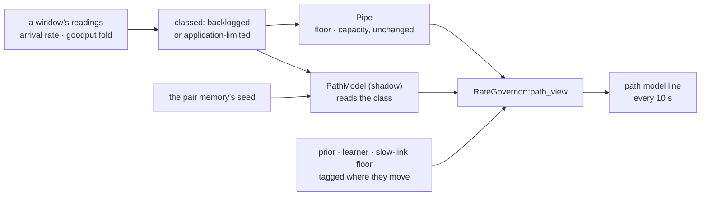

**How each number is tagged.** Each field is the heartbeat's field of the same name, read
by the same accessor at the same heartbeat; a test checks that at every window of the
replays (`same_numbers`).

| Field | The number | Its tag | Its age runs from |
|---|---|---|---|
| `goodput_bps` | the blocked-send estimate (`blocked_send_bps`) | `backlogged`: the estimator folds only sends that blocked | the last window it folded |
| `viewer_rx_bps` | the last per-window arrival rate the governor took (not in the heartbeat) | `backlogged` when the window offered more than arrived (`sent > 1.1 × rx`, or the classifier said `Overproduced`), else `app-limited` | that window |
| `pipe_belief` | `Pipe`'s (anchor, floor, capacity) | the reading that set each: a delivery its window's class; a goodput push-back `backlogged`; an arrival-rate push-back the offer streak's verdict, so `app-limited` when the switch-off law (V5a) takes it unoffered. The anchor takes the capacity's tag on a tie | when it was set |
| `pipe_measured` | the reading a stall is judged against: the less of the sender's reading and the held arrival rate. The sender's is the goodput, or under `on`, wherever the budget acts, the budget's held rate in its place (D51 B4b-2); `pipe_measured_by` names which (D51 B4g) | the sender's tag, `backlogged` either way, or the held arrival rate's (the sender's on a tie) | that reading |
| `prior_bps` | the stand-in | always `assumed`, at any rung | the reading its base was anchored on, or the seed's entry until a reading anchors it |
| `learned_ceiling_bps` | the learner's ceiling | `remembered` when the seed set it at the open; `app-limited` at a growth step (a rate carried with the target pinned under the ceiling); `assumed` after a cut or the seed's abandonment; `0`, the nominal start, `assumed` | when it last moved |
| `slow_link_floor_bps` | the relieved floor | the tag of the reading or stand-in it was derived from; the opener's ramp is `assumed` | that reading, or the open |
| `seed_bps` | the seed (not in the heartbeat) | `remembered` | the entry's age at the open, plus the session's |

**The shadow model** (`encode::pipe::PathModel`) takes the same inputs as `Pipe` and
reads their class:

| Input | `Pipe` | The model |
|---|---|---|
| a delivery, either measured class | raises the floor | raises the floor |
| a push-back, `backlogged` | sets the capacity; lowers the floor by half the gap, or raises it | the same, until a fall ([D50](#the-pace-of-a-real-fall-d50)): the second under the floor, with the in-flight budget's measured rate under it too, restarts the floor at the present |
| a push-back, `app-limited` | the same as a backlogged one | raises the floor, as a delivery does; the capacity does not move |
| the seed, at the open | never an input | an `app-limited` reading, marked `remembered` |
| a reading in a window FR-79's gate rejected | a delivery raises the floor | never enters (FR-148 P1, D24) |
| anything assumed | never an input | never enters |

So the model's floor rises on any measured reading and falls only on a backlogged one,
and its capacity moves only on a backlogged one (60 s, `CAPACITY_TTL`, as `Pipe`'s).
`model_stand_in_bps` is the stand-in as the model lets it stand: where the floor is at
or above it, the floor, with its own tag. What it would offer the pair memory at a
session's end (`PathModel::offer`) is its floor, with the tag of the reading that set
it, or nothing: never an assumed value, and since FR-148 P1 never the remembered floor
either (D23). A floor no reading of this session set is not this session's to write
back (`a_remembered_seed_is_an_application_limited_floor`). Nothing reaches a rate or a
ceiling. What P1 stores is in
[§ The path memory](#the-path-memory-fr-148-p1--the-models-floor-under-a-key-that-names-the-path).
When every input is backlogged and no rate is noted the model is `Pipe`'s law exactly
(`the_model_is_pipes_law_when_everything_is_backlogged`); with the in-flight budget's
rate noted the two part at a fall ([D50](#the-pace-of-a-real-fall-d50)), where `Pipe`
keeps damping.

**The line** is `path model (FR-148 P0, shadow, ≈10s)`, at INFO, written by
`media_delivery::emit_model` (`agents/roomlerd/src/media_delivery.rs:1534`). The delivery
sampler takes the numbers at every pump heartbeat (`on_view`, `:980`) and writes them
at the first heartbeat 10 s after the last line; the first heartbeat starts the count,
and a pump that ends between two lines writes its last numbers as it drops. Each value
is `<bps>/<provenance>/<age>ms`, or `None`. A test pins the names and their order
(`the_model_line_names_its_fields`):

| Field | Meaning |
|---|---|
| `session_id` | the session |
| `goodput_bps`, `pipe_belief`, `pipe_measured`, `prior_bps`, `learned_ceiling_bps`, `slow_link_floor_bps` | the heartbeat's numbers of those names, tagged (above) |
| `viewer_rx_bps`, `seed_bps` | the arrival rate and the seed, tagged |
| `model_floor_bps`, `model_capacity_bps`, `model_stand_in_bps` | the shadow model's floor, capacity and stand-in |
| `model_floor_push_back`, `model_capacity_push_back` | which delivery sample's push-back last set the model's floor and its capacity: `p1` or `p3` (D46 B2, [§ The delivery samples' push-backs](#the-delivery-samples-push-backs-d46-b2)), or `-`, a window's or none |
| `model_rule` | the rule that last kept a reading out of the shadow model, re-read it or bounded it, and how long ago, `<word>/<age>ms`: `stall` (B2's stall gate), `reread`, `ramp`, `bound` or `hole` (D48, [§ A path that drops](#a-path-that-drops-who-bound-the-sample-d48)); `-` while none has |
| `model_fell` | the shadow model's last fall, `<from_bps>-><to_bps>/<age>ms`: the floor before and after, and how long ago (D50, [§ The pace of a real fall](#the-pace-of-a-real-fall-d50)); `-` while there has been none |
| `pipe_measured_by` | the source of `pipe_measured`: `goodput` (the blocked-send goodput), `budget` (under `on`, wherever the budget acts, its held rate: D51 B4b-2) or `arrival` (the held arrival rate); `-` while there is no reading (D51 B4g, [§ B4g](#b4g-a-frame-is-charged-its-gap-less-the-time-the-gate-held-it-d51)) |

**Its cost**: a line with every number set is 746 bytes and an idle one 567, at most
268,560 and 204,120 bytes a session hour, measured by the same test (721 and 548 before
D51 B4g's `pipe_measured_by`, 685 and 535 before D50's `model_fell`, 662 and 522 before
D48's `model_rule`, 610 and 471 before D46 B2's two fields). **The switch** is
the delivery samples' (`ROOMLERD_PATH_MODEL`): `off` takes no path number and writes no
`path model` line (`off_takes_no_path_numbers_and_writes_no_model_line`).

**What feeds the shadow model** (D24): since #4014 the model behind `model_floor_bps`,
`model_capacity_bps` and `model_stand_in_bps` takes a delivery only from a window the
validity gate accepted; before it every window's arrival rate reached the model. AC3 is
read on this line, so a line from an older release is not comparable with one from that
release on. The path memory's counted evidence (D29) does not touch this line: a sample
set aside for the memory still feeds the model. Since D46 B2 the delivery samples'
push-backs feed it as well, P1 and P3, and the window after a stall the in-flight
budget saw does not ([§ The delivery samples' push-backs](#the-delivery-samples-push-backs-d46-b2)),
so a line from a release before B2 is not comparable either.

**What a healthy line looks like.** The jupiter replay on today's laws, at the end of its
busy minute and on the still screen 30 s later
(`a_healthy_session_reads_application_limited` prints both with `--nocapture`):

```text
path model (FR-148 P0, shadow, ≈10s) session_id=… goodput_bps=None pipe_belief=(15915240/app-limited/0ms, 15915240/app-limited/0ms, None) pipe_measured=None prior_bps=None learned_ceiling_bps=6209663/app-limited/0ms slow_link_floor_bps=None viewer_rx_bps=15915240/app-limited/0ms seed_bps=None model_floor_bps=15915240/app-limited/0ms model_capacity_bps=None model_stand_in_bps=None model_floor_push_back=- model_capacity_push_back=-
path model (FR-148 P0, shadow, ≈10s) session_id=… goodput_bps=None pipe_belief=(15915240/app-limited/30000ms, 15915240/app-limited/30000ms, None) pipe_measured=None prior_bps=None learned_ceiling_bps=6209663/app-limited/30000ms slow_link_floor_bps=None viewer_rx_bps=9120/app-limited/0ms seed_bps=None model_floor_bps=15915240/app-limited/30000ms model_capacity_bps=None model_stand_in_bps=None model_floor_push_back=- model_capacity_push_back=-
```

| Screen and path | Reads |
|---|---|
| a busy screen on a path with room | every measured number `app-limited`; no capacity (`pipe_belief`'s third and `model_capacity_bps` are `None`); the model's floor is the busiest window |
| the still screen after it | the same numbers, older; `viewer_rx_bps` is the trickle's, `app-limited`, and the floor does not fall |
| a path at its limit | `backlogged` readings: the goodput, the arrival rate of windows that offered more than arrived, and a `model_capacity_bps`. Not yet read in the field: FR-148 P0's standing relay cell is step 5 |
| a stand-in in use | `prior_bps` `assumed`, as old as the reading it walked from; `model_stand_in_bps` is the floor wherever the floor is at or above it |

**The two field chains, as cells.** Both lose the floor their path had demonstrated on the
laws of 2026-11-16 (`measured_evidence` off), and keep it when the tags are read. With
the model reading every push-back as backlogged, both fail.

| Cell | The chain | On the laws of 2026-11-16 | Read with provenance |
|---|---|---|---|
| `the_jupiter_chain_read_with_provenance_keeps_its_floor` | jupiter, 2026-11-02: a busy minute delivered 15,915,240 bit/s, then a still screen trickled | the trickle's 9,489 was a push-back, so the floor fell to 7,962,364, and the stand-in's last rung, 3,322, went to the pair memory | the push-back is `app-limited` and the 3,322 `assumed`; the model's floor stays 15,915,240 `app-limited`, with no capacity, and is what it would offer |
| `the_corplap2_chain_read_with_provenance_keeps_its_floor` | CORPLAP-2, 2026-11-11: 45 minutes of relayed AV1, replayed from its heartbeats (`agents/roomlerd/tests/fixtures/fr148-corplap2-20261111.txt`); 1,399,272 delivered at 394.9 s | at 909.1 s the viewer's queue grew while the pump wrote 498,304, and the arrival rate, 564,865, became the reading and a push-back: the floor fell to 982,068. The stand-in walked 178 steps to 179,980, and the session wrote that | the reading is `564865/app-limited`, the stand-in `assumed` and as old as that reading; the model's floor stays 1,399,272 and is what it would offer. Nothing later in the session delivered more |

**What a tag cannot tell.**

- An application-limited number is a lower bound and nothing more: it cannot say how
  much more the path would carry. Only a backlogged reading bounds it from above.
- Backlogged is the sender's verdict from the viewer's report: the window offered more
  than arrived. A viewer that stops reading, or decodes slowly, makes a good path read
  backlogged.
- A window with no link report has no arrival rate, so there is nothing to tag.
- An age is the evidence's, not the number's: the stand-in, a step a window, is as old
  as the reading its base was anchored on, however many steps it has taken since.
- Today's seed carries no class (P1's own file does, but nothing opens from it yet), so
  it is read as the weaker class whatever it was.
- The `path delivery` line's classes are not wired in: `viewer_rx_bps`'s class is the
  governor's per-window verdict, not the SCTP sample's. P0 keeps the two apart.

**The RTP pump writes no `path model` line.** It has no governor, no `Pipe` and no
delivery sampler. Its heartbeat (`media pump heartbeat (≈1s window)`,
`agents/roomlerd/src/peer.rs:3600`) carries no path number: `bytes_written` and
`write_errors` are its only transport fields. Its one path number is REMB, the browser's
estimate (`remb_bps` on the `applying adaptive bitrate` line, `peer.rs:3464`, written
when the target moves past its 15 % hysteresis): the target is the quality target,
capped at REMB × 85 % but never below the larger of `MIN_BITRATE_BPS` and a quarter of
the base (`peer.rs:3433`).

| Where | Anchor |
|---|---|
| the tags and the model | `agents/roomlerd/src/encode/pipe.rs:772` (`Basis`), `:807` (`PathNumber`), `:890` (`PathModel`), `:1222` (`PathView`); `Pipe` takes the class at `:314` (`observe_delivered`) and `:400` (`observe_capacity`) |
| the governor's tags and the view | `agents/roomlerd/src/encode/governor.rs:1648` (a delivery, classed), `:1855` (an arrival-rate push-back, classed), `:2313` (`path_view`), `:2586` (`PathTags`) |
| the line and the seed's age | `agents/roomlerd/src/media_delivery.rs:980` (`on_view`), `:1534` (`emit_model`), `:1572` (`seed_at_open`) |
| the pumps | `agents/roomlerd/src/peer.rs:5440` (VP9-444), `:10372` (FFmpeg), `:6677` (the FFmpeg pump's seed and its age) |

**The tests** (`cargo test -p roomlerd --lib -- pipe:: governor:: media_delivery`):

| Test | Shows |
|---|---|
| `encode::pipe::tests::tags_change_no_number`, and every existing `Pipe` cell | each runs through a twin that holds a verbatim copy of the law before the tags: every number equal, on 100,000 random operations |
| `the_model_is_pipes_law_when_everything_is_backlogged`, `an_application_limited_push_back_lowers_nothing_in_the_model`, `an_assumed_value_never_stands_below_the_floor_and_is_never_offered`, `a_remembered_seed_is_an_application_limited_floor`, `a_number_is_written_as_value_word_and_age` | the model's laws, and the written form |
| `encode::governor::tests::the_jupiter_chain_read_with_provenance_keeps_its_floor`, `the_corplap2_chain_read_with_provenance_keeps_its_floor` | the two field chains, above |
| `encode::governor::tests::a_healthy_session_reads_application_limited` | the healthy lines above |
| `same_numbers`, at every window of every `V5bSession` replay | the line's numbers are the heartbeat's |
| `media_delivery::tests::the_model_line_names_its_fields`, `the_model_line_comes_every_ten_seconds_and_a_drop_writes_the_last`, `off_takes_no_path_numbers_and_writes_no_model_line`, `the_seed_at_open_comes_with_its_entrys_age` | the line: its names and order, its size, its cadence, the switch, the seed's age |

## Why the target moved (FR-148 P0) — every move of the live target says why

FR-148 P0 (#3953). **It only measures: nothing reads a cause.** The data-channel pumps'
target lines now say why the live target moved, and each heartbeat counts the moves since
the heartbeat before it. No target, timing, gate or switch changed, no line was added and
no pump grew: the fields ride lines that were already written. The reason is FR-148's
field read of 2026-11-19: on two still screens the target moved with no reason logged,
7 times on CORPLAP-1, from 33.0 Mbit/s up to the encoder's cap of 43.2 while the screen
sent 0.45, and 3 times on CORPLAP-2. Those sessions ran before this change, so they are
not read with it yet.

**The causes.** `desired`, the AIMD's target, changes in these places and no others, and
each writes one word. The ×0.85 is one code path (`apply_md`, `encode/aimd.rs:442`, at
most once every 500 ms, `:93`) fed by six signals, and its word names the signal. A cause
is recorded only where the number actually moved: a ×0.85 the spacing refuses, a ceiling
above the target or an increase at the ceiling records nothing.

| Written | What moved `desired` | Anchor |
|---|---|---|
| `open` | the controller's first target: the opening, clamped between floor and ceiling, when the first tick builds it | `encode/aimd.rs:331`, built at `encode/governor.rs:1357` |
| `increase(…)` | the additive increase: 5 s after the last full channel and the AIMD's last step, with the occupancy average under 0.25; a step of ceiling ÷ 16, or of `desired` ÷ 8 below 1.5 Mbit/s | `encode/aimd.rs:347`, `:477` |
| `decrease(full)` | ×0.85 on a full send channel: the gate's skip, or a tick with no capacity | `encode/aimd.rs:346`; `encode/governor.rs:1047`, `:1361` |
| `decrease(overflow)` | ×0.85: an encoded frame overflowed the send channel (FFmpeg), or the DC buffer passed its high watermark (VP9-444) | `encode/aimd.rs:360`; `encode/governor.rs:1392` |
| `decrease(stall)` | ×0.85: a send blocked for less than `HARD_STALL` (1 s) | `encode/governor.rs:1431` |
| `decrease(age)` | ×0.85: FR-15's age loop found the window over-rate | `encode/governor.rs:1938-1948` |
| `decrease(link)` | ×0.85: FR-59 P3, the viewer's transit queue grew while the sender offered more than arrived | `encode/governor.rs:1938-1948` |
| `decrease(transit-stall)` | ×0.85: FR-79 V5, a stalled window while the target sat above the measured pipe | `encode/governor.rs:1938-1948` |
| `hard-decrease` | ×0.5: a send blocked 1 s or more, applied at a window the validity gate accepted | `encode/aimd.rs:461`; `encode/governor.rs:1728` |
| `ceiling(source)` | a lower ceiling pulled `desired` down to it | `encode/aimd.rs:379`; `encode/governor.rs:1360` |
| `floor(source)` | a higher floor pulled `desired` up to it | `encode/aimd.rs:400`; `encode/governor.rs:1359` |
| `reapply` | after an encoder rebuild, the same target handed out again | `encode/aimd.rs:432`; `encode/governor.rs:1451` |

The window's ×0.85 fires once for `age_over || link_over || stall_is_ours`, and when more
than one holds the word names the first of them in that order.

**The sources.** A ceiling or a floor names the stage of `pre_encode_tick`'s chain whose
number is in force: each stage that changes the bound becomes its source (`retag`,
`encode/governor.rs:572`), so the source is the last stage that changed it.

| Bound | Source | The number in force | Anchor |
|---|---|---|---|
| ceiling | `plan` | the pump's own: the quality preference × the relay clamp, ÷ viewers when shared (VP9-444, `peer.rs:5030-5043`); the rate plan's maxrate ceiling, FR-35-lifted, ÷ viewers (FFmpeg, `peer.rs:8933-8968`) | `encode/governor.rs:1118` |
| ceiling | `pipe` | stage 1, the measured clamp from the blocked-send goodput, direct only | `encode/governor.rs:1127` |
| ceiling | `learned` | FR-35's learned ceiling, constrained only. It is `learned` whenever the ceiling equals the learner's lift, so the FFmpeg pump's own lift of its plan reads `learned` too | `encode/governor.rs:1182` |
| ceiling | `arrival` | FR-59 P3, 90 % of the viewer's arrival rate while its queue grows | `encode/governor.rs:1197` |
| ceiling | `opener` | FR-63's slow-start cap while the ramp runs | `encode/governor.rs:1266` |
| floor | `area` | the pump's area-scaled legibility minimum (`area_min_bitrate_bps`, a flat 1.5 Mbit/s on a constrained transport) | `encode/governor.rs:1283` |
| floor | `relief` | FR-59 P1, the floor relieved toward a measured pipe | `encode/governor.rs:1292` |
| floor | `ramp` | FR-63's ramp floor while slow start runs | `encode/governor.rs:1327` |

The quality preference and the relay clamp reach the governor as one number, so both read
`plan`. Telling them apart would take a new argument at both pumps' tick call and grow
both pumps; the line's own `ceiling_bps` (both pumps) and `quality` (VP9-444) tell them
apart instead.

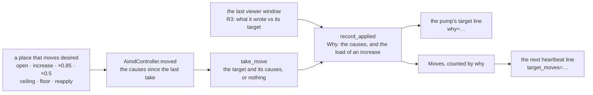

**How a cause travels.** The controller keeps the causes since the last take, in the order
they happened. A cause that repeats is kept once, at its first place; eight are kept, and
a ninth is written `+more`. `take_move` (`encode/aimd.rs:419`) hands out the target with its
causes when it differs from the last one handed out, and clears them either way, so a
move that netted to nothing leaves no cause for the next one. `take_pending`, the same
without the causes, stays for the controller's tests. The governor
turns the causes into a `Why` in `record_applied` (`encode/governor.rs:2290`), carries it
on `AppliedBitrate`, and counts the move by its `why` for the heartbeat.

**A folded move.** Several causes can land between two takes: the window's ×0.85 is taken
by the next tick, and inside one tick the floor, the ceiling and the occupancy sample run
in that order. The line writes **every cause, in the order it happened, joined by `+`**:
`decrease(link)+ceiling(arrival)` is one move (the constrained replay's call 614). The
applied number is the net of all of them, so naming only the last one would leave the
move unexplained. The heartbeat counts a folded move once, under its whole `why`, so the
counts add up to the moves.

**An increase says what the sender was doing.** At every viewer window the governor keeps
R3's verdict on that window (`encode/governor.rs:1640`), the test the pair memory already
uses (`pushing_against_plan`, `encode/pair_memory.rs:750`): what the send task wrote in the
window against the target the window ran with, whatever the gate said.

| Written | The last window |
|---|---|
| `increase(app-limited)` | wrote under half its target |
| `increase(loaded)` | wrote half its target or more, or the classifier called it `Overproduced` |
| `increase(no-window)` | none yet |

It is honest on a still screen because it reads the agent's own byte count over the whole
window: it needs no viewer report, no clock probe and no blocked send. A still screen
writes a trickle (0.45 Mbit/s under 33 Mbit/s in the field read), so its increases read
`app-limited`, as the direct replay's still span does. The word can only lean to `loaded`,
and only where the bytes were written: on a low target a trickle can be half of it, and
the constrained replay's still span, 0.48 Mbit/s under a 0.33 to 0.52 Mbit/s target, reads
`loaded`.

**The lines.** Each field sits on a line the pump already wrote:

| Line | Field | Written |
|---|---|---|
| `VP9-444 set_bitrate (AIMD)` (`peer.rs:5058`) | `why` | when the target or the quality changed |
| `VP9-444 AIMD decrease (DC buffer over high watermark)` (`peer.rs:5247`) | `why` | at each move the watermark makes |
| `VP9-444 DC pump heartbeat (≈1s window)` (`peer.rs:5383`) | `target_moves` | every heartbeat |
| `FFmpeg DC pump set_bitrate (AIMD)` (`peer.rs:9594`) | `why` | when the number changed, held or not (`deferred`) |
| `FFmpeg DC pump: deferred bitrate scheduled (background rebuild)` (`peer.rs:9635`) | `why`, the held target's | when a held target starts its rebuild |
| `FFmpeg DC pump: deferred bitrate applied at quiet` (`peer.rs:9648`) | `why`, the held target's | when a held target is applied in place |
| `FFmpeg DC pump heartbeat (≈2s window)` (`peer.rs:10180`) | `target_moves` | every heartbeat |

`why` is the causes joined by `+`, or `none`. `target_moves` is the moves handed out since
the last heartbeat line, as `why:count` joined by `,` in the order each first happened, or
`none`; past 16 distinct `why`s the rest count as `more:n`. Tracing evaluates a field only
when its line is written, so with the heartbeat filtered out nothing drains the count, and
the bound keeps it small. The FFmpeg pump's held target is the `AppliedBitrate` itself
(`deferred_bps`, `peer.rs:7291`), so it keeps its `why` until it lands. Made-up values:

```text
FFmpeg DC pump set_bitrate (AIMD) session_id=… codec_label="AV1" ceiling_bps=43200000 target_bps=36550000 why=increase(app-limited) deferred=false
FFmpeg DC pump set_bitrate (AIMD) session_id=… codec_label="AV1" ceiling_bps=2550000 target_bps=270000 why=decrease(link)+ceiling(arrival) deferred=true
FFmpeg DC pump: deferred bitrate applied at quiet session_id=… codec_label="AV1" target_bps=270000 why=decrease(link)+ceiling(arrival)
VP9-444 AIMD decrease (DC buffer over high watermark) session_id=… buffered=1310720 new_target=2550000 why=decrease(overflow)
FFmpeg DC pump heartbeat (≈2s window) session_id=… codec_label="AV1" target_fps=30 constrained=false target_bps=36550000 target_moves=increase(app-limited):1 …
VP9-444 DC pump heartbeat (≈1s window) session_id=… target_fps=30 … target_bps=2550000 target_moves=decrease(full):2,ceiling(plan):1 …
```

**What a `why` can and cannot tell.**

| The line says | A reader can conclude | A reader cannot conclude |
|---|---|---|
| `increase(app-limited)` | the AIMD's 5 s clock raised the target while the last window wrote under half of it: the channel stayed empty because the screen made few bytes | anything about the path. Neither the old target nor the new one was sent; a climb to the encoder's cap on a still screen is this |
| `increase(loaded)` | the last window wrote at least half its target and the send channel did not fill: the path took what was written | that it carries the new target. An increase is a step on a clock, not a reading; the readings are on the `path model` line ([§ Path numbers and their provenance](#path-numbers-and-their-provenance-fr-148-p0--how-each-was-obtained-and-how-old-it-is)) |
| `decrease(…)`, `hard-decrease` | which signal cut the target | how much the path carries: `link` and `transit-stall` say what the viewer and the gate saw, not a rate |
| `ceiling(…)`, `floor(…)` | which stage's number pulled the target | for `plan`, whether the quality preference, the relay clamp or the viewer split set it |
| `reapply` | the encoder was rebuilt and told the target it already had | — |

- The load of an increase is the last viewer window's (about 1 s), read before the move,
  not at it.
- A count is of moves handed out, not of moves an encoder applied: a held FFmpeg target
  can land later, or be replaced before it lands. A newer target's `why` explains its own
  step; the one it replaced is on its own `set_bitrate` line (`deferred=true`), or, for
  the gate's skip and the overflow, which write no line, only in the count.
- A re-apply hands out the number already applied, and the FFmpeg pump writes its
  `set_bitrate` line only when the number changed, so a pure re-apply is only in the count.
- Causes that netted to nothing leave nothing: a decrease and a floor that puts the
  number back hand out no move.
- The RTP pump has no governor and writes none of this.

The path report's `--timeline` reads both fields: each move prints with its `why`, a line from
an older agent as "(reason: not logged)", and each session counts its moves by `why` on the
target lines beside the heartbeats' `target_moves` ([production-mongo-reads.md](production-mongo-reads.md) §8a).

| Where | Anchor |
|---|---|
| the causes | `agents/roomlerd/src/encode/aimd.rs:108` (`Congestion`), `:140` (`CeilingSource`), `:172` (`FloorSource`), `:193` (`Cause`), `:234` (`Causes`), `:419` (`take_move`) |
| the `why` and the count | `agents/roomlerd/src/encode/governor.rs:84` (`Why`), `:124` (`Moves`), `:572` (`retag`), `:1640` (the window's R3 verdict), `:2227` (`take_moves`), `:2290` (`record_applied`) |
| the pumps | `agents/roomlerd/src/peer.rs:5058`, `:5247`, `:5383` (VP9-444); `:9594`, `:9635`, `:9648`, `:10180` (FFmpeg); `:7291` (the held target) |

**The tests** (`cargo test -p roomlerd --lib encode:: -- --skip clipboard::`):

| Test | Shows |
|---|---|
| `encode::governor::tests::naming_the_causes_moves_no_target` | no behaviour change: a scripted session on each transport (a measured pipe, a plan ceiling that drops and comes back, an area floor that rises, a full channel at the gate and at the tick, overflows, rebuilds, viewer windows with a rising age and a transit queue that grows then drains, and on the constrained one slow start, the learner, a soft and a hard stall) applies the same targets, at the same calls, with the same `changed`, as it did on `211ac93b6`, recorded before this change was written |
| `every_move_of_the_replay_says_why` | the `why` of every move of that session |
| `each_pump_input_names_its_move`, `an_age_excess_names_its_decrease`, `a_growing_transit_queue_names_its_decrease_and_its_bounds`, `a_transit_stall_names_its_decrease`, `a_hard_stall_names_its_halving`, `the_learned_ceiling_and_the_opener_name_their_moves` | each cause and each source, from the input that makes it |
| `a_folded_move_names_every_cause_in_order`, `a_held_target_keeps_its_why_until_it_lands`, `an_increase_says_whether_the_sender_was_application_limited`, `a_why_and_the_tally_read_as_written` | the folded move, the held target, the three loads, the written forms and the count's bound |
| `encode::aimd::tests::every_move_hands_out_its_cause`, `only_a_move_that_lands_is_named`, `causes_keep_their_order_and_say_when_more_landed` | the controller's record |

## The path memory (FR-148 P1) — the model's floor, under a key that names the path

FR-148 P1, steps 2 to 4 (#3953). A constrained session of the FFmpeg data-channel pump
keeps a second memory for the path model, `path_memory.json`, under a key that names the
path, beside today's `rate_memory.json`, which is written byte for byte as before
(`todays_file_is_written_byte_for_byte_as_master`). **Under the switch's default,
`shadow`, nothing reads the new file to drive a rate**: the opener is today's, bit for
bit (`shadow_is_todays_opener_exactly`). **Under `on`**, a session whose pair has a key
and a fresh entry opens from the model ([below](#which-rule-opens-the-session-step-3)).
Two lines a session say what the open read, which rule opened the session and why, and
what the close wrote.

| | Today's memory (FR-35, FR-79 V2, V4) | The path model's (FR-148 P1) |
|---|---|---|
| File | `rate_memory.json` | `path_memory.json`, in the same directory |
| Key | `remote_addr\|carrier` | `v2\|<carrier>\|u:<user>\|<viewer network>` |
| An entry | one rate, its time, its provenance | the model's floor, with the class and time of the reading that set it; a push-back record |
| Written from | `session_evidence_bps`: a carried hold, else a reading, else the opener's measurement | the model's floor and the counted push-backs, from valid windows only (D24, D25, D29, D30), and the delivery samples' push-backs under the last valid window (D46 B2) |
| Read by | the opener: 85 % of it seeds the opening ceiling, unless the model decides | the open line; under `on`, the opener (D25, D26) |
| Code | `RateMemoryGuard` (`agents/roomlerd/src/media_pair_memory.rs:210`) | `ModelGuard` (`:262`) over `encode::pair_memory` |

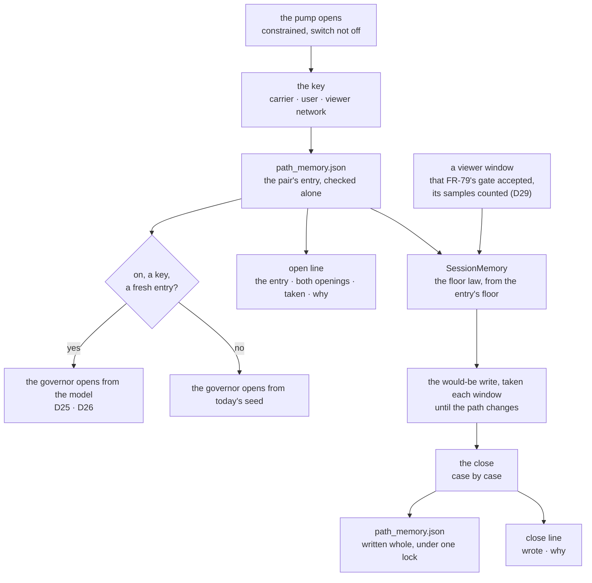

### The key (D22)

| Part | From | Rule |
|---|---|---|
| `v2` | | the key's version |
| carrier | FR-102's word for the selected pair (`session_carrier::carrier_of`) | `direct`, `turn`, `turn_local`, `overlay_direct`, `overlay_turn`, `derp`, `org_relay`. An overlay relay adds its transport when the overlay names it (`derp/tcp`), as FR-79 V2's key did. An overlay carrier never shares a word with any other. `unknown` gives no key |
| `u:<user>` | the controlling user's id, from the session's `rc:request` | 24 hex, lower case. No user gives no key: an anonymous key would merge every viewer |
| viewer network | the viewer's candidates, as it trickled them, and the selected remote | the first that exists: (1) its server-reflexive addresses that are not overlay addresses, a public one before a private one, then the lowest IPv4, else the lowest IPv6, masked: `n:203.0.113.0/24`, `n:2001:db8:1::/48`; (2) the selected remote when it is the viewer's own address (not a relay candidate, not an overlay address), masked; (3) the selected remote when it is an overlay address, whole, `o:<address>`: it names a device, not a network; (4) `n:?` |

The relay worker's address is never in the key, so two TURN workers serving one viewer
are one entry (AC8). The key stays in the local file. A line carries `key_id` (the first
12 hex of the key's SHA-256), `key_carrier`, and `key_net`, the word for what the network
part was made from: `srflx`, `remote`, `overlay` or `unknown`. A session with no key
reads and writes nothing, and `no_key` says why: `no_pair` (no selected pair within the
pump's 4 s wait), `carrier_unknown`, `no_user`, or `learner_off` (`relay_max_hi_bps` is 0).

| One entry | Two entries |
|---|---|
| two TURN workers for one viewer (`two_relay_workers_are_one_entry`) | two viewer networks (`two_viewer_networks_are_two_entries`) |
| two overlay addresses of one viewer on one network (`two_overlay_addresses_of_one_viewer_on_one_network_are_one_entry`) | an overlay carrier and any other (`overlay_and_other_carriers_never_share_a_word`) |
| a viewer that gave no srflx candidate, on one overlay device (`no_srflx_keys_the_overlay_device`) | two controlling users |

**Where the viewer's facts come from.** `PairFacts` (`media_pair_memory.rs:61`) is
registered by session id in `AgentPeer::new`, before the pump starts. The user comes from
the `rc:request`'s record (`agents/roomlerd/src/signaling.rs:4836`). The srflx addresses
are taken from the candidates the viewer trickles (`AgentPeer::add_remote_candidate`), at
most 16. They are not read through `get_stats`: the vendored ICE agent's accessor is
crate-private, and a stats read takes the ICE and SCTP locks. **Limit**: a candidate
inside the offer's SDP is not read. The controller trickles its candidates, so a viewer's
srflx address arrives the trickled way.

### The file (D23)

`path_memory.json` sits in the directory of `rate_memory.json`. It is written whole at a
close that changed an entry (a temporary sibling, then a rename), as pretty JSON, under
one lock in the process around the read, the change and the save (`PathMemory::update`).
Without it two pumps that end at once share the temporary sibling's name, and the later
save drops the key the earlier one wrote: 53 of 160 concurrent saves failed in the red
run (`pumps_that_end_at_once_each_keep_their_key`). Two sessions of one key still end as
the later close says, as today's memory does.

```json
{
  "v": 1,
  "pairs": {
    "v2|turn|u:<24 hex>|n:203.0.113.0/24": {
      "floor": { "bps": 722500, "basis": "backlogged", "at_unix": 1763420000 },
      "push_back": { "bps": 640000, "at_unix": 1763420000, "first_at_unix": 1763419987, "windows": 3 }
    }
  }
}
```

Each entry is checked on its own when the file is read, so one bad entry never costs the
others:

| On disk | Read as | The open line's `entry` |
|---|---|---|
| no file, an unreadable one, or `v` other than 1 | an empty memory; the next write replaces the file | `none` |
| a floor at most 7 days old | the entry | `fresh` |
| a floor older than that | not opened from; dropped at the next write | `expired` |
| a rate outside 50 kbit/s to 100 Mbit/s, a class other than `backlogged` or `app_limited`, a missing or mistyped field, or a record with no window or a first sample after its newest | dropped alone, and never written back | `invalid` |
| a time more than 300 s ahead (a clock that jumped) | dropped alone | `future` |
| a record whose newest sample is more than a day old | the record dropped, the floor kept | `fresh` |

**Why a file of its own.** A release that does not know the model writes
`rate_memory.json` whole, with only the fields it knows. A shared file would lose every
model entry at the first close of such a daemon, after a rollback or on a host whose
update is frozen (`a_frozen_master_loses_the_whole_file_if_the_model_shares_it`). An
older release never opens `path_memory.json`, so a rollback leaves it whole. A host with
no such file opens every pair at the nominal
(`with_no_new_file_every_pair_opens_at_the_nominal`).

### What a session measures (D24, D25)

The governor folds a window's delivery after FR-79's gate has ruled
(`agents/roomlerd/src/encode/governor.rs:1648`). `Pipe` takes it whatever the verdict,
as before. P0's shadow model and the session's memory take it only from a valid window.
So the opener's burst, the drain after a stall, and a rejected window set no stored
floor (`the_opener_burst_and_a_stall_drain_set_no_stored_floor`,
`a_session_of_rejected_windows_writes_nothing`).

`SessionMemory` (`agents/roomlerd/src/encode/pair_memory.rs:828`) opens from the pair's
entry, with its floor as remembered and its record while that is fresh:

| A valid window's reading | The floor | The push-back record |
|---|---|---|
| a delivery, either measured class | raises it (`PathModel`'s law) | ends it only when the delivery carries more than twice the record's rate (`ceiling_learn::CONTRADICTION_FACTOR`) |
| a push-back, `backlogged`, counted | lowers it as `Pipe` does (D30) | a sample |
| a push-back, `backlogged`, not counted | stays | stays; the close line counts it: `samples_unread`, `samples_viewer_late`, `samples_under_plan` or `samples_not_counted` |
| a push-back, `app-limited` | a delivery | a delivery |
| a delivery sample's push-back, P1 or P3 (D46 B2), counted | lowers it, damped, when under it; never raises it ([below](#the-delivery-samples-push-backs-d46-b2)) | a sample |
| anything assumed | never enters | never enters |

**One definition of counted evidence (D29).** A backlogged push-back counts for the
memory only when all four hold, in this order (`pair_memory::Take::of`):

| Test | Set aside as | Why |
|---|---|---|
| the classifier read the window: not `Unknown`, and for `Clear`, `TransitStalled` or `ViewerLate` a plausible viewer age, at least half the round trip (`viewer_rate::age_is_plausible`); `Overproduced` is always read | `samples_unread` | a still screen on a relay that stalls, with no viewer age, left a trusted record of tens of kbit/s on 24 of 336 swept sessions (`a_still_screen_on_a_stalling_relay_leaves_no_trusted_record`) |
| the classifier did not blame the window on the viewer: not `ViewerLate` (the browser's share of the age 100 ms or more over its floor, or the viewer reported `struggling`) | `samples_viewer_late` | the key names the path (the carrier, the user, the viewer's network), not the viewer's device: a record from a slow browser would open the same user's other devices on that network low (`a_window_the_classifier_blames_on_the_viewer_is_not_a_reading_of_the_path`) |
| the sender pushed against the plan: it wrote at least half the target the window ran with (`applied_bps`), or the window is `Overproduced` (`pushing_against_plan`) | `samples_under_plan` | a 40 kbit/s screen whose viewer age stays flat while its link report says the queue grows (`the_screens_families_on_r1_r2_and_the_plan_limited_test`) |
| D25's: at least half the session's best valid delivery | `samples_not_counted` | a dip beside a real delivery |

Inside the session nothing changes: a sample set aside still feeds `Pipe`, P0's model and
the governor as before. Setting samples aside never creates a trusted record where there
was none. It can lower a record's rate, though: with a higher sample set aside, the record's
`P` is the highest of the samples left, and `P ≤ T` is one of D26's two conditions, so the
slow-link profile can engage where the release before left it off (for example counted
samples of 0.8 Mbit/s beside an unread one of 1.2 Mbit/s).

**What a counted sample's window was.** After the gate (which rejects a `TransitStalled`
window and the one after it) and the tests above, a counted sample comes from one of two
states, and the close line counts each (`Read`, `counted_samples_split_by_their_windows_state_and_a_late_viewer_reads_nothing`):
`samples_counted_overproduced`, the sender's own counters (its queue at the budget, a
frame the budget gate skipped, a blocked send, a send that waited 100 ms or more), and
`samples_counted_clear`, a window whose transit share sat under 200 ms over its floor and
the browser's under 100 ms over its own, where only the viewer's link report said the
queue grew. The second is the open class (FR-148 §9, O7): a measurement, not a rule. On
the slow-link replay all five counted refusals are `clear`.

The record is `{bps, at_unix, first_at_unix, windows}`: the highest sample it counted, the
time of its newest and of its first, and how many windows it counted. A session's
samples add to a fresh record. **A record is trusted** when its newest sample is at most
a day old, it counted at least 3 windows, and those span at least 10 s: one sample is
never enough (`trust_needs_three_windows_over_ten_seconds_within_a_day`). A delivery
just above the floor does not end it: on the slow-link replay the record ends trusted
whichever side of the floor the link last refused
(`a_slow_link_ends_trusted_whichever_side_of_the_floor_it_last_refused`).

### The delivery samples' push-backs (D46 B2)

FR-148 D46, step B2 (#3953), in shadow like the rest of this section. A [delivery
sample](#delivery-samples-fr-148-p0--what-the-path-carried-and-whether-the-sender-was-waiting)
closes at a heartbeat about every 2 s, and two kinds of sample are evidence of what the
path carries (D46 item 10). The pump hands each to the governor at a heartbeat
(`DeliverySampler::heartbeat`, then `RateGovernor::on_sample_push_back`): the one that
closes it with the budget off, and with the budget computing the first one after its
settle time (`media_delivery::settle`, below), so one still waiting when the session
closes is never handed. The governor gives it to P0's shadow model
and the session's memory only (`Pipe::observe_sample_capacity`). `Pipe`'s own law, every
rate and gate, and the opener under `shadow` never see it.

| The sample (`media_delivery::push_back_of`) | The budget `off` | The budget in `shadow` or `on` |
|---|---|---|
| **P1**: `queued`, its least acknowledgement delay 250 ms or more over the session's least (O11's standing queue) | a capacity at its own acknowledged rate | the same |
| **P3**: counted (`standing_ms` known), backlogged (SCTP's own class, or the budget held a frame in each of its seconds; since D48 in a fifth of each second's whole grains), the clock never stood still for `least + S` inside it, and it starts at or after the budget's first measured rate on its association | nothing: SCTP's `Backlogged` class alone feeds nothing | a capacity at its own rate |
| **P3 with a loss in it**: SCTP's fast retransmits or T3 expiries moved over it (D48 rule 1) | nothing | a capacity at the larger of its own rate and the budget's rate at its close: [a path that drops](#a-path-that-drops-who-bound-the-sample-d48) |
| **P3 the association's ramp bound**: no loss in it, and a hold SCTP's congestion window sized in a grain wholly inside it (D48 rule 4) | nothing | nothing: [a path that drops](#a-path-that-drops-who-bound-the-sample-d48) |
| a still span of `least + S` met it, from the span's first still reading to the step that read its release | (nothing computes a still span) | nothing, P1 or P3: [the burst](#the-push-backs-in-the-shadow-model-d46-b2) |
| it closed in a stall: the budget marks one within its settle time, `least + S` and one held SACK (200 ms) after the close | (nothing marks a stall) | nothing, P1 or P3: [the stall's start](#the-push-backs-in-the-shadow-model-d46-b2) |
| it starts before that first measured rate, in the budget's opening: the opening rate stood in for the rate, and SCTP's window was still growing | (nothing computes a rate) | no P3; a `queued` one is still P1: [the opening](#the-push-backs-in-the-shadow-model-d46-b2) |
| anything else, an application-limited sample among them | nothing | nothing |

**The law.** A sample's push-back is a capacity at its rate (`PathModel::sample_pushed_back`).
It lowers the floor, damped as a counted push-back lowers it (`rate_memory::damp`) or, as
the second of a fall, restarts it at the present
([D50](#the-pace-of-a-real-fall-d50)), only when its rate is under the floor, and it
never raises a floor or makes one: a sample
over-reads the path only when it holds bytes a stall held back, and a raise is the one
place an over-read would reach. A raise still comes from a valid window's delivery. It
under-reads the path when it closes in a stall, which the settle time keeps out. The
`path model` line says which push-back last set each number (`model_floor_push_back`,
`model_capacity_push_back`): `p1`, `p3`, or `-` for a window's.

**In the memory** a sample is filed as a window's push-back is (D25, D29), under the take
of the last viewer window the gate accepted. After a window the gate rejected it reaches
nothing: it ran beside a stall the viewer saw. A counted one adds to the record and lowers
the floor as D30 says; the close line counts it in `samples_counted` and its split, and
again in `samples_counted_p1` or `samples_counted_p3`.

**The windows after a stall the budget saw.** With the budget computing, each step that
finds a still span standing for `least + S`, and the step that reads its release, mark the
governor (`Shadow::take_mark`, then `RateGovernor::note_path_stall`). The next viewer
window that delivers anything (`pipe::STALL_WINDOWS`, one) is then no reading for the
model or the memory (`Pipe::note_stall`); `Pipe`'s own law takes it as before. The steps
inside the stall mark the window that ends in it, and the step that reads the release
marks the window its burst comes back in, so it is D24's "that window and the one after
it", read from the sender's side: under the budget the transit stays short through a
stall, so FR-79's gate passes the windows that carry its release. Keeping a second
window out kept 15 of a 20 s run's windows out of the model on a stall shape (a stall
every 3.3 s), and the floor did not come back from a sample that read under the path.
The rules measured, and the numbers, are in
[§ The push-backs in the shadow model](#the-push-backs-in-the-shadow-model-d46-b2).

**Near a loss** (D48) the model and the memory take a window's delivery and the link
loop's push-back from it at no more than the budget's measured rate, nothing of a window
over a rate the opening stood in for, and no link push-back from a window under 0.9 of the
measured rate; `Pipe`'s own law takes every window as before. The rules and their numbers
are in [§ A path that drops](#a-path-that-drops-who-bound-the-sample-d48).

### What a close writes

`pair_memory::close` (`agents/roomlerd/src/encode/pair_memory.rs:1251`) decides, case by
case, from the entry the session opened from and its last would-be write:

| The session | `wrote` | `why` |
|---|---|---|
| measured nothing in a valid window | `nothing` | `nothing_measured` |
| had no key | `nothing` | `no_key` |
| changed path before its first viewer window was taken | `nothing` | `carrier_flipped` |
| measured only at or below the remembered floor | `push_back` when the record moved, else `nothing` | `remembered_only` |
| measured, on a pair with no fresh entry | `floor`, or `floor_and_push_back` | `first_measurement` |
| measured, on an entry whose floor passed its TTL during the session | `floor`, or `floor_and_push_back` | `floor_expired` |
| delivered above the floor | `floor`, or `floor_and_push_back` | `raised` |
| measured a floor equal to the remembered one | `floor` when its time moved to the later reading, else `nothing` | `refreshed` |
| was pushed back below it, with at least one counted sample | `floor`, or `floor_and_push_back` | `pushed_back` |
| measured a lower floor with no counted sample | `push_back` when the record moved, else `nothing`: the remembered floor stays, with its own age | `floor_kept` |

**The floor is a maximum inside its TTL (D30).** A floor is a lower bound on what the
path carries, and lower bounds combine by maximum: only a counted push-back lowers it,
in the session and at the close (`a_quiet_session_keeps_the_remembered_floor`,
`a_counted_push_back_lowers_the_floor_and_a_dip_beside_it_does_not`,
`the_close_keeps_the_higher_floor_inside_its_ttl`). Since the in-session floor moves
down only on a counted sample, `floor_kept` is a guard the close keeps rather than a case
a session reaches.

**A sample at or after the close** reaches no record, by construction, so no test pins it
(a cell that tried could not fail). The guard writes the closing of the last viewer window
the pump handed it (`PumpMemory::window`, right after each window), a copy taken then, so
nothing that happens after that window reaches the write. The delivery sampler holds no
reference to the governor, the session's memory or the guard. Since D46 B2 the pump lends
it the governor for two calls: at the heartbeat, a sample's push-back
(`RateGovernor::on_sample_push_back`), and at a frame, a stall's mark
(`RateGovernor::note_path_stall`). Both change the governor's shadow model and its memory
only, and a push-back reaches the write through the next viewer window's copy, so one
taken after the last window reaches no record either. The pump drops the guard before the sampler
(`peer.rs` declares `pair_memory` after `delivery`), so the sampler's last line comes after
the close line.

A floor is written with the class and time of the reading that set it, never the close's
time. The remembered floor is never written back as if this session had measured it:
`PathModel::offer` offers nothing while the floor is the remembered one (D23,
`a_remembered_floor_is_not_written_back`). An entry that would be written unchanged is
not written.

**The freeze.** A model guard exists only on a session that opened constrained. It
takes each viewer window's would-be write. The first window whose transport is not
constrained freezes it for good, and the close writes what the last window before it
would have (`a_change_of_path_freezes_the_offer`, design §2.7).

**A move between two relay tiers is kept, not frozen** (TURN to the mesh's relay, or
back; `a_move_between_relay_tiers_keeps_the_write`). The session stays constrained, and
the close writes its last window under the opening carrier's key. Why kept: the pump's
recheck reads relay or not (`current_pair_is_relay`, which the VP9 4:4:4 pump shares and
this phase does not change), not the carrier, and a carrier read at each recheck is a
LocalAPI call and new pump lines. What a write under the wrong carrier costs is bounded
as for a key that merges two paths: the opening is at most `hi`, a floor moves down only
on a counted sample, a record needs three counted windows over 10 s, and under `shadow`
nothing reads it. A freeze on a carrier change belongs with the carrier rank (FR-148 P4),
which makes such a move deliberate.

### The model's opening (D25, D26)

```text
O       = trusted ? clamp(⌊0.85·D⌋, 200 kbit/s, hi) : max(N, min(⌊0.85·D⌋, hi))
profile = trusted && P ≤ T && O ≤ T
```

| Symbol | Is |
|---|---|
| `N` | `nominal_bps`: the relay cap at the session's Priority dial, at least `MIN_BITRATE_BPS` (`media_pair_memory.rs:487`) |
| `hi` | the constrained learner's ceiling, `relay_max_hi_bps` |
| `D` | the entry's floor |
| `P` | the record's rate |
| `T` | the slow-link threshold, `slow_link_profile_bps`, while `slow_link_profile` is on; else 0, never |

With no fresh entry, `O = N` and no profile (`the_models_opening_follows_the_rule`). The
open line writes `O` and the profile beside today's rule's opening, in every mode.

### Which rule opens the session (step 3)

`Taken::decide` (`agents/roomlerd/src/encode/pair_memory.rs:685`), once, at the pump's
open (`PumpMemory::decide`, `agents/roomlerd/src/media_pair_memory.rs:616`):

| Switch | Key | The pair's entry | Opens by | `taken` | `taken_why` |
|---|---|---|---|---|---|
| `off` | | | today's rule | no line | |
| `shadow` (the default, D28) | any | any | today's rule | `today` | `shadow` |
| `on` | none | | today's rule | `today` | `no_key` |
| `on` | yes | none | today's rule | `today` | `no_entry` |
| `on` | yes | dropped at the read: a bad value, or a time ahead | today's rule | `today` | `entry_invalid` |
| `on` | yes | a floor older than 7 days | today's rule | `today` | `floor_expired` |
| `on` | yes | fresh | the model | `model` | `-` |

Today's rule is FR-35's and FR-59 P8's: the measured seed of `rate_memory.json`, so an
entry written before #3374 is read as assumed and seeds nothing (AC7). How each consumer
of the opening takes it (`OpenPlan`, `pair_memory.rs:600`; `RateGovernor::new_with`,
`agents/roomlerd/src/encode/governor.rs:597`):

| What the session acts on | Today's rule, seed `s` | The model, floor `D` |
|---|---|---|
| the ceiling learner's seed: 85 % of it is the learned ceiling, so the first tick's ceiling is `max(N, min(0.85·seed, hi))` | `s` | `D` |
| where the AIMD's first target, the first encoder, a replacement before the first tick and slow start open, when under the ceiling (`open_at_bps`) | `s`, when under 1.5 Mbit/s with the floor relief on (P8) | `O` after a trusted push-back (with the relief off, at least 1.5 Mbit/s, where the AIMD's floor would lift it a tick later); else the ceiling, which is `O` |
| the floor relief and the prior (P8) | `s` under 1.5 Mbit/s, the relief on | `O` under 1.5 Mbit/s, the relief on |
| the shadow controller, and the rate P0's model remembers | `s` | `D` |
| the slow-link profile, resolved once at the open | `s ≤ T` | D26: a trusted push-back at or under `T`, and `O ≤ T` |
| the viewer's cap detail, "remembered N kbps" | `s` | `O` when D26 engages the profile; else none (`PumpMemory::seed`) |
| the heartbeat's seed age | the entry's | the floor's |

Two lines say "remembered" when the model opened the session (ledger `p1:OPENER-3`): the
cap detail above, and FR-59 P8's open line, "the pair is remembered slower than the
nominal floor: opening at the remembered rate" (`agents/roomlerd/src/peer.rs:7250`), which
under the model fires when its trusted opening is under 1.5 Mbit/s. Its `seed_bps` is then
`O`, not a remembered rate; the open line's `taken=model` tells them apart. Its words stay
until P5, since `scripts/rc-path-report.cjs` matches them.

N does not enter what drives the session: after a trusted push-back the opening is
`clamp(⌊0.85·D⌋, 200 kbit/s, hi)`, and without one the learner seeded with `D` gives the
ceiling at the plan's own N. **The opener's grace stays** (D27): 2 s on a constrained
session, 3 s at most, ended at 1.2 s when nothing drains. **Nothing changes for a direct
path or the VP9 4:4:4 pump**: neither reads either memory. In the pump the change is in
place: `new_with` with `pair_memory.plan()`, and the two encoder opens read
`open_at_bps` (`agents/roomlerd/src/peer.rs:7241`, `:8785`, `:8987`).

| Test | Shows |
|---|---|
| `media_pair_memory::tests::shadow_is_todays_opener_exactly` | D28's twin: under `shadow` and `off`, for 8 of today's seeds × 3 model entries × 3 governor set-ups, the plan, the profile seed and its age are today's, and the governor acts on master's values, recorded on the base before step 3 (`MASTER`); `open_at_bps`, which the pump's two encoder opens read, is master's `open_seed_bps`, which they read on master. Moving P8's 1.5 Mbit/s bound by 0.5 Mbit/s turns it red |
| `on_opens_where_the_model_says` | the design's §3.3 rows through the governor under `on`, with master's opening beside the two AC3 chains and §2.1's 281,732 bit/s: master opens each lower, on the profile |
| `the_open_line_says_which_rule_opened_and_why` | the table above, line by line |
| `twenty_still_screens_keep_the_floor_and_its_age` | AC6 under `on`, through the file: after a session of 6.5 Mbit/s, twenty still screens each open at 5.525 Mbit/s or more, and the entry does not move |
| `roomler_node_core::config_surface::tests::path_model_set_echo_clear_and_validate` | the config key |

### The two lines

Both are at INFO, and only on a constrained session of the FFmpeg data-channel pump with
the switch not `off`.
`FR-148 P1 path memory: the pair's entry at the open` is written once the governor is
built (`ModelGuard::open_line`, `media_pair_memory.rs:326`).
`FR-148 P1 path memory: what the close wrote` is written as the pump drops, after
today's file (`media_pair_memory.rs:381`). A test pins the names and their order
(`the_two_lines_name_their_fields`).

| Open line field | Meaning |
|---|---|
| `session_id`, `codec_label` | the session and its codec |
| `mode` | the switch: `shadow` or `on` |
| `key_id`, `key_carrier`, `key_net` | the key's hash, its carrier word, and what its network part was made from; `-` with no key |
| `no_key` | why there is no key; `-` with one |
| `entry` | `none`, `fresh`, `expired`, `invalid` or `future` (the file's table) |
| `floor_bps`, `floor_basis`, `floor_age_s` | the fresh entry's floor, its class, and the age of the reading that set it |
| `push_back_bps`, `push_back_age_s`, `push_back_windows`, `push_back_span_s` | its record |
| `model_trusted` | the record is trusted |
| `nominal_bps` | `N` |
| `model_open_bps`, `model_profile` | what the model would open at, and whether at the slow-link profile |
| `today_seed_bps`, `today_open_bps`, `today_profile` | today's seed, the opening today's rule takes, and whether its slow-link profile engages |
| `taken` | which rule opened the session: `today` or `model` |
| `taken_why` | why today's rule opened it: `shadow`, `no_key`, `no_entry`, `entry_invalid` or `floor_expired`; `-` when the model did ([the table](#which-rule-opens-the-session-step-3)) |

| Close line field | Meaning |
|---|---|
| `session_id`, `key_id`, `key_carrier`, `key_net` | as at the open |
| `wrote` | `nothing`, `floor`, `push_back` or `floor_and_push_back` |
| `why` | the close's case (above) |
| `floor_bps`, `floor_basis`, `floor_age_s` | the floor as it stands after the close: the one written, else the one the session opened from |
| `best_bps`, `best_basis` | the session's highest valid delivery |
| `push_back_bps`, `push_back_windows`, `push_back_span_s` | the record as it stands |
| `samples_counted` | backlogged push-backs that counted (D29) |
| `samples_counted_overproduced`, `samples_counted_clear` | the counted ones by the state of their window: the sender's own counters, or `Clear`, where only the link report said the queue grew (the open class, FR-148 O7); they sum to `samples_counted` |
| `samples_not_counted` | backlogged push-backs under half the best delivery |
| `samples_unread` | backlogged push-backs from a window the classifier could not read (D29) |
| `samples_viewer_late` | backlogged push-backs from a window the classifier blamed on the viewer, `ViewerLate` (D29) |
| `samples_under_plan` | backlogged push-backs from a window whose sender wrote under half its target (D29) |
| `record_ended` | a delivery over twice the record's rate ended the record |
| `frozen` | the path changed during the session |
| `samples_counted_p1`, `samples_counted_p3` | of `samples_counted`, the delivery samples' push-backs: a queued sample's (P1), and a budget-backlogged one's with no still span (P3) (D46 B2, [§ The delivery samples' push-backs](#the-delivery-samples-push-backs-d46-b2)); a field read tells them from a window's push-back by these |

A session pushed back three times, once in an `Overproduced` window and twice in `Clear`
ones, with a late viewer's push-back beside them, and the session after it (the test
prints both with `--nocapture`; each line is 494 to 600 bytes without its timestamp, two a
session):

```text
FR-148 P1 path memory: what the close wrote session_id=… key_id=b2eb8bbf6a9f key_carrier=turn key_net=srflx wrote=floor_and_push_back why=pushed_back floor_bps=Some(722500) floor_basis=backlogged floor_age_s=Some(7) best_bps=Some(1200000) best_basis=app_limited push_back_bps=Some(640000) push_back_windows=Some(3) push_back_span_s=Some(13) samples_counted=3 samples_counted_overproduced=1 samples_counted_clear=2 samples_not_counted=0 samples_unread=0 samples_viewer_late=1 samples_under_plan=0 record_ended=false frozen=false samples_counted_p1=0 samples_counted_p3=0
FR-148 P1 path memory: the pair's entry at the open session_id=… codec_label="AV1" mode=shadow key_id=b2eb8bbf6a9f key_carrier=turn key_net=srflx no_key=- entry=fresh floor_bps=Some(722500) floor_basis=backlogged floor_age_s=Some(7) push_back_bps=Some(640000) push_back_age_s=Some(7) push_back_windows=Some(3) push_back_span_s=Some(13) model_trusted=true nominal_bps=2550000 model_open_bps=614125 model_profile=true today_seed_bps=None today_open_bps=2550000 today_profile=false taken=today taken_why=shadow
```

The model opens that pair at 614,125 bit/s (0.85 × 722,500) on the slow-link profile;
under `shadow` today's rule opened it at the nominal, 2,550,000. Under `on` the same
line reads `mode=on`, `taken=model taken_why=-`, and the session opens at 614,125.

### The switch (D28)

`ROOMLERD_PATH_MODEL`, or the config key `path_model`, read once per pump
(`media_delivery::mode`, `agents/roomlerd/src/media_delivery.rs:157`):

| Value | Delivery samples, path numbers, their lines | The path memory, its file and its lines | The opener |
|---|---|---|---|
| `off` | none: the release before P0 | none | today's memory |
| `shadow`, unset, or any value but `off` and `on` | taken and written | kept and written | today's memory |
| `on` | as `shadow` | as `shadow` | the path memory, when the pair has a key and a fresh entry; else today's memory ([the table](#which-rule-opens-the-session-step-3)) |

A test reads the three (`the_switch_has_three_modes_and_defaults_to_shadow`). Today's
memory is not under the switch: it seeds and writes as before in every mode.

**The config key** is built as `rc_carrier_rank`'s was (#4013): the field, its env
fallback, the key's metadata, its echo and its check
(`crates/agent-core/src/config.rs`, `crates/agent-core/src/config_surface.rs`).
⚠️ **`on` is set on no device until FR-148's open decision O7 is ruled**; until then it is
for tests. One false record under `on` lowers the pair's floor with it, and every session
on that key for up to 24 h (renewed by each push-back that counts) then opens at about
0.85 of it, on the slow-link profile for the whole session when the record is under the
profile's threshold, as a false slow record is (D26). A device found at `on` is
taken back with `roomler config set path_model shadow`, then `roomler restart`; a device
with `ROOMLERD_PATH_MODEL` set loses the variable as well. A set
`ROOMLERD_PATH_MODEL` wins over the key, and the value is checked: anything but `off`,
`shadow` or `on` is refused at `config set`. `shadow` is stored, not cleared, so a device
taken back stays at `shadow` when a release changes the default. Remote config cannot
set it ([remote-config.md](remote-config.md)). The pump's one read of the switch stays
in `media_delivery`, so the env-read count of the FR-135 ratchet does not move.

| Where | Anchor |
|---|---|
| the key, the file, the session, the close, the opening | `agents/roomlerd/src/encode/pair_memory.rs:248` (`pair_key`), `:226` (`viewer_net`), `:416` (`PathMemory`), `:515` (`PathMemory::update`, the lock), `:388` (the entry's check), `:828` (`SessionMemory`), `:1251` (`close`), `:563` (`model_opening`), `:600` (`OpenPlan`), `:685` (`Taken::decide`) |
| counted evidence (D29) | `agents/roomlerd/src/encode/pair_memory.rs:729` (`window_read`), `:750` (`pushing_against_plan`), `:796` (`Take::of`); `viewer_rate::age_is_plausible` at `agents/roomlerd/src/encode/viewer_rate.rs:709` |
| the glue: facts, guards, the lines | `agents/roomlerd/src/media_pair_memory.rs:61` (`PairFacts`), `:210` (`RateMemoryGuard`), `:262` (`ModelGuard`), `:326` (the open line), `:381` (the write and the close line), `:518` (`open`), `:616` (`decide`), `:660` (`plan`), `:672` (`at_open`), `:705` (`window`) |
| the governor's opening | `agents/roomlerd/src/encode/governor.rs:597` (`new_with`), `:709` (`open_at_bps`), `:718` (`opening_of`) |
| the gate's verdict before the fold | `agents/roomlerd/src/encode/governor.rs:1648`; `Pipe` at `agents/roomlerd/src/encode/pipe.rs:332` (`observe_delivered_in`), `:1213` (`PathModel::offer`) |
| the samples' push-backs (D46 B2) | `agents/roomlerd/src/encode/governor.rs:1636` (the take they are filed under), `:2359` (`on_sample_push_back`), `:2370` (`note_path_stall`); `agents/roomlerd/src/encode/pipe.rs:518` (`observe_sample_capacity`), `:537` (`note_stall`), `:1016` (`PathModel::sample_pushed_back`); `agents/roomlerd/src/encode/pair_memory.rs:1071` (`sample_pushed_back_in`) |
| the FFmpeg pump | `agents/roomlerd/src/peer.rs:6667` (open), `:7241` (`new_with`), `:7261` (`at_open`), `:9359` (`window`), `:9450` (`opener_measured`) |

**The tests** (`cargo test -p roomlerd --lib -- pair_memory governor:: media_delivery`):

| Test | Shows |
|---|---|
| `encode::pair_memory::tests::two_relay_workers_are_one_entry` and the seven key cells beside it | the key's merges and splits, the srflx rule, no key without a user or a carrier, the line's hash |
| `a_bad_entry_drops_alone`, `a_future_entry_is_dropped`, `a_version_other_than_one_reads_as_empty`, `the_file_round_trips_and_drops_what_expired` | the file's checks; a dropped entry is never written back |
| `todays_file_is_written_byte_for_byte_as_master`, `a_frozen_master_loses_the_whole_file_if_the_model_shares_it`, `with_no_new_file_every_pair_opens_at_the_nominal` | today's file untouched, and why the model's is its own |
| `trust_needs_three_windows_over_ten_seconds_within_a_day`, `windows_add_up_across_two_sessions_while_the_record_is_fresh`, `a_sample_under_half_the_sessions_best_valid_delivery_does_not_count`, `a_delivery_ends_the_record_only_above_twice_its_rate`, `the_corrected_rule_keeps_the_record_the_first_wording_ended` | the push-back record (D25) |
| `a_remembered_floor_is_not_written_back`, `a_session_that_measured_nothing_writes_nothing`, `the_write_takes_the_readings_class_and_time`, `the_models_opening_follows_the_rule` | the close and the opening |
| `encode::governor::tests::the_opener_burst_and_a_stall_drain_set_no_stored_floor`, `a_session_of_rejected_windows_writes_nothing`, `a_slow_link_ends_trusted_whichever_side_of_the_floor_it_last_refused` | D24 and D25 on the governor's replays |
| `encode::governor::tests::a_still_screen_on_a_stalling_relay_leaves_no_trusted_record` | D29's read test: 336 still screens on a 6 Mbit/s relay that stalls, swept over the viewer's age, the stall's depth and length; under the release before's law (`set_read_any`) 24 close with a trusted record, under D29 none |
| `the_screens_families_on_r1_r2_and_the_plan_limited_test` | D29's plan test, on the ruling's three families: shallower slowdowns, the viewer's age flat while its queue grows, a steady offer under the target; each family's count of sessions that leave a trusted record or a lowered floor, with and without the plan test (`set_plan_any`) |
| `encode::pair_memory::tests::a_quiet_session_keeps_the_remembered_floor`, `a_counted_push_back_lowers_the_floor_and_a_dip_beside_it_does_not`, `the_close_keeps_the_higher_floor_inside_its_ttl` | D30 |
| `pumps_that_end_at_once_each_keep_their_key` | the lock: eight pumps end at once, twenty times; every key is kept |
| `a_file_held_without_read_sharing_keeps_every_other_key` | a close whose read fails other than on a missing file saves nothing, and every other pair's entry stays (Windows: a handle with no read sharing, OS error 32) |
| `counted_samples_split_by_their_windows_state_and_a_late_viewer_reads_nothing`, `encode::governor::tests::a_window_the_classifier_blames_on_the_viewer_is_not_a_reading_of_the_path` | D29's viewer test and the close line's split: a late viewer's push-backs reach the session's belief and not the memory, and the classifier's tie stays `TransitStalled`, rejected by the gate |
| `media_pair_memory::tests::a_srflx_candidate_line_gives_its_address`, `a_sessions_facts_live_as_long_as_its_peer`, `todays_tag_is_formed_as_before`, `a_change_of_path_freezes_the_offer`, `the_two_lines_name_their_fields` | the glue: the facts, today's key unchanged, the freeze, the lines |
| `a_move_between_relay_tiers_keeps_the_write` | a relay-tier move is kept, not frozen |
| `media_delivery::tests::the_switch_has_three_modes_and_defaults_to_shadow` | the switch |
| `encode::pipe::tests::a_sample_push_back_moves_only_the_model_and_never_raises_its_floor`, `a_stall_the_budget_saw_keeps_the_next_window_out_of_the_model`, `encode::governor::tests::a_sample_push_back_moves_only_the_shadow_model` | D46 B2: a delivery sample's push-back in the model and the memory, counted and split as a window's and again as `samples_counted_p1` and `samples_counted_p3`, nothing after a rejected window, and the window after a stall ([above](#the-delivery-samples-push-backs-d46-b2)) |

The cells of step 3 are in [its section](#which-rule-opens-the-session-step-3).

**What is left.** The default stays `shadow` until the fleet's shadow lines and the
lab's shaped cell are read (AC6 to AC9, AC14); D28 sets the order. P5 deletes today's
memory. Until then two memories sit side by side under two keys, recorded in the debt
ledger as `p1:MEMORY-1`, the pump's four calls into them as `p1:MEMORY-2`, and the
opener's two rules as `p1:OPENER-1` (`docs/plans/rc-media-debt.tsv`). Under `on`, a
screen of about 300 kbit/s whose viewer age stays flat while its link report says the
queue grows can still leave a false record (D29); no test against the target a window
ran with separates it from a real slow link. That is the open class, FR-148 O7: the close
line's `samples_counted_clear` measures it on the fleet's shadow lines, and `on` is set on
no device until it is ruled ([§ The switch](#the-switch-d28)).

**Limits.**
- The record's and the floor's times are the session's monotonic clock, turned into Unix
  time at each viewer window. On Linux and macOS that clock stops during a host suspend,
  so a window taken after the agent's host wakes, with the session still open, writes them
  younger by the time it slept, and the record stays trusted that much longer (ledger
  `p1:MEMORY-3`).
- The lock serializes the close's file I/O: when several pumps end at once, each close
  blocks its runtime worker while the others read, write and rename the file. It is
  bounded, since nothing awaits under the lock and nothing nests, and today's memory does
  the same.
- The twin test (`shadow_is_todays_opener_exactly`) holds at one `N` (2.55 Mbit/s) and
  one `hi` (8 Mbit/s), with the flags the cell sets rather than `from_env`'s: master's
  values for another `N` or `hi` were not recorded. It compares `open_at_bps`, the value
  the pump's two encoder opens read, but not the opens themselves (ledger `p1:OPENER-4`).

## The in-flight budget (FR-148 D46) — what may be out, in time

FR-148 D46, step B1 (#3953), in shadow: both data-channel pumps compute the budget once a
frame and count what it would have done, and nothing reads the verdict. Since step B3 the
budget acts under `on` on a relay session
([§ The budget acts under `on`](#the-budget-acts-under-on-d46-b3)). Every bound on
what a pump has out is in bytes or frames today: the send channel's depth, the VP9-444
pump's watermark on `dc.buffered_amount()` (256 KiB on a constrained relay), and the
FFmpeg pump's byte ledger and its gate. A byte bound is a different wait on every link
(256 KiB is 1 s at 2 Mbit/s and 5 s at 0.4), and none bounds how long the bytes wait on a
carrier that queues, as TURN over TCP does
([§ The standing queue](#the-standing-queue-what-a-tcp-carrier-holds)). The budget
bounds what is out in time:

```text
out    = the pump's unsent bytes + SCTP's pending bytes + SCTP's bytes in flight
window = min(cwnd, rwnd + inflight)
budget = max( min(rate, window / least) × (least + S),  3 × max_payload )

a frame is admitted while out < budget, and held at out = budget or over, except:
  out = 0                                      nothing is out
  cwnd > 0, pending = 0 and inflight ≥ cwnd    SCTP's own window binds
  a still span after a head-of-line release,   written through the stall
    pending = 0 and out < budget + rate × still_age     (D46's classifier, below)
```

| Term | What it is |
|---|---|
| `out` | over the whole association: the pump's own count of the bytes it handed its send task and SCTP has not taken yet (below), and SCTP's pending and in-flight bytes from its gauges |
| `rate` | the acknowledgement clock's bytes over the last second, the most of those figures over the last two; a second that starts inside a released still span, or while its release comes back, counts from the span's first still reading (below). Before the first full second, the rate it last stood at, else the pump's opening rate (the governor's applied rate, or the rate it opened at); with neither, the window alone bounds it |
| `least` | the least acknowledgement delay a peek of the gauges showed on this association and pair; S before the first SACK |
| `S` | 150 ms, a constant (`SLACK`) |
| `window` | SCTP's congestion window, or less where the peer's receive window binds |
| the floor | three full packets |

**The two exceptions.** A frame goes whatever the budget when nothing is out. And the
vendored SCTP grows its congestion window only while a chunk waits in its queue (slow
start and congestion avoidance both ask for one), so where its own window binds and
nothing waits, a frame goes too: without that clause the prototype left a window that a
T3 had cut to one packet there for 3 s of a control's run, waiting on it.

**The rate falls only on evidence.** A second in which the budget did not hold was
application-limited: the clock saw what the pump had, not what the path carries. Such a
figure never lowers the rate and never lets it lapse, so a still screen that wakes gets
the last busy rate back. A figure lowers the rate only when the budget held in each
quarter of its second; a second held only at one edge is the edge of a still stretch.
The holds are kept as one bit per 50 ms, and the clock's readings and the figures in
fixed rings, so a step allocates nothing.

**The least starts over** on a new association, which a new clock handle shows, and on a
new selected candidate pair, which the pumps read at their 5 s re-check of the
transport, outside its env pin. It is a read, not the ICE transport's pair-change
handler: that handler is one slot per transport, which a second registration silently
replaces, and the pumps already look at the transport every 5 s, so a new pair's least
starts over within 5 s. The least takes a gauge's delay only when it changed since the
last peek, so the delivery sampler's takes, which reset `ack_delay_min`, cannot carry an
old least across a reset.

### Through a stall: the stall classifier (D46)

FR-148 D46's next step after B1, in shadow like it. B1 holds through every still span
alike: once the clock has stood still for `least + S` with bytes out, `out` stays at the
budget until the clock moves. Where the carrier is a TCP leg (TURN over TCP) and one
segment is lost, the leg keeps serializing behind the hole, and the receiver hands over
the whole stall at once when it fills. The frames written in the stall's last 300 ms then
still arrive fresh, and B1 held them: its fresh delivery on the 80 % path I stall shape
was 0.876, 0.880 and 0.952 of today's writer's. The classifier tells that stall from one
through which nothing moved, from the acknowledgement clock alone:

```text
a still span:  bytes out, the clock unmoved for least + S             (B1's, unchanged)
its release:   read at the first frame 50 ms or more after the span's last still reading
  head-of-line   600 ‰ or more of what SCTP had in flight at that reading is acknowledged:
                 a burst, so the carrier serialized through the stall
  drain          less, or a first frame at 600 ‰ of least + S or later: the release
                 acknowledges at the rate the link drains (an outage, or a TCP RTO)
the next still span, once its age is least + S, after one head-of-line release:
  a frame goes while  out < budget + rate × still_age  and SCTP's pending = 0
  otherwise it holds, as in B1; the first still span on an association holds too
a new association or a new selected pair forgets the class, with the least
the rate: a 1 s figure whose second starts inside a released still span, or while its
          release comes back, counts from the span's first still reading
```

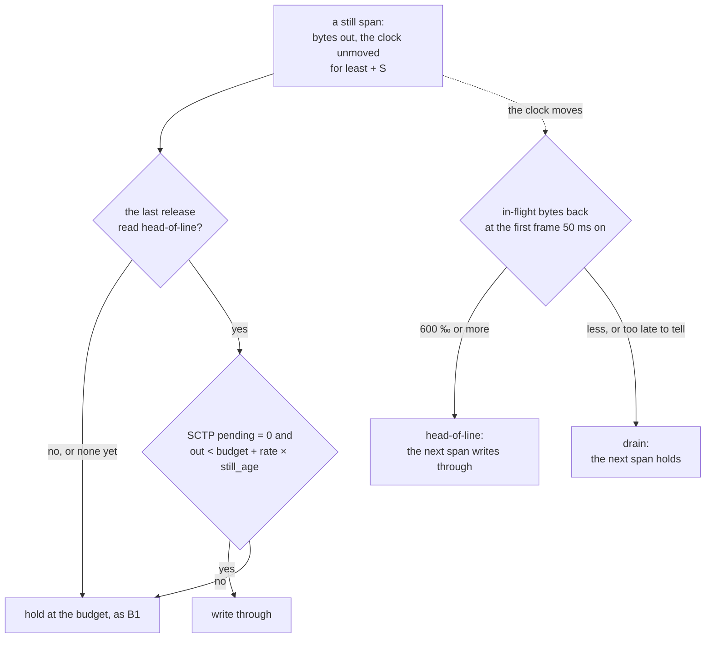

| Term | What it is |
|---|---|
| `still_age` | how long the span has stood, from its first still reading |
| `rate` | the budget's rate at that frame: the write-through goes no faster than the clock measured the carrier |
| what SCTP had in flight | its in-flight bytes at the span's last still reading. Pending bytes are not counted: SCTP had not sent them, and no release brings them back |

**Why in flight, why 50 ms, why 600 ‰.** A head-of-line release brings back at once
what the carrier serialized through the stall; a drain at the link's rate brings back in
`t` what the link carries in `t`, and with a budget's worth in flight (the rate over
`least + S`) that is `t / (least + S)` of it. Read at `least + S`, a drain has brought
back most of it too, so the read comes early: at the first frame 50 ms or more after the
last still reading, at most one frame interval later. A first frame at 600 ‰ of
`least + S` or later is too late to tell, and reads as a drain. The values are the
`tcp_shape` stall and outage cells' (below), every release of every cell under one set,
never per cell. On the first exploratory pass (live: 100 ms, 750 ‰, and SCTP's out with
its pending bytes as the share's base) its 40 releases, 20 head-of-line stalls and 20
outages, read:

| Read at, ms after the last still reading | Share of | Least head-of-line, ‰ | Most drain, ‰ | Misread at 600 ‰ | Misread at 750 ‰ |
|---|---|---|---|---|---|
| the first frame | SCTP's out | 15 | 178 | 8 + 0 | 11 + 0 |
| 50 | SCTP's out | 247 | 282 | 4 + 0 | 9 + 0 |
| 100 | SCTP's out | 247 | 567 | 3 + 0 | 8 + 0 |
| 33 | in flight | 99 | 439 | 1 + 0 | 3 + 0 |
| **50** | **in flight** | **694** | **439** | **0 + 0** | 3 + 0 |
| 80 | in flight | 707 | 576 | 0 + 0 | 2 + 0 |
| 100 | in flight | 707 | 879 | 0 + 2 | 2 + 1 |
| 133 | in flight | 707 | 923 | 0 + 8 | 2 + 3 |

A misread is a head-of-line release read as a drain, plus a drain read as head-of-line.
SCTP's out never separates them: on path C SCTP's window binds, and a stall's backlog
waits in its queue, where no release can bring it back. 500, 700, 800 and 900 ‰ were
swept too. 500 and 600 ‰ both separate the 40 at 50 ms; 600 also keeps a drain under it
at any least when the read comes one 33 ms frame late (83 ms over a `least + S` of
150 ms is 553 ‰), and the least head-of-line release, 694 ‰, still clears it. Read the
same way, the three passes below misread 6 + 0 of the budget's 171 releases (111 on the
stall shapes, 60 in the outages) at 50 ms and 500 to 700 ‰: the six are stalls a lone
packet's acknowledgement split (the open edges, below). At 67 ms they misread 6 + 4, at
100 ms 6 + 9.

**Only while SCTP queues nothing.** On path C, SCTP's window binds through a stall, and
what is written through waits in its queue for the release, then goes ahead of the
frames captured after it. On the exploratory pass a 778 ms stall on the 80 % path C shape
ended with 99,990 bytes pending against 59,994 in flight, and the shape's transit reached
449 ms at most against B1's 106 to 144 ms, for the same fresh delivery (58 % against
57–59 %).

**The rate counts a stall from its start.** A 1 s figure whose second starts inside a
still span sees the span's whole burst come back in less time than the carrier took to
serialize it. With the write-through that burst is the carrier's rate over the stall,
and on the exploratory pass the rate stood at 2,651 to 2,838 kbit/s on the 80 % path I
shape and at 3,361 kbit/s on the 150 % path I shape, on a link of 1,954. Such a second
now counts from the span's first still reading and the count the clock stood at, and
the budget it sizes stays at the link's. A release can come back over two frames: on
the first full pass one on the 80 % path I shape brought back 30,264 bytes of the
150,918 in flight by its first frame, 46 ms after the span's last still reading, and
146,652 by the next, 76 ms after it, and the rate stood at 2,421 kbit/s at the next
release. A second that starts while the release comes back, up to the frame that reads
it, now counts from the span's start too.

**One head-of-line release is enough.** The cells' last writer asks two in a row
(`HOL_RELEASES` = 2). It delivered less fresh than one release in each of the nine runs
with a ratio, and on the 80 % path I shape fell under the bar in the third: 1.055, 1.039
and 0.944 of today's writer's, against 1.072, 1.059 and 0.957. A second release guards
against a drain read as head-of-line, and no cell read one: every release in the outage
cells read as a drain, 120 of 120 over the three runs.

**The AIMD is unchanged:** a still span calls no decrease (D46).

### Where it runs

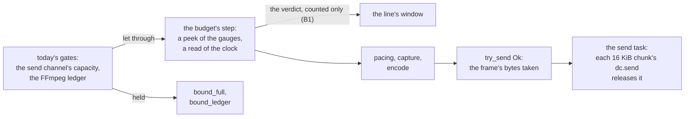

Both data-channel pumps step it, the VP9-444 pump and the FFmpeg pump, once per pass
that today's gates let through, before pacing and capture. The step reads SCTP's gauges
by `peek`, never `take`, so the delivery sampler's takes stay its own (FR-148 O10), and
the clock by `read`. The pump's unsent bytes are a count of the budget's own, apart from
today's ledger: taken where `try_send` returns Ok, released after each 16 KiB chunk's
`dc.send`, and the rest released when a send fails or the send task drops the frame (a
stale epoch, no channel). In shadow the FFmpeg ledger and every gate are untouched.
Under `on`, on a relay session, the step runs before today's gates instead, and its
verdict acts there ([§ The budget acts under `on`](#the-budget-acts-under-on-d46-b3)).
The RTP pump has no SCTP association and no budget.

**The send wait, measured once for both pumps (FR-148).** Each frame carries its hand-off
instant through the send channel, and the send task records the frame's wait, from that
hand-off to the moment SCTP took its last chunk, in the delivery sampler's `SendWait`
(`agents/roomlerd/src/media_inflight.rs:1392`; the sampler's handle,
`agents/roomlerd/src/media_delivery.rs:1303`), whatever the budget's mode. A frame records
only once it reached the wire, after its last chunk (the VP9-444 send task,
`agents/roomlerd/src/peer.rs:4377`; the FFmpeg one, `:7437`): a failed send, a stale frame
or one dropped on a closed channel records nothing. Each reader drains its own window. A
heartbeat takes it whole, and the FFmpeg pump's two readers between heartbeats, FR-74 P1b's
direct gate (`:8069`) and FR-71 T1a's sender window (`:9293`), each read from where it last
read (`SendWaitSince`, `agents/roomlerd/src/media_inflight.rs:1456`), as their own cursors
did. Both heartbeats print `send_wait_avg_ms`, the window's average in whole µs, as ms (0
with no frame), and `send_wait_max_ms`, its longest: the FFmpeg heartbeat over its 2 s
(`agents/roomlerd/src/peer.rs:10048`), the VP9-444 heartbeat over its 30 encoded frames
(`:5369`). Only the FFmpeg pump hands the figure to its governor; the VP9-444 governor gets
nothing new.

**Shadow acts on nothing.** Every call into the budget returns nothing to the pump; the
verdict reaches the line's counters and nothing else.

| Proof | What it shows |
|---|---|
| `media_delivery::tests::the_inflight_budget_in_shadow_answers_every_pump_call_as_off_does` | over 900 frames of a deep queue, a sampler with the budget in shadow and one without it get the same calls and answer each alike: the same samples, and the same lines but for the budget's field, while the shadow's verdicts held |
| `media_delivery::shaped_link::tcp_shape::the_inflight_budget_in_shadow_holds_nothing_on_a_shaped_link` | today's writer on the deep 2 Mbit/s path I shape, off and then in shadow through the pumps' own `Shadow`: in each of three runs it writes at every tick and holds and skips nothing in both (off 480, 480 and 481 ticks, shadow 480, 479 and 481), while the shadow's verdicts would have held 479, 478 and 479 frames. Today's skip writer, whose skips follow the link's timing, skipped 193 to 195 frames a run off and 193 to 195 in shadow, and held none. With the classifier, in the three runs below: off 480, 478 and 478 frames written of 481, 479 and 479 ticks, shadow 480, 479 and 478 of 481, 480 and 479, nothing held or skipped in either, while the shadow's verdicts would have held 480, 479 and 478; the skip writer skipped 193 to 194 a run off and in shadow, and held none |
| the diff | every line B1 added to the pumps is a count or a read; no path leads from the verdict to a gate, an AIMD call or a keyframe request. B3's one path, the budget's pass, acts only under `on` on a relay session: in shadow the pass is today's (`off_and_shadow_gate_as_today`, below) |

### The budget's switch

`ROOMLERD_INFLIGHT_BUDGET`, or the config key `inflight_budget`, read once per pump
beside `ROOMLERD_PATH_MODEL` (`media_inflight::mode`,
`agents/roomlerd/src/media_inflight.rs:160`, from `DeliverySampler::from_env`,
`agents/roomlerd/src/media_delivery.rs:688`):

| Value | The pumps |
|---|---|
| `off`, unset, or any other value | read nothing and count nothing; the `path delivery` line is as before, to the byte |
| `shadow` | compute the budget, count its verdicts and today's bounds beside them, and write them at the end of the `path delivery` line; hold nothing. Since B2, hand the shadow model what the budget saw: P3, the burst rule and the stall's windows ([below](#the-push-backs-in-the-shadow-model-d46-b2)) |
| `on` | on a relay session, act on the budget (D46 B3, [below](#the-budget-acts-under-on-d46-b3)): its hold skips a pass before capture, a hold in a still span of `least + S` calls no AIMD decrease, and the FFmpeg relay byte gate and the VP9-444 watermark arm hold nothing. On a direct session, as `shadow`. The pump says once which mode acted on its session |

With `ROOMLERD_PATH_MODEL=off` the budget stays off whatever its switch says, with one
INFO line: its fields ride on the `path delivery` line, which `off` does not write. The
config key is built as `path_model`'s: the field, its env fallback, the key's metadata,
its echo and its check (`crates/agent-core/src/config.rs:1233`,
`crates/agent-core/src/config_surface.rs:1451`). A set variable wins over the key, any
value but `off`, `shadow` or `on` is refused at `config set`, and remote config cannot
set it ([remote-config.md](remote-config.md)). The read is in `media_inflight`, inside
the FR-135 ratchet's media path, so the ratchet counts it (ledger `p2:BUDGET-1`).

### The budget's fields

The budget's window is the line's: its fields close `path delivery (FR-148 P0, shadow,
≈10s)`, after `loss`, or after `acked_bytes` on a line without the gauges, and only with
the switch not `off`. No name holds `standing_ms=` or `queued=`, which field reads grep
for.

| Field | Meaning |
|---|---|
| `budget_held` | `(held, offered)`: the frames the budget would have held, of those it was asked about |
| `budget_max` | the most the budget stood at, bytes |
| `budget_out_max` | the most `out` stood at, bytes |
| `budget_rate_bps` | the rate at the window's last frame, bit/s; 0 when none was known |
| `budget_least_ms` | the least acknowledgement delay then, ms; `None` before the first SACK, when S stands in for it |
| `budget_slack_ms` | S, ms |
| `budget_ack_over_ms` | `Some((least, median, most))`, ms: the acknowledgement delays over the least, at each frame the clock had moved since the frame before; the median to 5 ms under 1 s and to 100 ms up to 10 s. `None` when there was none |
| `budget_still` | `(count, longest ms)`: spans in which the clock stood still with bytes out for `least + S` or longer |
| `bound_watermark` | the VP9-444 pump's sheds over its watermark; under `on`, on a relay session, the frames over it, which it no longer sheds |
| `bound_ledger` | the FFmpeg pump's gate passes its ledger held; under `on`, on a relay session, the passes its byte gate was shut at, which it no longer holds |
| `bound_full` | gate passes a full send channel held, and `try_send`s that found it full |
| `budget_released` | `(head-of-line, drain)`: the still spans whose release was read in the window, by class (D46's classifier) |
| `budget_still_admitted` | the frames admitted while a still span stood, whatever let them go: under the budget, on SCTP's window, or written through |
| `budget_acted` | `(held, asked)`, D46 B3: under `on`, on a relay session, the passes the budget's hold shut by itself, of the passes it acted on; `(0, 0)` in shadow and on a direct session |
| `budget_acted_stalled` | of those holds, the ones in a still span of `least + S`, which called no AIMD decrease (B3's no-decrease rule); 0 where the budget does not act |

A line with made-up values:

```text
path delivery (FR-148 P0, shadow, ≈10s) session_id=… span_ms=10004 delivery_samples=(3, 2, 0) backlogged_bps=Some((1712000, 1840000, 1951000)) app_limited_bps=Some(1206000) stalled_ms=0 acked_bytes=2301441 ack_ms=Some((62, 74, 391)) standing_ms=Some((12, 329)) queued=1 inflight=(18240, 58650) cwnd=(61440, 98304) ssthresh=65536 rwnd_low=1015808 pending_high=24576 loss=(0, 0) budget_held=(212, 300) budget_max=61440 budget_out_max=79680 budget_rate_bps=1987000 budget_least_ms=Some(62) budget_slack_ms=150 budget_ack_over_ms=Some((3, 45, 1257)) budget_still=(1, 812) bound_watermark=0 bound_ledger=37 bound_full=4 budget_released=(1, 0) budget_still_admitted=9 budget_acted=(0, 0) budget_acted_stalled=0
```

With them a busy line is 771 bytes in the daemon's log-file format, against 435 without:
at most 277,560 bytes a session hour per pump (723 and 260,280 before B3's two fields), measured by
`the_inflight_budget_s_fields_close_the_line`, which also pins their order and the line
with the switch `off`.

### Fresh delivery on the shaped link

The `tcp_shape` cells (`media_delivery::shaped_link::tcp_shape`) run the D46 prototype's
cells on the product core: today's writer, then the budget's, on the same shape. On the
stall and outage shapes B1's budget runs between them, its still spans never written
through, and on the stall shapes the classifier asking two head-of-line releases in a
row runs last; since B2 B1's budget also runs after the budget on the deep shapes and the
controls. A writer under the budget holds a frame at the core's verdict
(`media_inflight::Budget::step`) and writes one through where the verdict says so; the
pumps do so only under `on`, on a relay session
([§ The budget acts under `on`](#the-budget-acts-under-on-d46-b3)). Each run prints a `D46 |` line and a `D46 B2 |` line (the shadow model's
floor, [below](#the-push-backs-in-the-shadow-model-d46-b2)), a `D46 B2 sample |` line for
each sample that pushes back under no rule (its span, rate and what the budget saw over
it, and what the rule makes of it: the rate taken, or `stood`, `marked` or `ended`), and
a holding budget's run a
`D46 release |` line for each still span it saw released: what SCTP had in flight and
pending at its last still reading, the rate and the budget, the bytes back at each step
of the next 400 ms, and the class it read. **Fresh delivery** is what the viewer read
within 300 ms of the fastest a frame can go (the one-way delay and the frame's packets
on the link, `fastest_ms`), as a share of the link's payload rate; read is all it read.
The link queue is the least each second's queue stood at, and the transit each second's
least, write to read, over the fastest, both as median / most over the 20 seconds.
Three runs, Windows, debug build; each cell is the least and the most of the three. The
budget runs at S = 150 ms unless a row says otherwise, with the classifier. B1's rows
measured beside it run B1's verdicts with the classifier's rate (a second that starts
inside a released still span counts from the span's start); the rows marked "B1's own
runs" are B1's three runs before the classifier.

**The stall shapes, D46 item 11's bar.** 800 ms stalls every 3.3 s on the 2 Mbit/s
deep-queue link. At 1.5 times the link today's writer is the VP9-444 pump's skip over
256 KiB: a writer without one queues without end there. The 1.5 times path C shape is
new with the classifier; today's skip reads nothing fresh on it, so it has no ratio.
"Written through" counts the frames the write-through let go, and the releases are the
still spans' by class, per run.

| Stall shape | Writer | Fresh % | Read % | Link queue, ms | Transit, ms | Held or skipped | Written through | Released head-of-line / drain | Fresh over today's, each run |
|---|---|---|---|---|---|---|---|---|---|
| offer 80 %, path I | today's | 62–69 | 80 | 0 / 0–176 | 1–3 / 49–454 | 0 | | | |
| | B1's own runs | 61 | 66–67 | 0 / 0 | 1–3 / 1–5 | 100–103 | – | – | 0.876, 0.880, 0.952 |
| | B1's budget | 61 | 66 | 0 / 0 | 0–3 / 1–4 | 104–105 | 0 | 5 / 0–1 | 0.987, 0.987, 0.873 |
| | **the budget** | 66–67 | 72–74 | 0 / 0 | 0–3 / 1–3 | 49–59 | 45–59 | 5 / 0–1 | **1.072, 1.059, 0.957** |
| | the budget, two releases | 65–66 | 70–73 | 0 / 0 | 0–3 / 1–4 | 50–73 | 31–57 | 5 / 0 | 1.055, 1.039, 0.944 |
| offer 80 %, path C | today's | 19–23 | 77–79 | 0 / 228–254 | 267–374 / 608–637 | 0 | | | |
| | B1's own runs | 57–59 | 63–65 | 0 / 0 | 0–3 / 106–144 | 113–129 | – | – | 3.32, 3.54, 2.58 |
| | B1's budget | 58–59 | 63–64 | 0 / 0 | 0–1 / 105–157 | 122–125 | 0 | 5 / 0–1 | 2.557, 2.515, 2.920 |
| | **the budget** | 59–60 | 65–66 | 0 / 0 | 0–1 / 106–108 | 109–111 | 12–13 | 5 / 0 | **2.594, 2.537, 3.020** |
| | the budget, two releases | 59 | 64–65 | 0 / 0 | 0–3 / 108–126 | 110–119 | 3–15 | 5 / 0 | 2.559, 2.531, 2.961 |
| offer 150 %, path I | today's skip | 8–10 | 96–97 | 470–560 / 948–976 | 448–467 / 971–986 | 199–201 | | | |
| | B1's own runs | 73–74 | 80–81 | 0 / 132–147 | 117–120 / 149–175 | 277–279 | – | – | 9.04, 7.79, 7.25 |
| | B1's budget | 73 | 80–81 | 0–6 / 112–127 | 103–118 / 140–146 | 277–282 | 0 | 5 / 0 | 7.603, 7.021, 8.227 |
| | **the budget** | 79–80 | 88–92 | 50–96 / 114–130 | 114–116 / 134–147 | 232–250 | 37–60 | 5 / 0–1 | **8.209, 7.559, 9.009** |
| | the budget, two releases | 78–79 | 87–88 | 55–87 / 113–123 | 115–117 / 124–165 | 246–256 | 25–45 | 5 / 0 | 8.182, 7.556, 8.796 |
| offer 150 %, path C | today's skip | 0 | 77–79 | 0–16 / 274–305 | 617–623 / 1259–1282 | 0 | | | |
| | B1's budget | 68–71 | 75–78 | 0 / 107–125 | 103–118 / 155–213 | 291–300 | 0 | 5 / 0 | – |
| | **the budget** | 68–70 | 76–78 | 0 / 104–124 | 102–118 / 154–165 | 285–295 | 5–7 | 5 / 0 | – |
| | the budget, two releases | 68–70 | 76–78 | 0 / 105–125 | 115–118 / 157–222 | 285–293 | 5–9 | 5 / 0 | – |

**The bar is met in each run.** On the 80 % path I shape the budget's fresh delivery is
1.072, 1.059 and 0.957 of today's writer's, where B1's own runs read 0.876, 0.880 and
0.952; on path C and at 1.5 times the link it is 2.5 to 9 times today's. That shape is
the hard one: today's writer has no standing queue there, so only what it writes in a
stall arrives late, and what it writes in a stall's last 300 ms still counts as fresh.
The ratio moves with today's writer as much as with the budget: today's delivered 62 %
fresh in the first two runs and 69 % in the third (64–69 % in B1's own runs), and B1's
budget, run beside it, read 0.987, 0.987 and 0.873. Against B1's budget in the same run
the classifier adds 5 to 6 points of fresh delivery (66–67 % against 61 %) and 6 to 8 of
read on the 80 % path I shape, and 6 to 7 points of fresh at 1.5 times the link on path
I. On the path C shapes it moves fresh delivery by −1 to +2 points: SCTP's window binds
through a stall, and the pending gate lets 5 to 13 frames a run through. Its link queue
and transit stay at B1's on every shape but the 1.5 times path I one, where the queue's
median rises to 50–96 ms (B1's budget: 0–6) and the transit stays under 150 ms at most.
What still separates it from today's writer on the 80 % path I shape is what it holds,
49 to 59 frames a run: the first stall on the association holds by design (17 to 20
frames), and each later stall holds until its span is `least + S` old and while SCTP
queues anything (2 to 14 frames a stall).

**The outage shapes.** The stall shape's link, but in each of its 800 ms stalls the
link neither serializes nor delivers, in both directions, and after it drains what
queued at its rate (`media_delivery::shaped_link::Outages`): a still span through which
nothing moved, where writing through would only queue. A packet whose turn on the link
falls in an outage starts at its end, and one due to arrive in an outage arrives that
much later. Offer 80 % and 150 %, paths I and C; at 1.5 times the link today's writer is
the skip writer. After each outage's end with a second of the run after it, the cell
reads when the link's queue and each arrival's transit over the fastest last stood at
300 ms or more before the next outage began (the queue until 300 ms before it, since a
packet sent in that stretch waits for that outage too), and prints a `D46 outage |` line
for it; the cell's bar is under 1 s for both, and fresh delivery at least today's
writer's.

| Outage shape | Writer | Fresh % | Read % | Link queue, ms | Transit, ms | Held or skipped | Released head-of-line / drain | Back under 300 ms after an outage, the most, each run: queue / transit, ms | Fresh over today's, each run |
|---|---|---|---|---|---|---|---|---|---|
| offer 80 %, path I | today's | 13 | 74–75 | 751–759 / 1756–1761 | 775–789 / 1629–1637 | 0 | | 2198, 2199, 2198 / 2499, 2495, 2485 | |
| | B1's budget | 61–62 | 66–67 | 0 / 51–57 | 0–3 / 85–794 | 102–105 | 0 / 5 | 0, 0, 0 / 185, 190, 224 | 4.569, 4.537, 4.635 |
| | **the budget** | 61–62 | 66–67 | 0 / 52–58 | 0–3 / 80–89 | 102–107 | 0 / 5 | 0, 0, 0 / 185, 190, 226 | 4.571, 4.536, 4.645 |
| offer 80 %, path C | today's | 2–4 | 72–74 | 171–199 / 277–305 | 463–488 / 1011–1068 | 0 | | 2188, 2195, 2195 / 2499, 2499, 2490 | |
| | B1's budget | 58–60 | 63–64 | 0 / 58–59 | 1–3 / 107–128 | 119–128 | 0 / 5 | 0, 0, 0 / 191, 191, 226 | 13.751, 14.195, 25.494 |
| | **the budget** | 58–60 | 63–64 | 0 / 12–53 | 1–3 / 105–787 | 118–128 | 0 / 5 | 0, 0, 0 / 190, 185, 227 | 13.783, 14.228, 25.544 |
| offer 150 %, path I | today's skip | 2 | 77 | 976–979 / 1595–1598 | 972–978 / 1775–1776 | 277 | | 2197, 2199, 2199 / 2497, 2497, 2485 | |
| | B1's budget | 70–71 | 76–77 | 107–123 / 133–135 | 117–120 / 130–146 | 294–296 | 0 / 5 | 0, 0, 0 / 235, 235, 254 | 27.967, 27.965, 27.527 |
| | **the budget** | 71 | 77 | 104–122 / 126–135 | 118–120 / 131–136 | 294–295 | 0 / 5 | 0, 0, 0 / 230, 236, 241 | 27.974, 27.965, 27.843 |
| offer 150 %, path C | today's skip | 0 | 72–74 | 163–198 / 274–305 | 731–748 / 1589–1608 | 0 | | 2190, 2199, 0 / 2492, 2497, 2497 | |
| | B1's budget | 66–68 | 72–74 | 116–131 / 131–140 | 120–130 / 155–181 | 306–312 | 0 / 5 | 0, 0, 0 / 230, 236, 243 | – |
| | **the budget** | 68 | 74 | 117–122 / 132–139 | 119–122 / 156–165 | 306 | 0 / 5 | 0, 0, 0 / 235, 232, 231 | – |

Every release in the outage cells read as a drain, 120 of 120 over the three runs, B1's
budget's included, so the classifier held through each outage as B1's budget does: the
two read alike to within two points. After every outage the budget's link queue was
under 300 ms at once and its transit within 241 ms (B1's budget: 254). Today's writers'
transit stood at 300 ms or more for 2,161 to 2,499 ms after each outage, nearly to the
next; their link queue did too on path I (2,061 to 2,199 ms), and on path C, where
SCTP's window bounds it, it was under 300 ms at once after some. The budget delivered
4.5 to 25.5 times today's writer's fresh at 80 %, and 28 times today's skip at 1.5 times
the link on path I; on path C there today's skip reads nothing fresh. A run's most
transit, up to 787 ms for the budget and 794 ms for B1's, falls in a second an outage
cut through; the recoveries are the cell's measure.

**The four deep shapes.** Offer 150 %, a deep queue.

| Shape | Writer | Fresh % | Read % | Link queue, ms | Transit, ms | Held or skipped |
|---|---|---|---|---|---|---|
| 2 Mbit/s, path I | today's | 1–2 | 98–99 | 4141–4172 / 4175–4177 | 3552–3575 / 4742–4744 | 0 |
| | today's skip | 2 | 99 | 974–975 / 981–983 | 972–973 / 977 | 193 |
| | **the budget** | 99 | 99 | 119–121 / 125–128 | 118–119 / 123–124 | 210 |
| | B1's own runs | 98–99 | 98–99 | 101–124 / 112–131 | 105–132 / 119–136 | 210–211 |
| 2 Mbit/s, path C | today's | 0 | 95 | 205–229 / 325–355 | 745–759 / 870–882 | 0 |
| | today's skip | 0 | 94–95 | 202–232 / 328–353 | 738–759 / 870–883 | 0 |
| | **the budget** | 94–95 | 94–95 | 109–121 / 114–127 | 117–119 / 157–209 | 221–227 |
| | B1's own runs | 94–95 | 94–95 | 97–120 / 111–127 | 115–118 / 158–197 | 221–227 |
| 0.4 Mbit/s, path I | today's | 3 | 98 | 5539–5578 / 10492–10534 | 3560–3579 / 6751–6778 | 0 |
| | today's skip | 3 | 98 | 5280–5281 / 5290–5294 | 3560–3576 / 5286–5288 | 111–112 |
| | **the budget** | 98 | 98 | 116–117 / 121–125 | 115 / 118–141 | 211 |
| | B1's own runs | 97–98 | 98 | 85–134 / 97–142 | 88–136 / 102–148 | 211–212 |
| 0.4 Mbit/s, path C | today's | 0 | 96–97 | 556–585 / 821–842 | 3167–3194 / 3474–3479 | 0 |
| | today's skip | 0 | 96–97 | 557–584 / 814–843 | 3178–3193 / 3474–3479 | 0 |
| | **the budget** | 96–97 | 96–97 | 116–129 / 123–142 | 114–133 / 117–148 | 216–218 |
| | B1's own runs | 96–97 | 96–97 | 78–116 / 99–124 | 87–115 / 103–118 | 216–219 |

No deep run saw a still span, so the classifier read no release there and the verdicts
are B1's. The budget reads what today's writers read, its fresh and read delivery within
B1's own runs, and its standing queue and transit stay under 300 ms in every run (the
cells' bar), where today's link queues stand at 0.2 to 5.6 s. Its link queue on the
0.4 Mbit/s path C shape (116–129 / 123–142 ms) and its transit there and on the 2 Mbit/s
path C shape sit a little over B1's own runs, on B1's verdicts.

**The four controls.** Offer 150 %, a shallow queue: the link drops instead of queueing,
so the queue today's writer builds is SCTP's own.

| Shape | Writer | Fresh % | Read % | Link queue, ms | Transit, ms | Held or skipped |
|---|---|---|---|---|---|---|
| 2 Mbit/s, path I | today's | 1 | 85–90 | 0 / 42–55 | 554–559 / 606–1724 | 0 |
| | **the budget** | 76–81 | 83–87 | 0 / 40–61 | 104–116 / 1613–2973 | 256–271 |
| | B1's own runs | 75–85 | 85–90 | 0 / 46–66 | 109–119 / 134–1032 | 245–261 |
| 2 Mbit/s, path C | today's | 0 | 92 | 0–13 / 39–67 | 557–577 / 595–634 | 0 |
| | **the budget** | 90–92 | 92–93 | 0–14 / 39–63 | 119–120 / 152–164 | 232–236 |
| | B1's own runs | 86–91 | 89–93 | 0–10 / 42–62 | 118–119 / 160–213 | 233–247 |
| 0.4 Mbit/s, path I | today's | 1 | 79–84 | 0 / 0 | 2988–3078 / 3304–3463 | 0 |
| | **the budget** | 33–47 | 75–83 | 0 / 0 | 84–116 / 184–700 | 258–299 |
| | B1's own runs | 45–54 | 78–85 | 0 / 0 | 102–114 / 304–746 | 259–288 |
| 0.4 Mbit/s, path C | today's | 0 | 78–82 | 0 / 0 | 3015–3168 / 3700–4009 | 0 |
| | **the budget** | 42–44 | 81–84 | 0 / 0 | 114–122 / 268–1124 | 268–272 |
| | B1's own runs | 47–59 | 81–85 | 0 / 0 | 102–115 / 212–358 | 258–276 |

⚠️ **Outside B1's own runs, on B1's verdicts.** The controls' cell asks the budget to
read at least 0.95 of what today's writer reads. B1's own runs missed it once (0.945 on
the 0.4 Mbit/s path I control); the third run here missed it twice: 0.892 on the
0.4 Mbit/s path I control (296 against 332 kbit/s, 299 frames held against B1's 259–288)
and 0.927 on the 2 Mbit/s path I control (1,631 against 1,761 kbit/s). The classifier
changes nothing until a still span is released, and neither run released one: both are
B1's verdicts. Over the twelve control runs it read one release, on the 0.4 Mbit/s path
I control in the second run, and wrote nothing through. The budget's steps ran slower in
the third run than in the two before (34 µs on average, against 31 and 29). The fresh
delivery on the 0.4 Mbit/s controls (33–47 % on path I and 42–44 % on path C, against
B1's 45–54 and 47–59) and the most transit on the 2 Mbit/s path I control (to 2,973 ms,
against B1's 1,032 and today's writer's 1,724) fall outside B1's own runs as well, with
nothing written through.

**The slack.** 2 Mbit/s, path I, offer 150 %; the stall shape is the one above at 1.5
times the link.

| Shape | S, ms | Writer | Fresh % | Read % | Link queue, ms | Transit, ms | Held | Written through |
|---|---|---|---|---|---|---|---|---|
| deep | 75 | **the budget** | 99 | 99 | 22–46 / 46–54 | 25–45 / 52–56 | 211–212 | 0 |
| | | B1's own runs | 99 | 99 | 21–47 / 34–56 | 26–45 / 52–57 | 211 | |
| deep | 150 | **the budget** | 98–99 | 98–99 | 107–120 / 116–128 | 117–119 / 119–125 | 210–211 | 0 |
| | | B1's own runs | 98–99 | 98–99 | 107–123 / 120–129 | 116–119 / 121–124 | 210–211 | |
| deep | 300 | **the budget** | 54–78 | 98–99 | 262–276 / 276–291 | 270–272 / 348–356 | 207–208 | 0 |
| | | B1's own runs | 48–74 | 98 | 253–264 / 259–284 | 257–271 / 316–352 | 207 | |
| stalls | 75 | **the budget** | 75–77 | 84–87 | 0–19 / 35–50 | 28–45 / 57–74 | 249–265 | 24–48 |
| | | B1's own runs | 73–74 | 78–79 | 0 / 34–54 | 26–47 / 56–75 | 289–290 | |
| stalls | 150 | **the budget** | 78–80 | 88–90 | 45–89 / 108–121 | 105–118 / 134–149 | 240–248 | 34–52 |
| | | B1's own runs | 73–75 | 80–81 | 0 / 140–155 | 118–120 / 149–174 | 277–279 | |
| stalls | 300 | **the budget** | 45–71 | 89–93 | 94–172 / 278–285 | 258–272 / 350–366 | 228–242 | 26–46 |
| | | B1's own runs | 28–30 | 86–87 | 138–159 / 407–434 | 269–271 / 425–429 | 247–251 | |
| shallow | 75 | **the budget** | 74–90 | 88–94 | 0–16 / 34–48 | 40–42 / 1118–1502 | 227–245 | 0 |
| | | B1's own runs | 85–90 | 90–94 | 0–19 / 28–44 | 39–42 / 851–1510 | 227–243 | |
| shallow | 150 | **the budget** | 75–84 | 84–90 | 0–2 / 47–65 | 118 / 133–2359 | 244–266 | 0 |
| | | B1's own runs | 72–80 | 83–89 | 0 / 45–54 | 103–118 / 181–1625 | 247–268 | |
| shallow | 300 | **the budget** | 37–61 | 86–88 | 0–4 / 44–47 | 265–271 / 299–1727 | 248–254 | 0 |
| | | B1's own runs | 33–65 | 86–89 | 0 / 46–65 | 267–272 / 624–2434 | 245–256 | |

The standing queue follows S in every run. On the stall shape the classifier writes
through at every S: fresh 75–80 % against B1's 73–75 % at S = 75 and 150 ms. At S =
300 ms the transit's median sits near the 300 ms that counts as fresh (258–272 ms), and
fresh delivery swings with it: 45–71 % against B1's 28–30 %, with the link queue at
278–285 ms at most against B1's 407–434. The deep shapes saw no still span, and the
shallow ones one, in one run at S = 150 ms, released as a drain: neither wrote anything
through. A step of the core took 26 to 53 µs on average per run, in the unoptimised test
build (B1's runs: 24 to 39).

### The push-backs in the shadow model (D46 B2)

FR-148 D46's step B2, in shadow. What the budget sees now reaches P0's shadow model, and
nothing else: at each delivery sample's close the sampler asks the budget what it saw
over the sample (`Budget::over`), and after each frame's step the pump hands the governor
the budget's mark (`Shadow::take_mark`), which also drops each push-back still inside its
settle time (`media_delivery::settle`). The push-backs' law and their place in the
memory are in [§ The delivery samples' push-backs](#the-delivery-samples-push-backs-d46-b2);
this section has the burst, the opening and the numbers.

```text
over a sample's span, from its start to its close (Budget::over):
  stood          a still span of least + S met it, from the span's first still reading
                 to the step that read its release
  still_inside   that span stood still for least + S inside the sample itself
  held           the verdicts held a frame in each whole second of it (D48: in a fifth
                 of each second's whole grains, the edge grains not counted)
  opening        it starts before the budget's first measured rate on its association
P1   queued                                                  a capacity at its own rate
P3   standing_ms known, SCTP's Backlogged or held, not still_inside, not opening
                                                             a capacity at its own rate
the burst rule: stood -> no capacity, P1 or P3
                a push-back waits settle = least + S + 200 ms (one held SACK) past
                its close, and a mark inside the wait drops it: it closed in a stall;
                one still waiting at the session's close is never handed
the opening:    a step's rate is measured when the 1 s figures gave it, or when the
                application-limited rule kept a rate they gave (Budget::rate_at);
                before, the opening rate stands in. The association's first measured
                rate ends its opening, and a new association opens again
the mark: each step at which a still span of least + S stands, and the step that reads
          its release; the next viewer window that delivers anything is no
          reading for the model or the memory
```

**Where the burst comes in.** A stall on the `tcp_shape` link holds what it serialized
for 800 ms and then delivers all of it at once: the association's clock stands still
through it, and then acknowledges everything within 50 ms. Three readings meet it:

- **a viewer window.** Today's writers queue through a stall, the transit grows, and
  FR-79's gate rejects the stall's window and the one after it (D24). Under the budget
  the transit stays short through the same stall, so the gate passes the window that
  carries the release, and its arrival rate raises the model's floor: with no window
  kept out the budget's floor ended at 1.04 to 1.67 times the link on the stall
  cells, from those windows alone.
- **a sample that holds the release** reads the burst at its acknowledged rate, and is
  backlogged when the budget held through the stall: the release rule's case. The
  41 samples the rule dropped so over the three runs read 0.87 to 1.08 times the link.
- **a sample that closes in a stall** reads less than the path carries. The SACK of a
  lone packet delivered as the stall begins comes back one held SACK later (200 ms),
  inside the stall, and ends its first still span short of `least + S`; the span after
  it stands later. A sample that closed before either stood was held (holds start once
  `out` reaches the budget, about 155 ms into the stall at 80 % of a 2 Mbit/s link), had
  no still span of `least + S` in it, and was P3: the 45 the settle wait dropped
  over the three runs read 0.73 to 0.90 times the link. Under the release rule
  alone (`s1`) B1's budget and the budget asking two releases ended at 0.76 to 0.77
  times the link on the 80 % stall cells, three runs each; the budget stayed at 0.82
  to 0.84 there.

**The rules tried.** Every run folds its samples, marks and windows through the shadow
model under each rule (`model_fold`, in the governor's order, with the opening rule
built: below), so they differ only in what they let through. For samples: `o`, each at
its own rate (P3's own `still_inside` only); `c`, the classifier's rate correction, a
sample that starts inside a released span counting from the span's first still reading
(D46's precedent); `s`, the release rule alone, read at the close; `e`, the rule built:
`s`, and the push-back waits its
settle time, a mark inside the wait dropping it. A run's last sample closes as its
writer stops, so under `e` its push-back is still waiting then and is never handed, as a
session's close drops what its sampler holds; each `D46 B2 sample |` line says which
(`stood`, `marked`, `ended`, or the rate taken). For windows: 0 to 3 windows that
deliver anything after each mark are no reading. On the twelve loaded cells, three runs
each, the model's floor at the run's end as a share of the link's payload rate, and how
many of the cell runs ended outside 0.80 to 1.05:

| Rule | the budget | B1's budget | the budget asking two releases |
|---|---|---|---|
| `e0` | 0.95–1.67, 11 of 36 out | 0.91–1.16, 6 of 36 out | 0.96–1.67, 10 of 12 out |
| `e1` | 0.82–1.00, 0 of 36 out | 0.82–1.00, 0 of 36 out | 0.82–1.00, 0 of 12 out |
| `e2` | 0.82–1.00, 0 of 36 out | 0.82–1.00, 0 of 36 out | 0.82–1.00, 0 of 12 out |
| `e3` | 0.82–1.00, 0 of 36 out | 0.82–1.00, 0 of 36 out | 0.82–1.00, 0 of 12 out |
| `s0` | 0.95–1.47, 10 of 36 out | 0.81–1.16, 4 of 36 out | 0.87–1.66, 7 of 12 out |
| `s1` | 0.82–1.00, 0 of 36 out | 0.76–1.00, 3 of 36 out | 0.76–1.00, 3 of 12 out |
| `s2` | 0.78–1.00, 8 of 36 out | 0.74–1.00, 6 of 36 out | 0.76–0.95, 6 of 12 out |
| `s3` | 0.78–1.00, 8 of 36 out | 0.74–1.00, 6 of 36 out | 0.76–0.95, 6 of 12 out |
| `c0` | 0.95–1.47, 10 of 36 out | 0.81–1.16, 4 of 36 out | 0.87–1.66, 7 of 12 out |
| `c1` | 0.82–1.00, 0 of 36 out | 0.76–1.00, 3 of 36 out | 0.76–1.00, 3 of 12 out |
| `c2` | 0.72–1.00, 8 of 36 out | 0.71–1.00, 6 of 36 out | 0.71–0.90, 6 of 12 out |
| `c3` | 0.72–1.00, 8 of 36 out | 0.71–1.00, 6 of 36 out | 0.71–0.90, 6 of 12 out |
| `o0` | 0.95–1.47, 10 of 36 out | 0.81–1.16, 4 of 36 out | 0.87–1.66, 7 of 12 out |
| `o1` | 0.82–1.00, 0 of 36 out | 0.76–1.00, 3 of 36 out | 0.76–1.00, 3 of 12 out |
| `o2` | 0.78–1.00, 8 of 36 out | 0.74–1.00, 6 of 36 out | 0.76–0.95, 6 of 12 out |
| `o3` | 0.78–1.00, 8 of 36 out | 0.74–1.00, 6 of 36 out | 0.76–0.95, 6 of 12 out |

The rule built is `e1`. The first build kept two windows out (`e2`), and its first
measured run put the budget's floor at 0.69 times the link on the 80 % stall cell on
path C: on a stall every 3.3 s, two windows after each mark kept 15 windows of the
20-second run out of the model, and the floor never came back from the session's first
sample (0.558 times the link, P3). One window was the only rule inside the bar on every
loaded cell of that run, for all three budget writers, so the build moved to it before
#4115's first three runs, in which `e2` missed three times, each at 0.68 on path C at
80 %: the budget on the same stall cell in the second and on the outage cell in the
third, and the budget asking two releases on the stall cell in the third. With the
opening rule (below) folded in, `e2` and `e3` stayed inside the bar in the three runs
here too: the session's first sample, which held the first build's floor down, no
longer reaches the model. One window stays the rule: the least that keeps the release
out.

**The opening.** #4115's first runs took each session's first sample (about 130 ms
to 2.13 s in) as P3 under every budget writer: the budget held in each of its first two
seconds while the association opened, and the 77 first samples read 0.52 to 0.92 times
the link. On the 80 % cells no later P3 replaced the capacity it set, and the model's
capacity ended at 0.52 to 0.78 times the link, under its own floor. AC2's bracket has
two edges (D45): the floor at 0.80 to 1.05 times the link, and the capacity absent or
at least 0.95. Those holds were the budget's own. Until its first 1 s figure the opening
rate stands in for its rate (D46 item 12: 80 % or 150 % of the link on these cells),
and SCTP's window is still opening: in the three runs here the 76 first samples that
were P3 without a rule held at 1 to 33 steps each, 1 to 22 of them at the stand-in rate
and up to 22 sized by SCTP's window rather than by the rate. P3 reads a held sample's
rate as what the path carried; in the opening it is what the stand-in and a young window
let out.

So a sample that starts before the budget's first measured rate on its association is
no P3 capacity (`Over::opening`, read by `push_back_of`). A step's rate is measured when
the 1 s figures gave it, or when the application-limited rule kept a rate they gave
(`Budget::rate_at`); a new association opens again (`Budget::on_new_association`). The
rule reads the budget and changes none of its verdicts. Nor does P1 change: a `queued`
sample in the opening is still P1, and the budget-off model still moves by P1 only.

The rules tried, each folded through the shadow model over the same runs (`Open` in the
harness, which reads the holding core's trace). What makes a sample the opening's, so no
P3: `n`, nothing (#4115's first commit); `a`, a hold in it at the opening's stand-in
rate; `b`, `a`, or a hold that SCTP's window sized rather than the rate (the
`min(rate, window / least)` of `Budget::size`); `c`, the rule built: it starts before
the first measured rate; `cw`, `c`, or `b`'s window; `f`, it is the session's first
sample. Both edges at the run's end on the twelve loaded cells, three runs each, times
the link's payload rate, under the burst rule built: the floor; the capacity, and the
runs that ended with none; and the cell runs off the bar.

| Rule | the budget | B1's budget | the budget asking two releases |
|---|---|---|---|
| `n` | 0.82–1.00; 0.54–1.00, none in 4; 8 of 36 off | 0.82–1.00; 0.54–1.00, none in 3; 9 of 36 off | 0.82–1.00; 0.54–1.00, none in 1; 5 of 12 off |
| `a` | 0.82–1.00; 0.98–1.00, none in 12; 0 of 36 off | 0.82–1.00; 0.98–1.00, none in 12; 0 of 36 off | 0.82–1.00; 1.00–1.00, none in 6; 0 of 12 off |
| `b` | 0.82–1.00; 0.98–1.00, none in 12; 0 of 36 off | 0.82–1.00; 0.98–1.00, none in 12; 0 of 36 off | 0.82–1.00; 1.00–1.00, none in 6; 0 of 12 off |
| `c` | 0.82–1.00; 0.98–1.00, none in 12; 0 of 36 off | 0.82–1.00; 0.98–1.00, none in 12; 0 of 36 off | 0.82–1.00; 1.00–1.00, none in 6; 0 of 12 off |
| `cw` | 0.82–1.00; 0.98–1.00, none in 12; 0 of 36 off | 0.82–1.00; 0.98–1.00, none in 12; 0 of 36 off | 0.82–1.00; 1.00–1.00, none in 6; 0 of 12 off |
| `f` | 0.82–1.00; 0.98–1.00, none in 12; 0 of 36 off | 0.82–1.00; 0.98–1.00, none in 12; 0 of 36 off | 0.82–1.00; 1.00–1.00, none in 6; 0 of 12 off |

Under `n` every run off the bar is a capacity under 0.95 on an 80 % cell (0.54 to 0.78),
set by the session's first sample. The first samples, under `n`: the budget's was P3 in
32 of its 36 loaded cell runs, B1's in 33 of 36 and the budget asking two releases' in
11 of 12, at 0.54 to 0.92 times the link; each of those 76 is the opening's under `a`,
`b`, `c`, `cw` and `f` alike, and the other 8 were no push-back under any rule. No later
sample on a loaded cell differs from rule to rule, so there the rules differ only in
the first sample. The capacity a rule leaves absent (12, 12 and 6 runs) is the 80 %
outage and stall cells': no sample after the opening was P3 there.

**After an outage** SCTP's window does not collapse on these cells: no run had a fast
retransmit or a T3 timeout, since the deep queue drops nothing, an outage holds what is
due in it (lossless), and 800 ms is under the 1 s floor of SCTP's retransmission timer
(`RTO_MIN`, `crates/vendored/webrtc-sctp/src/timer/rtx_timer.rs:10`); nor had any
sample after a session's first a hold that SCTP's window sized. The budget's rate stays
measured through an outage, so every rule but `n` leaves what follows one to the burst
rule, and they differ only on the first sample. SCTP's window does collapse and regrow
on the shallow queues, which drop (fast retransmits in each of the 45 shallow runs, T3
timeouts in 37, the window down to 1,228 bytes, one packet): on the shallow controls
`a`, `c` and `f` take the 187 P3 samples after the opening at their own rates, 0.70 to
1.00 times the link, and `b` and `cw` keep out 152 of them, held while the window
regrew (and 42 of the slack cell's 153). On a path that drops they would keep four of
five of its samples from the model. `c` is built: on every run it keeps out what `a` and
`f` keep out, it is one time in the budget (`first_measured`), and, unlike `f`, a new
association opens again.

**The bracket, every loaded cell**, under the rules built (`e1` and `c`), against the
classifier's runs (#4083), whose floor was `Pipe`'s own law (the model's floor did not
exist on these cells then): the floor and the model's capacity at the run's end, times
the link's payload rate (`-`: no capacity), today's writers beside the budget's.
At an offer of 80 % the floor ends at the offer, about 0.82 times the link: the
windows that read more carried a release, and are kept out. Every run of the three
budget writers is on the bar in these three passes: the floor at 0.82 to 1.00, the
capacity at 0.985 to 1.001, or none on the 80 % outage and stall cells. Four passes more,
run for D48, ended two off it, both on the 2 Mbit/s 80 % outage cells: the capacity at
0.856 (path C, B1's budget) and 0.870 (path I, the budget), each set by an
application-limited sample with no loss in it that `Budget::over` read as held from holds
in the grains at its edges, outside its span. D48 counts only the grains inside the span,
and asks for holds in a fifth of each second's
([§ A path that drops](#a-path-that-drops-who-bound-the-sample-d48)).

| Cell | Writer | Floor, runs 1 / 2 / 3 | Capacity, runs 1 / 2 / 3 | #4083's floor |
|---|---|---|---|---|
| 0.4 Mbit/s, deep queue, path C, offer 150 % | today's | 0.946 / 0.946 / 0.945 | - / - / - | 0.99–1.00 |
| 0.4 Mbit/s, deep queue, path C, offer 150 % | today's skip | 0.947 / 0.946 / 0.947 | - / - / - | 0.99–1.00 |
| 0.4 Mbit/s, deep queue, path C, offer 150 % | the budget | 0.992 / 0.992 / 0.991 | 0.997 / 0.998 / 0.997 | 0.99–1.00 |
| 0.4 Mbit/s, deep queue, path C, offer 150 % | B1's budget | 0.990 / 0.991 / 0.991 | 0.997 / 0.999 / 0.999 | (not run) |
| 0.4 Mbit/s, deep queue, path I, offer 150 % | today's | 0.954 / 0.954 / 0.957 | - / - / - | 0.99–1.00 |
| 0.4 Mbit/s, deep queue, path I, offer 150 % | today's skip | 0.954 / 0.955 / 0.954 | - / - / - | 0.99–1.00 |
| 0.4 Mbit/s, deep queue, path I, offer 150 % | the budget | 0.990 / 0.991 / 0.990 | 0.997 / 0.985 / 0.986 | 0.99 |
| 0.4 Mbit/s, deep queue, path I, offer 150 % | B1's budget | 0.991 / 0.992 / 0.990 | 0.986 / 0.985 / 0.986 | (not run) |
| 2 Mbit/s, deep queue, path C, offer 150 % | today's | 0.897 / 0.898 / 0.899 | 0.797 / 0.797 / 0.799 | 1.00–1.01 |
| 2 Mbit/s, deep queue, path C, offer 150 % | today's skip | 0.898 / 0.898 / 0.898 | 0.797 / 0.798 / 0.798 | 1.00–1.01 |
| 2 Mbit/s, deep queue, path C, offer 150 % | the budget | 0.999 / 0.999 / 1.000 | 1.001 / 1.001 / 1.001 | 1.00–1.01 |
| 2 Mbit/s, deep queue, path C, offer 150 % | B1's budget | 1.000 / 1.000 / 0.999 | 1.001 / 1.000 / 1.001 | (not run) |
| 2 Mbit/s, deep queue, path I, offer 150 % | today's | 0.975 / 0.974 / 0.972 | - / - / - | 1.00–1.01 |
| 2 Mbit/s, deep queue, path I, offer 150 % | today's skip | 0.972 / 0.972 / 0.975 | - / - / - | 1.00 |
| 2 Mbit/s, deep queue, path I, offer 150 % | the budget | 0.999 / 0.999 / 1.000 | 0.995 / 1.001 / 0.995 | 1.00 |
| 2 Mbit/s, deep queue, path I, offer 150 % | B1's budget | 1.000 / 0.999 / 1.000 | 1.001 / 1.001 / 1.000 | (not run) |
| 2 Mbit/s, deep queue, path C, offer 80 %, a 800ms outage every 3.3s | today's | 0.998 / 0.998 / 0.997 | - / - / - | 1.00–1.01 |
| 2 Mbit/s, deep queue, path C, offer 80 %, a 800ms outage every 3.3s | B1's budget | 0.820 / 0.819 / 0.820 | - / - / - | 0.95–0.96 |
| 2 Mbit/s, deep queue, path C, offer 80 %, a 800ms outage every 3.3s | the budget | 0.821 / 0.820 / 0.820 | - / - / - | 0.95 |
| 2 Mbit/s, deep queue, path I, offer 80 %, a 800ms outage every 3.3s | today's | 0.867 / 0.864 / 0.866 | - / - / - | 1.00–1.01 |
| 2 Mbit/s, deep queue, path I, offer 80 %, a 800ms outage every 3.3s | B1's budget | 0.840 / 0.839 / 0.838 | - / - / - | 0.95–0.96 |
| 2 Mbit/s, deep queue, path I, offer 80 %, a 800ms outage every 3.3s | the budget | 0.840 / 0.841 / 0.839 | - / - / - | 0.95–0.96 |
| 2 Mbit/s, deep queue, path C, offer 150 %, a 800ms outage every 3.3s | today's skip | 0.671 / 0.556 / 0.579 | 0.671 / 0.556 / 0.579 | 1.00–1.01 |
| 2 Mbit/s, deep queue, path C, offer 150 %, a 800ms outage every 3.3s | B1's budget | 0.999 / 1.000 / 1.000 | 1.000 / 1.001 / 1.000 | 1.00 |
| 2 Mbit/s, deep queue, path C, offer 150 %, a 800ms outage every 3.3s | the budget | 1.001 / 0.999 / 1.000 | 1.001 / 0.996 / 1.001 | 1.00 |
| 2 Mbit/s, deep queue, path I, offer 150 %, a 800ms outage every 3.3s | today's skip | 0.970 / 0.971 / 0.973 | - / - / - | 1.00–1.01 |
| 2 Mbit/s, deep queue, path I, offer 150 %, a 800ms outage every 3.3s | B1's budget | 0.999 / 1.000 / 1.000 | 1.000 / 0.999 / 0.999 | 1.00–1.01 |
| 2 Mbit/s, deep queue, path I, offer 150 %, a 800ms outage every 3.3s | the budget | 0.999 / 1.000 / 1.000 | 0.999 / 0.999 / 0.999 | 1.00–1.01 |
| 2 Mbit/s, deep queue, path C, offer 80 %, a 800ms stall every 3.3s | today's | 0.997 / 0.998 / 0.998 | - / - / - | 1.24–1.26 |
| 2 Mbit/s, deep queue, path C, offer 80 %, a 800ms stall every 3.3s | B1's budget | 0.822 / 0.819 / 0.820 | - / - / - | 0.91–0.95 |
| 2 Mbit/s, deep queue, path C, offer 80 %, a 800ms stall every 3.3s | the budget | 0.820 / 0.819 / 0.820 | - / - / - | 1.02–1.07 |
| 2 Mbit/s, deep queue, path C, offer 80 %, a 800ms stall every 3.3s | two releases | 0.820 / 0.821 / 0.819 | - / - / - | 0.96–1.07 |
| 2 Mbit/s, deep queue, path I, offer 80 %, a 800ms stall every 3.3s | today's | 1.447 / 1.446 / 1.450 | - / - / - | 1.46–1.55 |
| 2 Mbit/s, deep queue, path I, offer 80 %, a 800ms stall every 3.3s | B1's budget | 0.841 / 0.840 / 0.838 | - / - / - | 0.91–0.94 |
| 2 Mbit/s, deep queue, path I, offer 80 %, a 800ms stall every 3.3s | the budget | 0.839 / 0.839 / 0.840 | - / - / - | 1.37 |
| 2 Mbit/s, deep queue, path I, offer 80 %, a 800ms stall every 3.3s | two releases | 0.839 / 0.839 / 0.840 | - / - / - | 1.34–1.40 |
| 2 Mbit/s, deep queue, path C, offer 150 %, a 800ms stall every 3.3s | today's skip | 0.679 / 0.669 / 0.669 | 0.679 / 0.669 / 0.669 | 1.25–1.26 |
| 2 Mbit/s, deep queue, path C, offer 150 %, a 800ms stall every 3.3s | B1's budget | 1.001 / 1.000 / 0.999 | 1.001 / 1.001 / 0.997 | 1.13–1.16 |
| 2 Mbit/s, deep queue, path C, offer 150 %, a 800ms stall every 3.3s | the budget | 1.000 / 1.001 / 1.000 | 0.999 / 0.998 / 1.001 | 1.21–1.26 |
| 2 Mbit/s, deep queue, path C, offer 150 %, a 800ms stall every 3.3s | two releases | 0.999 / 1.000 / 0.999 | 0.999 / 1.000 / 1.001 | 1.22–1.26 |
| 2 Mbit/s, deep queue, path I, offer 150 %, a 800ms stall every 3.3s | today's skip | 0.973 / 0.970 / 0.971 | - / - / - | 1.78 |
| 2 Mbit/s, deep queue, path I, offer 150 %, a 800ms stall every 3.3s | B1's budget | 1.000 / 1.000 / 0.999 | 1.001 / 1.001 / 0.997 | 1.16–1.17 |
| 2 Mbit/s, deep queue, path I, offer 150 %, a 800ms stall every 3.3s | the budget | 0.999 / 1.000 / 1.000 | 0.996 / 1.000 / 1.000 | 1.65–1.72 |
| 2 Mbit/s, deep queue, path I, offer 150 %, a 800ms stall every 3.3s | two releases | 0.998 / 1.000 / 1.000 | 0.996 / 1.001 / 1.001 | 1.66–1.69 |

On the slack cell (the budget at 75, 150 and 300 ms of slack, on the 2 Mbit/s deep queue
with and without stalls and on the shallow one, path I, offer 150 %) the rules built
ended at 0.970 to 1.073 times the link in its 27 runs, over 1.05 once: on the shallow
queue at 75 ms in the first run (1.073), where no still span stood and a window FR-79's
gate passed read 1.82 times the link (`maxrx`), as on the shallow controls below. `n`
ends there alike, floor and capacity, in every run; `Pipe`'s own law read up to 2.08.

**Today's writers** (the budget off, P1 only): no push-back raised a floor on any cell,
asserted on every push-back of every run (`model_fold`). Today's writer's floor ended at
0.86 to 1.45 times the link, and today's skip's at 0.56 to 0.98. It ends over 1.05 only
on the 80 % stall cell on path I (1.446 to 1.450 in each run): a window FR-79's gate
passed carried part of a stall's release (the most a window the model took read,
`maxrx`, is the floor itself), and with the budget off nothing computes a still span, so
nothing marks the stall and no window after it is kept out. Today's skip's ends under
0.80 only at 1.5 times the link on path C, through the stalls and the outages (0.56 to
0.68): there windows' push-backs (`PathModel::pushed_back`, P0's law) lowered the floor,
and no sample reached the model.

Their capacity, the bracket's other edge, ended absent on every cell but path C at 1.5
times the link, and under 0.95 on each of those, in each run: 0.797 to 0.799 on the
deep queue (both writers), 0.56 to 0.68 through the outages and the stalls (today's
skip). P0's window push-backs set it: each valid viewer window hands the model the
goodput estimate as a capacity (`GoodputEstimator`,
`agents/roomlerd/src/encode/goodput.rs:211`). On path C SCTP's window is about 13 KB a
second in, growing in congestion avoidance (`ssthresh` 0), so the writer blocks from the
first second, and the estimator adopts that second's reading outright, 0.45 times the
link (0.53 once). It rises by `ALPHA_UP` of the gap a window (0.10, "down fast, up
slow", `goodput.rs:98`), and through the outages and the stalls each window an outage or
a stall held the writer in pulls it down by `ALPHA_DOWN` (0.50). The deep queue's
transit then takes the windows past FR-79's gate, no valid window takes a later
estimate, and the model keeps the last valid window's: 0.80 at 10.9 s on the deep queue,
0.56 to 0.68 at 7.4 s through the outages and the stalls. On path I the window is at
186 KB a second in, in slow start (`ssthresh` the peer's window): on the deep queue
today's writer first blocks at 9 s, when every window is past the gate, and today's skip
never blocks there, so no capacity is set. Both edges are the budget-off model as D24
left it, and B2 does not change it.

**The controls, same run.** Fresh and read delivery, kbit/s, today's writer, B1's
budget and the budget, in each run (`≫`: today's writer delivers almost nothing fresh):

| Control | Run | today's writer, fresh / read | B1's budget, fresh / read (× today's) | the budget, fresh / read (× today's) |
|---|---|---|---|---|
| 0.4 Mbit/s, path C | 1 | 1 / 316 | 139 / 307 (≫, 0.972) | 174 / 319 (≫, 1.010) |
| 0.4 Mbit/s, path I | 1 | 3 / 323 | 175 / 334 (≫, 1.034) | 180 / 324 (≫, 1.003) |
| 2 Mbit/s, path C | 1 | 0 / 1796 | 1800 / 1820 (≫, 1.014) | 1770 / 1800 (≫, 1.003) |
| 2 Mbit/s, path I | 1 | 29 / 1756 | 1565 / 1740 (≫, 0.991) | 1680 / 1765 (≫, 1.006) |
| 0.4 Mbit/s, path C | 2 | 1 / 316 | 156 / 310 (≫, 0.981) | 165 / 314 (≫, 0.994) |
| 0.4 Mbit/s, path I | 2 | 4 / 336 | 175 / 338 (≫, 1.006) | 169 / 325 (≫, 0.967) |
| 2 Mbit/s, path C | 2 | 0 / 1805 | 1766 / 1811 (≫, 1.003) | 1790 / 1815 (≫, 1.006) |
| 2 Mbit/s, path I | 2 | 29 / 1705 | 1465 / 1680 (≫, 0.985) | 1575 / 1745 (≫, 1.024) |
| 0.4 Mbit/s, path C | 3 | 1 / 317 | 169 / 316 (≫, 0.997) | 170 / 329 (≫, 1.038) |
| 0.4 Mbit/s, path I | 3 | 4 / 313 | 176 / 327 (≫, 1.045) | 160 / 329 (≫, 1.051) |
| 2 Mbit/s, path C | 3 | 0 / 1801 | 1675 / 1796 (≫, 0.997) | 1805 / 1825 (≫, 1.014) |
| 2 Mbit/s, path I | 3 | 29 / 1750 | 1660 / 1765 (≫, 1.008) | 1690 / 1771 (≫, 1.011) |

The cell asks the budget to read at least 0.95 of what today's writer reads. In the
three runs here every read met it: the budget's at 0.967 to 1.051 times today's, B1's
at 0.972 to 1.045. In #4115's first runs the budget missed it once (0.937, on the
2 Mbit/s path I control) and B1's budget once (0.921, on the 0.4 Mbit/s path I control),
and in the classifier's third run (#4083) B1's verdicts missed it twice (0.892 and
0.927). B2 changes nothing a writer sends, so these are the budget's verdicts and B1's,
from run to run.

**O7's split.** Per loaded cell and budget writer, the memory's counted push-backs
(`samples_counted`) and how many came from `Clear` windows, and of them the samples'
P3 (`samples_counted_p3`) and their `Clear` ones. `samples_counted_p1` stayed 0 on
every loaded cell:

| Cell | Writer | counted, runs 1 / 2 / 3 | of them `Clear` | the samples' P3 | of them `Clear` |
|---|---|---|---|---|---|
| 0.4 Mbit/s, deep queue, path C, offer 150 % | the budget | 8 / 8 / 8 | 0 / 0 / 0 | 8 / 8 / 8 | 0 / 0 / 0 |
| 0.4 Mbit/s, deep queue, path C, offer 150 % | B1's budget | 8 / 8 / 8 | 0 / 0 / 0 | 8 / 8 / 8 | 0 / 0 / 0 |
| 0.4 Mbit/s, deep queue, path I, offer 150 % | the budget | 8 / 8 / 8 | 0 / 0 / 0 | 8 / 8 / 8 | 0 / 0 / 0 |
| 0.4 Mbit/s, deep queue, path I, offer 150 % | B1's budget | 8 / 8 / 8 | 0 / 0 / 0 | 8 / 8 / 8 | 0 / 0 / 0 |
| 2 Mbit/s, deep queue, path C, offer 150 % | the budget | 8 / 8 / 8 | 0 / 0 / 0 | 8 / 8 / 8 | 0 / 0 / 0 |
| 2 Mbit/s, deep queue, path C, offer 150 % | B1's budget | 8 / 8 / 8 | 0 / 0 / 0 | 8 / 8 / 8 | 0 / 0 / 0 |
| 2 Mbit/s, deep queue, path I, offer 150 % | the budget | 8 / 8 / 8 | 0 / 0 / 0 | 8 / 8 / 8 | 0 / 0 / 0 |
| 2 Mbit/s, deep queue, path I, offer 150 % | B1's budget | 8 / 8 / 8 | 0 / 0 / 0 | 8 / 8 / 8 | 0 / 0 / 0 |
| 2 Mbit/s, deep queue, path C, offer 80 %, a 800ms outage every 3.3s | B1's budget | 0 / 0 / 0 | 0 / 0 / 0 | 0 / 0 / 0 | 0 / 0 / 0 |
| 2 Mbit/s, deep queue, path C, offer 80 %, a 800ms outage every 3.3s | the budget | 0 / 0 / 0 | 0 / 0 / 0 | 0 / 0 / 0 | 0 / 0 / 0 |
| 2 Mbit/s, deep queue, path I, offer 80 %, a 800ms outage every 3.3s | B1's budget | 0 / 0 / 0 | 0 / 0 / 0 | 0 / 0 / 0 | 0 / 0 / 0 |
| 2 Mbit/s, deep queue, path I, offer 80 %, a 800ms outage every 3.3s | the budget | 0 / 0 / 0 | 0 / 0 / 0 | 0 / 0 / 0 | 0 / 0 / 0 |
| 2 Mbit/s, deep queue, path C, offer 150 %, a 800ms outage every 3.3s | B1's budget | 1 / 1 / 1 | 0 / 0 / 0 | 1 / 1 / 1 | 0 / 0 / 0 |
| 2 Mbit/s, deep queue, path C, offer 150 %, a 800ms outage every 3.3s | the budget | 1 / 1 / 1 | 0 / 0 / 0 | 1 / 1 / 1 | 0 / 0 / 0 |
| 2 Mbit/s, deep queue, path I, offer 150 %, a 800ms outage every 3.3s | B1's budget | 1 / 1 / 1 | 0 / 0 / 0 | 1 / 1 / 1 | 0 / 0 / 0 |
| 2 Mbit/s, deep queue, path I, offer 150 %, a 800ms outage every 3.3s | the budget | 1 / 1 / 1 | 0 / 0 / 0 | 1 / 1 / 1 | 0 / 0 / 0 |
| 2 Mbit/s, deep queue, path C, offer 80 %, a 800ms stall every 3.3s | B1's budget | 0 / 0 / 0 | 0 / 0 / 0 | 0 / 0 / 0 | 0 / 0 / 0 |
| 2 Mbit/s, deep queue, path C, offer 80 %, a 800ms stall every 3.3s | the budget | 0 / 0 / 0 | 0 / 0 / 0 | 0 / 0 / 0 | 0 / 0 / 0 |
| 2 Mbit/s, deep queue, path C, offer 80 %, a 800ms stall every 3.3s | two releases | 0 / 0 / 0 | 0 / 0 / 0 | 0 / 0 / 0 | 0 / 0 / 0 |
| 2 Mbit/s, deep queue, path I, offer 80 %, a 800ms stall every 3.3s | B1's budget | 0 / 0 / 0 | 0 / 0 / 0 | 0 / 0 / 0 | 0 / 0 / 0 |
| 2 Mbit/s, deep queue, path I, offer 80 %, a 800ms stall every 3.3s | the budget | 0 / 0 / 0 | 0 / 0 / 0 | 0 / 0 / 0 | 0 / 0 / 0 |
| 2 Mbit/s, deep queue, path I, offer 80 %, a 800ms stall every 3.3s | two releases | 0 / 0 / 0 | 0 / 0 / 0 | 0 / 0 / 0 | 0 / 0 / 0 |
| 2 Mbit/s, deep queue, path C, offer 150 %, a 800ms stall every 3.3s | B1's budget | 1 / 1 / 1 | 0 / 0 / 0 | 1 / 1 / 1 | 0 / 0 / 0 |
| 2 Mbit/s, deep queue, path C, offer 150 %, a 800ms stall every 3.3s | the budget | 1 / 1 / 1 | 0 / 0 / 0 | 1 / 1 / 1 | 0 / 0 / 0 |
| 2 Mbit/s, deep queue, path C, offer 150 %, a 800ms stall every 3.3s | two releases | 1 / 1 / 1 | 0 / 0 / 0 | 1 / 1 / 1 | 0 / 0 / 0 |
| 2 Mbit/s, deep queue, path I, offer 150 %, a 800ms stall every 3.3s | B1's budget | 1 / 1 / 1 | 0 / 0 / 0 | 1 / 1 / 1 | 0 / 0 / 0 |
| 2 Mbit/s, deep queue, path I, offer 150 %, a 800ms stall every 3.3s | the budget | 1 / 1 / 1 | 0 / 0 / 0 | 1 / 1 / 1 | 0 / 0 / 0 |
| 2 Mbit/s, deep queue, path I, offer 150 %, a 800ms stall every 3.3s | two releases | 1 / 1 / 1 | 0 / 0 / 0 | 1 / 1 / 1 | 0 / 0 / 0 |

Over the loaded cells the budget writers' memory counted 222 push-backs in the three
runs (108 the budget's, 108 B1's, 6 two releases'), every one a sample's P3 and none
from a `Clear` window; no P1 reached the memory on a loaded cell, and today's writers
counted only windows' push-backs (84, none from a `Clear` window). #4115's first runs,
before the opening rule, counted 297, 8 of them from `Clear` windows on the 80 % stall
and outage cells on path I. The rule keeps each session's first sample out (76 here,
one a run), so a run now counts 8 instead of 9 on the 150 % deep cells, 1 through the
150 % outages and stalls, and none on the 80 % cells, where those 8 `Clear` ones fell.
P1 did reach the memory on the slack cell, which is not a loaded cell: at 300 ms of
slack the queue stood, the budget's samples read `queued`, and 8 P1 a run were counted,
none from a `Clear` window (every one from an `Overproduced` window in #4115's first
runs); at 75 and 150 ms the samples were P3, 8 a run.

**What it leaves.** What the opening rule leaves, and three readings that stay as they
were, each measured here:

- The opening's samples reach nothing. On the loaded cells the session's first sample
  was held at the opening in 76 of the budget writers' 84 runs and read 0.54 to 0.92
  times the link; under the rule none of them reaches the model, and the capacity ended
  at 0.985 to 1.001 times the link, or absent on the 80 % outage and stall cells (12
  runs of the budget's, 12 of B1's, 6 of two releases'). Without it (`n`) the capacity
  ended under 0.95 in 22 of those runs, at 0.54 to 0.78, each time that first sample's.
  The floor ended at 0.82 to 1.00 times the link under every rule; the rule raised it in
  8 runs, by 0.001 to 0.022, 7 of them on path I's 80 % outage and stall cells, where
  the first sample had read 0.78. On these cells no later sample changes its fate under
  any candidate: they differ from `n` only on the first samples.
- With the budget off, P1 reaches the model only under a window the gate accepted. On
  the deep shapes, where the queue stands, the gate accepts none once the queue has
  built: today's writers made 4 to 9 P1 push-backs a run there, and none reached the
  model.
- On the shallow 0.4 Mbit/s controls the budget writers' floor ended at up to 1.78
  times the link. Six of the seven runs that ended over 1.05 had no mark (no still span
  stood), so no rule of B2's reaches them: a viewer window FR-79's gate passed read up
  to 1.785 times the link (`maxrx`), what `Pipe`'s own law reads there (#4083's 1.78),
  and the model's floor took it, lowered only partly by the samples after it. The
  seventh, B1's at 1.052, had three marks and kept one window out. B1's budget ended at
  0.94 to 1.78 there and the budget at 0.84 to 1.77, from run to run; neither is a
  loaded cell.
- On a path that drops, neither edge holds. On the shallow queues SCTP made fast
  retransmits in each of the 45 runs and T3 timeouts in 37, its window down to one
  packet. On the four shallow controls the budget writers' bracket was on the bar in 4
  of their 24 runs (8 of 24 in the three passes run for D48's design, 2 of 24 in D48's
  three bar passes: [§ A path that drops](#a-path-that-drops-who-bound-the-sample-d48)).
  The capacity ended under 0.95 in 17: in 16 a P3 sample set it, at 0.79 to 0.95 times
  the link, and in one a window's push-back (P0's law, 0.58). The floor ended over 1.05
  in 9. Keeping out as well a sample with a hold that SCTP's window sized rather than
  the rate (`cw`) leaves 5 capacities under 0.95 and puts 8 runs on the bar, but 15
  floors end over 1.05, at up to 1.78: the samples `cw` keeps out are what lowered the
  floor after windows FR-79's gate passed that read up to 1.79 times the link (`maxrx`).
  Both edges there belong to the step for a path that drops: P3 when SCTP's window and
  not the rate held the budget, and the windows that read over the link.

### The budget acts under `on` (D46 B3)

FR-148 D46's step B3. Under `ROOMLERD_INFLIGHT_BUDGET=on`, on a constrained (relay)
session, both data-channel pumps act on the budget. One call before the pump's capacity
gate decides (`DeliverySampler::gate`) takes B1's step there: it reads the clock, peeks
the gauges, steps the core and keeps the `Pass` its verdict answers. The capacity gate
asks that pass last, after the send channel and the followers; the gate's skip calls the
AIMD's decrease through it; and in the VP9-444 pump the watermark arm goes through it
too. On a direct session under `on`, and under `shadow` and `off`, the call reads
nothing, the pass is today's, and the step stays after the gate
(`DeliverySampler::on_frame`), as in shadow.

```text
under on, on a relay session, at each pass of a pump's capacity gate:
  the budget's gate   before the gate decides: a read of the clock, a peek of the gauges
                      and the core's step (B1's, moved), whose verdict the pass keeps
  the gate            the send channel is full, or a follower is congested, or the budget
                      holds: its term last
  a hold              skips the pass before capture, as the gate's arm does today: no
                      keyframe asked, fps_state.pause() in the FFmpeg pump, the 2 ms sleep
  its decrease        on_backpressure_skip once a skip, outside FR-35's opener grace
  the no-decrease     a hold that shut the pass by itself while the clock has stood still
    rule              for least + S with bytes out, a stall of the carrier, calls none
  out                 the FFmpeg relay byte gate and the VP9-444 watermark arm act on
                      nothing; both are still computed, and counted where they fire
```

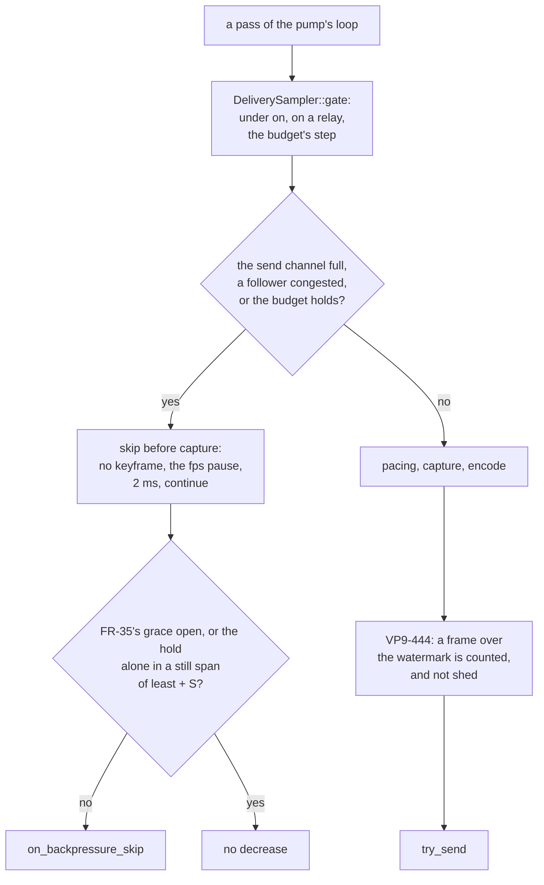

**The no-decrease rule.** A still span of `least + S` with bytes out is a stall of the
carrier, which B1's verdict holds through: TURN over TCP serializing behind a lost
segment, or an outage. A decrease there would answer the carrier's stall as congestion.
So a hold in such a span skips its pass and calls no decrease, and a hold before the span
is `least + S` old decreases once, as a skip outside the grace does today. The rule asks
the core whether its step stood in such a span (`Budget::stalled`), and spares only a pass
the hold shut by itself: a pass the send channel or a follower shut decreases as today,
whether the budget held or not. Inside FR-35's opener grace nothing decreases, as today.

**Since B4.** Under `on`, D51 B4a-1 takes every hold that shut the pass by itself out of
the decrease: one before the still span is heard as the budget's hold (`on_budget_hold`),
and one in it is neither ([B4](#b4-one-owner-per-plane-under-on-d51)).

**What stays.** The send-channel gates and `try_send`'s Full arms, the followers' gate,
the AIMD and its drain, the fps cap, the relay cap and FR-35's opener grace. The grace's
stuck timer runs on the budget's holds as it ran on the byte gate's skips, and its reset
still reads the ledger. The FFmpeg pump still computes its relay byte gate as before and
hands it to FR-70's plan check first, so `plan_divergences` reads as it does with the
budget off, in every mode. The byte gate's firings still count as `bound_ledger` and the
watermark's as `bound_watermark`; under `on` on a relay neither shuts or sheds anything.

**A direct session** under `on` computes the budget as shadow does, beside its own gates:
the byte gate shuts what it shuts, the watermark sheds what it sheds, each skip outside
the grace decreases, and the step stays after the gate.

**The mode, said once.** `on` no longer runs as `shadow`, and `for_pump`'s warning is
gone. At its first pass the pump says which mode acted on its session, at INFO:
`budget_acts="on"` on a relay ("the in-flight budget acts on this relay session …") or
`budget_acts="shadow"` on a direct one ("… runs as shadow on this direct session …"),
and again when a change of transport changes it. `shadow` says nothing.

**The fields.** `budget_acted` and `budget_acted_stalled` close the `path delivery` line
([§ The budget's fields](#the-budgets-fields)): the passes the hold shut by itself, of
those the budget acted on, and the stalled holds among them. They read `(0, 0)` and `0`
in shadow and on a direct session. `budget_held` still counts the core's verdicts at
every step: under `on`, `held − acted` is the holds a full channel or a follower had
already shut.

**Off and shadow act as before.** The six protected proofs keep their bodies, and pass:

| Proof | What it shows |
|---|---|
| `media_delivery::tests::the_inflight_budget_in_shadow_answers_every_pump_call_as_off_does` | shadow acts on nothing ([above](#where-it-runs)) |
| `media_delivery::tests::off_takes_no_sample_and_writes_no_line`, `off_takes_no_path_numbers_and_writes_no_model_line` | `off` reads nothing and writes no line |
| `media_pair_memory::tests::shadow_is_todays_opener_exactly`, `encode::pair_memory::tests::todays_file_is_written_byte_for_byte_as_master` | the path memory's shadow opener and today's file, unchanged |
| `media_delivery::shaped_link::tcp_shape::the_inflight_budget_in_shadow_holds_nothing_on_a_shaped_link` | today's writer off and in shadow holds and skips nothing on the deep 2 Mbit/s path I shape (in each of B3's five passes) |
| `media_delivery::tests::off_and_shadow_gate_as_today` | `off` and `shadow` driven with B3's calls do what samplers driven as the pumps were at B2 do |
| `media_delivery::tests::plan_divergences_read_today_s_byte_gate_under_on` | `plan_divergences` under `on` read as with the budget off |

Each of B3's tests ([below](#the-tests)) was run red first, with its arm taken out: the
hold that shuts nothing, the decrease in a still span, each admitting verdict held in
turn (nothing out, under the budget, SCTP's window, written through), the budget acting
on a direct session or in shadow, the byte gate and the watermark kept in under `on` or
taken out everywhere, the grace ignored, the mode said at every pass, the fields left
off the line, the acted holds left uncounted, the gate's stall mark dropped, the step
run after the gate as well, and in `peer.rs` the budget's term out of the VP9-444 gate
and FR-70's check fed the budget's answer.

**On the shaped link.** `the_inflight_budget_on_holds_frames_on_a_shaped_relay` runs
today's plain writer off and then under `on` through the pumps' own `Shadow` and its gate
(`Shadow::gate_with`, `Shadow::shut`: the `tcp_shape` writer `Core::On`), on the deep
2 Mbit/s path I shape and on the 80 % path I stall shape. Off holds nothing; under `on`
each hold is one the line counts as acted, and nothing is shed. B3's five passes:

| Shape | Writer | Fresh % | Read % | Link queue, ms | Transit, ms | Held, of frames | Acted: held alone, in a still span | Stall marks | Fresh over off's, each pass |
|---|---|---|---|---|---|---|---|---|---|
| deep queue, offer 150 % | off | 1–2 | 98–99 | 4138–4173 / 4156–4178 | 3551–3602 / 4723–4748 | 0 of 479–481 | | | |
| | **`on`** | 98–99 | 98–99 | 112–121 / 126–136 | 118 / 123–138 | 209–210 of 600–601 | 209–210, 0 | 0 | ≫: 55.6, 38.7, 38.8, 38.7, 38.8 |
| a 800 ms stall every 3.3 s, offer 80 % | off | 62–69 | 80 | 0 / 0–193 | 0–2 / 19–471 | 0 of 601 | | | |
| | **`on`** | 65–67 | 70–74 | 0 / 0 | 0–3 / 1–4 | 46–75 of 601 | 46–75, 18–32 | 62–89 | **0.963, 1.061, 1.072, 1.046, 1.046** |

Every hold under `on` is one the line counts as acted (`budget_acted`'s first number is
the core's holds: the harness writer has no send channel to fill and no follower), and
nothing was shed. On the deep shape `on` holds about a third of the frames, as the
budget writer of `the_budget_on_the_deep_2_mbps_path_i` does (210 a run), and keeps the
transit at 118 ms median and 138 ms at most, where off's stands at 3.6 s and grows to
4.7 s: off reads as much, almost none of it fresh. No still span stood there, so no hold
was a stalled one and the core marked nothing. On the stall shape 18 to 32 of a run's
holds came in a still span: in the pumps each is a skip that calls no decrease. The core
marked 62 to 89 steps a run (each step at which a still span of `least + S` stood, held
or written through, and each that read a release), and under `on` the pumps' gate hands
each mark to the governor. Off reads more there (80 % against 70–74 %): it holds
nothing, and what it writes in a stall arrives late. `on` delivered 0.963 to 1.072 times
off's fresh, over D46 item 11's 0.95 in each pass, which the cell asserts. The ratio
moves with off's run as much as with `on`'s: off read 69 % fresh in the first pass, at
19 ms of transit at most, and 62 % in the other four, at 451 to 471 ms. On both shapes
`on` reads what the budget writer of the same cells reads in the same passes (on the
stall shape 66–67 % fresh, 72–75 % read and 34 to 61 holds a run), through the pumps'
gate instead of the core's step.

**B3's five passes against B2's runs.** Windows, debug build: the 19 `tcp_shape` cells in
a row (`--test-threads=1`), five times, with no sleep or wake event in the system log
over any pass, and all 19 passed in each, the shadow cell and B3's among them. B3 changes
no verdict of the core's and no writer of the other cells, so their budget writers read
here what they read in B2's three runs, within the runs' spread:

| Reading | B3's passes 1 / 2 / 3 / 4 / 5 | B2's runs 1 / 2 / 3 |
|---|---|---|
| the budget's read over today's writer's: the 0.4 Mbit/s path C control | 1.000, 1.101, 0.997, 1.032, 1.010 | 1.010, 0.994, 1.038 |
| the 0.4 Mbit/s path I control | 0.969, 1.067, 1.010, 0.975, 1.012 | 1.003, 0.967, 1.051 |
| the 2 Mbit/s path C control | 1.008, 1.014, 1.000, 0.997, 1.014 | 1.003, 1.006, 1.014 |
| the 2 Mbit/s path I control | 0.986, 0.983, 0.994, 1.000, 0.994 | 1.006, 1.024, 1.011 |
| the budget's fresh over today's writer's: the 80 % stall shape, path I (D46 item 11's bar, 0.95) | 1.078, 1.050, 1.059, 1.063, 1.065 | 1.072, 1.066, 1.028 |
| the 80 % stall shape, path C | 2.514, 3.475, 2.505, 2.449, 2.453 | 2.431, 2.472, 2.319 |
| the 150 % stall shape, path I, over today's skip | 7.681, 8.131, 8.005, 7.732, 8.104 | 8.372, 8.321, 8.156 |

| Deep shape, offer 150 % | The budget: transit, ms, median / most | Fresh / read % | B2's runs: transit, ms | Fresh / read % | Today's writer: transit, ms |
|---|---|---|---|---|---|
| 2 Mbit/s, path I | 118–119 / 123–124 | 99 / 99 | 118–119 / 124–125 | 99 / 99 | 3551–3555 / 4743–4745 |
| 2 Mbit/s, path C | 118–119 / 152–166 | 95 / 95 | 118–119 / 155–159 | 95 / 95 | 753–758 / 871–883 |
| 0.4 Mbit/s, path I | 114–116 / 117–139 | 98 / 98 | 115 / 118–119 | 98 / 98 | 3559–3561 / 6752–6753 |
| 0.4 Mbit/s, path C | 115–116 / 116–119 | 97 / 97 | 114–116 / 118–123 | 97 / 97 | 3192–3194 / 3477–3479 |

Every control read met the cell's 0.95, and the stall bar held on both 80 % shapes in
every pass. The second pass reads differently from B2's runs, by today's writer: it read
298 and 299 kbit/s on the 0.4 Mbit/s controls (300 to 336 in every other pass and in
B2's runs), so the budget's ratios rose to 1.101 and 1.067, over B2's 0.967 to 1.051,
while the budget itself read 328 and 319 kbit/s, inside B2's runs' 314 to 329. On the
80 % path C stall shape today's writer delivered 336 kbit/s fresh in that pass (461 to
501 in the other passes and in B2's runs), and the ratio rose to 3.475. B1's budget
read 0.931 of today's writer on the 2 Mbit/s path I control in the second pass and 0.963
on the 2 Mbit/s path C control in the fifth (B2's runs: 0.985 to 1.014), the first under
the 0.95 the cell asks of the budget only. On the path I controls the budget's own reads
sit a little under B2's runs in most passes (303 to 328 kbit/s at 0.4 Mbit/s against 324
to 329; 1,711 to 1,760 at 2 Mbit/s against 1,745 to 1,771), and the ratios hold: on the
shallow queues, which drop, SCTP's window collapses and regrows from run to run
([above](#the-push-backs-in-the-shadow-model-d46-b2)). On the 150 % path I stall shape
the ratio sits under B2's in each pass (7.68 to 8.13 against 8.16 to 8.37): the budget's
fresh delivery spans B2's (1,520 to 1,585 kbit/s against 1,550 to 1,590), and today's
skip's reached 205 kbit/s in two passes, against B2's 189 to 190. The deep shapes' most
transit rose to 139 ms on the 0.4 Mbit/s path I shape and 166 ms on the 2 Mbit/s path C
shape, both in the fourth pass (B2's runs: 119 and 159), under the cells' 300 ms; their
medians and their delivery are B2's.

**What it leaves.**

- No session runs `on` in B3's runs: the cell drives the pumps' `Shadow` and gate under a
  harness writer, with no encoder, no capture and no keyframe. AC32's lab runs and O11's
  field read come before `on` is anyone's default (the kill-switch registry, below).
- FR-35's stuck timer reads the budget's holds as congestion inside the grace, as it read
  the byte gate's skips, and its reset reads the ledger, which the budget does not bound.
  No cell runs the grace.
- The ledger row `p2:BUDGET-1` still says `on` runs as `shadow`. Rows are never edited:
  `p2:BUDGET-4` says so.

### A path that drops: who bound the sample (D48)

FR-148 D48, in shadow, on B2's push-backs. A push-back is the path's reading only when the
path bound what it read. B2 already asks so in three cases: what the application bound is
no P3 (an application-limited sample, and no push-back at all where a still span of
`least + S` met the sample), what a stall the viewer saw bound is no reading (the window
after the budget's stall mark, and a sample that closed in the stall), and what the
opening bound is no P3. On a queue that drops at its tail three more things bind what the
shadow model reads, and B2 took each as the path's: SCTP's recovery from a loss, the
association's own ramp while its window regrows, and the viewer waiting behind a hole.
Over D48's three bar passes B2's bracket was on AC2's bar in 2 of the four shallow
controls' 24 budget-writer runs (8 of 24 in the three passes run for D48's design), in 6
of the 12 on a 200 ms round trip and in 8 of the 12 on the opener, its capacity set under
0.95 of the link by one of those readings in most of the misses. And on the 80 % cells B2
read an application-limited sample as held from holds in the grains at its edges, outside
its span, or from a hold or three inside it: the first ended two runs under the bar in the
passes run for D48's design, the second one in D48's bar passes. D48 asks of each reading
who bound it, and gives the shadow model and the pair memory only what the path or the
viewer bound:

| Who bound it | What says so | What the model and the memory take | Rule |
|---|---|---|---|
| the application | an application-limited sample (its holds in under a fifth of a second's whole grains), or a still span of `least + S` that met it | no P3 (and no P1 either, after a still span) | B2, and D48's share |
| the opening | the sample starts before the association's first measured rate | no P3 | B2 |
| a stall the viewer saw | the budget's stall mark | nothing of the next window, nor of a sample that closed in the stall | B2 |
| a loss | SCTP's fast retransmits or T3 expiries moved over the sample | P3 at the larger of its own rate and the budget's rate at its close | rule 1 (`rr`) |
| the association's ramp | no loss, and a hold SCTP's congestion window sized | no P3 | rule 4 |
| the viewer | a hold the receive window sized (`rwnd + inflight < cwnd`) | P3 at its own rate | stands |
| the path | held or backlogged, and none of the above | P3 at its own rate | B2 |
| a hole's release, near a loss | a window over the budget's rate | the window at no more than a measured rate, and nothing of it over a stand-in | rule 2 (`bm0`) |
| a hole the viewer waited on, near a loss | a window under 0.9 times the measured rate | its delivery, and no link push-back | rule 3 (`u90`) |

The rules read only what a computing budget has: its view of the sample (`Over`), its
rate and whether this association's figures gave it, and SCTP's loss count. So they ride
`ROOMLERD_INFLIGHT_BUDGET` = `shadow` or `on`, on a path model that stays `shadow`, with no
switch, read of the environment or config key of their own. With the budget `off` nothing
notes a rate, and every window and P1 reach the model and the memory byte for byte as
before (`with_no_loss_or_the_budget_off_the_model_reads_every_window_as_before`). `Pipe`'s
own law takes every window as it did, and nothing a session sends, gates or opens moves:
the memory reaches an open only once O7 lets `path_model = on` do that.

A closed sample, in the order the rules read it:

```mermaid
flowchart TD
    S["a sample closes: what the budget saw over it (Budget::over)"] --> Q{"queued?"}
    Q -- yes --> P1["P1 at its own rate"]
    Q -- no --> B{"B2's P3: counted, backlogged or held,<br/>no still span inside it, not the opening's"}
    B -- no --> N["no push-back"]
    B -- yes --> L{"a loss over it?"}
    L -- yes --> R1["rule 1: P3 at the larger of its own rate<br/>and the budget's rate at its close (reread)"]
    L -- no --> C{"a hold SCTP's congestion window sized,<br/>in a grain wholly inside it?"}
    C -- yes --> R4["rule 4: kept out (ramp)"]
    C -- no --> P3["P3 at its own rate"]
    P1 --> W["B2's settle wait: a stall mark inside it drops the push-back"]
    R1 --> W
    P3 --> W
    W --> M["the shadow model and the pair memory"]
```

A viewer window's close (`Pipe::observe_delivered_in`), and the link loop's push-back from
it (`Pipe::observe_link_capacity_in`):

```mermaid
flowchart TD
    W["a viewer window closes"] --> G{"B2's stall gate: one of the windows<br/>after the budget's stall mark?"}
    G -- yes --> X["no reading (stall)"]
    G -- no --> N{"near a loss? SCTP's count moved<br/>since the close two windows back"}
    N -- no --> A["as read"]
    N -- yes --> O{"over the budget's rate?"}
    O -- "yes, a measured rate" --> B["rule 2: its delivery and its link push-back<br/>at no more than the rate (bound)"]
    O -- "yes, a stand-in" --> Z["rule 2: no reading at all (bound)"]
    O -- no --> H{"under 0.9 times a measured rate?"}
    H -- yes --> U["rule 3: its delivery counts,<br/>no link push-back (hole)"]
    H -- no --> A
```

**Rule 1: a loss re-reads a P3 (`rr`).** A P3 sample over which SCTP's fast-retransmit or
T3-rtx count moved (`QueueReading::loss` not `(0, 0)`) reaches the model and the memory at
the larger of its own rate and the budget's rate at its close (`Over::rate`;
`media_delivery::sample_read_of`,
`agents/roomlerd/src/media_delivery.rs:442`). With a loss in it the
sample's two-second mean reads SCTP's recovery as well as the path: a T3 cuts the window to
one packet (`crates/vendored/webrtc-sctp/src/association/association_internal.rs:2620-2621`),
which then regrows in slow start, and a fast retransmit halves it (`:1547-1548`), each lost
chunk crossing the link twice and counted once. The budget's rate is the most of the same
clock's one-second figures, and the clock counts what a gap block says the peer holds
(`:1358-1359`), what reached the peer in any order. So the rate reads the second the
recovery cost least, and it follows the path down: every second holds once the path carries
less than the budget lets out. Keeping such samples out never followed a real fall (0 of 6
on the halving cell), and a discount has nothing to measure it by. A P3 with no loss in it,
and every P1, stay as B2 built them. A run that ends on a re-read under 0.95 of the link (a
T3 sample's rate read down to 0.89 of it) is reported with its trace, not tuned.

**Rule 4: the association's ramp is no P3.** A P3 sample with no loss in it and a hold
SCTP's congestion window sized, in a grain wholly inside its span, is no push-back
(`SampleRead::Ramp`). The congestion window sized a hold when, at the held step, the
budget's window term was under its rate (`window / least`, which `Budget::size` takes when
it is the smaller; any hold before the first rate counts) and the congestion window was the
smaller window (`cwnd <= rwnd + inflight`): `Budget::ramp_sized`
(`agents/roomlerd/src/media_inflight.rs:954`). The budget keeps those holds
in a second grain mask beside `holds` (`ramp_holds`, `:561`), set at the
step (`:741`), aged with `holds` and cleared by a new association, and
`Budget::over` reads it as `Over::ramp` (`:637`, read at
`:857`). It reads gauges the budget already takes: no new SCTP
plumbing. Why: nothing in such a sample says the path was full. After a loss SCTP's window
regrows from a half or from one packet, and while it does, the window, not the path, sizes
what the budget lets out. The open-time train says the same of path C: the floor it reads is
the association's own ramp, not the path's
([§ The open-time train](#the-open-time-train-fr-148-p0-reading-the-path-before-the-first-frame)).
On the 200 ms round trip such a sample ended a run of B2's off the bar: 0.452 of the link
over 16.4 to 18.4 s, its 40 holds all sized by SCTP's congestion window as it regrew from
20,058 to 31,582 bytes after the sample before's fast retransmits, the floor lowered from
1.003 to 0.727 and the capacity set at 0.452. A hold the **receive** window sized is the
viewer's, a real limit of the pair: it is no ramp, and the P3 stands. A loss goes first: a
sample with a loss and congestion-window holds is re-read by rule 1, not kept out. Keeping
those out too is what made the prototype's `lw` follow none of the halving cell's falls (0
of 6). The rule takes **any** such hold, not every hold: just after a loss the window sizes
the holds while the rate's two-second figure still stands, and a sample that straddles the
change is part ramp. Over the bar's passes rule 4 kept out 13 of the shallow controls' 25
no-loss P3s, in which the congestion window sized 0.05 to 0.42 of the held whole grains
(median 0.10), and 16 of the 200 ms round trip's 87, in which it sized 0.09 to all of them
(median 0.55; all of them in 3). It sized none in any no-loss P3 of the loaded cells (476
over the five passes), the deep halving cell (54) or the slow viewer (85), and moved no
run there; on the shallow halving cell it kept out two samples before the fall (2.1 to
4.1 s, at 0.95 of the old link) and moved no run's end. An `every` rule would have kept
none of the shallow controls' out.

**Near a loss.** A window is near a loss when SCTP's count moved since the close two
windows back: over the window, or over the window's length before it, since a hole's release
reaches the viewer a round trip or so after the retransmission the count counts (39 of 43
over-link windows had it in their own span; the look-back caught the rest). The governor
hears the budget's last step beside its stall mark (`DeliverySampler::note_path_rate`,
`agents/roomlerd/src/media_delivery.rs:1101`, after each
step in shadow and after the gate's under `on`; `RateGovernor::note_path_rate`,
`agents/roomlerd/src/encode/governor.rs:2393`): the rate, whether this
association's figures gave it, and SCTP's fast retransmits and T3 expiries, summed over the
budget's associations so that the count never runs back (`PathRate`,
`agents/roomlerd/src/encode/pipe.rs:202`; `Budget::loss`,
`agents/roomlerd/src/media_inflight.rs:913`). `Pipe` keeps what it read at
its last two window closes and rules each window at its close (`Pipe::close_window`,
`agents/roomlerd/src/encode/pipe.rs:621`).

**Rule 2: a window over the rate is bounded (`bm0`).** Near a loss the model and the memory
take a window's delivery, and the link loop's push-back from it, at no more than the
budget's rate at the window's close, when this association's figures gave that rate; over a
rate the opening stood in for they take nothing of the window, its goodput push-back
included (`WindowRule::Bound` and `Out`, `:254`; read in
`observe_delivered_in`, `:319`, `observe_capacity_in`,
`:404`, and `observe_link_capacity_in`,
`:422`, which the governor's link loop now calls,
`agents/roomlerd/src/encode/governor.rs:1855`).
Why: a hole's release reads 1.05 to 1.78 times the link at the viewer, and the damped fall
then needs four push-backs, six to eight seconds, to undo it, while the rate read 0.93 to
1.03 times the link at those closes. A stand-in is a guess, and a guess bounds nothing.

**Rule 3: a hole is no link push-back (`u90`).** Near a loss, a window whose delivery is
under 0.9 times the measured rate makes no link push-back for the model and the memory
(`WindowRule::Hole`, `HOLE_TENTHS`, `agents/roomlerd/src/encode/pipe.rs:284`); its
delivery still counts.
Under a stand-in rate the rule reads nothing. Why: behind a hole the viewer reads 0.50 to
0.61 of the link while SCTP's clock read 0.98 to 1.01; the push-back read the viewer's
order, not the path. 0.8 and 0.9 were identical on 120 runs, and 0.9 keeps smaller holes out
too.

B2's stall gate acts before the window rules: a window it keeps out is no reading whatever
they say.

**The line.** The `path model` line gains one field, `model_rule`, the rule that last kept a
reading out of the shadow model, re-read it or bounded it, and how long ago: `stall` (B2's
stall gate, which had no field of its own), `reread` (rule 1), `ramp` (rule 4), `bound` (rule
2) or `hole` (rule 3), as `<word>/<age>ms`, or `-` while none has (`Pipe::note_ruled`,
`agents/roomlerd/src/encode/pipe.rs:601`; the line's field,
`agents/roomlerd/src/media_delivery.rs:1561`). A sample's rule is
named at the heartbeat that hands it, and only where the push-back would have reached the
model: after a window the gate rejected B2 files none, so no rule acted on one
(`RateGovernor::on_sample_ruled`). A rule 4 sample still takes the sampler's slot as B2's P3
would have, so its name comes when that push-back would have. A busy line now ends
`model_floor_push_back=- model_capacity_push_back=p3 model_rule=hole/3400ms` (rule 3 last
kept a window's link push-back out, 3.4 s before the line) and an idle one
`model_rule=-`: 13 to 23 bytes more a line
([§ Path numbers and their provenance](#path-numbers-and-their-provenance-fr-148-p0--how-each-was-obtained-and-how-old-it-is)).

**B2's `held`.** `Budget::over` read a sample held when each one-second stretch of its span
had a hold in any grain, and its stretches ran from the grain holding the span's start to
the grain holding its end. Two things in that made an application-limited sample a P3 on
the 80 % cells. A hold in either edge grain (`GRAIN` is 50 ms), before the span started or
after it ended, counted for the span; that ended two runs off the bar in the passes run
for D48's design (above). D48 counts only the grains wholly inside the span
(`whole_grains`, `agents/roomlerd/src/media_inflight.rs:529`;
`a_hold_in_a_span_s_edge_grains_is_not_the_span_s`). And one hold in a stretch was
enough. With the edges fixed, 15 application-limited P3s over the five bar passes still
held 1 to 3 of their 38 or 39 whole grains (0.03 to 0.08 of them): 12 at a stall cell's
close, the next stall filling the budget, and 3 on the outage cells, the release draining
30 to 61 ms into the span or the next outage at its close. One of them, 0.878 of the link,
set the capacity of the 2 Mbit/s deep path I outage cell (the budget writer, fourth pass)
under the bar. A backlogged writer's P3 held 0.36 of each second's whole grains or more
(461 samples; 1 % of them under 0.42). So D48 takes the ruling's branch for real, sparse
holds: a second is held when the verdicts held a frame in at least a fifth of its whole
grains (`HELD_SHARE_PERCENT`, `:104`, in `held_each`, `:884`;
`a_second_is_held_when_a_fifth_of_its_whole_grains_are`). Over the five passes the share
changes those 15 P3s and no other push-back in any cell, and read from the harness's trace
it puts the loaded line at 0 of 140 off. In the two passes run on the product with it, no
application-limited sample on the 80 % cells was a P3 (a backlogged writer's least second
held 0.40 of its whole grains or more), and the loaded cells ended 0 of 56 off.
`Over::held` has one reader, `sample_read_of`
(`agents/roomlerd/src/media_delivery.rs:442`), which `push_back_of` wraps and the sampler
calls at a sample's close (`DeliverySampler::on_reading_with`, `:878`): no admission
decision reads it.

**The bar.** The `tcp_shape` harness folds every run through the product's rules
(`d48`: `sample_read_of` and `Pipe`'s window rules), beside B2 as built (`c`) and rules 1
to 3 alone (`rr+bm0+u90+l`, the first pick); the folds read the same runs. A bracket is on
AC2's bar when the model's floor ends at 0.80 to 1.05 times the link and its capacity at
0.95 or more, or none (D45); the halving cell reads against the new link. The budget
writers (the budget, and B1's budget beside it), over the passes the bar asks:

| Cells | Passes | Required | `d48` | `c` | `rr+bm0+u90+l` |
|---|---|---|---|---|---|
| the four shallow controls | 3 | at least 23 of 24 on | **24 of 24** | 2 of 24 | 23 of 24 |
| the loaded cells: deep, stalls, outages | 5 | 0 of 140 off, B2's `held` fixed | **0 of 140** with the share; 1 of 140 with the edges alone | 1 of 140 (the same run) | 1 of 140 (the same run) |
| the shallow halving cell | 3, and 3 of the cell alone | at least 4 of 6 on, every miss at the damped fall's pace | **1 of 6, and 2 of 12: not met**; every miss at the damped pace | 3 of 6, and 5 of 12 | 1 of 6, and 2 of 12 |
| the deep halving cell | 3 | (reported) | 2 of 6 | 2 of 6 | 2 of 6 |
| a 200 ms round trip | 3 | no run ends on a no-loss P3 with a congestion-window-sized hold | **none of 12**; 10 of 12 on | 6 of 12 on | 6 of 12 on |
| the opener | 3 | the floor at most 1.05 of the link at every run's end | **12 of 12** (0.978 to 1.014); 12 of 12 on | 10 of 12; 8 of 12 on | 12 of 12; 12 of 12 on |
| the slow viewer | 3 | identical to `c` on every run | **12 of 12 identical**; 5 of 12 on | 5 of 12 on | 5 of 12 on |

The bar's passes ran on D48 before the share (the loaded line's "with the share" is the
harness's trace read with it, which moves no other line). Two more passes ran on the
product as committed, the share in it: a full pass and a loaded pass. The loaded cells
ended 0 of 56 off, and in both passes the product's `held` read as the harness's trace
read with the share, on every one of 707 samples. The full pass read the other lines as
the bar's passes did: the shallow controls 7 of 8, the miss the 0.4 Mbit/s path I
control's capacity at 0.893 of the link, set by rule 1's re-read of a sample with a fast
retransmit and two T3 expiries in it (the class rule 1 reports, above); the shallow
halving cell 1 of 2 (the other at 1.087 after four push-backs from 1.99); the deep halving
cell 1 of 2; the 200 ms round trip 4 of 4, none ending on a no-loss P3 with a
congestion-window-sized hold; the opener 4 of 4 (its floor at 1.001 to 1.008); the slow
viewer identical to `c` on all 4.

**The shallow halving cell is off the bar: 1 of 6 over the three passes, and 2 of 12 with
three passes of the cell alone, against at least 4 of 6.** `d48` reads it as rules 1 to 3
alone do, run for run: rule 4 kept out two samples there, both before the fall. Every
miss is the damped fall's pace, push-back for push-back: after the link halves at 6 s each
P3 near the new link moves the floor half its gap (`ALPHA_DOWN` 0.5), so the count of
push-backs by the run's end decides the run. In 10 of the 12 runs the first came at
12.5 s: FR-79's gate rejects 4 to 9 of a run's 16 to 18 viewer windows, and B2 files no
sample's push-back after a window the gate rejected (`RateGovernor::on_sample_push_back`),
so the samples that close over 6.1 to 10.1 s give none. Four push-backs from a floor at
1.54 to 2.00 of the new link at the fall left it at 1.052 to 1.076 (one run, with three
from 1.41, at 1.063); the two runs whose push-backs began at 10.5 s had five and ended at
1.035 and 1.037, on. Every capacity ended on the bar (1.011 to 1.024), each set by a
re-read P3 near the new link. Rules 1 to 3 alone were on in 4 of 6 in the passes run for
D48's design, and in 8 of 22 over the eleven passes that ran the cell, those included. B2's
`c` was on in 5 of 12, its capacity under 0.95 in 3 of the others (0.882 to 0.903) and its
floor over 1.05 in 4 (1.055 to 1.060). No rule of D48's moves the pace, which is the damped
law's and the gate's: reported, not tuned. D50 answers the miss: a real fall is an event of
the shadow model, and the floor restarts at the present at the second push-back filed after
it. Over D50's six halving passes the shallow cell was on the bar in 12 of 12 runs, where the
law before D50 was on in 4 of the same 12
([§ The pace of a real fall](#the-pace-of-a-real-fall-d50)).

**The deep halving cell**, 2 of 6 under every rule set, falls at the same pace with
nothing for D48's rules to read: a deep queue drops nothing, and no hold there was sized by
SCTP's window. In its four misses four push-backs from 12.5 s took the floor from 1.98 of
the new link at the fall to 1.058 to 1.062. Its two runs on kept the opening's floor, 1.027
and 1.030 of the new link, all run: they had no fall to follow. D50 reads this fall too: on
its passes the deep cell was on in 12 of 12 runs, the law before D50 in 5 of the same 12.

The 200 ms round trip's two misses on path I and the slow viewer's seven are below.

**What the cells do not separate, and what is seen and not built.**

- **The opener** (4 times a 0.4 Mbit/s shallow link) does not separate `bm0` from bounding
  by a stand-in as well (`b0`): the harness's stand-in is the offer, four times the link,
  which no window reads over, and the rate is measured from the first full window on. `bm0`
  stands on its reason (the product's stand-in is a guess), pinned by
  `near_a_loss_a_window_over_a_stand_in_rate_is_no_reading`. Its floor ended at 0.978 to
  1.014 of the link and its capacity at 0.977 to 1.013 in all 12 budget-writer runs, the
  same under rules 1 to 3 alone; B2's floor ended as high as 1.082 and its capacity as low
  as 0.843, on the bar in 8 of the 12.
- **The slow viewer** (it reads at half the link through a 128 KiB receive buffer): every
  window behind its full buffer fails D24's transit check (about 1.1 s over), and the
  governor files no sample's push-back after a window the gate rejected
  (`RateGovernor::on_sample_push_back`,
  `agents/roomlerd/src/encode/governor.rs:2359`), so the bracket
  keeps the opening's reading. Path C ended on AC2's bar in 5 of its 6 runs (the sixth's
  floor at 0.793 of the viewer's rate, from a window inside the opening), path I in none
  (its floor 0.337 to 0.660 and no capacity, or nothing at all). Its P3s after the opening
  read 0.54 to 1.22 times the viewer's rate (median 0.97). Rule 1 re-read 13 of them at
  0.92 to 1.84 times it, 8 over 1.05: the budget's rate is the best of SCTP's one-second
  figures, which count what the peer's SCTP holds, not what the viewer took, and it ran 1.1
  to 1.3 times the viewer's rate through the run and 1.84 times it while the receive buffer
  filled. None reached the model. It is identical under every rule set, B2's included: not
  D48's. The open question it leaves: a viewer-limited pair's model learns nothing past its
  opening. Rule 4 leaves a hold the receive window sized alone, which the harness cannot show
  there (its windows never reach the model), so machine tests pin it
  (`a_hold_sctp_s_congestion_window_sized_is_the_ramp_s`,
  `the_sampler_keeps_out_a_p3_the_ramp_bound`).
- **The 200 ms round trip on path I.** Two of its six budget-writer runs ended with the
  capacity under the bar, both under the budget and with the same capacity under every
  rule set: 0.806 and 0.773 of the link, each set by a backlogged P3 with no loss over 16.4
  to 18.4 s, 28 of its 60 steps held and none by a window, the budget's rate 0.866 and
  0.836 of the link at its close; their floors (0.994 and 0.890) ended inside D45's edges.
  They end on no-loss P3s whose holds the
  budget's own rate sized while that rate followed SCTP's regrowing window: the ramp seen
  through the rate, not through the window. No rule here reads them; the open question is
  how to read the association's ramp at a long round trip through the rate. Not built.
- **`held_throughout`** (`agents/roomlerd/src/media_inflight.rs:1222`) has
  the edge construction `held_each` had (above), but it sits in the budget's rate law and
  moves frame holds under `on`: not in this step.

**D44, the six cells the unit lane runs.** The four `shallow_*_control` cells and the two
deep path I cells run in real time in the unit lane, about two minutes together. Each keeps
its CI gate: in each of three runs every assertion was structural or held at least twice its
bound. The least margin over the three:

- `deep_0_4_mbps_path_i_reads_under_half_backlogged`: no tail drop (a deep queue drops
  nothing); 19 of 20 seconds loaded; the acknowledgement delay over its least at 14.1 times
  its 250 ms bound at the median, where the half-the-loaded-seconds pin turns; the sampler's
  standing queue the same; 0 of 19 loaded seconds backlogged.
- `deep_2_mbps_path_i_with_the_pump_skip_reads_under_half_backlogged`: the same, at 3.8
  times.
- the four `shallow_*_control`: 12 to 61 tail drops (it must drop); the queue's highest
  second 4.1 to 5.6 times under its 500 ms bound; the acknowledgement delay's worst rise 4.5
  to 8.9 times under 250 ms; the sampler's standing queue 10.4 to 16.7 times under 250 ms.

The six cells this step adds (the opener, the slow viewer and the 200 ms round trip, on
path C and on path I) keep their D44 `#[ignore]`: they measure, they do not gate.

### The pace of a real fall (D50)

FR-148 D50 (O14), in shadow, on D48's model. D48's shallow halving cell missed its bar at
the damped law's pace ([above](#a-path-that-drops-who-bound-the-sample-d48)): a backlogged
push-back under the shadow model's floor lowers it by half the gap (`rate_memory::damp`,
`ALPHA_DOWN` 0.5), so after the link halves the floor needs five filed push-backs to come
within 1.05 of the new link, and FR-79's gate rejects a third of the cell's viewer windows,
after each of which B2 files no sample's push-back. D50 reads a real fall as an event of
the model: **the second backlogged push-back under the floor, with the in-flight budget's
measured rate under the floor too, restarts the floor at the present.** The model is still
read by the `path model` line alone (`RateGovernor::path_view`,
`agents/roomlerd/src/encode/governor.rs:2313`): nothing a session sends, gates or opens
moves, and the pair memory, `Pipe`'s own law, B2's filing rule, FR-79's gate and D48's rules
are as they were.

**The run.** The model keeps one instant, `run` (`PathModel`,
`agents/roomlerd/src/encode/pipe.rs:890`): the first backlogged push-back under the floor
since a reading last met or raised it, whatever the clock read then. Both push-back paths
feed it, a window's (`PathModel::pushed_back_clocked`,
`agents/roomlerd/src/encode/pipe.rs:1124`) and a delivery sample's, P1 or P3
(`PathModel::sample_pushed_back_clocked`, `agents/roomlerd/src/encode/pipe.rs:1024`), so a
link push-back and a sample make one run (`a_window_and_a_sample_make_one_run`).

**The event** (`PathModel::under_floor`, `agents/roomlerd/src/encode/pipe.rs:1059`). A
backlogged push-back under the floor leaves:

| When | The floor | The run |
|---|---|---|
| a run is open, its first push-back at most `CAPACITY_TTL` back (60 s, `agents/roomlerd/src/encode/pipe.rs:148`), and the clock reads under the floor | **a fall**: it restarts at the more of the push-back and the clock, `backlogged`, set by the push-back (`model_floor_push_back` `p1` or `p3`, or `-` for a window's) | closes, and the model keeps the fall for the line |
| a run is open, and the clock is absent, or at or over the floor | damped as built | keeps its first instant |
| no run is open, or the open one began more than 60 s back | damped as built | opens at this push-back |

So a fall takes two push-backs under the floor, and the clock is read at the second only. On
the first harness pass's 2 Mbit/s deep halving cell (path I, the budget writer) the old
path's last sample opened the run at 6.5 s, 1.965 of the new link under a floor of 1.998
(the budget's rate at its close 2.019, over the floor), and the next one filed, at 12.5 s,
1.003 with the budget's rate at 1.015, was the fall: the floor restarted at 1.015, the
clock. The law before D50 took the same samples to 1.982, 1.492, 1.245, 1.124 and, at the
run's end, 1.061, off the bar. A run that opened only with the clock under the floor would
have read the fall one filed push-back later.

**The level** is the more of the push-back and the clock. The floor is the most the path was
shown to carry: at the event the push-back is what the path carried while backlogged, and
the clock is its best acknowledged second of the last two, so a restart under either would
contradict a present reading. Both sit under the floor, so a fall only lowers it: a
push-back still never raises a floor nor makes one (D46 item 10). The run's first push-back
is not the level: in the deep halving it is the old path's, and a restart there would leave
the floor where it stood (`the_level_is_the_present_not_the_run`).

**What closes a run.** A reading that raises the floor (`PathModel::raise`,
`agents/roomlerd/src/encode/pipe.rs:1163`: a delivery, an application-limited push-back, the
seed), or a backlogged push-back at or over the floor, a window's or a sample's. Nothing
else does: a delivery under the floor leaves it open, and a reading that never reaches the
model neither extends nor closes it (a sample B2 does not file, a window FR-79's gate
rejects, the window after the budget's stall mark, and what D48's rules keep out).

```mermaid
flowchart TD
    P["a backlogged push-back reaches the model<br/>a window's, or a delivery sample's P1 or P3"] --> U{"under the floor?"}
    U -- no --> X["the run closes<br/>a window's over the floor raises it, as built"]
    U -- yes --> R{"a run open, its first push-back<br/>at most 60 s back?"}
    R -- no --> O["damped (rate_memory::damp)<br/>the run opens here"]
    R -- yes --> K{"the clock under the floor?"}
    K -- "no, or no clock" --> D["damped<br/>the run keeps its first instant"]
    K -- yes --> F["the fall: the floor restarts at the more of<br/>the push-back and the clock, backlogged<br/>the run closes and the line writes model_fell"]
    Y["a reading that raises the floor<br/>a delivery, an application-limited push-back, the seed"] --> Z["the run closes"]
```

**The clock** is the in-flight budget's rate as `Pipe` last noted it (`Pipe::note_path_rate`,
`agents/roomlerd/src/encode/pipe.rs:570`, D48), when this association's figures gave it and
it is over 0: `Pipe::clock` (`agents/roomlerd/src/encode/pipe.rs:580`). The rate the opening
stands in with is no clock (`an_opening_rate_is_no_clock`). `Pipe` passes it at each
push-back, a window's and a sample's (`Pipe::capacity_in`,
`agents/roomlerd/src/encode/pipe.rs:477-478`, and `Pipe::observe_sample_capacity`, `:528-529`),
and the model never keeps it: D48's twin cells compare the whole model, and still compare
like with like.

**The pair memory reads no fall** (D30 stands). It takes the same push-backs through the
calls that pass no clock (`agents/roomlerd/src/encode/pair_memory.rs:1047-1048`), so its
floor is the damped law byte for byte while the model's falls
(`the_pair_memory_keeps_the_damped_law`). The memory is what `path_model = on` opens from;
whether it reads a fall waits for the field read (below) and a ruling of its own.

**The line.** The `path model` line gains `model_fell`, after `model_rule` and in its
grammar: `<from_bps>-><to_bps>/<age>ms`, the floor before and after the last fall and how
long ago, or `-` while there has been none (`PathModel::fell`,
`agents/roomlerd/src/encode/pipe.rs:1082`; `PathView::model_fell`, `:1257`; `path_view`,
`agents/roomlerd/src/encode/governor.rs:2349`; the field,
`agents/roomlerd/src/media_delivery.rs:1564`). A busy line now ends
`model_rule=hole/3400ms model_fell=2131000->1162000/61300ms` and an idle one
`model_rule=- model_fell=-`, 36 and 13 bytes more
([§ Path numbers and their provenance](#path-numbers-and-their-provenance-fr-148-p0--how-each-was-obtained-and-how-old-it-is)).
A fall's depth is `to/from`. The event has no size gate: AC2's 1.05 is a bar, not a law,
and the line carries the depth instead.

**The kill switch** is the budget's. `ROOMLERD_INFLIGHT_BUDGET` = `off`, the default, notes
no rate, so there is no clock and no fall, and the model is the damped law byte for byte:
`with_the_budget_off_the_law_is_the_law_as_built` drives 100,000 mixed readings (valid and
rejected deliveries, goodput and link push-backs, P1 and P3 samples) through `Pipe` and
through a verbatim copy of the law before D50, and compares the floor with its class and its
push-back, and the capacity with its push-back, after each reading and at a later moment,
with no fall on the line. D50 adds no switch, constant or config key (D41).
`ROOMLERD_PATH_MODEL` = `off` removes the model and its line.

**The numbers.** The `tcp_shape` harness folds every run through D50's law as the product's
word (`d50`), beside the law before D50 (`d48`: the same `Pipe` passed no clock,
`Pipe::set_unclocked`, `agents/roomlerd/src/encode/pipe.rs:595`), B2 as built (`c`) and rules
1 to 3 alone (`rr+bm0+u90+l`), and prints each fall of the product's fold: its time, the
push-back, and the floor before and after (`print_drop`,
`agents/roomlerd/src/media_delivery.rs:7381`). Every fold reads the same run, so each
comparison with `d48` is paired: "fixed" is a run off the bar under `d48` and on it under
`d50`, "broke" the reverse, "moved" any change of the end floor or capacity. The bar and its
count are D48's ([above](#a-path-that-drops-who-bound-the-sample-d48)): the budget writers
(the budget, and B1's budget beside it) at slack 150 ms, on AC2's bar, the halving cells
against the new link. Six halving passes, four steady passes (the shallow controls, the 200
ms round trip, the opener, the slow viewer), one loaded pass, and two more passes of the
shallow controls alone:

| Cells | Passes | Required | `d50` | `d48` | `d50` against `d48`: fixed / broke / moved |
|---|---|---|---|---|---|
| the shallow halving cell | 6 | at least 4 of 6 on | **12 of 12** | 4 of 12 | 8 / 0 / 11 |
| the deep halving cell | 6 | (reported) | **12 of 12** | 5 of 12 | 7 / 0 / 12 |
| the loaded cells: deep, stalls, outages | 1 | 0 off | **0 of 28 off**; no fall read in the 44 runs of every writer | 0 of 28 off | 0 / 0 / 0 |
| the four shallow controls | 4, and 2 of the cells alone | at least 23 of 24 on | **28 of 32: not met**; 15 of 16 alone; 43 of 48 over the six | 28 of 32; 15 of 16; 43 of 48 | 0 / 0 / 3; 0 / 0 / 1 |
| a 200 ms round trip | 4 | no run ends on a no-loss P3 with a congestion-window-sized hold | **none of 16**; 14 of 16 on | none of 16; 14 of 16 on | 0 / 0 / 0 |
| the opener | 4 | the floor at most 1.05 of the link at every run's end | **16 of 16** (0.988 to 1.009); 16 of 16 on | 16 of 16 (0.993 to 1.009); 16 of 16 on | 0 / 0 / 2 |
| the slow viewer | 4 | identical to `c` on every run | **16 of 16 identical**; 8 of 16 on | 16 of 16 identical; 8 of 16 on | 0 / 0 / 0 |

**The shallow controls are off the bar under both laws: 28 of 32 over the four passes,
against at least 23 of 24.** `d50` and `d48` read the same on every run, and the four misses
are two runs, each off for both budget writers under every fold, B2 as built and rules 1 to
3 alone included. In the first pass the 0.4 Mbit/s path C control's floor ended at 0.373 and
0.734 of the link: FR-79's gate held 13 of its 15 and 12 of its 14 viewer windows invalid,
and the floor kept each writer's first window. In the fourth the 0.4 Mbit/s path I control's
capacity ended at 0.946 of the link, rule 1's re-read of a sample with a loss in it (B2 as
built: 0.923 and 0.918), the class D48's fourth pass read at 0.893. D50 moves neither: the
capacity is not the fall's, and the first run read no fall. The two passes of the controls
alone read 15 of 16 under both laws, the miss the same path C control's B1 writer, its floor
at 0.521 with 10 of its 13 viewer windows invalid: 43 of 48 over the six passes, run for run
as `d48` reads them. Two of the four steady passes also failed the harness's writer check on
a path I control (the budget's delivery at 0.937 and 0.933 of today's writer's, against
0.95), which measures what the writers sent: no code of D50's runs in the writers, and each
run's brackets were printed before the assert and are counted. On the 200 ms round trip
D48's bar was read on the sample that set each run's end capacity and its B2 line's count of
holds SCTP's window sized; the two runs off AC2's bar are the fourth pass's path I runs,
their capacity at 0.815 and 0.798 under every fold, each set by a no-loss P3 with no such
hold.

**On a quiet host** (2026-11-22, on master `61897906f`; FR-148 O16). Four passes of the four
controls alone, each started only when two checks 30 s apart found no build on the box, and
with none found while it ran, read **32 of 32** on the bar under `d50` and under `d48` (B2 as
built 7 of 32, rules 1 to 3 alone 27 of 32): the misses above did not recur. At 0.4 Mbit/s on
path C, FR-79's gate held 1 to 11 of the budget writers' 15 to 17 viewer windows invalid, and
the floor ended in AC2's bracket on every run. The writer check's misses did recur: it missed
on 2 of the 16 budget runs it asserts (0.941 on the 0.4 Mbit/s path C control, 0.942 on the
2 Mbit/s path I control), while those runs delivered 108.7 and 45.9 times today's writer's
fresh rate, and over all 32 budget-writer runs the read delivery spread from 0.941 to 1.118
of today's writer's.

**The pace.** When the floor came into AC2's bracket after the halving at 6 s, and stayed:

| Law | Shallow: on for good | From (median) | Deep: on for good | From (median) |
|---|---|---|---|---|
| `d50` | 12 of 12 | 12.5 to 18.5 s (14.5 s) | 12 of 12 | 10.5 to 12.6 s (12.5 s) |
| `d48` | 4 of 12 | 18.5 s | 5 of 12 | 18.5 s |

One shallow run, the budget writer's in the first pass, was in the bracket from the
halving's first windows under both laws, and is left out of the times. D50's fall is the
second backlogged push-back the model takes under the floor after the halving. On the deep
queue the old path's last sample opened the run in all 12 runs, so the fall was the first
sample filed after it: at 10.5 s in the five runs where the gate let the 10.5 s sample
through, the same five that `d48` ends on, with its fifth damped step at 18.5 s, and at 12.5 s
in the seven where it did not. On the shallow queue the first push-back under the floor after
the halving opened the run and the next one filed fell: at 12.5 s in three runs, 14.5 s in
six, and 16.5 s and 18.5 s in one each, where the gate kept the samples between them out. The
pace does not depend on the fall's depth: the restart lands at the present whatever the gap,
where the damped law needs five filed push-backs for a halving and more for a deeper fall.

**Falls where the link never fell.** The event has no size gate. On a steady link the floor
(the best valid window) and the clock (the best second of the last two) are both maxima, and
when the best recent second sits a hair under the best window, two push-backs under the floor
read as a fall of a few hundredths. Every fall of the product's fold on these passes
(restart/floor: the floor after a fall over the floor before it):

| Family | Runs | Falls (runs with one) | Restart/floor: least, median, most | Back over the restart by a valid delivery within 10 s |
|---|---|---|---|---|
| the shallow controls | 48 | 12 (12) | 0.945, 0.994, 1.000 | 5 of 12 |
| a 200 ms round trip | 16 | 1 (1) | 0.969 | 1 of 1 |
| the opener | 16 | 5 (5) | 0.961, 0.991, 0.999 | 3 of 5 |
| the slow viewer | 16 | 0 | | |
| the loaded cells | 28 | 0, and none in the 44 runs of every writer | | |
| **the shallow halving** (the link fell) | 12 | 14 (11) | 0.678, 0.742, 1.000 | 4 of 14 |
| **the deep halving** (the link fell) | 12 | 12 (12) | 0.510, 0.512, 0.517 | 0 of 12 |

Where the link never fell, every restart was 0.945 or more of the floor it replaced, 9 of the
18 were taken back over the restart by a valid delivery within 10 s, and none moved a run
across the bar (the first table). The deepest, 0.945 and 0.946 on the fourth pass's 0.4
Mbit/s path I control, restarted at a P3 that rule 1 re-read at 0.946 of the link, with the
clock at or under it: the same sample set the run's capacity under `d48` too, and the run was
off on that capacity under both. Where the link fell, each run's first fall restarted the
floor at 0.68 to 0.80 of the floor it replaced (deep: 0.51); the three at 0.993 to 1.000 are
second falls at the new link's own level, which moved nothing. The four taken back were taken
back by the new link's own deliveries, 0.001 to 0.005 of the link over the restart.

**What D50 leaves.**

- `Pipe`'s own law still damps (`Pipe::capacity_in`,
  `agents/roomlerd/src/encode/pipe.rs:458`): D50 is the shadow model's, which the line
  alone reads.
- The pair memory reads no fall until the field read and a ruling of its own.
- The field read: on the devices that run `inflight_budget = shadow`, the falls per session
  hour by depth (`to/from`), and for each one deeper than 0.9 whether a valid delivery took
  the floor back over 1.25 times the restart within 10 s. That is a false fall's signature:
  the path had not fallen, and the floor came back on the next delivery. A real fall shows
  the restart standing and the session's later deliveries at or under it.
- The line holds the last fall only. Two falls inside one line's period show as the second;
  a reader tells falls apart by their `from` and `to` and the line's time less the age.
- The path report's timeline (`scripts/rc-path-timeline.cjs`, which
  `scripts/rc-path-report.sh --timeline` runs) carries `model_fell` since #4231: a `model`
  row where the fall changes or a fall starts anew (`docs/production-mongo-reads.md` §8a).

### B4: one owner per plane under `on` (D51)

FR-148 D51, step B4. Under `ROOMLERD_INFLIGHT_BUDGET=on`, on a relay session, B3 made the
budget hold the queue at `least + S`, and left four coarse loops acting on the same queue
beside it: the AIMD's full-channel sample on every hold, the FR-15 age loop, FR-70's prior
reading that age as push-back, and FR-59's relief standing on that prior. B4 gives each
plane one owner. `off` and `shadow` are unchanged, and so is a direct session under `on`.

| Plane | Owner under `on` before B4 | Owner under `on` with B4 |
|---|---|---|
| the transit queue, up to the viewer's SACK | the budget, and every hold a `decrease(full)` (×0.85, the increase blocked 5 s) | the budget alone: a hold is no AIMD event (B4a-1) |
| the delivery rate (the encoder's target) | the AIMD between a floor of 0.85 × a prior and the relay cap | the AIMD under the budget's measured rate while it held in the last second (B4b) |
| what the governor has measured | the opening's blocked-send goodput, then nothing | the budget's measured rate while it held (B4b-2) |
| the age the viewer reads | the FR-15 age loop at `floor + 70 ms`, and the prior's push-back at the same level | the budget within its envelope; the age loop and the prior past it (B4a-2) |
| the viewer's lag (decode, paint) | the fps cap, from the decode-backlog bit | unchanged |

```mermaid
flowchart LR
  B["in-flight budget<br/>(on, relay)"] -->|holds the queue at least + S| Q["transit queue"]
  B -->|its measured rate while it held| C["the target's ceiling<br/>CeilingSource::Budget"]
  B -->|the same rate| R["measured_bps:<br/>the prior's anchor, FR-59's relief"]
  B -->|S + the largest frame ÷ its rate| E["the envelope"]
  E -->|age within it is the budget's queue| A["FR-15 age loop:<br/>acts only past it"]
  E --> P["FR-70 prior:<br/>push-back only past it"]
  D["the viewer's decode backlog"] --> F["the fps cap"]
  H["a hold"] -->|capacity facts only| O["the opener's ramp,<br/>FR-63's shadow"]
```

**The closed loop (B4c).** `media_delivery::shaped_link::tcp_shape::closed_loop`
(`agents/roomlerd/src/media_delivery.rs:9550`) runs the VP9-444 pump's own loop on a relay
session: the pump's gate and its 2 ms retry, a 30 fps capture, the real governor (its
AIMD, fps cap, age loop, link loop and drain), and an encoder that spends its target over
the gap between the pts it is handed (`encode::charge`), as libvpx's one-pass CBR does,
against a viewer that reports as the browser does. The path is B3T's: 2 Mbit/s on the wire, of which SCTP's
payload gets E_sat = 0.8137, behind a 512 KiB first hop as the relay's socket holds on
TURN over TCP (`HOP`), with the relay's stalls on the agent's direction (`RELAY_STALLS`,
`:9600`), deltas of at most 40 kB (`DELTA_MOST`, `:9586`) and an 800 kB opening key
(`OPENING_KEY`, `:9593`). `run_loop` (`:10398`) runs one arm, `read` (`:10509`) and `gate`
(`:10814`) read it, and `print_gate` (`:11073`) prints the trail the lab reads by
heartbeat. The cell (`:11139`) runs `off` for 90 s, then `on` for 240 s. `off` must fill
at least 0.95 of the payload over a standing queue of more than 500 ms. For B4, `on`,
from the prior's crossing of the band or else over its last 60 s, had to fill at least
0.92 of the payload and 0.95 of `off`, with the fps divisor at 2 or more in at most a
tenth of the windows and a transit p95 under 300 ms. Since B4f the cell asserts B4f's bar
([below](#b4f-a-hold-is-never-charged-to-the-encoder-d51)), and since B4g a second cell
runs `on` with a 20 fps capture against a bar of its own
([below](#b4g-a-frame-is-charged-its-gap-less-the-time-the-gate-held-it-d51)).

**The fixed point B3 left.** The lab pair read it on every heartbeat of the ten `on` runs
of B3T, B3U and B3A (0.4.230, 2 Mbit/s, motion), and the `tcp_shape` closed loop
reproduces it on master (`budget_on_with_the_pump_loop`, three passes):

| Step | The lab pair (B3T on TURN over TCP) | The closed loop on master, passes 1 / 2 / 3 |
|---|---|---|
| (a) the opening's blocked-send goodput, over the 2 Mbit/s carrier | 3.3-3.7 M (UDP 2.2 M), anchoring the prior above the band | 3711 / 3710 / 3713 k at 3.9 s, anchored each time |
| (b) a live reading after it | none: the budget keeps sends from blocking (`pipe_measured` Some in 0 of 116-127 windows) | none in any pass; the reading lapses at 64.2 / 64.3 / 64.6 s |
| (c) the walk down, ×10/11 per two age-elevated windows | 9-11 steps, the prior crossing the band at 1311-1406 k | 10 steps each, crossing at 103.0 / 123.9 / 125.6 s at 1430 / 1430 / 1431 k |
| (d) `decrease(full)` on the holds, to 0.85 × that prior | 14-20 a run; target p50 / floor p50 1.06-1.13 | 17 / 15 / 14 after the crossing, 8 / 6 / 8 of them onto the relieved floor; target p50 / floor p50 1.049 / 1.103 / 1.125 |
| the under-fill | 0.794-0.848 of C_sat, 0.827-0.882 of the `off` mean | 0.854 / 0.831 / 0.834 of the payload from the crossing; `off` 0.998 in each pass |

The target sat exactly on the relieved floor in 33-38 % of the settled windows and within
an eighth of it in 64-70 %: the lab's "at that floor in most windows" holds within one
additive step, not to the bit. The closed loop's heartbeats 2-5 carried 0.2-0.9 MB against
the lab's 0.84-1.16 MB on TCP; that gap is the harness's, and it does not change the loop.

**What B4 moved.**

| Step | What changed | Where |
|---|---|---|
| B4a-1 | A hold that shut the pass by itself is no AIMD event. The pass hears it (`Pass::hears_hold`), and the governor keeps the hold's capacity facts (the opener's `slow_start_congested`, FR-63's shadow sample) without the full-channel sample. A pass the send channel or a follower shut still decreases. A hold in a still span is neither (D46). | `agents/roomlerd/src/media_inflight.rs:1558` (`Pass::decreases`), `:1567` (`Pass::hears_hold`); `agents/roomlerd/src/media_delivery.rs:1246` (`DeliverySampler::on_skip`); `agents/roomlerd/src/encode/governor.rs:69` (`GateSkip`), `:1056` (`on_gate_skip`), `:1073` (`on_budget_hold`); `agents/roomlerd/src/peer.rs:4550` (the VP9-444 pump), `:8196` (the FFmpeg pump) |
| B4b | While the budget held a frame in the last second outside a still span (`Budget::held_lately`), its measured rate bounds the target's ceiling, at gain 1.0, in a stage after FR-59 P3's arrival bound. The moves name it `ceiling(budget)`. | `agents/roomlerd/src/media_inflight.rs:811` (`Budget::held_lately`), `:602` (`open_hold`); `agents/roomlerd/src/encode/pipe.rs:215` (`PathRate::acts`), `:220` (`PathRate::held`); `agents/roomlerd/src/media_delivery.rs:1101` (`DeliverySampler::note_path_rate`); `agents/roomlerd/src/encode/governor.rs:2408` (`budget_held_bps`), `:1208` (the stage in `pre_encode_tick`); `agents/roomlerd/src/encode/aimd.rs:152` (`CeilingSource::Budget`) |
| B4b-2 | The same rate is what the sender measured: `measured_bps` reads it where the blocked-send goodput stood (`sent_bps`). It re-anchors the prior (FR-70), and FR-59's relief and its learner stand on it. While the budget acts and has not held lately, the sender has no reading, and the opening's goodput is never read. | `agents/roomlerd/src/encode/governor.rs:2445` (`sent_bps`), `:2455` (`sent_tagged`), `:883` (`measured_bps`), `:1970` (the prior's reading in `tick_viewer_window`), `:2401` (`budget_acts`) |
| B4a-2 | The envelope: S + the window's largest frame ÷ the budget's rate, the frame term at most 100 ms, carried on `PathRate::envelope_ms`. Both of the age loop's thresholds and the prior's `age_elevated` move up by it. | `agents/roomlerd/src/media_delivery.rs:359` (`envelope_ms`), `:353` (`ENVELOPE_FRAME_MAX_MS`), `:372` (`Largest`), `:1283` (`on_handed`, which notes each frame); `agents/roomlerd/src/encode/pipe.rs:224` (`PathRate::envelope_ms`); `agents/roomlerd/src/encode/viewer_rate.rs:779` (`AgeLoop::observe_within`); `agents/roomlerd/src/encode/governor.rs:1770` (the envelope in `tick_viewer_window`), `:2418` (`budget_envelope_ms`) |

What stays:

- `off`, `shadow` and a direct session under `on`, byte for byte. The budget never acts
  there, so `PathRate::acts` is false and every reader above answers as before. The pin is
  `b4_reads_nothing_while_the_budget_does_not_act`: two governors, one fed the budget's
  random fields with `acts` false and one fed defaults, through 100,000 random events.
- The decode-backlog bit (`struggling`) keeps driving the fps cap.
- FR-59 P3's link loop and the drain read as before.
- The kill switch is `inflight_budget` (`ROOMLERD_INFLIGHT_BUDGET`: `off`, the default;
  `shadow`; `on`). There is no new switch, and B3 without B4 under `on` is not a state kept.

**The cells**, each red on master before B4 and green with it, except the guards:

| Cell | Test | On master | With B4 |
|---|---|---|---|
| C1 | `media_inflight::tests::an_acting_hold_is_no_aimd_event` | red: the hold decreased (`no decrease, at 2000 ms`) | green |
| C1's guard | `media_inflight::tests::a_channel_skip_under_on_still_decreases` | green | green |
| C2 | `media_delivery::tests::budget_holds_leave_the_target_and_the_learned_ceiling_alone` | red: 5 holds moved the target from 3 M to 1.5 M | green |
| C3 | `encode::governor::tests::the_age_loop_leaves_the_budgets_queue_to_the_budget` | red: `age_over` at an age of 190 ms over a 40 ms floor, divisor 2 | green |
| C4 | `encode::governor::tests::the_age_loop_still_catches_a_lag_past_the_envelope` | green (the guard) | green |
| C5 | `encode::governor::tests::under_the_budget_the_target_follows_its_measured_rate` | red: the target passed the budget's 1.5 M (2,164,306) | green |
| C7 | `encode::governor::tests::under_the_budget_its_held_rate_is_the_live_reading` | red: the prior kept 3.5 M, two steps down | green |
| C8 | `encode::governor::tests::the_budgets_queue_does_not_walk_the_prior_down` | red: three steps down within the envelope | green |
| the pin | `encode::governor::tests::b4_reads_nothing_while_the_budget_does_not_act` | green | green |
| C6 | `media_delivery::shaped_link::tcp_shape::closed_loop::budget_on_with_the_pump_loop` (ignored, real time) | red at the under-fill, 3 of 3 | red at the transit p95 (382-394 ms), 3 of 3; the fill passes |

**The closed loop after B4**, the same cell, `on`'s whole run unless a row says otherwise:

| Read | Master, passes 1 / 2 / 3 | With B4, passes 1 / 2 / 3 |
|---|---|---|
| fill of the payload | 0.902 / 0.902 / 0.901 | 0.992 / 0.990 / 0.994 |
| settled fill (from the prior's crossing, else the last 60 s) | 0.854 / 0.831 / 0.834 | 0.996 / 0.991 / 0.995 |
| windows with the fps divisor at 2 or more | 73 / 66 / 85 of 228-230 | 0 of 211-214, each pass |
| `decrease(full)` / `decrease(age)` | 24 / 26 / 20 and 3 / 2 / 3 | none |
| the prior's steps down | 10 a pass, crossing the band | none |
| captured / encoded fps | 28.9 / 27.6 / 27.4 and 23.1 / 22.6 / 20.8 | 7.9 / 7.3 / 6.8, every captured frame encoded |
| transit p50 / p95, ms | 50 / 213, 60 / 234, 65 / 253 | 299 / 382, 315 / 384, 323 / 394 |
| the viewer's rtt p50 / p95, ms | 56 / 195, 64 / 218, 67 / 226 | 242 / 348, 244 / 349, 247 / 351 |
| acting holds | 7,431 / 12,970 / 12,667 | 66,112 / 67,321 / 67,930, 97 % of the passes |
| `off` in the same pass | 0.998 of the payload, a standing queue 71-85 of 85 s | 0.998, a standing queue 62-82 of 85 s |

**What the closed loop says.** Each plane has the owner B4 gave it: no hold decreases,
the divisor never rises, the prior never walks, and the fill is `off`'s. But the loop
settles at a point the design did not predict. D51 expected the pump hold-paced at the
link's frame rate, at the encoder's coarsest frame, about 22 fps. Instead the target sits
at the budget's rate (gain 1.0, 83-85 `ceiling(budget)` moves a run, target p50 1643
kbit/s on a 1627 kbit/s payload), and the budget holds 97 % of the pump's passes. The
encoder grants each frame the target times the time since its last frame, as libvpx's
one-pass CBR does by timestamp, so a frame taken after a hold of T carries the rate times
T and drains in about T. Every frame period is then a fixed point, and nothing brings the
pump back to 30 fps: the opening's 800 kB keyframe starts the period long, and it stays
near 7 fps, with frames of about 27 kB. The transit p95 is `least + S` plus one such
frame, 382-394 ms, over the cell's 300 ms, and the cell is red there in each pass.

A diagnostic pass with the bound at 0.95 of the rate, built for this reading and not
shipped, eases the slideshow without ending it: 12.8 fps, transit p95 351 ms, rtt p95
314 ms, the fill 0.993. The relay's stalls, one every 3 s or so, lengthen the period
faster than a margin of a few percent shortens it. What ends it is for D51 to rule: a
margin wide enough to beat the stalls costs fill; a bound on what the encoder grants one
frame under `on` keeps a hold from becoming a bigger frame; a hold that keeps the
capture's cadence drops a frame instead of delaying it.

#### B4f: a hold is never charged to the encoder (D51)

D51 ruled the second. libvpx's one-pass CBR reads its frame rate off the gaps between the
pts it is handed, and grants each encode its target over that gap. The VP9-444 pump gates
before it captures and hands libvpx the capture's own time, so a frame that waited H ms
for the budget was granted the target over the capture interval and H, and with B4b's
gain at 1.0 nothing brought the frame period back to the capture's. Under `on`, wherever
the budget acts, the pump now charges an encode at most the interval it chose for that
frame, so after a hold the encoder sends less than its target until the queue drains, and
the hold is the restoring force.

| | The rule |
|---|---|
| where | `on`, a relay session: wherever the budget acts (`PathRate::acts`) |
| the interval | `1/target_fps`, or FR-112's paced rate while `paced_software_fps()` is in force, times the skip divisor (`RateGovernor::charge_most`) |
| charged | the gap today's pts gives (the capture's time, or #3472's time since the last encode for a frame fed again), at most the interval; a budget hold, a channel-full skip, a drain pause or an idle stretch past it is not charged |
| elsewhere | `off`, `shadow` and a direct session: no bound, and the pts handed is today's, byte for byte |
| what stays | the gain (1.0), the encoder's `duration`, and the wire's frame stamp (`agent_epoch_us()` at framing, `agents/roomlerd/src/peer.rs:5275`), which the viewer paints by |

The encoder keeps today's pts beside the one it was handed (`encode::charge::Stamp`), and
only the gap is bounded. With no bound the pts handed is today's exactly; after a bounded
stretch the pts handed stays behind today's for the rest of the encoder's life, so nothing
a hold skipped is granted later. libvpx 1.12, the Windows release's, measured by
`a_hold_charged_the_interval_is_not_granted` (640×360 4:4:4 at 3 Mbit/s and 30 fps, a
window of noise on every capture, a 500 ms hold): with today's pts the three seconds after
the hold carried 826, 500 and 411 kB against 389 kB for a second on time. The grant is
spent over the frames that follow, not in the first (20.2 kB, then 21.8, 23.7, 25.2 kB),
because libvpx lowers its quantizer a few steps a frame. Charged the interval, the same
seconds carried 378, 379 and 378 kB, and the first frame 12.7 kB.

**A reading is its pair's (C11).** B4b's cap and B4b-2's reading take the budget's rate
while it held lately (`Budget::held_lately`). After a change of selected pair the budget
kept the old pair's figures and its last hold, so the old pair's rate went on reading as
the new one's. A change of pair or association now forgets the hold and marks when it was
(`Budget::forget_reading`), and `held_lately` answers only for a rate that figures measured
since then gave (`Budget::own`). The standing rate still sizes the budget, as the opening
rate does. With no change of either, `own` is `rate_measured` and nothing else moves.

**The FFmpeg pump is left as it is.** Its encoders are hardware only
(`agents/roomlerd/src/encode/ffmpeg/encoder.rs:115-123` HEVC, `:135` VP9, `:161-169` AV1,
`:184-192` H.264). Each is opened with the session's frame rate (`:1900`) and a µs time
base (`:1899`), and the pts is the capture's time (`:97`, `:2359-2362`). QSV's rate
control is measured: its CBR frames were each exactly target ÷ fps ÷ 8 bytes
(`docs/plans/rate-control-architecture.md:36-37`), so it budgets by the configured rate,
never by the pts gap, and a hold there is not granted. NVENC and AMF are measured too
(FR-148 O18, [encoders.md](encoders.md#after-a-hold-what-each-ffmpeg-encoder-spends-fr-148-o18)):
a 500 ms jump in the pts moves no byte of any frame of `h264_nvenc`, `hevc_nvenc` (4:2:0
and 4:4:4), `av1_nvenc`, `h264_amf` or `hevc_amf`, so none grants a hold and B4f has
nothing to bound there either. VAAPI's driver is handed no pts, and VideoToolbox
rescales it to its own clock (`encoder.rs:90-93`), but neither is measured, nor are
`av1_amf`, QSV at QVBR (`qsv_rate_mode`), D3D12 and Vulkan: they are the edge, and `on`
reaches no device whose cascade picks one.

**B4f's cells**, each red before B4f and green with it, except the guards:

| Cell | Test | Before B4f | With B4f |
|---|---|---|---|
| C9 | `encode::charge::tests::under_on_an_encode_after_a_hold_is_charged_at_most_the_interval` | red: a gap of 43,333 µs charged whole against an interval of 33,333 | green |
| C9 | `encode::governor::tests::under_on_the_charge_is_the_pumps_interval_times_the_divisor` | red: no bound while the budget acts (`None` against 33.333 ms) | green |
| C10 | `encode::charge::tests::under_on_a_refed_frame_is_charged_at_most_the_interval` | red: a frame fed again 60 ms on charged 60,000 µs | green |
| C11 | `media_inflight::tests::after_a_new_pair_or_association_nothing_reads_until_a_hold_there_reads_again` | red: at the new pair the old pair's 2 Mbit/s still read | green |
| the guards | `encode::charge::tests::with_no_bound_the_charged_pts_is_todays`, `a_frame_fed_again_takes_the_time_since_the_last_encode`; `encode::governor::tests::b4_reads_nothing_while_the_budget_does_not_act` | green | green |
| every cause | `encode::governor::tests::a_why_and_the_tally_read_as_written`; `node scripts/rc-path-timeline.cjs --self-test` | the tally green (the code already wrote the word); the timeline red, 296 of 297, without `ceiling(budget)` among its words | green; 297 of 297 |
| libvpx | `encode::libvpx::tests::a_hold_charged_the_interval_is_not_granted` (`--features vp9-444`) | its arm with today's pts: the second after the hold carries 2.12 × a second on time | green on libvpx 1.12: 0.98 × |
| C6 | `media_delivery::shaped_link::tcp_shape::closed_loop::budget_on_with_the_pump_loop` (ignored, real time) | red at the transit p95 (382-394 ms), 3 of 3 | green against B4f's bar, 3 of 3 |

**The closed loop with B4f.** C6 now judges `on` over its settled stretch, from 60 s
(`settled_from`: past the opening and its reading's confidence), against B4f's bar: a
fill of at least 0.90 of the payload, at least 24 frames sent in the median second, a
transit p95 and a round-trip p95 each under 300 ms, and no hold read as `decrease(full)`.
`off` keeps its bar, and the gate line prints each figure. `on`'s whole run unless a row
says otherwise:

| Read | With B4, passes 1 / 2 / 3 | With B4f, passes 1 / 2 / 3 |
|---|---|---|
| fill of the payload | 0.992 / 0.990 / 0.994 | 0.978 / 0.976 / 0.981 |
| fill over B4's settled stretch (the last 60 s) | 0.996 / 0.991 / 0.995 | 0.972 / 0.989 / 0.986 |
| fill over B4f's settled stretch (from 60 s) | not read | 0.979 / 0.975 / 0.979 |
| captured / encoded / sent fps | 7.9 / 7.3 / 6.8, every captured frame encoded | 27.1 / 27.1 / 27.2, every captured frame encoded and sent |
| frames sent in each whole second, p50 / p10, from 60 s | not read | 28 / 24 in each pass |
| transit p50 / p95, ms | 299 / 382, 315 / 384, 323 / 394 | 168 / 216, 168 / 214, 169 / 213 |
| the viewer's rtt p50 / p95, ms | 242 / 348, 244 / 349, 247 / 351 | 142 / 181, 143 / 180, 145 / 180 |
| held passes, in holds | 66,112 / 67,321 / 67,930, 97 % of the passes | 5,377 / 5,463 / 5,553 in 3,073 / 3,162 / 3,257 holds, 46 % of the passes |
| holds read as `decrease(full)` | none | none |
| the target's moves | `ceiling(budget)` 83-85 a run | `ceiling(budget)` 68 / 77 / 74, `increase(loaded)` 41 / 42 / 36, `open` 1; from 60 s, `ceiling(budget)` 53 / 57 / 53 and `increase(loaded)` 33 / 33 / 27 |
| drain pauses / `link` cuts | not read | none / none, in each pass |
| windows with the fps divisor at 2 or more | 0 of 211-214, each pass | 0 of 230 / 229 / 230 |
| the encoder's sent ÷ target, p10 / p50 | not read | 0.822 / 0.975, 0.827 / 0.975, 0.857 / 0.975 |
| a standing queue; the least's median | not read | 0 of 235 s in each pass; 52 / 64 / 82 ms |
| `off` in the same pass | 0.998 of the payload, a standing queue 62-82 of 85 s | 0.998 / 0.997 / 0.998 of the payload, a standing queue 85 / 85 / 70 of 85 s, transit p95 1293 / 1340 / 1338 ms, sent fps p50 30 / 30 / 29 and p10 10 / 9 / 10 |

**What the closed loop says with B4f.** The fixed point is gone. A hold now delays the
next capture by a few milliseconds and is not granted, so a frame stays near the target ÷
the frame rate (about 7.3 kB), and the pump encodes and sends every frame it captures, 27
a second. The budget still holds 46 % of the passes, in holds of under two passes each,
and its rate is still the target's ceiling at gain 1.0: the target's median sits at
1654-1656 kbit/s on the 1627 kbit/s payload. The transit p95 falls from 382-394 ms to
213-216 ms, `least + S` plus one such frame, and the viewer's rtt p95 from 348-351 ms to
180-181 ms. What it costs is the share of the target a hold no longer grants: the encoder
sends 0.975 of its target in the median window, and the fill falls from 0.99 to
0.976-0.981 of the payload, 0.98 of `off`'s.

**The lab next.** B4T (TURN over TCP) and B4U (UDP) on the lab pair, with B4f, against
the bar AC32 was amended to: under `on` the viewer's rtt p95 stays under 300 ms, and the
run delivers at least 0.95 of the same slice's `off` mean and at least 0.90 of the
capacity at the `off` runs' measured E (C_sat). The median is reported beside p95, not
judged. The median trade is accepted: under `on` the median round trip moves to about
`least + S` while p95 holds, and the lever for the median is S (D46 item 5), never a
frame-rate loop. The closed loop's B4 missed that bar on p95, and the design's line that
the frame rate stays within 0.95 of `off`'s. With B4f its rtt p95 is 180-181 ms, it
delivers 0.98 of `off`, and it sends 27 frames a second to `off`'s 22-25 (28 in the
median second to `off`'s 29-30).

#### B4g: a frame is charged its gap less the time the gate held it (D51)

B4f's bound kept a hold off the encoder, and with it every gap longer than the interval:
at 20 frames a second on the pump's 30, libvpx was granted 33 ms of its target for each
50 ms frame and sent 0.68-0.71 of it, and the closed loop's fill fell to 0.76 of the
payload. D51 ruled B4g: the VP9-444 pump times its capacity gate's skip loop since the last
encode (`encode::charge::GateClock`), whatever shut it (a full send channel, congested
followers, the budget's hold), and the encode is charged its gap less that time, never
less than the interval. A hold is still not granted, while a slow capture, capture jitter
and an idle stretch are charged as they come. The time gated rides the encode's own
message to the encoder thread (`EncoderHandle::encode_charged`), so the pump adds no await
and no state the thread shares.

| | The rule |
|---|---|
| where | `on`, a relay session: wherever the budget acts (`PathRate::acts`), as B4f |
| gated | the time the VP9-444 pump's capacity gate held frames back since the last encode: from the first pass it skipped after an encode to the pass it let through, spans added (`GateClock`); since FR-148 a pass a drain pause held counts as one it skipped (below) |
| the interval | B4f's: `1/target_fps`, or FR-112's paced rate while it is in force, times the skip divisor (`RateGovernor::charge_interval`, B4f's `charge_most` renamed), now the charge's floor |
| charged | `max(gap - gated, min(gap, interval))`: the gap today's pts gives (the capture's time, or #3472's time since the last encode for a frame fed again), less the time gated, never less than the interval, or than the gap where that is shorter (`encode::charge::charge`) |
| elsewhere | `off`, `shadow` and a direct session: no gate, and the pts handed is today's, byte for byte. The FFmpeg pump is unchanged |
| what stays | the gain (1.0), the encoder's `duration`, and the wire's frame stamp (`agent_epoch_us()` at framing, `agents/roomlerd/src/peer.rs:5275`), which the viewer paints by |

**What the gate does not see.** Two waits B4f bounded are now charged, in whole or in
part, because the gate did not make them. A third, the drain pause, is gated since FR-148:

- A drain pause (FR-59 P4's, `RateGovernor::draining`) waits after the gate has let the
  pass through, its capture included. The pump's drain arm marks that pass on the gate
  clock as one the gate skipped, from the instant the gate let it through
  (`GateClock::paused`, `agents/roomlerd/src/encode/charge.rs:141`, called at
  `agents/roomlerd/src/peer.rs:4989`), and the next pass the gate lets through closes the
  span. An encode after a pause with nothing else gated is charged the interval, where B4g
  charged its whole gap (C16, below); a span opened only where the pause sleeps would gate
  10 ms of each paused pass's 33. Where the budget does not act the clock's time is never
  handed, and the pts is today's.
- A hold that overlaps the capture's own wait. On a slow capture a hold of H ms is part of
  the 50 ms the capture waits anyway, yet it comes off the gap: the frame is charged
  `max(50 - H, interval)` ms rather than 50. The floor bounds what such a frame loses.
- The idle keepalive under `on` is charged its time since the last encode again
  (#3472's rule), where B4f bounded it to the interval.

**Where the measured reading comes from (C15).** Under `on` the budget keeps sends from
blocking, so the sender's reading is the budget's held rate (B4b-2) and no longer the
goodput, under the same `backlogged` tag. The `path model` line now names the source after
`pipe_measured`: `pipe_measured_by=goodput`, `budget` or `arrival`, and `-` while there is
no reading (`RateGovernor::measured_tagged`, `encode::pipe::MeasuredBy`). The timeline
prints it on its `model` row, and a change of source is a row of its own.

**B4g's cells**, each red on B4f and green with B4g, except the guards. C9, C10 and the
kill switch are B4f's cells under new names, because their words changed:

| Cell | Test | On B4f | With B4g |
|---|---|---|---|
| C9 | `encode::charge::tests::under_on_a_hold_is_never_charged` (B4f's `under_on_an_encode_after_a_hold_is_charged_at_most_the_interval`) | green: a hold of 10, 50 or 500 ms is charged the interval | green |
| C10 | `encode::charge::tests::under_on_a_refed_frame_is_charged_its_time_less_the_gated_time` (B4f's `under_on_a_refed_frame_is_charged_at_most_the_interval`) | red: a frame fed again 60 ms on, 10 ms of it gated, charged 33,333 µs against 50,000 | green |
| C12 | `encode::charge::tests::under_on_a_slow_capture_is_charged_its_real_gaps` | red: a 50 ms frame charged 33,333 µs against 50,000 | green |
| C13 | `encode::charge::tests::under_on_capture_jitter_is_charged_as_it_comes` | red: a 37 ms frame charged 33,333 µs | green |
| C14 | `encode::charge::tests::under_on_the_gated_time_comes_off_down_to_the_interval` | red: a 40 ms gap with 5 ms gated charged 33,333 µs against 35,000 | green |
| the kill switch | `encode::charge::tests::with_no_gate_the_charged_pts_is_todays` (B4f's `with_no_bound_the_charged_pts_is_todays`), `a_frame_fed_again_takes_the_time_since_the_last_encode`, `the_gate_clock_adds_its_spans_until_the_encode_takes_them` | green | green |
| the interval | `encode::governor::tests::under_on_the_charge_is_the_pumps_interval_times_the_divisor`, `b4_reads_nothing_while_the_budget_does_not_act`, reading `charge_interval` | green | green |
| C15 | `encode::governor::tests::the_measured_reading_names_its_source`; `media_delivery::tests::the_model_line_names_the_measured_source`, `the_model_line_names_its_fields` | red: no source where the goodput read, and no `pipe_measured_by` on the line | green |
| the pump | `media_delivery::tests::the_vp9_pump_hands_the_encode_the_time_its_gate_held` | written with B4g | green |
| the timeline | `node scripts/rc-path-timeline.cjs --self-test` | 310 of 310 | 312 of 312 |
| libvpx | `encode::libvpx::tests::a_slow_capture_charged_its_gaps_spends_its_target` (`--features vp9-444`) | red: charged the interval, the three seconds after a 2 s settle carry 0.71, 0.69 and 0.68 × the target | green on libvpx 1.12: 1.10, 1.05 and 1.02 × (today's pts: 1.09, 1.05, 1.03 ×) |
| libvpx | `encode::libvpx::tests::a_hold_charged_the_interval_is_not_granted` (`--features vp9-444`) | green | green: the hold gated, the three seconds after it carry 378, 379 and 378 kB against 387 kB for a second on time |
| C6 | `media_delivery::shaped_link::tcp_shape::closed_loop::budget_on_with_the_pump_loop` (ignored, real time) | green against B4f's bar, 3 of 3 | green against the same bar, 3 of 3 |
| C6s | `media_delivery::shaped_link::tcp_shape::closed_loop::budget_on_with_a_slow_capture` (ignored, real time) | red at the fill: 0.764 of the payload, 1 of 1 | green, 3 of 3 |

**The send wait's and the drain pause's cells (FR-148)**, each red on B4g and green with
the send wait, except the kill switch:

| Cell | Test | On B4g | With the send wait |
|---|---|---|---|
| S1 | `media_inflight::tests::the_send_wait_counts_the_frames_that_reached_the_wire_and_each_reader_drains_its_own_window` | red: nothing recorded, the first reader's average `None` against 20 ms | green |
| S2 | `media_inflight::tests::the_ffmpeg_pump_s_send_wait_readings_hold` | red at the 8th event: the sender window's longest and average `(0.0, None)` against today's `(32.686, Some(14.828875))` | green: over 100,000 events of frames, heartbeats and the readers' passes in any order, the heartbeat's two fields, the sender window's two and the direct gate's EMA each equal what the FFmpeg pump's own atomics gave, read by its arithmetic as B4g had it (kept in the test as the reference), the passes across a heartbeat included |
| S3 | `media_delivery::tests::the_vp9_heartbeat_prints_the_send_wait_as_the_ffmpeg_one_does` | red: no `send_wait_avg_ms, send_wait_max_ms` on the VP9-444 heartbeat | green |
| the measure, once | `media_delivery::tests::both_pumps_measure_the_send_wait_once` | red: the VP9-444 channel carries no hand-off instant | green |
| C16 | `encode::charge::tests::under_on_a_drain_pause_is_gated` | red: after a 300 ms pause, charged 333,330 µs against 33,333 | green |
| the pump | `media_delivery::tests::the_vp9_pump_hands_the_encode_the_time_its_gate_held`, which now finds `gate_clock.paused()` in the drain arm | red: no `paused` | green |
| the kill switch | `encode::charge::tests::with_no_gate_the_charged_pts_is_todays` | green | green |

**The closed loop with B4g.** C6 keeps B4f's bar. C6s runs `on` alone for `ON_RUN`, with a
capture of 20 frames a second (`SLOW_CAPTURE`) on the pump's 30 and no FR-112 pacing,
against a bar of its own over the same settled stretch from 60 s: a fill of at least 0.90
of the payload, at least 18 frames sent in the median second, and a transit p95 and a
round-trip p95 each under 300 ms. Each bar now prints the time gated and the gap charged
per encode. B4f's C6 is in the table above; `on`'s whole run unless a row says otherwise:

| Read | C6 with B4g, passes 1 / 2 / 3 | C6s with B4f, 1 pass | C6s with B4g, passes 1 / 2 / 3 |
|---|---|---|---|
| fill of the payload | 0.974 / 0.973 / 0.981 | 0.767 | 0.980 / 0.975 / 0.978 |
| fill from 60 s | 0.975 / 0.976 / 0.984 | 0.764 | 0.980 / 0.974 / 0.977 |
| captured / encoded / sent fps | 27.0 / 26.9 / 27.1, every captured frame encoded and sent | 19.8, every captured frame encoded and sent | 19.4 / 19.3 / 19.3, every captured frame encoded and sent |
| frames sent in each whole second, p50 / p10, from 60 s | 28 / 23, 27 / 23, 28 / 24 | 20 / 20 | 20 / 18, 20 / 17, 20 / 17 |
| transit p50 / p95, ms | 168 / 215, 168 / 217, 169 / 215 | 61 / 123 | 152 / 188, 151 / 199, 141 / 199 |
| the viewer's rtt p50 / p95, ms | 144 / 178, 143 / 183, 148 / 183 | 36 / 57 | 117 / 156, 116 / 158, 115 / 154 |
| held passes, in holds | 5,877 / 5,655 / 6,058 in 3,414 / 3,181 / 3,609 holds, 47-49 % of the passes | 1,188 in 52 holds, 20 % of the passes | 2,685 / 2,765 / 2,633 in 1,010 / 991 / 947 holds, 36-38 % of the passes |
| holds read as `decrease(full)` | none | none | none |
| the target's moves | `ceiling(budget)` 75 / 79 / 86, `increase(loaded)` 40 / 42 / 40, `open` 1; from 60 s, 58 / 59 / 67 and 30 / 32 / 32 | `ceiling(budget)` 33, `increase(loaded)` 40, `open` 1; from 60 s, 25 and 31 | `ceiling(budget)` 75 / 80 / 61, `increase(loaded)` 44 / 40 / 41, `open` 1; from 60 s, 53 / 62 / 40 and 35 / 32 / 33 |
| drain pauses / `link` cuts | none / none, in each pass | none / none | none / none, in each pass |
| the time gated per encode from 60 s, mean / p95, ms | 13.4 / 31.5, 13.0 / 31.5, 13.6 / 31.7 | 0.7 / 0.0 | 5.6 / 16.2, 6.0 / 16.3, 5.5 / 16.1 |
| the gap charged per encode from 60 s, mean, ms | 33.4 in each pass | 33.3 | 46.6 / 46.6 / 46.8 |
| windows with the fps divisor at 2 or more | 0 of 228 / 229 / 230 | 0 of 228 | 0 of 227 / 228 / 228 |
| the encoder's sent ÷ target, p10 / p50 | 0.817 / 0.979, 0.807 / 0.976, 0.849 / 0.973 | 0.640 / 0.699 | 0.871 / 0.975, 0.836 / 0.971, 0.859 / 0.976 |
| a standing queue; the least's median | 0 of 235 s in each pass; 61 / 57 / 91 ms | 0 of 235 s; 0 ms | 0 of 235 s in each pass; 55 / 48 / 47 ms |
| `off` in the same pass | 0.997 / 0.994 / 0.998 of the payload, a standing queue 85 / 55 / 72 of 85 s, transit p95 1292 / 1253 / 1242 ms, sent fps p50 27 / 30 / 30 and p10 10 in each | not run | not run |

**What the closed loop says with B4g.** At the capture's own 30 frames a second B4g reads
as B4f: the gate held each encode 13-14 ms on average (p95 32 ms), each was charged the
interval, 33.4 ms, and from 60 s `on` filled 0.975-0.984 of the payload against B4f's
0.975-0.979, with a transit p95 of 215-217 ms and an rtt p95 of 178-183 ms over the
whole run. At 20 frames a second the shortfall B4f left is gone. The capture ran at
19.3-19.4 frames a second, a gap of about 52 ms, and from 60 s each encode was charged
46.6-46.8 ms of it on average where B4f charged 33.3; the encoder sends 0.971-0.976 of its
target in the median window where B4f's sent 0.699, and from 60 s `on` fills 0.974-0.980
of the payload, with 20 frames sent in the median second and a transit p95 of 187-199 ms.
What a frame is charged short of its gap is the gate's time that overlapped the capture's
own wait (above): from 60 s the gate held each encode 5.5-6.0 ms on average.

**The closed loop with the send wait (FR-148).** Each bar now also prints the heartbeat's
two send-wait figures, modelled as the VP9-444 heartbeat takes them, every 30 frames: their
p50 and p95 over the stretch's heartbeats, and the longest. C6 ran three passes and C6s
one; `on`'s whole run unless a row says otherwise:

| Read | C6 with B4g, passes 1 / 2 / 3 | C6 with the send wait, passes 1 / 2 / 3 | C6s with B4g, passes 1 / 2 / 3 | C6s with the send wait, 1 pass |
|---|---|---|---|---|
| the cell | green, 3 of 3 | green / red at `off`'s standing queue / green | green, 3 of 3 | green |
| fill of the payload | 0.974 / 0.973 / 0.981 | 0.978 / 0.978 / 0.976 | 0.980 / 0.975 / 0.978 | 0.976 |
| fill from 60 s | 0.975 / 0.976 / 0.984 | 0.977 / 0.980 / 0.979 | 0.980 / 0.974 / 0.977 | 0.975 |
| captured / encoded / sent fps | 27.0 / 26.9 / 27.1, every captured frame encoded and sent | 27.0 / 27.1 / 26.9, every captured frame encoded and sent | 19.4 / 19.3 / 19.3, every captured frame encoded and sent | 19.3, every captured frame encoded and sent |
| frames sent in each whole second, p50 / p10, from 60 s | 28 / 23, 27 / 23, 28 / 24 | 28 / 24, 28 / 24, 27 / 23 | 20 / 18, 20 / 17, 20 / 17 | 20 / 17 |
| transit p50 / p95, ms | 168 / 215, 168 / 217, 169 / 215 | 169 / 229, 169 / 215, 169 / 214 | 152 / 188, 151 / 199, 141 / 199 | 140 / 201 |
| the viewer's rtt p50 / p95, ms | 144 / 178, 143 / 183, 148 / 183 | 145 / 187, 146 / 183, 145 / 182 | 117 / 156, 116 / 158, 115 / 154 | 114 / 155 |
| held passes, in holds | 5,877 / 5,655 / 6,058 in 3,414 / 3,181 / 3,609 holds, 47-49 % of the passes | 5,561 / 5,705 / 5,895 in 3,150 / 3,297 / 3,391 holds, 47-48 % of the passes | 2,685 / 2,765 / 2,633 in 1,010 / 991 / 947 holds, 36-38 % of the passes | 2,679 in 940 holds, 37 % of the passes |
| drain pauses / `link` cuts | none / none, in each pass | none / none, in each pass | none / none, in each pass | none / none |
| the time gated per encode from 60 s, mean / p95, ms | 13.4 / 31.5, 13.0 / 31.5, 13.6 / 31.7 | 12.6 / 31.7, 12.5 / 31.7, 13.2 / 31.6 | 5.6 / 16.2, 6.0 / 16.3, 5.5 / 16.1 | 5.8 / 16.2 |
| the gap charged per encode from 60 s, mean, ms | 33.4 in each pass | 33.4 in each pass | 46.6 / 46.6 / 46.8 | 46.8 |
| a standing queue; the least's median | 0 of 235 s in each pass; 61 / 57 / 91 ms | 0 of 235 s in each pass; 59 / 69 / 76 ms | 0 of 235 s in each pass; 55 / 48 / 47 ms | 0 of 235 s; 44 ms |
| the heartbeat's `send_wait_avg_ms` from 60 s, p50 / p95 | not printed | 0.1 / 0.1 in each pass | not printed | 0.1 / 0.1 |
| the heartbeat's `send_wait_max_ms` from 60 s, p50 / p95; the longest | not printed | 0.1 / 0.2, 0.2 / 0.2, 0.2 / 0.3; 5.5 / 0.4 / 0.8 ms over 162 / 164 / 163 heartbeats | not printed | 0.2 / 0.3; 0.4 ms over 116 heartbeats |
| the longest send wait of the whole run | not printed | 1,780 / 1,758 / 1,777 ms, the opening's one blocked send | not printed | 1,725 ms, in the first minute |
| `off` in the same pass | 0.997 / 0.994 / 0.998 of the payload, a standing queue 85 / 55 / 72 of 85 s, transit p95 1292 / 1253 / 1242 ms, sent fps p50 27 / 30 / 30 and p10 10 in each | 0.997 / 0.997 / 0.998 of the payload, a standing queue 65 / 38 / 58 of 85 s with the least's median at 873 / 463 / 634 ms, transit p95 1307 / 1282 / 1277 ms, sent fps p50 26 / 15 / 29 and p10 10 in each, drain pauses 0 / 1 / 3 | not run | not run |

**What the closed loop says with the send wait.** Under `on` the send wait is a tenth of a
millisecond in the median heartbeat, and its longest after the first minute at most 5.5 ms: the
budget holds a frame before the send channel, so SCTP takes each frame as it comes, and a
backlog shows in the budget's holds, not in the send wait. The longest of a whole run is the
opening's one blocked send, the gate line's `opening` read (one blocked stretch of 800 kB,
1.76-1.78 s, in each C6 pass). No pass paused for a drain under `on`, so the drain pause's
mark never ran there. `on` reads within B4g's spread in C6's last two passes and in C6s;
C6's first pass, which ran beside other load on the host, read a transit p95 of 229 ms
against B4g's 215-217. C6's second pass failed at the cell's precondition, a standing queue
under `off`: that `off` held its frame rate down for longer (the divisor at 2 or more in 38
of 83 windows, 18.7 frames sent a second), so the median second's least queue was 463 ms,
under `STANDING_MS` (500). Nothing this change made acts under `off`: its pts is today's,
and the send wait is only printed. The bar's time gated under `off` now counts the passes a
drain pause held (0.3 and 0.8 ms per encode in the passes that paused), a figure the
encoder is never handed.

### Where

| Where | Anchor |
|---|---|
| the core | `agents/roomlerd/src/media_inflight.rs:544` (`Budget`), `:718` (`step`), `:1301` (`size`), `:1124` (`rate_at`), `:1222` (`held_throughout`), `:1101` (`fold_least`), `:1241` (`watch_still`), `:1079` (`take_window`), `:963` (`reset_least`), `:972` (`on_new_association`) |
| the stall classifier | `agents/roomlerd/src/media_inflight.rs:115` (`BURST_PERMILLE`), `:121` (`BURST_WITHIN`), `:125` (`HOL_RELEASES`), `:235` (`Classifier`), `:1034` (`read_release`), `:1021` (`through`), `:1011` (`still_age`), `:1002` (`forget_releases`), `:748` (the write-through's verdict in `step`), `:1153` (the rate's start in `rate_at`); its fields: `agents/roomlerd/src/media_delivery.rs:1452` (`budget_released`) |
| the pump's side | `agents/roomlerd/src/media_inflight.rs:1598` (`Shadow`), `:1630` (`for_pump`), `:1667` (`on_frame`), `:1680` (`on_frame_with`), `:1844` (`on_pair_check`); the count: `:1316` (`PumpBytes`), `:1335` (`PumpCount`), `:1355` (`Unsent`) |
| the sampler and the line | `agents/roomlerd/src/media_delivery.rs:660` (the field), `:1043` (`on_frame`), `:1121` (`on_pair_check`), `:1131` (`note_gate`), `:1283` (`on_handed`), `:1292` (`pump_count`), `:966` (`report`), `:1409` (`emit`) |
| the VP9-444 pump | `agents/roomlerd/src/peer.rs:4324` (the send task's count), `:4338` and `:4366` (each frame taken, each chunk released), `:4421` (the pair), `:4540` (the gate's count), `:4559` (the step), `:5254` (the watermark), `:5289` (`on_handed`), `:5306` (a full channel) |
| the FFmpeg pump | `agents/roomlerd/src/peer.rs:7344` (the send task's count), `:7365` and `:7420` (each frame taken, each chunk released), `:7755` (the pair), `:8150` (the gate's count, the ledger beside the channel), `:8225` (the step), `:9944` (`on_handed`), `:9970` (a full channel) |
| the config key | `crates/agent-core/src/config.rs:1233` (the field), `:3566` (the env fallback); `crates/agent-core/src/config_surface.rs:1451` (the key), `:2165` (its echo), `:2754` (its check) |
| the harness's outages and reads | `agents/roomlerd/src/media_delivery.rs:4916` (`Outages`), `:5135` (`out_direction`), `:7730` (`outaged`), `:8880` (`print_releases`), `:8940` (`recoveries`), `:9096` (`stalls_against_today`), `:9325` (`outages_against_today`) |
| B2's view of the budget | `agents/roomlerd/src/media_inflight.rs:625` (`Over`), `:868` (`over`), `:925` (`held_each`), `:820` (`still_after`), `:833` (`take_mark`), `:738` (the mark in `step`), `:1873` (`Shadow::take_mark`); the opening: `:644` (`Over::opening`), `:897` (its reading in `over`), `:734` (the first measured rate, in `step`), `:1175` (the rate's provenance, in `rate_at`), `:986` (a new association's opening, in `on_new_association`) |
| B2's push-backs | `agents/roomlerd/src/media_delivery.rs:255` (`SamplePushBack`), `:277` (`Burst`), `:321` (`BURST`), `:331` (`settle`), `:412` (`push_back_of`), `:454` (P3, with the opening's), `:903` (`Budget::over` at a sample's close), `:756` (`heartbeat`, the hand-off), `:789` (`due_read`), `:799` (`on_mark`), `:1043` (`on_frame`, the mark) |
| the shadow model and the memory | `agents/roomlerd/src/encode/pipe.rs:295` (`STALL_WINDOWS`), `:518` (`observe_sample_capacity`), `:537` (`note_stall`), `:938` (`PushedBy`), `:1016` (`PathModel::sample_pushed_back`); `agents/roomlerd/src/encode/governor.rs:1636` (the window's take), `:2359` (`on_sample_push_back`), `:2370` (`note_path_stall`); `agents/roomlerd/src/encode/pair_memory.rs:1071` (`sample_pushed_back_in`) |
| the harness's B2 | `agents/roomlerd/src/media_delivery.rs:6705` (`handed`), `:6747` (`model_fold`), `:7022` (`print_b2`); the opening rules: `:6555` (`Open`), `:6573` (`OPENS`), `:6598` (`holds_over`), `:6623` (`opening_of`) |
| B3's gate | `agents/roomlerd/src/media_inflight.rs:1507` (`Pass`), `:1535` (`Pass::shuts`), `:1558` (`decreases`), `:1573` (`sheds`), `:1738` (`Shadow::gate`), `:1761` (`gate_with`), `:1797` (`acts_on`), `:1804` (`acting`), `:1824` (`shut`), `:1835` (`shed`), `:1630` (`for_pump`, with no warning), `:839` (`Budget::stalled`), `:851` (`note_acted_hold`), `:299` (`WindowReport::acted`) |
| B3's sampler | `agents/roomlerd/src/media_delivery.rs:1150` (`DeliverySampler::gate`), `:1212` (`gated`: the stall mark and the mode line), `:1232` (`shuts`), `:1246` (`on_skip`), `:1259` (`sheds`), `:1043` (`on_frame`, which reads nothing while the budget acts), `:1131` (`note_gate`), `:1382` (`say_budget_mode`), `:1454` (the fields) |
| B3 in the pumps | the VP9-444 pump: `agents/roomlerd/src/peer.rs:4536` (the budget's gate), `:4537` (the capacity gate), `:4550` (the decrease), `:4555` (the 2 ms sleep), `:5241` (the watermark arm); the FFmpeg pump: `:8094` (today's byte gate), `:8121` (FR-70's check of it), `:8135` (the budget's gate), `:8136` (the capacity gate), `:8154` (the fps pause), `:8176` (FR-35's stuck timer), `:8194` (the grace), `:8196` (the decrease) |
| the harness's B3 | `agents/roomlerd/src/media_delivery.rs:5996` (`Budgeted::On`), `:6139` (`Core::On`), `:7941` (its writer), `:7638` (`TcpRun::acted`), `:9041` (`turned_on`), `:9470` (`print_b3`), `:9511` (the cell) |
| D48's sample rules | `agents/roomlerd/src/media_delivery.rs:442` (`sample_read_of`: rule 1's re-read, rule 4's ramp), `:264` (`SampleRead`), `:412` (`push_back_of`), `:789` (`due_read`), `:779` (the heartbeat's hand-off); `agents/roomlerd/src/media_inflight.rs:651` (`Over::ramp`), `:655` (`Over::rate`), `:954` (`ramp_sized`), `:759` (the mask, in `step`), `:529` (`whole_grains`), `:925` (`held_each`), `:104` (`HELD_SHARE_PERCENT`); `agents/roomlerd/src/encode/governor.rs:2380` (`on_sample_ruled`) |
| D48's window rules | `agents/roomlerd/src/media_delivery.rs:342` (`path_rate`), `:1101` (`DeliverySampler::note_path_rate`); `agents/roomlerd/src/media_inflight.rs:913` (`Budget::loss`), `:979` (its sum across associations); `agents/roomlerd/src/encode/governor.rs:2393` (`note_path_rate`), `:1855` (the link loop's push-back); `agents/roomlerd/src/encode/pipe.rs:202` (`PathRate`), `:267` (`WindowRule`), `:284` (`HOLE_TENTHS`), `:621` (`close_window`), `:332` (`observe_delivered_in`), `:417` (`observe_capacity_in`), `:435` (`observe_link_capacity_in`) |
| D48's line field | `agents/roomlerd/src/encode/pipe.rs:231` (`Ruled`), `:601` (`note_ruled`), `:607` (`ruled`), `:1254` (`PathView::model_ruled`); `agents/roomlerd/src/media_delivery.rs:1507` (`RuledShown`), `:1561` (the field) |
| the harness's D48 | `agents/roomlerd/src/media_delivery.rs:6651` (`Rules`, the folds), `:6691` (`RULES`), `:6788` (`fold_with`), `:6754` (`path_rate_at`), `:6252` (`Step::ramp_held`), `:7381` (`print_drop`), `:7191` (`print_held`) |
| D50's fall event | `agents/roomlerd/src/encode/pipe.rs:890` (`PathModel`: `run`, `fell`), `:1059` (`under_floor`: the event, the level and the run), `:1024` (`sample_pushed_back_clocked`), `:1124` (`pushed_back_clocked`), `:1163` (`raise`, which closes a run), `:148` (`CAPACITY_TTL`); the clock: `:580` (`Pipe::clock`), `:477-478` (`capacity_in`), `:528-529` (`observe_sample_capacity`); the memory's calls, with no clock: `agents/roomlerd/src/encode/pair_memory.rs:1047-1048` |
| D50's line field | `agents/roomlerd/src/encode/pipe.rs:916` (`Fall`), `:1082` (`PathModel::fell`), `:1257` (`PathView::model_fell`); `agents/roomlerd/src/encode/governor.rs:2349` (`path_view`); `agents/roomlerd/src/media_delivery.rs:1520` (`FellShown`), `:1564` (the field) |
| the harness's D50 | `agents/roomlerd/src/media_delivery.rs:6659` (`Rules::D50`, the product's fold), `:6685` (`Rules::clocked`), `:6799` (the law before D50 for the other folds: `Pipe::set_unclocked`, `agents/roomlerd/src/encode/pipe.rs:595`), `agents/roomlerd/src/media_delivery.rs:6839` and `:6943` (a fall marked at a sample's hand-off and at a window's push-back), `:6540` (`ModelFold::falls`), `:7381` (`print_drop`: the `D50 falls` and `D50 fall` lines) |
| B4's owners (D51) | `agents/roomlerd/src/media_inflight.rs:1558` (`Pass::decreases`), `:1567` (`Pass::hears_hold`), `:811` (`Budget::held_lately`); `agents/roomlerd/src/media_delivery.rs:1246` (`on_skip`), `:1101` (`note_path_rate`), `:359` (`envelope_ms`), `:372` (`Largest`); `agents/roomlerd/src/encode/governor.rs:69` (`GateSkip`), `:1073` (`on_budget_hold`), `:1208` (the budget's ceiling), `:2445` (`sent_bps`), `:1770` (the envelope); `agents/roomlerd/src/encode/viewer_rate.rs:779` (`observe_within`); `agents/roomlerd/src/encode/aimd.rs:152` (`CeilingSource::Budget`) |
| the harness's B4c | `agents/roomlerd/src/media_delivery.rs:9550` (`closed_loop`), `:10398` (`run_loop`), `:10509` (`read`), `:10814` (`gate`), `:11073` (`print_gate`), `:11139` (the cell) |
| B4f's and B4g's charge (D51) | `agents/roomlerd/src/encode/charge.rs:30` (`Stamp`), `:52` (`refed_pts`, #3472's rule, moved from `encode::libvpx`), `:68` (`Gate`), `:82` (`charge`), `:115` (`GateClock`), `:125` (`skipped`), `:130` (`passed`), `:141` (`paused`, FR-148), `:149` (`take`); `agents/roomlerd/src/encode/governor.rs:2430` (`charge_interval`); `agents/roomlerd/src/encode/thread.rs:81` (`EncoderOps::encode_charged`), `:121` (`Cmd::Encode`, which carries the gate), `:238` (`EncoderThread::encode_charged`), `:316` (the encode arm of the thread's `serve`), `:427` (`EncoderHandle::encode_charged`); `agents/roomlerd/src/encode/libvpx.rs:168` (`last_pts`), `:649` (`encode_at`), `:727` (the charge in `encode_at`), `:755` (the stamp kept after an encode), `:844` (`encode_charged`); `agents/roomlerd/src/peer.rs:4060` (`gate_clock`), `:4539` (a pass the gate skipped), `:4558` (the pass it let through), `:4989` (a drain pause, FR-148), `:5069` (the hand-off before the encode), `:5074` (`encode_charged`), `:5275` (the wire's stamp, untouched) |
| B4g's source of the measured reading | `agents/roomlerd/src/encode/pipe.rs:966` (`MeasuredBy`), `:987` (`word_of`), `:1230` (`PathView::measured_by`); `agents/roomlerd/src/encode/governor.rs:2475` (`measured_tagged`), `:2333` (in `path_view`); `agents/roomlerd/src/media_delivery.rs:1545` (the line's field) |
| C11's reading | `agents/roomlerd/src/media_inflight.rs:811` (`Budget::held_lately`), `:607` (`own`), `:994` (`forget_reading`), `:963` (`reset_least`), `:972` (`on_new_association`), `:1180` (`own` in `rate_at`), `:381` (`Figure::from`) |
| the harness's B4f and B4g | `agents/roomlerd/src/media_delivery.rs:10193` (the encoder model's charge), `:10022` (its gate clock), `:10039` and `:10064` (a pass skipped, a pass let through), `:10162` (a drain pause, FR-148), `:10189` (the take), `:9622` (`SLOW_CAPTURE`), `:11175` (C6s), `:9870` (the bar's marks in `Pumped`), `:9877` (each encode's gated and charged time), `:10959` (`Bar`), `:10980` (`settled_from`), `:10984` (`bar`), `:11033` (`bar_words`), `:11073` (`print_gate`, which carries the bar), `:11139` (the cell) |
| the send wait (FR-148) | `agents/roomlerd/src/media_inflight.rs:1392` (`SendWait`), `:1402` (`sent`), `:1411` (`take`), `:1423` (`max_ms`), `:1431` (`SendWaitWindow`), `:1440` (`ms`), `:1456` (`SendWaitSince`), `:1464` (`avg_ms`); `agents/roomlerd/src/media_delivery.rs:678` (the sampler's field), `:1303` (`send_wait`); the VP9-444 pump: `agents/roomlerd/src/peer.rs:4299` (the channel, each frame with its hand-off instant), `:4325` (the send task's handle), `:4377` (a frame that reached the wire), `:5286` (the hand-off), `:5369` (the heartbeat's take); the FFmpeg pump: `:7144` and `:7171` (the sender window's and the direct gate's places), `:7336` (the send task's handle), `:7437` (a frame that reached the wire), `:8069` (the direct gate's read), `:9293` and `:9298` (the sender window's), `:10048` (the heartbeat's take) |
| the harness's send wait | `agents/roomlerd/src/media_delivery.rs:9958` (the channel), `:9963` (the send task's handle), `:9996` (a frame that reached the wire), `:10237` (the heartbeat's take, every 30 frames), `:9880` (`Pumped::send_waits`), `:10975` (the bar's figures) |

### The tests

`cargo test -p roomlerd --lib inflight -- --skip clipboard::` and
`cargo test -p roomlerd --lib media_delivery::tests:: -- --skip clipboard::` for the
sampler's, and `cargo test -p roomler-node-core --lib inflight_budget` for the key:

| Test | Shows |
|---|---|
| `media_inflight::tests::the_inflight_budget_admits_while_out_is_under_it`, `the_inflight_budget_holds_at_out_equal_to_it`, `the_inflight_budget_admits_with_nothing_out`, `the_inflight_budget_admits_when_sctp_s_window_binds_with_nothing_pending` | the verdict, its equality, and its two exceptions |
| `the_inflight_budget_is_never_under_three_packets`, `the_inflight_budget_never_lets_out_more_than_sctp_s_window_in_a_least` | the floor, and the window's bound on the rate |
| `the_inflight_budget_s_rate_is_the_opening_rate_before_the_first_full_second`, `the_inflight_budget_s_rate_is_the_most_of_its_1_s_figures_over_2_s`, `the_inflight_budget_s_rate_falls_after_a_held_window`, `the_inflight_budget_s_rate_neither_falls_nor_expires_while_nothing_holds`, `the_inflight_budget_s_rate_stands_across_a_still_screen_that_wakes` | the rate |
| `the_inflight_budget_s_least_is_s_before_the_first_sack`, `the_inflight_budget_s_least_falls_with_a_lower_reading`, `the_inflight_budget_s_least_starts_over_on_a_new_pair`, `the_inflight_budget_s_least_starts_over_on_a_new_association`; `media_delivery::shaped_link::the_inflight_budget_s_least_starts_over_on_a_new_clock` | the least and its two resets, the second also on two real associations |
| `a_still_clock_counts_only_with_bytes_out`, `a_still_clock_counts_only_past_the_least_and_s`, `the_inflight_budget_s_window_counts_and_starts_over`, `the_spread_s_median_is_to_its_slot`, `the_inflight_budget_s_rings_are_fixed` | the window's counters, and the fixed rings |
| `the_inflight_budget_switch_is_off_unless_shadow_or_on`, `media_delivery::tests::the_inflight_budget_on_says_once_which_mode_acted`, `roomler_node_core::config_surface::tests::inflight_budget_set_echo_clear_and_validate` | the switch, the line that says which mode acted under `on` (once, and again on a change of transport; none in shadow, and no warning where a pump reads the switch), and the key |
| `the_inflight_budget_s_pump_count_takes_and_releases_per_chunk` | the pump's count |
| `a_burst_release_is_head_of_line_and_one_at_the_rate_a_drain`, `a_release_whose_first_step_comes_too_late_to_tell_is_a_drain` | D46's classifier: the release's two classes, the share's edge (of what was in flight, not pending), and when it is read |
| `the_first_still_span_holds`, `after_a_head_of_line_release_a_still_span_writes_through_at_the_clock_s_rate`, `after_a_drain_release_a_still_span_holds`, `a_still_span_writes_through_only_while_sctp_queues_nothing`, `two_head_of_line_releases_in_a_row_when_two_are_asked` | the write-through: when it goes, up to `rate × still_age` over the budget and no more, and when it holds |
| `a_new_association_and_a_new_pair_each_forget_the_class` | the class's two resets, the second through the pumps' side |
| `a_second_that_starts_inside_a_released_still_span_counts_from_its_first_still_reading` | the rate across a release that comes back over two frames |
| `media_delivery::tests::the_inflight_budget_s_fields_close_the_line` | the fields, their order, and the line with the switch off |
| `the_inflight_budget_in_shadow_answers_every_pump_call_as_off_does` | shadow acts on nothing (above) |
| `a_step_marks_a_still_span_that_stands_and_the_release_it_reads`, `the_budget_says_what_it_saw_over_a_samples_span`, `the_budget_says_whether_it_held_in_each_second_of_a_span` | B2's view of the budget: the mark from a span's `least + S` to the step that reads its release, `over`'s facts at each edge of a span, and a hold in each second |
| `a_span_that_starts_before_the_first_measured_rate_is_the_opening` | the opening (`Over::opening`): a span that starts before the association's first measured rate is the opening's and one at or after it is not, a new association opens again, and while the application-limited rule keeps the opening rate nothing is measured until a second held throughout |
| `media_delivery::tests::a_queued_sample_pushes_back_at_its_own_rate_whatever_the_budget`, `a_backlogged_sample_with_no_still_span_pushes_back_with_the_budget_and_not_without`, `a_sample_with_a_still_span_of_least_and_s_in_it_is_no_p3_capacity`, `a_sample_that_holds_a_releases_burst_is_no_capacity`, `an_application_limited_sample_never_lowers_the_floor` | B2's push-backs: P1 whatever the budget, P3 with it and never without, a still span inside a sample is no P3, the burst rule against the correction and no rule, and a sample that is neither never lowers the floor |
| `media_delivery::tests::a_sample_the_budget_held_at_its_opening_is_no_p3_capacity`, `a_held_sample_at_a_measured_rate_with_no_still_span_is_p3`, `a_session_whose_only_held_sample_is_the_openers_leaves_the_capacity_absent` | the opening rule: a held sample that starts in the opening is no P3 and a `queued` one there is still P1, a held sample at a measured rate with no still span is P3, and a session whose budget held only while it opened leaves the model's capacity absent |
| `the_sampler_pushes_back_by_what_its_budget_saw` | the sampler's own push-back over 7 s of readings, with the budget in shadow and off: due at its close with the budget off, after its settle time in shadow, where the first sample starts in the opening and is none |
| `a_sample_that_closes_in_a_stall_is_no_capacity` | the rule's other half: a sample that closes while the clock stands still reaches nothing when the still span stands `least + S` inside its settle time, and is P3 when the clock moves again sooner |
| `encode::pipe::tests::a_sample_push_back_moves_only_the_model_and_never_raises_its_floor`, `a_stall_the_budget_saw_keeps_the_next_window_out_of_the_model`, `encode::governor::tests::a_sample_push_back_moves_only_the_shadow_model` | the model's law for a push-back, the window after a stall, and that `Pipe`'s own law and the applied rate do not move |
| `media_inflight::tests::under_on_every_verdict_but_hold_admits_a_relay_pass`, `the_budget_acts_only_under_on_on_a_constrained_session` | B3's pass: under `on` on a relay only a hold shuts it (nothing out, under the budget, SCTP's window binding and a written-through still span admit it, whatever the byte gate says), and the watermark sheds nothing; under `shadow`, and on a direct session under `on`, the pass is today's and the gate steps nothing |
| `under_on_a_hold_in_a_still_span_calls_no_decrease`, `media_delivery::tests::under_on_a_stall_hold_calls_no_decrease_and_marks_the_stall` | the no-decrease rule: a hold once the clock has stood still for `least + S` calls no decrease, and since B4 (D51 B4a-1) neither does one before that, which the governor hears as the budget's hold instead; a pass the send channel shut first decreases, and inside the opener's grace none does; through the sampler the gate also marks the stall for the governor at those steps |
| `under_on_the_byte_gate_and_the_watermark_fire_and_act_on_nothing`, `media_delivery::tests::the_byte_gate_and_the_watermark_are_out_under_on_and_in_under_off_and_shadow` | today's two bounds under `on` on a relay: counted where they fire, acting on nothing; in under `off`, `shadow` and a direct session under `on` |
| `media_delivery::tests::under_on_the_budget_s_hold_skips_a_relay_pass_and_is_heard_once_per_hold` | the hold through the sampler as both pumps call it: 200 of 300 passes skipped, each heard once as the budget's hold and none a decrease (B3 decreased once each; D51 B4a-1), no frame shed, and the line's `budget_acted` |
| `media_delivery::tests::fr35_s_opener_grace_keeps_the_aimd_through_the_budget_s_holds_under_on` | FR-35's opener grace under `on`: the holds inside it call no decrease and are not heard; after it each is heard once, and still calls no decrease (B3 called one each; D51 B4a-1) |
| `media_delivery::tests::under_on_a_direct_session_runs_as_shadow`, `off_and_shadow_gate_as_today` | a direct session under `on` passes, skips, decreases and writes its lines as a shadow sampler does; `off` and `shadow` driven with B3's calls do what samplers driven as the pumps were at B2 do, on relay and direct passes |
| `media_delivery::tests::plan_divergences_read_today_s_byte_gate_under_on` | FR-70's `plan_divergences` under `on` read as with the budget off, where the budget's answer differs at every pass; a plan fed the budget's answer would diverge at each |
| `media_delivery::tests::both_pumps_gate_on_the_budget_s_pass` | both pumps' text in `peer.rs` as compiled: the budget's gate before the capacity gate, its term last, the arm's decrease through it with no keyframe asked, the step after the gate, the watermark arm through it, and FR-70's check of today's byte gate before the budget's gate |
| `media_delivery::tests::a_p3_sample_with_a_loss_in_it_is_re_read_at_the_budget_s_rate`, `a_p3_sample_the_ramp_bound_is_kept_out_and_one_with_a_loss_is_re_read`, `the_sampler_keeps_out_a_p3_the_ramp_bound` | D48's rules 1 and 4: a P3 with a fast retransmit or a T3 in it re-read at the budget's rate when that is more and never lowered, never a P1; one with no loss and a hold SCTP's congestion window sized kept out, its slot still taken; a hold the receive window sized leaving the P3 standing; a loss read first; and through the sampler over 7 s of readings |
| `media_inflight::tests::a_hold_in_a_span_s_edge_grains_is_not_the_span_s`, `a_second_is_held_when_a_fifth_of_its_whole_grains_are`, `a_hold_sctp_s_congestion_window_sized_is_the_ramp_s` | B2's `held` on the grains wholly inside a span, and on a fifth of each second's (8 of 39 held, 7 not, one hold 30 ms in not, each second its own); `Over::ramp`: a hold the congestion window sized, the equal case, none the receive window or the rate sized, the edges, a new association, and a loss count that never runs back |
| `encode::pipe::tests::near_a_loss_a_window_over_the_measured_rate_is_taken_at_that_rate`, `near_a_loss_a_window_over_a_stand_in_rate_is_no_reading`, `near_a_loss_a_window_under_nine_tenths_of_the_rate_makes_no_link_push_back`, `a_loss_is_near_for_the_window_it_moved_in_and_the_next_only`, `the_stall_gate_acts_before_the_window_rules`, `with_no_loss_or_the_budget_off_the_model_reads_every_window_as_before` | D48's rules 2 and 3 for the model and the memory only, near a loss's look-back of one window, B2's stall gate first, and with no loss or the budget off every window byte for byte as before |
| `media_delivery::tests::the_model_line_names_each_rule` | the `path model` line's `model_rule`: each rule's word with its age, once a line |
| `encode::pipe::tests::a_lone_push_back_under_the_floor_is_damped_as_built`, `a_second_push_back_under_the_floor_with_the_clock_under_it_is_a_fall`, `the_level_is_the_present_not_the_run`, `the_level_is_the_more_of_the_push_back_and_the_clock` | D50's event: one push-back under the floor is damped as built; the second, with the clock under the floor, restarts it at the more of the push-back and the clock (the present, not the run's first reading), `backlogged` and set by the push-back, and the fall's age grows on the line |
| `a_delivery_that_raises_the_floor_between_them_is_no_fall`, `a_push_back_at_or_over_the_floor_between_them_is_no_fall`, `a_run_older_than_the_capacity_ttl_starts_again`, `a_window_and_a_sample_make_one_run` | what closes a run (a raise; a push-back at or over the floor, a window's or a sample's) and what does not (a delivery under the floor); a run more than `CAPACITY_TTL` old starts again, and one 60 s old is still open; a window's push-back and a sample's make one run, in either order |
| `the_clock_at_or_over_the_floor_is_no_fall_yet`, `an_opening_rate_is_no_clock` | the clock: over the floor or equal to it no fall yet, and the next push-back with it under is the fall; a stand-in rate, a rate of 0 or none is no clock |
| `with_the_budget_off_the_law_is_the_law_as_built`, `the_pair_memory_keeps_the_damped_law` | the kill switch: with no rate noted, 100,000 mixed readings leave the model as a verbatim copy of the law before D50 leaves it, and no fall; the pair memory keeps the damped law through `Pipe` while the model falls |
| `a_fall_never_raises_a_floor_nor_makes_one` | D46 item 10 over 100,000 mixed readings and clocks: a push-back under the floor leaves it at or over the push-back and under the floor, a fall at the more of the push-back and the clock and only with the clock under the floor, a sample at or over the floor moves nothing, and no sample makes a floor |
| `encode::governor::tests::the_path_view_carries_the_models_last_fall`, `media_delivery::tests::the_model_line_writes_the_last_fall` | `path_view` carries the model's fall and its age, with the rate the governor applies and the heartbeat's numbers unmoved; the line writes `model_fell` after `model_rule`, `-` while there has been none, and a busy line with a fall stays under 800 bytes |
| `media_inflight::tests::an_acting_hold_is_no_aimd_event`, `a_channel_skip_under_on_still_decreases` | B4a-1 (C1): under `on` on a relay a hold that shut the pass by itself is heard and calls no decrease, inside the opener's grace neither; a pass the send channel shut, or today's pass under `shadow` or on a direct session, decreases as before |
| `media_delivery::tests::budget_holds_leave_the_target_and_the_learned_ceiling_alone` | B4a-1 through the sampler (C2): 5,000 holds in 10 s, each handed to the governor as the pumps hand it, mark the opener's ramp congested and move neither the target nor the learned ceiling |
| `encode::governor::tests::under_the_budget_the_target_follows_its_measured_rate` | B4b (C5): the target rises to the budget's rate and no further while it held, a target over it is pulled down with `ceiling(budget)`, and a budget that has not held lately bounds nothing |
| `encode::governor::tests::under_the_budget_its_held_rate_is_the_live_reading` | B4b-2 (C7): the held rate is `measured_bps` and re-anchors the prior; a window without a hold leaves both alone |
| `encode::governor::tests::the_budgets_queue_does_not_walk_the_prior_down`, `the_age_loop_leaves_the_budgets_queue_to_the_budget`, `the_age_loop_still_catches_a_lag_past_the_envelope` | B4a-2 (C8, C3, C4): an age within the envelope is neither the prior's push-back nor the age loop's trigger, and two windows past it still fire the age loop and step the prior |
| `encode::governor::tests::b4_reads_nothing_while_the_budget_does_not_act` | the pin: 100,000 random frames, skips, budget steps and windows leave two governors equal when one is fed the budget's B4 fields with `acts` false |
| `media_delivery::shaped_link::tcp_shape::closed_loop::budget_on_with_the_pump_loop` (ignored, real time) | B4c (C6): the closed loop on B3T's path, `off` against `on`, with the bar above; red on master at the under-fill, and with B4 at the transit p95 (the frame period above), 3 of 3 each; green with B4f against B4f's bar from 60 s, 3 of 3, and with B4g, 3 of 3; with the send wait, 2 of 3, the second pass red at `off`'s standing queue (above) |
| `encode::charge::tests::under_on_a_hold_is_never_charged`, `under_on_a_refed_frame_is_charged_its_time_less_the_gated_time` | the rule's hold (C9, C10; B4f's, B4g's words): an encode after a hold of 10, 50 or 500 ms, all of it gated, is charged the interval and a shorter gap its own, 10,000 random gaps held past the interval are charged at most N × the interval in all, and a frame fed again 60 ms on is charged its 60 ms less the time gated (the interval after 40 ms of a hold, 50 ms after 10, 60 ms with none gated or no gate) |
| `encode::charge::tests::under_on_a_slow_capture_is_charged_its_real_gaps`, `under_on_capture_jitter_is_charged_as_it_comes`, `under_on_the_gated_time_comes_off_down_to_the_interval` | B4g's rule (C12, C13, C14): with nothing gated, 600 frames 50 ms apart are charged their 50 ms each and gaps of 30 and 37 ms their own, the wall time in all; the gated time comes off the gap down to the interval and no further (40 ms with 20 gated: the interval; with 5 gated: 35 ms), and a gap under the interval or under the time gated is charged as it is |
| `encode::charge::tests::with_no_gate_the_charged_pts_is_todays`, `a_frame_fed_again_takes_the_time_since_the_last_encode`, `the_gate_clock_adds_its_spans_until_the_encode_takes_them` | the kill switch: with no gate 100,000 random frames (repeats, earlier pts, fresh captures, clock steps) are handed today's pts exactly; #3472's rule, moved from `encode::libvpx`; the pump's gate clock, whose spans run from the first pass skipped to the pass let through, add up, and go to the encode that takes them |
| `encode::governor::tests::under_on_the_charge_is_the_pumps_interval_times_the_divisor`, `b4_reads_nothing_while_the_budget_does_not_act` | the interval (C9): none before the budget acts, then 1/target_fps times the skip divisor, FR-112's paced rate when it is in force, and none again once the budget stops acting; the pin also reads `charge_interval` at every event |
| `encode::governor::tests::the_measured_reading_names_its_source`, `media_delivery::tests::the_model_line_names_the_measured_source` | C15: the measured reading's source: the goodput while the budget does not act, the budget's held rate while it acts and holds (the same `backlogged` tag), the arrival rate where it is the lower and the budget's where it is not, and none with no reading or while the budget acts without holding; on the line, each word or `-` once, after `pipe_measured` |
| `media_delivery::tests::the_vp9_pump_hands_the_encode_the_time_its_gate_held` | the VP9-444 pump's text in `peer.rs` as compiled: one gate clock, a pass skipped in the gate's arm, a pass let through between the gate and the budget's step, the take before `encode_charged`, and no other encode call; since FR-148, the drain arm's mark (`gate_clock.paused()`, once) |
| `media_inflight::tests::the_send_wait_counts_the_frames_that_reached_the_wire_and_each_reader_drains_its_own_window` | S1 (FR-148): frames with known hand-off and completion instants give the window's sum, longest and count; a frame that never reached the wire records nothing; a heartbeat's take and two readers' places each drain their own window |
| `media_inflight::tests::the_ffmpeg_pump_s_send_wait_readings_hold` | S2 (FR-148): over 100,000 random events, the FFmpeg heartbeat's two fields, the sender window's two inputs and the direct gate's EMA equal what B4g's private atomics gave, by the arithmetic kept in the test as the reference, the passes across a heartbeat included |
| `media_delivery::tests::the_vp9_heartbeat_prints_the_send_wait_as_the_ffmpeg_one_does`, `both_pumps_measure_the_send_wait_once` | S3 and the measure's guard (FR-148): both pumps' text in `peer.rs` as compiled: each send channel carries the hand-off instant, each send task records a frame once after its last chunk, and each heartbeat takes its window and prints `send_wait_avg_ms` and `send_wait_max_ms` |
| `encode::charge::tests::under_on_a_drain_pause_is_gated` | C16 (FR-148): under `on` an encode after a 300 ms drain pause, with nothing gated before it, is charged the interval; with no gate, its whole gap |
| `encode::libvpx::tests::a_hold_charged_the_interval_is_not_granted`, `a_slow_capture_charged_its_gaps_spends_its_target` (`--features vp9-444`) | libvpx itself: after a 500 ms hold, with today's pts the second after it spends at least 1.25 × what a second on time does, and with the hold gated at most 1.1 ×; at 20 fps on an encoder opened at 30, with each gap charged, each of the three seconds after a 2 s settle spends 0.85 to 1.15 × the target |
| `media_delivery::shaped_link::tcp_shape::closed_loop::budget_on_with_a_slow_capture` (ignored, real time) | C6s: the closed loop under `on` with a 20 fps capture, against its bar from 60 s (above); red with B4f, 1 of 1, green with B4g, 3 of 3, and with the send wait, 1 of 1 |
| `media_inflight::tests::after_a_new_pair_or_association_nothing_reads_until_a_hold_there_reads_again` | C11: after a new pair and after a new association the old rate is no reading, while it still sizes the budget; backlogged on the new one, its own rate reads |
| `encode::governor::tests::a_why_and_the_tally_read_as_written`; `node scripts/rc-path-timeline.cjs --self-test` | every cause a move can name, `ceiling(budget)` among them, in the governor's tally and in the timeline's words |

The `tcp_shape` budget cells (`the_budget_*`) are real-time measurements, ignored in CI
(FR-148 D44):
`cargo test -p roomlerd --lib media_delivery::shaped_link::tcp_shape::the_ --
--include-ignored --nocapture --test-threads=1 --skip clipboard::`. Six other
`tcp_shape` cells keep their CI gate ([§ A path that drops](#a-path-that-drops-who-bound-the-sample-d48), D44).

**What is left.** B2 took P1 and P3 into the shadow model
([above](#the-push-backs-in-the-shadow-model-d46-b2)), and B3 turned `on` for relay
sessions ([above](#the-budget-acts-under-on-d46-b3)): the hold and its write-through, the
no-decrease rule, and the watermark arm and the relay byte gate out (D46 item 13). Direct
sessions go `on` only after their own shadow read. Until then the switch and its calls
are FR-135 debt: `p2:BUDGET-1` (the switch), `p2:BUDGET-2` and `p2:BUDGET-3` (9 lines in
the VP9-444 pump, 8 in the FFmpeg pump), and `p2:BUDGET-4` (B3's gate: 2 more lines in
the VP9-444 pump, 1 fewer in the FFmpeg pump), and `p2:BUDGET-5` (B4f's charge: 11 more
lines in the VP9-444 pump, where B4g's gate clock now takes as many), all retiring
with FR-148 P5 (`docs/plans/rc-media-debt.tsv`). The classifier adds no switch, no read
of the environment and no line to a pump: the ratchet's counts are unchanged. Nor does
B2: the pumps' four calls that hand the sampler the governor change in place, and its
counts stay 181, 33, 1312, 1482 and 3896. B3's are 181, 33, 1312, 1484 and 3895, and
B4f's and B4g's 181, 33, 1312, 1495 and 3895.

The classifier's open edges, none of them measured on a real carrier yet:

- It reads a release at a frame. At under about ten frames a second the first frame
  50 ms after a span's last still reading comes too late to tell, and every release
  reads as a drain: the budget holds through every still span, as B1 does.
- A drain read as head-of-line lets the next still span write through, up to
  `rate × still_age` over the budget. Where in flight was far under a budget's worth (an
  application-limited path whose link is much faster than the offer) a drain at the
  link's rate can bring back 600 ‰ of it within 50 ms. If the next span is an outage,
  what was written through drains at the link's rate after it, the release reads as a
  drain, and the span after holds.
- A lone packet delivered as a stall begins is acknowledged one `ACK_INTERVAL` later
  (200 ms, `crates/vendored/webrtc-sctp/src/timer/ack_timer.rs:7`), inside the stall. Its
  1,200 bytes end a still span of about 200 ms, whose release reads as a drain, and the
  rest of the stall holds as a new span: 6 of the 111 releases the budget read on the
  stall shapes over the three runs read so, four at S = 75 ms, where a span of 165 to
  200 ms is already `least + S` old, one on the first stall of an association, which
  holds anyway, and one at 1.5 times the link. The error is B1's hold. Not
  reading a release whose clock stands still again by the read would keep the class
  through such a stall, and would also write through an outage whose start lets one
  acknowledgement through: no cell has that, and the rule is not built.
- The rate remembers the last released still span only. When a second stall is released
  within a second of the first, the seconds that start inside the first and end after
  that count from where they start, and the first stall's burst can lift the rate for up
  to two seconds. No cell has two stalls that close.
- A stall that writes through releases more than the budget, and the run's fold reads
  the release as delivery. On the stall shapes the budget's floor and P1's ended at 1.02
  to 1.72 times the link, against 0.91 to 1.17 under B1's budget beside it, and its P3
  at 1.02 to 1.37 against B1's 0.91 to 1.16. Today's writers' floor ended at 1.24 to
  1.78 and their P1 at 1.04 to 1.55; at 1.5 times the link the budget's P1 ended over
  today's skip's on path I (1.65 to 1.72 against 1.30 to 1.31), and its floor over
  today's skip's on path C in one run (2,462 against 2,456 kbit/s). B1's cell asserted
  the lower floor on its budget, and now asserts it on B1's budget only. Through the
  outages every writer's floor stays at 0.95 to 1.01 times the link. **B2 closes this
  edge in the shadow model.** The release's burst no longer reaches the model's floor:
  over three runs it ended at 0.82 to 1.00 times the link on the stall shapes under the
  budget, and at 0.82 to 1.00 under B1's budget
  ([§ The push-backs in the shadow model](#the-push-backs-in-the-shadow-model-d46-b2)).
  `Pipe`'s own law still takes every window, the release's among them: its floor ended
  at 1.02 to 1.73 under the budget on the same cells. With the budget off nothing marks
  a stall, and today's writers' model floor ended at 0.68 to 1.45 there.

## The deadline channel (FR-148 P4b-3) — a frame that cannot arrive in time is not sent

FR-148 P4b-3 (D55), behind a switch that ships off. On TURN over TCP a lost segment stops the leg
until it is sent again, and on the ordered `video-bytes` every frame behind it waits too, with no
bound on how old a frame is when it reaches the viewer
([§ The standing queue](#the-standing-queue-what-a-tcp-carrier-holds)). P4b-1 gave the vendored SCTP a
deadline-limited stream, written in order, abandoned on loss and skipped by a FORWARD TSN, and P4b-2's
viewer opens one, `video-deadline`, beside `video-bytes` on every framed session. P4b-3 moves a
session's video onto it where the carrier is TCP somewhere, and bounds how old a frame may be when it
is written there: D. Somewhere is either end of the pair. The agent reads its own, and since P4b-3b
(D58) the viewer reports what carries its own relay on each `rc:decodestat`, so a viewer behind a
proxy that passes only 443, which reaches TURN over TCP or TLS, moves the session too. Its lines name
the end that holds the TCP leg, `tcp_end`. The pick per carrier class and the viewer's report, the
switch at a key frame with its drain rule and the stream's mark are in
[remote-control.md §11.20](remote-control.md#1120-two-video-channels-and-the-agents-pick-fr-148-p4b-3);
this section is D, P4b-4's key frame rule, the counts and the switch.

```text
age = now - the frame's hand-off to the send task

under on, on video-deadline, once, before the frame's first chunk is written:
  age >  D (300 ms)   dropped whole: nothing written, its frame_seq consumed, late_dropped + 1,
                      a key frame asked through the session's gate
  age <= D            written whole, every chunk, however long the writes take
```

| Rule | Why |
|---|---|
| D is 300 ms, a constant (`DEADLINE`, `agents/roomlerd/src/media_deadline.rs:146`) | FR-148's O-b starts it there, counted under `shadow` first |
| it is read once, at the frame's turn | the road is decided before the first write, so a frame begun is finished: cutting one after its first chunk would cost the viewer the whole frame and the link the chunks already sent |
| from the hand-off | the instant each frame already carries through the send channel for the send wait ([§ Where it runs](#where-it-runs)): the VP9-444 send task's (`agents/roomlerd/src/peer.rs:4337`) and the FFmpeg one's (`:7363`) |
| on `video-deadline` only | `video-bytes` stays reliable and ordered: D drops nothing there, under any value of the switch |
| a drop consumes its `frame_seq` | the viewer reads it as a gap, as it reads a loss on that channel (P4b-2): on `video-deadline` a gap does not re-arm its decode gate |
| the recovery key frame | asked through the session's gate, the one the viewer's `rc:keyframe` passes through (`KeyframeGate`, `media_deadline.rs:614`). P4b-3 let one forced key frame through per 500 ms at most, whoever asked (`MIN_KF_GAP`, `:416`). Under `on`, on `video-deadline`, P4b-4's key frame rule spaces them by their cost on the path instead ([§ The key frame rule](#the-key-frame-rule-fr-148-p4b-4--recovery-costs-at-most-a-quarter-of-the-path)) |

The frames that follow a dropped one are written while they are young enough, and the viewer decodes
them as it decodes the frames after a loss on that channel, until the key frame lands. Under `shadow`
the lane computes the same age on the channel `on` would be on, counts the frames D would drop, and
drops none.

### The key frame rule (FR-148 P4b-4) — recovery costs at most a quarter of the path

FR-148 P4b-4 builds D55's **Recovery** rule (O6) with D59's rulings, as part of the switch's `on`. A key
frame is a session's largest frame, and on a carrier that is TCP somewhere D drops frames in runs: one
ask per dropped frame and one forced key frame per 500 ms can put more key frames onto a thin path than
it carries. While a session's lane is on `video-deadline`, or switching to it, the session's gate spaces
recovery key frames, the ones D and the viewer's `rc:keyframe` ask for, by what the last one cost:

```text
gap = max(MIN_KF_GAP, 8 × kf_bytes / (KF_SHARE × rate))   MIN_KF_GAP = 500 ms, KF_SHARE = 0.25,
                                                          kf_bytes in bytes, rate in bit/s

a recovery ask passes   once gap has passed since the later of the last key frame written and the last grant
a recovery ask refused  is owed, never forgotten: the first frame the send task hands its lane after the gap
                        opens grants it, with no further ask; a key frame written before then answers it
a switch's own ask      passes once 500 ms have passed since the last grant, rc.130's gap (P4b-4b); refused,
                        it is forgotten, and the lane asks again at its next frame
```

So recovery key frames take at most a quarter of the path's rate, AC24's bound: 80 KB at 2 Mbit/s are
1.28 s apart, while 20 KB at 16 Mbit/s keep the 500 ms floor (`kf_gap`,
`agents/roomlerd/src/media_deadline.rs:428`). A switch's own key frame is not recovery (FR-148 P4b-4b,
`LaneAsk::Switch`, `media_deadline.rs:494`): the switch drops every frame until it comes, so the
rule's gap there would hold the picture still while the link carries no video. One is written per
switch, a switch begins only when the pick changes, and the class it picks by is read again every 5 s;
once written it restarts the rule's clock like any other key frame, so the next recovery key frame
waits a whole gap after it.

| Ruling (D59) | As built |
|---|---|
| scope | the rule acts only under `on`, while the lane is on `video-deadline` or switching to it (`Draining` or `Keying` toward it): the lane hands the gate its scope with each ask and each frame (`Lane::scope`, `media_deadline.rs:1708`). It acts on recovery asks alone, D's and the viewer's: a switch's own asks, its `Keying` ask and its ask again after a key frame older than D, get the 500 ms gap in both of the gate's worlds and toward either channel (P4b-4b: the lane says why it asks, `KeyframeGate::answer`, `media_deadline.rs:657`). Under `off`, under `shadow`, on `video-bytes` and for an older viewer the gate grants what P4b-3's granted, ask for ask |
| `shadow` | the gate also keeps the grants and the owed ask `on` would have had, from the session's first ask, and N12's split counts that world; every grant is `off`'s. The shadow lane asks nothing (P4b-3), so under `shadow` the split counts the viewer's asks alone, not the ones D and a switch would add under `on` |
| `kf_bytes` | the size of the last key frame the send task wrote, on either channel and whatever asked for it, read from the record's key frame flag: the record as `frame_video_bytes` built it, its 13-byte header in, the chunks' 8-byte headers out (`Lane::route_at`, `media_deadline.rs:1644`). Before the first one there is no cost term, and the floor applies alone |
| `rate` | the in-flight budget's rate at its last step when this association's own figures gave it (`Budget::rate_measured`), else the encoder's current target (`current_maxrate_bps`), else none and the floor alone (`kf_rate`, `media_deadline.rs:443`). Each pump hands it over at every frame past the capacity gate, in its one call to the budget's step (`DeliverySampler::on_frame`, `agents/roomlerd/src/media_delivery.rs:1043`; `peer.rs:4559`, `:8225`) |
| the clock | the last key frame written, or the gate's last grant when that is later. Counted from the key frame alone, a grant whose key frame D then dropped would leave the gate open to every ask after it, and a steady run of drops would force a key frame at every frame (`GateState::verdict`, `media_deadline.rs:563`) |
| owed asks | one at most: asks coalesce as the flag does, and the oldest is kept. Each frame the lane is handed checks it, with no timer task (`KeyframeGate::on_frame`, `media_deadline.rs:716`). An ask owed when the lane leaves `video-deadline` is granted under the 500 ms gap alone. A switch's own ask is never owed: refused, it is forgotten, and the switch asks again at each frame until an ask passes the 500 ms gap (P4b-4b); its grant also grants an owed ask, and its key frame, written, answers one |
| no new switch | the rule is `video_deadline`'s `on`: no new variable and no new environment read, and the FR-135 ratchet's baseline does not move |

### The deadline channel's switch

`ROOMLERD_VIDEO_DEADLINE`, or the config key `video_deadline`, read once per pump beside
`ROOMLERD_PATH_MODEL` (`media_deadline::mode`, `agents/roomlerd/src/media_deadline.rs:99`, from
`DeliverySampler::from_env`, `agents/roomlerd/src/media_delivery.rs:688`):

| Value | The send tasks |
|---|---|
| `off`, unset, or any other value | today's writes, numbers and holds: every frame on `video-bytes`, no class read, no viewer report kept, no line, and the `path delivery` line is as before, to the byte |
| `shadow` | the pick and D run on the channel `on` would be on; the lines and the counts say what `on` would do, the key frame rule's included. Every write is `off`'s, byte for byte, with no mark, no drop and no ask, and every key frame the gate grants is `off`'s |
| `on` | on a carrier that is TCP somewhere, at the agent's end or by the viewer's report at its own, a framed session's video moves to `video-deadline` at a key frame once the old channel drained, its stream marked first, and D drops a frame older than 300 ms there |

Unlike the in-flight budget's, this switch acts with `ROOMLERD_PATH_MODEL=off`: only its counts ride
that line, and its own lines are written either way. The config key is built as `inflight_budget`'s: the
field, its env fallback, the key's metadata, its echo and its check
(`crates/agent-core/src/config.rs:1241`, `:3569`; `crates/agent-core/src/config_surface.rs:1459`,
`:2166`, `:2756`). A set variable wins over the key, any value but `off`, `shadow` or `on` is refused
at `config set`, and remote config cannot set it ([remote-config.md](remote-config.md)). The read is
inside the FR-135 ratchet's media path, so the ratchet counts it (ledger `p4:DEADLINE-1`, which
retires with FR-148 P5).

### The deadline channel's fields

Its counts close `path delivery (FR-148 P0, shadow, ≈10s)`, after the budget's fields, or after `loss`,
or after `acked_bytes`, whichever ends the line without them, and only with the switch not `off`. They
are a pump's: each data-channel pump's line carries its own send task's (`Counters`,
`agents/roomlerd/src/media_deadline.rs:939`; the sampler's handle, `DeliverySampler::deadline`,
`agents/roomlerd/src/media_delivery.rs:1310`).

| Field | Meaning |
|---|---|
| `forward_tsns` | FORWARD TSN packets the association sent since it began (P4b-1's gauge, `Gauges::forward_tsns`), read at the line by a peek that resets nothing; `None` without the gauges |
| `late_dropped` | the frames D dropped over the line; under `shadow`, the frames it would have dropped |
| `drain_dropped` | the frames a switch dropped over the line, while the old channel drained and then until the key frame; 0 under `shadow`, whose switch drains nothing |
| `channel_switches` | the switches completed over the line; under `shadow`, the ones `on` would have made |
| `video_channel` | the channel the pump's video is on at the line, `none` before its first frame; under `shadow`, the one `on` would be on |
| `kf_asks_viewer` | P4b-4: the session's key frame asks over the line that came from the viewer's `rc:keyframe` |
| `kf_asks_lane` | the asks over the line that came from the send tasks' lanes, D's and the switches'; 0 under `shadow`, whose lane asks nothing |
| `kf_refused_gap` | the asks the 500 ms gap refused over the line; under `shadow`, the ones it would have refused in `on`'s world |
| `kf_refused_rule` | the asks the key frame rule refused over the line, past the 500 ms gap; under `shadow`, the ones `on` would have refused |
| `kf_owed_granted` | the owed asks granted over the line, at a frame once the gap opened or by a later ask that passed; under `shadow`, the ones `on` would have granted |
| `kf_gap_ms` | the key frame rule's gap at the line, from the last key frame the send task wrote and the rate the pump last handed the gate (`KeyframeGate::gap`, `agents/roomlerd/src/media_deadline.rs:767`): `Some(500)` before the first key frame or with no rate, `None` for a pump that serves no session's gate. It spaces recovery key frames only while `video_channel` is `video-deadline` (under `shadow`, `on`'s) |
| `kf_written` | P4b-5a: the key frames the send task wrote whole, `(<video-bytes>, <video-deadline>)`, **from the pump's start**. A key frame counts on the channel it went on once every chunk of it was handed to the stack without error, where the send task's arm tells the lane (`Lane::written`, `agents/roomlerd/src/media_deadline.rs:1619`, called at `peer.rs:4369` and `:7423`); a frame whose send failed counts on neither side. Under `shadow` every key frame counts on `video-bytes`, where `off` writes it |
| `kf_dropped` | the key frames the lane dropped before the socket, `(<late>, <switching>)`, **from the pump's start**: by D (`drop_late`, `media_deadline.rs:1978`) and while a switch drained or waited for its key frame (`drop_switching`, `:1964`). A dropped key frame is never written, so it is in neither `kf_written` nor `viewer_kf`. `(0, 0)` under `shadow`, whose lane drops nothing: `late_dropped` and `drain_dropped` carry what `on` would have dropped |
| `viewer_kf` | the newest counts the viewer reported in `rc:decodestat`'s `kf`: the key frames its assembler completed whole on `video-bytes` and on `video-deadline`, **from the session's start** (`ViewerRelayReport::kf`, `media_deadline.rs:877`). `None` until a report carries them; a viewer whose session is unframed, or older than P4b-5a, sends none |

P4b-4's five counts are the session's, not the pump's: N12's split (`KeyframeSplit`,
`agents/roomlerd/src/session_telemetry.rs:196`), taken from the pump's start (`Counters::follow`,
`agents/roomlerd/src/media_deadline.rs:1018`), so a pump's line counts every ask its session's gate
heard over the line, the viewer's too; `kf_gap_ms` is that gate's too. Under `on`, on
`video-deadline`, every refused recovery ask is owed and a switch's own is forgotten, and N12's
`kf_asks_gapped` counts either as an ask not let through.

### The key frame ledger (FR-148 P4b-5a, O20)

O20 asks how many of the key frames written on `video-deadline` the viewer completes, before it rules
whether key frames should ride `video-bytes`. The last three fields count it at both ends. Unlike the
counts above, which cover one line, they are cumulative, so the viewer's count compares with the
agent's at any line.

```mermaid
flowchart LR
  L["the lane<br/>a key frame's road"] -->|"D or a switch drops it"| KD["kf_dropped<br/>(late, switching)"]
  L -->|"let through"| S["the send task<br/>its chunks, one dc.send each"]
  S -->|"every chunk sent:<br/>lane.written"| KW["kf_written<br/>(video-bytes, video-deadline)"]
  S -.->|"a send failed"| X["counted nowhere"]
  S --> A["the viewer's assembler<br/>completes it whole, key flag set"]
  A --> V["rc:decodestat kf<br/>[video-bytes, video-deadline]"]
  V --> R["ViewerRelayReport<br/>keeps the newest"]
  KW --> PD["path delivery<br/>kf_written · kf_dropped · viewer_kf"]
  KD --> PD
  R --> PD
```

**The viewer's count.** The assembler names a frame a key frame when a message completes it, from its
record's flags byte, as the agent reads it (`finish`, `ui/src/workers/rc-chunk-framing.ts:337`). The
worker counts it on the channel the completing message came on, by the page's flag on it
(`ui/src/workers/rc-dc-worker.ts:647`). A frame evicted, abandoned or overtaken while partial never
completes, and a straggler's chunks are discarded, so a key frame `video-deadline` lost part of is never
counted. The worker's stats carry the pair on a framed session alone (`:464`), and `rc:decodestat`
carries it as `kf` when it is two non-negative integers (`decodeStatWireMessage`,
`ui/src/composables/useRemoteControl.ts:2622`). The agent keeps the newest under `shadow` and `on`, and
a report without it leaves the last in place.

**How P4b-5 reads O20.** At a session's last line, `kf_written.1 − viewer_kf.1`, less the key frames
written within one report period before the line, is the key frames written on `video-deadline` that
the viewer never completed: the wire's losses. The worker posts its stats at most once a second, at a
chunk or at a decoded frame (`STATS_EMIT_INTERVAL_MS`, `rc-dc-worker.ts:352`), so the newest
`viewer_kf` can lag the agent's count by that second and the report's trip. On the data-channel pumps a
still screen still sends its keepalive every 60 ms ([below](#the-wake-lines-fr-148-p4b-5a-d60)), so that
bound holds through a session, except while a pump holds its frames: then no stats come, and nothing is
written either. `kf_dropped` is the other loss, before the socket. On `video-bytes`, reliable and drained before a switch
writes on the other channel, the two counts agree but for the lag. O20's bar is the wire's losses over
`kf_written.1`: more than one in ten moves key frames to `video-bytes`.

A line with made-up values, the budget off, `video_deadline` at `on` (`shadow` is the path model's):

```text
path delivery (FR-148 P0, shadow, ≈10s) session_id=… span_ms=10004 delivery_samples=(3, 2, 0) backlogged_bps=Some((1712000, 1840000, 1951000)) app_limited_bps=Some(1206000) stalled_ms=0 acked_bytes=2301441 ack_ms=Some((62, 74, 391)) standing_ms=Some((12, 329)) queued=1 inflight=(18240, 58650) cwnd=(61440, 98304) ssthresh=65536 rwnd_low=1015808 pending_high=24576 loss=(0, 0) forward_tsns=Some(41) late_dropped=3 drain_dropped=0 channel_switches=0 video_channel=video-deadline kf_asks_viewer=0 kf_asks_lane=3 kf_refused_gap=2 kf_refused_rule=0 kf_owed_granted=1 kf_gap_ms=Some(1280) kf_written=(7, 12) kf_dropped=(2, 1) viewer_kf=(7, 10)
```

`the_video_channel_s_counts_close_the_line` (`agents/roomlerd/src/media_delivery.rs:2240`) pins their
order, that they close the line with and without the gauges' and the budget's fields, and the line with
the switch `off`, to the byte past its timestamp, against the writer as master had it, kept beside the
test (`emit_today`, `:2136`). The writer now builds each of the line's eight shapes from one list of
fields per group (`emit`, `:1409`). Since P4b-4 the same test pins the key frame asks' five after
P4b-3's five, and `kf_gap_ms` after them; since P4b-5a, the ledger's three closing the line, `viewer_kf`
as `None` before a report, and none of the three with the switch `off`.

### The wake lines (FR-148 P4b-5a, D60)

D60 asks for the window at the first key frame after a still screen: a loss among the last packets
before the link goes quiet is found by a T3 alone, which cuts the window to one MTU, and the
`path delivery` line folds 10 s, too coarse to see it. Under `shadow` and `on`, each data-channel send
task's lane therefore writes a line at the first write after a **still stretch**: 1 s or more with no
lane write (`STILL`, `agents/roomlerd/src/media_deadline.rs:1378`, a constant, never a knob), from the
end of the last frame's sends, which the send task reports (`Lane::written`, `:1619`), to the next frame
the lane lets through. A frame whose chunks take a second to hand over is no stretch: the stack's
pending queue holds 128 KiB and a write waits for room in it
(`crates/vendored/webrtc-sctp/src/queue/pending_queue.rs:26`, `take_room` at `:368`), and those seconds
are a write.

⚠️ **On both data-channel pumps a still screen is not a still stretch.** Each re-encodes its last frame
every 60 ms that the capture has nothing new (`IDLE_KEEPALIVE`, `agents/roomlerd/src/peer.rs:4078`,
`:6914`), so the lane writes about 16 times a second on a still screen, and a loss among its last
packets is reported by the SACKs that the next keepalives draw, well inside the stack's least RTO of
1 s (`RTO_MIN`, `crates/vendored/webrtc-sctp/src/timer/rtx_timer.rs:10`). A stretch is most often a pump
that held its frames, at its capacity gate (a full send channel, the byte gate or the budget's hold,
`peer.rs:8136`) or with its display off, or a lane that dropped them, by D or for a switch. That is
where D60's tail loss can wait for a T3.

**`path wake (FR-148 P4b-5a, D60)`**, at INFO, at the stretch's first write (`emit_wake`,
`media_deadline.rs:1478`):

| Field | Meaning |
|---|---|
| `still_ms` | the stretch, from the end of the last write's sends to this write |
| `cwnd`, `ssthresh`, `inflight_bytes`, `pending_bytes`, `max_payload` | the association's gauges at this write, read by `GaugeReader::peek`, which resets nothing: the `path delivery` line's `take` keeps its least acknowledgement delay (O10) |
| `ack_delay_ms` | the latest acknowledgement delay (`Gauges::ack_delay`; the stack keeps no srtt to read), `None` before the first |
| `t3_in_stretch`, `fast_in_stretch` | the T3-rtx expiries and the fast retransmissions over the stretch: the association's counts at this write less its counts at the end of the last write's sends; `None` when that end read no gauges |
| `frame`, `bytes`, `channel` | this write: `key` or `delta`, its record's length, and the channel it went on (under `shadow`, `video-bytes`) |
| `skipped` | the stretches since the last wake line that wrote none, being inside its 10 s |

**`path wake key (FR-148 P4b-5a, D60)`**, when the wake's frame was a delta, at the first key frame
written within 10 s after it (`emit_wake_key`, `:1520`): `delay_ms` from the wake's write, the key
frame's `bytes` and `channel`, the same gauges at its write, and `t3_since_wake`. With no key frame in
those 10 s, there is no second line. A pump writes at most one `path wake` line in any 10 s (`WAKE_EVERY`,
`:1382`), and `grep 'path wake'` finds both. Without the gauges (no association yet, or its slot held)
each line carries what is left: `path wake` its stretch, its frame and `skipped`, and `path wake key`
its delay and its frame.

Two lines with made-up values, `video_deadline` at `on`:

```text
path wake (FR-148 P4b-5a, D60) session=… still_ms=1200 cwnd=1228 ssthresh=4912 inflight_bytes=2400 pending_bytes=0 ack_delay_ms=37 max_payload=1200 t3_in_stretch=1 fast_in_stretch=0 frame=delta bytes=900 channel=video-deadline skipped=0
path wake key (FR-148 P4b-5a, D60) session=… delay_ms=300 bytes=40000 channel=video-deadline cwnd=2456 ssthresh=4912 inflight_bytes=2400 pending_bytes=0 ack_delay_ms=37 max_payload=1200 t3_since_wake=1
```

**How P4b-5 reads D60.** A T3 sets `cwnd` to one MTU, `max_payload` + 28 bytes (1,228 at the stack's
MTU), and `ssthresh` to the larger of half the window and four MTUs, 4,912
(`crates/vendored/webrtc-sctp/src/association/association_internal.rs:2578-2579`). Nothing else sets the
window that low: a fast recovery leaves it at `ssthresh`, and the stack has no reset after an idle
period. The window grows back in slow start only while data is pending (`:1439`). So a wake line with
`t3_in_stretch` of 1 or more and `cwnd` at `max_payload` + 28 is D60's case: a T3 found the stretch's
tail loss, and the frames after it start from one packet. The `path wake key` line reads the window
again where D60 asks, at the first key frame after the stretch, and `t3_since_wake` says whether another
T3 came before it. A `cwnd` well above one MTU with `t3_in_stretch=0` is a stretch that cost the window
nothing.

## Config / env reference

All keys live in the agent config (`roomler config set …`) with
`ROOMLERD_*` env twins; restart required.

| Key | Default | Meaning |
|---|---|---|
| `priority_res_cap` | off | Restore the pre-rc.445 dial resolution rungs (A/B only) |
| `smoother_rate_pct` / `balanced_rate_pct` | 70 / 85 | Dial ceiling factors (30–100) |
| `constrained_queue_ms` | 450 | Send-queue byte budget, ms of the relay ceiling; 0 = unbounded |
| `constrained_hrd_pct` | 200 | HRD window for relay sessions, % of maxrate. ⚠ sub-100 is per-host experiment only — a window smaller than a forced IDR makes Intel AV1 **error and hang** (rc.442 incident) |
| `constrained_cq_relief` | 4 | CQ softening at a sub-native rung on relay — only reachable via explicit picks / restored rungs |
| `idle_refine_settle_constrained_ms` | 1200 | Up-flip settle on relay when a rung exists |
| `gpu_scale` / `scale_threads` | on / 1 | HW-downscale Phase A/B levers (only active when something scales) |
| `ROOMLERD_RELAY_MAX_KBPS` | 3000 | The constrained-transport ceiling clamp (the nominal the learner grows above) |
| `relay_ceiling_learn` / `ROOMLERD_RELAY_CEILING_LEARN` | on | FR-35 — the constrained ceiling learns the pair; off ⇒ the fixed clamp and no rate memory ([§ The ceiling learner](#the-ceiling-learner-fr-35-p1--growth-above-the-nominal)) |
| `relay_max_hi_kbps` / `ROOMLERD_RELAY_MAX_HI_KBPS` | 8000 | FR-35 — the ceiling the learned rate may reach; `0` = nominal only (= `relay_ceiling_learn` off) |
| `measured_evidence` / `ROOMLERD_MEASURED_EVIDENCE` | on | FR-79 V5b — only a measurement is evidence about the rate; off ⇒ V5a's rules ([§ V5b](#v5b--only-a-measurement-is-evidence-about-the-rate)) |
| `ROOMLERD_SMOOTH_MAX_EDGE` / `RELAY_MAX_EDGE` | 1024 / 1280 | Rung sizes when `priority_res_cap` is on |
| `direct_queue_ms` | 150 | FR-74 P1/P1b — the direct gate's **lag bound**: bytes over 150 ms of the ceiling gate only once the measured send wait has also crossed 150 ms; 0 disables the gate ([§ The direct path](#the-direct-path-fr-74--a-ceiling-that-is-a-bound-a-gate-that-measures-lag)) |
| `direct_hrd_pct` | 100 | HRD window for direct sessions, % of maxrate ([25, 200]); also the gate's hard budget. ⚠ `av1_*` encoders stay at 200 regardless (the rc.443 hang) |
| `ROOMLERD_FFMPEG_MAXRATE_KBPS` | unset | Env only — replaces the computed ceiling in both directions (the FR-74 P0 A/B knob and the way back from P1) |
| `ROOMLERD_VP9_DIRECT_MAX_Q` | 16 | FR-74 P3 — the libvpx VP9 4:4:4 pump's worst quality on direct transports (q-index 64); 63 = the pre-P3 behaviour |
| `ROOMLERD_SW_FPS_60` | on (Linux), off (Windows, macOS) | FR-112 P2 — software encoders target 60, paced down to what they sustain, never below 30; `0` = 30 and the old base everywhere, `1` opts Windows or macOS in ([§ Software encoders](#software-encoders-at-60-fps-fr-112)) |
| `ROOMLERD_ENCODER_CLOCK` | on (Linux), on for software encoders (Windows), off (macOS) | FR-112 P1, P3 — the encoding and capture threads ask for their clock (Linux: a `uclamp_min`; macOS: a QoS class; Windows: out of power throttling); `0` = the scheduler's default, `1` asks on every thread that can, hardware encoders' included; each OS's default follows its own numbers ([`encoders.md`](encoders.md#the-clock-on-macos-and-windows-fr-112-p3)) |
| `ROOMLERD_SW_PACE_UP_MARGIN` | 2.5 | Env only. FR-112 P2d: how far (fps) a software encoder's estimate must clear a higher step before its pace moves up to it (0–10). `0` = 0.4.142's pace, which steps up as soon as the estimate quantises higher ([§ Software encoders](#software-encoders-at-60-fps-fr-112)) |
| `ROOMLERD_RATECTL` | shadow | Env only (B1). FR-63 B1 — whether the shadow rate controller runs beside the governor; `off` stops it, any other value is `shadow`. It drives NOTHING — its only output is the `shadow_*` heartbeat fields ([§ The shadow rate controller](#the-shadow-rate-controller-fr-63-b1)). The config-surface tribool and the `live` value are B2 |
| `ROOMLERD_PATH_MODEL` (config key `path_model`) | shadow | FR-148 P0, P1 (D28) — `off` is the release before P0: no delivery sample, no path number, no path memory, none of their lines. `shadow` (unset, or any value but `off` and `on`) takes the samples and the tagged path numbers ([§ Delivery samples](#delivery-samples-fr-148-p0--what-the-path-carried-and-whether-the-sender-was-waiting)) and keeps the path model's memory ([§ The path memory](#the-path-memory-fr-148-p1--the-models-floor-under-a-key-that-names-the-path)); the opener reads today's rate memory. `on` is `shadow`, and a constrained session of the FFmpeg data-channel pump whose pair has a key and a fresh entry opens from the path memory ([§ Which rule opens the session](#which-rule-opens-the-session-step-3)); ⚠️ it is set on no device until FR-148's O7 is ruled ([§ The switch](#the-switch-d28)). A set variable wins over the key; remote config cannot set it |
| `ROOMLERD_INFLIGHT_BUDGET` (config key `inflight_budget`) | off | FR-148 D46 B1 — `shadow` computes the in-flight budget once a frame on both data-channel pumps, counts what it would have held, and writes its fields at the end of the `path delivery` line; it holds nothing. Since B2 what it sees also reaches the shadow model, and only it: a backlogged delivery sample with no still span is a push-back (P3), one a still span met is none, and the windows after a stall it saw are no reading ([§ The delivery samples' push-backs](#the-delivery-samples-push-backs-d46-b2)). Since D48 the same reading reads a path that drops: a P3 with a loss in it is re-read at the budget's rate, one the association's ramp bound is none, a sample is held only when the budget held in a fifth of each second's whole grains, and near a loss a window reaches the model at no more than the measured rate and makes no link push-back under 0.9 of it ([§ A path that drops](#a-path-that-drops-who-bound-the-sample-d48)); no switch of its own. Since D46's step B3 `on` acts on relay sessions: the budget's hold skips a pass before capture, a hold in a still span of `least + S` calls no AIMD decrease, and the FFmpeg relay byte gate and the VP9-444 watermark arm hold nothing; a direct session computes it as `shadow` does ([§ The budget acts under `on`](#the-budget-acts-under-on-d46-b3)). Any other value is `off`. With `ROOMLERD_PATH_MODEL=off` it stays off ([§ The in-flight budget](#the-in-flight-budget-fr-148-d46--what-may-be-out-in-time)). A set variable wins over the key; remote config cannot set it |
| `qsv_rate_mode` / `ROOMLERD_QSV_RATE_MODE` | `cbr` | FR-148 P2 — `qvbr` opens an HEVC or H.264 QSV encoder off constant bitrate: its target at 0.9 × the cap, under `maxrate` at the cap, at the session's quality (QVBR), so a frame is no longer padded to the cap. A driver that refuses it opens at `cbr`. Every rebuild and reopen follows. This device only: not pushable ([`encoders.md`](encoders.md#qsv-off-constant-bitrate-fr-148-p2)) |
| `ROOMLERD_VIDEO_DEADLINE` (config key `video_deadline`) | off | FR-148 P4b-3 (D55) — `shadow` runs the pick of a session's video channel, per carrier class and the viewer's report of its own relay (P4b-3b, D58), and the deadline D on both data-channel send tasks, writes the lines and counts what `on` would do, and sends exactly as `off`: no mark, no drop, no ask. `on` moves a framed session's video onto `video-deadline` on a carrier that is TCP somewhere, at a key frame once the old channel drained, marks that channel's SCTP stream first, and drops a frame older than 300 ms there whole ([§ The deadline channel](#the-deadline-channel-fr-148-p4b-3--a-frame-that-cannot-arrive-in-time-is-not-sent), [remote-control.md §11.20](remote-control.md#1120-two-video-channels-and-the-agents-pick-fr-148-p4b-3)). Any other value is `off`. It acts with `ROOMLERD_PATH_MODEL=off` too; only its counts ride that line. Since P4b-5a both `shadow` and `on` also count the key frames written, dropped and completed by the viewer ([§ The key frame ledger](#the-key-frame-ledger-fr-148-p4b-5a-o20)) and write the wake lines ([§ The wake lines](#the-wake-lines-fr-148-p4b-5a-d60)). A set variable wins over the key; remote config cannot set it |

⚠️ Three keys an older `config.toml` may still carry are **deleted, not off**
— the daemon ignores them: `transit_classify` and `transit_hold` (FR-71
T1a/T1b; removed by FR-79 V1 in `agent-v0.4.93` — the classifier always runs
and the validity gate replaced the hold) and `rate_prior_decay` (FR-70 P1;
removed by FR-79 V3a in `agent-v0.4.95` — the prior always decays, which
FR-70 P1 field-verified on 0.4.64 with a same-build control). Their
behaviour is described under the validity gate at the top of this page.

## Kill switches and when each retires — the registry (FR-62 AC4)

This is every rate-control kill switch in `agents/roomlerd/src/encode/mod.rs`, with
the evidence that retires it and the phase that deletes it. It implements rule 4 of
the [rate-control plan](plans/rate-control-architecture.md): a switch gets its
retirement condition the day it ships, and it leaves the code only through its row
here. The plan put this table in `docs/fr/README.md`. It lives on this page instead,
beside the keys it retires, because every FR session edits that registry and these
rows change with every deletion PR.

```mermaid
flowchart LR
  B["a switch ships<br/>with its row: default +<br/>the evidence that flips it"] --> E["evidence on the surface:<br/>a field read shown RED first,<br/>or a release of heartbeats"]
  E --> F["the default flips,<br/>or the condition is met"]
  F --> S["one release soak"]
  S --> D["the deletion PR removes the old arm<br/>AND the switch, and fills<br/>its row's Deletion PR"]
  D --> I["an older config.toml that still<br/>carries the key is ignored,<br/>not refused"]
```

⚠️ **Nothing below has been deleted, and nothing is due before FR-63's B2 flip plus one
release soak.** The plan sequences the deletions after that soak (its Sequencing row 5),
and `encode/` is shadow-first (its Process rule 1). FR-62's A0 also showed that a
heuristic which rations rate moves is dead weight on NVENC but load-bearing on QSV,
so every retirement is gated on the backend it is retired for.

**The switches.** Each one is `ROOMLERD_<KEY>` in the environment and the lowercase
key in the config (`roomler config set`), except the three marked *env only*. A
default of *on* guards shipped behaviour. A default of *off* means the behaviour is
still waiting for its evidence.

| Switch | `encode/mod.rs` | From | Default | What it guards | Retires when | Exit | Deletion PR |
|---|---|---|---|---|---|---|---|
| `ENCODER_INPLACE_RATE` | `:356` | FR-62 A1 | off | QSV applies a rate move in place; NVENC sizes its VBV to the open's window (`inplace_rate_bufsize`, `:369`) | QSV gets an in-place path (patch 0004), or the arm is dropped. On Iris Xe the Reset fails `-14` in both `low_power` modes | FR-62 | — |
| `ENCODER_NVENC_ASSUME_IDR` (env only) | `:385` | FR-62 A2 | off | sends NVENC back onto the IDR-rationing pump path | a release of constrained NVENC heartbeats with `idr_count` flat across `rate_moves` (FR-62 AC3's read) | FR-62 | — |
| `BG_REBUILD` | `:523` | FR-1 P3 | on | a rebuild-bound rate apply opens the new encoder off-thread and swaps between frames | ⚠️ not while QSV rebuilds: inline, a QSV rebuild is the 0.34–2.0 s pump freeze (#1254) | FR-62 A4 row 2, FR-63 B3 | — |
| `BG_REBUILD_CONSTRAINED` | `:544` | FR-62 (#1254) | on | the same on constrained sessions | never, while any rebuild backend exists | — | — |
| `RELAY_IDR_THRIFT` | `:688` | FR-10 | on | a constrained session suppresses the idle-settle keyframe and spaces its deferred rate applies | narrows to settle-keyframe suppression on a backend whose rate move costs no IDR. The plan's precondition, "A0 pass on QSV", failed | FR-62 A4 row 1, FR-63 B3 | — |
| `MEASURED_CEILING` | `:333` | measured-rate stage 1 | on | the ceiling is clamped to 85 % of the measured drain rate | one release after B2's `live` | FR-63 B3a | — |
| `SLOW_LINK_FLOOR` | `:347` | FR-59 P1 | on | the floor descends toward a measured pipe | one release after `live` | FR-63 B3a | — |
| `SEED_CONTRADICTION` | `:441` | FR-59 P6 | on | a held goodput far below the learned ceiling abandons it | one release after `live` | FR-63 B3a | — |
| `VIEWER_RATE_CLAMP` | `:462` | FR-59 P3 | on | the viewer's arrival report drives the constrained loop | one release after `live` | FR-63 B3a | — |
| `QUEUE_DRAIN` | `:480` | FR-59 P4 | on | a transit queue too deep to cut through pauses the pump | one release after `live` | FR-63 B3a | — |
| `MEASURED_EVIDENCE` | `:495` | FR-79 V5b | on | only a measurement is evidence about the rate: five rules on the constrained path | one release after `live`, or sooner if FR-79's AC8 and AC9 read clean on it, since the off arm is the defect | FR-63 B3a | — |
| `RELAY_AGE_FEEDBACK` | `:696` | FR-15 | on | the viewer's paint age caps the frame rate and cuts the rate | one release after `live` | FR-63 B3a | — |
| `CONSTRAINED_QUEUE_MEASURED` | `:425` | FR-59 P2 | on | the constrained queue budget is counted in the measured drain rate | the budget becomes `reference_bps` | FR-63 B3b | — |
| `SLOW_LINK_PROFILE` | `:510` | FR-59 P5 | on | a pair remembered as slow opens with fewer pixels and frames | it becomes a rung | FR-63 B3b | — |
| `RELAY_CEILING_LEARN`, with `RELAY_MAX_HI_KBPS` | `:964` | FR-35 | on | the constrained ceiling learns the pair | it becomes the prior's bound | FR-63 B3b | — |
| `AREA_MIN_BITRATE` | `:318` | area floor (2026-08-26) | on | the AIMD floor scales with the encoded area | it becomes a `RateDomain` rule | FR-63 B3b | — |
| `RATE_SLOW_START` | `:573` | FR-63 | off | a session opens with slow start instead of a constant | B2's evidence flips it, or it is deleted | FR-63 | — |
| `RATECTL` (env only) | `:613` | FR-63 B1 | shadow | whether the shadow controller runs beside the governor | B2 turns it into the `ratectl` tribool (`shadow`, `live`, `off`) | FR-63 B2 | — |
| `SHARED_RATE_SPLIT` (env only) | `:926` | shared pipeline | on | a constrained shared encoder divides its ceiling by the live viewer count | ⚠️ an open row: the plan's B3 list does not name it | — | — |
| `PATH_MODEL` | `agents/roomlerd/src/media_delivery.rs:157`, not `encode/mod.rs` | FR-148 P0 | shadow | the delivery samples and their line ([§ Delivery samples](#delivery-samples-fr-148-p0--what-the-path-carried-and-whether-the-sender-was-waiting)), the path numbers' tags and their line ([§ Path numbers](#path-numbers-and-their-provenance-fr-148-p0--how-each-was-obtained-and-how-old-it-is)), and since P1 the path memory and its two lines ([§ The path memory](#the-path-memory-fr-148-p1--the-models-floor-under-a-key-that-names-the-path)). Three values since P1 (D28): `off`, `shadow` (the default) and `on`, under which the path memory opens a constrained session of the FFmpeg data-channel pump ([§ Which rule opens the session](#which-rule-opens-the-session-step-3)); ⚠️ `on` is set on no device until FR-148's O7 is ruled | P5 deletes it with the composition it measures | FR-148 P5 | — |
| `QSV_RATE_MODE` | `agents/roomlerd/src/encode/ffmpeg/encoder.rs:3471`, not `encode/mod.rs` | FR-148 P2 (FR-62 A5) | `cbr` | constant bitrate on QSV: `qvbr` opens HEVC and H.264 QSV at QVBR, the target at 0.9 × the cap, and falls back to `cbr` on a refusal (`QsvRateOpen`, [`encoders.md`](encoders.md#qsv-off-constant-bitrate-fr-148-p2)) | FR-148 AC13 read with it on: a QSV keepalive no longer `maxrate ÷ fps ÷ 8` bytes, a still screen under 0.3 Mbit/s. FR-148 P5 then deletes the constant-bitrate path, and the switch with it | FR-148 P5 | — |
| `INFLIGHT_BUDGET` | `agents/roomlerd/src/media_inflight.rs:160`, not `encode/mod.rs` | FR-148 D46 B1 | off | the in-flight budget, computed in shadow on both data-channel pumps, and its fields at the end of the `path delivery` line ([§ The in-flight budget](#the-in-flight-budget-fr-148-d46--what-may-be-out-in-time)). Since D46's step B3 `on` acts on relay sessions, in place of the relay byte gate and the VP9-444 watermark arm ([§ The budget acts under `on`](#the-budget-acts-under-on-d46-b3)). Since D48 the same computing reads a path that drops for the shadow model and the pair memory ([§ A path that drops](#a-path-that-drops-who-bound-the-sample-d48)) | B3's gates: D46's fresh-delivery bar on the stall shapes, O11's field read of the sessions that ride a TCP leg, and AC32 in the lab; B3 then holds on it on relay sessions. FR-148 P5 deletes the switch, kept or not | FR-148 P5 | — |
| `VIDEO_DEADLINE` | `agents/roomlerd/src/media_deadline.rs:99`, not `encode/mod.rs` | FR-148 P4b-3 (D55) | off | the video channel's pick per carrier class and the viewer's relay report (P4b-3b), the switch at a key frame with its drain, the stream's mark and the deadline D on both data-channel send tasks ([§ The deadline channel](#the-deadline-channel-fr-148-p4b-3--a-frame-that-cannot-arrive-in-time-is-not-sent)) | FR-148 P5: one controller picks the channel and owns D, or the field read rejects the deadline channel. P5 deletes the switch either way | FR-148 P5 | — |

**Heuristics with no switch of their own.** FR-62's A4 deletions, FR-63's B4 since 2026-11-05.
Each one retires through this table too, and its deletion PR cites the precondition below.

| Heuristic | Anchor | Plan row | Precondition | State |
|---|---|---|---|---|
| Motion-defer: `deferred_bps`, `DEFER_QUIET`, `relay_deferred_apply_allowed`, `rebuild_apply_allowed` | `peer.rs:7251`, `:7258`; `encode/mod.rs:706`, `:748` | A4 row 1 | A0 passes on QSV, and the switch is ON for one release | ❌ QSV's A0 failed (2026-09-02); both recorded causes are refuted (2026-09-04). NVENC already skips the `held_increase` arm (`peer.rs:9505`), because `NVENC_RECONFIG_FORCES_IDR` is `false` (`encode/ffmpeg/encoder.rs:893`, #1252) |
| The coarsen ladder: `BITRATE_LADDER_BPS`, `coarsen_bitrate` | `encode/aimd.rs:503`, `:523` | A4 row 2 | VideoToolbox is measured, or kept on the settle rule | VideoToolbox is measured (2026-11-05): an 8–12 ms rebuild with an IDR on every move, so the ladder stays for it too. It is load-bearing for QSV, which has no cheap apply. It keeps AMF, D3D12 and Vulkan's rate IDRs rare. It is dead weight on NVENC, and it caps NVENC at the 25 Mbps rung |
| The background swap: `rebuild_spec`, `open_rebuilt`, `adopt_rebuilt` | `encode/ffmpeg/encoder.rs:2560`, `:2608`, `:2730` | A4 row 2 | as above, plus a cheap QSV apply | load-bearing while QSV rebuilds |
| VP9's rebuild divergence: `on_encoder_rebuilt_mirror_only` | gone; the one hook left is `on_encoder_rebuilt` (`encode/governor.rs:1386`), called at `peer.rs:4826` | A4 row 3 | none in the plan, but the code called unifying it "a behavioral decision for the post-soak pass" | ✅ Retired by #4061 (2026-11-19), ahead of B2's soak, because #3472 measured it as a defect: a fresh libvpx encoder starts at its 8 Mbps boot target and nothing re-applied the session's, so a relay session that display match rebuilt 0.1 s in ran 6 min 18 s at 8.8 Mbps against its 3 Mbps ceiling, `target_bps=0` in every heartbeat (2026-11-04). The VP9-444 pump now calls `on_encoder_rebuilt`, as the FFmpeg pump does: the next tick hands the fresh encoder the session's target, and the heartbeat keeps the last target applied. Every rebuild reaches the call: new dims, a capture reopen (#3376) and the keyframe fallback. Pinned by `a_vp9_rebuild_hands_the_fresh_encoder_its_target` |

⚠️ **B3b deletes `aimd.rs` whole, and the ladder goes with it.** The plan was written
before A0-QSV, so whatever replaces the AIMD must carry QSV's rationing forward, or
every QSV session pays a 0.34–2.0 s rebuild per move.

Out of scope here are the feature switches, each owned by its FR: `media_thread`
(FR-70 M1, `:628`), `par_convert` (FR-1 P5, `:660`), `color_description` (FR-130,
`:672`), `pump_stall_watch` (FR-65 P0, `:559`), `sw_fps_60` (FR-112, `:860`) and
`fps_high` (FR-119, `:869`). `ICE_RELAY_TCP` (`:890`) is a test pin, not a kill
switch.

## Field history (why it is shaped this way)

| Release | Change | Field driver |
|---|---|---|
| rc.436–441 | HW downscale (CPU resampler rework, GPU scale-before-readback), deliverable refine-Up | Smoother's 1024 rung cost 26–45 ms CPU Lanczos on Iris Xe |
| rc.442 | Signed CQ bias (relief), byte-budget queue gate, settle 2000→1200 ms | 9 fps motion equilibrium; drag-start freeze = 0.5–1 MB queue; 4–5 s crystallize |
| rc.443 | HRD trim reverted; stale-pipeline eviction; encode-error ladder | Intel AV1 rejects + hangs on an over-budget forced IDR; a hung pump zombied the shared pipeline ("no video after 4 attempts") |
| rc.445 | **No-flip motion**: dial rungs off, dial ceiling factors, motion-deferred QSV bitrate, send-epoch flush, proven-encoder fast path | The remaining ~1 s mid-drag freeze measured as the flip's blocking encoder open (865/654 ms) + mid-motion ladder rebuilds |
| rc.446 | Deferral motion clock on any ≥4 KB frame | Light motion (GDI + AV1 window moves at 5–30 KB) slipped under the significance floor and let ladder rebuilds through mid-burst |
| 0.4.50 | FR-59 P8 — remembered-slow-pair opener; the coarsen ladder's bottom rung lowered | The ladder bottomed at 1.5 M, so no relieved target ever reached the encoder: bytes/frame 4.88 → 0.90, SACK drops 24 → 0 |
| 0.4.51 | FR-62 A1/A2 — in-place rate applies behind `encoder_inplace_rate`; the NVENC no-IDR patch | An NVENC rate move cost a forced keyframe on 20/20 rungs while the apply itself was 0.004 ms |
| 0.4.55–0.4.56 | FR-63 B-opener — slow-start on the session opener (`rate_slow_start`, default off) | The opener over-drove from BOTH directions on one host in one day: a remembered 6.13 M (6287 ms paint) and a nominal 2.55 M into a 213 kbps path (1550 ms) |
| 0.4.59–0.4.60 | FR-65 P0 — `open_ms`/`other_ms` on the stall watch; the encoder open moved off the shared runtime worker | A 0.5–1 s hole on every session's first pass sat in no measured phase; it was the encoder open, blocking a tokio worker at the moment the control plane is busiest |
| 0.4.64 | FR-70 P1 — the remembered rate is a decaying prior (`rate_prior_decay`); the FR-59 P5 cap attributed as `slow-link-cap`; `rc:video-info` carries `cap_reason`/`cap_detail` | A 200 kbps memory held a session at the floor for four minutes with nothing measuring the pipe: the P2 budget denominated in the memory tripped on every drag frame, so no queue ever formed and no measurement could contradict it; the write-back then recorded the pinned rate. Field A/B on one pair, one build, one flag: 200 k → 3.9 Mbps in 3 min with the decay, 200–285 k for 3 min without |
| 0.4.67 | FR-71 T1a + T1b — the pipe-state classifier in shadow (`transit_classify`, on) and the hold behind `transit_hold` (off); the B0 simulator gained post-ack transit stalls, the age loop's cut and the finding-4 cell | A 4.9 s DERP head-of-line block read as over-production and the rate was cut into an 8 Mbps link; the sender's queue held 1485 bytes throughout — the stall sat beyond the ack point, where no sender-side counter can see it. First live read (CORPLAP-1 over a pinned relay, 90 windows): 89 clear, one correct `overproduced` on a lock-screen burst, one `transit-stalled` on the opening window before the viewer's first report — a start-gap artefact this build still carries (fixed in #1370 for the next release) |
| 0.4.77 | FR-74 P1 — the DIRECT ceiling is a content-generous bound (0.25 bpp/s, [3, 48] Mbps per codec factor; relay keeps 0.07 / [3, 12] and its clamp) and the direct send-queue budget (`direct_queue_ms`) is denominated in the path's ceiling, not the AIMD's applied target — the applied-target budget shrank with every cut and tripped on a single text frame (six cuts to 2.24 Mbps, then 2–3.7 Mbps for minutes on CORPLAP-3). P0 on the operator's own scroll: at a 40 Mbps cap the blur could not be reproduced on AV1, VP9 4:2:0 or H.264. No new switch; `FFMPEG_MAXRATE_KBPS` and `direct_queue_ms` remain the way back |
| 0.4.79 | FR-74 P1b — the DIRECT byte-budget gate is the MEASURED send wait's call: bytes over `direct_queue_ms` × ceiling gate only when the wait (EMA of completed frames' enqueue→wire waits, or the live age of the frame on the wire, whichever is larger) has also crossed `direct_queue_ms`; bytes alone gate at `max(budget, HRD reservoir)` (`direct_queue_hard_budget_bytes`, the codec's effective `open_hrd_pct`). The 0.4.77 read tripped P1's budget on an AV1 burst the encoder was configured to emit (200 % HRD = 8.6 MB vs 648 KB) at ≤ 20 ms of viewer age. Relay paths untouched. |
| 0.4.80 | FR-74 P3 — the libvpx VP9 4:4:4 pump caps the WORST quality on DIRECT transports (`rc_max_quantizer` 16 = q-index 64; relay keeps 63; env `ROOMLERD_VP9_DIRECT_MAX_Q`). Measured offline against the real encoder: libvpx one-pass CBR + screen tune treats every mouse-wheel notch as a scene change, resets q to 255 and walks it down ~7/frame, so a choppy text scroll was rendered at the worst quality while spending a fifth of its target; the cap holds the notch frames at q 64, the steady scroll still refines to q 0 inside the budget, idle stays lossless. Constant-quality mode was measured too (sharp, ~9 Mbps) and rejected for losing the idle refine and the rate bound. |
| 0.4.90 | FR-71 T2 — a hard stall (a send blocked ≥ 1 s) is a DEFERRED verdict: its blocked-send samples are quarantined and the FR-35 ×0.5 held pending until the next REPORTED window — sends still blocking there (≥ `MIN_WINDOW_BLOCKED`) confirm it (fold + halve, one window late), nothing blocking is a pause (discard, no move); a gap window decides nothing. Field 2026-09-08 12:15 (CORPLAP-1 on the corp VPN): an overlay rekey storm blocked two sends for 2.9 s and 7.4 s on a pipe that carried 6.6 M twenty seconds later, and the hard halving, the goodput fold, FR-59 P6 and P1's floor relief read those blocked sends as a 1.6 M pipe — 6.60 → 0.68 M in 36 s. No new controller, no switch; heartbeat `hard_stalls_paused` / `hard_stalls_confirmed`. |
| 0.4.93 | FR-79 — ONE validity gate every estimator consumes (`encode::evidence`): a window is evidence about the pipe only if the agent's own loop was free, the transport did not stall, the window before it did not either, and the carrier did not move. V1 deleted `transit_hold`, `transit_classify`, T2's quarantine and T2b's shadow with their four counters (one `evidence_rejected` replaces them); FR-35's hard ×0.5 moved to the window boundary, where the gate can say whether the block was the pipe. V2 took the same rule to the write-back: the opener's growth target is the goodput estimator's measurement instead of the whole burst divided by one frame's wait (which recorded 6–8 M against a 1.8–3.4 M pipe), and the pair memory is keyed by CARRIER (`100.65.4.2|relay:derp/tcp`), because one overlay address is carried by direct, a UDP relay or DERP on different days. Field: five consecutive CORPLAP-1 sessions opened 1.44–2.82 M against a carrier measuring 1.09–6.13 M, where the same host had swung 1.26 ↔ 6.8 M. |
| 0.4.95 | FR-79 V3a + V4 — ONE belief (`pipe_bps`) composed in one place with one named source (`blocked_send_bps`); `remembered_candidate_bps`, a third inlined copy of the same composition and the `rate_prior_decay` switch deleted. And the pair memory keeps what a session MEASURED about the carrier instead of the MAXIMUM it ever saw: damped with goodput's own asymmetry (fast down, slow up), and a session that measured nothing writes nothing — not the value, not the timestamp. The `max` rule, `had_decrease`, the opener's arithmetic and its three constants are gone (−159 lines). Field: two idle CORPLAP-1 sessions wrote nothing where the old rule would have recorded 3.83 M from a socket-absorbed burst, twice in three minutes. |
| 0.4.96 | FR-79 V5 — a rejected window is not a measurement, but a transit stall while sending ABOVE the measured pipe is still the rate's doing: `Reason::is_congestion()` (true only for `TransitStalled`) + `stall_is_ours` (desired > 1.2 × the pipe) reach the rate-limited ×0.85, the ramp's end, the age streak and the prior's push-back; everything that sets a number still reads `valid`, and `apply_hard_md` is never on this path. | CORPLAP-2, 2026-09-09 07:41: one goodput sample (1,058,145) all session, eleven transit stalls, the target 1.6–2.1× over, paint age to 7,784 ms, and the rate ended HIGHER than it started — every loop that could lower it read `valid`. |
| 0.4.97 | FR-79 V5a — `stall_is_ours` compares against `pipe_bps` (goodput → the viewer's arrival rate → the prior), not `blocked_send_bps`. | CORPLAP-3 over the relay read `goodput_bps=None`, `goodput_samples=(0, 5)` for a whole session: the agent's sends block only when the queue is local, so 0.4.96's rule was inert exactly where it was needed. |
| 0.4.98 | FR-79 V3b — `encode::pipe::Pipe`, ONE belief split into a demonstrated FLOOR and a pushed-back CAPACITY, in SHADOW (`pipe_belief`, `pipe_belief_n` in the heartbeat; no consumer). | Three symptoms on three hosts and two carriers, one defect: no trustworthy, always-available estimate of what the path carries. |
| 0.4.99 | FR-79 V3b-1 + V3b-2 — no single `believed_bps()` (`capacity_bps` for "am I over?", `ceiling_anchor_bps` for "what may the ceiling be?"); the floor is retired by evidence, not by time. | An idle relay session read 1.8 M from deliveries alone with nothing wrong; a host that had demonstrated 8.4 M read 12.8 kbps on a still screen hours later. |
| 0.4.100 | FR-79 V3b-3 — a capacity sample is also a delivery, so it raises the floor and survives its own expiry. | A 13.16 M capacity expired after one TTL and the anchor fell to a 4.05 M content floor while the target ran to the 34.56 M constant. |
| 0.4.188 | FR-63 B1 — the ONE delay-based controller (`encode::ratectl`) runs in SHADOW beside the governor, emitting six `shadow_*` heartbeat fields ([§ The shadow rate controller](#the-shadow-rate-controller-fr-63-b1)). It drives nothing; a containment test holds the line. (Merged after 0.4.187 was cut: 0.4.188, published 2026-10-30, is the first release that carries it.) | Eight estimators of one quantity glued with "the lower of" rules. Shadow-first per the rate-control plan: a release of `shadow_*` logs against the flip criterion (AC2) decides B2's flip, so the controller is never the fleet's own first trial. |
| *next* | FR-79 V5b — only a measurement is evidence about the rate, five rules behind `measured_evidence`: a stall needs a live reading, a delivery takes out a reading it beats by 2×, a hold must be carried, the write-back records a reading or nothing, and a growing queue counts only while the sender offered more than arrived. New heartbeat fields `pipe_measured`, `readings_refuted`, `link_unoffered`. | 2026-11-02, jupiter: an idle session's 9,489 bps became the pipe, 6.2 M → 200 kbps, was walked to 3,322 and written, and each later session wrote its own stand-in back with a fresh TTL: 3,322 → 2,989 → 2,690 with no rise. 2026-10-30, CORPLAP-2: stalls cut 13 of 16 times with a stand-in and 0 of 26 with nothing. |
| *next* | FR-148 P1, step 2 — an entry written before this release is read as assumed. `Entry.provenance` is `measured` on every write. An entry without it seeds nothing, so there is no slow-link profile and no opening below the floor. The first measurement replaces it outright, and the next write drops it. No switch: an older agent reads the file, and its writes read back as assumed ([§ the pair memory](#the-write-back-and-the-seed-v2--v4--the-pair-memory)). | 2026-11-16, CORPLAP-2: the operator's pair was remembered at 281,732 bit/s, grown from a placeholder written before V5b, and opened at 1280×800 and 15 fps. Its sessions could only creep the entry, and none could refute it. V5b stops new placeholders, and this lifts the ones already on disk (FR-148 §2.1). |

## The measured-rate closed loop

The remaining constants (dial percentages, 450 ms budget, relay clamp) are
open-loop: they key off a NOMINAL relay clamp while the variable that matters
is what the session actually delivers. The AIMD only watches send-channel
occupancy and SCTP absorbs the mismatch, so it parks at the ceiling and never
learns the pipe — a field capture shows `target_bps=3000000` constant across a
session delivering 1.75 Mbps.

### How the measurement is taken (v2)

`encode::goodput::GoodputEstimator`, owned by the governor, folded on the
existing 1 s viewer-window tick, reported in the heartbeat as `goodput_bps`
and `goodput_samples=(accepted, rejected)`. **Read it against `target_bps` on
the same line — the gap between them is the open-loop error.**

The hard part is that *a fast sample is not evidence*. Handing a frame to SCTP
is not delivering it: with buffer headroom a frame serialises in microseconds,
which computes to an absurd rate and means only "at least this fast".

⚠️ **The first answer to that did not work, and the way it failed is worth
keeping.** Stage 0 (rc.453) bracketed a **busy period** — an unbroken ≥ 300 ms
stretch where the send task always had another frame waiting — on the reasoning
that a period that long can only end when the pipe drains. It turned out to be
structurally unsatisfiable at the frame rates we run: at 40 fps a ~30 KB frame
drains in ~24 ms, just under the ~25 ms inter-arrival, so the queue dried
*between frames* even while the cumulative deficit grew. No period ever formed,
and field heartbeats read `goodput_samples: (0, N)` for whole sessions — an
estimator that was wired, reported, and structurally incapable of producing a
number.

v2 keeps the philosophy and fixes the granularity. The send task times each
frame's chunked `dc.send()` serialisation; a frame that took at least
`MIN_BLOCKED_SEND` (10 ms) was flow-controlled by SCTP for its whole transit,
so its bytes-over-time **is** the drain rate. Sub-threshold sends are discarded
at the source, so no amount of idle traffic can bias the estimate upward. The
window's accepted samples are aggregated byte-weighted (Σbytes / Σelapsed) and
the window must carry at least `MIN_WINDOW_BLOCKED` (60 ms) of genuinely
blocked time before it counts.

The EWMA is asymmetric — down fast (α 0.5), up slow (α 0.1): a VPN throttling
mid-session is worth believing at once, one lucky burst is not proof the pipe
grew. Confidence decays to `None` after `CONFIDENCE_TTL` (60 s) without a
qualifying sample, so a stale number can never outlive the conditions that
produced it.

### What consumes it today

The measurement is **no longer observe-only**. Both consumers take the same
`MEASURED_CEILING_PCT` (85 %) margin, deliberately: the estimate is "what the
pipe carried", and a bound set exactly AT it leaves the controller nothing to
converge under.

| Consumer | Rule | Guard |
|---|---|---|
| FR-59 P1 — floor relief | the legibility floor descends toward `0.85 × measured`, floored at `slow_link_min_bitrate` | evidence-gated for an UNREMEMBERED pair: with no measurement it is byte-for-byte unchanged. A remembered pair's seed stands in for the measurement (FR-59 P8) — and since FR-70 P1 it **decays** (`prior_bps`) instead of holding the floor AND the P2 queue budget at the memory for the session, which on 2026-09-04 kept a session at 200 kbps for four minutes while the budget it set prevented the very measurement that would have freed it |
| FR-59 P3 — arrival clamp | the ceiling is bounded by what the VIEWER reports arriving while its transit queue grows | constrained paths only; applied AFTER the learner, because a live report outranks past evidence |

⚠️ The viewer reads that growth (`queue_ms`) when a frame is painted, so a decoder
falling behind reports as a growing queue. Since FR-135 R3 the viewer also sends
`queue_arr_ms`, the same sum read when each frame arrives, before the decoder. No
agent reads it yet; FR-63's B2 chooses between the two
([remote-control.md §11.14.2](remote-control.md#11142-the-arrival-reading-queue_arr_ms)).

⚠️ The two are **coupled**, and the coupling is not obvious: `set_ceiling`
raises any ceiling back up to the floor, so the P3 clamp is silently undone
unless the P1 relief lowers the floor with it. That coupling bit FR-63's opener
phase in exactly the same place — 0.4.55 shipped a ceiling cap with no floor
descent and the ramp was inert while looking wired.

⚠️ Measurement may only ever LOWER a clamp: the relay clamp also protects the
TURN path, so a measurement that reads high is not permission to exceed it.

### Where the program went next

The remaining constants are the subject of an approved plan
(`docs/plans/rate-control-architecture.md`) split into three FRs. Read those
for current state rather than this section:

- **FR-62** (#1242) — make an encoder rate change cost neither an IDR nor a
  rebuild, so the nine heuristics that exist only to ration that cost can go.
- **FR-63** (#1243) — replace eight estimators of one quantity with one
  delay-based controller, shadow-first, verified against a deterministic
  simulator (`encode::sim`) rather than against the fleet.
- **FR-64** (#1244) — remote control never rides the overlay.
