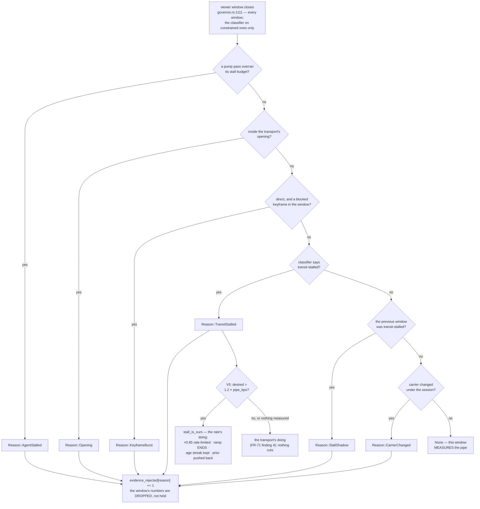
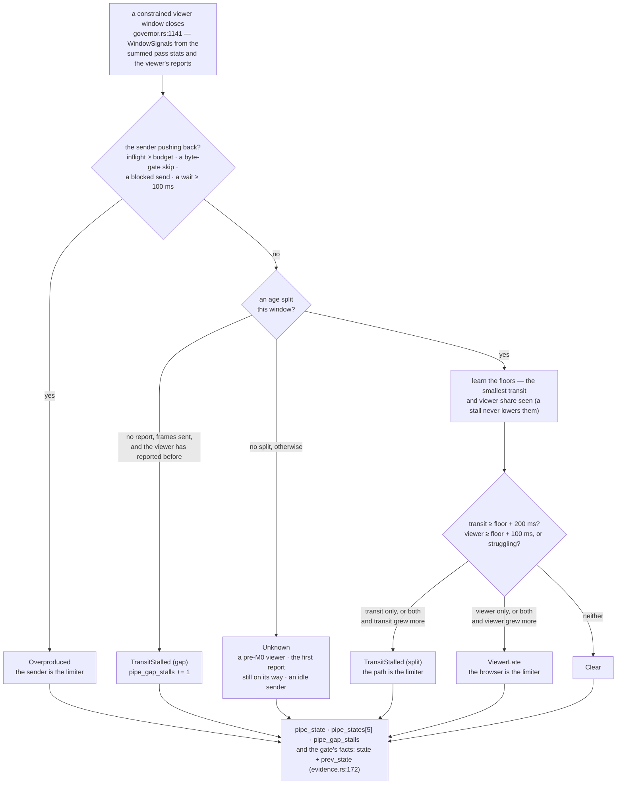
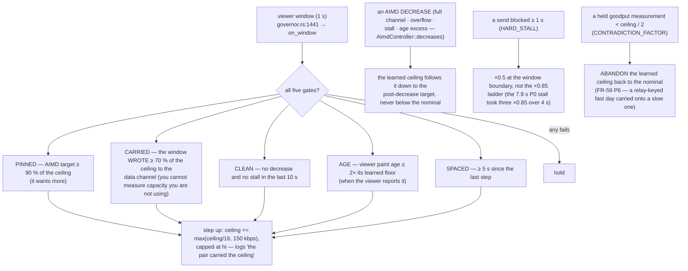
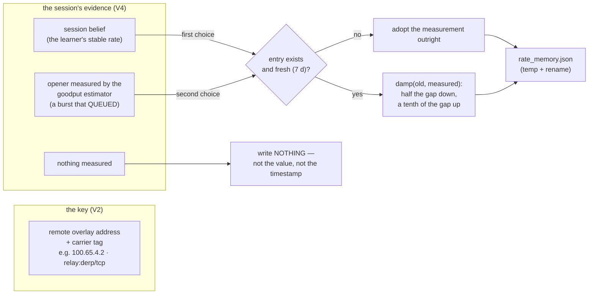
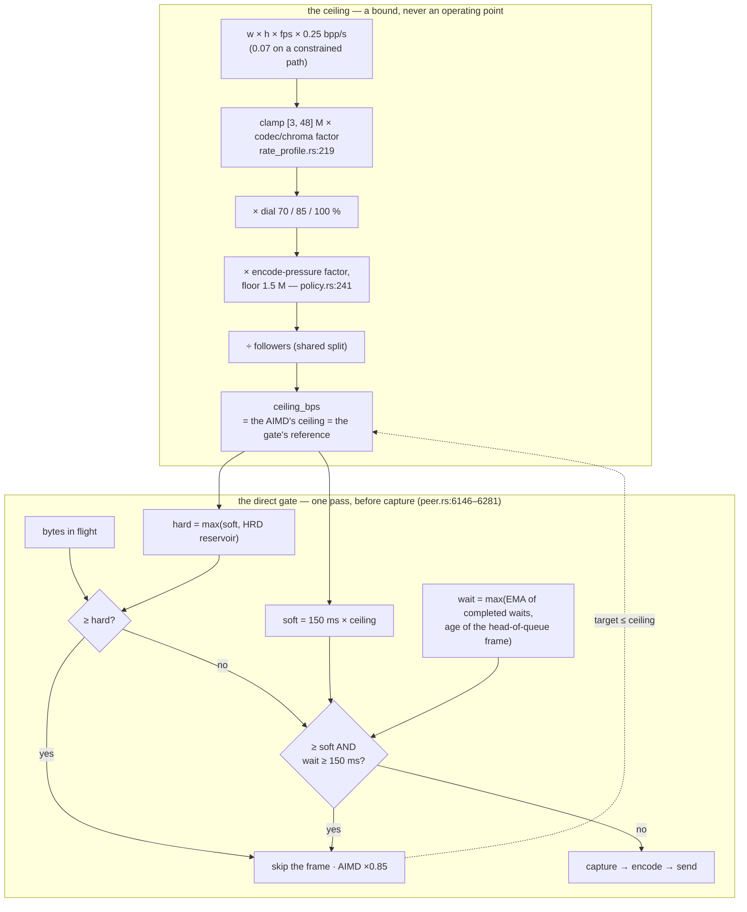
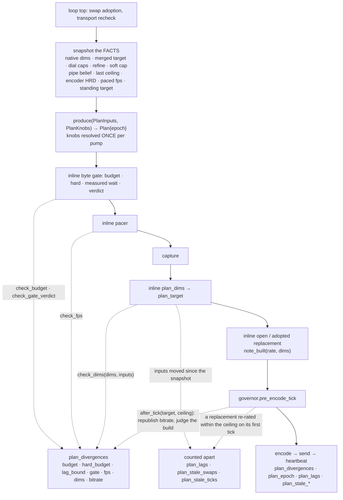
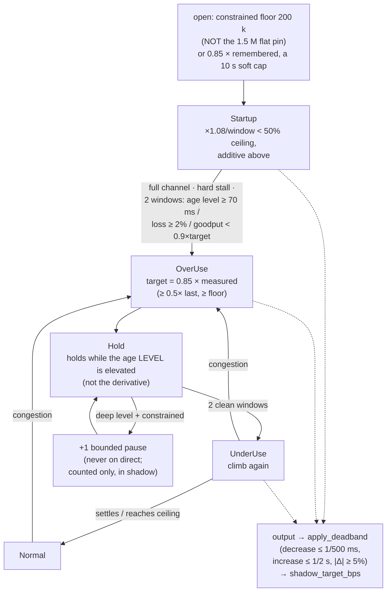
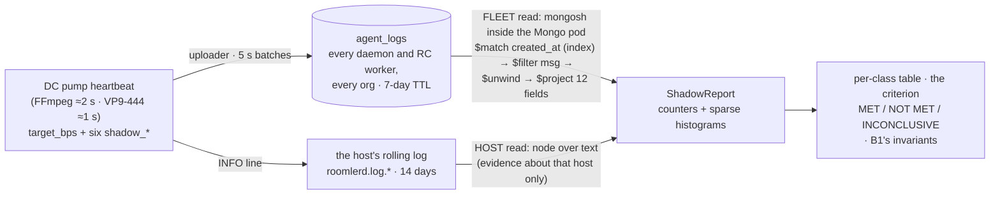
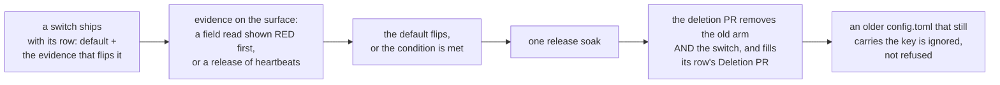

# Rate control — how the remote-desktop stream spends its bits

How a session decides **bitrate, quality, frame rate, and resolution**, and why
(since rc.445) it never changes resolution mid-motion. Companion to
[encoders.md](encoders.md) (which encoder runs) — this doc is about what that
encoder is told to do. History and field evidence at the bottom. Since
`agent-v0.4.93` every loop here reads **one validity gate** before it acts,
so that is the first section: everything after it consumes its verdict.

## The validity gate (FR-79) — a window is evidence about the pipe, or it is not

Every loop in this document estimates the same quantity — what the path will
carry — from the same 1–2 s viewer window. Until `agent-v0.4.93` each loop
decided for itself whether a window could be trusted, and on 2026-09-08 one
host produced three field events through three different inputs with one
shape: a number taken while the pipe was *not free to be measured* was read as
the pipe (FR-71 T2 and T2b, then the opener — the record is in
[`fr/FR-79-one-validity-gate.md`](fr/FR-79-one-validity-gate.md)). FR-79
replaced the three per-input rules, their two kill switches and their four
counters with **one verdict per window, taken before any loop acts**:

> A window is evidence about the pipe only if **(1)** the agent's own loop was
> free — no pump pass overran its stall budget inside it, **(2)** the transport
> was past its opening, **(3)** the transport did not stall in it, and did not
> stall in the window before it, and **(4)** the carrier it will be attributed
> to is the carrier that produced it.

`encode::evidence::rejected(WindowFacts) -> Option<Reason>`
(`agents/roomlerd/src/encode/evidence.rs:194`) is pure — no clock, no I/O, no
configuration and **no switch**. Its inputs (`WindowFacts`, `evidence.rs:172`)
are things the governor already holds at the window boundary: this window's
pipe-state verdict, the previous window's, whether a pump pass stalled inside
it (`encode::stall`, counted per pass), whether the transport was still in its
opening, and whether the carrier moved.

**FR-119 P2b-8 — every window, and the whole window.** Three corrections, all
found when a freshly granted 120 fps was taken back one second into two of
four direct sessions on the MacBook:

- **The gate runs on every window.** It used to run on constrained windows
  only, and a direct window was evidence by definition, so FR-119's grant
  (which only runs on a direct path) read capacity claims nothing had gated.
  On a direct window the classifier does not run, so its state is `Unknown`
  with no predecessor, and only the agent's own stall and the opening apply
  (`governor.rs:1174`).
- **`Reason::Opening`.** The opening keyframe meeting a transport that is
  still ramping blocked sends for 43–82 ms, and the drain rate folded as a
  capacity of 14–22 Mbps against a 104 Mbps ceiling, which held for its 60 s.
  A window any pass of which falls inside FR-35's opener window (at least 2 s
  from the first keyframe and until the send ledger drains, at most 3 s, now
  kept for every session) is not evidence. FR-35 already declined to cut for
  that burst, so it is not congestion either.
- **The window is the sum of its passes.** The pump hands its sender facts
  over on every pass, as deltas since the previous one, and each call
  overwrote the last, so the "window" the classifier and the gate read was one
  pass long: a stalled pass anywhere but in the window's last iteration never
  reached `AgentStalled`, and `frames_sent` / `gate_skips` read 0–2 where the
  window held 30–120. `WindowSenderStats::absorb` now folds the passes: counts
  add, the longest wait wins, the average is weighted by frames sent, `opening`
  ORs, and the levels are the latest. ⚠️ On constrained sessions this also
  corrects the classifier's inputs: a gate skip anywhere in a window now makes
  it `overproduced`, and the silent-viewer gap rule sees real frame counts.

**FR-119 P2b-13 — a keyframe's ramp, later in the session.** The opening's
defect was not confined to the opening. SCTP grows its congestion window only
while data is queued (`on_cumulative_tsn_ack_point_advanced` in the vendored
`webrtc-sctp`). So on a fast path the deltas leave it about one delta's size,
and a keyframe many times larger spends its send growing the window back. On
the first Windows run, one ~625 KB keyframe on a mesh path blocked 71.6 ms and
folded as 69.9 Mbit/s of capacity, while the path carried 311 Mbit/s over TCP.
The measured-ceiling clamp cut the rate to 59 M, and FR-119's grant handed a
granted 120 fps back on `pipe`. Each blocked send now says whether it was a
keyframe (`BlockedSend::keyframe`, read by the send task from the frame's own
header), and on a **direct** window whose blocked sends include a keyframe the
gate answers `Reason::KeyframeBurst`. Constrained windows keep the old rule:
there a keyframe's drain is dominated by the path, and it may be the only
sample a session gets.

**P2b-14 widened it from "only keyframes" to "a keyframe at all".** P2b-13
still read a window when a delta blocked beside the keyframe, on the theory
that a narrow pipe shows in the deltas behind it. But at 120 fps eight deltas
queue behind a 66 ms keyframe send, and they block on the keyframe's own
backlog, so they measure the same ramp. On the second Windows run the
encoder's idle-settle keyframe after a motion burst did exactly that: the
window folded as 60.7 Mbit/s against the 88.8 Mbit/s ceiling at 120, on a LAN
path, and 120 went back after 6 s. A pipe really narrower than the stream
still shows: its deltas block in the keyframe-free windows either side, which
are read as before.



The heartbeat carries the tally as `evidence_rejected=[agent-stalled,
transit-stalled, stall-shadow, carrier-changed, opening, keyframe-burst]` (`Rejections`,
`evidence.rs:219`; printed at `peer.rs:9788` for the FFmpeg pump and `:5163` for
VP9's) — one field where T1b, T2 and
T2b each had their own counter. `opening` was appended (P2b-8) and then
`keyframe-burst` (P2b-13), so the earlier positions keep their meaning for a
reader that parses them.

### The classifier the gate reads (FR-71 T1a) — which plane is the limiter

Every loop below used to read one number, the viewer's paint age, and every one
of them read an excursion as "the encoder produced too much". On 2026-09-04
(CORPLAP-3 over DERP, session `6a9abaa8`) a head-of-line block held frames in
transit for **4.9 s** while the sender's queue held **1,485 bytes**, the worst
pump pass was 28 ms and the encoder averaged 14 ms — nothing sender-side was
wrong, and the AIMD and the FR-15 age loop cut the rate into an 8 Mbps link
(FR-71's finding 4, the FAIL on record in
[`fr/FR-71-transport-stall-classification.md`](fr/FR-71-transport-stall-classification.md)).
FR-70 M0 split the age into the three planes that can own it
(`viewer_rate::split_age`, `viewer_rate.rs:314`: sender wait, transit, the
browser's own share), and FR-71 T1a turns the split plus what the governor
already knows about its own send queue into **one verdict per constrained
viewer window** — `encode::pipe_state::PipeClassifier::classify`
(`pipe_state.rs:159`). The gate reads that verdict, and the previous window's,
as two of its facts (`WindowFacts::state` / `prev_state`, `evidence.rs:172`);
the classifier itself acts on nothing. Pure, like the gate: no clock, no I/O,
no switch — it unit-tests on the default build and runs inside the B0 simulator.



| verdict | says | the rule (`decide`, `pipe_state.rs:169`) | what the gate makes of it |
|---|---|---|---|
| `Overproduced` | the sender is the limiter | checked **first**: `inflight_bytes ≥ budget_bytes`, or a byte-budget skip, or a blocked send the goodput sink accepted, or `send_wait_max_ms ≥ SENDER_WAIT_MS` (100 ms, `:67`) — whatever the path is doing, a full queue is real back-pressure, the one case the loops were always right about | evidence: the window measures the pipe |
| `TransitStalled` | the path is the limiter | the transit share sits `TRANSIT_SLACK_MS` (200 ms, `:63`) or more over its learned floor while the browser's share is under its own slack (both over: the larger excess names the limiter); **or a report gap** — no report this window, frames were sent, and the viewer has reported at least once this session (`:193`) | rejected (`Reason::TransitStalled`), and the window after it too (`StallShadow`); under V5 it is also the transport pushing back — the rate-limited ×0.85 fires only while `desired > 1.2 × pipe_bps` |
| `ViewerLate` | the browser is the limiter | the viewer share sits `VIEWER_SLACK_MS` (100 ms, `:65`) or more over its floor, or the viewer reports `struggling` (`rc:decodestat`) | evidence (an open decision in FR-79); the viewer-rate cap sheds frames, nothing cuts the bitrate |
| `Clear` | none of the above | | evidence |
| `Unknown` | nothing to classify | no split and no gap: a pre-M0 viewer, a report without an age, silence **before** the first report, or a window the sender was idle in — and every direct window, because the classifier runs on constrained windows only (`governor.rs:1153`) | evidence; the loops behave as they did before FR-71 |

Its inputs are `WindowSignals` (`pipe_state.rs:112`), assembled once at the
window fold (`governor.rs:1141`):

| input | where it comes from | note |
|---|---|---|
| `split` — sender / transit / viewer ms | `split_age` over the window's average age, the viewer's arrival stamp and the window's average send wait (`governor.rs:1125`) | `None` = no split this window |
| `reported` | any report this window — an age, a link report, or the raw count (`governor.rs:1143`) | the gap rule's subject |
| `inflight_bytes`, `budget_bytes`, `gate_skips`, `send_wait_max_ms`, `frames_sent` | `WindowSenderStats` (`governor.rs:360`), handed over by the pump on every pass and **summed per window** since FR-119 P2b-8 (`absorb`, `:391`) | ⚠️ until P2b-8 (2026-10-23) the governor kept only the last pass, so `frames_sent` and `gate_skips` read 0–2 where a window held 30–120, and a gate skip outside the final pass never made the window `overproduced`; every test fed whole windows, so the tests describe the classifier the field runs from then on |
| `blocked_sends` | the goodput sink's samples, drained at the fold | the same samples the fold then accepts or drops |
| `struggling` | the viewer's decode-backlog bit | |

The floors are learned the way the FR-15 age loop learns its floor — the
smallest share seen (`pipe_state.rs:202`) — so a permanently slow path is not
a permanent stall, and a stall never lowers the floor it is measured against.

**The heartbeat.** `pipe_state` is the last window's verdict, `pipe_states` the
session's windows per verdict as `[unknown, clear, overproduced,
transit-stalled, viewer-late]`, and `pipe_gap_stalls` the subset of the
transit-stalled count that came from the gap rule (`peer.rs:9786`–`:9796` for
the FFmpeg pump; `:5161`–`:5171` for VP9's, whose transit share is an upper
bound because that pump keeps no send-wait figure). Three rules for reading them:

- a heartbeat spans about two windows, so `pipe_state` and the histogram are
  **offset by one window** when read side by side — count stalls from the
  histogram's deltas, not from the current verdict (measured 2026-09-07);
- the counters are per session: the governor is built with the session, so a
  new `session_id` restarts them at zero;
- on `0.4.67` every session showed one `transit-stalled` window at its start —
  the viewer's first report had not arrived yet. The "has reported once" clause
  (#1370) fixed it from `0.4.68`; nothing needs subtracting after that.

**What the field taught**, with the record in FR-71's spec:

- Finding 4 has **two shapes** on the corporate hosts, and the gate answers each
  with a different fact. The post-ack kind — an age in the hundreds of
  milliseconds to seconds with 0 B in flight and a 0.03 ms send wait (CORPLAP-2,
  2026-09-07 and 09-08 08:48) — is the split rule's `TransitStalled`. The
  blocked-send kind — a DC send blocked for 2.9 s and 7.4 s inside pump passes
  the runtime had stalled (CORPLAP-1 on the Check Point VPN, 2026-09-08 12:15)
  — is `AgentStalled`, the gate's first reason, whatever the classifier said of
  the window. The B0 freeze fixtures model a third: a frozen drain that fills
  the **sender's** queue, which the classifier rightly calls `Overproduced`
  (`t1a_freeze_stalls_are_sender_visible`, `sim.rs:2326`); the simulator's
  `transit_stalls` (acked on time, observed late) and the `finding4_transit_stall`
  cell (`sim.rs:1716`) model the first.
- **96 % of `transit-stalled` verdicts are report gaps**: 209 of 218 over four
  days of the operator's sessions (2026-09-05 → 09-08, about 15,000 constrained
  windows on `0.4.69` → `0.4.85`), one silent window every few minutes on a
  healthy relay, and nothing was ever classified stalled while its queue was
  over budget. A gap is still a rejected window; whether a hidden tab's silence
  should count as a stall is an open decision in FR-71.
- The cell that keeps the rate is `finding_4_keeps_the_rate_with_the_validity_gate`
  (`sim.rs:2452`): no window below the pre-stall target and the path reading
  clear within the stall's own length. Its FAIL arm,
  `finding_4_cuts_the_rate_without_the_validity_gate` (`:2284`), keeps the
  defect on record — the gate has no daemon switch, so the arm lives only in
  the simulator — and the thin pipe, the LAN burst and a genuinely slow relay
  trace **byte-identical** with the gate on and off
  (`t1b_hold_is_inert_where_nothing_stalls`, `:2355`).

⚠️ The classifier was a shadow for one release: `transit_classify` (T1a) and
the hold behind `transit_hold` (T1b, default off) shipped in `0.4.67`, and
FR-79 V1 **deleted** both the day the gate was built on the verdict. A
`transit_hold = true` left in a host's `config.toml` is an inert key.

### What each consumer does with the verdict

All of it is in one function, `RateGovernor`'s window fold (`governor.rs:1111`
onward). `valid` is the gate's `None`; `stall_is_ours` is V5's exception, below.

| consumer | on a valid window | on a rejected window | site |
|---|---|---|---|
| goodput fold (`GoodputEstimator::observe_window`) | folds the window's blocked sends | samples **dropped**, not quarantined; the next valid window is measured on its own merits | `governor.rs:1225` |
| FR-35 hard ×0.5 (a send blocked ≥ `HARD_STALL` = 1 s, `ceiling_learn.rs:64`) | `apply_hard_md` | nothing — only the window boundary knows whether the block was the pipe (12:15: 2.9 s and 7.4 s blocked sends inside stalled passes, on a path that carried 6.6 M twenty seconds later) | `governor.rs:1241` |
| FR-63 opener ramp | doubles on a clean window, ends on congestion | neither — unless `stall_is_ours`, which ENDS it | `governor.rs:1247` |
| FR-15 age loop | fires on a streak over the learned floor; always learns the floor | learns, does not fire, and the streak resets — unless `stall_is_ours`, which keeps both | `governor.rs:1287` |
| FR-59 P3 arrival-rate clamp | armed / released by the viewer's report | **neither armed nor released** — whatever it held, it still holds (14:52: the report *for* the stall set 834,800 on a path that had just carried 7.45 M) | `governor.rs:1317` |
| the rate-limited ×0.85 (`aimd.rs:180`, ≥ 500 ms apart, `aimd.rs:84`) | on `age_over` or `link_over` | on `stall_is_ours` | `governor.rs:1409` |
| FR-70 P1 prior | re-anchors on a live measurement, decays on a clean window | does not move — unless `stall_is_ours`, which pushes it back with no value attached | `governor.rs:1425`, `:1434` |
| FR-79 V3b belief (shadow) | a delivery every window; a capacity when the fold accepted, or the viewer's queue grew | the delivery is still recorded; no capacity | `governor.rs:1095`, `:1228`, `:1342` |
| pair-memory write-back (V2 + V4) | the session's belief, else the opener's measurement | nothing measured ⇒ nothing written | `peer.rs:2111` |

### V5 — a rejected window is not a measurement, but a stall is still push-back

V1 shipped the gate as an unconditional DROP, and on `agent-v0.4.95`
(2026-09-09 07:41, CORPLAP-2, AV1 over `relay:derp/tcp`) that was a live
regression: one accepted goodput sample of 1,058,145 all session, eleven
transit-stalled windows, `target_bps` 1.6–2.1× the measurement, paint age
240 → 4,022 → 7,784 ms, and **the rate ended higher than it started** —
because every loop that could lower it read `valid`, the local send queue
never filled (`bytes_inflight=0`), and the viewer's age report landed in
rejected windows.

🔑 The gate answers *is this window a measurement of the pipe?* V1 let every
consumer read it as *does this window say anything at all?* Those differ for
exactly one reason: a stalled transport is not a measurement, but it **is the
transport pushing back** — and on a relay-TCP session, where the queue sits
downstream of the agent, it is the only push-back there is.

| half | rule | anchor |
|---|---|---|
| which rejection also speaks about the rate | `Reason::is_congestion()` is true **only** for `TransitStalled`. `AgentStalled` would re-create the 12:15 defect, `StallShadow` double-counts one stall, `CarrierChanged` cuts for a path the session has left, `Opening` cuts for the opener draining into a transport still ramping | `evidence.rs:143` |
| whose fault the stall is | `stall_is_ours` = congestion **and** `desired > pipe_bps × 1.2`. Above the measured pipe the stall is the rate's doing; at or below it, the transport's (FR-71's finding 4: an 8 Mbps leg head-of-line-blocked for 4.9 s with 1485 bytes queued, where a cut costs quality for an event the sender did not cause); **with nothing measured there is no claim to contradict, so no cut** | `governor.rs:1207` |
| what it reaches | only the rate-limited ×0.85, the ramp's end, the age streak and the prior's push-back. **Never `apply_hard_md`** — it has no spacing and would halve once per stalled window. Everything that sets a *number* still reads `valid` | `governor.rs:1247`, `:1287`, `:1409`, `:1434` |
| which estimate | `pipe_bps` (`governor.rs:634`: blocked-send goodput → the viewer's arrival rate while its queue grows, 15 s TTL → the decaying prior), **never** `blocked_send_bps` (`:617`). `0.4.96` shipped on the wrong accessor: the agent's sends block only when the queue is LOCAL, and CORPLAP-3 read `goodput_bps=None` with `goodput_samples=(0, 5)` for a whole relay session — V5 inert on that host. Fixed in **V5a, `agent-v0.4.97`** | `governor.rs:1196`–`1216` |

⚠️ The control that must stay green is
`finding_4_keeps_the_rate_with_the_validity_gate`. Its field twin is every
relay stall on a session that is *not* overdriving: on 2026-09-24 a
three-hour CORPLAP-2 session over `relay:derp/tcp` held its target through
**117 of 118** transit stalls (the exception, 10:33:30–34, is an 800 ms
locally blocked send inside an agent-stalled window — the AIMD's own occupancy
loop, not the gate) at a paint age of p50 76 ms / p95 99 ms / max 988 ms.

⚠️ **AC9, partly met 2026-10-31**: the positive half — the target *converging*
toward the measurement across repeated stalls — needs a stall inside a
**measured** minute. A sweep of the three relay laptops' daemon logs for
2026-09-10 → 09-25 (24,013 heartbeats, 7,442 constrained windows, 193 transit
stalls) found the pipe estimate absent at every one of the 193: the
blocked-send source was live in 2 % of the constrained windows and the prior in
none. That absence is the V3b finding, below. The first sustained run came on
2026-10-30 on CORPLAP-2, `0.4.187`: 27 stalls in 56 s at a live
`goodput_bps=180,484`, the target held at 1.11–1.40× it, bounded by the 200 kbps
floor. The weak point is the reading it converges to (the A/B below).

⚠️ **The 2026-10-29 fleet read found the inverse (FR-71).** Over 15 days and
40,654 constrained windows on the corporate laptops (`0.4.137` → `0.4.184`), a
transit stall on a session with no pipe estimate was held 433 times out of
482 — but 49 clean stall episodes cut, every one on a session whose prior stood
at 0.02–0.8 M: `stall_is_ours` compares against `pipe_bps`, whose last source
is the prior's stand-in (`governor.rs:648`), and pushes that prior back without
a measurement on every window it fires on (`:1439`), so each cut lowers the
number the next stall is judged against. One 25-minute HEVC session over DERP
went 3.63 → 0.94 M on 24 gap windows with 0 B in flight. A second edge: the
viewer's congested report in a stall's **onset** window (transit still under
the classifier's 200 ms slack, so the window is `clear` and valid) arms the P3
clamp at the collapsed arrival rate — 3.0 → 0.62 M at 09:17:07 on 10-19, 13
such drops in the fortnight. Both are recorded with their arcs in
[`fr/FR-71-transport-stall-classification.md`](fr/FR-71-transport-stall-classification.md)
(§Open decisions, field log); the law is not changed on this page.

⚠️ **The fix for the first is FR-79's to make (V5b, proposed 2026-10-30).**
`stall_is_ours` would compare only against a *measured* source (the goodput, or
the viewer's arrival rate inside its 15 s TTL, `governor.rs:415`), never against
the stand-in, and a stall that carries no number would stop walking the prior.
Until the operator decides it, a convergence caught in the field may be toward
the stand-in rather than a measurement, so it cannot count as AC9. The options
and the rig AC8 and AC9 still need are in
[`fr/FR-79-one-validity-gate.md`](fr/FR-79-one-validity-gate.md) §Open decisions.

⚠️ That prior's size did not come from the walk. The session's stand-in moved on
the measured ×11/10 ladder (`prior.rs:80`, `:167`) above a base of at most 17,799
bps, so a live reading anchored it, and the walk only moved it between rungs. A
congested viewer report stores the arrival rate with no floor (`governor.rs:1343`),
and the same window re-anchors the prior on it (`:1433`). V5b would stop the cuts,
but the anchor would stay in `pipe_bps` until it climbs back.

⚠️ **The field A/B (2026-10-30 11:48–12:19, CORPLAP-2, `0.4.187`,
`relay:derp/tcp`).** Over one session, stalls cut the target 13 times of 16 while
a stand-in stood and 0 of 26 while nothing did, which is V5b's case. The same
session shows V5b is not enough. One 102 ms blocked send folded into a live
`goodput_bps=223,794`, because a window needs only 60 ms of blocked time
(`goodput.rs:82`), on a path that delivered 5.39 M. While it stood the target
fell 3.0 → 0.68 M in 22 s, most of it through the queue budget, which is
denominated in the same `pipe_bps`.

### The ceiling learner (FR-35 P1) — growth above the nominal

On a constrained (relayed) session the AIMD runs under a ceiling, and that
ceiling used to be a fleet constant: `relay_max_bps` = 3 Mbps (`mod.rs:875`,
env `ROOMLERD_RELAY_MAX_KBPS`), the encoder opened at 85 % of it. One constant
cannot be right for the fleet. The real `neo16 → CORPLAP-2` DERP path, measured
2026-08-29, sustains ~6–9 Mbps and absorbs short bursts far above; other corp
relays measured ~2 Mbps. At 2.55 Mbps that first pair's opening keyframe is a
5.6 KB max-QP smear repaired by inter frames over ~1.2 s; at a 25.5 Mbps cap the
whole desktop arrived as one 680 KB frame at +0.3 s — yet 12.8 Mbps *sustained*
choked it with a 7.9 s stall. So the cap must be **learned per pair**, and —
because every NVENC rate change *down* forces a starved keyframe that replaces
the picture (FR-31) — within a session it may only ever **climb**.

`encode::ceiling_learn::CeilingLearner` (`ceiling_learn.rs:89`) sits between the
plan's nominal ceiling and the AIMD. `RateGovernor::effective_ceiling`
(`governor.rs:572`) returns `plan.max(learned.min(hi))` on a constrained
session, so the learned ceiling only ever RAISES the plan's, never past `hi`
(`relay_max_hi_bps` = 8 Mbps, `mod.rs:933`). Once per viewer window the governor
hands the learner that window's evidence (`governor.rs:1441` → `on_window`,
`ceiling_learn.rs:190`), and it steps the ceiling up only when **all five** gates
pass:



| gate / rule | constant | anchor |
|---|---|---|
| pinned | `PINNED_PCT` 90 | `ceiling_learn.rs:55` |
| carried | `CARRIED_PCT` 70 | `ceiling_learn.rs:57` |
| clean | `GROW_CLEAN` 10 s (decrease **and** stall) | `ceiling_learn.rs:51` |
| age | `AGE_FLOOR_FACTOR_PCT` 200 — was 150, until the first field run's 66–80 ms over a 43 ms floor turned out to BE the evidence | `ceiling_learn.rs:62` |
| spaced | `GROW_INTERVAL` 5 s | `ceiling_learn.rs:53` |
| step | `max(ceiling / 16, 150 kbps)`, capped at `hi` | `ceiling_learn.rs:69`, `:236` |
| hard stall | `HARD_STALL` 1 s ⇒ ×0.5, applied at the window boundary (FR-79: only there is it known the block was the pipe, not a pass the runtime stalled under) | `ceiling_learn.rs:64`, `governor.rs:1241` |
| contradiction | learned > 2 × a held measurement ⇒ abandon to the nominal, exactly once | `ceiling_learn.rs:172`, `:79` |

Two things the gates measure that read differently from their names, both found
in the 2026-10-27/28 field reads below:

- **CARRIED counts bytes the send task WROTE to the data channel in the window**
  (`governor.rs:1057`, the send task's running byte total over the elapsed
  window), not bytes the pipe delivered, and `on_window` runs on **every**
  constrained window — it does not read the FR-79 verdict (`governor.rs:1441`).
  So an opening burst the socket absorbs is "carried": on 2026-10-28 07:57:43 the
  first step landed 0.36 s *before* the opener grace ended, inside a 697 KB
  opener that had blocked a send for 164 ms — the very `Opening` window V4
  refuses as write-back evidence. The exposure is one step (+1/16) per session,
  capped by `hi`; the later steps need windows that really carry.
- **DECREASE means an AIMD decrease** — `AimdController::decreases` ticking
  (`aimd.rs:245`, `:259`; read at `governor.rs:933`). The FR-59 P3 viewer bound
  (`governor.rs:799`: the ceiling capped at 90 % of the viewer's reported arrival
  rate while its queue grows) lowers the AIMD's ceiling through `set_ceiling`,
  which clamps `desired` **without** counting a decrease (`aimd.rs:188`). The
  learner neither follows that bound down nor restarts its 10 s clean window on
  it — by the P3 ordering's own argument ("a live report that the receiver is
  falling behind outranks" the learner), but a reader of the heartbeat sees
  `target_bps` fall ×0.9 while `learned_ceiling_bps` holds.

The session's **stable rate** — the highest target that held 10 s
(`STABLE_HOLD`) with no decrease — is what the pair memory persists
(`ceiling_learn.rs:66`; next section), so the next session opens at 85 % of what
the pair proved and the learner climbs from that floor instead of the constant.
⚠️ "Held" is a hold of the AIMD *target*, not a delivery: on an idle session the
target sits at the opener's seed for the whole session, so `stable_bps()` is
that seed — see the write-back rows below for what that does to the memory.
Kill switches: `relay_ceiling_learn` (tribool, default on; off ⇒ `hi` = 0 ⇒ the
plan ceiling verbatim and no memory) and `relay_max_hi_kbps`
(`crates/agent-core/src/config_surface.rs:1236`, `:1348`; `mod.rs:933`). Direct
sessions never touch the learner (`governor.rs:572` gates on `constrained`).

⚠️ **Only the FFmpeg DC pump runs the learner.** `relay_max_hi_bps()` has one
caller (`peer.rs:6290`, `media_pump_ffmpeg_dc`), the VP9-444 pump builds its
governor with `hi = 0` (`peer.rs:4153`), and the RTP pump has no governor. There
is no software FFmpeg encoder, so a host with no hardware encoder never reaches
the learner, and `relay_ceiling_learn` reads the same on and off there. A VM
cannot prove that switch (FR-35 AC6).

> **Field, `CORPLAP-2` over `relay:derp/tcp`, 2026-10-27/28 — agent 0.4.177,
> 0.4.178 and 0.4.181** (the FR-35 surface is byte-identical from
> `agent-v0.4.177` through `agent-v0.4.185` and master; the host took 0.4.178 at
> 13:41Z and 0.4.179 at 18:01Z on 10-27, so no read here ran 0.4.179). Seven
> sessions on the pair `100.65.4.2|relay:derp/tcp` (AV1 NVENC, 1920×1200, DERP
> rtt 106–258 ms), read from the host's own log and `rate_memory.json`:
>
> - **Seeding (P2):** every session opened at 0.85 × the remembered rate —
>   `seed_bps` 4,750,677 ⇒ `opener_maxrate_bps` 4,038,075; 4,759,961 ⇒
>   4,045,966; 4,402,963 ⇒ 3,742,518 (×5) — against the 2.55 M a cold pair gets.
> - **Growth (P1):** the 10-27 09:23 session (79 s) stepped 4.04 → 4.29 → 4.56 →
>   4.84 M in its first 15 s while the 2 s heartbeats carried 6.2 / 6.3 / 4.4 /
>   7.6 Mbps, sat at 4.84 M through 45 s of an idle desktop (0.28–0.35 Mbps at
>   18 fps — not carried, no step), and stepped to 5.15 M at 09:24:34.8 on a
>   6.4 Mbps window. The 10-28 16:46:31 session (90 s) stepped 3.74 → 3.98 → 4.22
>   → 4.49 M during 12 s of motion (3.1–7.4 Mbps windows), then nothing for 60 s
>   of idle. Of the four 11–19 s sessions, three stepped once and the 07:57 one
>   three times (to 4.49 M on 4.7–7.3 Mbps windows); the idle 15:27 session never
>   stepped.
> - **Health** (the four sessions read heartbeat by heartbeat: 09:23 and 15:27
>   on 10-27, 07:57 and 16:46:31 on 10-28): `send_stalls=0` in every one;
>   `send_wait_max_ms` 0.04–2.1 except the heartbeat holding an opener burst
>   (52.4 ms on 09:23:26, 163.9 ms on 10-28 07:57:43) — never near `HARD_STALL`.
>   Viewer paint age p50 66–68 / p95 103–117 ms over a 45–50 ms floor, the maxima
>   (438, 775 ms) in a session's opening ten seconds (4 s and 10 s in). The
>   ceiling never passed 5,146,238 (`hi` = 8 M) in any of the seven.
> - **What held the opener at ~1.5×, not 2.5×:** the memory sat at 4.40–4.76 M
>   while the pipe carried 6–7.6 Mbps windows with sub-ms send waits. The
>   write-back rows below show why: a session that *proved* 4.84 M stable moved
>   the memory +0.2 % (`ALPHA_UP` 0.10 of the gap), the next idle session moved
>   it −7.5 % (its own seed written back as evidence). Nothing in these reads
>   measured a sustainable limit; the memory's level is the write-back's
>   dynamics, not the pipe's. (FR-35 AC1 is open on exactly this.)

### The write-back and the seed (V2 + V4) — the pair memory

FR-35 P2 remembers a pair's rate so the next session opens at 85 % of it
instead of at the fleet constant. FR-79 changed **what** is remembered and
**under which key**:



| piece | rule | anchor |
|---|---|---|
| the key | `remote_addr\|carrier` — `direct`, `tunnel`, `relay:<kind>/<transport>` from the LocalAPI peer record; a mid-churn carrier (`blocked` / `offline`) leaves the bare pre-FR-79 key. DERP-over-TLS and a UDP relay are different pipes on the same address, four times apart in capacity | `rate_memory.rs:42`, `:65`; `peer.rs:2054` |
| the opener | measured by the goodput estimator (bytes over blocked time) for a burst that queued; `None` for one the socket absorbed. The old `bytes × 8 / longest_single_wait × 75 %` recorded 6–8 M against a 1.8–3.4 M pipe | `peer.rs:9077` (`opener_measured_bps`) |
| the evidence | first choice `RateGovernor::stable_bps()` — the highest AIMD target that held 10 s with no decrease, when above the nominal; then `pipe_bps`; else 0 = nothing. ⚠️ The first is a hold of the *target*, not a measurement: an idle session holds the opener's seed for its whole length and writes 0.85 × the memory back as evidence (field rows below). ⚠️ The second is the belief the gate accepted only while a measurement is live: its last source is the prior's stand-in (`governor.rs:648`), so a prior that stands low can be written back too (field rows below) | `peer.rs:8985`; `governor.rs:599` |
| the write | `record_session(peer, evidence, now)`: `None` or 0 ⇒ **no write**; first evidence ⇒ adopted outright; otherwise `damp` with the goodput estimator's own asymmetry (`ALPHA_DOWN` 0.50 / `ALPHA_UP` 0.10, `goodput.rs:94`, `:98`). The maximum rule, `had_decrease`, the unqueued ×1.5 step and its constants are gone | `rate_memory.rs:147`, `:79`; `peer.rs:2111` |
| the file | `rate_memory.json` in the daemon's data dir (`appdirs::project_dirs().data_dir()` — on a Windows SYSTEM service `…\config\systemprofile\AppData\Roaming\roomler\roomler\data\`); whole-file atomic write; a missing or corrupt file is an empty memory; an entry older than 7 days never seeds and is pruned on the next write | `rate_memory.rs:185`, `:22` |
| the log line | `FR-79 V4 rate memory: … peer=… evidence_bps=… kept_bps=…` at every session end that had a key. **`kept` lies between the old value and the evidence**, so `kept > evidence` on one line proves the entry moved DOWN — no old value needed | `peer.rs:2120` |

Field reads of the write-back so far (key `100.65.4.2\|relay:derp/tcp` unless noted):

| when (UTC) | host · build | evidence → kept | what it shows |
|---|---|---|---|
| 2026-09-08 19:12–19:18 | CORPLAP-1 · 0.4.93 | 1.44 / 1.09 / — / 3.32 / 6.13 M, the max rule still in force | five openers 1.44–2.82 M inside a carrier measuring 1.09–6.13 M (AC5) |
| 2026-09-08 22:14–22:17 | CORPLAP-1 · 0.4.95 | `None → kept 2,264,993`, twice (`100.65.0.5`) | a session that measured nothing wrote nothing; the old rule would have written 3,825,000 from an absorbed burst (AC8, first half) |
| 2026-09-10 08:39:41 | CORPLAP-2 · 0.4.97 | `Some(3187500) → 3210512` from a seed of 3,233,525 | the entry moved **down** — `damp` exactly; the max rule would have kept 3,233,525. Marginal (0.7 %), but a direction the old rule could not take |
| 2026-09-10 14:03:44 | CORPLAP-1 · 0.4.97 | `Some(8000000) → 6318171` from 6,131,302 | the entry moved **up**, damped, after a session that measured the relay at 11.5–17.0 M — one ×0.10 step toward the learner's 8 M cap |
| 2026-10-27 09:24:41 | CORPLAP-2 · 0.4.177 | `Some(4843519) → 4759961` from 4,750,677 | the learner's stable rate (4.84 M held 57 s, windows carrying 6–7.6 Mbps) moved the entry **+0.2 %** — `ALPHA_UP` of a 93 kbps gap |
| 2026-10-27 15:29:46 | CORPLAP-2 · 0.4.178 | `Some(4045966) → 4402963` from 4,759,961 | **the P2b decay, in V4 form**: a 130 s session on an idle desktop (0.16–0.25 Mbps at 18 fps, a 405-byte opener) never stepped and never decreased, so `stable_bps()` was its own `opener_maxrate_bps` — 0.85 × the memory — and `damp` took half the gap: **−7.5 % for having measured nothing**. Ten such sessions halve the memory; one proving session restores a tenth of its gap |
| 2026-10-27 16:31 · 10-28 07:58, 12:38, 16:46 | CORPLAP-2 · 0.4.178 / 0.4.181 | `None → kept 4402963`, four times | sessions of 11–19 s: nothing held 10 s, nothing written — not the value, not the timestamp (as designed) |
| 2026-10-28 16:48:01 | CORPLAP-2 · 0.4.181 | `Some(4489010) → 4411567` from 4,402,963 | the 90 s session's stable rate (4.49 M after three steps) moved the entry **+0.2 %**; the file now holds `100.65.4.2\|relay:derp/tcp` = 4,411,567 at `at_unix` 1793206081 |
| 2026-10-30 12:22:06 | CORPLAP-2 · 0.4.187 | `Some(84195) → 84195`, a new entry | **the prior's stand-in written as evidence**: anchored at 180,484, it walked eight rungs in 28 s once the goodput expired, and `pipe_bps`'s last source wrote it. Nobody measured 84,195 |
| 2026-10-25 → 10-30 | CORPLAP-2 · up to 0.4.188 | 18 writes with evidence, `5955306 → 3379312` | **every one a rung of the session's own opener**, 0.85 × the memory × (17/16)^k, six at k = 0. 17 of the 18 sessions held no live measurement in any heartbeat, and the entry lost 43 % while they delivered up to 10.2 M |

⚠️ An entry written before V2 is keyed by the bare address, never matches
again and ages out. An entry that ages out is *replaced* by the next session's
first evidence, not damped toward it — the damping only ever acts inside the
7-day window.

⚠️ The 2026-10-27 15:29 row is the open question FR-35 AC1 now turns on. V4
dropped `had_decrease` because "the gate can tell a measurement from a
non-measurement" — but `stable_bps()` is not gated: a target that nothing pushed
is a hold, not a measurement, and on the connect-look-leave sessions this fleet
actually has it writes the opener's own seed back as evidence. The asymmetry
that protects against a flooded opener (believe a drop fast) then compounds it:
the pair that carried 6–7.6 Mbps windows is remembered at 4.4 M. A fix belongs
with the governor (`peer.rs:8985`: require the hold to have been *carried*, or
route the first-choice evidence through the gate); nothing here is changed yet.
The 2026-10-25 → 10-30 row is the same defect at scale: every write on that pair,
not only the idle sessions.

**That week, replayed (2026-10-31).** `damp` reproduces all 24 sessions' logged
`kept` to within 2 bps, so the replay is the write-back itself. All 18 writes lie
within 0.2 % of a rung of the session's own opener, `0.85 × memory × (17/16)^k`,
which fixes what a write can do:

| rungs climbed `k` | evidence ÷ memory | the memory moves | writes that week |
|---|---|---|---|
| 0 | 0.850 | −7.50 % | 6 |
| 1 | 0.903 | −4.84 % | 2 |
| 2 | 0.960 | −2.02 % | 3 |
| 3 | 1.020 | +0.20 % | 4 |
| 4 | 1.083 | +0.83 % | 2 |
| 9 | 1.467 | +4.67 % | 1 |

A session raises the memory only by climbing at least three rungs and then
holding ten seconds; the week's mean was −2.98 % per write. Only 6 of the 18 held
a target that a 2 s window carried at ≥ 70 %. Counting only carried holds helps,
but it does not reach what FR-35 AC1 asks:

| rule | writes that count | end value, evidence as logged | end value, same rungs from the higher opener | opener, × the cold 2.55 M |
|---|---|---|---|---|
| today | 18 | 3.38 M | 3.38 M | 1.13× |
| the session's peak window reached 70 % of the evidence | 11 | 3.78 M | 5.51 M | 1.26–1.84× |
| a window at the held target reached 70 % of it | 6 | 4.13 M | 5.79 M | 1.38–1.93× |
| only rungs above the seed (`k ≥ 3`) | 7 | 4.23 M | 6.25 M | 1.41–2.08× |

The fourth column is an upper bound, because CARRIED is harder to pass under a
higher ceiling. A 2.5× opener needs a memory of 7.5 M, the last 6 % under `hi`,
and the week's highest learned ceiling was 6.40 M. (AC1 asks for 2.5× the
keyframe's bytes, which FR-31 ties to `maxrate` and the 2026-08-29 field rows
follow only loosely.) So the hold question is worth deciding, but AC1 does not
follow from it alone.

### V3b — ONE belief about the path (SHADOW since `agent-v0.4.98`)

`encode::pipe::Pipe` (`pipe.rs:137`) answers a defect the shadow data made
undeniable: **there is no trustworthy, always-available estimate of what the
path carries.** The blocked-send source is silent whenever the queue is
downstream (every relay-TCP session), the viewer's arrival rate was being
thrown away unless the link loop called the window congested, and the pair
memory had almost nothing to remember. The type separates two kinds of
evidence the old `min(goodput, link_rx)` averaged together:

| evidence | meaning | source | accessor |
|---|---|---|---|
| a **delivery** | *"the path carried at least X"* — a lower bound, available every window on every carrier | the viewer's arrival rate (`governor.rs:1091`) | `floor_bps` — a MAX for the session, lowered only by contrary evidence, never by time |
| a **push-back** | *"the path refused above X"* — a limit | an accepted goodput fold (`governor.rs:1224`), or the arrival rate while the viewer's queue grows (`:1338`) | `capacity_bps` (`pipe.rs:216`), 60 s TTL |
| the anchor a ceiling may be built on | `max(capacity, floor)` — never `min` | — | `ceiling_anchor_bps` (`pipe.rs:242`) |

⚠️ **It is a shadow.** The heartbeat prints `pipe_belief=(anchor, floor,
capacity)` and `pipe_belief_n=(deliveries, capacities)` (`peer.rs:8186`) and
**no consumer reads them** — not V5, not the ceiling, not the memory. The
shadow corrected its own design three times in five days, which is why this
page stops here rather than describing a law:

| release | what the shadow found | correction |
|---|---|---|
| 0.4.99 (V3b-1) | a healthy idle relay session read `belief=1.8 M` from 35 deliveries and zero push-backs; a rule reading that as "the pipe" would have called a fine session overdriving | no single `believed_bps()`: `capacity_bps` answers *am I over?* (`None` = no claim to contradict), `ceiling_anchor_bps` answers *what may the ceiling be?* |
| 0.4.99 (V3b-2) | a host that had demonstrated 8.4 M read 12.8 kbps hours later on a static screen (`n=(10696, 0)`); a 30 s window cannot tell a degraded path from a quiet one | the floor is retired by **evidence**, not time: only a push-back lowers it, and damped (`rate_memory::damp`), never snapped |
| 0.4.100 (V3b-3) | a capacity of 13,163,844 expired after one TTL and the anchor fell back to a content floor of 4,050,945 while the target ran to the 34.56 M constant | a capacity sample **is also a delivery** — those bytes got through — so it raises the floor, and the demonstration survives the estimate expiring |

What two more weeks of shadow say (2026-09-24, CORPLAP-2, three hours over
`relay:derp/tcp`): `pipe_belief_n=(9912, 1)` — nine thousand deliveries, **one
push-back**, while the transport stalled 118 times with no number attached.
Whether V5 should read `capacity_bps`, and what a transit stall should feed
into the belief, is the open question the shadow exists to answer; do not
build on the anchor's semantics until it has. FR-74 P5's gate was read against
this shadow on 2026-09-25 — the result, and the floor-damping interaction it
found, are under [§ The direct path](#the-direct-path-fr-74--a-ceiling-that-is-a-bound-a-gate-that-measures-lag).

## The Priority dial

The viewer's Priority dial (`Sharper` / `Balanced` / `Smoother`) is the only
user-facing rate knob. Since rc.445 all three run at **native resolution all
the time**; they differ in the **bitrate ceiling** handed to the encoder:

| Dial | Ceiling factor | Feel |
|---|---|---|
| Sharper | 100 % | Maximum per-frame quality; fps dips first under load |
| Balanced | 85 % | Default |
| Smoother | 70 % | Smallest motion frames → steadiest fps on thin links |

Why this works: the encoders run **constant-quality VBR with a maxrate cap**
(`cq`/`global_quality` ≈ 22 + `maxrate` + a 2× HRD window). A settled desktop
costs almost nothing, so it *never touches the ceiling* — at rest every dial
delivers identical, full-quality text. During motion the HRD binds and the
encoder raises QP **continuously, frame by frame** — smaller frames, steadier
arrival, more fps through the same pipe. A lower ceiling simply moves that
trade further toward fluidity. No mode switch, no rebuild, no seam.

### Why resolution flips were removed (rc.445)

Until rc.443 Smoother/Balanced dropped to a 1024/1280 rung during motion and
refined back to native at rest. Field measurement (2026-08-21, three hosts)
killed the design: every flip is a **blocking encoder open on the pump
thread** — 865 ms down / 654 ms up on an Iris-Xe-class iGPU — plus a
new-resolution IDR queued behind stale frames. Users felt it as "drag takes
off ~1 s, freezes ~1 s, continues", and unanimously preferred Sharper (the
one dial that never flipped). The rungs remain available behind the
`priority_res_cap` config key for A/B, but the default is: **resolution is
not a rate-control lever**. (An explicit resolution pick by the viewer, and
the encode-bound auto-downscale tier, still apply — those change rarely and
deliberately, not per drag.)

## The per-session control loops

Each DC video pump runs these, owned by `encode::governor::RateGovernor`
(P8c) and executed by the pump:

| Loop | Signal | Actuator | Cadence |
|---|---|---|---|
| **CQ + HRD** | encoder-internal | per-frame QP | every frame, zero cost |
| **AIMD bitrate** (`encode::aimd`) | send-channel occupancy + byte budget | `set_bitrate` → ladder-coarsened maxrate | MD ≤1/500 ms, AI ≤1/5 s |
| **Byte-budget queue gate** (rc.442; FR-74 P1b on direct paths) | relay: bytes in flight vs `constrained_queue_ms` (450 ms) of the relay ceiling. Direct: the **measured send wait** vs `direct_queue_ms` (150 ms) once bytes exceed 150 ms of the ceiling; bytes alone gate only at the encoder's HRD reservoir ([§ The direct path](#the-direct-path-fr-74--a-ceiling-that-is-a-bound-a-gate-that-measures-lag)) | skip producing a frame | every loop iteration |
| **Viewer-rate divisor** (`encode::viewer_rate`) | browser's decoded-fps + struggling report. Since FR-119 P2b-7 the browser judges "struggling" on its decode backlog in TIME — a window whose mean backlog exceeds 33 ms, or a frame shed at 67 ms — not on a frame count, which halved its meaning at every doubling of the rate | send every Nth frame | 1 s windows |
| **Encode pressure + auto tier** (`encode::encode_pressure`) | avg encode ms | maxrate factor; long-edge cap when encode-bound | 2 s heartbeat |
| **Goodput estimate** (`encode::goodput`, rc.453) | blocked-send goodput from the send task, folded **only when the validity gate accepts the window** (§ above) | the measured-ceiling clamp (stage 1), FR-59 P1/P6 and V5's `stall_is_ours` via `pipe_bps`, the pair memory's write-back | folded on the viewer window |

Three rules keep them from stepping on each other:

- **Rebuild-bound bitrate applies are motion-deferred** (rc.445). NVENC
  reconfigures maxrate in place; QSV/AMF must rebuild the encoder — a
  blocking open. The pump holds AIMD applies while any real frame encoded
  ≥4 KB in the last 1.2 s (the motion clock; caret/keystroke deltas at
  0.5–3 KB never hold it) and flushes once quiet — the rebuild then stalls a
  static image nobody can see, and its first-frame IDR doubles as the
  post-motion refresh.
- **A rebuild bumps the send epoch** (rc.445): the send task discards
  queued frames from the previous encoder, so the fresh IDR ships
  immediately instead of behind up to 450 ms of obsolete motion.
- **A rate move is not a viewer limit** (FR-119 P2b-4). The viewer-rate cap
  starts at the capture rate, which means no cap, and it follows the capture
  rate when that moves: FR-119's 60 → 120 swap, or a relayed session going
  direct. Before, it stayed at the old rate and read as a clamp, so every
  other frame was dropped for the 3–5 s of the recovery climb. A cap below the
  capture rate is the viewer's own number and stays where it is.

Rebuilds also reuse the session's **proven encoder name** first instead of
re-walking the vendor cascade (a failed tiered open of an absent vendor's
encoder costs 100–300 ms), and open at `min(ceiling, AIMD target)` so the
governor's forced reapply cannot trigger an immediate second rebuild.

## The direct path (FR-74) — a ceiling that is a bound, a gate that measures lag

Everything above is about paths that push back. A direct path on a LAN or a
good WAN mostly does not, and until `agent-v0.4.77` the controller there was
fighting itself. The operator's own test that opened FR-74 (2026-09-06,
CORPLAP-3, `av1_qsv` 1920×1200 at 4 ms RTT, a Notepad++ scroll — the record is
[`fr/FR-74-text-clarity-on-direct-paths.md`](fr/FR-74-text-clarity-on-direct-paths.md)):
the direct ceiling was a constant, `0.07 bpp × 1920 × 1200 × 60 = 9.68 Mbps`,
and Sharper was 100 % of it; every scroll burst overran it; the send queue
crossed a byte budget denominated in the **applied** target; the gate skipped
frames; and the AIMD read its own cap as congestion — three ×0.85 cuts in six
seconds, ~40 s of additive climb back, and on QSV a rebuild plus an IDR at
every ladder crossing (37 swaps and 35 settle keyframes in 11 minutes). The
budget was self-reinforcing: at 2.5 Mbps it was ~47 KB, one text frame tripped
it, and a session sat at 2–3.7 Mbps for minutes.

Two changes fixed it, both on the direct branch of the FFmpeg pump, relay
paths untouched byte for byte, and **no new switch** — the operator's overrides
(`FFMPEG_MAXRATE_KBPS`, `direct_queue_ms`) are the way back in both directions.

### P1 (0.4.77) — the ceiling is a content-generous bound

`rate_profile::ffmpeg_maxrate_bps_scaled`
(`agents/roomlerd/src/encode/rate_profile.rs:219`) uses **0.25 bpp/s on a
direct path** (0.07 on a constrained one, min'd with the relay clamp as
before), clamped to **[3, 48] Mbps × the codec/chroma factor**
(`codec_rate_factor_pct`, `:129` — AV1 100, HEVC and VP9 125, H.264 150;
`chroma_rate_factor_pct`, `:155`, for 4:4:4 cells). The fleet's heartbeats
show the products: 34.56 M for AV1 at 1920×1200 @ 60, 43.2 M for HEVC and
`vp9_qsv` there, 38.88 M for HEVC at 1920×1080. It is a **ceiling, never a
target**: the encoders run constant quality under `maxrate`, so a settled
desktop spends almost nothing and only motion approaches the bound.

`policy::rate_plan` (`encode/policy.rs:241`) finishes the chain: × the dial
(`dial_rate_factor_pct` — 70 / 85 / 100, clamped to [30, 100]) × the
encode-pressure factor (`governor.encode_factor()`, `governor.rs:1616`),
floored at `MIN_BITRATE_BPS` (1.5 M, `encode/mod.rs:258`). On a direct
transport `effective_ceiling` is the plan's value unchanged (`governor.rs:568`
— the learner lifts it on constrained sessions only); the shared-pipeline split
divides it by the follower count; and the result is both the AIMD's ceiling
and the gate's reference rate (`last_ceiling_bps`, `peer.rs:7045`).

⚠️ The encode-pressure factor multiplies the bound, so a host whose encoder is
struggling lowers its own ceiling with no path evidence in it. On 2026-09-25
CORPLAP-3's ceiling fell to 13.82 M (0.4 ×) at 4 ms of viewer age and 0 bytes
in flight while its `av1_qsv` passes took 120–170 ms and the cadence was paced
60 → 20 fps, and it was back at 27.8 M eleven seconds later. Read
`ceiling_bps` on the `set_bitrate` line before calling a `target_bps` drop a
path event.

### P1b (0.4.79) — the gate is the measured wait's call

P1's budget (150 ms of the ceiling) still tripped once on 0.4.77: AV1's HRD
window is floored at 200 % of `maxrate` (Intel's VDENC hangs on a forced IDR
larger than its reservoir — the rc.443 incident), so the encoder was
*configured* to emit an 8.6 MB burst against a 648 KB budget, and the
controller cut on a burst it had itself legalised, at ≤ 20 ms of viewer age.
Bytes cannot tell a burst the wire is draining from a backlog the viewer
feels; the send wait can, and it is the quantity `direct_queue_ms` was always
meant to bound.

| piece | rule | anchor |
|---|---|---|
| soft budget | `direct_queue_ms` (150) × ceiling ÷ 8, floored at 48 KiB; `0` disables the gate | `rate_profile.rs:559` (`direct_queue_budget_bytes`) |
| hard budget | `max(soft, HRD reservoir)`, the reservoir being `maxrate × open_hrd_pct ÷ 8` — 100 % on direct (`direct_hrd_pct`, `:590`; config `direct_hrd_pct`, [25, 200]), 200 % for every `av1_*` encoder regardless | `rate_profile.rs:578` (`direct_queue_hard_budget_bytes`); `ffmpeg/encoder.rs` `open_hrd_pct` |
| measured wait | the larger of an EMA (α 0.3 per pass) of completed frames' enqueue→wire-complete waits and the **live age of the frame the send task is writing** (`send_head_enqueued_us`) — a stalled pipe completes nothing, so the EMA alone reads stale-low exactly when the queue grows | `peer.rs:6355`–`6261`; set and cleared by the send task at `:5699`, `:5767` |
| the verdict | bytes ≥ hard ⇒ trip; bytes ≥ soft **and** wait ≥ `direct_queue_ms` ⇒ trip; otherwise pass | `rate_profile.rs:597` (`direct_gate_trips`), called at `peer.rs:6399` |
| on a trip | the pass skips producing a frame (`frames_skipped_backpressure`) and drives the AIMD's multiplicative decrease, as the full-channel arm always did; the first trip logs `direct byte-budget gate engaged` with `inflight`, `budget`, `hard_budget` and `measured_wait_ms`, so a field read can tell which arm fired | `peer.rs:6475`, `:6353` |
| relay paths | unchanged: bytes vs `constrained_queue_ms` (450) of the relay ceiling, no wait term | `peer.rs:6324`–`6190` |



**Field.** The P1b gate on the release's defaults (0.4.79, 2026-09-07,
CORPLAP-3, the operator judging): no blur on AV1, VP9 4:2:0 or H.264, and the
sessions' heartbeats read 0 cuts, 0 gate skips and 0 gate lines at 20–36 Mbps
and 30–47 fps; the rate ladder stopped firing on direct paths altogether (0
swaps in 17 sessions on three hosts, where the baseline had 37 in 11 minutes),
which retired the planned QSV hysteresis. What the gate deliberately does not
see: a pipe throttled **below the socket** (an OS QoS policy, a thin Wi-Fi
driver queue) queues where `bytes_inflight` cannot look — measured 2026-09-07
with `roomlerd.exe` capped at 15 Mbps, the gate shed nothing and the cost
surfaced as 160–380 ms of viewer age instead. That standing lag is the viewer
age's call (FR-15), not this gate's.

The libvpx VP9 4:4:4 pump is a different machine and got its own fix in the
same arc (P3, 0.4.80: `rc_max_quantizer` 16 on direct transports, because
libvpx resets q to the worst on every wheel notch — [encoders.md](encoders.md)),
and the viewer's pixel chain, which no encoder setting can undo, got the
display-scale pill (P4 — [remote-control.md](remote-control.md) §18.6.1).

### P5 — the ceiling follows the path: decided, refined, and NOT built

A higher constant is still a constant. On 2026-09-10 a direct HEVC session on
another host (the Regal cell, 1920×1080 at 6–11 ms of paint age) ran for hours
between a 38.88 M ceiling with no measurement in it and a path that pushed
back at ~6 M: 4.5 minutes to first reach the ceiling, then a collapse to the
measurement every two to three minutes, every collapse a visible softening.
The decision (FR-74 §P5, refined 2026-09-15): the bpp product becomes a
**cap**, and the ceiling follows the FR-79 V3b belief above — with the
asymmetry that **only a refusal (`capacity`) may lower the ceiling, a delivery
(`floor`) may only raise it**, and the capacity trace decays upward while
nothing pushes back, so the loop has no ratchet in either direction.

It is gated on the shadow reading sane, and the gate was read on 2026-09-25
from the hosts' own daemon log files over Fleet RPC (agents 0.4.99–0.4.102;
four hosts; 104,698 heartbeats in 37 sessions, 09-11 → 09-25; the exec-enabled
population only — three corp laptops and the Regal cell):

| the gate asked | what the shadow said |
|---|---|
| on relay hosts the anchor is not `None` | **holds** — the two relay sessions (5,240 constrained windows) carried a floor within their first five windows and an anchor of 3.5–5.2 M for the rest (`pipe_belief_n` 9,912 / 1 over three hours, 155 / 0 over three minutes) |
| a quiet screen must not read as a thin pipe | **holds since 0.4.99 (V3b-2)** — 19 of 19 push-back-free direct sessions ended at their maximum floor, and each of the 7 whose floor fell carried a push-back; CORPLAP-3 held 34.27 M through 3.5 min of idle after one scroll. The 0.4.98 control on the same host: 16.4 M → 13.5 kbps over 4.3 h with no push-back |
| on a direct session the anchor tracks the path, not the content | **not as written, and not meetable** — before the first burst the anchor *is* the content's weight (the Regal sessions open at 0.07–2.4 M and take 4 s to 2.2 h to reach half their eventual floor; a 4.6-min CORPLAP-3 session never rose above 3.5 M on a path that carries 34 M). Nothing measures capacity on an uncongested direct path. The refinement already makes this harmless: a delivery never lowers the ceiling |
| the push-backs are real refusals | on the LAN-class hosts the only capacities are the encoder's burst drain **at the cap** (34.3 M against a 34.56 M ceiling; 45.6–59.7 M against 43.2 M) — not refusals, and `limit ≥ bound` leaves the ceiling alone. On the Regal cell: **14 accepted push-backs in ~51 h of sessions, 0.85–19.9 M**, send waits up to 1.36 s around them (two ≥ 1 s hard stalls); at every one the target had already collapsed from 38.88 M to 1.5–17.0 M (median 3.9 M) — today's sawtooth, at one accepted fold per ~3.6 h rather than the 2–3 min period of 09-10 |
| the floor guard holds | **it erodes** — V3b-2 damps the floor by half the gap on *every* push-back below it, whatever the spacing: 28.84 → 18.09 → 11.82 → 7.76 M on three push-backs 5.5 h apart; 38.90 → 22.26 → 14.04 → 8.57 → 9.78 → 14.21 M on five in 1.6 h, the demonstration re-arming to 16–25 M between them. The refined law's "never below what the path has demonstrably carried" assumed an undamped demonstration; with the damped floor, P5's ceiling on that cell would have sat at 8–18 M for hours of sessions whose path also carried 24–39 M, and an encoder under an 8 M ceiling cannot demonstrate 25 M, so recovery would rest on the upward decay alone |

⚠️ So P5 is **not built**. Whether a ceiling at 8–18 M beats the constant with
its ~90 % collapses cannot be read from the belief alone — it needs the
viewer's outcome under both laws, and the 09-23 daytime viewer on that cell
reported no paint age at all. What unblocks it, in order: (1) a decision on the
guard — an undamped demonstrated maximum kept beside the damped floor, or a
time-aware damping — a `Pipe` change and FR-79's to make; (2) the two numbers
the design leaves open, `HEADROOM` and the upward-decay rate (FR-70 P1's law);
(3) a replay of the Regal 09-25 arc in `encode::sim` under both laws, before
any release; (4) the release, and an A/B on that cell with a viewer that
reports age — the same log sweep reads the after.

## Crisp at rest

Orthogonal to the dials (the P7→P8 "sharp all the time" arc):

- **Damage-gated capture** — static screens produce no frames; DXGI/WGC
  report real dirty rects, judged by area (rung-invariant).
- **Polish loop** — at rest the pump re-encodes the last frame on the
  keepalive cadence; CQ-driven VBR spends the idle budget sharpening, so
  text converges to full quality within ~1 s of motion ending.
- **Settle IDR** (`SettleKeyframeGate`) — one resync keyframe after a real
  motion burst (≥10 frames), burst-gated so caret blinks never metronome
  IDRs.

## Software encoders at 60 fps (FR-112)

The two software pumps, VP9-444 on the DataChannel and OpenH264 on the RTP track, target **60** on Linux.
A software pace brings them down to what their encoder sustains, never below the 30 they had before. Full
treatment, with the clock that made 60 reachable: [`encoders.md` § Software encoders](encoders.md#software-encoders-the-clock-and-60-fps-fr-112).
What it changes here:

| Lever | Before FR-112 | Now |
|---|---|---|
| frame rate | a constant 30 | 60, paced by `SoftwarePace` (`encode/encode_pressure.rs:242`) in 5-fps steps, never below 30: down at once, up only with 2.5 fps of headroom (P2d) |
| bitrate base | `w·h·fps·0.20` at the target | `bitrate_base_for_fps` (`encode/mod.rs:808`): the old figure at 30, ×√(fps/30) at the rate the pump runs at |
| OpenH264's per-frame budget | configured for 30 whatever the rate | `set_frame_rate`: the rate the pump runs at, the keyframe period kept at 2 s |
| the auto-fps-cap (a software encoder dropped to 30) | always | only where the tier is off: Windows and macOS by default |

⚠️ The pace steps per heartbeat window on the encode cost alone. A host whose capture is the costly stage is not
paced by it, and is limited by its own loop as before.

⚠️ **A step up waits for headroom** (P2d, `SW_PACE_UP_MARGIN_FPS`, `encode/encode_pressure.rs:255`). FR-1's
`FpsPace` was meant to hold a pace until the estimate moved a full step, but it compared two 5-fps steps, which
always differ by at least a whole step. So on 0.4.142 an estimate hovering on a step boundary moved the pace every window it
crossed (a field trace: 55 → 50 → 55 → 50 → 45 → 50, five moves in ten windows). The software pace now steps down at
once and up only when the encoder clears the higher step by 2.5 fps. The hardware pace keeps margin 0 until it
is measured on hardware ([#2432](https://github.com/gjovanov/roomler-ai/issues/2432)).

## Above 60 fps (FR-119) — the ceiling law and the pipe, per rate

A viewer may ask for 120 or 144 fps, and the agent grants a rate only where the host has shown it can sustain
it ([`remote-control.md` §5.4](remote-control.md#54-above-60-fps-the-viewer-asks-the-host-proves-it-fr-119)).
Here is what the rate controller does differently above 60. At and below 60, every ceiling is byte-identical
to before.

**The rate law.** The ceiling is computed at `rate_law_fps` (`encode/rate_profile.rs:184`): the rate itself up to
60, and above that the 60 fps rate scaled by `(fps / 60)^α`, with `HIGH_FPS_ALPHA = 0.8`
(`encode/rate_profile.rs:179`). The band's top grows the same way. α is the upper envelope of FR-119 P0(d)'s
offline measurement, where α ran from about 0 to 0.8 by codec and content. A linear law would double the bits
at 120; a fixed band would halve them per frame.

| Rate | `rate_law_fps` | Bits per frame, as a share of 60 fps |
|---|---|---|
| 60 | 60.0 | 1.00 |
| 120 | 104.5 | 0.87 |
| 144 | 120.9 | 0.84 |

So 1080p at 144 gets 62.7 Mbit/s where the linear law clamped it to 48, and 2560×1600 or 4K at 144 reach the
class top, 96.7 Mbit/s.

**The pipe, per rate.** Before granting a rate the agent checks that rate's own ceiling against the session's
pipe push-back (`pipe_covers`, `encode/frame_rate.rs:263`). Since P2b-18, a pipe that covers 120's ceiling but
not 144's runs the session at 120 instead of the base rate. Only a push-back refuses: the FR-79 belief's
`capacity_bps`. The belief's floor is never read as a limit. At 60 fps the floor is the content's weight at 60,
which is always under the ceiling at 120, so read as a limit it would refuse every healthy session.

⚠️ **A keyframe is not a capacity measurement** (P2b-13, P2b-14, `Reason::KeyframeBurst`,
`encode/evidence.rs:90`). On a direct path, a window holding a blocked keyframe send is rejected as evidence.
Before that, one ~625 KB keyframe whose send blocked for 72 ms read as 70 Mbit/s of capacity on a mesh that
carried 311, and took 120 back on `pipe`.

## The media plan, in shadow (FR-70 M3a)

FR-70's M3 moves every rate and geometry decision out of the media loop into a
**plan** the loop reads. M3a (`agent-v0.4.144`+) ships the plan's producer and
runs it in SHADOW: nothing reads the plan yet, and the pump's inline decisions
are unchanged, but once per pass the FFmpeg DC pump computes the plan from the
facts it has at that instant and compares it, field by field, against the
inline value it computes later in the same pass. The retirement gate for the
inline arithmetic is the operator's standing rule — the counter must read
**fleet-zero** before M3b flips the loop — so a divergence is a measured bug in
the plan, not a regression in the field. Design and anchors:
`docs/fr/FR-70-media-pipeline-leaves-the-runtime.md` §"M3a — as built".



| plan field | what it is | the inline value it is compared with |
|---|---|---|
| `queue_budget_bytes` | FR-59 P2 / FR-74 P1 — link time at the reference rate (the pipe belief on a relay, the LAST frame's ceiling on direct) | the pump's `queue_budget` at the gate |
| `queue_hard_budget_bytes` | FR-74 P1b — the larger of the soft budget and the encoder's HRD reservoir; equal to the soft budget on a relay | the pump's `hard_budget` |
| `queue_lag_bound_ms` | the measured-wait bound that qualifies the soft budget; **0 = bytes alone trip it** (the relay's rule), which is what lets `direct_gate_trips` serve both transports | the bound the gate used |
| `fps` | the pace in force, else the target — the loop paces itself only below the target (rc.93) | `paced_fps.unwrap_or(target_fps)` |
| `dims` | `plan_dims` reduced by the resampler's rule; `(0, 0)` before the first frame | `target_dims(native, plan_target)` each frame, and the dims of every encoder the loop builds |
| `bitrate_bps` | the governor's standing target on the ladder — the one input that is itself a decision (the controller is M4's) | the rate of every encoder the loop builds by itself (the inline open, an adopted replacement), judged after the controller's next tick |
| `epoch` | moves when any other field moves | — (`plan_epoch` on the heartbeat counts distinct plans) |

What stays with the loop as a **fact**, deliberately: the bytes in flight, the
send-wait EMA and its cursors (a measurement that only reads like a decision),
the live head-of-queue age, the captured frame's own dims and the M2 pin.

**Reading it.** The heartbeat carries
`plan_divergences = PlanDivergences { budget: 0, hard_budget: 0, lag_bound: 0, gate: 0, fps: 0, dims: 0, bitrate: 0 }`
and `plan_epoch = N`. A field's FIRST divergence of the session also logs once,
with both values:

```
WARN FR-70 M3a: the shadow plan diverged from the pump's inline value (first time this session for this field)
     field="dims" plan="(1920, 1200)" inline="(944, 590)"
```

Read the line, not the count: it names the field and the two numbers.

Three things are counted **apart** from the divergences, because none is a bug
in the plan, and each logs its first occurrence once:

| heartbeat field | counts | since |
|---|---|---|
| `plan_lags` | a geometry difference whose INPUTS moved between the plan's snapshot and the inline read: a native-dims change under a live session (a display-mode switch), a resolution or Priority write landing in between, a viewer joining a shared pipeline, a refine flip or a soft-cap move. The log line names the input that moved (`moved="native"`, `"target"`, `"priority_cap"`, …) | FR-70 M3a.3 |
| `plan_stale_swaps` | a replacement adopted after the plan moved while it opened | FR-70 M3a.1 |
| `plan_stale_ticks` | a replacement adopted while the plan held, whose rate the controller moved on its very next tick within the frame's ceiling (a congestion decrease, often set off by the replacement's own IDR) | FR-70 M3a.3 |

The gate reads `plan_divergences` alone. A geometry divergence there had its
inputs hold, and a bitrate divergence is an encoder built at a rate the plan
did not stand behind: an inline open re-rated on its first tick, a replacement
built above its frame's ceiling, or one re-rated on a tick that did not move.
Each of those is a plan bug and blocks M3b. ⚠️ A `pipe_bps` TTL expiry between
the two reads would still read as a budget divergence: no counter classifies
the budget fields yet, and none has been seen.

⚠️ **No kill switch, on purpose.** The shadow changes no decision, takes no
await, adds no env read to the frame path (every knob is resolved once per pump
into `PlanKnobs`) and logs at most seven lines per session; a switch would be
the twelfth of the kill switches FR-70 exists to delete, guarding nothing.
⚠️ The VP9-444 pump and the RTP pump run no shadow (M3b decides whether the
software pump reads the same plan; the RTP pump has no governor).

## The shadow rate controller (FR-63 B1)

Everything above is eight estimators of one quantity — the pipe's rate —
composed with "the lower of" rules (the occupancy AIMD, the blocked-send
goodput, the FR-35 learner and pair memory, FR-59's floor relief / arrival clamp
/ drain / seed contradiction / remembered-rate opener, the FR-15 age loop). FR-63
([`fr/FR-63-one-delay-based-rate-controller.md`](fr/FR-63-one-delay-based-rate-controller.md))
replaces them with **one** delay-based controller, `encode::ratectl::Controller`
(`agents/roomlerd/src/encode/ratectl.rs`), and does it the way the rate-control
plan requires — **shadow-first**. B1 (`agent-v0.4.188`+) builds the controller
and runs it beside the live governor, emitting what it *would* decide into six
`shadow_*` heartbeat fields. It drives nothing; B2 flips it live on a fleet-log
flip criterion, B3 deletes the eight.

⚠️ **Containment is the whole safety property of this phase.** The governor owns
the controller as `shadow: Option<ratectl::Controller>` (`governor.rs`), fed only
through its methods at the five live positions and read only by the `shadow_*`
accessors. No live decision is a function of anything it computes, and
`governor::tests::the_shadow_never_moves_the_live_decision` proves it: two
governors identical but for `ratectl` (Off vs Shadow), driven through the same
frames and windows, must produce byte-identical `applied_bps`, relieved floor,
pipe-state tally, link stats, goodput samples and viewer age — and a red-run that
lets the shadow write a live field fails it.



`measured` is the viewer's arrival rate on a constrained path, `min(goodput, rx)`
on a direct one; an `fps == 0` window (a DERP stall) is no evidence. The path
floor is **200 kbps constrained** — the controller's thesis is that the
governor's flat 1.5 M `area_min_bitrate_bps` is a pin, not evidence — and the
governor's area floor on a direct path.

The controller is fed at the five positions the governor already instruments,
from locals the live loops computed, with no hot-path signature change:

| position | call | signal |
|---|---|---|
| `pre_encode_tick` (per frame) | `set_domain` + `observe_frame` | the resolved floor/ceiling and the send-channel occupancy (the AIMD's own signal) |
| `on_backpressure_skip` | `on_budget_skip` | the byte-budget gate tripped — a congestion sample, NOT a blocked send |
| `on_send_overflow` | `on_overflow` | a send-channel overflow |
| `note_send_stall` | `on_stall` | a blocked send (hard ≥ 1 s halves; softer is rate-limited) |
| `tick_viewer_window` | `fold_window` | the window's age / arrival rate / queue growth / goodput / fps |

The heartbeat (both DC pumps) carries, in SHADOW:

| field | meaning |
|---|---|
| `shadow_target_bps` | what the controller would be targeting |
| `shadow_state` | `startup` / `normal` / `overuse` / `hold` / `underuse`, or `off` when `ROOMLERD_RATECTL=off` |
| `shadow_measured_bps` | the controller's own pipe estimate |
| `shadow_disagree_pct` | `(shadow − live) / live` — **negative = the shadow asked for less**, the safe direction, and the quantity the flip criterion counts |
| `shadow_pauses` | bounded pauses it would have ordered (constrained only; it cannot pause anything in B1) |
| `shadow_reason` | why its target last moved |

A `RateLaw` adapter (`sim::tests::RatectlLaw`) runs the controller on the same
B0 cells as the shipped laws, so its numbers are the baseline B2 must beat: on
the recorded 213 kbps cell its peak commitment is under half arm A's 2.55 M, it
never leaves `[floor, ceiling]`, and it never pauses on a direct cell.

⚠️ **B1 is the code, not the verdict.** Whether the shadow agrees with the live
governor closely enough to flip (AC2) is a release plus a week of `agent_logs`
read per path class — a field read, not a test, and the instrument for it is the
next section's. The config-surface tribool
`ratectl = shadow|live|off` and the `live` apply seam are **B2**; B1 is env-only
(`ROOMLERD_RATECTL`), so a B1 fleet cannot be made to let the shadow steer.

### Reading the shadow — AC2's instrument (FR-63 B1b)

`scripts/rc-shadow-report.cjs` measures the flip criterion. It does not decide it:
whether the bar is right, and whether to flip, stay the operator's calls.

> ≥ 20 constrained + ≥ 20 direct sessions, and shadow ≤ live in ≥ 90 % of the
> elevated-age windows (and all four B0 fixtures green).



**One window is one DC-pump heartbeat.** A window without `shadow_state` came from a
build before B1 and is counted, never compared; `shadow_state="off"` is the kill
switch; an unopened shadow (`shadow_target_bps=None`) or a zero live rate is not
compared. Every other window compares the shadow with `target_bps` (the governor's
`applied_bps`, the same rate `shadow_disagree_pct` divides by): **shadow ≤ live is
agreement**, the safe direction. A window is **elevated** when
`viewer_age_ms − viewer_age_floor_ms ≥ 70 ms` — the controller's own level threshold
(`ratectl::AGE_SLACK_MS`; the self-test fails if the two drift apart). The path class
is the heartbeat's `constrained` flag, which the FFmpeg pump logs every window; the
VP9-444 heartbeat has no such field, so a VP9 session takes the `relay=` of its
"per-session ICE path detected" line and is `unknown` without one, never `direct`.
Windows classed that way are counted apart, because `relay` misses one case the
pump's flag catches (an overlay remote on a relay tier).

| verdict | when |
|---|---|
| **MET** | both session clauses met and the pooled agreement ≥ 90 % over at least one elevated window |
| **NOT MET** | any clause below its bar |
| **INCONCLUSIVE** | no clause fails, but there is no elevated window to judge — zero evidence is never a pass |

The agreement clause is pooled, as the criterion words it; each class's own agreement
is printed beside it, and a class below 90 % on its own is flagged, so a pool that
passes on the strength of one class cannot hide the other. The fixtures clause is
CI's (`cargo test -p roomlerd --lib`), so the report says "not checked here" rather
than claiming it. The same pass reads two of **B1's invariants off the field**: a
`shadow_pauses` rise inside a DIRECT window (the "never on direct" rule — a count
carried over from an earlier constrained stretch is not a rise), and a constrained
shadow below its 200 kbps floor. Both must read 0.

⚠️ **The criterion judges elevated windows only, and the first field read showed why
that is not enough on its own.** On ten direct sessions on `agent-v0.4.188`
(2026-10-30) every window carried the shadow, and in all 43 clean windows it asked
for **96 % less** than the governor: it opens at the direct path's area floor
(2.46 Mbps at 2560×1600) and climbs ×1.08 per window, while the governor opens at its
content-generous ceiling (~90 Mbps). Asking for less passes the criterion. So the
report prints the clean-window disagreement under its own heading, with no
threshold of its own; the detail and the B2 question it raises are in the FR-63 spec
(§ "Day 0").

**Why the fleet read is server-side.** The plan assumed the API could serve it
(`list_for_agent(?session_id=…)`). It cannot: `GET /api/tenant/{tid}/agent/{aid}/logs`
takes only `limit`, clamped to 500 recent batches per agent — about 40 minutes of a
session. An exec sweep of host logs is worse than incomplete: it reaches only
exec-enabled, online hosts of one org, which is a biased sample of exactly the
proportion AC2 asks for. `agent_logs` holds the whole population, because every
daemon and every RC worker runs the uploader (a Windows host's RC pump runs in its
console-session worker, `roomlerd run --supervisor scm`, which uploads like the service
does).

**The fleet read is bounded by construction**, because an unbounded read inside the
Mongo container OOM-killed production Mongo once (2026-10-26):

| bound | how |
|---|---|
| time | a window of at most 8 days (`agent_logs` keeps 7), read one day per query, each with `maxTimeMS` 240 s |
| plan | `$match` on `created_at` + `$sort` served by an index — `IXSCAN created_at_1` for the fleet, `tenant_id_1_source_1_created_at_-1` (backward) for one org; `explain` shows no blocking SORT |
| memory | only streaming stages after the index scan, `allowDiskUse: false`; mongosh holds one row at a time and folds it into counters and sparse histograms |
| data | only 12 fields are projected — never an address, a name or another line |
| credentials | read from the container's own environment, never argv |
| consent | `--kubectl` / `--mars` refuse without `--yes`; the mongodb pod's restart count is printed before and after, and a restart fails the run (exit 3) |

**Rehearsed, not assumed.** `--to-ejson` turns real log text into `agent_logs` batches
exactly as the uploader stores them (an integer an Int64, a `?Debug` value its printed
string, a lone quoted value its text), and `--docker NAME --seed FILE` runs the fleet
read against a throwaway `mongo:7` — the image production runs. On 2,274 lines (a dev
box's real 2026-10-29 heartbeats, all pre-B1, plus synthetic B1 lines) the Node read
over the text, the mongosh read over the seeded batches, and the Node read over the
fleet read's own `--rows` output agreed exactly on every class, the pool, the
criterion and the invariants.

```bash
node scripts/rc-shadow-report.cjs --self-test                       # 33 cases, incl. the bar's edges and red runs
node scripts/rc-shadow-report.cjs roomlerd.log.2026-10-30 …          # a host's logs: evidence about that host only
bash scripts/rc-shadow-report.sh --mars --yes --since 2026-10-30T14:21:00Z   # the fleet read AC2 is judged by (--until: now)
bash scripts/rc-shadow-report.sh --docker NAME --seed seed.ejson     # the rehearsal
```

⚠️ **The window starts at `agent-v0.4.188`** (published 2026-10-30 14:21Z), the first
release with B1. `agent_logs` deletes a batch 7 days after it arrives, so a window
anchored at the release loses its first hours the moment it turns 7 days old: read it
during its 7th day (`--until` = the time of the read), not after.

## Config / env reference

All keys live in the agent config (`roomler config set …`) with
`ROOMLERD_*` env twins; restart required.

| Key | Default | Meaning |
|---|---|---|
| `priority_res_cap` | off | Restore the pre-rc.445 dial resolution rungs (A/B only) |
| `smoother_rate_pct` / `balanced_rate_pct` | 70 / 85 | Dial ceiling factors (30–100) |
| `constrained_queue_ms` | 450 | Send-queue byte budget, ms of the relay ceiling; 0 = unbounded |
| `constrained_hrd_pct` | 200 | HRD window for relay sessions, % of maxrate. ⚠ sub-100 is per-host experiment only — a window smaller than a forced IDR makes Intel AV1 **error and hang** (rc.442 incident) |
| `constrained_cq_relief` | 4 | CQ softening at a sub-native rung on relay — only reachable via explicit picks / restored rungs |
| `idle_refine_settle_constrained_ms` | 1200 | Up-flip settle on relay when a rung exists |
| `gpu_scale` / `scale_threads` | on / 1 | HW-downscale Phase A/B levers (only active when something scales) |
| `ROOMLERD_RELAY_MAX_KBPS` | 3000 | The constrained-transport ceiling clamp (the nominal the learner grows above) |
| `relay_ceiling_learn` / `ROOMLERD_RELAY_CEILING_LEARN` | on | FR-35 — the constrained ceiling learns the pair; off ⇒ the fixed clamp and no rate memory ([§ The ceiling learner](#the-ceiling-learner-fr-35-p1--growth-above-the-nominal)) |
| `relay_max_hi_kbps` / `ROOMLERD_RELAY_MAX_HI_KBPS` | 8000 | FR-35 — the ceiling the learned rate may reach; `0` = nominal only (= `relay_ceiling_learn` off) |
| `ROOMLERD_SMOOTH_MAX_EDGE` / `RELAY_MAX_EDGE` | 1024 / 1280 | Rung sizes when `priority_res_cap` is on |
| `direct_queue_ms` | 150 | FR-74 P1/P1b — the direct gate's **lag bound**: bytes over 150 ms of the ceiling gate only once the measured send wait has also crossed 150 ms; 0 disables the gate ([§ The direct path](#the-direct-path-fr-74--a-ceiling-that-is-a-bound-a-gate-that-measures-lag)) |
| `direct_hrd_pct` | 100 | HRD window for direct sessions, % of maxrate ([25, 200]); also the gate's hard budget. ⚠ `av1_*` encoders stay at 200 regardless (the rc.443 hang) |
| `ROOMLERD_FFMPEG_MAXRATE_KBPS` | unset | Env only — replaces the computed ceiling in both directions (the FR-74 P0 A/B knob and the way back from P1) |
| `ROOMLERD_VP9_DIRECT_MAX_Q` | 16 | FR-74 P3 — the libvpx VP9 4:4:4 pump's worst quality on direct transports (q-index 64); 63 = the pre-P3 behaviour |
| `ROOMLERD_SW_FPS_60` | on (Linux), off (Windows, macOS) | FR-112 P2 — software encoders target 60, paced down to what they sustain, never below 30; `0` = 30 and the old base everywhere, `1` opts Windows or macOS in ([§ Software encoders](#software-encoders-at-60-fps-fr-112)) |
| `ROOMLERD_ENCODER_CLOCK` | on (Linux), off (Windows, macOS) | FR-112 P1, P3 — the encoding and capture threads ask for their clock (Linux: a `uclamp_min`; macOS: a QoS class; Windows: out of power throttling); `0` = the scheduler's default, `1` opts Windows or macOS in until their own numbers decide ([`encoders.md`](encoders.md#the-clock-on-macos-and-windows-fr-112-p3)) |
| `ROOMLERD_SW_PACE_UP_MARGIN` | 2.5 | Env only. FR-112 P2d: how far (fps) a software encoder's estimate must clear a higher step before its pace moves up to it (0–10). `0` = 0.4.142's pace, which steps up as soon as the estimate quantises higher ([§ Software encoders](#software-encoders-at-60-fps-fr-112)) |
| `ROOMLERD_RATECTL` | shadow | Env only (B1). FR-63 B1 — whether the shadow rate controller runs beside the governor; `off` stops it, any other value is `shadow`. It drives NOTHING — its only output is the `shadow_*` heartbeat fields ([§ The shadow rate controller](#the-shadow-rate-controller-fr-63-b1)). The config-surface tribool and the `live` value are B2 |

⚠️ Three keys an older `config.toml` may still carry are **deleted, not off**
— the daemon ignores them: `transit_classify` and `transit_hold` (FR-71
T1a/T1b; removed by FR-79 V1 in `agent-v0.4.93` — the classifier always runs
and the validity gate replaced the hold) and `rate_prior_decay` (FR-70 P1;
removed by FR-79 V3a in `agent-v0.4.95` — the prior always decays, which
FR-70 P1 field-verified on 0.4.64 with a same-build control). Their
behaviour is described under the validity gate at the top of this page.

## Kill switches and when each retires — the registry (FR-62 AC4)

This is every rate-control kill switch in `agents/roomlerd/src/encode/mod.rs`, with
the evidence that retires it and the phase that deletes it. It implements rule 4 of
the [rate-control plan](plans/rate-control-architecture.md): a switch gets its
retirement condition the day it ships, and it leaves the code only through its row
here. The plan put this table in `docs/fr/README.md`. It lives on this page instead,
beside the keys it retires, because every FR session edits that registry and these
rows change with every deletion PR.



⚠️ **Nothing below has been deleted, and nothing is due before FR-63's B2 flip plus one
release soak.** The plan sequences the deletions after that soak (its Sequencing row 5),
and `encode/` is shadow-first (its Process rule 1). FR-62's A0 also showed that a
heuristic which rations rate moves is dead weight on NVENC but load-bearing on QSV,
so every retirement is gated on the backend it is retired for.

**The switches.** Each one is `ROOMLERD_<KEY>` in the environment and the lowercase
key in the config (`roomler config set`), except the three marked *env only*. A
default of *on* guards shipped behaviour. A default of *off* means the behaviour is
still waiting for its evidence.

| Switch | `encode/mod.rs` | From | Default | What it guards | Retires when | Exit | Deletion PR |
|---|---|---|---|---|---|---|---|
| `ENCODER_INPLACE_RATE` | `:342` | FR-62 A1 | off | QSV applies a rate move in place; NVENC sizes its VBV to the open's window (`inplace_rate_bufsize`, `:355`) | QSV gets an in-place path (patch 0004), or the arm is dropped. On Iris Xe the Reset fails `-14` in both `low_power` modes | FR-62 | — |
| `ENCODER_NVENC_ASSUME_IDR` (env only) | `:371` | FR-62 A2 | off | sends NVENC back onto the IDR-rationing pump path | a release of constrained NVENC heartbeats with `idr_count` flat across `rate_moves` (FR-62 AC3's read) | FR-62 | — |
| `BG_REBUILD` | `:494` | FR-1 P3 | on | a rebuild-bound rate apply opens the new encoder off-thread and swaps between frames | ⚠️ not while QSV rebuilds: inline, a QSV rebuild is the 0.34–2.0 s pump freeze (#1254) | FR-62 A4 row 2, FR-63 B3 | — |
| `BG_REBUILD_CONSTRAINED` | `:515` | FR-62 (#1254) | on | the same on constrained sessions | never, while any rebuild backend exists | — | — |
| `RELAY_IDR_THRIFT` | `:657` | FR-10 | on | a constrained session suppresses the idle-settle keyframe and spaces its deferred rate applies | narrows to settle-keyframe suppression on a backend whose rate move costs no IDR. The plan's precondition, "A0 pass on QSV", failed | FR-62 A4 row 1, FR-63 B3 | — |
| `MEASURED_CEILING` | `:319` | measured-rate stage 1 | on | the ceiling is clamped to 85 % of the measured drain rate | one release after B2's `live` | FR-63 B3a | — |
| `SLOW_LINK_FLOOR` | `:333` | FR-59 P1 | on | the floor descends toward a measured pipe | one release after `live` | FR-63 B3a | — |
| `SEED_CONTRADICTION` | `:427` | FR-59 P6 | on | a held goodput far below the learned ceiling abandons it | one release after `live` | FR-63 B3a | — |
| `VIEWER_RATE_CLAMP` | `:448` | FR-59 P3 | on | the viewer's arrival report drives the constrained loop | one release after `live` | FR-63 B3a | — |
| `QUEUE_DRAIN` | `:466` | FR-59 P4 | on | a transit queue too deep to cut through pauses the pump | one release after `live` | FR-63 B3a | — |
| `RELAY_AGE_FEEDBACK` | `:665` | FR-15 | on | the viewer's paint age caps the frame rate and cuts the rate | one release after `live` | FR-63 B3a | — |
| `CONSTRAINED_QUEUE_MEASURED` | `:411` | FR-59 P2 | on | the constrained queue budget is counted in the measured drain rate | the budget becomes `reference_bps` | FR-63 B3b | — |
| `SLOW_LINK_PROFILE` | `:481` | FR-59 P5 | on | a pair remembered as slow opens with fewer pixels and frames | it becomes a rung | FR-63 B3b | — |
| `RELAY_CEILING_LEARN`, with `RELAY_MAX_HI_KBPS` | `:934` | FR-35 | on | the constrained ceiling learns the pair | it becomes the prior's bound | FR-63 B3b | — |
| `AREA_MIN_BITRATE` | `:304` | area floor (2026-08-26) | on | the AIMD floor scales with the encoded area | it becomes a `RateDomain` rule | FR-63 B3b | — |
| `RATE_SLOW_START` | `:542` | FR-63 | off | a session opens with slow start instead of a constant | B2's evidence flips it, or it is deleted | FR-63 | — |
| `RATECTL` (env only) | `:582` | FR-63 B1 | shadow | whether the shadow controller runs beside the governor | B2 turns it into the `ratectl` tribool (`shadow`, `live`, `off`) | FR-63 B2 | — |
| `SHARED_RATE_SPLIT` (env only) | `:895` | shared pipeline | on | a constrained shared encoder divides its ceiling by the live viewer count | ⚠️ an open row: the plan's B3 list does not name it | — | — |

**Heuristics with no switch of their own.** These are FR-62's A4 deletions. Each one
retires through this table too, and its deletion PR cites the precondition below.

| Heuristic | Anchor | Plan row | Precondition | State |
|---|---|---|---|---|
| Motion-defer: `deferred_bps`, `DEFER_QUIET`, `relay_deferred_apply_allowed`, `rebuild_apply_allowed` | `peer.rs:6930`, `:6937`; `encode/mod.rs:675`, `:717` | A4 row 1 | A0 passes on QSV, and the switch is ON for one release | ❌ QSV's A0 failed (2026-09-02); both recorded causes are refuted (2026-09-04). NVENC already skips the `held_increase` arm (`peer.rs:9161`), because `NVENC_RECONFIG_FORCES_IDR` is `false` (`encode/ffmpeg/encoder.rs:893`, #1252) |
| The coarsen ladder: `BITRATE_LADDER_BPS`, `coarsen_bitrate` | `encode/aimd.rs:297`, `:317` | A4 row 2 | VideoToolbox is measured, or kept on the settle rule | It is load-bearing for QSV, which has no cheap apply. It keeps AMF, D3D12 and Vulkan's rate IDRs rare. It is dead weight on NVENC, and it caps NVENC at the 25 Mbps rung |
| The background swap: `rebuild_spec`, `open_rebuilt`, `adopt_rebuilt` | `encode/ffmpeg/encoder.rs:2542`, `:2590`, `:2712` | A4 row 2 | as above, plus a cheap QSV apply | load-bearing while QSV rebuilds |
| VP9's rebuild divergence: `on_encoder_rebuilt_mirror_only` | `encode/governor.rs:1017` | A4 row 3 | none in the plan, but the code calls unifying it "a behavioral decision for the post-soak pass" | waits for B2's soak |

⚠️ **B3b deletes `aimd.rs` whole, and the ladder goes with it.** The plan was written
before A0-QSV, so whatever replaces the AIMD must carry QSV's rationing forward, or
every QSV session pays a 0.34–2.0 s rebuild per move.

Out of scope here are the feature switches, each owned by its FR: `media_thread`
(FR-70 M1, `:597`), `par_convert` (FR-1 P5, `:629`), `color_description` (FR-130,
`:641`), `pump_stall_watch` (FR-65 P0, `:528`), `sw_fps_60` (FR-112, `:829`) and
`fps_high` (FR-119, `:838`). `ICE_RELAY_TCP` (`:859`) is a test pin, not a kill
switch.

## Field history (why it is shaped this way)

| Release | Change | Field driver |
|---|---|---|
| rc.436–441 | HW downscale (CPU resampler rework, GPU scale-before-readback), deliverable refine-Up | Smoother's 1024 rung cost 26–45 ms CPU Lanczos on Iris Xe |
| rc.442 | Signed CQ bias (relief), byte-budget queue gate, settle 2000→1200 ms | 9 fps motion equilibrium; drag-start freeze = 0.5–1 MB queue; 4–5 s crystallize |
| rc.443 | HRD trim reverted; stale-pipeline eviction; encode-error ladder | Intel AV1 rejects + hangs on an over-budget forced IDR; a hung pump zombied the shared pipeline ("no video after 4 attempts") |
| rc.445 | **No-flip motion**: dial rungs off, dial ceiling factors, motion-deferred QSV bitrate, send-epoch flush, proven-encoder fast path | The remaining ~1 s mid-drag freeze measured as the flip's blocking encoder open (865/654 ms) + mid-motion ladder rebuilds |
| rc.446 | Deferral motion clock on any ≥4 KB frame | Light motion (GDI + AV1 window moves at 5–30 KB) slipped under the significance floor and let ladder rebuilds through mid-burst |
| 0.4.50 | FR-59 P8 — remembered-slow-pair opener; the coarsen ladder's bottom rung lowered | The ladder bottomed at 1.5 M, so no relieved target ever reached the encoder: bytes/frame 4.88 → 0.90, SACK drops 24 → 0 |
| 0.4.51 | FR-62 A1/A2 — in-place rate applies behind `encoder_inplace_rate`; the NVENC no-IDR patch | An NVENC rate move cost a forced keyframe on 20/20 rungs while the apply itself was 0.004 ms |
| 0.4.55–0.4.56 | FR-63 B-opener — slow-start on the session opener (`rate_slow_start`, default off) | The opener over-drove from BOTH directions on one host in one day: a remembered 6.13 M (6287 ms paint) and a nominal 2.55 M into a 213 kbps path (1550 ms) |
| 0.4.59–0.4.60 | FR-65 P0 — `open_ms`/`other_ms` on the stall watch; the encoder open moved off the shared runtime worker | A 0.5–1 s hole on every session's first pass sat in no measured phase; it was the encoder open, blocking a tokio worker at the moment the control plane is busiest |
| 0.4.64 | FR-70 P1 — the remembered rate is a decaying prior (`rate_prior_decay`); the FR-59 P5 cap attributed as `slow-link-cap`; `rc:video-info` carries `cap_reason`/`cap_detail` | A 200 kbps memory held a session at the floor for four minutes with nothing measuring the pipe: the P2 budget denominated in the memory tripped on every drag frame, so no queue ever formed and no measurement could contradict it; the write-back then recorded the pinned rate. Field A/B on one pair, one build, one flag: 200 k → 3.9 Mbps in 3 min with the decay, 200–285 k for 3 min without |
| 0.4.67 | FR-71 T1a + T1b — the pipe-state classifier in shadow (`transit_classify`, on) and the hold behind `transit_hold` (off); the B0 simulator gained post-ack transit stalls, the age loop's cut and the finding-4 cell | A 4.9 s DERP head-of-line block read as over-production and the rate was cut into an 8 Mbps link; the sender's queue held 1485 bytes throughout — the stall sat beyond the ack point, where no sender-side counter can see it. First live read (CORPLAP-1 over a pinned relay, 90 windows): 89 clear, one correct `overproduced` on a lock-screen burst, one `transit-stalled` on the opening window before the viewer's first report — a start-gap artefact this build still carries (fixed in #1370 for the next release) |
| 0.4.77 | FR-74 P1 — the DIRECT ceiling is a content-generous bound (0.25 bpp/s, [3, 48] Mbps per codec factor; relay keeps 0.07 / [3, 12] and its clamp) and the direct send-queue budget (`direct_queue_ms`) is denominated in the path's ceiling, not the AIMD's applied target — the applied-target budget shrank with every cut and tripped on a single text frame (six cuts to 2.24 Mbps, then 2–3.7 Mbps for minutes on CORPLAP-3). P0 on the operator's own scroll: at a 40 Mbps cap the blur could not be reproduced on AV1, VP9 4:2:0 or H.264. No new switch; `FFMPEG_MAXRATE_KBPS` and `direct_queue_ms` remain the way back |
| 0.4.79 | FR-74 P1b — the DIRECT byte-budget gate is the MEASURED send wait's call: bytes over `direct_queue_ms` × ceiling gate only when the wait (EMA of completed frames' enqueue→wire waits, or the live age of the frame on the wire, whichever is larger) has also crossed `direct_queue_ms`; bytes alone gate at `max(budget, HRD reservoir)` (`direct_queue_hard_budget_bytes`, the codec's effective `open_hrd_pct`). The 0.4.77 read tripped P1's budget on an AV1 burst the encoder was configured to emit (200 % HRD = 8.6 MB vs 648 KB) at ≤ 20 ms of viewer age. Relay paths untouched. |
| 0.4.80 | FR-74 P3 — the libvpx VP9 4:4:4 pump caps the WORST quality on DIRECT transports (`rc_max_quantizer` 16 = q-index 64; relay keeps 63; env `ROOMLERD_VP9_DIRECT_MAX_Q`). Measured offline against the real encoder: libvpx one-pass CBR + screen tune treats every mouse-wheel notch as a scene change, resets q to 255 and walks it down ~7/frame, so a choppy text scroll was rendered at the worst quality while spending a fifth of its target; the cap holds the notch frames at q 64, the steady scroll still refines to q 0 inside the budget, idle stays lossless. Constant-quality mode was measured too (sharp, ~9 Mbps) and rejected for losing the idle refine and the rate bound. |
| 0.4.90 | FR-71 T2 — a hard stall (a send blocked ≥ 1 s) is a DEFERRED verdict: its blocked-send samples are quarantined and the FR-35 ×0.5 held pending until the next REPORTED window — sends still blocking there (≥ `MIN_WINDOW_BLOCKED`) confirm it (fold + halve, one window late), nothing blocking is a pause (discard, no move); a gap window decides nothing. Field 2026-09-08 12:15 (CORPLAP-1 on the corp VPN): an overlay rekey storm blocked two sends for 2.9 s and 7.4 s on a pipe that carried 6.6 M twenty seconds later, and the hard halving, the goodput fold, FR-59 P6 and P1's floor relief read those blocked sends as a 1.6 M pipe — 6.60 → 0.68 M in 36 s. No new controller, no switch; heartbeat `hard_stalls_paused` / `hard_stalls_confirmed`. |
| 0.4.93 | FR-79 — ONE validity gate every estimator consumes (`encode::evidence`): a window is evidence about the pipe only if the agent's own loop was free, the transport did not stall, the window before it did not either, and the carrier did not move. V1 deleted `transit_hold`, `transit_classify`, T2's quarantine and T2b's shadow with their four counters (one `evidence_rejected` replaces them); FR-35's hard ×0.5 moved to the window boundary, where the gate can say whether the block was the pipe. V2 took the same rule to the write-back: the opener's growth target is the goodput estimator's measurement instead of the whole burst divided by one frame's wait (which recorded 6–8 M against a 1.8–3.4 M pipe), and the pair memory is keyed by CARRIER (`100.65.4.2|relay:derp/tcp`), because one overlay address is carried by direct, a UDP relay or DERP on different days. Field: five consecutive CORPLAP-1 sessions opened 1.44–2.82 M against a carrier measuring 1.09–6.13 M, where the same host had swung 1.26 ↔ 6.8 M. |
| 0.4.95 | FR-79 V3a + V4 — ONE belief (`pipe_bps`) composed in one place with one named source (`blocked_send_bps`); `remembered_candidate_bps`, a third inlined copy of the same composition and the `rate_prior_decay` switch deleted. And the pair memory keeps what a session MEASURED about the carrier instead of the MAXIMUM it ever saw: damped with goodput's own asymmetry (fast down, slow up), and a session that measured nothing writes nothing — not the value, not the timestamp. The `max` rule, `had_decrease`, the opener's arithmetic and its three constants are gone (−159 lines). Field: two idle CORPLAP-1 sessions wrote nothing where the old rule would have recorded 3.83 M from a socket-absorbed burst, twice in three minutes. |
| 0.4.96 | FR-79 V5 — a rejected window is not a measurement, but a transit stall while sending ABOVE the measured pipe is still the rate's doing: `Reason::is_congestion()` (true only for `TransitStalled`) + `stall_is_ours` (desired > 1.2 × the pipe) reach the rate-limited ×0.85, the ramp's end, the age streak and the prior's push-back; everything that sets a number still reads `valid`, and `apply_hard_md` is never on this path. | CORPLAP-2, 2026-09-09 07:41: one goodput sample (1,058,145) all session, eleven transit stalls, the target 1.6–2.1× over, paint age to 7,784 ms, and the rate ended HIGHER than it started — every loop that could lower it read `valid`. |
| 0.4.97 | FR-79 V5a — `stall_is_ours` compares against `pipe_bps` (goodput → the viewer's arrival rate → the prior), not `blocked_send_bps`. | CORPLAP-3 over the relay read `goodput_bps=None`, `goodput_samples=(0, 5)` for a whole session: the agent's sends block only when the queue is local, so 0.4.96's rule was inert exactly where it was needed. |
| 0.4.98 | FR-79 V3b — `encode::pipe::Pipe`, ONE belief split into a demonstrated FLOOR and a pushed-back CAPACITY, in SHADOW (`pipe_belief`, `pipe_belief_n` in the heartbeat; no consumer). | Three symptoms on three hosts and two carriers, one defect: no trustworthy, always-available estimate of what the path carries. |
| 0.4.99 | FR-79 V3b-1 + V3b-2 — no single `believed_bps()` (`capacity_bps` for "am I over?", `ceiling_anchor_bps` for "what may the ceiling be?"); the floor is retired by evidence, not by time. | An idle relay session read 1.8 M from deliveries alone with nothing wrong; a host that had demonstrated 8.4 M read 12.8 kbps on a still screen hours later. |
| 0.4.100 | FR-79 V3b-3 — a capacity sample is also a delivery, so it raises the floor and survives its own expiry. | A 13.16 M capacity expired after one TTL and the anchor fell to a 4.05 M content floor while the target ran to the 34.56 M constant. |
| 0.4.188 | FR-63 B1 — the ONE delay-based controller (`encode::ratectl`) runs in SHADOW beside the governor, emitting six `shadow_*` heartbeat fields ([§ The shadow rate controller](#the-shadow-rate-controller-fr-63-b1)). It drives nothing; a containment test holds the line. (Merged after 0.4.187 was cut: 0.4.188, published 2026-10-30, is the first release that carries it.) | Eight estimators of one quantity glued with "the lower of" rules. Shadow-first per the rate-control plan: a release of `shadow_*` logs against the flip criterion (AC2) decides B2's flip, so the controller is never the fleet's own first trial. |

## The measured-rate closed loop

The remaining constants (dial percentages, 450 ms budget, relay clamp) are
open-loop: they key off a NOMINAL relay clamp while the variable that matters
is what the session actually delivers. The AIMD only watches send-channel
occupancy and SCTP absorbs the mismatch, so it parks at the ceiling and never
learns the pipe — a field capture shows `target_bps=3000000` constant across a
session delivering 1.75 Mbps.

### How the measurement is taken (v2)

`encode::goodput::GoodputEstimator`, owned by the governor, folded on the
existing 1 s viewer-window tick, reported in the heartbeat as `goodput_bps`
and `goodput_samples=(accepted, rejected)`. **Read it against `target_bps` on
the same line — the gap between them is the open-loop error.**

The hard part is that *a fast sample is not evidence*. Handing a frame to SCTP
is not delivering it: with buffer headroom a frame serialises in microseconds,
which computes to an absurd rate and means only "at least this fast".

⚠️ **The first answer to that did not work, and the way it failed is worth
keeping.** Stage 0 (rc.453) bracketed a **busy period** — an unbroken ≥ 300 ms
stretch where the send task always had another frame waiting — on the reasoning
that a period that long can only end when the pipe drains. It turned out to be
structurally unsatisfiable at the frame rates we run: at 40 fps a ~30 KB frame
drains in ~24 ms, just under the ~25 ms inter-arrival, so the queue dried
*between frames* even while the cumulative deficit grew. No period ever formed,
and field heartbeats read `goodput_samples: (0, N)` for whole sessions — an
estimator that was wired, reported, and structurally incapable of producing a
number.

v2 keeps the philosophy and fixes the granularity. The send task times each
frame's chunked `dc.send()` serialisation; a frame that took at least
`MIN_BLOCKED_SEND` (10 ms) was flow-controlled by SCTP for its whole transit,
so its bytes-over-time **is** the drain rate. Sub-threshold sends are discarded
at the source, so no amount of idle traffic can bias the estimate upward. The
window's accepted samples are aggregated byte-weighted (Σbytes / Σelapsed) and
the window must carry at least `MIN_WINDOW_BLOCKED` (60 ms) of genuinely
blocked time before it counts.

The EWMA is asymmetric — down fast (α 0.5), up slow (α 0.1): a VPN throttling
mid-session is worth believing at once, one lucky burst is not proof the pipe
grew. Confidence decays to `None` after `CONFIDENCE_TTL` (60 s) without a
qualifying sample, so a stale number can never outlive the conditions that
produced it.

### What consumes it today

The measurement is **no longer observe-only**. Both consumers take the same
`MEASURED_CEILING_PCT` (85 %) margin, deliberately: the estimate is "what the
pipe carried", and a bound set exactly AT it leaves the controller nothing to
converge under.

| Consumer | Rule | Guard |
|---|---|---|
| FR-59 P1 — floor relief | the legibility floor descends toward `0.85 × measured`, floored at `slow_link_min_bitrate` | evidence-gated for an UNREMEMBERED pair: with no measurement it is byte-for-byte unchanged. A remembered pair's seed stands in for the measurement (FR-59 P8) — and since FR-70 P1 it **decays** (`prior_bps`) instead of holding the floor AND the P2 queue budget at the memory for the session, which on 2026-09-04 kept a session at 200 kbps for four minutes while the budget it set prevented the very measurement that would have freed it |
| FR-59 P3 — arrival clamp | the ceiling is bounded by what the VIEWER reports arriving while its transit queue grows | constrained paths only; applied AFTER the learner, because a live report outranks past evidence |

⚠️ The two are **coupled**, and the coupling is not obvious: `set_ceiling`
raises any ceiling back up to the floor, so the P3 clamp is silently undone
unless the P1 relief lowers the floor with it. That coupling bit FR-63's opener
phase in exactly the same place — 0.4.55 shipped a ceiling cap with no floor
descent and the ramp was inert while looking wired.

⚠️ Measurement may only ever LOWER a clamp: the relay clamp also protects the
TURN path, so a measurement that reads high is not permission to exceed it.

### Where the program went next

The remaining constants are the subject of an approved plan
(`docs/plans/rate-control-architecture.md`) split into three FRs. Read those
for current state rather than this section:

- **FR-62** (#1242) — make an encoder rate change cost neither an IDR nor a
  rebuild, so the nine heuristics that exist only to ration that cost can go.
- **FR-63** (#1243) — replace eight estimators of one quantity with one
  delay-based controller, shadow-first, verified against a deterministic
  simulator (`encode::sim`) rather than against the fleet.
- **FR-64** (#1244) — remote control never rides the overlay.
