# Real-Time Protocols

The server exposes two upgrade endpoints. `/ws` multiplexes three client roles over
one handshake; `/derp` is a purpose-built relay for overlay pairs whose UDP is
blocked in both directions. *As of 0.3.0-rc.381.*

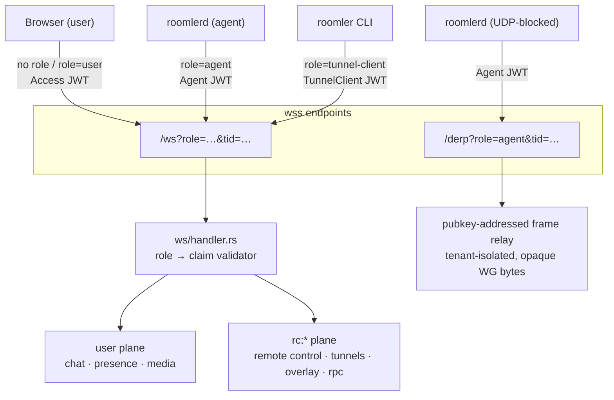

Each role is validated against its own JWT audience — a user token cannot open an
agent socket and vice-versa. An optional `tid=<tenant-hex>` query parameter lets the
front load balancer hash tenant-affine connections onto one pod; tokens must match
the claimed tenant (membership-checked for users).

### Where a native client's credential travels (#3656)

The agent and tunnel-client roles and `/derp` take the device's JWT as
`Authorization: Bearer <jwt>`, as the daemon's HTTP routes always have: a request
line is what access logs and URL-logging proxies record, and a request header is
not. `role` and `tid` stay in the query, because the load balancer hashes on `tid`.
The daemon and the CLI move to the header in 0.4.210; every earlier one sends the
JWT in the query (`token=`), and that keeps working. The browser role reads no
header: it takes the session cookie, or a query token from an older bundle.

| Dial carries | Judged on |
|---|---|
| `Authorization: Bearer <jwt>` | the header |
| `?token=<jwt>` only | the query, as before |
| both | the header; the query is not read, so a refused header is not rescued by a good query |
| `Authorization` with another scheme (Basic, NTLM, Negotiate) | the query, as if no header came |
| neither | refused |

Every check after that is the same for both forms: the audience, the `tid` claim,
the device's row (`refusal_reason`, deletion first) and its token generation. A
refusal of these upgrades is a `401` with `WWW-Authenticate: Bearer
realm="roomler"`, and `error="invalid_token"` when a credential arrived in either
form. A client tries the query form only on a refusal without that `error`: one
from a server older than the header, or one whose header was dropped on the way.
The shared rules live in `crates/remote_control/src/upgrade_auth.rs`.

#### How the daemon and the CLI dial (#3656)

From 0.4.210 every native dial puts its credential in an `Authorization: Bearer`
header whose value is marked sensitive: the daemon's control socket
(`agents/roomlerd/src/signaling.rs:1842`), its central and regional DERP sockets
(`agents/roomlerd/src/derp.rs:424`) and the CLI's tunnel-client socket. The URL
names the role and the tenant only. The rule is one function in each client
(`agents/roomlerd/src/ws_connect.rs:224`, `agents/roomler-cli/src/forward.rs:442`):

| The header-only dial hears | The client |
|---|---|
| `101` | is connected |
| `401` with `error="invalid_token"` (a server that read the credential and refused it) | stops: the daemon's FR-103 recovery and auth ladder take it from there, the CLI reports it |
| a bare `401` (a server older than the header) or a bare `400` (a regional relay older than it) | dials ONCE more with the credential in the query: `token=`, or `ticket=` for a relay |
| `401` with a challenge and no `error` (our server saw no credential: the header was dropped on the way) | dials once more in the query, the same way |
| `403`, `5xx`, a timeout or anything else | handles it as before, with no second dial |

A redial that upgrades notes its endpoint (the URL before its `?`), and the
client's dials there take the query form for 6 h (`QUERY_FORM_FOR`,
`crates/remote_control/src/upgrade_auth.rs:158`): a server or relay older than the
header costs one refused dial per endpoint every six hours, and one updated
meanwhile hears the header again the same day. The note is in memory, per
process. A redial refused too notes nothing, so a refused credential is offered in
the header first again next time. Each dial has its own 30 s limit
(`WS_CONNECT_TIMEOUT`, `DERP_CONNECT_TIMEOUT`, and the CLI's `WS_DIAL_TIMEOUT`,
new: the CLI's dial had none), so a dial that falls back can take two.

tungstenite writes a client's whole upgrade request at TRACE, the `Authorization`
line included, and marking the value sensitive does not reach that line. The
daemon's and the CLI's subscribers drop those lines whatever `RUST_LOG` asks
(`upgrade_auth::may_log`, `crates/remote_control/src/upgrade_auth.rs:243`), with a
global `filter_fn` beside the `EnvFilter` (`crates/agent-core/src/logging.rs:403`,
`agents/roomler-cli/src/cli.rs:829`). Not a directive, on purpose: a fixed
`tungstenite=debug` would raise those crates above the default `warn`, and any
target directive loses to a span-scoped one such as `[org]=trace`, which
`EnvFilter` lets win.

Delivery across pods: WS sessions are pod-local; chat, presence, and notification
events fan out through Redis pub/sub so every pod pushes to its own sockets. Each pod's
subscriber probes its own connection, so one that a lost Redis left deaf is found and subscribes
again within a minute of Redis answering, losing the events in between (at-most-once)
([multi-pod-scale-out.md](multi-pod-scale-out.md#the-subscriptions-3952)).

## User plane (browser)

JSON messages, `{"type": "...", ...}`.

**Client → server**

| Type | Purpose |
|---|---|
| `media:join` / `media:leave` | Enter/exit a room call (mediasoup). FR-127 P1: a join may carry `caps: ["view"]` — this client will report what it renders, [below](#a-meeting-receives-what-is-visible-fr-127-p1) |
| `media:produce` / `media:consume` | Publish / subscribe a track |
| `media:connect_transport` | DTLS-connect a transport |
| `media:producer_close` | Stop publishing |
| `media:producer_pause` | FR-30 — the OWNER paused or resumed one of their producers (camera off, mic muted); the room is told as `media:producer_paused` |
| `media:view` | FR-127 P1 — the viewer's WHOLE rendered set, `{ room_id, seq, video: [{ producer_id, w, h }] }`: the server resumes those video consumers and pauses the viewer's others; no reply |
| `media:play_audio` / `media:stop_audio` | Bot/audio playback control |
| `presence:update` | Presence state |
| `ping` | Keepalive |

**Server → client** (consumed by `ui/src/stores/ws.ts`)

| Event | Purpose |
|---|---|
| `message:create` / `update` / `delete` / `reaction` | Live chat |
| `call:message:create` | In-call chat |
| `room:call_started` / `call_ended` / `call_updated` | Call presence on the room list. A `call_ended` the plan's meeting-length cap caused carries `reason: "plan_limit"`, `max_minutes` and `plan`. One sent because a person's membership ended carries `reason: "not_a_member"` and goes to each of their connections whose seat closed; one sent because the room was deleted carries `reason: "room_deleted"` and goes to each connection seated in the call's media, since the room's member list went with it ([below](#a-room-deleted-mid-call-ends-its-call)) |
| `room:call_ending_soon` | FR-115 P5 — the plan's meeting-length cap (Free: 60 minutes) warns the room's members five minutes before it ends the meeting: `ends_at` (epoch ms), `max_minutes`, `plan`. Shown only to those in that call |
| `typing:start` | Typing indicators |
| `notification:new` / `notification:unread_count` | Notification bell |
| `task:update` | Background-task progress |

The mediasoup signalling (`media:*`) carries router RTP capabilities, transport
parameters, and producer/consumer ids — the SFU forwards RTP between participants
without decoding it.

The meeting-length cap is a **sweep, not a timer** (FR-115 P5): every pod reads
the calls in progress every 30 s and decides each against the org's plan, and the
two writes it can make — the warning and the end — are conditional on the call it
read, so two pods warn and end a meeting once
(`crates/modules/conference/src/meeting_cap.rs:100`). A timer would have lived in the
pod that started the call and died with it on a rolling deploy. The design, its guards
and its one known gap are in
[FR-115 *Meetings, as built*](fr/FR-115-pricing-reshape.md#meetings-as-built-p5).

### The call session: join, leave, socket close, sweep (#3416)

A call is kept in two places. The room holds `conference_status` and `participant_count`,
the number of **people** in the call. Each person's `room_members` row holds `sessions[]`,
one entry per join, open while its `left_at` is null. A session carries the
`connection_id` of the page's socket, so one person can be in a call from several devices
and one device's leave closes only its own session. The count rises when a person's first
open session opens, falls when their last one closes, and the call ends at 0.

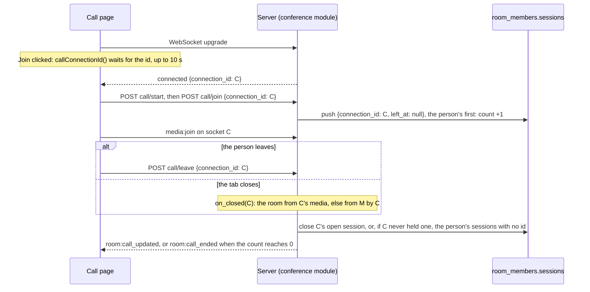

| Moment | Where | What happens |
|---|---|---|
| Join | `ConferenceView.vue:613`, `stores/rooms.ts:273` `callConnectionId`, `:279` `joinCall`; server `call.rs:152`, `dao/room.rs:749` `join_participant` | The page waits up to `CALL_SOCKET_WAIT_MS` (`rooms.ts:263`, 10 s) for its socket's id (`stores/ws.ts:416` `waitForConnectionId`; the id comes with the `connected` frame, `ws.ts:194`), then starts the call and joins naming it. Past the bound it starts and joins nothing, and says why: "Failed to join call: Not connected to the server…" (`ConferenceView.vue:644`). A join on a connection that already holds a session closes that one first |
| Leave | `rooms.ts:288` `leaveCall`, `call.rs:225`, `finalize_call_leave_db` (`call.rs:302`), `leave_participant` (`dao/room.rs:951`) | Names the socket's id at leave time and closes that connection's open session. With no body (older clients) it closes every open session of the person in the room |
| Socket close | `ws_media.rs:83` `on_closed` | The leave the page never sent. The room comes from the socket's media (`media:join`), else from Mongo by the connection id (`:134`), and the same leave runs naming the socket (`:141`) |
| A miss | `dao/room.rs:960`, the close itself `close_sessions` (`:1028`) | A leave or a socket close whose connection **never held** a session in that room closes the person's open sessions there that have no connection id: a page whose join went out before its socket had an id, or an older client's. A connection that holds its own session never touches them. Nor does one that held a session and closed it, because it is leaving twice: a repeated leave, a leave racing its socket's close, a leave after the call ended. A closed session keeps its `connection_id`, so the filter can tell (`$ne` on `sessions.connection_id`) |
| Sweep | `maintenance.rs:63` `close_orphaned_call_state`, every rollup cycle | Closes the open sessions in rooms that are **not** `in_progress`. A room in progress is skipped, so the sweep never reaches a session that keeps its call's count above 0 |
| Boot | `maintenance.rs:21` `stale_call_reset`, at startup under the lease (`crates/modules/conference/src/lib.rs:290`) | No call outlives a server start: every `in_progress` room is ended, then the sweep runs |
| Room deleted | `crates/modules/chat/src/room.rs:373`, `dao/room.rs:348` `cascade_delete` | The room's `room_members` rows go with its document, and their sessions with them. The call ends for everyone in it, on the pod serving it ([below](#a-room-deleted-mid-call-ends-its-call)) |

What a leave naming connection C may close:

| The open session | Closed? |
|---|---|
| the person's, connection C | yes |
| the person's, no connection id | only when C never held a session in that room |
| the person's, another connection | never: that is their other device |
| another person's | never: the update is keyed by the leaver's own `user_id` |

**Why a miss closes every session with no id, not only the oldest.** Such a session names
no device. On a miss the leaver's own session is among them, if it has one, and nothing
says which. Closing only the oldest would leave the leaver listed whenever an older dead
one sits beside it, which is the bug itself. Closing them all always takes the leaver out.

**What it does not heal.** Since #3416 the page never sends a join without the id, so
sessions with no id come only from older cached bundles, and these three cases last only
while those are in use:

1. A dead session with no id beside a later session of the same person that has one: that
   later session's leave closes only its own. The boot reset clears it at the next roll.
   An older bundle leaves exactly this when its first `media:join` finds the socket not
   open yet. The store's retry (`stores/conference.ts:172`) joins again on the open socket,
   this time with the id, so the person holds both sessions, and the page's leave closes
   the scoped one.
2. Two devices of one person that both joined without an id (both older bundles, both
   raced): a miss from one closes both, so the other drops off the list while still in the
   call, and a call the person was alone in ends.
3. A page whose socket redialled mid-call holds nothing under its new id, because the old
   socket's close took its session. Its Leave is a miss, and closes the person's sessions
   with no id in that room: an older bundle's, on another of their devices.

The disconnect cleanup reaches a session only through the socket's media or its own id,
so a socket that was never in the call, such as another tab of the same person, closes
nothing.

**Tests.** The #3416 block in `crates/tests/src/conference_tests.rs:2084`: a join with no
body, then a leave or a socket close; two devices; another person's session; a device that
already left, leaving again; a repeated leave; a socket never in the call. `ui/src/__tests__/stores/rooms.spec.ts:259`: the wait
and the refusal. `ui/e2e/conference-fast-join.spec.ts` holds back the socket's frames until after
the click, against a real API, and reads the outcome from the server's participant list.

### Who may use `media:*`: the participants of the call

The socket path admits only someone the REST path admitted. A connection may send a
`media:*` command for a room only while it is a participant of that room's call, and the
participation gate (`crates/modules/conference/src/media_gate.rs`) decides before any
handler runs.

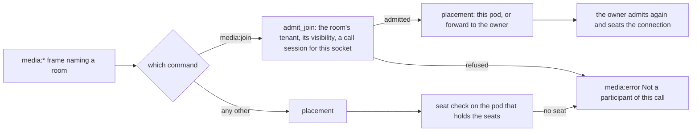

| Command | Requires | Checked |
|---|---|---|
| `media:join` | What `call/join` checks: a member of the **room's** tenant (read from the room, never from the frame), the room's visibility, and an open call session for **this** connection, or one with no connection id (an older client). A session opened for another socket of the same person does not count | `media_gate.rs:114` `admit_join`, the session by `dao/room.rs:1108` `has_open_call_session`. Before placement (`ws_media.rs:166`), so a refused join claims no room and builds no router, and again on the pod that seats the connection, the owner of a forwarded join (`media_cluster.rs:982`) |
| every other `media:*` | This connection's seat in the room's media, as this user: a participant entry that only an admitted join creates | `media_gate.rs:151` `seat`, by `room_manager.rs:1086` `holds_seat`, in `dispatch_media_local` (`ws_media.rs:247`) on the pod that runs the command, so a forwarded command is checked at the owner, where the seats are |

- The handlers take the gate's proof, a `JoinPass` or a `Seat`, never a bare room, user or
  connection id (`dispatch_seated`, `ws_media.rs:265`). A new handler has nothing else to
  act on.
- A refusal says the same for every reason, `Not a participant of this call`
  (`media_gate.rs:35`). Only join, produce and consume answer at all, as they answered
  their failures before; the reason goes to the log.
- `media:play_audio` plays only a live file of the call's own room, in the room's tenant,
  and each playback carries its own `playback_id` (`ws_media.rs:1026`).
- `GET /api/cluster/status`, which lists every live meeting room on a pod, is for platform
  admins only (`crates/api/src/routes/cluster.rs:23`).

**Tests.** `crates/tests/src/conference_gate_tests.rs`: an account of another org, a member
outside a Private room and a member not in the call each get nothing from any `media:*`
command, and nothing of theirs reaches the call; the participant path end to end; a
playback of another room's file, or of a removed one.
`cluster_tests::cluster_status_is_for_platform_admins_only`.

### A seat ends with the membership that admitted it

The gate checks membership once, at `media:join`. The seat it admits lasts only as long as
that membership: when someone is removed from the org or leaves it, or leaves the room, any
seat they hold in a call of that org or room goes at once, on whichever pod serves the call.
When no word of it reaches that pod, the pod finds it by its own seat check, within 40 s
([below](#the-pod-serving-a-call-checks-its-own-seats)).
The membership's owner tells `conference` through core's `MembershipLifecycle` hook
(`crates/core/src/hooks.rs:194`), after the membership row is gone, so nothing can be
admitted on it again while the seats are withdrawn. A room deleted mid-call ends every
membership of it at once, and so its whole call
([below](#a-room-deleted-mid-call-ends-its-call)).

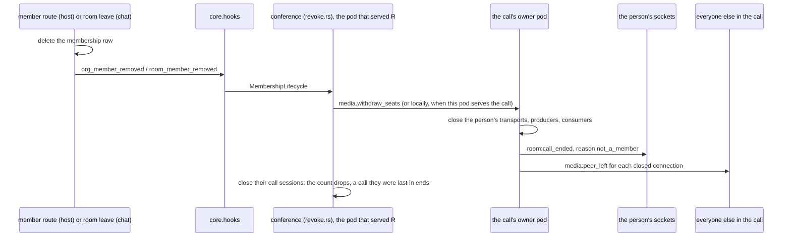

| Trigger | Told by | What ends |
|---|---|---|
| Removed from the org by an admin, or left it (`DELETE …/member/{user_id}`) | `crates/api/src/routes/user.rs:239`, `org_member_removed` | every call of the org they may sit in: the rooms they belong to whose call is live, and any where they still hold an open call session (`dao/room.rs:1141` `call_rooms_of_member`), plus any room on the pod where they sit (`revoke.rs:251`). Their open call sessions close through the hang-up path, `finalize_call_leave_db` |
| Left the room (`POST …/room/{room_id}/leave`) | `crates/modules/chat/src/room.rs:239`, `room_member_removed` | their seats in that room's call (`revoke.rs:223`). The membership row held their call sessions, so the leave itself drops the call's count (`dao/room.rs:526`), and a call they were the last one in ends (`call.rs:331` `settle_call_after_departure`) |
| The room was deleted (`DELETE …/room/{room_id}`) | `crates/modules/chat/src/room.rs:393`, `room_removed` | the room's call, for everyone in it (`revoke.rs:120` `room_deleted`): every seat, the router, the claim and the call's stats record ([below](#a-room-deleted-mid-call-ends-its-call)) |

- The seats close on the pod that holds them (`revoke.rs:355` `withdraw_seats_here`), reached
  over the bus as `media.withdraw_seats` when it is the other pod (`revoke.rs:316`,
  `media_cluster.rs:882`). A withdrawal that does not reach that pod (no answer within the
  bus deadline, or no bus on this pod) is not taken to mean the pod is gone: it may be alive
  and serving the call. It is a warning with the org, the room, the person and the pod
  (`alert = membership_seat_unreached`), conference's hook still answers `Ok` so the hooks
  after it run, and the pod serving the call ends the seat by its own check where it runs
  one ([below](#the-pod-serving-a-call-checks-its-own-seats)). A request that was only late
  closed the seat there and settled nothing: a call a room leave emptied stays `in_progress`
  at count 0 until the next leave in it or the next pod start (`maintenance.rs:21`
  `stale_call_reset`), as before the check. An org removal's hook settles the call itself.
- `room:call_ended` is what the web client already reads as "this call is over for you"
  (`ui/src/stores/ws.ts:351`): it tears the call down, with no client change.
- A join already on its way when the membership ends asks the gate again once its seat
  exists (`ws_media.rs:457`): either the withdrawal sees that seat, or the seat sees the
  membership gone and closes itself before the client hears anything.
- The routes answer the membership change whatever the hook says, since it has happened; a
  hook that fails (a database read or write of the call's books) is logged as an error with
  the org, room and person. A pod the withdrawal did not reach is no failure of the hook.
- Before the seats, `network` (first in `HOOK_ORDER`) removes the tunnel clients the person
  owns in the org ([tunnels.md](tunnels.md#what-ends-a-tunnel-client)). It never stops the
  cascade, so a failure there cannot keep a seat or a room membership alive.
- After the seats, `chat` (the record owner, later in `HOOK_ORDER`) drops the person's room
  memberships of the org they left (`crates/modules/chat/src/membership.rs`). Every room
  fan-out (messages, reactions, pins, typing, mentions) is addressed to those rows, so the
  org's rooms stop reaching the person with the org membership. Rows of people no longer in
  the org are ended by `POST /api/admin/room-members/prune`, an operator step (a dry run
  by default, bounded, idempotent).

**Tests.** `conference_gate_tests`: a member removed from the org, one who leaves it and one
who leaves the room each lose the seat at once (their client hears the call ended, the host
sees them leave, their transports, producers and consumers close, the host's consumer of
their camera closes, they are off the participant list and the count, and their socket gets
nothing more); `the_last_participant_leaving_the_room_ends_its_call`.
`cluster_tests::an_org_removal_on_one_pod_withdraws_the_seat_the_other_pod_holds` and
`a_room_leave_on_one_pod_withdraws_the_seat_the_other_pod_holds`.

### The pod serving a call checks its own seats

A withdrawal reaches only a pod that answers. When the bus request is lost or late, when
the pod that took the membership's end has no bus, when the pod serving the call runs an
older image during a roll, or when a membership goes by a path that never calls the hook,
no word reaches the seat, and the pod serving the call is not gone: the person would keep
hearing and being heard in a meeting of an org or a room they no longer belong to. So that
pod checks its own seats (`crates/modules/conference/src/seat_check.rs`). Its reads pick the
seats whose admission reads as gone twice in a row, a pass apart; the room guard `media:join`
runs then decides each, and only its refusal ends the seat there.

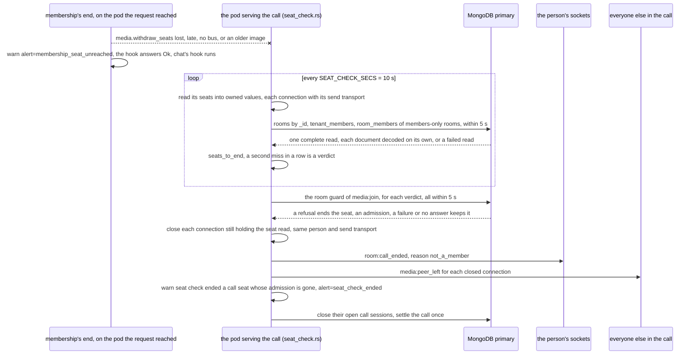

- **The loop.** Every pod runs it in a task of its own (`seat_check::spawn`,
  `seat_check.rs:280`, started at `crates/modules/conference/src/lib.rs:194`), every
  `SEAT_CHECK_SECS` = 10 s (`seat_check.rs:109`), the room reconcile's cadence. A pass is a
  read half and an end half, in that order (`check_seats_once`, `:341`). The read half
  (`read_seats`, `:370`) first reads the pod's seats out of the room manager into owned
  values (`seats_here`, `:325`): each person in each room, with their connections and the
  seat each holds, its send transport's id (`HeldSeat`, `:320`), which every join makes
  anew. No guard of the room manager is held across a read. The end half (`end_seats`,
  `:418`) ends only what the read half hands it, and a test drives the two apart to act
  between them.
- **The reads pick, the guard decides.** The reads re-check two of the three checks
  `media:join` passed (`media_gate.rs:114`): membership of the room's org (the `tenant_id`
  the room records), and, in a room whose visibility `requires_membership()` (Private,
  Secret), a room membership. Each counts as `is_member` counts it: `{tenant_id, user_id}`
  for the org, `{tenant_id, room_id, user_id}` for the room. The third, an open call session
  for the connection, is not re-read: a person's other tab, or a call whose sessions a sweep
  closed, would lose a seat they are entitled to. What the reads find is a cheap filter: it
  picks the seats to ask the room guard about, and the guard's own answer decides each, so
  any admission path the guard has or gains keeps its seats with no change here.
- **One read a pass, three queries, from the primary** (`read_admissions_unbounded`,
  `:907`): the rooms by `_id`; `tenant_members` by `$in` lists of the rooms' orgs and the
  people, on its unique `(tenant_id, user_id)` index (`crates/db/src/indexes.rs:155`); and,
  for the members-only rooms only, `room_members` by `$in` lists of their orgs, the rooms and
  the people, the three fields `RoomDao::is_member` names
  (`crates/services/src/dao/room.rs:565`), served by the unique `(room_id, user_id)` index
  (`crates/modules/chat/src/lib.rs:224`) with the org checked on the rows it fetches, or by
  `(user_id, tenant_id)` (`:225`); no index is new. Each query has a projection and reads the
  primary whatever the connection string says (`seat_check.rs:951`), so a person added a
  moment ago reads as a member, as the join's own gate read them; all three together within
  `READ_TIMEOUT` = 5 s (`:117`). A pod with 300 seats in 20 rooms makes three indexed queries
  every 10 s, with `$in` lists of at most 20 rooms, their orgs and the seated people, and
  reads back at most about 620 small documents; a pod with no seats reads nothing.
- **The verdict** (`seats_to_end`, `:219`, a pure function), counted by the person in the
  room. A seat whose admission the `MISSES_TO_END` = 2nd complete read in a row finds gone
  (`:113`) is a verdict. A read that fails, breaks off or is late changes nothing, not even
  what it forgets, and from the `FAILED_READS_TO_WARN` = 3rd in a row each one warns
  (`:121`). A person found admitted, one seated in a room the read found no document for
  (the reconcile's case, [below](#a-room-deleted-mid-call-ends-its-call)), and one a document
  that did not decode bears on all start again from zero, and a seat no longer held is
  forgotten.
- **A document that does not decode costs only its own seats their verdict.** Each room
  document and each membership row decodes on its own (`RoomsRead::decode`, `:677`;
  `decode_rows`, `:748`). One that does not fails no read: the seats it bears on read
  `Unreadable` (`:178`), and every other seat reads as the complete read would read it
  without that document (`readings_of`, `:828`). When in doubt, more seats lose their
  verdict, never fewer:

  | The document that does not decode | The seats it bears on, which get no verdict |
  |---|---|
  | a room (a visibility the model does not know, a `tenant_id` that is not an id) | the room's own. It stays out of the membership reads, and its `_id` decodes, since the read matched it by `_id` |
  | a `tenant_members` row (an id in an array, an id missing) | every seat whose room's org is among the row's `tenant_id` values and whose person is among its `user_id` values |
  | a `room_members` row | every seat whose room is among the row's `room_id` values and whose person is among its `user_id` values, whatever its `tenant_id` |

  A value is the id itself or an array's elements, and a field that holds no id could name
  any. ⚠️ A membership row that does not decode is never "absent": `TenantDao::is_member`
  counts rows without decoding them (`crates/services/src/dao/tenant.rs:593`), so the guard
  admits a person through an org row whose `tenant_id` is an array holding the org, and
  skipping such a row would end a seat the guard admits. A `room_members` row of no org or
  of another org is no doubt: the filter never matches it, as the guard's own filter never
  does. Each document that does not decode warns (`ODD_DOCUMENT`, in the log below); while it
  stays so, a pod warns about it at most once an hour (`ODD_DOCUMENT_WARN_EVERY`, `:140`),
  and again at its first pass after a start.
- **The room guard decides each end** (`ask_the_room_guard`, `:535`). For each verdict the
  end half asks `roomler_ai_mod_chat::guards::require_room_in_tenant_with`
  (`crates/modules/chat/src/guards.rs:89`), the function `media:join`'s gate runs
  (`crates/modules/conference/src/guards.rs:24`), about the person, in the org the read found
  for the room. Its two DAOs sit on a handle that reads the primary (`on_the_primary`,
  `seat_check.rs:579`), as the check's own reads do: the driver's default is the primary, but
  a connection string naming another read preference would move the default DAOs to a
  secondary, where a lagging one could admit a person whose row is gone or refuse one added a
  moment ago. At most `GUARD_READS_AT_ONCE` = 8 asks run at once (`:149`), all within one
  deadline of `READ_TIMEOUT` (`:539`). Only a refusal ends a seat, matched by the error's
  variant (`guard_word`, `:518`), never by its message, and never through `admit_join`'s
  folded refusal:

  | The guard answers | The seat |
  |---|---|
  | `NotAMember`: not in the room's org (`chat/src/guards.rs:49`) | ends, and `ENDED` names the refusal (`guard = not_a_member`) |
  | `Forbidden`: a private room the person is not in (`:81`) | ends (`guard = forbidden`) |
  | `NotFound`: no live room of that id in the org (`:51`), or a secret room the person is not in (`:79`) | ends (`guard = not_found`) |
  | `Ok`: it admits the person | stays, and warns `GUARD_ADMITS` with what each read found |
  | any other error (a failed read, a row its typed read cannot decode), or no answer by the deadline | stays: debug, and from the 3rd in a row a warning |

  A verdict the guard does not refuse is spent, and the seat is read again from zero, so a
  guard that does not answer keeps it for two more passes at least. The 24-cell matrix test
  stays as the other direction: wherever the guard refuses, the reads find the seat gone.
- **One teardown, counted once.** A seat the guard refuses ends as a withdrawal that reached
  it ends (`revoke::withdraw_these_seats_here`, `revoke.rs:372`), for each connection still
  holding the seat the pass read: the same person and the same send transport, decided and
  removed under one lock of the room's map (`RoomManager::close_participant_seat`,
  `media/room_manager.rs:1280`, one `remove_if`). A connection that took a seat again since
  (a rejoin on it makes a new send transport) or closed meanwhile (a hang-up, a withdrawal
  that came late) is left alone, and a seat taken since is the next passes' to judge. Each
  connection closed hears `room:call_ended` with `reason: "not_a_member"` once, and everyone
  left hears `media:peer_left` once for it. Then the call's books, as a hang-up keeps them
  (`seat_check.rs:485`): the person's open call sessions in the room close and the count
  drops (`finalize_call_leave_db`, `call.rs:302`), and the call is settled once: by finalize
  when it closed their last session, else by the check (`settle_call_after_departure`,
  `call.rs:331`), as when the membership's hook closed the sessions already or finalize
  failed. So a call they were the last one in ends on the pod where its media is. A pass that
  closed nothing for a verdict logs nothing and keeps no books. A room row deleted by a raw
  write took its call sessions with it; the count it leaves is the stale sweep's, not the
  check's. ⚠️ **The cross-pod repeat stays.** Where the pod that took an org membership's end
  closed the person's sessions (its hook's finalize settles the call, `revoke.rs:251`) and
  the pod serving the call then ends the seat by its check, that pod settles too: the room's
  members hear `room:call_updated` twice, with one count. Nothing dedupes it across pods.
- **The bound.** On a pod whose reads succeed, a seat whose admission is gone ends within
  `2 × (SEAT_CHECK_SECS + 2 × READ_TIMEOUT)` = 40 s of the membership's end: the read under
  way then, two sleeps, the two reads that miss and one ask of the room guard, each at its
  5 s limit (each takes milliseconds on a healthy pod, so the seat goes in about 20 s). Asks
  about other seats in the same passes can add up to 5 s to each of the two passes before the
  deciding one, 50 s at most: many seats ending at once (an org removal of a person seated in
  many rooms on one pod) cost one ask each, 8 at a time, all within their pass's one 5 s
  deadline. A guard that does not answer keeps the seat for two more passes. Before the
  guard decided, the bound was `2 × (SEAT_CHECK_SECS + READ_TIMEOUT)` = 30 s.
- **Doubt keeps the seat.** Wherever the guard admits, the seat stays, whatever the reads
  found, and a read or an ask that fails or is late keeps every seat it bears on. A room that
  still has a document, a tombstone included, is judged by its memberships, as the reconcile
  reads "no document" literally: the guard, which answers 404 for a tombstone, is asked only
  about a seat whose admission the reads found gone.
- **The window that is left.** A person added back after the guard's read and before the
  close loses the seat they held, and is admitted again on their next join. Before the guard
  decided, the same read-then-act window ran from the deciding read to the close, wider.
- **Who holds a seat.** Every participant entry is made by `RoomManager::create_transports`
  (`media/room_manager.rs:333`), whose one caller, `handle_media_join` (`ws_media.rs:442`),
  takes a `JoinPass` that only `admit_join` mints (`media_gate.rs:138`). A recording is no
  seat (a member uploads it over REST), and the room manager's RTP taps are kept apart from
  its participants. ⚠️ A seat made any other way (a recorder, a bot, a pipe between pods or
  workers: anything no membership admits by design) must be skipped by the check, or the
  check ends it.
- **The switch.** `ROOMLER__CONFERENCE__SEAT_CHECK` (`SWITCH`, `seat_check.rs:124`) is read
  from the environment only, once, as the pod starts: no config file sets it (`Settings` has
  no `conference` section), and turning it off takes a pod restart with the variable set,
  not a new image. `spawn` reads it in one line and hands the value to `start` (`:289`),
  which the tests drive with each value. `false`, `0`, `off` or `no`, in any case and with
  the space around it aside, turns the check off on that pod; unset, empty, `true`, `1`, `on`
  or `yes` leaves it on; any other value leaves it on and warns (`SWITCH_UNKNOWN`), so a typo
  never turns it off unseen (`switch_of`, `:263`). As it starts, a pod logs
  `seat check: on this pod` or `seat check: off on this pod` at info; with it off, a seat no
  withdrawal reached keeps its call.
- **The log, read by hand.** Each line has one wording, and most an `alert` field: a handle
  for a person reading the pod logs, on which nothing files or pages. Count them with
  `grep -F` on ANSI-stripped text:

  | Line (its wording, and what it carries) | `alert` | Expected | A count above that means | Seen firing in |
  |---|---|---|---|---|
  | `seat check: on this pod` / `seat check: off on this pod`, info (`seat_check.rs:307`, `:292`) | none | one of the two at each pod's start | | every test app's log |
  | `seat check: ended a call seat whose admission is gone` (`ENDED`, `:132`): the org, the room, the person, the connections closed, both readings and the guard's refusal (`guard`) | `seat_check_ended` | one per seat no withdrawal reached, beside a membership's end | a seat ended with no membership's end near it: read its two readings and its `guard` | `cluster_tests::an_org_removal_the_pod_serving_the_call_did_not_hear_ends_the_seat_there` |
  | `seat check: the room guard admits a seat its reads found gone; the seat stays` (`GUARD_ADMITS`, `:145`): the org, the room, the person and both readings | `seat_check_guard_admits` | 0 | the reads and the guard disagree (an admission path the reads do not know): the seat stays | `seat_check_tests::a_seat_the_room_guard_admits_is_not_ended_whatever_the_reads_found` |
  | `seat check: a document did not decode; the seats it bears on get no verdict` (`ODD_DOCUMENT`, `:135`): the collection, the `_id` and the fields read | `seat_check_odd_document` | 0 | a document the models cannot read: the seats it bears on go unchecked while it stays | `seat_check_tests::a_document_that_stays_odd_warns_once` |
  | `seat check: the switch has a value it does not know; the check runs on this pod` (`SWITCH_UNKNOWN`, `:128`): the value | `seat_check_switch_unknown` | 0 | a mistyped switch: the check runs anyway | `seat_check_tests::the_switch_decides_inside_spawn` |
  | `seat check: the admissions read keeps failing; no seat ends here until it reads again` (`:386`) | none | 0 | a pod that ends no seat until it reads again | `seat_check_tests::a_failed_read_ends_no_seat_and_keeps_the_count` |
  | `seat check: the room guard keeps failing to answer; the seat stays` (`:452`) | none | 0 | a guard that cannot read: every verdict is kept | `seat_check_tests::a_seat_whose_room_guard_cannot_answer_is_kept` |
  | `call seat withdrawal did not reach the pod serving the call; that pod's seat check ends the seat where it runs one, and a pod without the check keeps it` (`revoke.rs:316`): the org, the room, the person and the pod, on the pod that took the membership's end | `membership_seat_unreached` | once per room with a remote claim when a removal lands in a roll's mixed minute, else 0 | a bus that did not answer | `cluster_tests::an_org_removal_the_pod_serving_the_call_did_not_hear_ends_the_seat_there` |

  The unreached line keeps its prefix, `call seat withdrawal did not reach the pod serving the
  call`, byte for byte, so a roll's count reads it on both images; only what follows the
  semicolon changed.
- **Mixed versions.** The check runs where the seat lives and adds no message:
  `media.withdraw_seats` and its reply are unchanged, so pods on either image ask and answer
  each other as before. During a roll, the pod on the previous image runs that image's check:
  before #3950, one that ends a verdict on its own reads with no word from the guard; before
  #3839, none, and a seat it serves that no withdrawal reached lasts until that pod is
  replaced.

**Tests.** `seat_check::tests`: a seat ends on its second miss in a row and not before; an
admitted seat never ends; a failed read changes nothing; one miss then found starts again
from zero; no room document and no reading give no verdict; only the seat whose admission is
gone ends; a seat no longer here is forgotten; both readings are reported; the switch knows
its on and off values and no others; a room document decodes with the model's visibility
default; the readings of a world of documents are the ones a complete read gave before, and
a room document, an org row or a room row that does not decode costs only the seats it could
name their verdict (`the_worlds_readings_are_the_ones_master_gives` and the three after it);
the room rows are read by the rooms' orgs, as the guard reads them;
`only_a_refusal_of_the_room_guard_ends_a_seat`;
`a_document_that_stays_odd_warns_once_an_hour_at_most`. `media::room_manager::tests`:
`a_close_of_a_gone_or_a_foreign_connection_reports_false_and_changes_nothing` and
`a_close_of_a_seat_taken_again_on_its_connection_reports_false_and_keeps_it`.
`seat_check_tests` (one pod; each cell drives its own passes, the read and the end half apart
where it says so, within the background loop's 10 s window):

| Test | What it pins |
|---|---|
| `a_room_document_that_does_not_decode_costs_only_its_own_seats_their_verdict` | a room of a visibility the model does not know blinds the pass to no other seat |
| `an_org_row_that_does_not_decode_keeps_the_seats_it_could_admit_and_blinds_no_other` | an org row with an array `tenant_id`, which the guard admits by, gives that seat no verdict, and another seat ends |
| `a_room_row_that_does_not_decode_keeps_the_seats_it_could_admit_and_blinds_no_other` | the same for a room row with an array `room_id` |
| `a_room_row_without_its_org_is_not_read` | a `room_members` row with no `tenant_id` is not read, so it blinds the pass to nothing |
| `a_room_row_of_no_org_does_not_hide_the_seat_it_names` | nor does it hide the seat it names: the guard refuses, and the seat ends |
| `a_document_that_stays_odd_warns_once` | `ODD_DOCUMENT` fires, once over three passes, and ends nothing |
| `a_failed_read_ends_no_seat_and_keeps_the_count`, `a_late_read_ends_no_seat_and_keeps_the_count` | a read that fails (the 3rd in a row warns) or is late ends nothing and keeps the miss before it |
| `one_person_on_two_connections_loses_both_seats_counted_once` | both connections close, under one key, each frame heard once |
| `an_ended_seat_settles_its_call_once` | the host hears one `room:call_updated`, as a hang-up gives |
| `a_seat_the_room_guard_admits_is_not_ended_whatever_the_reads_found` | a verdict for an entitled person ends nothing and `GUARD_ADMITS` fires; the same verdict ends the seat once the guard refuses |
| `a_seat_whose_room_guard_cannot_answer_is_kept` | a guard that cannot be reached keeps the seat (the 3rd in a row warns) |
| `a_pass_ends_only_the_seat_it_read`, `a_join_on_a_new_connection_after_the_read_is_not_ended_by_that_pass` | a rejoin on the same connection, or a join on another, between the read and the end keeps its seat |
| `a_reached_withdrawal_during_a_pass_leaves_it_nothing_to_end` | a withdrawal that reached the seats first leaves the pass nothing, each frame heard once |
| `the_switch_decides_inside_spawn` | no loop for each off value; a loop, and `SWITCH_UNKNOWN`, for a value it does not know |

`cluster_tests`:
`an_org_removal_the_pod_serving_the_call_did_not_hear_ends_the_seat_there` and
`a_private_room_leave_the_pod_serving_the_call_did_not_hear_ends_the_seat_there` (the pod
serving the call cannot be reached: the removal answers, chat's hook runs, and the seat ends
within the bound with `not_a_member`, the call going on for the host, counted once; both
fail without the check), `the_seat_checks_reading_agrees_with_the_room_guard_in_every_cell`,
`an_entitled_member_keeps_the_seat_across_seat_checks`,
`a_person_the_rooms_visibility_admits_without_a_room_row_keeps_the_seat` and
`the_seat_check_ends_only_the_seat_whose_admission_is_gone_and_once` (the same person's seat
in another room of the org and in a room of another org stays, a call they were the last one
in ends, and passes after the closes end nothing).

### A room deleted mid-call ends its call

Deleting a room (`DELETE /api/tenant/{tenant_id}/room/{room_id}`, `MANAGE_CHANNELS`) ends
every membership of it at once: `cascade_delete` (`dao/room.rs:348`) removes the room's
document and its `room_members` rows, and the call sessions those rows held go with them.
The call running in the room ends with them, for everyone in it, on whichever pod serves
it. `chat` tells `conference` through `MembershipLifecycle::room_removed`
(`crates/core/src/hooks.rs:229`) once the room is gone
(`crates/modules/chat/src/room.rs:393`).

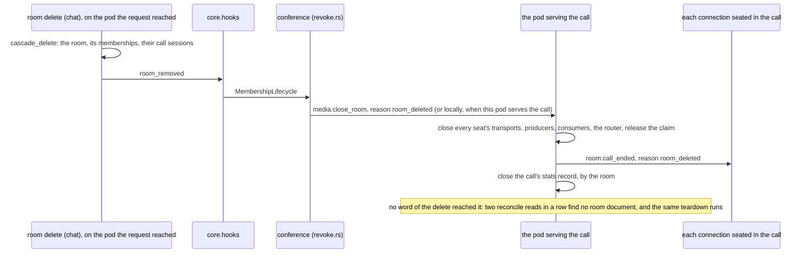

- **The order: the delete first, then the hook.** Every admission reads the room's document
  (`media_gate.rs:127`), so once it is gone nothing new is admitted while the call ends. A
  join or a start already on its way when the room went looks again once it has built its
  seat or its router (`ws_media.rs:466`, `call.rs:62`), and a room that is gone takes an
  empty router with it.
- **One teardown.** Whatever finds a deleted room's call ends it in `close_room_here`
  (`media_cluster.rs:475`), the way `call/end` ends a call: every seat's transports,
  producers and consumers close, the router goes and the claim is released. The release
  waits at most `CLAIM_RELEASE_BOUND`, 2 s: a Redis link lost without a reset parks a
  command with no answer, and the people are told all the same, while the record's own
  30 s TTL ends the claim. Each connection
  that was seated hears `room:call_ended` with `reason: "room_deleted"` (`revoke.rs:170`
  `deleted_rooms_call_ended`), and the call's stats record closes by the room
  (`dao/stats.rs:462`), because the room's `current_call_id` went with its document. The
  member list went too, so the connections to tell come from the call's media, and they are
  told wherever their sockets are (`send_to_connection_routed`).
- **The other pod.** A delete that reaches the pod not serving the call asks the one serving
  it over the bus: `media.close_room` with `reason: "room_deleted"` (`media_cluster.rs:397`
  `close_room_everywhere`, handled at `:898`). The hook awaits one directory read, at most
  one request whose reply waits at most `RPC_DEADLINE`, 2 s
  (`crates/core/src/cluster/bus.rs:42`), a second read and a release when no reply comes,
  and one update of the stats record.
- **The delete waits a bounded time.** The hook runs in a task of its own, and the delete
  waits for it at most `ROOM_REMOVED_BOUND`, 5 s (`crates/modules/chat/src/room.rs:351`),
  well above the slowest healthy teardown. Past the bound (a Redis or Mongo node lost
  without a reset hangs a read without end), or when the client hangs up, the delete
  answers and the teardown goes on: it is never cut off between a router removed and its
  people told. The task itself logs how the teardown ended, so a failure past the bound is
  still seen: an error names each holder that failed, and a teardown that ends after the
  delete answered says how long it took.
- **The pod serving the call ends it on its own** when no word of the delete reached it: the
  hook failed, its request was lost, or a pod whose code ends no call served the delete. Its
  reconcile (`end_calls_of_rooms_gone`, `media_cluster.rs:704`), a loop of its own every
  `MEDIA_REFRESH_SECS` = 10 s (`:934`), apart from the claim heartbeat so that neither
  waits for the other, reads the documents of the rooms it serves media for, and a room
  with no document in `MISSES_TO_END` = 2 reads in a row (`:680`) is gone: its call ends
  through the same teardown, within about 20 s. Only a read that completes counts: one that
  fails, breaks off or takes longer than 5 s (`:684`) changes nothing, and from the third
  failed read in a row (`FAILED_READS_TO_WARN`, `:688`) each one is a warning, so a
  reconcile that cannot read shows in the log. "No document" is literal: a legacy room that
  still carries `deleted_at` has a document, and its call is left alone. The reconcile runs
  on every pod, whether or not it has a cluster directory.
- **The delete answers 200 whatever the hook says**, since the room is gone. When the pod
  serving the call could not be reached (`RoomClose::NotReached`, `media_cluster.rs:377`),
  the hook fails, the delete logs it as an error with the org and the room, and that pod
  ends the call itself as above. When no reply comes in time, the claim is read again
  (`media_cluster.rs:434`): a claim gone with the media means that pod closed the call and
  answered late, and nothing failed (`RoomClose::Owner` with no seats); a claim that still
  names it, as a crashed pod's does until its record runs out, is pruned and stays a
  failure. Every holder of `room_removed` runs even when one before it fails
  (`crates/core/src/hooks.rs:394`), and the error names each failure. A stats record that
  does not close behind the reconcile or a guard of a join or a start is closed by the stats
  rollup's orphan sweep as `stale_reset` within 15 minutes (`maintenance.rs:63`
  `close_orphaned_call_state`, each cycle at `crates/api/src/stats_rollup.rs:633`).
- **It is idempotent.** A call that already ended, or a second `room_removed`, finds no
  media and no open record: nothing closes and nobody hears anything.
- **During a roll**, a pod on the previous image that serves the call takes the request as
  an ended call: its seats, router and claim go, but its people hear nothing until that pod
  is replaced. A request with no `reason`, as the previous image sends, closes the room as
  an ended call, as before.
- The web client reads `room:call_ended` as "this call is over for you" whatever its reason
  (`ui/src/stores/ws.ts:351`), so a deleted room needs no client change.

**Tests.** `conference_gate_tests`: `deleting_a_room_mid_call_ends_its_call_for_everyone_in_it`,
`deleting_a_room_leaves_a_call_in_another_room_alone` (the deleted room has no call, and
the call's people are members of it),
`removing_a_room_whose_call_ended_or_a_second_time_tells_no_one`,
`a_room_removed_again_after_its_call_ended_ends_nothing_twice`,
`a_call_whose_room_is_gone_is_ended_by_the_pod_serving_it`,
`a_router_left_for_a_room_already_gone_is_reaped` and
`a_room_delete_answers_at_its_bound_and_its_teardown_runs_on` (a holder that outlasts the
bound: the delete answers at the bound and the holder still runs to its end; it fails both
with the hook awaited inline and with a plain timeout around it). `cluster_tests`:
`a_room_deleted_on_the_pod_serving_its_call_ends_the_call_on_both_pods`,
`a_room_deleted_on_the_other_pod_ends_its_call_on_the_pod_serving_it`,
`a_call_whose_room_is_gone_is_ended_by_the_pod_serving_it_across_pods`,
`the_pod_serving_a_deleted_rooms_call_tells_its_own_people`,
`a_room_deleted_while_the_pod_serving_its_call_cannot_be_reached_ends_it_afterwards` (the
delete answers within the bound, and the reconcile ends the call) and
`a_close_answered_too_late_after_its_claim_went_is_no_failure`. The two-miss rule and the
close request's reason are unit tests in `media_cluster::tests`, and every holder running
past a failing one is `hooks::tests::a_holder_that_fails_a_deleted_room_does_not_stop_the_others`.
The guards of a join and a start that raced the delete have no test of their own: reaching
either needs the room to go between two reads inside one request, which no test can time
without a seam in production code. What they miss, the reconcile reaps within two passes
(`a_router_left_for_a_room_already_gone_is_reaped`).

### A socket's `media:*` frames are limited

Each socket has a token bucket for its `media:*` frames: `[meetings] media_frame_burst`
frames at once (400), refilled at `media_frame_rate` a second (20)
(`crates/config/src/settings.rs:319`, `:324`; env `ROOMLER__MEETINGS__MEDIA_FRAME_BURST` and
`…_RATE`; `0` turns the limit off). A frame is counted on the pod that holds the socket, as it
arrives and before anything is looked up for it (`ws_media.rs:56`), so a frame forwarded to
the call's owner pod is counted once, where it came in.

| A frame over the limit | Where |
|---|---|
| is not run, and the socket hears `media:error` with `code: "rate_limited"`, `retry_after_ms` (the time until the bucket holds a frame again) and a `message` | `crates/modules/conference/src/frame_limit.rs:48` `refused` |
| leaves the socket open: a client that overruns loses that frame, never its socket or its call | the same |
| counts in `media_frames_rate_limited_total` on `GET /api/cluster/status` | `crates/core/src/cluster/metrics.rs:38`, `crates/api/src/cluster/metrics.rs:63` |
| is logged: the socket's first refusal at warn, and its total at info when it closes | `frame_limit.rs:48`, `:85` `socket_closed` |

**How deep, measured.** The deepest burst a real client sends is a join into a large
meeting: the join, one `media:consume` for every producer already in the call, back to back
as fast as the answers come (`consumeChain`, `ui/src/stores/conference.ts`), both
transports' connects, its own camera and microphone, and the view reports its tiles trigger.
`conference_rate_tests` builds Business's largest meeting, 100 people with a camera and a
microphone each, and joins it that way: **212 frames** (1 join, 198 consumes, 2 connects,
2 produces, 9 view reports) in about 1 s, at most 211 in any one second. The default holds
that join on the bucket's depth alone, with room for screen shares, people on two devices and
a rejoin a second later. The refill is twice the fastest steady sender the client has, the
view report (debounced to 10 a second while the grid scrolls), and holds a flood to 20 frames
a second after its first 400.

**Tests.** `conference_rate_tests`: the 100-person join passes the shipped limit whole, and a
flood of 1000 frames on the same socket right after it is refused frame by frame (791
refused, 209 run, measured), the socket answers a ping and gets on with the call once the
bucket refills; a refusal's wire and that the frame never reaches the participation gate; a
zero burst turns the limit off. Unit: the bucket's arithmetic (`frame_limit.rs` `tests`).

### A meeting receives what is visible (FR-127 P1)

One room is one mediasoup router on one worker thread, and every participant's every
video stream used to be forwarded to every other participant whether or not a tile showed
it — which is the N×(N−1) that FR-115 O4 measured running out at about 20 cameras.
[FR-127](fr/FR-127-meeting-room-scales-past-one-worker.md) lifts that in three levers; P1
is the first: **the viewer says what it renders, and the server forwards only that.**
Audio always flows, and the microphone is produced with Opus DTX so a silent participant
costs the worker about one packet every 400 ms instead of fifty a second.

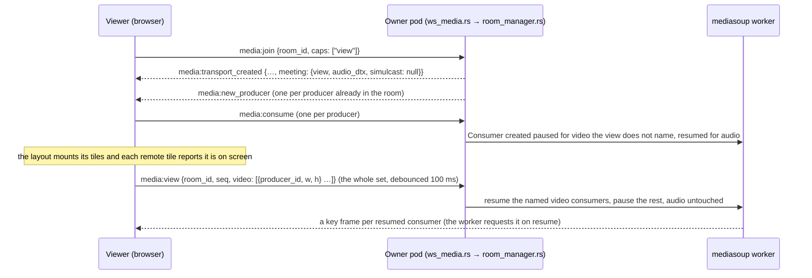

**The wire** — two additive fields, both ignored by a server or a client that predates them:

| Message | Change | Where |
|---|---|---|
| `media:join` | `caps: ["view"]` declares a client that will report its view. Read only while the lever is on | `crates/modules/conference/src/ws_media.rs:434` |
| `media:transport_created` | `meeting: { view, audio_dtx, simulcast: null }` — the levers this server runs, so a behaviour the client carries (DTX now, simulcast in P2) keeps a server-side switch | `ws_media.rs:604`, `meeting_levers` at `:813` |
| `media:view` | `{ room_id, seq, video: [{ producer_id, w, h }] }`, the WHOLE rendered set, never a delta: idempotent, self-healing after a lost message. `seq` only grows, and the server drops a report older than the one it holds. `w`/`h` are device pixels, kept for P2's layer map | the arm at `ws_media.rs:287`, the handler at `:830`, applied by `RoomManager::apply_view` (`media/room_manager.rs:654`) |

It is dispatched where `media:consume` is — through the C-4 placement gate — so a viewer
whose socket is on the other pod reaches the owner's participant state over `media.cmd`
like every other command, and one connection's `join` → `view` → `consume` order holds end
to end because the WS loop awaits each message in turn.

**Three states, never collapsed.** A participant's view is `Option<ViewState>`
(`media/room_manager.rs:56`, the pure half in `media/view.rs:38`):

| `ParticipantMedia.view` | Who | Video consumers | Audio consumers |
|---|---|---|---|
| `None` | a legacy client — no `caps` on its join, or the lever off | all resumed, as before P1; a `media:view` from it is ignored (`room_manager.rs:685`), never read as "show nothing" | resumed |
| `Some(empty)` | a view client that renders nothing yet (just joined, navigated to the mini view, its grid empty) | all paused | resumed |
| `Some(set)` | a view client showing `set` | the named ones resumed, every other paused | resumed |

The decision is pure and unit-tested (`view::wants`, `view.rs:68`; `view::plan`,
`view.rs:97`): a consumer is created with `ConsumerOptions.paused = !wanted`
(`room_manager.rs:589` — ⚠️ mediasoup 0.20.0 creates consumers *resumed* by default,
whatever the old comment there said), and a report that names a producer before its
consumer exists is kept and honoured at the consume.

**No map guard across a worker round trip (P1.1).** Every async method of the room
manager reads under its DashMap guards, drops them, awaits the worker, and takes a guard
again only to record the result — the pattern FR-30's `set_producer_paused` set. A guard
held across an `.await` does not park the task that holds it; it parks the **thread** of
every task that wants the same shard, and a production pod's 2 CPUs give tokio 2 worker
threads:

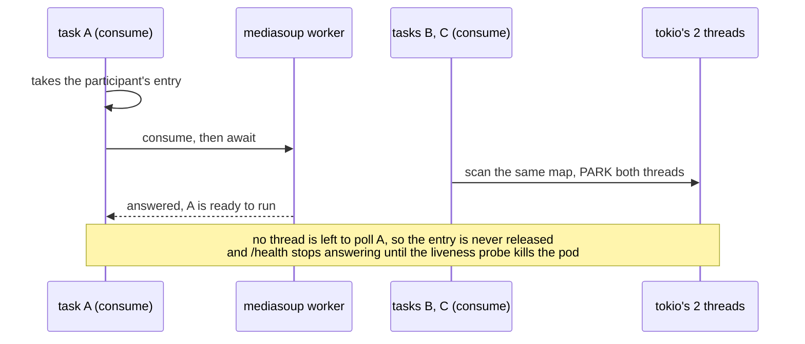

P1 first shipped with `consume` holding the participant's entry across both of its round
trips, and on 2026-10-27 a field run's joins froze a production pod that way twice before
it was rolled back. Two nets now catch it, and neither catches everything:

- **A build error for the common shape.** The root `clippy.toml` lists dashmap's guard
  types for `clippy::await_holding_invalid_type`, which CI's `-D warnings` denies. A guard
  dropped with `drop()` still counts, because a value that was borrowed stays in the future
  until its scope ends, so a guard lives in a block that ends before the await
  (`connect_transport`, `room_manager.rs:359`). ⚠️ The lint matches the type of the value
  held, so it sees a bare guard but **not** one inside an `Option` (a `map.get(k)` kept
  unwrapped), a `Result`, a tuple, a struct or an iterator adapter. The review measured
  it: `consume` holding an `Option<RefMut>` across its awaits passed clippy. Read what the
  await needs into owned values first, and `rooms_ref()` is crate-private so every caller
  is behind the same gate.
- **Tests on two worker threads** (`room_manager.rs`'s `tests`, `room_manager.rs:1558`). A burst of
  joins, publishes, consumes and view reports in one room, behind a watchdog: on the old
  code both threads park in dashmap's lock and the test fails at 60 s, and the review's
  `Option<RefMut>` variant froze it too. Fixed, the conference unit suite finishes in under
  2 s. Three more tests hold a participant's turn from the outside, so dropping the turn
  or its identity check fails them deterministically, and a 50-round race of two room
  creators checks `create_room`.

What the held guards used to serialise as a side effect, three pieces now hold explicitly:

| Piece | Rule | Where |
|---|---|---|
| the participant's `ops` turn | an async mutex that `consume` and `apply_view` hold from decision to record, so a report cannot land between a new consumer's `wanted` and its push into `consumers`; a waiter yields its thread | `room_manager.rs:67`, taken at `:538` and `:665` |
| "the same participant" | a record step re-reads the participant and compares its `ops` to the one it started with: a participant that left meanwhile, or left and joined again on the same connection, gets nothing recorded, and the new producer or consumer is dropped, which closes it | `room_manager.rs:488`, `:618` |
| one room per id | two joins that both found no room each build a router, and the first to insert keeps the room; an `insert` would have replaced a room that may already hold the first joiner's transports | `create_room`, `room_manager.rs:243` |

**Two pauses, two flags.** FR-30's owner pause is `Producer::pause()`, which the worker
mirrors into every consumer's `producer_paused` and which `media:consumer_created` and the
`media:producer_paused` event carry. The viewer's pause is `Consumer::pause()`, the
consumer's own `paused`. Nothing in P1 reads or writes the owner's flag, and the planner's
input (`view::ConsumerLine`, `view.rs:80`) has no field for it, so the two cannot be
confused: a viewer hiding a tile changes nothing another viewer sees, and an owner's pause
reaches every viewer whatever their view says. Locked against a real worker by
`crates/tests/src/conference_view_tests.rs:439`.

**What "visible" is.** Each remote `VideoTile` runs an `IntersectionObserver` on its root
(`ui/src/components/conference/VideoTile.vue:481`), which applies the clip of every
scrolling ancestor, and emits `visible: { visible, w, h }` once per change and `false` on
unmount (`:527`), while its parent still listens. Every layout forwards it with the stream
key (`layouts/TiledLayout.vue:23`, `SpotlightLayout.vue:25`, `SidebarLayout.vue:25`), the
call page hands it to the store (`ConferenceView.vue:441`), and the store keeps the tiles on
screen, maps stream keys to the video producers it consumes
(`ui/src/stores/conference.ts:428`) and sends one `media:view` at most every 100 ms
(`:672-734`) — and again every 15 s while in the call and when the tab returns to the
foreground, so a report the socket dropped or a forward the owner pod never got heals
within the period (`seq` keeps the re-send idempotent, and the server plans nothing for a
report that changes nothing). A tile never reports for the local stream: nothing is received
for it. The cap is declared on the join only where an `IntersectionObserver` exists: a
declared viewer that never reported would have every camera paused.

| Layout | Rendered | In the view |
|---|---|---|
| tiled | `primary`, at most `tiledMaxTiles` (`useConferenceLayout.ts:306`), no scrolling | exactly the rendered remote tiles |
| spotlight | the big tile, a 120 px filmstrip that scrolls sideways | the big tile plus the strip tiles inside the strip's viewport |
| sidebar | the big tile, a 280 px column that scrolls | the same rule |
| the mini view (another page of the app, `MiniConference.vue`) | up to three remote cameras in the app bar's widget, no `VideoTile` | exactly those three (the widget reports them itself; the per-key count tolerates its report overlapping a tile's during the page switch); the rest paused until the call page is back; audio flows, and the app shell's `CallAudio` plays every participant's, these three included (#3563) |

A tile scrolled into view plays within a second: one debounce, one round trip, and the
worker requests a key frame the moment a consumer resumes (`SimpleConsumer::UserOnResumed`
in mediasoup-sys 0.10.0). FR-124's black-picture detector needs three black samples, about
3 s, so a resumed tile paints long before it could be judged. Its sampler keeps running on a
paused tile too — safely: `sampleLuma` answers `null` until the element has a frame
(`ui/src/utils/blackPicture.ts:82`), and once a tile has painted, pausing its consumer
leaves the last frame on screen, which is not black unless the camera was. A tile in
picture-in-picture reports itself visible even when its strip has scrolled it out, so the
floating window keeps playing.

**Opus DTX.** When `meeting.audio_dtx` is true the microphone producer is created with
`codecOptions: { opusDtx: true }` (`ui/src/stores/conference.ts:371`); Chrome then sends
about one packet every 400 ms while the microphone hears silence, and the SFU forwards
exactly what it gets. FR-127's P0 arithmetic is why: fifty people unmuted and quiet cost
more packets than one worker carries without it.

**Switches** — `[meetings]` in `crates/config/src/settings.rs`, env `ROOMLER__MEETINGS__*`:

| Setting | Default | Off means |
|---|---|---|
| `visible_tiles` (`:387`) | on | the server ignores `caps` and every `media:view`, every consumer is resumed at creation, and the client is told `meeting.view = false`, so it stops reporting — today's shape, exactly |
| `audio_dtx` (`:394`) | on | `meeting.audio_dtx = false`, the client produces as before |
| `view_max` (`:399`) | 49 (the UI's own grid maximum) | a load guard, not a policy: a longer report is truncated in the order sent |

**Reading it.** `GET /api/cluster/status` gains `local.media_video_paused` — the video
consumers held back by their viewers' views, never the owner's FR-30 pause
(`crates/api/src/cluster/metrics.rs:96`, from `MediaGauges::video_paused_total`,
`crates/modules/conference/src/lib.rs:128`) — and each row of `media_rooms_detail` its
`video_paused`. With `RUST_LOG=roomler_ai_mod_conference=debug` every applied report logs
`view applied` with `resumed` and `paused` counts. What this lever buys in packets, and the
two that follow it (simulcast, a room piped across workers), are in the FR's §3.0.

## The `rc:*` plane (agents, tunnel clients, controllers)

Defined in `crates/remote_control/src/signaling.rs` (`ClientMsg` / `ServerMsg`,
~60 wire tags). Serialization is **wire-locked by tests**: tags are pinned,
ObjectIds serialize as raw hex, `Permissions` as pipe-separated names. Renaming a
tag is a deliberate wire break.

| Family | Tags | Purpose |
|---|---|---|
| Agent lifecycle | `rc:agent.hello` · `rc:agent.heartbeat` · `rc:agent.sleeping` · `rc:agent.update` · `rc:agent.join_org` · `rc:goodbye` | Hello carries caps (codecs, transports, rpc), displays, advertised routes; heartbeat every 30 s, with the device's power posture (`power`, FR-55 P4); `rc:agent.sleeping {power}` is the device's goodbye just before the OS sleeps it, which the server records and answers with the ordinary teardown, so the device reads **asleep** instead of **offline** ([power.md](power.md) §3); `goodbye` carries a close reason (deleted / replaced / policy) |
| Remote-desktop session | `rc:session.request` · `rc:session.created` · `rc:request` · `rc:ready` · `rc:terminate` · `rc:session.stats` · `rc:error` | Session state machine between controller, server, agent |
| Session resume ([FR-138](fr/FR-138-the-session-outlives-its-control-socket.md), wire only) | `rc:agent.resume_window {secs}` · `rc:session.resumed {session_id}` · `rc:session.detached {session_id, resume_by}` · `rc:session.rejoin {session_id}`, and the fields `kept_sessions` on `rc:agent.hello`, `replaces` on `rc:session.request`, `resume_secs` on `rc:session.created`, with the `rc-resume` verb in `AgentCaps.rpc` | A live session outlives its device's control socket: the device keeps its peer and claims it back in its next hello, the viewer holds and rejoins, and the server decides each claim. **Inert at window 0**, as P1a shipped it: every field is absent unless set, nothing sends the four messages, nothing reads `kept_sessions` or `replaces`, and a rejoin is dropped unanswered, as a server before it drops it. The window (`ROOMLER__RC__SESSION_RESUME_SECS`, default 0) and the platform admin's resume scope (`/api/admin/rc-resume-scope`) gate it. `resume_by` is unix ms on the server's clock. `rc:agent.resume_window` is never sent to an agent without the verb |
| SDP / ICE | `rc:sdp.offer` · `rc:sdp.answer` · `rc:ice` | WebRTC negotiation relayed through the server |
| Consent | `rc:consent` | Owner consent decision (pairs with the HTTP capability URLs) |
| Keepalive | `rc:ping` / `rc:pong` | Application-level liveness |
| Tunnel session | `rc:tunnel.hello` · `.open` · `.opened` · `.terminate` · `.revoked` | Client ⇄ agent tunnel establishment (`open_nonce` correlates concurrent opens) |
| Tunnel TCP flows | `rc:tunnel.tcp.request` → `.forward` → `.accept`/`.reject` · `.half_close` · `.closed` | Per-flow lifecycle |
| Tunnel UDP flows | `rc:tunnel.udp.request` → `.forward` → `.accept`/`.reject` · `.closed` | SOCKS5 UDP ASSOCIATE flows |
| Tunnel carriers | `rc:tunnel.sdp.offer`/`.answer` · `.ice` · `.quic.setup`/`.ready`/`.candidate` | WebRTC-DC and QUIC data-plane negotiation |
| Overlay | `rc:overlay.join` · `.endpoints` · `.srflx` · `.leave` · `.relay_request` → `.netmap` · `.netmap_delta` · `.relay_grant` · `.force_derp` · `.warm_relay_request`/`.warm_relay_grant` | Mesh membership, endpoint discovery, relay coordination |
| Relay / DERP | `rc:relay.regions` · `.probe_report` · `.derp_ticket_request`/`.derp_ticket` | Multi-region PoP selection + ticket auth for standalone DERP relays |
| Fleet RPC | `rc:rpc.exec` · `.cancel` · `.result` · `.request` · `.response` | Remote command execution over the control WS (see [fleet-rpc.md](fleet-rpc.md)) — capability-gated via `AgentCaps.rpc` |
| Overlay key rotation | `rc:agent.key_rotate` → `rc:agent.key_rotated` | An **order** to re-mint the device's overlay key, never a delivery: the order carries no key material (test-locked), the report carries public keys only and is sent on every outcome, refusals included, then re-sent on the next session (see [overlay-key-rotation.md](overlay-key-rotation.md)) — capability-gated via `AgentCaps.rpc` (`key-rotate`), never sent blind |
| Retired with FR-90 (FR-137) | `rc:hive.*` · `rc:vault.*` · `rc:knowhow.*`, and the user socket's `hive:*` | **Reserved, never reused.** A 0.4.199 agent, or a tab opened before FR-90 was parked, still sends and expects frames under them, so a new tag named into one would feed a build that means something else by it. The same holds for FR-90's 21 `RpcCap` spellings, which such an agent keeps advertising and which match by equality, and for the module ids `hive`, `vault`, `knowhow`. The lists are `RETIRED_RPC_VERBS` (`crates/remote_control/src/models.rs:1297`), `RETIRED_RC_TAG_FAMILIES` (`:1326`), `RETIRED_USER_WS_NAMESPACES` (`:1331`) and `RETIRED_MODULE_IDS` (`:1335`), locked by `retired_rpc_verbs_are_never_reused` (`:8543`), `retired_wire_families_and_module_ids_are_never_reused` (`:8612`) and a frozen 0.4.199 hello (`a_0_4_199_hello_with_the_retired_words_still_parses`, `signaling.rs:5321`). The checklist: [retired-names.md](retired-names.md#reserved-after-fr-90-was-parked-fr-137) |

### Remote-desktop session setup

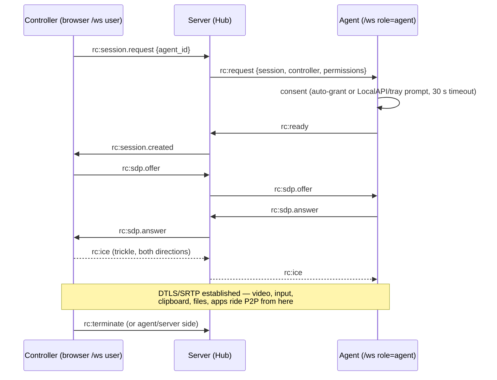

Once the P2P link is up, everything else is **DataChannel traffic that never
touches the server**: input events, clipboard chunks, file transfers, the apps
menu, cursor shapes, decoder statistics (`rc:decodestat` feedback that drives the
agent's rate control), decode-error reports (`rc:decode-error`, one per error, counted
into the session's stats: FR-132, [remote-control.md §11.10](remote-control.md#1110-the-viewers-decode-errors-fr-132-p1)),
and — on the DC render paths — the video bitstream itself.

### Tunnel flow open

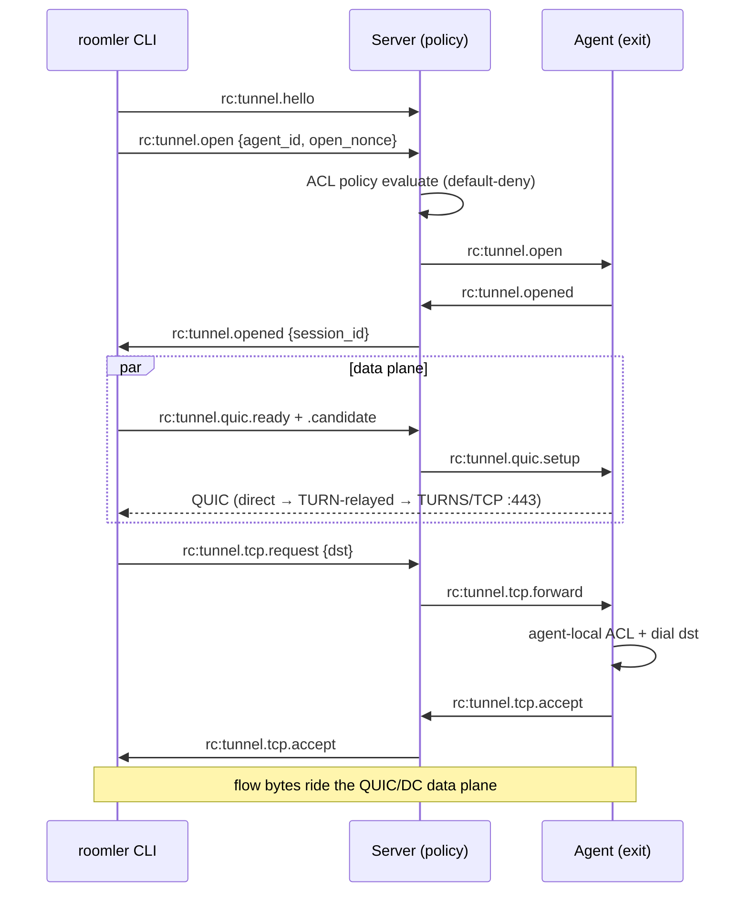

### Overlay join

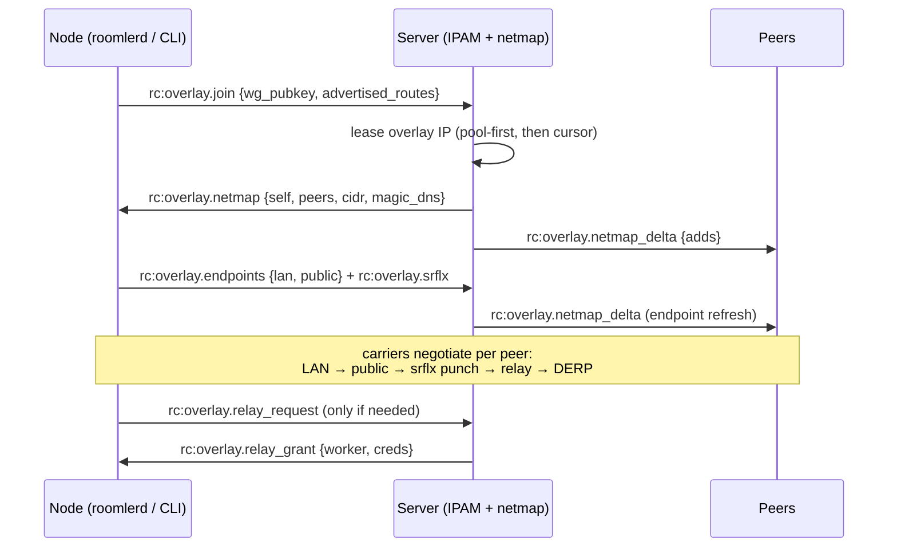

## DERP

`GET /derp?role=agent&tid=<tenant>` with `Authorization: Bearer <agent-jwt>` (or,
from a daemon older than 0.4.210, `?token=<agent-jwt>`; [above](#where-a-native-clients-credential-travels-3656))
upgrades to a minimal frame relay for overlay pairs where **both** sides are
UDP-blocked:

- Frames are `[dst_pubkey(32) || payload]` client→server, rewritten to
  `[src_pubkey(32) || payload]` on delivery.
- Hard tenant/network isolation; the payload is WireGuard ciphertext the relay
  cannot read.
- Standalone regional PoPs (`crates/derp-relay`) run the same protocol DB-free,
  authenticated by Ed25519 tickets minted over `rc:relay.derp_ticket_request`. A
  ticket travels like the JWT: `Authorization: Bearer <ticket>`, or `?ticket=` from
  an older daemon, with the same precedence and the same challenge
  ([scripts/relay-pop/README.md](../scripts/relay-pop/README.md#the-admission-ticket-and-the-access-log-3656)).

## Connection hygiene

- Agents keep one outbound WSS control link: WS ping every 25 s,
  `rc:agent.heartbeat` every 30 s, exponential reconnect capped at 60 s.
  - The ladder restarts at 1 s when a connection that sent its hello lived ≥ 30 s
    and then dropped (#2221). Before that, a successful reconnect kept the
    ladder where the outage left it, so the next ordinary drop waited out the
    PREVIOUS outage's step (8 s in the field after a pod roll; up to 60 s).
  - A server that accepts and drops at once still climbs the ladder. That 30 s
    bar is what keeps a flapping server from drawing a fleet-wide reconnect
    every second.
- A `401` on upgrade (after [the one query-form redial](#how-the-daemon-and-the-cli-dial-3656)
  where that applies) is not fatal. It closes the sessions the agent kept, and
  FR-103 looks for a newer token in the config file, else renews this one, and
  retries once (`agents/roomlerd/src/signaling.rs:1311`). Otherwise the agent
  waits 30 s, 60 s, 5 min, then an hour between tries
  (`agents/roomlerd/src/signaling.rs:1625`), and the third refusal in a row raises
  the re-enrollment prompt on the primary org.
- Agents also enforce **receive-liveness**: no inbound frame for 80 s ⇒ reconnect —
  this heals half-open sockets that TLS-inspecting middleboxes keep artificially
  alive.
- `rc:goodbye` close reasons distinguish *replaced by newer connection* (benign
  restart) from *deleted / policy-rejected* (stop retrying).

### How an agent socket ended (#3517)

Every end of a registered agent socket leaves one line on the pod that held it, at the
end of its teardown (`crates/modules/fleet/src/socket.rs:1083-1095`), and its `cause`
says how the socket ended:

```
INFO roomler_ai_mod_fleet::socket: remote-control agent WS disconnected agent_id=… cause=error kind=eof error="…"
```

Each exit of the read loop (`socket.rs:534`) breaks with a `SocketEnd`
(`crates/modules/fleet/src/socket_end.rs:25`), so an exit added later does not compile
until it names its cause. `cause` is always on the line. Every other field appears only
with the cause it belongs to, so the line never carries a field that means nothing for
its end. Before #3517 the line carried the agent id alone, and a close frame or a reset
showed on no line at all.

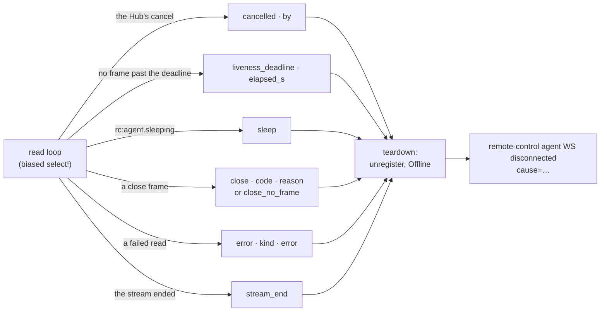

| `cause` | its fields | what ended the socket |
|---|---|---|
| `close` | `code`, `reason` (quoted) | the device sent a close frame with a status code |
| `close_no_frame` | — | a close frame with no status code: the daemon's own clean stop, on a service stop, a restart or an update (`agents/roomlerd/src/signaling.rs:2302`) |
| `error` | `kind`, `error` (quoted) | the read failed; `kind` below |
| `liveness_deadline` | `elapsed_s` | no frame for longer than `rc.ws_rx_deadline_secs` (90 s by default): a half-open socket, reaped (`socket.rs:556`). The check runs on a tick, so `elapsed_s` reads past the deadline |
| `cancelled` | `by` | the Hub cancelled the loop; `by` below |
| `sleep` | — | the device said it is going to sleep (FR-55 P4). Its daemon sends a close frame next, which the loop never reads |
| `stream_end` | — | the stream ended with neither a frame nor an error. tokio-tungstenite ends it that way only after a close or an error, and the loop leaves on both first, so this is not expected |

`by`, for `cause=cancelled`. Each trigger records itself just before its notify
(`AgentCancel`, `crates/modules/fleet/src/hub.rs:217`), with the notify call itself
unchanged. The cancel arm's own line, `agent connection cancelled by Hub; exiting
read-loop`, carries the same `by`.

| `by` | the trigger |
|---|---|
| `replaced` | a newer connection for the same agent registered (`Hub::register_agent`, `hub.rs:1103`): a reconnect that beat the old socket's teardown, or two daemons on one identity |
| `idle_nudge` | the idle nudge cycled an idle agent, so its reconnect re-hashes through the LB (`Hub::nudge_agent_if_idle`, `hub.rs:1332`) |
| `renumber` | an overlay renumber (`Hub::cycle_agent_ws`, `hub.rs:1360`) |
| `shutdown` | this pod's graceful shutdown (`Hub::cancel_all_agents`, `hub.rs:1375`) |
| `unknown` | a cancel with no trigger recorded. Nothing fires one today |

`kind`, for `cause=error` (`error_kind`, `socket_end.rs:138`):

| `kind` | what the transport under the socket said |
|---|---|
| `eof` | the TCP leg ended with no close frame |
| `reset` | the TCP leg was reset |
| `aborted` · `timeout` · `broken_pipe` · `io` | the other I/O errors; `io` is any not named |
| `protocol` | a frame RFC 6455 forbids, invalid UTF-8 in a text frame among them |
| `capacity` | a frame over `MAX_WS_MESSAGE_BYTES` |
| `other` | an error that is not tungstenite's |

⚠️ **The pod sees the hop in front of it, not the device.** The binary's peer is the
pod's nginx ([deployment.md § Topology](deployment.md#topology)), so a device whose
process died or whose network dropped mid-stream usually reads `kind=eof` once the
proxies close their legs, whatever the device's own TCP stack sent. `eof` means *no
close frame*, not *a clean FIN at the device*.

⚠️ **`kind=other` on every error means the tungstenite pin drifted.** `error_kind`
downcasts axum's error to the tungstenite that `crates/modules/fleet/Cargo.toml`
pins. If axum moves to another one, every error reads `other`, and the loopback test
`socket::tests::a_dropped_tcp_leg_reads_eof` fails first.

**Before the hello.** A socket that ends before its `rc:agent.hello` registered nothing,
so it gets no disconnect line. The hello wait (`read_next_rc`, `socket.rs:1295`) says
how it ended on its own warn line, `agent opened WS without rc:agent.hello — closing`,
with the same `cause`, `code`, `reason`, `kind` and `error`. Before #3517 that line read
`other=None` for every end.

**The grep.** Pod logs are ANSI-coloured, so strip the codes first. Tenant affinity pins
each socket to one pod, so read every pod. Select the pods by their label. A name match
such as `grep roomler2-` also catches the `roomler2-prepull-*` pods of FR-28's pre-pull
DaemonSet (`.github/workflows/promote.yml:46`), which carry `app=roomler2-prepull` and
run no `roomler2` container.

```bash
for p in $(kubectl -n roomler-ai get pods -l app=roomler2 -o name); do
  echo "== $p"
  kubectl -n roomler-ai logs "$p" | sed -E 's/\x1b\[[0-9;]*m//g' \
    | grep 'remote-control agent WS disconnected' \
    | grep -oE 'cause=[a-z_]+( kind=[a-z_]+| by=[a-z_]+)?' | sort | uniq -c | sort -rn
done
```

For one device's history, replace the last `grep -oE …` with `grep 'agent_id=<hex>'`.

⚠️ **`kubectl logs` reads only the pod's current log file.** The kubelet rotates that
file at its size cap, which under daytime traffic has been every 10 to 15 minutes, so an
empty grep can be the file's boundary rather than the absence of a disconnect. Most of
those lines were one DEBUG line per item: two for each request, one for each peer of an
overlay fan-out, one for each inserted row and one for each WS message sent or received.
Since #4402 they write at TRACE, except a request's finished line for a 4xx, a 5xx or an
answer of 1 s or more (`crates/api/src/request_log.rs:32`), and a fan-out pass writes one
`overlay: delta fanned out` line with its counts (`crates/modules/network/src/overlay.rs:2250`).
For an older window, read the rotated files through the kubelet's log proxy. The newest rotated
file is plain text and the older ones are gzipped, and each line there carries the CRI
prefix `<ts> stdout F`:

```bash
P=roomler2-…   # the pod's name, without the pod/ prefix
N=$(kubectl -n roomler-ai get pod "$P" -o jsonpath='{.spec.nodeName}')
U=$(kubectl -n roomler-ai get pod "$P" -o jsonpath='{.metadata.uid}')
D="/api/v1/nodes/$N/proxy/logs/pods/roomler-ai_${P}_${U}/roomler2"
kubectl get --raw "$D/"                  # lists 0.log, 0.log.<ts> and the *.gz files
kubectl get --raw "$D/0.log.<ts>" | sed -E 's/\x1b\[[0-9;]*m//g' | grep 'remote-control agent WS disconnected'
```
