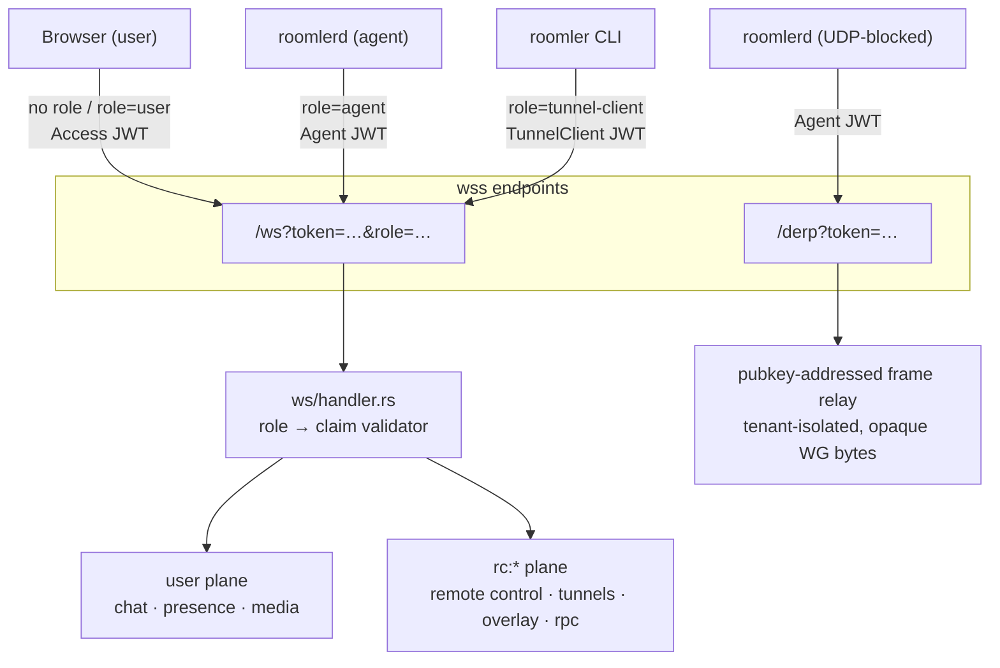
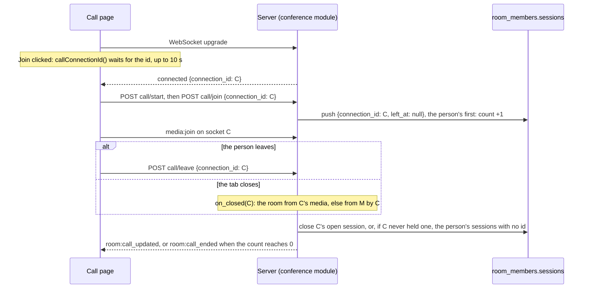
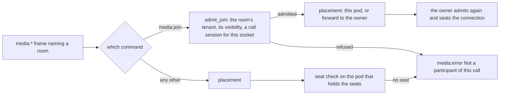
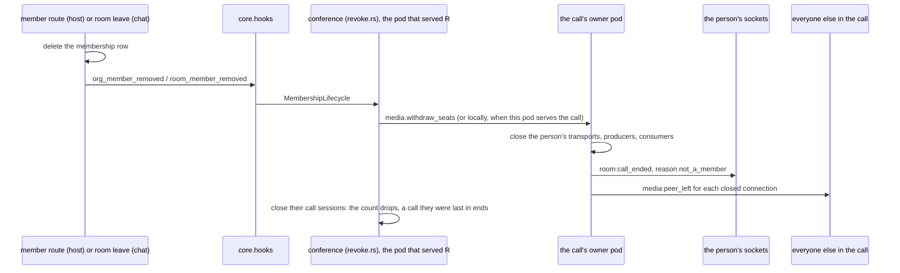
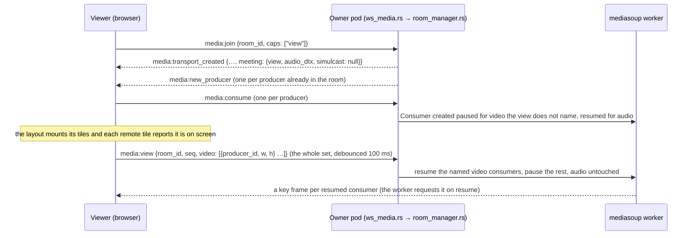
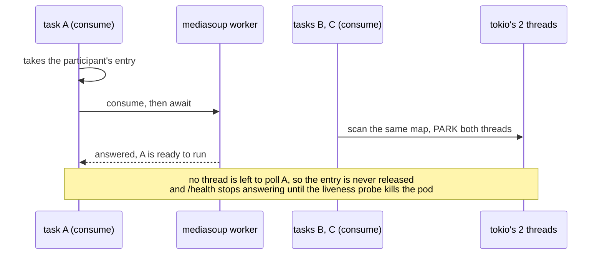
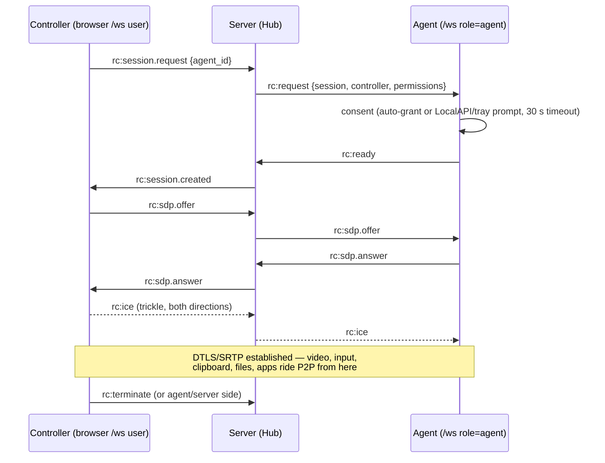
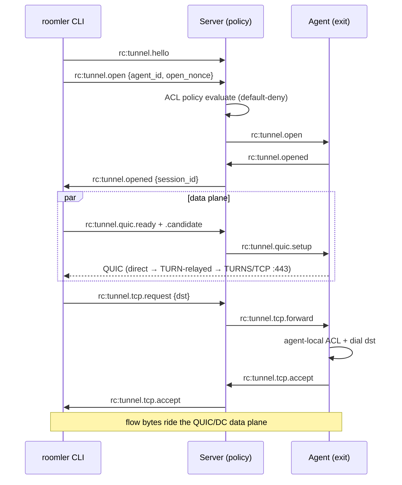
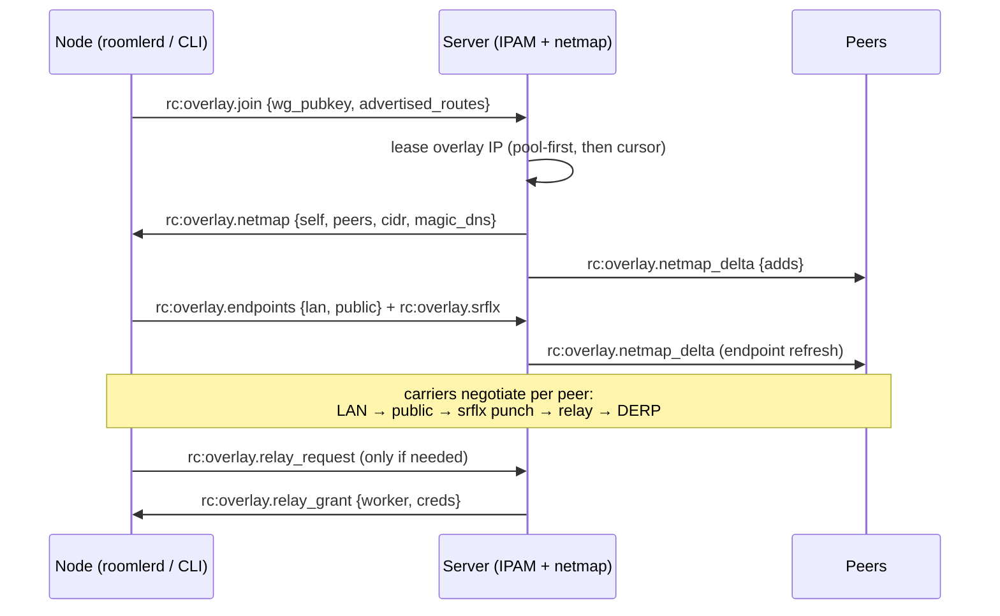
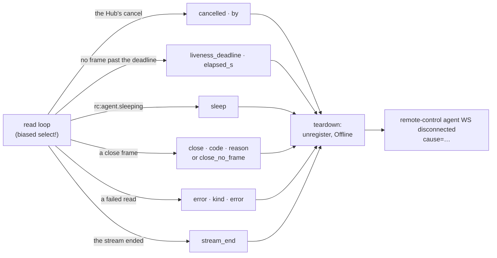

# Real-Time Protocols

The server exposes two upgrade endpoints. `/ws` multiplexes three client roles over
one handshake; `/derp` is a purpose-built relay for overlay pairs whose UDP is
blocked in both directions. *As of 0.3.0-rc.381.*



Each role is validated against its own JWT audience — a user token cannot open an
agent socket and vice-versa. An optional `tid=<tenant-hex>` query parameter lets the
front load balancer hash tenant-affine connections onto one pod; tokens must match
the claimed tenant (membership-checked for users).

Delivery across pods: WS sessions are pod-local; chat, presence, and notification
events fan out through Redis pub/sub so every pod pushes to its own sockets.

## User plane (browser)

JSON messages, `{"type": "...", ...}`.

**Client → server**

| Type | Purpose |
|---|---|
| `media:join` / `media:leave` | Enter/exit a room call (mediasoup). FR-127 P1: a join may carry `caps: ["view"]` — this client will report what it renders, [below](#a-meeting-receives-what-is-visible-fr-127-p1) |
| `media:produce` / `media:consume` | Publish / subscribe a track |
| `media:connect_transport` | DTLS-connect a transport |
| `media:producer_close` | Stop publishing |
| `media:producer_pause` | FR-30 — the OWNER paused or resumed one of their producers (camera off, mic muted); the room is told as `media:producer_paused` |
| `media:view` | FR-127 P1 — the viewer's WHOLE rendered set, `{ room_id, seq, video: [{ producer_id, w, h }] }`: the server resumes those video consumers and pauses the viewer's others; no reply |
| `media:play_audio` / `media:stop_audio` | Bot/audio playback control |
| `presence:update` | Presence state |
| `ping` | Keepalive |

**Server → client** (consumed by `ui/src/stores/ws.ts`)

| Event | Purpose |
|---|---|
| `message:create` / `update` / `delete` / `reaction` | Live chat |
| `call:message:create` | In-call chat |
| `room:call_started` / `call_ended` / `call_updated` | Call presence on the room list. A `call_ended` the plan's meeting-length cap caused carries `reason: "plan_limit"`, `max_minutes` and `plan` |
| `room:call_ending_soon` | FR-115 P5 — the plan's meeting-length cap (Free: 60 minutes) warns the room's members five minutes before it ends the meeting: `ends_at` (epoch ms), `max_minutes`, `plan`. Shown only to those in that call |
| `typing:start` | Typing indicators |
| `notification:new` / `notification:unread_count` | Notification bell |
| `task:update` | Background-task progress |

The mediasoup signalling (`media:*`) carries router RTP capabilities, transport
parameters, and producer/consumer ids — the SFU forwards RTP between participants
without decoding it.

The meeting-length cap is a **sweep, not a timer** (FR-115 P5): every pod reads
the calls in progress every 30 s and decides each against the org's plan, and the
two writes it can make — the warning and the end — are conditional on the call it
read, so two pods warn and end a meeting once
(`crates/modules/conference/src/meeting_cap.rs:100`). A timer would have lived in the
pod that started the call and died with it on a rolling deploy. The design, its guards
and its one known gap are in
[FR-115 *Meetings, as built*](fr/FR-115-pricing-reshape.md#meetings-as-built-p5).

### The call session: join, leave, socket close, sweep (#3416)

A call is kept in two places. The room holds `conference_status` and `participant_count`,
the number of **people** in the call. Each person's `room_members` row holds `sessions[]`,
one entry per join, open while its `left_at` is null. A session carries the
`connection_id` of the page's socket, so one person can be in a call from several devices
and one device's leave closes only its own session. The count rises when a person's first
open session opens, falls when their last one closes, and the call ends at 0.



| Moment | Where | What happens |
|---|---|---|
| Join | `ConferenceView.vue:607`, `stores/rooms.ts:194` `callConnectionId`, `:200` `joinCall`; server `call.rs:133`, `dao/room.rs:749` `join_participant` | The page waits up to `CALL_SOCKET_WAIT_MS` (`rooms.ts:184`, 10 s) for its socket's id (`stores/ws.ts:414` `waitForConnectionId`; the id comes with the `connected` frame, `ws.ts:194`), then starts the call and joins naming it. Past the bound it starts and joins nothing, and says why: "Failed to join call: Not connected to the server…" (`ConferenceView.vue:638`). A join on a connection that already holds a session closes that one first |
| Leave | `rooms.ts:209` `leaveCall`, `call.rs:206`, `finalize_call_leave_db` (`call.rs:283`), `leave_participant` (`dao/room.rs:951`) | Names the socket's id at leave time and closes that connection's open session. With no body (older clients) it closes every open session of the person in the room |
| Socket close | `ws_media.rs:83` `on_closed` | The leave the page never sent. The room comes from the socket's media (`media:join`), else from Mongo by the connection id (`:134`), and the same leave runs naming the socket (`:141`) |
| A miss | `dao/room.rs:960`, the close itself `close_sessions` (`:1028`) | A leave or a socket close whose connection **never held** a session in that room closes the person's open sessions there that have no connection id: a page whose join went out before its socket had an id, or an older client's. A connection that holds its own session never touches them. Nor does one that held a session and closed it, because it is leaving twice: a repeated leave, a leave racing its socket's close, a leave after the call ended. A closed session keeps its `connection_id`, so the filter can tell (`$ne` on `sessions.connection_id`) |
| Sweep | `maintenance.rs:63` `close_orphaned_call_state`, every rollup cycle | Closes the open sessions in rooms that are **not** `in_progress`. A room in progress is skipped, so the sweep never reaches a session that keeps its call's count above 0 |
| Boot | `maintenance.rs:21` `stale_call_reset`, at startup under the lease (`lib.rs:275`) | No call outlives a server start: every `in_progress` room is ended, then the sweep runs |

What a leave naming connection C may close:

| The open session | Closed? |
|---|---|
| the person's, connection C | yes |
| the person's, no connection id | only when C never held a session in that room |
| the person's, another connection | never: that is their other device |
| another person's | never: the update is keyed by the leaver's own `user_id` |

**Why a miss closes every session with no id, not only the oldest.** Such a session names
no device. On a miss the leaver's own session is among them, if it has one, and nothing
says which. Closing only the oldest would leave the leaver listed whenever an older dead
one sits beside it, which is the bug itself. Closing them all always takes the leaver out.

**What it does not heal.** Since #3416 the page never sends a join without the id, so
sessions with no id come only from older cached bundles, and these three cases last only
while those are in use:

1. A dead session with no id beside a later session of the same person that has one: that
   later session's leave closes only its own. The boot reset clears it at the next roll.
   An older bundle leaves exactly this when its first `media:join` finds the socket not
   open yet. The store's retry (`stores/conference.ts:172`) joins again on the open socket,
   this time with the id, so the person holds both sessions, and the page's leave closes
   the scoped one.
2. Two devices of one person that both joined without an id (both older bundles, both
   raced): a miss from one closes both, so the other drops off the list while still in the
   call, and a call the person was alone in ends.
3. A page whose socket redialled mid-call holds nothing under its new id, because the old
   socket's close took its session. Its Leave is a miss, and closes the person's sessions
   with no id in that room: an older bundle's, on another of their devices.

The disconnect cleanup reaches a session only through the socket's media or its own id,
so a socket that was never in the call, such as another tab of the same person, closes
nothing.

**Tests.** The #3416 block in `crates/tests/src/conference_tests.rs:2084`: a join with no
body, then a leave or a socket close; two devices; another person's session; a device that
already left, leaving again; a repeated leave; a socket never in the call. `ui/src/__tests__/stores/rooms.spec.ts:259`: the wait
and the refusal. `ui/e2e/conference-fast-join.spec.ts` holds back the socket's frames until after
the click, against a real API, and reads the outcome from the server's participant list.

### Who may use `media:*`: the participants of the call

The socket path admits only someone the REST path admitted. A connection may send a
`media:*` command for a room only while it is a participant of that room's call, and the
participation gate (`crates/modules/conference/src/media_gate.rs`) decides before any
handler runs.



| Command | Requires | Checked |
|---|---|---|
| `media:join` | What `call/join` checks: a member of the **room's** tenant (read from the room, never from the frame), the room's visibility, and an open call session for **this** connection, or one with no connection id (an older client). A session opened for another socket of the same person does not count | `media_gate.rs:114` `admit_join`, the session by `dao/room.rs:1108` `has_open_call_session`. Before placement (`ws_media.rs:166`), so a refused join claims no room and builds no router, and again on the pod that seats the connection, the owner of a forwarded join (`media_cluster.rs:701`) |
| every other `media:*` | This connection's seat in the room's media, as this user: a participant entry that only an admitted join creates | `media_gate.rs:151` `seat`, by `room_manager.rs:1086` `holds_seat`, in `dispatch_media_local` (`ws_media.rs:247`) on the pod that runs the command, so a forwarded command is checked at the owner, where the seats are |

- The handlers take the gate's proof, a `JoinPass` or a `Seat`, never a bare room, user or
  connection id (`dispatch_seated`, `ws_media.rs:265`). A new handler has nothing else to
  act on.
- A refusal says the same for every reason, `Not a participant of this call`
  (`media_gate.rs:35`). Only join, produce and consume answer at all, as they answered
  their failures before; the reason goes to the log.
- `media:play_audio` plays only a live file of the call's own room, in the room's tenant,
  and each playback carries its own `playback_id` (`ws_media.rs:1011`).
- `GET /api/cluster/status`, which lists every live meeting room on a pod, is for platform
  admins only (`crates/api/src/routes/cluster.rs:23`).

**Tests.** `crates/tests/src/conference_gate_tests.rs`: an account of another org, a member
outside a Private room and a member not in the call each get nothing from any `media:*`
command, and nothing of theirs reaches the call; the participant path end to end; a
playback of another room's file, or of a removed one.
`cluster_tests::cluster_status_is_for_platform_admins_only`.

### A seat ends with the membership that admitted it

The gate checks membership once, at `media:join`. The seat it admits lasts only as long as
that membership: when someone is removed from the org or leaves it, or leaves the room, any
seat they hold in a call of that org or room goes at once, on whichever pod serves the call.
The membership's owner tells `conference` through core's `MembershipLifecycle` hook
(`crates/core/src/hooks.rs:170`), after the membership row is gone, so nothing can be
admitted on it again while the seats are withdrawn.



| Trigger | Told by | What ends |
|---|---|---|
| Removed from the org by an admin, or left it (`DELETE …/member/{user_id}`) | `crates/api/src/routes/user.rs:229`, `org_member_removed` | every call of the org they may sit in: the rooms they belong to whose call is live, and any where they still hold an open call session (`dao/room.rs:1141` `call_rooms_of_member`), plus any room on the pod where they sit (`revoke.rs:111`). Their open call sessions close through the hang-up path, `finalize_call_leave_db` |
| Left the room (`POST …/room/{room_id}/leave`) | `crates/modules/chat/src/room.rs:238`, `room_member_removed` | their seats in that room's call (`revoke.rs:88`). The membership row held their call sessions, so the leave itself drops the call's count (`dao/room.rs:526`), and a call they were the last one in ends (`call.rs:312` `settle_call_after_departure`) |

- The seats close on the pod that holds them (`revoke.rs:180` `withdraw_seats_here`), reached
  over the bus as `media.withdraw_seats` when it is the other pod (`revoke.rs:156`,
  `media_cluster.rs:612`). A pod that answers no withdrawal is presumed gone, and its media
  with it; the failure is logged.
- `room:call_ended` is what the web client already reads as "this call is over for you"
  (`ui/src/stores/ws.ts:349`): it tears the call down, with no client change.
- A join already on its way when the membership ends asks the gate again once its seat
  exists (`ws_media.rs:457`): either the withdrawal sees that seat, or the seat sees the
  membership gone and closes itself before the client hears anything.
- The routes answer the membership change whatever the hook says, since it has happened; a
  failure to withdraw is logged as an error with the org, room and person.
- After the seats, `chat` (the record owner, later in `HOOK_ORDER`) drops the person's room
  memberships of the org they left (`crates/modules/chat/src/membership.rs`). Every room
  fan-out (messages, reactions, pins, typing, mentions) is addressed to those rows, so the
  org's rooms stop reaching the person with the org membership. Rows of people no longer in
  the org are ended by `POST /api/admin/room-members/prune`, an operator step (a dry run
  by default, bounded, idempotent).

**Tests.** `conference_gate_tests`: a member removed from the org, one who leaves it and one
who leaves the room each lose the seat at once (their client hears the call ended, the host
sees them leave, their transports, producers and consumers close, the host's consumer of
their camera closes, they are off the participant list and the count, and their socket gets
nothing more); `the_last_participant_leaving_the_room_ends_its_call`.
`cluster_tests::an_org_removal_on_one_pod_withdraws_the_seat_the_other_pod_holds` and
`a_room_leave_on_one_pod_withdraws_the_seat_the_other_pod_holds`.

### A socket's `media:*` frames are limited

Each socket has a token bucket for its `media:*` frames: `[meetings] media_frame_burst`
frames at once (400), refilled at `media_frame_rate` a second (20)
(`crates/config/src/settings.rs:280`, `:285`; env `ROOMLER__MEETINGS__MEDIA_FRAME_BURST` and
`…_RATE`; `0` turns the limit off). A frame is counted on the pod that holds the socket, as it
arrives and before anything is looked up for it (`ws_media.rs:56`), so a frame forwarded to
the call's owner pod is counted once, where it came in.

| A frame over the limit | Where |
|---|---|
| is not run, and the socket hears `media:error` with `code: "rate_limited"`, `retry_after_ms` (the time until the bucket holds a frame again) and a `message` | `crates/modules/conference/src/frame_limit.rs:48` `refused` |
| leaves the socket open: a client that overruns loses that frame, never its socket or its call | the same |
| counts in `media_frames_rate_limited_total` on `GET /api/cluster/status` | `crates/core/src/cluster/metrics.rs:36`, `crates/api/src/cluster/metrics.rs:63` |
| is logged: the socket's first refusal at warn, and its total at info when it closes | `frame_limit.rs:48`, `:85` `socket_closed` |

**How deep, measured.** The deepest burst a real client sends is a join into a large
meeting: the join, one `media:consume` for every producer already in the call, back to back
as fast as the answers come (`consumeChain`, `ui/src/stores/conference.ts`), both
transports' connects, its own camera and microphone, and the view reports its tiles trigger.
`conference_rate_tests` builds Business's largest meeting, 100 people with a camera and a
microphone each, and joins it that way: **212 frames** (1 join, 198 consumes, 2 connects,
2 produces, 9 view reports) in about 1 s, at most 211 in any one second. The default holds
that join on the bucket's depth alone, with room for screen shares, people on two devices and
a rejoin a second later. The refill is twice the fastest steady sender the client has, the
view report (debounced to 10 a second while the grid scrolls), and holds a flood to 20 frames
a second after its first 400.

**Tests.** `conference_rate_tests`: the 100-person join passes the shipped limit whole, and a
flood of 1000 frames on the same socket right after it is refused frame by frame (791
refused, 209 run, measured), the socket answers a ping and gets on with the call once the
bucket refills; a refusal's wire and that the frame never reaches the participation gate; a
zero burst turns the limit off. Unit: the bucket's arithmetic (`frame_limit.rs` `tests`).

### A meeting receives what is visible (FR-127 P1)

One room is one mediasoup router on one worker thread, and every participant's every
video stream used to be forwarded to every other participant whether or not a tile showed
it — which is the N×(N−1) that FR-115 O4 measured running out at about 20 cameras.
[FR-127](fr/FR-127-meeting-room-scales-past-one-worker.md) lifts that in three levers; P1
is the first: **the viewer says what it renders, and the server forwards only that.**
Audio always flows, and the microphone is produced with Opus DTX so a silent participant
costs the worker about one packet every 400 ms instead of fifty a second.



**The wire** — two additive fields, both ignored by a server or a client that predates them:

| Message | Change | Where |
|---|---|---|
| `media:join` | `caps: ["view"]` declares a client that will report its view. Read only while the lever is on | `crates/modules/conference/src/ws_media.rs:434` |
| `media:transport_created` | `meeting: { view, audio_dtx, simulcast: null }` — the levers this server runs, so a behaviour the client carries (DTX now, simulcast in P2) keeps a server-side switch | `ws_media.rs:589`, `meeting_levers` at `:798` |
| `media:view` | `{ room_id, seq, video: [{ producer_id, w, h }] }`, the WHOLE rendered set, never a delta: idempotent, self-healing after a lost message. `seq` only grows, and the server drops a report older than the one it holds. `w`/`h` are device pixels, kept for P2's layer map | the arm at `ws_media.rs:287`, the handler at `:815`, applied by `RoomManager::apply_view` (`media/room_manager.rs:654`) |

It is dispatched where `media:consume` is — through the C-4 placement gate — so a viewer
whose socket is on the other pod reaches the owner's participant state over `media.cmd`
like every other command, and one connection's `join` → `view` → `consume` order holds end
to end because the WS loop awaits each message in turn.

**Three states, never collapsed.** A participant's view is `Option<ViewState>`
(`media/room_manager.rs:56`, the pure half in `media/view.rs:38`):

| `ParticipantMedia.view` | Who | Video consumers | Audio consumers |
|---|---|---|---|
| `None` | a legacy client — no `caps` on its join, or the lever off | all resumed, as before P1; a `media:view` from it is ignored (`room_manager.rs:685`), never read as "show nothing" | resumed |
| `Some(empty)` | a view client that renders nothing yet (just joined, navigated to the mini view, its grid empty) | all paused | resumed |
| `Some(set)` | a view client showing `set` | the named ones resumed, every other paused | resumed |

The decision is pure and unit-tested (`view::wants`, `view.rs:68`; `view::plan`,
`view.rs:97`): a consumer is created with `ConsumerOptions.paused = !wanted`
(`room_manager.rs:589` — ⚠️ mediasoup 0.20.0 creates consumers *resumed* by default,
whatever the old comment there said), and a report that names a producer before its
consumer exists is kept and honoured at the consume.

**No map guard across a worker round trip (P1.1).** Every async method of the room
manager reads under its DashMap guards, drops them, awaits the worker, and takes a guard
again only to record the result — the pattern FR-30's `set_producer_paused` set. A guard
held across an `.await` does not park the task that holds it; it parks the **thread** of
every task that wants the same shard, and a production pod's 2 CPUs give tokio 2 worker
threads:



P1 first shipped with `consume` holding the participant's entry across both of its round
trips, and on 2026-10-27 a field run's joins froze a production pod that way twice before
it was rolled back. Two nets now catch it, and neither catches everything:

- **A build error for the common shape.** The root `clippy.toml` lists dashmap's guard
  types for `clippy::await_holding_invalid_type`, which CI's `-D warnings` denies. A guard
  dropped with `drop()` still counts, because a value that was borrowed stays in the future
  until its scope ends, so a guard lives in a block that ends before the await
  (`connect_transport`, `room_manager.rs:359`). ⚠️ The lint matches the type of the value
  held, so it sees a bare guard but **not** one inside an `Option` (a `map.get(k)` kept
  unwrapped), a `Result`, a tuple, a struct or an iterator adapter. The review measured
  it: `consume` holding an `Option<RefMut>` across its awaits passed clippy. Read what the
  await needs into owned values first, and `rooms_ref()` is crate-private so every caller
  is behind the same gate.
- **Tests on two worker threads** (`room_manager.rs`'s `tests`, `room_manager.rs:1528`). A burst of
  joins, publishes, consumes and view reports in one room, behind a watchdog: on the old
  code both threads park in dashmap's lock and the test fails at 60 s, and the review's
  `Option<RefMut>` variant froze it too. Fixed, the conference unit suite finishes in under
  2 s. Three more tests hold a participant's turn from the outside, so dropping the turn
  or its identity check fails them deterministically, and a 50-round race of two room
  creators checks `create_room`.

What the held guards used to serialise as a side effect, three pieces now hold explicitly:

| Piece | Rule | Where |
|---|---|---|
| the participant's `ops` turn | an async mutex that `consume` and `apply_view` hold from decision to record, so a report cannot land between a new consumer's `wanted` and its push into `consumers`; a waiter yields its thread | `room_manager.rs:67`, taken at `:538` and `:665` |
| "the same participant" | a record step re-reads the participant and compares its `ops` to the one it started with: a participant that left meanwhile, or left and joined again on the same connection, gets nothing recorded, and the new producer or consumer is dropped, which closes it | `room_manager.rs:488`, `:618` |
| one room per id | two joins that both found no room each build a router, and the first to insert keeps the room; an `insert` would have replaced a room that may already hold the first joiner's transports | `create_room`, `room_manager.rs:243` |

**Two pauses, two flags.** FR-30's owner pause is `Producer::pause()`, which the worker
mirrors into every consumer's `producer_paused` and which `media:consumer_created` and the
`media:producer_paused` event carry. The viewer's pause is `Consumer::pause()`, the
consumer's own `paused`. Nothing in P1 reads or writes the owner's flag, and the planner's
input (`view::ConsumerLine`, `view.rs:80`) has no field for it, so the two cannot be
confused: a viewer hiding a tile changes nothing another viewer sees, and an owner's pause
reaches every viewer whatever their view says. Locked against a real worker by
`crates/tests/src/conference_view_tests.rs:439`.

**What "visible" is.** Each remote `VideoTile` runs an `IntersectionObserver` on its root
(`ui/src/components/conference/VideoTile.vue:507`), which applies the clip of every
scrolling ancestor, and emits `visible: { visible, w, h }` once per change and `false` on
unmount (`:553`), while its parent still listens. Every layout forwards it with the stream
key (`layouts/TiledLayout.vue:23`, `SpotlightLayout.vue:25`, `SidebarLayout.vue:25`), the
call page hands it to the store (`ConferenceView.vue:435`), and the store keeps the tiles on
screen, maps stream keys to the video producers it consumes
(`ui/src/stores/conference.ts:428`) and sends one `media:view` at most every 100 ms
(`:672-734`) — and again every 15 s while in the call and when the tab returns to the
foreground, so a report the socket dropped or a forward the owner pod never got heals
within the period (`seq` keeps the re-send idempotent, and the server plans nothing for a
report that changes nothing). A tile never reports for the local stream: nothing is received
for it. The cap is declared on the join only where an `IntersectionObserver` exists: a
declared viewer that never reported would have every camera paused.

| Layout | Rendered | In the view |
|---|---|---|
| tiled | `primary`, at most `tiledMaxTiles` (`useConferenceLayout.ts:306`), no scrolling | exactly the rendered remote tiles |
| spotlight | the big tile, a 120 px filmstrip that scrolls sideways | the big tile plus the strip tiles inside the strip's viewport |
| sidebar | the big tile, a 280 px column that scrolls | the same rule |
| the mini view (another page of the app, `MiniConference.vue`) | up to three remote cameras in the app bar's widget, no `VideoTile` | exactly those three (the widget reports them itself; the per-key count tolerates its report overlapping a tile's during the page switch); the rest paused until the call page is back; audio flows |

A tile scrolled into view plays within a second: one debounce, one round trip, and the
worker requests a key frame the moment a consumer resumes (`SimpleConsumer::UserOnResumed`
in mediasoup-sys 0.10.0). FR-124's black-picture detector needs three black samples, about
3 s, so a resumed tile paints long before it could be judged. Its sampler keeps running on a
paused tile too — safely: `sampleLuma` answers `null` until the element has a frame
(`ui/src/utils/blackPicture.ts:82`), and once a tile has painted, pausing its consumer
leaves the last frame on screen, which is not black unless the camera was. A tile in
picture-in-picture reports itself visible even when its strip has scrolled it out, so the
floating window keeps playing.

**Opus DTX.** When `meeting.audio_dtx` is true the microphone producer is created with
`codecOptions: { opusDtx: true }` (`ui/src/stores/conference.ts:371`); Chrome then sends
about one packet every 400 ms while the microphone hears silence, and the SFU forwards
exactly what it gets. FR-127's P0 arithmetic is why: fifty people unmuted and quiet cost
more packets than one worker carries without it.

**Switches** — `[meetings]` in `crates/config/src/settings.rs`, env `ROOMLER__MEETINGS__*`:

| Setting | Default | Off means |
|---|---|---|
| `visible_tiles` (`:387`) | on | the server ignores `caps` and every `media:view`, every consumer is resumed at creation, and the client is told `meeting.view = false`, so it stops reporting — today's shape, exactly |
| `audio_dtx` (`:394`) | on | `meeting.audio_dtx = false`, the client produces as before |
| `view_max` (`:399`) | 49 (the UI's own grid maximum) | a load guard, not a policy: a longer report is truncated in the order sent |

**Reading it.** `GET /api/cluster/status` gains `local.media_video_paused` — the video
consumers held back by their viewers' views, never the owner's FR-30 pause
(`crates/api/src/cluster/metrics.rs:88`, from `MediaGauges::video_paused_total`,
`crates/modules/conference/src/lib.rs:120`) — and each row of `media_rooms_detail` its
`video_paused`. With `RUST_LOG=roomler_ai_mod_conference=debug` every applied report logs
`view applied` with `resumed` and `paused` counts. What this lever buys in packets, and the
two that follow it (simulcast, a room piped across workers), are in the FR's §3.0.

## The `rc:*` plane (agents, tunnel clients, controllers)

Defined in `crates/remote_control/src/signaling.rs` (`ClientMsg` / `ServerMsg`,
~60 wire tags). Serialization is **wire-locked by tests**: tags are pinned,
ObjectIds serialize as raw hex, `Permissions` as pipe-separated names. Renaming a
tag is a deliberate wire break.

| Family | Tags | Purpose |
|---|---|---|
| Agent lifecycle | `rc:agent.hello` · `rc:agent.heartbeat` · `rc:agent.sleeping` · `rc:agent.update` · `rc:agent.join_org` · `rc:goodbye` | Hello carries caps (codecs, transports, rpc), displays, advertised routes; heartbeat every 30 s, with the device's power posture (`power`, FR-55 P4); `rc:agent.sleeping {power}` is the device's goodbye just before the OS sleeps it, which the server records and answers with the ordinary teardown, so the device reads **asleep** instead of **offline** ([power.md](power.md) §3); `goodbye` carries a close reason (deleted / replaced / policy) |
| Remote-desktop session | `rc:session.request` · `rc:session.created` · `rc:request` · `rc:ready` · `rc:terminate` · `rc:session.stats` · `rc:error` | Session state machine between controller, server, agent |
| SDP / ICE | `rc:sdp.offer` · `rc:sdp.answer` · `rc:ice` | WebRTC negotiation relayed through the server |
| Consent | `rc:consent` | Owner consent decision (pairs with the HTTP capability URLs) |
| Keepalive | `rc:ping` / `rc:pong` | Application-level liveness |
| Tunnel session | `rc:tunnel.hello` · `.open` · `.opened` · `.terminate` · `.revoked` | Client ⇄ agent tunnel establishment (`open_nonce` correlates concurrent opens) |
| Tunnel TCP flows | `rc:tunnel.tcp.request` → `.forward` → `.accept`/`.reject` · `.half_close` · `.closed` | Per-flow lifecycle |
| Tunnel UDP flows | `rc:tunnel.udp.request` → `.forward` → `.accept`/`.reject` · `.closed` | SOCKS5 UDP ASSOCIATE flows |
| Tunnel carriers | `rc:tunnel.sdp.offer`/`.answer` · `.ice` · `.quic.setup`/`.ready`/`.candidate` | WebRTC-DC and QUIC data-plane negotiation |
| Overlay | `rc:overlay.join` · `.endpoints` · `.srflx` · `.leave` · `.relay_request` → `.netmap` · `.netmap_delta` · `.relay_grant` · `.force_derp` · `.warm_relay_request`/`.warm_relay_grant` | Mesh membership, endpoint discovery, relay coordination |
| Relay / DERP | `rc:relay.regions` · `.probe_report` · `.derp_ticket_request`/`.derp_ticket` | Multi-region PoP selection + ticket auth for standalone DERP relays |
| Fleet RPC | `rc:rpc.exec` · `.cancel` · `.result` · `.request` · `.response` | Remote command execution over the control WS (see [fleet-rpc.md](fleet-rpc.md)) — capability-gated via `AgentCaps.rpc` |
| Overlay key rotation | `rc:agent.key_rotate` → `rc:agent.key_rotated` | An **order** to re-mint the device's overlay key, never a delivery: the order carries no key material (test-locked), the report carries public keys only and is sent on every outcome, refusals included, then re-sent on the next session (see [overlay-key-rotation.md](overlay-key-rotation.md)) — capability-gated via `AgentCaps.rpc` (`key-rotate`), never sent blind |
| Retired with FR-90 (FR-137) | `rc:hive.*` · `rc:vault.*` · `rc:knowhow.*`, and the user socket's `hive:*` | **Reserved, never reused.** A 0.4.199 agent, or a tab opened before FR-90 was parked, still sends and expects frames under them, so a new tag named into one would feed a build that means something else by it. The same holds for FR-90's 21 `RpcCap` spellings, which such an agent keeps advertising and which match by equality, and for the module ids `hive`, `vault`, `knowhow`. The lists are `RETIRED_RPC_VERBS` (`crates/remote_control/src/models.rs:1173`), `RETIRED_RC_TAG_FAMILIES` (`:1202`), `RETIRED_USER_WS_NAMESPACES` (`:1207`) and `RETIRED_MODULE_IDS` (`:1211`), locked by `retired_rpc_verbs_are_never_reused` (`:8194`), `retired_wire_families_and_module_ids_are_never_reused` (`:8263`) and a frozen 0.4.199 hello (`a_0_4_199_hello_with_the_retired_words_still_parses`, `signaling.rs:5210`). The checklist: [retired-names.md](retired-names.md#reserved-after-fr-90-was-parked-fr-137) |

### Remote-desktop session setup



Once the P2P link is up, everything else is **DataChannel traffic that never
touches the server**: input events, clipboard chunks, file transfers, the apps
menu, cursor shapes, decoder statistics (`rc:decodestat` feedback that drives the
agent's rate control), decode-error reports (`rc:decode-error`, one per error, counted
into the session's stats: FR-132, [remote-control.md §11.10](remote-control.md#1110-the-viewers-decode-errors-fr-132-p1)),
and — on the DC render paths — the video bitstream itself.

### Tunnel flow open



### Overlay join



## DERP

`GET /derp?token=<agent-jwt>` upgrades to a minimal frame relay for overlay pairs
where **both** sides are UDP-blocked:

- Frames are `[dst_pubkey(32) || payload]` client→server, rewritten to
  `[src_pubkey(32) || payload]` on delivery.
- Hard tenant/network isolation; the payload is WireGuard ciphertext the relay
  cannot read.
- Standalone regional PoPs (`crates/derp-relay`) run the same protocol DB-free,
  authenticated by Ed25519 tickets minted over `rc:relay.derp_ticket_request`.

## Connection hygiene

- Agents keep one outbound WSS control link: WS ping every 25 s,
  `rc:agent.heartbeat` every 30 s, exponential reconnect capped at 60 s; a 401 on
  upgrade is fatal (re-enroll).
  - The ladder restarts at 1 s when a connection that sent its hello lived ≥ 30 s
    and then dropped (#2221). Before that, a successful reconnect kept the
    ladder where the outage left it, so the next ordinary drop waited out the
    PREVIOUS outage's step (8 s in the field after a pod roll; up to 60 s).
  - A server that accepts and drops at once still climbs the ladder. That 30 s
    bar is what keeps a flapping server from drawing a fleet-wide reconnect
    every second.
- Agents also enforce **receive-liveness**: no inbound frame for 80 s ⇒ reconnect —
  this heals half-open sockets that TLS-inspecting middleboxes keep artificially
  alive.
- `rc:goodbye` close reasons distinguish *replaced by newer connection* (benign
  restart) from *deleted / policy-rejected* (stop retrying).

### How an agent socket ended (#3517)

Every end of a registered agent socket leaves one line on the pod that held it, at the
end of its teardown (`crates/modules/fleet/src/socket.rs:1031-1043`), and its `cause`
says how the socket ended:

```
INFO roomler_ai_mod_fleet::socket: remote-control agent WS disconnected agent_id=… cause=error kind=eof error="…"
```

Each exit of the read loop (`socket.rs:482`) breaks with a `SocketEnd`
(`crates/modules/fleet/src/socket_end.rs:25`), so an exit added later does not compile
until it names its cause. `cause` is always on the line. Every other field appears only
with the cause it belongs to, so the line never carries a field that means nothing for
its end. Before #3517 the line carried the agent id alone, and a close frame or a reset
showed on no line at all.



| `cause` | its fields | what ended the socket |
|---|---|---|
| `close` | `code`, `reason` (quoted) | the device sent a close frame with a status code |
| `close_no_frame` | — | a close frame with no status code: the daemon's own clean stop, on a service stop, a restart or an update (`agents/roomlerd/src/signaling.rs:2233`) |
| `error` | `kind`, `error` (quoted) | the read failed; `kind` below |
| `liveness_deadline` | `elapsed_s` | no frame for longer than `rc.ws_rx_deadline_secs` (90 s by default): a half-open socket, reaped (`socket.rs:504`). The check runs on a tick, so `elapsed_s` reads past the deadline |
| `cancelled` | `by` | the Hub cancelled the loop; `by` below |
| `sleep` | — | the device said it is going to sleep (FR-55 P4). Its daemon sends a close frame next, which the loop never reads |
| `stream_end` | — | the stream ended with neither a frame nor an error. tokio-tungstenite ends it that way only after a close or an error, and the loop leaves on both first, so this is not expected |

`by`, for `cause=cancelled`. Each trigger records itself just before its notify
(`AgentCancel`, `crates/modules/fleet/src/hub.rs:217`), with the notify call itself
unchanged. The cancel arm's own line, `agent connection cancelled by Hub; exiting
read-loop`, carries the same `by`.

| `by` | the trigger |
|---|---|
| `replaced` | a newer connection for the same agent registered (`Hub::register_agent`, `hub.rs:1043`): a reconnect that beat the old socket's teardown, or two daemons on one identity |
| `idle_nudge` | the idle nudge cycled an idle agent, so its reconnect re-hashes through the LB (`Hub::nudge_agent_if_idle`, `hub.rs:1239`) |
| `renumber` | an overlay renumber (`Hub::cycle_agent_ws`, `hub.rs:1267`) |
| `shutdown` | this pod's graceful shutdown (`Hub::cancel_all_agents`, `hub.rs:1282`) |
| `unknown` | a cancel with no trigger recorded. Nothing fires one today |

`kind`, for `cause=error` (`error_kind`, `socket_end.rs:138`):

| `kind` | what the transport under the socket said |
|---|---|
| `eof` | the TCP leg ended with no close frame |
| `reset` | the TCP leg was reset |
| `aborted` · `timeout` · `broken_pipe` · `io` | the other I/O errors; `io` is any not named |
| `protocol` | a frame RFC 6455 forbids, invalid UTF-8 in a text frame among them |
| `capacity` | a frame over `MAX_WS_MESSAGE_BYTES` |
| `other` | an error that is not tungstenite's |

⚠️ **The pod sees the hop in front of it, not the device.** The binary's peer is the
pod's nginx ([deployment.md § Topology](deployment.md#topology)), so a device whose
process died or whose network dropped mid-stream usually reads `kind=eof` once the
proxies close their legs, whatever the device's own TCP stack sent. `eof` means *no
close frame*, not *a clean FIN at the device*.

⚠️ **`kind=other` on every error means the tungstenite pin drifted.** `error_kind`
downcasts axum's error to the tungstenite that `crates/modules/fleet/Cargo.toml`
pins. If axum moves to another one, every error reads `other`, and the loopback test
`socket::tests::a_dropped_tcp_leg_reads_eof` fails first.

**Before the hello.** A socket that ends before its `rc:agent.hello` registered nothing,
so it gets no disconnect line. The hello wait (`read_next_rc`, `socket.rs:1243`) says
how it ended on its own warn line, `agent opened WS without rc:agent.hello — closing`,
with the same `cause`, `code`, `reason`, `kind` and `error`. Before #3517 that line read
`other=None` for every end.

**The grep.** Pod logs are ANSI-coloured, so strip the codes first. Tenant affinity pins
each socket to one pod, so read every pod. Select the pods by their label. A name match
such as `grep roomler2-` also catches the `roomler2-prepull-*` pods of FR-28's pre-pull
DaemonSet (`.github/workflows/promote.yml:46`), which carry `app=roomler2-prepull` and
run no `roomler2` container.

```bash
for p in $(kubectl -n roomler-ai get pods -l app=roomler2 -o name); do
  echo "== $p"
  kubectl -n roomler-ai logs "$p" | sed -E 's/\x1b\[[0-9;]*m//g' \
    | grep 'remote-control agent WS disconnected' \
    | grep -oE 'cause=[a-z_]+( kind=[a-z_]+| by=[a-z_]+)?' | sort | uniq -c | sort -rn
done
```

For one device's history, replace the last `grep -oE …` with `grep 'agent_id=<hex>'`.

⚠️ **`kubectl logs` reads only the pod's current log file.** The kubelet rotates that
file at its size cap, which under daytime traffic has been every 10 to 15 minutes, so an
empty grep can be the file's boundary rather than the absence of a disconnect. For an
older window, read the rotated files through the kubelet's log proxy. The newest rotated
file is plain text and the older ones are gzipped, and each line there carries the CRI
prefix `<ts> stdout F`:

```bash
P=roomler2-…   # the pod's name, without the pod/ prefix
N=$(kubectl -n roomler-ai get pod "$P" -o jsonpath='{.spec.nodeName}')
U=$(kubectl -n roomler-ai get pod "$P" -o jsonpath='{.metadata.uid}')
D="/api/v1/nodes/$N/proxy/logs/pods/roomler-ai_${P}_${U}/roomler2"
kubectl get --raw "$D/"                  # lists 0.log, 0.log.<ts> and the *.gz files
kubectl get --raw "$D/0.log.<ts>" | sed -E 's/\x1b\[[0-9;]*m//g' | grep 'remote-control agent WS disconnected'
```
