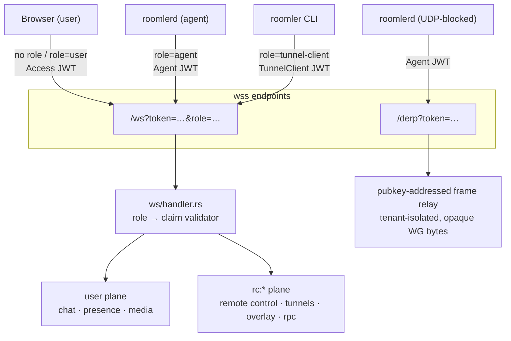
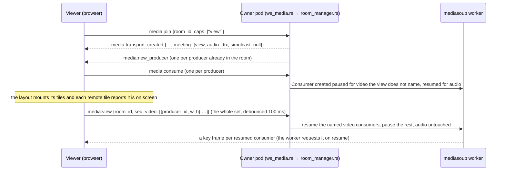
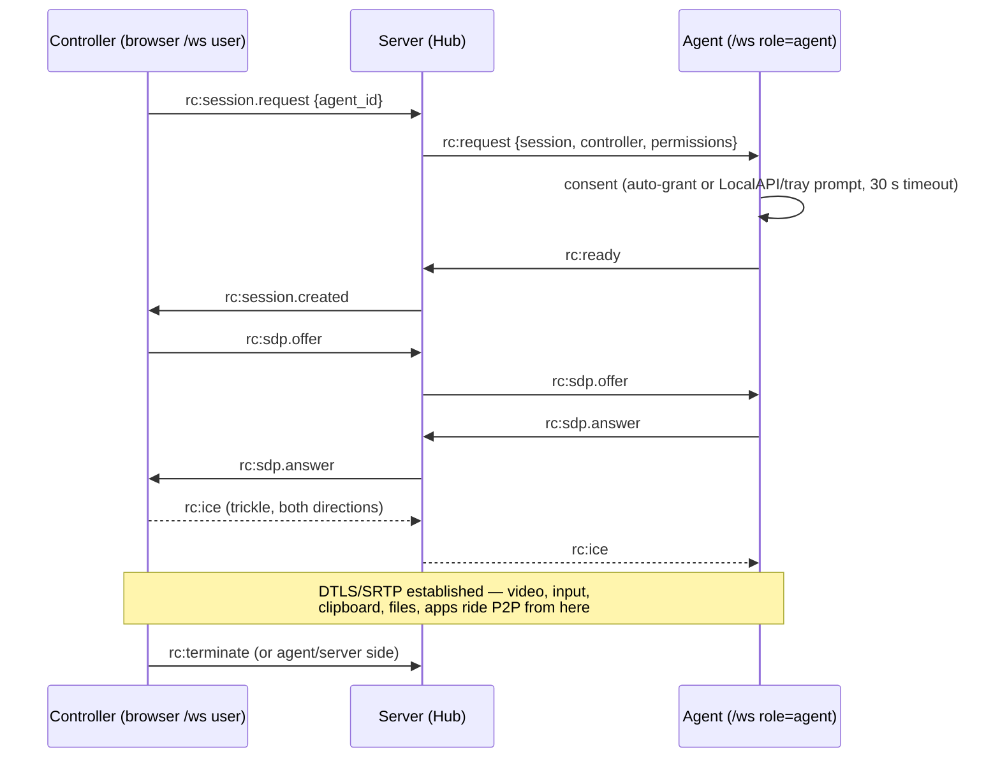
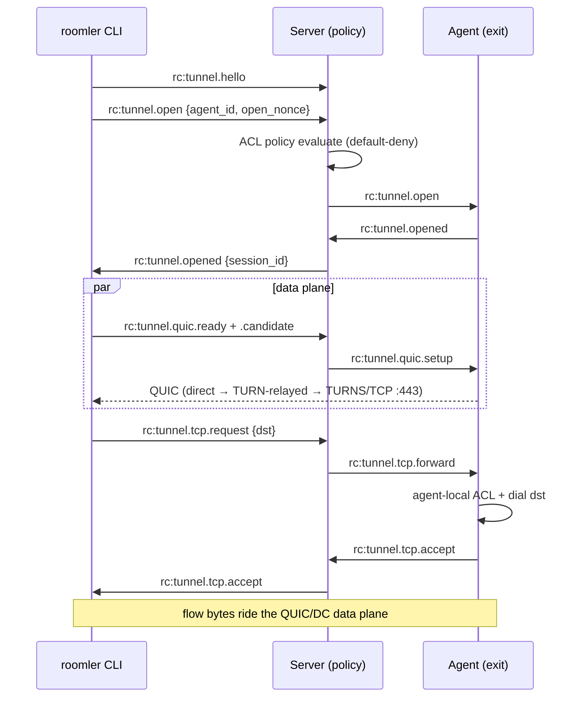
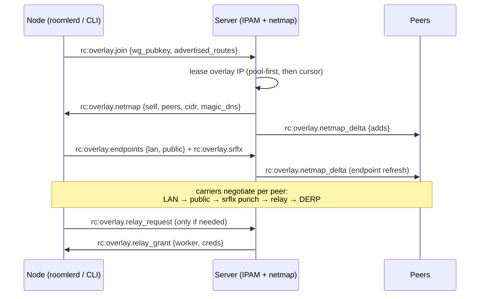

# Real-Time Protocols

The server exposes two upgrade endpoints. `/ws` multiplexes three client roles over
one handshake; `/derp` is a purpose-built relay for overlay pairs whose UDP is
blocked in both directions. *As of 0.3.0-rc.381.*

Each role is validated against its own JWT audience — a user token cannot open an
agent socket and vice-versa. An optional `tid=<tenant-hex>` query parameter lets the
front load balancer hash tenant-affine connections onto one pod; tokens must match
the claimed tenant (membership-checked for users).

Delivery across pods: WS sessions are pod-local; chat, presence, and notification
events fan out through Redis pub/sub so every pod pushes to its own sockets.

## User plane (browser)

JSON messages, `{"type": "...", ...}`.

**Client → server**

| Type | Purpose |
|---|---|
| `media:join` / `media:leave` | Enter/exit a room call (mediasoup). FR-127 P1: a join may carry `caps: ["view"]` — this client will report what it renders, [below](#a-meeting-receives-what-is-visible-fr-127-p1) |
| `media:produce` / `media:consume` | Publish / subscribe a track |
| `media:connect_transport` | DTLS-connect a transport |
| `media:producer_close` | Stop publishing |
| `media:producer_pause` | FR-30 — the OWNER paused or resumed one of their producers (camera off, mic muted); the room is told as `media:producer_paused` |
| `media:view` | FR-127 P1 — the viewer's WHOLE rendered set, `{ room_id, seq, video: [{ producer_id, w, h }] }`: the server resumes those video consumers and pauses the viewer's others; no reply |
| `media:play_audio` / `media:stop_audio` | Bot/audio playback control |
| `presence:update` | Presence state |
| `hive:view.open` / `offer` / `ice` / `renew` / `close` | FR-90 — read an agent session over a viewer peer (module `hive`) |
| `hive:search.open` | FR-90 P2i-2 — search, over a peer of its own, the copies an archive replica holds of the sessions the asker may read; the peer then takes `hive:view.offer` / `ice` / `renew` / `close`, by its grant |
| `ping` | Keepalive |

**Server → client** (consumed by `ui/src/stores/ws.ts`)

| Event | Purpose |
|---|---|
| `message:create` / `update` / `delete` / `reaction` | Live chat |
| `call:message:create` | In-call chat |
| `room:call_started` / `call_ended` / `call_updated` | Call presence on the room list. A `call_ended` the plan's meeting-length cap caused carries `reason: "plan_limit"`, `max_minutes` and `plan` |
| `room:call_ending_soon` | FR-115 P5 — the plan's meeting-length cap (Free: 60 minutes) warns the room's members five minutes before it ends the meeting: `ends_at` (epoch ms), `max_minutes`, `plan`. Shown only to those in that call |
| `typing:start` | Typing indicators |
| `notification:new` / `notification:unread_count` | Notification bell |
| `task:update` | Background-task progress |
| `hive:view.ready` / `refused` / `answer` / `ice` / `renewed` / `closed` | FR-90 — the viewer peer's handshake, addressed to the ONE connection that opened it |
| `hive:search.ready` / `refused` | FR-90 P2i-2 — a search's grant confirmed by its archive replica (with how many sessions it names), or refused; the rest of its handshake is the view's above |

The mediasoup signalling (`media:*`) carries router RTP capabilities, transport
parameters, and producer/consumer ids — the SFU forwards RTP between participants
without decoding it.

The meeting-length cap is a **sweep, not a timer** (FR-115 P5): every pod reads
the calls in progress every 30 s and decides each against the org's plan, and the
two writes it can make — the warning and the end — are conditional on the call it
read, so two pods warn and end a meeting once
(`crates/modules/conference/src/meeting_cap.rs:100`). A timer would have lived in the
pod that started the call and died with it on a rolling deploy. The design, its guards
and its one known gap are in
[FR-115 *Meetings, as built*](fr/FR-115-pricing-reshape.md#meetings-as-built-p5).

### A meeting receives what is visible (FR-127 P1)

One room is one mediasoup router on one worker thread, and every participant's every
video stream used to be forwarded to every other participant whether or not a tile showed
it — which is the N×(N−1) that FR-115 O4 measured running out at about 20 cameras.
[FR-127](fr/FR-127-meeting-room-scales-past-one-worker.md) lifts that in three levers; P1
is the first: **the viewer says what it renders, and the server forwards only that.**
Audio always flows, and the microphone is produced with Opus DTX so a silent participant
costs the worker about one packet every 400 ms instead of fifty a second.

**The wire** — two additive fields, both ignored by a server or a client that predates them:

| Message | Change | Where |
|---|---|---|
| `media:join` | `caps: ["view"]` declares a client that will report its view. Read only while the lever is on | `crates/modules/conference/src/ws_media.rs:313` |
| `media:transport_created` | `meeting: { view, audio_dtx, simulcast: null }` — the levers this server runs, so a behaviour the client carries (DTX now, simulcast in P2) keeps a server-side switch | `ws_media.rs:452`, `meeting_levers` at `:728` |
| `media:view` | `{ room_id, seq, video: [{ producer_id, w, h }] }`, the WHOLE rendered set, never a delta: idempotent, self-healing after a lost message. `seq` only grows, and the server drops a report older than the one it holds. `w`/`h` are device pixels, kept for P2's layer map | the arm at `ws_media.rs:196`, the handler at `:745`, applied by `RoomManager::apply_view` (`media/room_manager.rs:551`) |

It is dispatched where `media:consume` is — through the C-4 placement gate — so a viewer
whose socket is on the other pod reaches the owner's participant state over `media.cmd`
like every other command, and one connection's `join` → `view` → `consume` order holds end
to end because the WS loop awaits each message in turn.

**Three states, never collapsed.** A participant's view is `Option<ViewState>`
(`media/room_manager.rs:56`, the pure half in `media/view.rs:38`):

| `ParticipantMedia.view` | Who | Video consumers | Audio consumers |
|---|---|---|---|
| `None` | a legacy client — no `caps` on its join, or the lever off | all resumed, as before P1; a `media:view` from it is ignored (`room_manager.rs:573`), never read as "show nothing" | resumed |
| `Some(empty)` | a view client that renders nothing yet (just joined, navigated to the mini view, its grid empty) | all paused | resumed |
| `Some(set)` | a view client showing `set` | the named ones resumed, every other paused | resumed |

The decision is pure and unit-tested (`view::wants`, `view.rs:68`; `view::plan`,
`view.rs:97`): a consumer is created with `ConsumerOptions.paused = !wanted`
(`room_manager.rs:492-510` — ⚠️ mediasoup 0.20.0 creates consumers *resumed* by default,
whatever the old comment there said), and a report that names a producer before its
consumer exists is kept and honoured at the consume. The room manager clones the consumer
handles out of its maps and awaits the worker only after every DashMap guard is dropped,
the pattern FR-30's `set_producer_paused` set.

**Two pauses, two flags.** FR-30's owner pause is `Producer::pause()`, which the worker
mirrors into every consumer's `producer_paused` and which `media:consumer_created` and the
`media:producer_paused` event carry. The viewer's pause is `Consumer::pause()`, the
consumer's own `paused`. Nothing in P1 reads or writes the owner's flag, and the planner's
input (`view::ConsumerLine`, `view.rs:80`) has no field for it, so the two cannot be
confused: a viewer hiding a tile changes nothing another viewer sees, and an owner's pause
reaches every viewer whatever their view says. Locked against a real worker by
`crates/tests/src/conference_view_tests.rs:439`.

**What "visible" is.** Each remote `VideoTile` runs an `IntersectionObserver` on its root
(`ui/src/components/conference/VideoTile.vue:507`), which applies the clip of every
scrolling ancestor, and emits `visible: { visible, w, h }` once per change and `false` on
unmount (`:553`), while its parent still listens. Every layout forwards it with the stream
key (`layouts/TiledLayout.vue:23`, `SpotlightLayout.vue:25`, `SidebarLayout.vue:25`), the
call page hands it to the store (`ConferenceView.vue:427`), and the store keeps the tiles on
screen, maps stream keys to the video producers it consumes
(`ui/src/stores/conference.ts:428`) and sends one `media:view` at most every 100 ms
(`:672-734`) — and again every 15 s while in the call and when the tab returns to the
foreground, so a report the socket dropped or a forward the owner pod never got heals
within the period (`seq` keeps the re-send idempotent, and the server plans nothing for a
report that changes nothing). A tile never reports for the local stream: nothing is received
for it. The cap is declared on the join only where an `IntersectionObserver` exists: a
declared viewer that never reported would have every camera paused.

| Layout | Rendered | In the view |
|---|---|---|
| tiled | `primary`, at most `tiledMaxTiles` (`useConferenceLayout.ts:306`), no scrolling | exactly the rendered remote tiles |
| spotlight | the big tile, a 120 px filmstrip that scrolls sideways | the big tile plus the strip tiles inside the strip's viewport |
| sidebar | the big tile, a 280 px column that scrolls | the same rule |
| the mini view (another page of the app, `MiniConference.vue`) | up to three remote cameras in the app bar's widget, no `VideoTile` | exactly those three (the widget reports them itself; the per-key count tolerates its report overlapping a tile's during the page switch); the rest paused until the call page is back; audio flows |

A tile scrolled into view plays within a second: one debounce, one round trip, and the
worker requests a key frame the moment a consumer resumes (`SimpleConsumer::UserOnResumed`
in mediasoup-sys 0.10.0). FR-124's black-picture detector needs three black samples, about
3 s, so a resumed tile paints long before it could be judged. Its sampler keeps running on a
paused tile too — safely: `sampleLuma` answers `null` until the element has a frame
(`ui/src/utils/blackPicture.ts:82`), and once a tile has painted, pausing its consumer
leaves the last frame on screen, which is not black unless the camera was. A tile in
picture-in-picture reports itself visible even when its strip has scrolled it out, so the
floating window keeps playing.

**Opus DTX.** When `meeting.audio_dtx` is true the microphone producer is created with
`codecOptions: { opusDtx: true }` (`ui/src/stores/conference.ts:371`); Chrome then sends
about one packet every 400 ms while the microphone hears silence, and the SFU forwards
exactly what it gets. FR-127's P0 arithmetic is why: fifty people unmuted and quiet cost
more packets than one worker carries without it.

**Switches** — `[meetings]` in `crates/config/src/settings.rs`, env `ROOMLER__MEETINGS__*`:

| Setting | Default | Off means |
|---|---|---|
| `visible_tiles` (`:387`) | on | the server ignores `caps` and every `media:view`, every consumer is resumed at creation, and the client is told `meeting.view = false`, so it stops reporting — today's shape, exactly |
| `audio_dtx` (`:394`) | on | `meeting.audio_dtx = false`, the client produces as before |
| `view_max` (`:399`) | 49 (the UI's own grid maximum) | a load guard, not a policy: a longer report is truncated in the order sent |

**Reading it.** `GET /api/cluster/status` gains `local.media_video_paused` — the video
consumers held back by their viewers' views, never the owner's FR-30 pause
(`crates/api/src/cluster/metrics.rs:86`, from `MediaGauges::video_paused_total`,
`crates/modules/conference/src/lib.rs:109`) — and each row of `media_rooms_detail` its
`video_paused`. With `RUST_LOG=roomler_ai_mod_conference=debug` every applied report logs
`view applied` with `resumed` and `paused` counts. What this lever buys in packets, and the
two that follow it (simulcast, a room piped across workers), are in the FR's §3.0.

The viewer peer's signalling (`hive:view.*`, FR-90) is a view grant and the SDP
and ICE of a **data-only** WebRTC peer between the browser and the device that
holds the session. The server tells the browser `ready` only after the device has
confirmed the grant (FR-83), relays the handshake to and from the one connection
that holds the grant, and never sees the transcript that then flows over the
peer. A search (`hive:search.open`, P2i-2) is a grant of the same kind toward an
archive replica, naming the sessions the asker may read whose copy it holds; its
query and what it finds travel only over its peer. The server's half is
[`crates/modules/hive/src/view.rs`](../crates/modules/hive/src/view.rs), the
device's `agents/roomlerd/src/hive/view.rs`.

## The `rc:*` plane (agents, tunnel clients, controllers)

Defined in `crates/remote_control/src/signaling.rs` (`ClientMsg` / `ServerMsg`,
~60 wire tags). Serialization is **wire-locked by tests**: tags are pinned,
ObjectIds serialize as raw hex, `Permissions` as pipe-separated names. Renaming a
tag is a deliberate wire break.

| Family | Tags | Purpose |
|---|---|---|
| Agent lifecycle | `rc:agent.hello` · `rc:agent.heartbeat` · `rc:agent.update` · `rc:agent.join_org` · `rc:goodbye` | Hello carries caps (codecs, transports, rpc), displays, advertised routes; heartbeat every 30 s; `goodbye` carries a close reason (deleted / replaced / policy) |
| Remote-desktop session | `rc:session.request` · `rc:session.created` · `rc:request` · `rc:ready` · `rc:terminate` · `rc:session.stats` · `rc:error` | Session state machine between controller, server, agent |
| SDP / ICE | `rc:sdp.offer` · `rc:sdp.answer` · `rc:ice` | WebRTC negotiation relayed through the server |
| Consent | `rc:consent` | Owner consent decision (pairs with the HTTP capability URLs) |
| Keepalive | `rc:ping` / `rc:pong` | Application-level liveness |
| Tunnel session | `rc:tunnel.hello` · `.open` · `.opened` · `.terminate` · `.revoked` | Client ⇄ agent tunnel establishment (`open_nonce` correlates concurrent opens; an agent session's `net_grant` rides `.open` from its own device, and `.opened` echoes its id as `net_grant_id`: [tunnels.md](tunnels.md#an-agent-sessions-grant-fr-90-p3-7-2a)) |
| Tunnel TCP flows | `rc:tunnel.tcp.request` → `.forward` → `.accept`/`.reject` · `.half_close` · `.closed` | Per-flow lifecycle |
| Tunnel UDP flows | `rc:tunnel.udp.request` → `.forward` → `.accept`/`.reject` · `.closed` | SOCKS5 UDP ASSOCIATE flows |
| Tunnel carriers | `rc:tunnel.sdp.offer`/`.answer` · `.ice` · `.quic.setup`/`.ready`/`.candidate` | WebRTC-DC and QUIC data-plane negotiation |
| Overlay | `rc:overlay.join` · `.endpoints` · `.srflx` · `.leave` · `.relay_request` → `.netmap` · `.netmap_delta` · `.relay_grant` · `.force_derp` · `.warm_relay_request`/`.warm_relay_grant` | Mesh membership, endpoint discovery, relay coordination |
| Relay / DERP | `rc:relay.regions` · `.probe_report` · `.derp_ticket_request`/`.derp_ticket` | Multi-region PoP selection + ticket auth for standalone DERP relays |
| Fleet RPC | `rc:rpc.exec` · `.cancel` · `.result` · `.request` · `.response` | Remote command execution over the control WS (see [fleet-rpc.md](fleet-rpc.md)) — capability-gated via `AgentCaps.rpc` |
| Overlay key rotation | `rc:agent.key_rotate` → `rc:agent.key_rotated` | An **order** to re-mint the device's overlay key, never a delivery: the order carries no key material (test-locked), the report carries public keys only and is sent on every outcome, refusals included, then re-sent on the next session (see [overlay-key-rotation.md](overlay-key-rotation.md)) — capability-gated via `AgentCaps.rpc` (`key-rotate`), never sent blind |

### Remote-desktop session setup

Once the P2P link is up, everything else is **DataChannel traffic that never
touches the server**: input events, clipboard chunks, file transfers, the apps
menu, cursor shapes, decoder statistics (`rc:decodestat` feedback that drives the
agent's rate control), and — on the DC render paths — the video bitstream itself.

### Tunnel flow open

### Overlay join

## DERP

`GET /derp?token=<agent-jwt>` upgrades to a minimal frame relay for overlay pairs
where **both** sides are UDP-blocked:

- Frames are `[dst_pubkey(32) || payload]` client→server, rewritten to
  `[src_pubkey(32) || payload]` on delivery.
- Hard tenant/network isolation; the payload is WireGuard ciphertext the relay
  cannot read.
- Standalone regional PoPs (`crates/derp-relay`) run the same protocol DB-free,
  authenticated by Ed25519 tickets minted over `rc:relay.derp_ticket_request`.

## Connection hygiene

- Agents keep one outbound WSS control link: WS ping every 25 s,
  `rc:agent.heartbeat` every 30 s, exponential reconnect capped at 60 s; a 401 on
  upgrade is fatal (re-enroll).
  - The ladder restarts at 1 s when a connection that sent its hello lived ≥ 30 s
    and then dropped (#2221). Before that, a successful reconnect kept the
    ladder where the outage left it, so the next ordinary drop waited out the
    PREVIOUS outage's step (8 s in the field after a pod roll; up to 60 s).
  - A server that accepts and drops at once still climbs the ladder. That 30 s
    bar is what keeps a flapping server from drawing a fleet-wide reconnect
    every second.
- Agents also enforce **receive-liveness**: no inbound frame for 80 s ⇒ reconnect —
  this heals half-open sockets that TLS-inspecting middleboxes keep artificially
  alive.
- `rc:goodbye` close reasons distinguish *replaced by newer connection* (benign
  restart) from *deleted / policy-rejected* (stop retrying).
